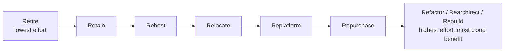
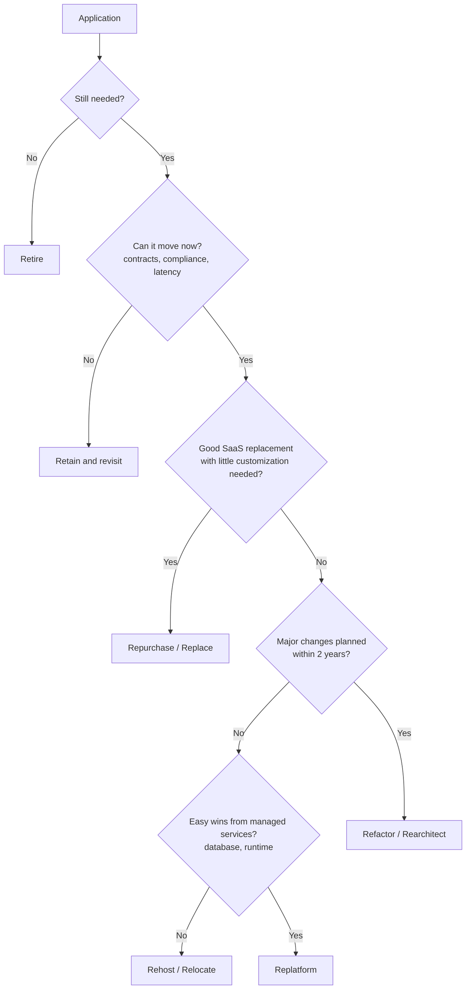
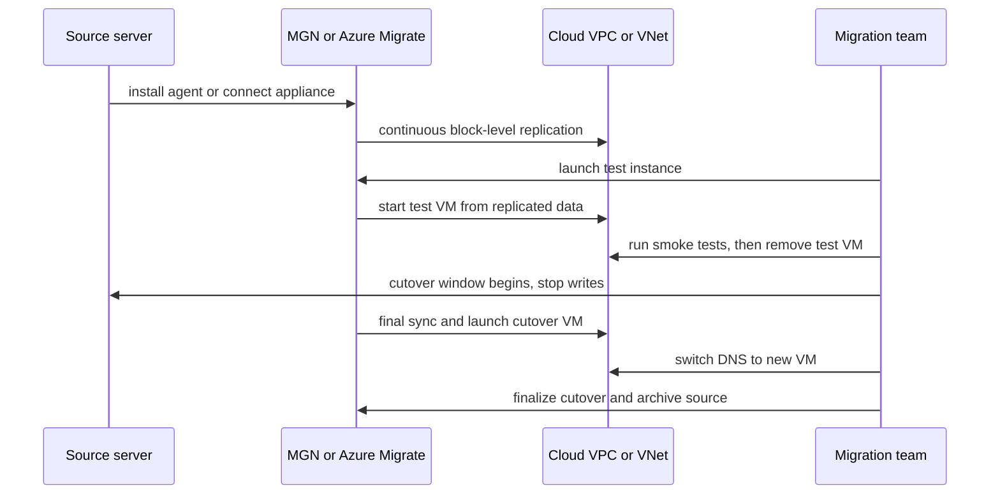

# Migration Strategies: The 7 Rs

## Introduction

"Move to the cloud" sounds like one project. In practice, a company has dozens or hundreds of applications, each with different value, age, risk and technical debt. Moving all of them the same way is a mistake: rewriting everything takes years, and copying everything as-is often produces a cloud bill higher than the data center ever cost.

The **"Rs" of migration** give you a vocabulary for deciding, **application by application**, what to do. The idea goes back to Gartner's "5 Rs" from 2011. AWS expanded it into the **7 Rs** used throughout its [Prescriptive Guidance](https://docs.aws.amazon.com/prescriptive-guidance/latest/large-migration-guide/migration-strategies.html), and Microsoft's [Cloud Adoption Framework](https://learn.microsoft.com/azure/cloud-adoption-framework/plan/select-cloud-migration-strategy) uses a similar list of eight.

An analogy: moving house. Some furniture you throw away (retire). Some stays in storage at your parents' place (retain). Most boxes go in the truck as-is (rehost). The old sofa gets new upholstery on the way (replatform). The kitchen gets redesigned for the new space (refactor). And instead of moving your DVD collection, you subscribe to a streaming service (repurchase).

This page explains each strategy, how AWS and Azure name them, how to decide, and which tools each provider offers.

## The Strategies

### AWS's 7 Rs

| Strategy | Also called | What happens | Example |
|----------|-------------|--------------|---------|
| **Retire** | Decommission | Shut it down; nobody needs it | A reporting tool replaced years ago but still running |
| **Retain** | Revisit | Keep it where it is, for now | A mainframe system with a 2-year contract left |
| **Rehost** | Lift and shift | Move servers to cloud VMs unchanged | VMware VMs to EC2 with Application Migration Service |
| **Relocate** | Hypervisor-level lift and shift | Move a whole virtualization platform without converting VMs | VMware workloads moved to a VMware-based environment in the cloud |
| **Repurchase** | Drop and shop | Replace with a different product, usually SaaS | Self-hosted CRM replaced by a SaaS CRM |
| **Replatform** | Lift and reshape (lift, tinker and shift) | Move with targeted optimizations, no core architecture change | Self-managed MySQL VM becomes Amazon RDS for MySQL |
| **Refactor** | Re-architect | Change the architecture to use cloud-native features | Monolith split into containers and serverless functions |

### Azure Cloud Adoption Framework

Microsoft's guidance lists **Retire, Rehost, Replatform, Refactor, Rearchitect, Replace, Rebuild** and **Retain**. The main differences from AWS:

| AWS term | Azure CAF term(s) | Notes |
|----------|-------------------|-------|
| Retire | Retire | Same |
| Retain | Retain | Azure suggests managing retained on-premises workloads with Azure Arc, or modernizing them on Azure Local |
| Rehost | Rehost | Same idea: like-for-like (VMs to IaaS, PaaS to PaaS) |
| Relocate | (Usually treated as rehost) | Azure VMware Solution fits here |
| Repurchase | Replace | Replace with SaaS or an AI-based solution |
| Replatform | Replatform | Move to PaaS with minimal code changes, for example VMs to App Service, SQL Server to Azure SQL Database |
| Refactor | Refactor, Rearchitect, Rebuild | Azure splits this into three: **Refactor** (improve code, no new features), **Rearchitect** (change architecture, such as decomposing into services), **Rebuild** (redevelop cloud-native from scratch) |

The Azure split is useful in practice, because "refactor" in AWS's list covers everything from a small code cleanup to a complete rewrite, which have very different costs and risks.

## Effort, Risk and Benefit



| Strategy | Speed | Cost to migrate | Cloud benefit afterwards | Main risk |
|----------|-------|-----------------|--------------------------|-----------|
| Retire | Fastest | Near zero | Saves money immediately | Hidden dependency nobody documented |
| Retain | n/a | Zero now | None | Delays the inevitable, keeps data center costs |
| Rehost | Fast | Low | Low (same architecture, now on cloud VMs) | Bringing problems along; may cost more than on-premises |
| Relocate | Fast | Low | Low to medium | Platform-specific licensing |
| Replatform | Medium | Medium | Medium (less patching, managed backups and HA) | Compatibility issues with the managed service |
| Repurchase / Replace | Medium | Varies (licenses, data migration, training) | High for commodity functions | Losing customizations, vendor fit |
| Refactor / Rearchitect | Slow | High | Highest (elastic, managed, cheaper to run at scale) | Scope creep, a long project that delivers late |

AWS's large migration guidance notes that **rehost, replatform, relocate and retire** are the common strategies for large migrations, while refactoring during a large migration is generally not recommended. The pattern is often "migrate first, modernize later": move quickly to exit the data center, then refactor the applications that matter most once they are in the cloud.

## Choosing a Strategy per Application

Gather a few facts per application: business value, how much it will change in the next two years, technical health, dependencies, and compliance constraints. Then apply a decision flow like this one:



The "two years" rule comes from Microsoft's guidance: only rehost if you are confident the workload will not need modernizing within roughly two years, or you will pay to move it twice.

You can encode a first pass of this logic to triage a large portfolio. It does not replace human judgment, but it makes the reasoning explicit and repeatable.

```python
from dataclasses import dataclass

@dataclass
class App:
    name: str
    still_needed: bool
    can_move_now: bool
    saas_fit: bool
    major_change_soon: bool
    managed_service_win: bool

def suggest(app: App) -> str:
    if not app.still_needed:
        return "Retire"
    if not app.can_move_now:
        return "Retain (revisit)"
    if app.saas_fit:
        return "Repurchase / Replace"
    if app.major_change_soon:
        return "Refactor / Rearchitect"
    if app.managed_service_win:
        return "Replatform"
    return "Rehost"

portfolio = [
    App("legacy-fax-gateway", False, True, False, False, False),
    App("payroll-onprem",     True, False, False, False, False),
    App("self-hosted-crm",    True, True,  True,  False, False),
    App("ticket-api",         True, True,  False, True,  True),
    App("reporting-db",       True, True,  False, False, True),
    App("license-server",     True, True,  False, False, False),
]

for app in portfolio:
    print(f"{app.name:<20} -> {suggest(app)}")
```

Output:

```text
legacy-fax-gateway   -> Retire
payroll-onprem       -> Retain (revisit)
self-hosted-crm      -> Repurchase / Replace
ticket-api           -> Refactor / Rearchitect
reporting-db         -> Replatform
license-server       -> Rehost
```

## The Migration Process

Both providers describe a phased approach. AWS often frames it as **Assess, Mobilize, Migrate and Modernize**. Microsoft's Cloud Adoption Framework has methodologies such as **Strategy, Plan, Ready, Migrate** and onward.

1. **Assess / Plan:** discover servers and dependencies, build a business case (total cost of ownership comparison), choose a strategy per app.
2. **Mobilize / Ready:** build the landing zone (accounts or subscriptions, networking, identity, guardrails), train the team, run a pilot migration. See [Multi-Account and Landing Zone Strategy](../2-cloud-identity/7-cloud-multi-account-strategy.mdx).
3. **Migrate in waves:** group applications with their dependencies, migrate a wave, validate, cut over, then the next wave.
4. **Optimize and modernize:** right-size, apply [cost optimization](./4-cloud-cost-optimization.mdx), and refactor the apps that justify it.

### Wave planning

A **wave** is a group of applications migrated together. Group by dependencies (an app and the database it calls belong in the same wave, or you create latency across the hybrid link) and start with low-risk applications to build confidence.

```text
Wave 0 (pilot):   2 internal tools, rehost       -> prove tooling and runbooks
Wave 1:           6 low-risk apps, rehost        -> build migration speed
Wave 2:           reporting-db + reporting-web   -> replatform DB to managed service
Wave 3:           ticket-api ecosystem           -> rehost first, refactor later
Decommission:     data center racks freed after each wave
```

## Tools on Each Platform

| Task | AWS | Azure |
|------|-----|-------|
| Discovery, assessment and planning | **AWS Transform** (agentic AI service for discovery, wave planning, landing zone, network migration and server rehost); AWS Migration Hub is no longer open to new customers as of November 2025 | **Azure Migrate** (appliance-based discovery, assessments, business case, dependency analysis); Azure Copilot migration agent (preview) for planning |
| Rehost servers | **AWS Application Migration Service (MGN)**, also orchestrated by AWS Transform | **Azure Migrate** migration (agentless for VMware, agent-based for physical and other clouds) |
| Relocate VMware | VMware-compatible environments on AWS (check current offerings) | **Azure VMware Solution** |
| Migrate databases | **AWS Database Migration Service (DMS)**, with Schema Conversion for engine changes | **Azure Database Migration Service**, database assessments in Azure Migrate |
| Bulk data transfer online | AWS DataSync | AzCopy, Azure Storage Mover |
| Bulk data transfer offline | AWS Snowball (check current device availability) | Azure Data Box |
| Modernize code | AWS Transform (.NET to cross-platform .NET, mainframe, containerization) | GitHub Copilot app modernization tooling, App Service migration tools |
| Disaster recovery during migration | AWS Elastic Disaster Recovery | Azure Site Recovery |

Migration tooling is changing fast, with AI-assisted services appearing in both clouds. Check the current state in the [AWS Transform documentation](https://docs.aws.amazon.com/transform/latest/userguide/what-is-service.html) and the [Azure Migrate overview](https://learn.microsoft.com/azure/migrate/migrate-services-overview).

### What a rehost cutover looks like

Both AWS Application Migration Service and Azure Migrate follow the same basic flow for rehosting a server: replicate continuously, test, then cut over during a short window.



A cutover runbook should answer these questions before the window starts:

| Question | Example answer |
|----------|----------------|
| Who decides go or no-go? | Application owner, after smoke tests pass |
| How long is the window? | 2 hours on Saturday morning, announced a week ahead |
| How do writes stop on the source? | Put the app in maintenance mode, stop the service |
| How is traffic switched? | Lower DNS TTL a day before, then update the record |
| What proves success? | Health check green, five key user journeys pass, error rate normal for 1 hour |
| How do we roll back? | Point DNS back to the source; keep source servers intact for 2 weeks |
| When is the source decommissioned? | After 2 weeks of stable operation and a final backup |

### Measuring success

Agree on success metrics per strategy before the migration starts, so "done" is not a matter of opinion. Microsoft's guidance suggests examples like these:

- **Retire:** percentage of obsolete workloads decommissioned
- **Rehost:** workloads migrated without SLA degradation, data center capacity freed
- **Replatform:** reduced deployment lead time, lower licensing and infrastructure cost
- **Refactor / Rearchitect:** improved response time, ability to handle more load
- **Replace:** SaaS adopted with no custom code to maintain

### A glimpse at the CLI

Most migration work happens in consoles and planning tools, but you can monitor progress from the CLI.

### On AWS

```bash
# Source servers replicating through Application Migration Service
aws mgn describe-source-servers \
  --query "items[].{Host:sourceProperties.identificationHints.hostname,State:dataReplicationInfo.dataReplicationState,Lifecycle:lifeCycle.state}" \
  --output table

# Database migration tasks in DMS
aws dms describe-replication-tasks \
  --query "ReplicationTasks[].{Task:ReplicationTaskIdentifier,Status:Status,Progress:ReplicationTaskStats.FullLoadProgressPercent}" \
  --output table
```

Example output (MGN, trimmed):

```text
-------------------------------------------------------
|               DescribeSourceServers                 |
+----------------+---------------------+--------------+
|      Host      |      Lifecycle      |    State     |
+----------------+---------------------+--------------+
|  rpt-db-01     |  READY_FOR_TEST     |  CONTINUOUS  |
|  rpt-web-01    |  READY_FOR_CUTOVER  |  CONTINUOUS  |
+----------------+---------------------+--------------+
```

### On Azure

```bash
# Azure Migrate projects in a resource group (generic resource query)
az resource list \
  --resource-group rg-migration \
  --resource-type Microsoft.Migrate/migrateprojects \
  --query "[].{Name:name, Location:location}" --output table

# Database Migration Service instances
az dms list --query "[].{Name:name, RG:resourceGroup, Sku:sku.name}" --output table
```

Example output:

```text
Name               Location
-----------------  ----------
dc-exit-2026       eastus2
```

:::warning Cost and cleanup
Migration tools themselves are often free (AWS Transform and Azure Migrate state no additional charge for the service), but **the resources they create are not**: replication servers, staging disks, DMS replication instances, test instances and target VMs all bill while they run. Prices vary by region and change; check the pricing calculators. After cutover, finalize and archive the source servers in MGN, delete DMS replication instances (`aws dms delete-replication-instance`), and delete Azure Migrate replication resources and test VMs. Then decommission the on-premises servers, or you pay twice.
:::

## Real-World Scenario

Your company runs its helpdesk platform and 40 supporting applications in a co-located data center whose contract ends in 18 months. The CTO wants out of the data center and mentions a "full cloud-native rewrite".

**Assessment results (after discovery and interviews):**

| Group | Count | Strategy | Reason |
|-------|-------|----------|--------|
| Unused or duplicate tools | 7 | Retire | No logins in 6 months |
| Self-hosted email, wiki, CRM | 4 | Repurchase / Replace | Mature SaaS available |
| Stable internal apps | 18 | Rehost | Unlikely to change, low value of modernizing |
| Apps on self-managed MySQL and PostgreSQL | 8 | Replatform | Managed databases remove patching and backup work |
| Core ticket API and search | 2 | Rehost now, refactor in year 2 | Strategic, but a rewrite would miss the deadline |
| Legacy telephony integration | 1 | Retain (hybrid) | Hardware dependency; connect via VPN |

**Why this approach:** the hard deadline is the data center exit. A full rewrite of 40 applications in 18 months is not realistic. Retiring and replacing first shrinks the problem; rehosting and replatforming the rest meets the deadline; modernizing the two strategic apps afterwards puts engineering effort where it creates value. The [Strangler Fig pattern](../../../fundamental/architecture/9-arch-distributed-systems/11-arch-strangler-fig.mdx) works well for the later refactor.

**When not to use this mix:** if there is no deadline and the core app is blocking growth today, refactoring that one app first may be the better investment.

### Alternatives and trade-offs

| Approach | Pros | Cons | Best for |
|----------|------|------|----------|
| Rehost everything, modernize later | Fastest data center exit | Higher run cost until optimized; "later" may never come | Hard deadlines |
| Refactor everything | Maximum cloud benefit | Slow, expensive, high risk of failure | Small portfolios with strong teams |
| Mixed strategy per app (the 7 Rs) | Effort matches value | Requires portfolio analysis up front | Most organizations |
| Replace with SaaS where possible | Removes operational burden | Less control, data migration effort, subscription costs | Commodity functions (email, HR, CRM) |
| Stay on-premises / hybrid | No migration risk | Keeps hardware lifecycle and data center costs | Workloads with strong locality or regulatory constraints |

## Common Mistakes

- **Rehosting broken applications.** Performance and reliability problems move to the cloud with them and often get more expensive.
- **Skipping dependency discovery.** Migrating an app without its database creates cross-site latency and outages. Use dependency analysis in Azure Migrate or AWS discovery tools.
- **Lift and shift with on-premises sizing.** Servers sized for five-year peak growth become expensive cloud VMs. Right-size from measured utilization.
- **Forgetting licenses.** Some licenses are not portable to cloud or have special rules. Check Windows Server, SQL Server and Oracle terms, and Azure Hybrid Benefit eligibility.
- **No landing zone first.** Migrating into an unstructured account or subscription creates security and cost problems that are hard to fix later.
- **Never decommissioning the source.** Paying for both environments eats the business case.
- **Treating "refactor" as one size.** Distinguish small code changes from rearchitecting and rebuilding; they differ by orders of magnitude in effort.

## Summary

- Decide a migration strategy **per application**, not for the whole portfolio.
- AWS's 7 Rs: Retire, Retain, Rehost, Relocate, Repurchase, Replatform, Refactor. Azure's CAF uses Retire, Retain, Rehost, Replatform, Refactor, Rearchitect, Rebuild and Replace.
- Effort and long-term cloud benefit both increase from retire and rehost toward refactor and rebuild.
- Large migrations usually "migrate first, modernize later", in dependency-based waves after a landing zone is ready.
- Tools: AWS Transform, Application Migration Service, DMS (Migration Hub is closed to new customers); Azure Migrate, Azure Database Migration Service, Azure VMware Solution, Data Box.

## Exercises

1. Take five applications you know (real or invented) and assign each a strategy using the decision flow. Write one sentence of justification for each.
2. Extend the `suggest` function with a `compliance_blocked` flag and a `vmware_estate` flag (suggesting Relocate). Add test cases.
3. Group the following into waves based on dependencies: web-frontend calls ticket-api; ticket-api uses tickets-db and search; reporting reads tickets-db nightly; wiki is standalone.
4. Write a short business case outline for replatforming a self-managed PostgreSQL VM to Amazon RDS or Azure Database for PostgreSQL: what costs disappear, what new costs appear, and which risks remain.

**Related pages:**
- [Migrating Databases to the Cloud](../7-cloud-databases/5-cloud-database-migration.mdx)
- [When the Cloud Makes Sense and When It Doesn't](../0-cloud-fundamentals/8-cloud-when-to-use.mdx)
- [Multi-Cloud and Hybrid Strategy](./5-cloud-multi-cloud-strategy.mdx)
- [Legacy Modernization](../../../fundamental/architecture/13-arch-documenting-and-evolving/5-arch-legacy-modernization.mdx)
- [Cost Optimization and FinOps](./4-cloud-cost-optimization.mdx)
