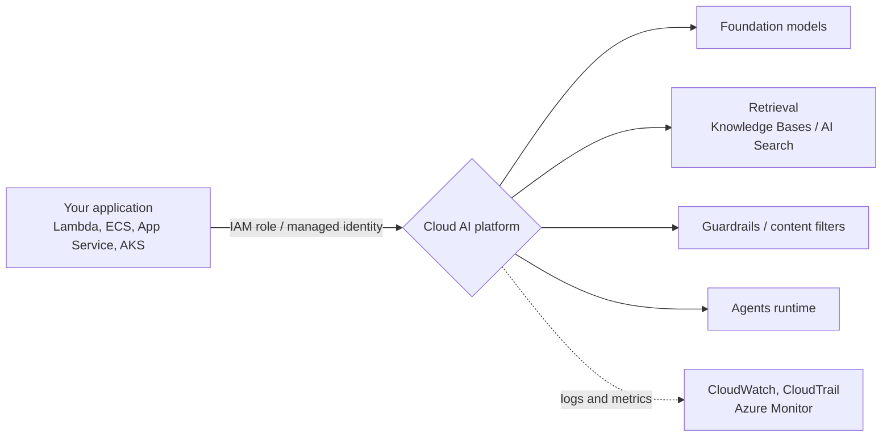
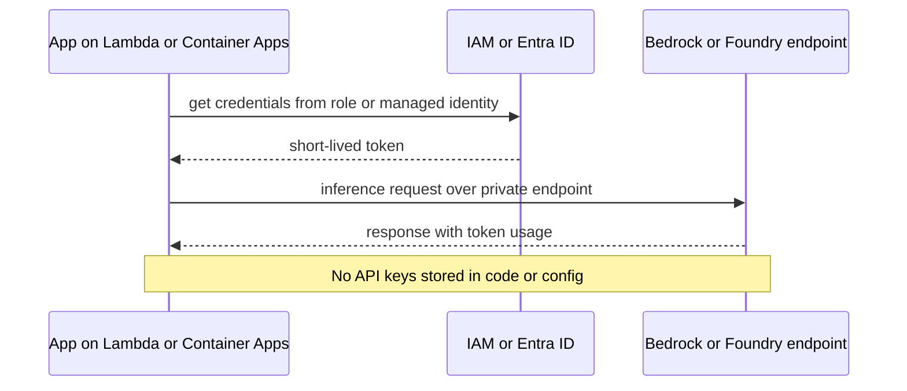

# Cloud AI Services: Bedrock and Microsoft Foundry

## Introduction

Large language models (LLMs) are now a standard building block, much like a database or a queue. You can call a model provider's API directly, but many teams prefer to use models **through their cloud provider**, because:

- Access is controlled with the identity system you already use (IAM roles, Entra ID and managed identities), with no extra API keys to manage
- Traffic can stay on private networks (VPC endpoints, Private Link)
- Usage appears on the same bill, can count toward existing commitments, and is governed by the same policies
- Data residency options let you keep processing within a geography
- Logging, monitoring and audit go to CloudWatch, CloudTrail, Azure Monitor and the Activity Log

The two main services are:

- **[Amazon Bedrock](https://docs.aws.amazon.com/bedrock/latest/userguide/what-is-bedrock.html)**: a fully managed service giving access to foundation models from Amazon and third parties (such as Anthropic, Meta, Mistral AI, OpenAI, DeepSeek and others) through one API.
- **[Microsoft Foundry](https://learn.microsoft.com/azure/foundry/what-is-foundry)**: Microsoft's platform for models, agents and tools. It was called **Azure AI Studio**, then **Azure AI Foundry**, and is now branded **Microsoft Foundry**. It includes Azure OpenAI models plus models from Microsoft, Anthropic, Meta and many others. Many articles and SDK names still say "Azure AI Foundry", so expect to see both names.

An analogy: a model API from the model vendor is like buying ingredients straight from the farm. A cloud AI platform is like a supermarket: the same ingredients from many farms, under one roof, one payment card and one set of store rules. Sometimes the farm has the newest product first; the supermarket is more convenient when you already shop there.

This page shows how to call models on both platforms, the surrounding services (retrieval, agents, guardrails), and the architecture decisions: identity, data residency, scaling and cost. For building agents in depth (tools, memory, RAG, evaluation), see the [AI Agents tutorial](/docs/ai/agents).

## Service Mapping

| Capability | AWS | Azure |
|------------|-----|-------|
| Model catalog and inference | Amazon Bedrock (`bedrock-runtime` endpoint) | Microsoft Foundry Models (Foundry resource and projects) |
| Unified chat API | Converse / ConverseStream API; also OpenAI-compatible Responses and Chat Completions APIs for supported models | OpenAI-compatible Responses API through the project client (`azure-ai-projects` 2.x) |
| Retrieval-augmented generation | Amazon Bedrock Knowledge Bases | Azure AI Search with Foundry tools and knowledge |
| Managed agents | Amazon Bedrock Agents, Amazon Bedrock AgentCore | Foundry Agent Service (prompt agents and hosted agents) |
| Safety filters | Amazon Bedrock Guardrails | Content filters and Azure AI Content Safety |
| Model evaluation | Bedrock model evaluation | Foundry evaluations |
| Fine-tuning and customization | Bedrock model customization | Foundry fine-tuning |
| Higher or reserved throughput | Cross-Region inference profiles, Provisioned Throughput | Global and Data Zone deployments, Provisioned (PTU) deployments |
| Cheaper asynchronous work | Batch inference | Global Batch and Data Zone Batch deployments |
| Pre-built AI APIs | Amazon Textract, Comprehend, Transcribe, Translate, Rekognition | Foundry Tools (formerly Azure AI Services): Document Intelligence, Speech, Translator, Vision, Language |

These services evolve monthly. New models, APIs and features appear constantly, and some names in this table will change. Always check the linked documentation before you build.



## How You Pay

Generative AI is billed differently from most cloud services. Prices change frequently and vary by model and region, so this page gives none; see [Amazon Bedrock pricing](https://aws.amazon.com/bedrock/pricing/) and the Foundry and Azure OpenAI pricing pages.

| Billing mode | AWS | Azure | When to use |
|--------------|-----|-------|-------------|
| Pay per token (input and output tokens priced separately) | On-demand inference | Standard, Global Standard, Data Zone Standard | Default for most apps, variable traffic |
| Reserved capacity | Provisioned Throughput | Provisioned deployments, billed in PTUs (provisioned throughput units) | Steady high volume, need predictable latency |
| Discounted asynchronous | Batch inference | Global Batch, Data Zone Batch | Large jobs that can wait (Azure targets 24-hour turnaround) |
| Prompt caching | Supported for some models | Supported for some models | Long repeated system prompts or documents |

Things that drive cost in practice:

- **Output tokens** usually cost more than input tokens. Ask for concise output.
- **Model size**: a small, fast model is often good enough for classification or extraction. Save the largest models for hard reasoning.
- **Context length**: sending a 50-page document with every request multiplies input tokens. Retrieve only relevant chunks.
- **Retries and agents**: an agent loop may call the model many times per user request.

:::warning Cost and cleanup
Every model call in the examples below is billed per token. Provisioned throughput and provisioned deployments bill **per hour whether used or not**, so never create them for experiments. Search indexes, knowledge base vector stores and agent runtimes may also bill while they exist. Delete experimental resources afterwards: on Azure, delete the resource group (`az group delete --name rg-ai-demo --yes`); on AWS, delete knowledge bases, their vector stores and any provisioned throughput you created.
:::

## Calling a Model on AWS: Bedrock Converse API

The **Converse API** gives one request and response shape across all Bedrock models that support messages, so switching models is usually a one-line change. Your IAM principal needs `bedrock:InvokeModel` (and `bedrock:InvokeModelWithResponseStream` for streaming).

### Find a model or inference profile ID

Many newer models are called through **inference profiles** (IDs prefixed with a geography such as `us.` or `eu.`, or `global.`), which route requests across Regions for more throughput.

```bash
# Foundation models from one provider in this Region
aws bedrock list-foundation-models --region us-east-1 \
  --by-provider anthropic \
  --query "modelSummaries[].modelId" --output text

# System-defined inference profiles (cross-Region)
aws bedrock list-inference-profiles --region us-east-1 \
  --query "inferenceProfileSummaries[].inferenceProfileId" --output text
```

Example output (IDs are illustrative, use the ones your account returns):

```text
anthropic.example-model-v1:0   anthropic.example-small-v1:0
us.anthropic.example-model-v1:0   global.anthropic.example-model-v1:0
```

Access to most serverless models is enabled by default when your account has the right AWS Marketplace permissions. Some providers have extra steps; for example, Anthropic models require a one-time use case submission per account or organization. See [Request access to models](https://docs.aws.amazon.com/bedrock/latest/userguide/model-access.html).

### Call the model with boto3

```python
# pip install boto3
import os
import boto3

MODEL_ID = os.environ["BEDROCK_MODEL_ID"]  # e.g. an inference profile ID from the list above

client = boto3.client("bedrock-runtime", region_name="us-east-1")

response = client.converse(
    modelId=MODEL_ID,
    system=[{"text": "You summarize helpdesk tickets in one sentence for support agents."}],
    messages=[{
        "role": "user",
        "content": [{"text": "Customer says the mobile app logs them out every 5 minutes "
                             "since yesterday's update. Tried reinstalling. iOS 18."}],
    }],
    inferenceConfig={"maxTokens": 200, "temperature": 0.2},
)

print(response["output"]["message"]["content"][0]["text"])
usage = response["usage"]
print(f"stop={response['stopReason']} in={usage['inputTokens']} out={usage['outputTokens']}")
```

Example output (model wording varies):

```text
iOS user is logged out every 5 minutes since the latest app update, and reinstalling did not help.
stop=end_turn in=58 out=24
```

The `usage` block is your cost meter. Log it per request (with a tenant or feature tag) so you can attribute AI spend, just like the unit cost tracking in [Cost Optimization and FinOps](./4-cloud-cost-optimization.mdx).

## Calling a Model on Azure: Microsoft Foundry

In Foundry, you create a **Foundry resource** (an Azure resource), one or more **projects** inside it, and **deployments** of the models you want. Your code connects to the project endpoint, which looks like `https://<resource-name>.services.ai.azure.com/api/projects/<project-name>`.

### Create a resource and deploy a model

```bash
az group create --name rg-ai-demo --location eastus2

# A Foundry resource uses the AIServices kind
az cognitiveservices account create \
  --name helpdesk-foundry \
  --resource-group rg-ai-demo \
  --kind AIServices \
  --sku S0 \
  --location eastus2 \
  --custom-domain helpdesk-foundry

# Deploy a model (name, version and SKU depend on current availability)
az cognitiveservices account deployment create \
  --name helpdesk-foundry \
  --resource-group rg-ai-demo \
  --deployment-name gpt-5-mini \
  --model-name gpt-5-mini \
  --model-version "<version>" \
  --model-format OpenAI \
  --sku-name GlobalStandard \
  --sku-capacity 10
```

Check available models and versions with `az cognitiveservices account list-models --name helpdesk-foundry --resource-group rg-ai-demo --output table`. Create the **project** in the Foundry portal (or with the current CLI or Bicep, see [Set up Microsoft Foundry resources](https://learn.microsoft.com/azure/foundry/tutorials/quickstart-create-foundry-resources)), and grant your identity an appropriate role on the resource, such as **Azure AI User**. Role names and required permissions evolve, so follow the current quickstart.

The `--sku-name` is the **deployment type**, which controls where prompts are processed and how you pay:

| Deployment type | Data processing | Billing |
|-----------------|-----------------|---------|
| Global Standard | Any Azure region | Pay per token (Microsoft's recommended starting point) |
| Data Zone Standard | Within the US, EU or APAC data zone | Pay per token |
| Standard | Within the resource's Azure geography | Pay per token |
| Global / Data Zone / Regional Provisioned | As above | Reserved PTUs |
| Global Batch / Data Zone Batch | As above | Discounted, asynchronous |

### Call the model with the Foundry SDK

The current Python SDK is `azure-ai-projects` **2.x**, which returns an OpenAI-compatible client bound to your project. It is not compatible with 1.x code you may find in older tutorials.

```python
# pip install "azure-ai-projects>=2.3.0" azure-identity
import os
from azure.identity import DefaultAzureCredential
from azure.ai.projects import AIProjectClient

project = AIProjectClient(
    endpoint=os.environ["FOUNDRY_PROJECT_ENDPOINT"],
    credential=DefaultAzureCredential(),
)
openai = project.get_openai_client()

response = openai.responses.create(
    model=os.environ.get("FOUNDRY_MODEL_DEPLOYMENT", "gpt-5-mini"),
    instructions="You summarize helpdesk tickets in one sentence for support agents.",
    input="Customer says the mobile app logs them out every 5 minutes since "
          "yesterday's update. Tried reinstalling. iOS 18.",
)

print(response.output_text)
print(f"in={response.usage.input_tokens} out={response.usage.output_tokens}")
```

Example output (model wording varies):

```text
An iOS 18 customer is being logged out every 5 minutes since yesterday's app update, even after reinstalling.
in=61 out=27
```

`DefaultAzureCredential` uses your `az login` session locally and a **managed identity** when the code runs on App Service, Container Apps, Functions or AKS. No API key appears anywhere. Foundry resources also support keys, but prefer Entra ID authentication and consider disabling local (key) auth for production.

## Keeping Your Code Portable

If you might switch providers or use both, isolate the model call behind a small function. This also makes testing easy, because you can substitute a fake.

```python
from typing import Callable

Summarizer = Callable[[str], str]

SYSTEM = "You summarize helpdesk tickets in one sentence for support agents."

def bedrock_summarizer(model_id: str) -> Summarizer:
    import boto3
    client = boto3.client("bedrock-runtime")
    def run(text: str) -> str:
        r = client.converse(
            modelId=model_id,
            system=[{"text": SYSTEM}],
            messages=[{"role": "user", "content": [{"text": text}]}],
            inferenceConfig={"maxTokens": 200},
        )
        return r["output"]["message"]["content"][0]["text"]
    return run

def foundry_summarizer(endpoint: str, deployment: str) -> Summarizer:
    from azure.identity import DefaultAzureCredential
    from azure.ai.projects import AIProjectClient
    client = AIProjectClient(endpoint=endpoint, credential=DefaultAzureCredential()).get_openai_client()
    def run(text: str) -> str:
        return client.responses.create(model=deployment, instructions=SYSTEM, input=text).output_text
    return run

def fake_summarizer(text: str) -> str:
    return "SUMMARY: " + text.split(".")[0][:60]

def triage(ticket: str, summarize: Summarizer) -> dict:
    return {"summary": summarize(ticket), "chars": len(ticket)}

print(triage("Printer on floor 3 jams on every duplex job. Started Monday.", fake_summarizer))
```

Output:

```text
{'summary': 'SUMMARY: Printer on floor 3 jams on every duplex job', 'chars': 60}
```

The adapters cover the simple case. Advanced features (tool use formats, guardrail configuration, agent services) differ between platforms, so portability gets harder the more of the platform you use. That is the same trade-off discussed in [Multi-Cloud and Hybrid Strategy](./5-cloud-multi-cloud-strategy.mdx).

## Architecture Decisions

### Identity and network access



- **AWS:** grant `bedrock:InvokeModel` on specific model or inference profile ARNs only. Use an interface VPC endpoint (PrivateLink) for `bedrock-runtime` so traffic stays off the internet. To block models your organization has not approved, deny `bedrock:InvokeModel` for those model ARNs with IAM policies or SCPs.
- **Azure:** assign a least-privilege role to the app's managed identity on the Foundry resource, use a private endpoint, and restrict public network access. Use Azure Policy to control which deployment types (and therefore which processing locations) are allowed.

See [Workload Identity](../2-cloud-identity/4-cloud-workload-identity.mdx) and [Private Endpoints, Peering and Transit](../8-cloud-networking/7-cloud-private-connectivity.mdx).

### Data residency

| Need | AWS | Azure |
|------|-----|-------|
| Process anywhere, best capacity and price | Global cross-Region inference profiles (`global.`) | Global Standard |
| Stay in a geography (US, EU, APAC) | Geographic cross-Region inference profiles (`us.`, `eu.`, `apac.`) | Data Zone Standard |
| Stay in one region or country geography | In-Region model IDs where available | Standard or Regional Provisioned |

On AWS, CloudTrail records where each cross-Region request was processed. If you use SCPs that restrict Regions, check the cross-Region inference documentation, because global profiles need specific SCP conditions to work.

### Scaling and resilience

Model endpoints have **quotas** (tokens per minute, requests per minute). Plan for them like any other dependency:

- Request quota increases before launch.
- Handle throttling (`ThrottlingException` on Bedrock, HTTP 429 on Foundry) with retries, backoff and a queue for non-interactive work. See [Scalability Patterns](./3-cloud-scalability-patterns.mdx).
- Use cross-Region or global deployment types to spread load, and consider a fallback model for degraded mode.
- Send bulk work (nightly summarization of all tickets) to batch inference instead of the online endpoint.

### Safety and quality

Use **Bedrock Guardrails** or Foundry **content filters** to filter harmful content, block topics and detect sensitive information. They are a layer of defense, not a guarantee. Evaluate outputs on a test set before and after every model or prompt change. The AI Agents tutorial covers [evaluation](/docs/ai/agents) and security in depth.

## Real-World Scenario

Your SaaS helpdesk wants an "AI summary" button on each ticket and nightly summaries for managers. The platform runs on AWS; one large EU customer requires processing within the EU, and the Azure-based reporting product wants the same feature.

**Solution:**

1. **Helpdesk (AWS):** Lambda function with an IAM role allowed to invoke one approved model through an **EU geographic inference profile** for EU tenants and a US profile for others. Calls go through a VPC endpoint. Token usage is logged per tenant to CloudWatch.
2. **Nightly summaries:** a scheduled job submits a **Bedrock batch inference** job instead of thousands of online calls.
3. **Reporting (Azure):** Container App with a managed identity calling a **Data Zone Standard** deployment in a Foundry project in an EU region.
4. **Guardrails:** Bedrock Guardrails sensitive information filters mask personal data such as email addresses and phone numbers; on Azure, Foundry content filters handle harmful content and PII detection (for example with Azure AI Language) handles personal data. Check which filters each model and region supports.
5. **Evaluation:** a fixed set of 200 anonymized tickets scored before any model change.

**Why this approach:** both teams use the AI platform of the cloud they already run on, so identity, networking, billing and compliance follow existing patterns. Residency needs are met with geography-scoped routing rather than separate infrastructure.

**When not to use a cloud AI platform:** if you need a model or feature that only the model vendor's own API offers today, or you are building a quick prototype outside any cloud account, calling the vendor's API directly may be simpler.

### Alternatives and trade-offs

| Approach | Pros | Cons | Best for |
|----------|------|------|----------|
| Amazon Bedrock | IAM, VPC endpoints, many model providers, AWS billing | AWS-specific APIs for advanced features | Teams on AWS |
| Microsoft Foundry | Entra ID, Azure OpenAI and many other models, Azure billing and policy | Rapidly changing SDKs and portal, naming churn | Teams on Azure or Microsoft-centric organizations |
| Model vendor API directly | Newest models and features first | Separate keys, billing and compliance review | Prototypes, vendor-specific features |
| Self-hosted open-weight models (SageMaker, AKS with GPUs) | Full control, data never leaves your environment | GPU cost and scarcity, you operate everything | Strict isolation, heavy steady usage, custom models |
| Pre-built AI APIs (Textract, Document Intelligence) | Purpose-built, predictable output | Less flexible than an LLM | OCR, forms, translation, speech |

## Common Mistakes

- **API keys in code or environment files.** Use IAM roles and managed identities.
- **Hardcoding model IDs everywhere.** Models are retired and replaced regularly. Keep the ID in configuration and plan for upgrades.
- **Ignoring quotas** until launch day brings throttling errors.
- **Using the largest model for everything.** Test smaller models first; they are faster and cheaper.
- **Creating provisioned capacity to experiment.** It bills hourly regardless of use.
- **Not logging token usage per feature or tenant,** so AI costs cannot be attributed or optimized.
- **Following outdated tutorials.** Foundry moved from hub-based projects and `azure-ai-projects` 1.x to Foundry projects and 2.x; Bedrock model access changed from manual enablement to default access. Check dates on what you read.

## Summary

- Amazon Bedrock and Microsoft Foundry (formerly Azure AI Foundry) offer many models behind your cloud's identity, networking, billing and governance.
- Bedrock: Converse API with `boto3`, inference profiles for cross-Region routing, Knowledge Bases, Agents and AgentCore, Guardrails, Provisioned Throughput and batch.
- Foundry: Foundry resource, projects and model deployments; `azure-ai-projects` 2.x with an OpenAI-compatible Responses client; deployment types (Global, Data Zone, Standard, Provisioned, Batch) control residency and billing.
- Billing is per token (input and output) or reserved capacity; log usage to manage cost.
- Use roles and managed identities, private endpoints, quota planning, guardrails and evaluation.

## Exercises

1. In an AWS sandbox, list the inference profiles available in your Region and identify which ones keep processing within a single geography.
2. Run the Bedrock Converse example with two different models on the same 10 tickets. Compare quality, latency and token usage.
3. Extend the portable `triage` function to retry on throttling errors with exponential backoff, using the fake summarizer to simulate failures.
4. Design the IAM policy (AWS) and role assignment (Azure) for an app that may call exactly one approved model and nothing else.

**Related pages:**
- [AI Agents tutorial](/docs/ai/agents)
- [Using Cloud SDKs from Code](../1-cloud-getting-started/4-cloud-sdks.mdx)
- [Secrets Management: Secrets Manager and Key Vault](../11-cloud-devops/4-cloud-secrets-management.mdx)
- [Policies and Governance: SCPs and Azure Policy](../12-cloud-observability-and-security/7-cloud-compliance-and-governance.mdx)
- [Cost Optimization and FinOps](./4-cloud-cost-optimization.mdx)
