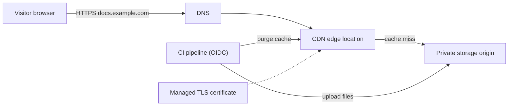
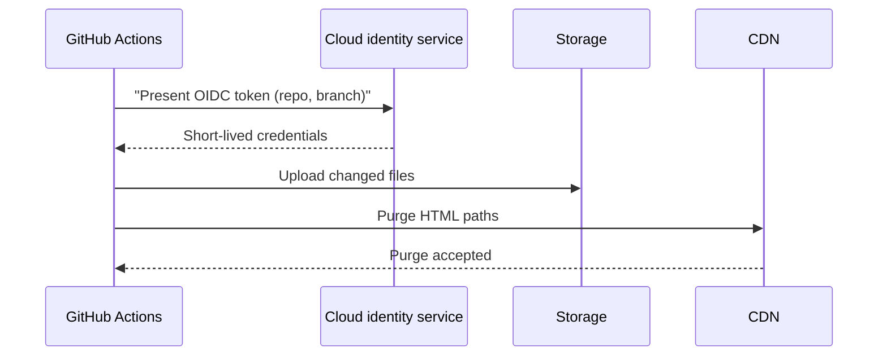

# Project: Static Website with CDN and HTTPS

## Introduction

A static website is the best first cloud project. It has a real user-facing result (a page on your own domain with a padlock in the browser), it touches four core services (storage, CDN, certificates and DNS), and when it is idle it costs very little.

In this project you will build the same website twice:

- **On AWS:** a private S3 bucket behind Amazon CloudFront, with a TLS certificate from AWS Certificate Manager (ACM) and DNS in Route 53. The whole stack is defined in one CloudFormation template.
- **On Azure:** a Storage account with static website hosting behind Azure Front Door Standard, with a Front Door managed certificate. You build it with the Azure CLI.

Then you add a deployment pipeline that uploads new versions and clears the CDN cache, test the site, and delete everything.

Think of the storage bucket as a warehouse and the CDN as a chain of local shops. Visitors never drive to the warehouse. They visit the nearest shop, which keeps popular items on its shelves and only orders from the warehouse when something runs out.

Background pages you may want open in another tab:

- [Hosting Static Websites](../6-cloud-storage/6-cloud-static-websites.mdx)
- [CDNs: CloudFront and Azure Front Door](../8-cloud-networking/6-cloud-cdn.mdx)
- [DNS: Route 53 and Azure DNS](../8-cloud-networking/5-cloud-dns.mdx)

:::warning Cost and cleanup
This project creates real, billable resources. Storage is billed per GB-month and per request, and the CDN is billed for data transfer out to viewers and per request (or through a monthly plan, see below). A hosted zone in Route 53 or a DNS zone in Azure has a small monthly charge, and a domain name costs money every year. A small personal site usually costs very little, but set a budget alert first ([Budgets and Billing Alerts](../1-cloud-getting-started/7-cloud-budgets-and-alerts.mdx)) and run the **Cleanup** section when you finish. Check current prices with the [AWS Pricing Calculator](https://calculator.aws/) and the [Azure Pricing Calculator](https://azure.microsoft.com/pricing/calculator/).
:::

## What You Will Build

The requirements come from a small company that wants its product documentation online:

1. Serve the site on `https://docs.example.com` with a valid certificate. Plain HTTP must redirect to HTTPS.
2. Keep the origin storage **private** where the platform allows it, so that nobody can bypass the CDN.
3. Cache aggressively, but let a new deployment appear within minutes.
4. Return a friendly 404 page for unknown paths.
5. Deploy from CI without long-lived keys.



The same shape maps onto both clouds:

| Building block | AWS | Azure |
| --- | --- | --- |
| Origin storage | S3 bucket (private) | Storage account with static website (`$web` container) |
| CDN | CloudFront distribution | Azure Front Door Standard profile |
| Origin lock-down | Origin Access Control (OAC) plus bucket policy | Front Door Premium with Private Link, or accept a public origin |
| TLS certificate | ACM certificate in `us-east-1` | Front Door managed certificate |
| DNS | Route 53 alias record | CNAME in Azure DNS or any DNS provider |
| Cache purge | `aws cloudfront create-invalidation` | `az afd endpoint purge` |
| IaC used here | CloudFormation | Azure CLI script |

:::info Retired and renamed services
On Azure, the older **Azure CDN** SKUs (from Verizon/Edgio, and the "classic" Microsoft tier) are retired or being retired. New projects should use **Azure Front Door Standard or Premium**. On AWS, use **Origin Access Control (OAC)**. The older Origin Access Identity (OAI) is now legacy. Check the [Azure Front Door documentation](https://learn.microsoft.com/azure/frontdoor/) for current retirement dates.
:::

## Prerequisites

- The AWS CLI v2 signed in with IAM Identity Center (`aws sso login`), as in [The AWS CLI](../1-cloud-getting-started/2-cloud-aws-cli.mdx).
- The Azure CLI signed in with `az login`, as in [The Azure CLI](../1-cloud-getting-started/3-cloud-azure-cli.mdx).
- Optional: a domain you control. Every step works without one by using the CDN's default hostname.

## Step 1: Create the Website

Keep the site tiny so you can focus on the infrastructure. Any static site generator (Docusaurus, Hugo, Astro, Vite) produces the same kind of output folder.

```bash
mkdir -p site/assets
cat > site/index.html <<'EOF'
<!doctype html>
<html lang="en">
<head>
  <meta charset="utf-8">
  <title>Acme Docs</title>
  <link rel="stylesheet" href="/assets/app.3f9a1c.css">
</head>
<body>
  <h1>Acme Docs</h1>
  <p>Version: <span id="v">2026.10.1</span></p>
</body>
</html>
EOF

cat > site/404.html <<'EOF'
<!doctype html>
<html lang="en"><head><meta charset="utf-8"><title>Not found</title></head>
<body><h1>Page not found</h1><p><a href="/">Back to the docs</a></p></body>
</html>
EOF

echo 'body { font-family: sans-serif; max-width: 40rem; margin: 2rem auto; }' > site/assets/app.3f9a1c.css
find site -type f
```

Output:

```text
site/index.html
site/404.html
site/assets/app.3f9a1c.css
```

### A caching strategy that makes deployments safe

The file name `app.3f9a1c.css` contains a content hash. Build tools add it automatically. That lets you use two cache rules:

| File type | Example | `Cache-Control` header | Why |
| --- | --- | --- | --- |
| Fingerprinted assets | `assets/app.3f9a1c.css` | `public, max-age=31536000, immutable` | A changed file gets a new name, so the old one can be cached for a year |
| HTML entry points | `index.html`, `404.html` | `public, max-age=60` (or `no-cache`) | HTML points at the current asset names and must refresh quickly |

With this split you rarely need to purge the whole CDN. New HTML pages reference new asset names, and browsers fetch them on the next visit.

## Part A: Build It on AWS

### A1. Request a certificate (custom domain only)

CloudFront only accepts ACM certificates from the **`us-east-1`** Region, whatever Region your bucket is in. This trips up many people.

```bash
aws acm request-certificate \
  --region us-east-1 \
  --domain-name docs.example.com \
  --validation-method DNS \
  --query CertificateArn --output text
```

Example output:

```text
arn:aws:acm:us-east-1:111122223333:certificate/0a1b2c3d-1111-2222-3333-444455556666
```

Next, create the DNS validation record. `aws acm describe-certificate --region us-east-1 --certificate-arn "$CERT_ARN"` shows the CNAME name and value under `DomainValidationOptions`. If the zone is in Route 53, the ACM console has a **Create records in Route 53** button that does this for you.

ACM renews DNS-validated certificates automatically as long as the CNAME record stays in place. Do not delete it after validation.

### A2. Define the stack in CloudFormation

Save this as `static-site.yaml`. It creates a private bucket, an Origin Access Control, a CloudFront distribution and the bucket policy that only lets that distribution read objects.

```yaml
AWSTemplateFormatVersion: "2010-09-09"
Description: Static website - private S3 origin behind CloudFront with OAC

Parameters:
  DomainName:
    Type: String
    Default: ""
    Description: Optional custom domain such as docs.example.com
  CertificateArn:
    Type: String
    Default: ""
    Description: ACM certificate ARN in us-east-1 (required if DomainName is set)

Conditions:
  HasDomain: !Not [!Equals [!Ref DomainName, ""]]

Resources:
  SiteBucket:
    Type: AWS::S3::Bucket
    Properties:
      PublicAccessBlockConfiguration:
        BlockPublicAcls: true
        IgnorePublicAcls: true
        BlockPublicPolicy: true
        RestrictPublicBuckets: true
      OwnershipControls:
        Rules:
          - ObjectOwnership: BucketOwnerEnforced
      VersioningConfiguration:
        Status: Enabled
      LifecycleConfiguration:
        Rules:
          - Id: expire-old-versions
            Status: Enabled
            NoncurrentVersionExpiration:
              NoncurrentDays: 30
      Tags:
        - Key: project
          Value: acme-docs

  SiteOac:
    Type: AWS::CloudFront::OriginAccessControl
    Properties:
      OriginAccessControlConfig:
        Name: !Sub "${AWS::StackName}-oac"
        OriginAccessControlOriginType: s3
        SigningBehavior: always
        SigningProtocol: sigv4

  Distribution:
    Type: AWS::CloudFront::Distribution
    Properties:
      DistributionConfig:
        Enabled: true
        Comment: Acme docs site
        HttpVersion: http2and3
        DefaultRootObject: index.html
        PriceClass: PriceClass_100
        Aliases: !If [HasDomain, [!Ref DomainName], !Ref "AWS::NoValue"]
        ViewerCertificate: !If
          - HasDomain
          - AcmCertificateArn: !Ref CertificateArn
            SslSupportMethod: sni-only
            MinimumProtocolVersion: TLSv1.2_2021
          - CloudFrontDefaultCertificate: true
        Origins:
          - Id: s3-origin
            DomainName: !GetAtt SiteBucket.RegionalDomainName
            OriginAccessControlId: !GetAtt SiteOac.Id
            S3OriginConfig:
              OriginAccessIdentity: ""
        DefaultCacheBehavior:
          TargetOriginId: s3-origin
          ViewerProtocolPolicy: redirect-to-https
          Compress: true
          AllowedMethods: [GET, HEAD]
          # Managed policies: CachingOptimized and SecurityHeadersPolicy
          CachePolicyId: 658327ea-f89d-4fab-a63d-7e88639e58f6
          ResponseHeadersPolicyId: 67f7725c-6f97-4210-82d7-5512b31e9d03
        CustomErrorResponses:
          # A private bucket returns 403 for missing keys, so map it to the 404 page
          - ErrorCode: 403
            ResponseCode: 404
            ResponsePagePath: /404.html
            ErrorCachingMinTTL: 60

  SiteBucketPolicy:
    Type: AWS::S3::BucketPolicy
    Properties:
      Bucket: !Ref SiteBucket
      PolicyDocument:
        Version: "2012-10-17"
        Statement:
          - Sid: AllowCloudFrontServicePrincipalReadOnly
            Effect: Allow
            Principal:
              Service: cloudfront.amazonaws.com
            Action: s3:GetObject
            Resource: !Sub "${SiteBucket.Arn}/*"
            Condition:
              StringEquals:
                AWS:SourceArn: !Sub "arn:aws:cloudfront::${AWS::AccountId}:distribution/${Distribution}"

Outputs:
  BucketName:
    Value: !Ref SiteBucket
  DistributionId:
    Value: !Ref Distribution
  DistributionDomain:
    Value: !GetAtt Distribution.DomainName
```

A few design decisions are worth calling out:

- **OAC with `SigningBehavior: always`.** CloudFront signs every request to S3 with SigV4. The bucket policy allows the CloudFront service principal, but only when `AWS:SourceArn` is *this* distribution. Another customer's distribution cannot read your bucket.
- **REST endpoint, not website endpoint.** OAC only works with the bucket's regular REST endpoint. The S3 *website* endpoint must be a public custom origin, so we do not use it. The trade-off is that sub-folder `index.html` files are not served automatically (for example `/guide/` will not map to `/guide/index.html`). If your site generator needs that, add a small CloudFront Function that rewrites the URI.
- **Managed policies.** `CachingOptimized` respects your `Cache-Control` headers within its TTL limits. `SecurityHeadersPolicy` adds headers such as `Strict-Transport-Security` and `X-Content-Type-Options`.
- **403 mapped to 404.** Without `s3:ListBucket`, S3 answers "access denied" for missing keys. That is a good thing, because it hides which keys exist. The error response turns it into a normal 404 page.
- **`PriceClass_100`** serves from edge locations in the cheapest regions only (North America and Europe). Choose a wider class if your visitors are elsewhere.

### A3. Deploy the stack

```bash
aws cloudformation deploy \
  --stack-name acme-docs \
  --template-file static-site.yaml \
  --region eu-west-1 \
  --parameter-overrides DomainName=docs.example.com CertificateArn="$CERT_ARN" \
  --tags project=acme-docs env=prod

aws cloudformation describe-stacks --stack-name acme-docs --region eu-west-1 \
  --query 'Stacks[0].Outputs' --output table
```

Example output:

```text
Waiting for changeset to be created..
Waiting for stack create/update to complete
Successfully created/updated stack - acme-docs
---------------------------------------------------------------------
|                          DescribeStacks                           |
+---------------------+---------------------------------------------+
|      OutputKey      |                 OutputValue                 |
+---------------------+---------------------------------------------+
|  BucketName         |  acme-docs-sitebucket-1x2y3z4w5v6u          |
|  DistributionId     |  E2ABCDEXAMPLE7                             |
|  DistributionDomain |  d111111abcdef8.cloudfront.net              |
+---------------------+---------------------------------------------+
```

Skip `--parameter-overrides` if you have no domain. The site then lives at the `cloudfront.net` hostname with CloudFront's default certificate. A new distribution takes a few minutes to deploy to all edge locations.

### A4. Upload the files with the right cache headers

Upload in two passes so that each group of files gets its own `Cache-Control` header:

```bash
BUCKET=$(aws cloudformation describe-stacks --stack-name acme-docs --region eu-west-1 \
  --query "Stacks[0].Outputs[?OutputKey=='BucketName'].OutputValue" --output text)

# 1. Fingerprinted assets: cache for a year
aws s3 sync site/assets "s3://$BUCKET/assets" \
  --cache-control "public, max-age=31536000, immutable"

# 2. Everything else (HTML): short cache, and remove files deleted locally
aws s3 sync site "s3://$BUCKET" --exclude "assets/*" \
  --cache-control "public, max-age=60" --delete
```

Example output:

```text
upload: site/assets/app.3f9a1c.css to s3://acme-docs-sitebucket-1x2y3z4w5v6u/assets/app.3f9a1c.css
upload: site/index.html to s3://acme-docs-sitebucket-1x2y3z4w5v6u/index.html
upload: site/404.html to s3://acme-docs-sitebucket-1x2y3z4w5v6u/404.html
```

The CLI guesses each object's `Content-Type` from the file extension. A wrong content type (for example `.js` stored as `binary/octet-stream`) makes browsers refuse to run the file.

### A5. Point DNS at CloudFront

In Route 53, use an **alias** record rather than a CNAME. Alias records work at the zone apex (`example.com`), and queries to alias targets are not charged. `Z2FDTNDATAQYW2` is the fixed hosted zone ID that AWS documents for all CloudFront distributions.

```bash
cat > alias.json <<'EOF'
{
  "Changes": [{
    "Action": "UPSERT",
    "ResourceRecordSet": {
      "Name": "docs.example.com",
      "Type": "A",
      "AliasTarget": {
        "HostedZoneId": "Z2FDTNDATAQYW2",
        "DNSName": "d111111abcdef8.cloudfront.net",
        "EvaluateTargetHealth": false
      }
    }
  }]
}
EOF
aws route53 change-resource-record-sets --hosted-zone-id "$ZONE_ID" --change-batch file://alias.json
```

Add a second record with `"Type": "AAAA"` for IPv6. If your DNS is hosted elsewhere, create a CNAME from `docs.example.com` to the `cloudfront.net` name instead.

### A6. Test it

```bash
curl -sI https://docs.example.com/ | grep -iE "^(HTTP|cache-control|x-cache|strict-transport)"
curl -sI http://docs.example.com/  | grep -iE "^(HTTP|location)"
curl -s -o /dev/null -w "%{http_code}\n" https://docs.example.com/does-not-exist
curl -s -o /dev/null -w "%{http_code}\n" "https://$BUCKET.s3.eu-west-1.amazonaws.com/index.html"
```

Example output:

```text
HTTP/2 200
cache-control: public, max-age=60
strict-transport-security: max-age=31536000
x-cache: Hit from cloudfront
HTTP/1.1 301 Moved Permanently
Location: https://docs.example.com/
404
403
```

The last line proves the origin is private: going straight to S3 is denied.

## Part B: Build It on Azure

On Azure, the static website feature of a Storage account serves files from a special container named `$web`. Its endpoint (`https://<account>.z6.web.core.windows.net`) is **always anonymous and read-only**. Azure Front Door sits in front to add your domain, a managed certificate, caching at the edge and an HTTP-to-HTTPS redirect.

### B1. Create the storage account and enable static website hosting

```bash
RG=rg-acme-docs
LOC=westeurope
SA=acmedocs$RANDOM          # 3-24 lowercase letters and numbers, globally unique

az group create -n "$RG" -l "$LOC" --tags project=acme-docs env=prod

az storage account create -n "$SA" -g "$RG" -l "$LOC" \
  --sku Standard_ZRS --kind StorageV2 \
  --min-tls-version TLS1_2 --allow-blob-public-access false

az storage blob service-properties update --account-name "$SA" --auth-mode login \
  --static-website --index-document index.html --404-document 404.html

ORIGIN_HOST=$(az storage account show -n "$SA" -g "$RG" \
  --query "primaryEndpoints.web" -o tsv | sed -e 's#https://##' -e 's#/##')
echo "$ORIGIN_HOST"
```

Example output:

```text
acmedocs12345.z6.web.core.windows.net
```

`--allow-blob-public-access false` blocks anonymous access to normal containers. It does not affect `$web`, which is served by the separate static website endpoint.

### B2. Upload the files

Give yourself the **Storage Blob Data Contributor** role on the account (see [Microsoft Entra ID and Azure RBAC](../2-cloud-identity/2-cloud-azure-entra-id.mdx)) so that `--auth-mode login` works without account keys.

```bash
az storage blob upload-batch --account-name "$SA" --auth-mode login \
  -d '$web' -s site/assets --destination-path assets \
  --content-cache-control "public, max-age=31536000, immutable" --overwrite

az storage blob upload-batch --account-name "$SA" --auth-mode login \
  -d '$web' -s site --pattern "*.html" \
  --content-cache-control "public, max-age=60" --overwrite
```

Example output (trimmed):

```text
Finished[#############################################################]  100.0000%
[
  { "Blob": "https://acmedocs12345.blob.core.windows.net/$web/assets/app.3f9a1c.css", ... }
]
```

Unlike `aws s3 sync --delete`, `upload-batch` never removes old files. Use `az storage blob sync` (which wraps AzCopy) if you need deletes to propagate.

### B3. Create the Front Door profile, origin and route

```bash
AFD=afd-acme-docs
EP=acme-docs-$RANDOM

az afd profile create -g "$RG" --profile-name "$AFD" --sku Standard_AzureFrontDoor

az afd endpoint create -g "$RG" --profile-name "$AFD" \
  --endpoint-name "$EP" --enabled-state Enabled

az afd origin-group create -g "$RG" --profile-name "$AFD" --origin-group-name og-site \
  --probe-request-type HEAD --probe-protocol Https --probe-interval-in-seconds 120 \
  --probe-path / --sample-size 4 --successful-samples-required 3 \
  --additional-latency-in-milliseconds 50

az afd origin create -g "$RG" --profile-name "$AFD" --origin-group-name og-site \
  --origin-name storage-web --host-name "$ORIGIN_HOST" --origin-host-header "$ORIGIN_HOST" \
  --priority 1 --weight 1000 --enabled-state Enabled --https-port 443 --http-port 80

az afd route create -g "$RG" --profile-name "$AFD" --endpoint-name "$EP" \
  --route-name default --origin-group og-site \
  --supported-protocols "[Http,Https]" --https-redirect Enabled \
  --forwarding-protocol HttpsOnly --link-to-default-domain Enabled \
  --patterns-to-match "[/*]"
```

Two settings matter most:

- `--origin-host-header` must equal the storage hostname. The storage service uses the `Host` header to find your account. If Front Door forwarded `docs.example.com` instead, you would get errors.
- `--https-redirect Enabled` adds the HTTP-to-HTTPS redirect as the first rule, and `--forwarding-protocol HttpsOnly` keeps the hop to storage encrypted too.

Turn on caching for the route. Without a cache configuration, Front Door acts as a pure proxy:

```bash
az afd route update -g "$RG" --profile-name "$AFD" --endpoint-name "$EP" \
  --route-name default \
  --cache-configuration "{query-string-caching-behavior:IgnoreQueryString,compression-settings:{is-compression-enabled:true,content-types-to-compress:[text/html,text/css,application/javascript]}}"
```

Get the default hostname and test it:

```bash
az afd endpoint show -g "$RG" --profile-name "$AFD" --endpoint-name "$EP" \
  --query hostName -o tsv
```

Example output:

```text
acme-docs-24680-b7fwhedxfgcgb4dk.z01.azurefd.net
```

### B4. Add the custom domain and managed certificate

```bash
az afd custom-domain create -g "$RG" --profile-name "$AFD" \
  --custom-domain-name docs-example-com --host-name docs.example.com \
  --certificate-type ManagedCertificate --minimum-tls-version TLS12

az afd custom-domain show -g "$RG" --profile-name "$AFD" \
  --custom-domain-name docs-example-com --query validationProperties
```

The output contains a `validationToken` value.

Then, in your DNS zone:

1. Create a TXT record `_dnsauth.docs` with the validation token. Front Door uses it to prove you own the domain.
2. Create a CNAME `docs` that points to the endpoint hostname from B3.
3. Associate the domain with the route:

```bash
DOMAIN_ID=$(az afd custom-domain show -g "$RG" --profile-name "$AFD" \
  --custom-domain-name docs-example-com --query id -o tsv)

az afd route update -g "$RG" --profile-name "$AFD" --endpoint-name "$EP" \
  --route-name default --formatted-custom-domains "[{id:$DOMAIN_ID}]"
```

Front Door issues and renews the managed certificate automatically once validation succeeds. That can take a while, so be patient.

:::note The origin is still public on Azure
The static website endpoint stays reachable directly, even with Front Door in front. For public documentation this is usually acceptable. If you must force all traffic through the CDN, the options are **Front Door Premium with a Private Link origin** (more expensive), or a Front Door rule that adds a secret header combined with a different origin, such as App Service with access restrictions. **Azure Static Web Apps** is a simpler alternative with a built-in global edge, free managed certificates and preview environments. Compare them in [Hosting Static Websites](../6-cloud-storage/6-cloud-static-websites.mdx).
:::

### B5. Test it

```bash
curl -sI https://docs.example.com/ | grep -iE "^(HTTP|cache-control|x-cache)"
curl -sI http://docs.example.com/  | grep -iE "^(HTTP|location)"
curl -s -o /dev/null -w "%{http_code}\n" https://docs.example.com/missing
```

Example output:

```text
HTTP/2 200
cache-control: public, max-age=60
x-cache: TCP_HIT
HTTP/1.1 307 Temporary Redirect
Location: https://docs.example.com/
404
```

## Step 2: Automate Deployments with OIDC

Manual uploads are fine once. After that, let CI publish every merge to `main`. Both clouds trust GitHub's OIDC tokens, so the workflow needs **no stored cloud secrets**. The full setup of the trust relationship is in [Keyless CI/CD with OIDC](../2-cloud-identity/6-cloud-oidc-for-ci.mdx).



```yaml
name: deploy-docs
on:
  push:
    branches: [main]

permissions:
  id-token: write   # required to request the OIDC token
  contents: read

jobs:
  aws:
    runs-on: ubuntu-latest
    steps:
      - uses: actions/checkout@v4
      - uses: aws-actions/configure-aws-credentials@v4
        with:
          role-to-assume: arn:aws:iam::111122223333:role/acme-docs-deployer
          aws-region: eu-west-1
      - name: Upload and invalidate
        run: |
          aws s3 sync site/assets "s3://${{ vars.BUCKET }}/assets" --cache-control "public, max-age=31536000, immutable"
          aws s3 sync site "s3://${{ vars.BUCKET }}" --exclude "assets/*" --cache-control "public, max-age=60" --delete
          aws cloudfront create-invalidation --distribution-id "${{ vars.DISTRIBUTION_ID }}" --paths "/index.html" "/404.html" "/"

  azure:
    runs-on: ubuntu-latest
    steps:
      - uses: actions/checkout@v4
      - uses: azure/login@v2
        with:
          client-id: ${{ vars.AZURE_CLIENT_ID }}
          tenant-id: ${{ vars.AZURE_TENANT_ID }}
          subscription-id: ${{ vars.AZURE_SUBSCRIPTION_ID }}
      - name: Upload and purge
        run: |
          az storage blob upload-batch --account-name "${{ vars.SA }}" --auth-mode login -d '$web' -s site/assets --destination-path assets --content-cache-control "public, max-age=31536000, immutable" --overwrite
          az storage blob upload-batch --account-name "${{ vars.SA }}" --auth-mode login -d '$web' -s site --pattern "*.html" --content-cache-control "public, max-age=60" --overwrite
          az afd endpoint purge -g rg-acme-docs --profile-name afd-acme-docs --endpoint-name "${{ vars.AFD_ENDPOINT }}" --content-paths "[/index.html,/404.html,/]"
```

Keep the deployer's permissions narrow:

- **AWS role:** `s3:PutObject`, `s3:DeleteObject` and `s3:ListBucket` on this bucket only, plus `cloudfront:CreateInvalidation` on this distribution only.
- **Azure identity:** **Storage Blob Data Contributor** on this storage account, plus **CDN Endpoint Contributor** (or a custom role with the purge action) on the Front Door profile.

Purging only the HTML paths, instead of `/*`, keeps the cached assets warm. On CloudFront, invalidations are free up to a monthly quota of paths and charged per path after that, and a wildcard counts as one path. Check the current terms on the pricing pages.

## How the Two Platforms Compare for This Project

| Concern | AWS | Azure |
| --- | --- | --- |
| Private origin | Yes, with OAC on the standard tier | Only with Front Door Premium and Private Link |
| Certificate | ACM, must be in `us-east-1`, free for CloudFront | Front Door managed certificate, free |
| Apex domain (`example.com`) | Route 53 alias record | Azure DNS alias record, or a provider that supports CNAME flattening |
| Directory index (`/guide/`) | Needs a CloudFront Function when using OAC | Built into static website hosting |
| 404 page | Custom error response | `--404-document` setting |
| Deployment sync with deletes | `aws s3 sync --delete` | `az storage blob sync` |
| Billing shape | Data transfer plus requests, or a CloudFront flat-rate plan | Base fee per profile plus data transfer and requests |

AWS also offers **CloudFront flat-rate pricing plans** (Free, Pro, Business and Premium tiers). They bundle the CDN with AWS WAF, DDoS protection, Route 53 DNS and some S3 storage credits for a fixed monthly price with no overage charges. They are worth comparing with pay-as-you-go pricing for small and medium sites. Details and limits are on the [CloudFront pricing page](https://aws.amazon.com/cloudfront/pricing/).

## Real-World Scenario

Your team maintains documentation for a developer tool. Today it runs on a single small VM with nginx. Twice last year a traffic spike after a conference talk made the VM fall over, and the TLS certificate once expired because a renewal cron job had silently failed.

**The solution:** the build pipeline already produces a static `build/` folder, so you move to storage plus CDN. The company's main platform is AWS, so you use the Part A design. The template lives in the docs repository, and the GitHub Actions workflow deploys on every merge.

**Why this approach:**

- There is no server to patch, and nothing to fall over under load. The CDN absorbs spikes at the edge.
- ACM renews the certificate automatically, which removes a whole class of outages.
- Fingerprinted assets plus short HTML caching mean deployments appear within a minute without full purges.
- OAC keeps the bucket private, so there is only one public entry point, and you can add AWS WAF there later.

**When to use it / when not to:**

- Use it for documentation, marketing sites, blogs, and single-page apps whose APIs live elsewhere.
- Do not use it when pages must be rendered per user on the server, such as dashboards behind login with server-side rendering. Use App Service, containers, or a framework host with SSR support instead.
- Be careful when you need features at the edge that grow into real logic, such as authentication, A/B testing and redirects. A platform like Azure Static Web Apps or AWS Amplify Hosting may be simpler than hand-written edge functions.

**Alternatives and trade-offs:**

| Approach | Pros | Cons | Best for |
| --- | --- | --- | --- |
| S3 + CloudFront (this project) | Private origin, fine-grained control, everything in IaC | More pieces to wire up, no directory index without a function | Teams that want full control on AWS |
| Blob static website + Front Door | Directory index built in, simple CLI setup | Origin stays public on Standard, extra base fee for the profile | Teams on Azure with public content |
| Azure Static Web Apps | Global edge, free certificates, preview environments per PR, built-in auth | Less control over caching, opinionated build pipeline | Front-end apps with small APIs |
| AWS Amplify Hosting | Git-based deploys, previews, SSR support for some frameworks | Opinionated, less transparent infrastructure | Front-end teams on AWS who want a managed workflow |
| Third-party hosts (Netlify, Vercel, Cloudflare Pages) | Very fast setup, generous free tiers | Another vendor, separate from your cloud account and IAM | Small teams and open-source projects |

## Common Mistakes

- **Requesting the ACM certificate in the wrong Region.** CloudFront only lists certificates from `us-east-1`.
- **Using the S3 website endpoint with OAC.** OAC needs the REST endpoint (`bucket.s3.region.amazonaws.com`). The website endpoint must be a public custom origin.
- **Making the bucket public "to fix a 403".** A 403 through CloudFront usually means a missing object, a wrong `AWS:SourceArn`, or an OAC that is not attached. Check those first.
- **Setting long cache times on `index.html`.** Visitors keep seeing old pages for days. Cache HTML briefly and fingerprint assets.
- **Purging `/*` on every deploy.** It works, but it empties every edge cache and sends a burst of traffic to the origin. Purge only what changed.
- **Forgetting `--origin-host-header` on Front Door.** The storage endpoint answers with an error when the `Host` header is your custom domain.
- **Deleting the DNS validation records.** Both ACM and Front Door need them to renew certificates.
- **Storing access keys in CI secrets.** Use OIDC, as shown above.

## Cleanup

Run these when you are done. Deletion order matters on AWS, because the distribution must be gone before the bucket can be removed cleanly, and CloudFormation will not delete a bucket that still has objects in it.

### On AWS

```bash
# 1. Empty the bucket, including old versions (versioning is enabled)
aws s3 rm "s3://$BUCKET" --recursive
aws s3api delete-objects --bucket "$BUCKET" --delete "$(aws s3api list-object-versions \
  --bucket "$BUCKET" --output json \
  --query '{Objects: [Versions[].{Key:Key,VersionId:VersionId}, DeleteMarkers[].{Key:Key,VersionId:VersionId}][]}')"

# 2. Delete the stack (CloudFormation disables the distribution, waits, then deletes it)
aws cloudformation delete-stack --stack-name acme-docs --region eu-west-1
aws cloudformation wait stack-delete-complete --stack-name acme-docs --region eu-west-1

# 3. Remove the DNS records you created, then the certificate if you no longer need it
aws acm delete-certificate --region us-east-1 --certificate-arn "$CERT_ARN"
```

Deleting the stack can take a while because CloudFront has to disable the distribution across all edge locations first.

### On Azure

```bash
az group delete -n rg-acme-docs --yes --no-wait
```

Deleting the resource group removes the Front Door profile, the custom domain and the storage account. Also delete the `docs` CNAME and the `_dnsauth.docs` TXT records from your DNS zone, so that nobody can later claim your subdomain by creating a Front Door endpoint with the same name (a "dangling DNS" takeover).

## Summary

- A static site needs four building blocks: **storage, CDN, certificate and DNS**. Both clouds offer managed versions of each.
- On AWS, a **private S3 bucket + CloudFront + OAC** keeps the origin closed to everyone except your distribution. The ACM certificate must live in **`us-east-1`**.
- On Azure, **Blob static website + Front Door Standard** gives you HTTPS, caching and a managed certificate. The origin stays public unless you use Front Door Premium with Private Link.
- Use **fingerprinted asset names** with long cache times and **short cache times for HTML**, so deployments are fast and purges are small.
- Deploy from CI with **OIDC**, scoped to one bucket or storage account and one CDN.
- Clean up DNS records along with the resources to avoid subdomain takeovers.

## Exercises

1. Add a CloudFront Function to the template that rewrites `/guide/` to `/guide/index.html`. Test that `curl https://<domain>/guide/` returns 200.
2. Deploy the Azure version with **Azure Static Web Apps** instead of Storage plus Front Door. Write down three differences in setup effort and features.
3. Add AWS WAF (or the Front Door WAF policy) with a rate-limiting rule. Use a load-testing tool against your own site to confirm it triggers.
4. Change the CI workflow so that it only purges the HTML files that actually changed in the commit.

**Related pages:** [Amazon S3](../6-cloud-storage/1-cloud-s3.mdx), [Azure Blob Storage](../6-cloud-storage/2-cloud-azure-blob.mdx), [AWS CloudFormation](../10-cloud-infrastructure-as-code/1-cloud-cloudformation.mdx), [CI/CD with Azure DevOps and GitHub Actions](../11-cloud-devops/1-cloud-ci-cd-on-azure.mdx), and the next project, [Project: Serverless REST API](./1-cloud-project-serverless-api.mdx).
