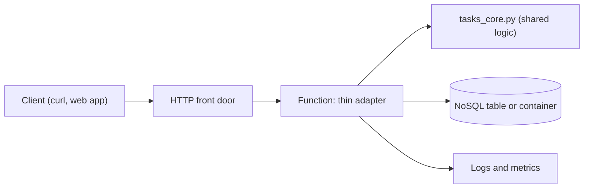
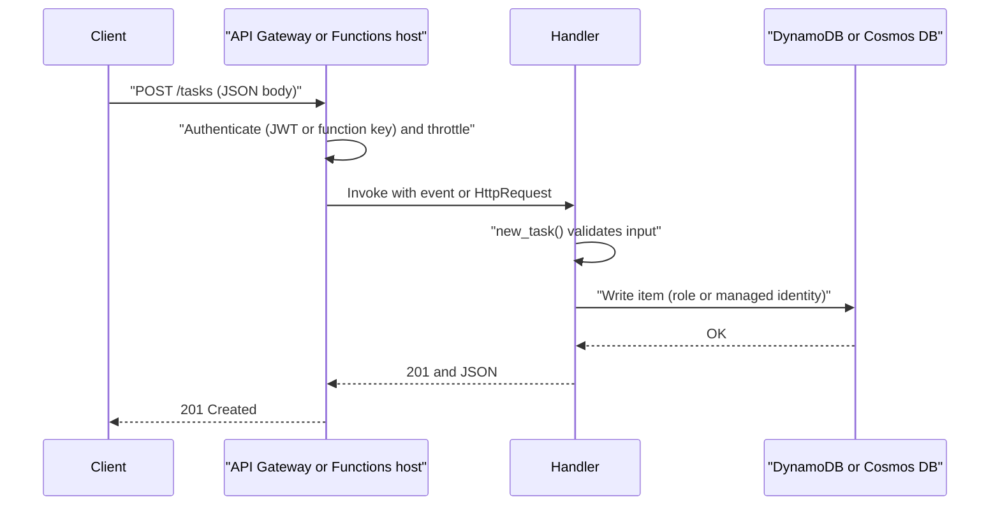

# Project: Serverless REST API

## Introduction

Most backends start as a small JSON API: create something, read it back, list it, delete it. Serverless platforms are a good fit for that kind of API when traffic is spiky or unknown. You write the handler code, the platform runs it on demand, and you pay mainly for requests and execution time instead of idle servers.

In this project you build the same **Tasks API** twice:

- **On AWS:** Amazon API Gateway (HTTP API) in front of an AWS Lambda function, storing data in Amazon DynamoDB. Everything is defined in an AWS SAM template.
- **On Azure:** an Azure Functions app on the **Flex Consumption** plan with HTTP triggers, storing data in Azure Cosmos DB for NoSQL (serverless capacity mode). It connects with a managed identity, so there are no database keys anywhere.

Both versions share the same business logic module. Only a thin adapter layer is cloud-specific. That design choice, "portable core, thin cloud adapters", is one of the most useful habits you can build.

Background pages: [AWS Lambda](../4-cloud-serverless/1-cloud-aws-lambda.mdx), [Azure Functions](../4-cloud-serverless/2-cloud-azure-functions.mdx), [API Gateway and Azure API Management](../4-cloud-serverless/4-cloud-api-gateway.mdx) and [NoSQL: DynamoDB and Cosmos DB](../7-cloud-databases/2-cloud-dynamodb-cosmosdb.mdx).

:::warning Cost and cleanup
All services in this project are billed per use: API requests, function invocations and execution time (GB-seconds), database reads, writes and storage, and log ingestion. Idle cost is close to zero, but a load test or an infinite retry loop can generate real charges. Set a budget alert first ([Budgets and Billing Alerts](../1-cloud-getting-started/7-cloud-budgets-and-alerts.mdx)) and run the **Cleanup** section when you are done. Prices vary by region and change over time, so check the [AWS Pricing Calculator](https://calculator.aws/) and the [Azure Pricing Calculator](https://azure.microsoft.com/pricing/calculator/).
:::

## What You Will Build

The API is a small task tracker for an internal operations team:

| Method and path | Purpose | Success code |
| --- | --- | --- |
| `POST /tasks` | Create a task from a JSON body like `{"title": "Renew TLS cert"}` | 201 |
| `GET /tasks?status=open` | List up to 50 tasks with a status, newest first | 200 |
| `GET /tasks/{id}` | Fetch one task | 200 or 404 |
| `DELETE /tasks/{id}` | Delete a task (safe to repeat) | 204 |



| Building block | AWS | Azure |
| --- | --- | --- |
| HTTP front door | API Gateway HTTP API | Built-in HTTP trigger (add API Management for a full gateway) |
| Compute | Lambda, `python3.13` runtime, arm64 | Functions Flex Consumption, Python 3.12 |
| Database | DynamoDB on-demand table with a GSI | Cosmos DB for NoSQL, serverless |
| Data access identity | Lambda execution role | System-assigned managed identity with a Cosmos DB data-plane role |
| IaC and deploy tool | AWS SAM (`sam build`, `sam deploy`) | Azure CLI plus Functions Core Tools (`func`) |
| Logs | CloudWatch Logs | Application Insights |

:::info Current versions
Lambda supports `python3.12`, `python3.13` and `python3.14` on Amazon Linux 2023 at the time of writing. Azure Functions supports Python 3.10 through 3.14 in general, but the Flex Consumption plan may lag behind, and the older Linux Consumption plan is being retired in favor of Flex Consumption. Check [Lambda runtimes](https://docs.aws.amazon.com/lambda/latest/dg/lambda-runtimes.html) and [Azure Functions supported languages](https://learn.microsoft.com/azure/azure-functions/supported-languages) before you pick a version.
:::

## Step 1: Write the Shared Business Logic

Keep validation and the data model in plain Python with no cloud imports. It is easy to unit-test, and it moves between clouds unchanged.

```python
# tasks_core.py
"""Cloud-neutral business logic shared by the AWS and Azure handlers."""
import uuid
from datetime import datetime, timezone

MAX_TITLE = 200


class ValidationError(ValueError):
    """Raised when a request body is invalid."""


def new_task(payload: dict) -> dict:
    title = str(payload.get("title", "")).strip()
    if not title:
        raise ValidationError("title is required")
    if len(title) > MAX_TITLE:
        raise ValidationError(f"title must be {MAX_TITLE} characters or fewer")
    return {
        "id": uuid.uuid4().hex,
        "title": title,
        "status": "open",
        "createdAt": datetime.now(timezone.utc).isoformat(timespec="seconds"),
    }
```

```python
# test_tasks_core.py
import pytest
from tasks_core import ValidationError, new_task


def test_new_task_sets_defaults():
    task = new_task({"title": "  Renew TLS cert  "})
    assert task["title"] == "Renew TLS cert"
    assert task["status"] == "open"
    assert len(task["id"]) == 32


@pytest.mark.parametrize("body", [{}, {"title": "   "}, {"title": "x" * 201}])
def test_new_task_rejects_bad_input(body):
    with pytest.raises(ValidationError):
        new_task(body)
```

```bash
pip install pytest
python -m pytest -q
```

Output:

```text
....                                                                     [100%]
4 passed in 0.01s
```

## Part A: Build It on AWS

### A1. Project layout

```text
tasks-api-aws/
├── template.yaml
└── src/
    ├── app.py            # Lambda adapter
    ├── tasks_core.py     # shared logic from Step 1
    └── requirements.txt  # empty: boto3 is in the runtime, pin it if you need a version
```

### A2. The data model in DynamoDB

The table uses `id` as the partition key, so reading one task by ID is a single cheap `GetItem`. Listing by status needs a different access path, so a **global secondary index** (GSI) named `status-index` uses `status` as its partition key and `createdAt` as its sort key. In DynamoDB you design keys around your queries, which is the opposite of relational design. [NoSQL: DynamoDB and Cosmos DB](../7-cloud-databases/2-cloud-dynamodb-cosmosdb.mdx) explains why.

:::caution Hot partitions
With only two status values, every write to the index lands on one of two partitions. That is fine for an internal tool. At high scale you would add a suffix to spread the load (`open#3`) or model "open tasks per team" instead.
:::

### A3. The Lambda adapter

API Gateway HTTP APIs send the **payload format 2.0** event to Lambda. Its `routeKey` field (for example `GET /tasks/{id}`) makes routing a simple string comparison.

```python
# src/app.py
import json
import os

import boto3
from boto3.dynamodb.conditions import Key

from tasks_core import ValidationError, new_task

# Created once per execution environment and reused across invocations
table = boto3.resource("dynamodb").Table(os.environ.get("TABLE_NAME", "tasks"))


def respond(status: int, body=None) -> dict:
    return {
        "statusCode": status,
        "headers": {"content-type": "application/json"},
        "body": "" if body is None else json.dumps(body),
    }


def handler(event, context):
    route = event["routeKey"]                      # for example "GET /tasks/{id}"
    task_id = (event.get("pathParameters") or {}).get("id")
    query = event.get("queryStringParameters") or {}

    try:
        if route == "POST /tasks":
            task = new_task(json.loads(event.get("body") or "{}"))
            table.put_item(Item=task, ConditionExpression="attribute_not_exists(id)")
            return respond(201, task)

        if route == "GET /tasks":
            result = table.query(
                IndexName="status-index",
                KeyConditionExpression=Key("status").eq(query.get("status", "open")),
                ScanIndexForward=False,               # newest first
                Limit=50,
            )
            return respond(200, result["Items"])

        if route == "GET /tasks/{id}":
            item = table.get_item(Key={"id": task_id}).get("Item")
            return respond(200, item) if item else respond(404, {"error": "not found"})

        if route == "DELETE /tasks/{id}":
            table.delete_item(Key={"id": task_id})
            return respond(204)

        return respond(404, {"error": f"no route for {route}"})
    except ValidationError as err:
        return respond(400, {"error": str(err)})
    except json.JSONDecodeError:
        return respond(400, {"error": "body must be valid JSON"})
```

Points worth noticing:

- The boto3 `table` object is created **outside** the handler, so warm invocations reuse the connection.
- `ConditionExpression="attribute_not_exists(id)"` makes the write fail instead of silently overwriting if an ID ever collides.
- `Key("status")` uses the conditions builder, which handles the fact that `status` is a DynamoDB reserved word. In a raw expression string you would need `ExpressionAttributeNames`.
- Every error path returns a clear 4xx response. Unexpected exceptions still bubble up, so Lambda logs them and API Gateway returns a 500.

You can test the adapter locally with a fake table and no AWS account:

```python
# test_app.py (run from the src/ folder)
import json
import app


class FakeTable:
    def __init__(self):
        self.items = {}

    def put_item(self, Item, ConditionExpression=None):
        self.items[Item["id"]] = Item

    def get_item(self, Key):
        item = self.items.get(Key["id"])
        return {"Item": item} if item else {}


def test_create_then_get(monkeypatch):
    monkeypatch.setattr(app, "table", FakeTable())
    created = app.handler({"routeKey": "POST /tasks", "body": json.dumps({"title": "Rotate keys"})}, None)
    assert created["statusCode"] == 201
    task_id = json.loads(created["body"])["id"]

    fetched = app.handler({"routeKey": "GET /tasks/{id}", "pathParameters": {"id": task_id}}, None)
    assert json.loads(fetched["body"])["title"] == "Rotate keys"


def test_bad_json_is_400(monkeypatch):
    monkeypatch.setattr(app, "table", FakeTable())
    resp = app.handler({"routeKey": "POST /tasks", "body": "{oops"}, None)
    assert resp["statusCode"] == 400
```

Output:

```text
......                                                                   [100%]
6 passed in 0.42s
```

### A4. The SAM template

```yaml
AWSTemplateFormatVersion: "2010-09-09"
Transform: AWS::Serverless-2016-10-31
Description: Tasks API - HTTP API + Lambda + DynamoDB

Globals:
  Function:
    Runtime: python3.13
    Architectures: [arm64]
    MemorySize: 256
    Timeout: 10
    LoggingConfig:
      LogFormat: JSON

Resources:
  TasksTable:
    Type: AWS::DynamoDB::Table
    Properties:
      BillingMode: PAY_PER_REQUEST
      AttributeDefinitions:
        - { AttributeName: id, AttributeType: S }
        - { AttributeName: status, AttributeType: S }
        - { AttributeName: createdAt, AttributeType: S }
      KeySchema:
        - { AttributeName: id, KeyType: HASH }
      GlobalSecondaryIndexes:
        - IndexName: status-index
          KeySchema:
            - { AttributeName: status, KeyType: HASH }
            - { AttributeName: createdAt, KeyType: RANGE }
          Projection: { ProjectionType: ALL }
      PointInTimeRecoverySpecification:
        PointInTimeRecoveryEnabled: true
      Tags:
        - { Key: project, Value: tasks-api }

  TasksApi:
    Type: AWS::Serverless::HttpApi
    Properties:
      FailOnWarnings: true
      DefaultRouteSettings:
        ThrottlingBurstLimit: 50
        ThrottlingRateLimit: 20

  TasksFunction:
    Type: AWS::Serverless::Function
    Properties:
      CodeUri: src/
      Handler: app.handler
      Environment:
        Variables:
          TABLE_NAME: !Ref TasksTable
      Policies:
        - DynamoDBCrudPolicy:
            TableName: !Ref TasksTable
      Events:
        Create: { Type: HttpApi, Properties: { ApiId: !Ref TasksApi, Path: /tasks, Method: POST } }
        List:   { Type: HttpApi, Properties: { ApiId: !Ref TasksApi, Path: /tasks, Method: GET } }
        Get:    { Type: HttpApi, Properties: { ApiId: !Ref TasksApi, Path: "/tasks/{id}", Method: GET } }
        Delete: { Type: HttpApi, Properties: { ApiId: !Ref TasksApi, Path: "/tasks/{id}", Method: DELETE } }

  TasksFunctionLogs:
    Type: AWS::Logs::LogGroup
    Properties:
      LogGroupName: !Sub "/aws/lambda/${TasksFunction}"
      RetentionInDays: 14

Outputs:
  ApiUrl:
    Value: !Sub "https://${TasksApi}.execute-api.${AWS::Region}.amazonaws.com"
  TableName:
    Value: !Ref TasksTable
```

Design notes:

- **HTTP API rather than REST API.** HTTP APIs are simpler and cheaper per request, and they support JWT authorizers and throttling. REST APIs add usage plans with API keys, request validation and response caching. [API Gateway and Azure API Management](../4-cloud-serverless/4-cloud-api-gateway.mdx) compares them.
- **One function, four routes.** A single function is easier to deploy and keeps one warm pool. Split functions when routes need different permissions, memory or scaling.
- **`DynamoDBCrudPolicy`** is a SAM policy template that grants CRUD actions on this one table and its indexes, not `dynamodb:*` on everything.
- **Throttling** caps the steady rate and burst for all routes. It protects your table and your bill from a runaway client.
- **Log retention** is set explicitly, because log groups that Lambda creates by default keep logs forever.
- **arm64 (Graviton)** usually gives better price-performance for pure-Python code. Test your dependencies before switching.

### A5. Build, deploy and test

```bash
sam build
sam deploy --guided --stack-name tasks-api --region eu-west-1 --tags project=tasks-api
```

Example output (trimmed):

```text
CloudFormation outputs from deployed stack
-------------------------------------------------------------------------
Outputs
-------------------------------------------------------------------------
Key                 ApiUrl
Value               https://a1b2c3d4e5.execute-api.eu-west-1.amazonaws.com
Key                 TableName
Value               tasks-api-TasksTable-1ABCDEF2GHIJ
-------------------------------------------------------------------------
Successfully created/updated stack - tasks-api in eu-west-1
```

`--guided` saves your answers to `samconfig.toml`, so later deployments are just `sam deploy`. Now exercise the API:

```bash
API=https://a1b2c3d4e5.execute-api.eu-west-1.amazonaws.com

curl -s -X POST "$API/tasks" -H 'content-type: application/json' -d '{"title":"Renew TLS cert"}'
curl -s "$API/tasks?status=open"
curl -s -o /dev/null -w "%{http_code}\n" "$API/tasks/does-not-exist"
curl -s -X POST "$API/tasks" -H 'content-type: application/json' -d '{"title":""}'
```

Example output:

```text
{"id": "9f2c4e1ab3d84c6f9a0e5b7d1c2f3a4b", "title": "Renew TLS cert", "status": "open", "createdAt": "2026-10-11T09:30:12+00:00"}
[{"id": "9f2c4e1ab3d84c6f9a0e5b7d1c2f3a4b", "title": "Renew TLS cert", "status": "open", "createdAt": "2026-10-11T09:30:12+00:00"}]
404
{"error": "title is required"}
```

Follow the logs while you test:

```bash
sam logs --stack-name tasks-api --name TasksFunction --tail
```

### A6. Lock it down

The API above is public: anyone who finds the URL can create tasks. Before real use, add an authorizer. HTTP APIs validate JWTs from any OpenID Connect provider (Amazon Cognito, Microsoft Entra ID, Auth0) without extra code:

```yaml
  TasksApi:
    Type: AWS::Serverless::HttpApi
    Properties:
      Auth:
        DefaultAuthorizer: OpsJwt
        Authorizers:
          OpsJwt:
            IdentitySource: "$request.header.Authorization"
            JwtConfiguration:
              issuer: "https://login.microsoftonline.com/<tenant-id>/v2.0"
              audience:
                - "api://tasks-api"
```

API Gateway now rejects requests without a valid token before your function runs, so unauthenticated traffic costs you no Lambda time.

## Part B: Build It on Azure

### B1. Create the resources

```bash
RG=rg-tasks-api
LOC=westeurope                     # choose a region that supports Flex Consumption
SA=tasksfn$RANDOM                  # storage account for the Functions host
APP=tasks-api-$RANDOM              # globally unique function app name
COSMOS=tasks-cosmos-$RANDOM

az group create -n "$RG" -l "$LOC" --tags project=tasks-api

# Cosmos DB for NoSQL in serverless mode (billed per request unit and storage)
az cosmosdb create -n "$COSMOS" -g "$RG" --locations regionName="$LOC" \
  --capabilities EnableServerless --default-consistency-level Session
az cosmosdb sql database create -a "$COSMOS" -g "$RG" -n tasksdb
az cosmosdb sql container create -a "$COSMOS" -g "$RG" -d tasksdb -n tasks \
  --partition-key-path /id

# Storage account and function app on the Flex Consumption plan
az storage account create -n "$SA" -g "$RG" -l "$LOC" --sku Standard_LRS \
  --allow-blob-public-access false
az functionapp create -g "$RG" -n "$APP" --storage-account "$SA" \
  --flexconsumption-location "$LOC" --runtime python --runtime-version 3.12
```

Example output (trimmed):

```text
{
  "defaultHostName": "tasks-api-23817.azurewebsites.net",
  "kind": "functionapp,linux",
  "name": "tasks-api-23817",
  "state": "Running",
  ...
}
```

Run `az functionapp list-flexconsumption-locations -o table` if the create command rejects your region. `az functionapp create` also creates an Application Insights resource for the app by default.

### B2. Connect with a managed identity instead of keys

Cosmos DB has its own **data-plane** RBAC, separate from Azure's management-plane roles. Give the function app an identity and grant it the built-in **Cosmos DB Built-in Data Contributor** role, whose fixed ID is `00000000-0000-0000-0000-000000000002`:

```bash
PRINCIPAL_ID=$(az functionapp identity assign -g "$RG" -n "$APP" --query principalId -o tsv)

az cosmosdb sql role assignment create -a "$COSMOS" -g "$RG" \
  --role-definition-id 00000000-0000-0000-0000-000000000002 \
  --principal-id "$PRINCIPAL_ID" --scope "/"

ENDPOINT=$(az cosmosdb show -n "$COSMOS" -g "$RG" --query documentEndpoint -o tsv)
az functionapp config appsettings set -g "$RG" -n "$APP" \
  --settings COSMOS_ENDPOINT="$ENDPOINT"
```

Once the app works, turn off key-based access on the account entirely, so leaked keys are useless:

```bash
az resource update -g "$RG" -n "$COSMOS" \
  --resource-type Microsoft.DocumentDB/databaseAccounts \
  --set properties.disableLocalAuth=true
```

To run the function locally against the same database, assign the same data role to your own user. `DefaultAzureCredential` then picks up your `az login` session.

### B3. The Functions adapter

The Python v2 programming model declares triggers with decorators in a single `function_app.py`:

```text
tasks-api-azure/
├── function_app.py
├── tasks_core.py        # same file as on AWS
├── host.json
└── requirements.txt     # azure-functions, azure-cosmos, azure-identity
```

```python
# function_app.py
import json
import os

import azure.functions as func
from azure.cosmos import CosmosClient, exceptions
from azure.identity import DefaultAzureCredential

from tasks_core import ValidationError, new_task

app = func.FunctionApp(http_auth_level=func.AuthLevel.FUNCTION)

# Managed identity in Azure, your az login session on a laptop. No keys.
_client = CosmosClient(os.environ["COSMOS_ENDPOINT"], credential=DefaultAzureCredential())
container = _client.get_database_client("tasksdb").get_container_client("tasks")


def respond(status: int, body=None) -> func.HttpResponse:
    return func.HttpResponse(
        "" if body is None else json.dumps(body),
        status_code=status,
        mimetype="application/json",
    )


@app.route(route="tasks", methods=["POST"])
def create_task(req: func.HttpRequest) -> func.HttpResponse:
    try:
        payload = req.get_json()
    except ValueError:
        return respond(400, {"error": "body must be valid JSON"})
    try:
        task = new_task(payload)
    except ValidationError as err:
        return respond(400, {"error": str(err)})
    container.create_item(task)
    return respond(201, task)


@app.route(route="tasks", methods=["GET"])
def list_tasks(req: func.HttpRequest) -> func.HttpResponse:
    items = container.query_items(
        query="SELECT TOP 50 * FROM c WHERE c.status = @status ORDER BY c.createdAt DESC",
        parameters=[{"name": "@status", "value": req.params.get("status", "open")}],
        enable_cross_partition_query=True,
    )
    fields = ("id", "title", "status", "createdAt")
    return respond(200, [{k: i[k] for k in fields} for i in items])


@app.route(route="tasks/{id}", methods=["GET"])
def get_task(req: func.HttpRequest) -> func.HttpResponse:
    task_id = req.route_params["id"]
    try:
        item = container.read_item(item=task_id, partition_key=task_id)
    except exceptions.CosmosResourceNotFoundError:
        return respond(404, {"error": "not found"})
    return respond(200, {k: item[k] for k in ("id", "title", "status", "createdAt")})


@app.route(route="tasks/{id}", methods=["DELETE"])
def delete_task(req: func.HttpRequest) -> func.HttpResponse:
    task_id = req.route_params["id"]
    try:
        container.delete_item(item=task_id, partition_key=task_id)
    except exceptions.CosmosResourceNotFoundError:
        pass                           # deleting twice is fine (idempotent)
    return respond(204)
```

Differences from the AWS adapter:

- **Routing is declarative.** Each function has its own route and method, and Functions adds the `/api` prefix by default.
- **Auth level `FUNCTION`** means callers must send a function key (`?code=...` or the `x-functions-key` header). Keys are shared secrets, which is fine for testing. For real users, put **Azure API Management** in front or enable App Service Authentication (Easy Auth) with Entra ID.
- **Cosmos DB is schemaless** and supports SQL-like queries, so listing by status needs no extra index. Cosmos indexes every property by default. The trade-off is that a cross-partition query fans out to all partitions and costs more request units as the data grows.
- The client is created at import time, which keeps warm requests fast. If the endpoint setting is missing, the whole app fails to load, so watch the startup logs after configuration changes.

### B4. Deploy and test

```bash
func azure functionapp publish "$APP"
```

Example output (trimmed):

```text
Getting site publishing info...
Creating archive for current directory...
Performing remote build for functions project.
Deployment successful.
Functions in tasks-api-23817:
    create_task - [httpTrigger]
        Invoke url: https://tasks-api-23817.azurewebsites.net/api/tasks
    delete_task - [httpTrigger]
    get_task - [httpTrigger]
    list_tasks - [httpTrigger]
```

The remote build installs `requirements.txt` on Linux, which avoids broken wheels when you develop on Windows or macOS. Get a key and call the API:

```bash
KEY=$(az functionapp keys list -g "$RG" -n "$APP" --query functionKeys.default -o tsv)
BASE="https://$APP.azurewebsites.net/api"

curl -s -X POST "$BASE/tasks" -H "x-functions-key: $KEY" \
  -H 'content-type: application/json' -d '{"title":"Renew TLS cert"}'
curl -s "$BASE/tasks?status=open" -H "x-functions-key: $KEY"
curl -s -o /dev/null -w "%{http_code}\n" "$BASE/tasks"
```

Example output:

```text
{"id": "4be1f0c27a9d4e3b8c6a2d1e0f9b8a7c", "title": "Renew TLS cert", "status": "open", "createdAt": "2026-10-11T09:41:55+00:00"}
[{"id": "4be1f0c27a9d4e3b8c6a2d1e0f9b8a7c", "title": "Renew TLS cert", "status": "open", "createdAt": "2026-10-11T09:41:55+00:00"}]
401
```

The last call has no key, so the Functions host rejects it before your code runs.

## Request Flow Side by Side



## How the Two Builds Compare

| Concern | AWS build | Azure build |
| --- | --- | --- |
| Gateway features | Throttling, JWT authorizers, custom domains, CORS | Function keys only, add API Management for gateway features |
| Scaling unit | One request per execution environment | Concurrent requests per instance (configurable on Flex) |
| Cold starts | Usually short for Python, SnapStart available for Python | Reduced with always-ready instances on Flex Consumption |
| Data access auth | IAM role policy scoped to the table | Managed identity with Cosmos DB data-plane role |
| Query flexibility | Only key and index queries, scans are expensive | SQL-like queries on any property, cross-partition costs RUs |
| Local testing | `sam local start-api` with Docker | `func start` with Core Tools |
| Billing shape | Per request and GB-second, DynamoDB per read and write unit | Per execution and GB-second, Cosmos DB per request unit |

Cold starts and their mitigations are covered in [Cold Starts and Performance](../4-cloud-serverless/6-cloud-cold-starts.mdx).

## Real-World Scenario

Your operations team tracks recurring chores (certificate renewals, key rotations, license renewals) in a shared spreadsheet. Two outages last year happened because someone missed a row. The team wants a tiny API that a Slack bot and a web page can both call, but nobody wants to run a server for something used a few hundred times a day.

**The solution:** the company runs on AWS, so you deploy Part A with the JWT authorizer pointed at the company identity provider. The Slack bot uses a client-credentials token, and the web page uses the signed-in user's token. A small EventBridge Scheduler rule calls a second function every morning that posts overdue tasks to Slack.

**Why this approach:**

- Traffic is low and bursty. Pay-per-use means the monthly bill is driven by actual use, with no idle servers.
- There is nothing to patch or scale. The team owns about 150 lines of code and one template.
- The shared `tasks_core.py` keeps business rules testable without the cloud, and it made the Azure port in Part B a matter of an hour.

**When to use it / when not to:**

- Use serverless APIs for internal tools, webhooks, mobile backends, and APIs with unpredictable or spiky traffic.
- Avoid it for very high, steady throughput, where containers or VMs are often cheaper. Avoid it for long-running requests beyond the function timeout, for persistent connections (use managed WebSockets or containers), and when strict single-digit-millisecond latency rules out any cold start.

**Alternatives and trade-offs:**

| Approach | Pros | Cons | Best for |
| --- | --- | --- | --- |
| Lambda + HTTP API + DynamoDB | Near-zero idle cost, fine-grained IAM, mature tooling | Query patterns must be designed up front | Spiky APIs on AWS |
| Functions Flex + Cosmos DB serverless | Flexible queries, managed identity, VNet integration on Flex | Gateway features need API Management, RU costs grow with fan-out queries | Spiky APIs on Azure |
| Containers (ECS Fargate, Container Apps) | Any framework (FastAPI, Express), long requests, steady cost | Pay for minimum replicas, more to configure | Steady traffic, existing web apps |
| PaaS web app (App Service, Elastic Beanstalk) | Familiar deployment model, always warm | Always-on cost, manual scaling rules | Traditional web apps |
| Relational database instead of NoSQL | Joins, ad-hoc reporting, transactions | Connection limits with many function instances, needs a proxy or pooling | Data with rich relationships |

The containers option is built in [Project: Containerized App on Managed Containers](./3-cloud-project-containerized-app.mdx).

## Common Mistakes

- **Leaving the API without auth.** Default endpoints are public. Add a JWT authorizer, API Management or Easy Auth before sharing the URL.
- **Granting `dynamodb:*` or using Cosmos DB account keys.** Scope the role to one table, and use managed identity with data-plane RBAC.
- **Scanning instead of querying.** A DynamoDB `Scan` reads the whole table and gets slower and more expensive as it grows. Design a key or index for each access pattern.
- **Creating SDK clients inside the handler.** It adds latency to every request. Create them once at module level.
- **Unbounded retries.** A failing downstream call retried by both your code and the platform can multiply traffic. Use backoff and limits.
- **Logs that never expire.** Set retention on CloudWatch log groups and a data cap or retention on Application Insights.
- **Packaging native wheels from a laptop.** Build on Linux (`sam build --use-container`, or the Functions remote build) when dependencies include compiled code.

## Cleanup

### On AWS

```bash
sam delete --stack-name tasks-api --region eu-west-1
```

Example output:

```text
Are you sure you want to delete the stack tasks-api in the region eu-west-1 ? [y/N]: y
Deleted successfully
```

SAM also offers to delete the artifacts bucket it created for packaging. Accept if no other stacks use it.

### On Azure

```bash
az group delete -n rg-tasks-api --yes --no-wait
```

This removes the function app, storage account, Application Insights and the Cosmos DB account. Cosmos DB role assignments are deleted with the account.

## Summary

- A serverless REST API needs an **HTTP front door, a function and a managed database**. On AWS that is API Gateway, Lambda and DynamoDB. On Azure it is the Functions HTTP trigger (plus API Management when you need gateway features) and Cosmos DB.
- Keep business logic in a **cloud-neutral module** and make the handlers thin adapters. You can test the logic without the cloud and port it in hours.
- Use **IAM roles** and **managed identities with data-plane RBAC**. Turn off key-based database access once identity works.
- Add **authentication, throttling and log retention** before going live.
- Design DynamoDB keys around queries, and watch cross-partition query costs in Cosmos DB.
- Both stacks are pay-per-use and can be removed with one command.

## Exercises

1. Add `PATCH /tasks/{id}` that sets `status` to `done`. On DynamoDB use `update_item` with a condition that the item exists. On Cosmos DB use `patch_item`.
2. Replace the function key on Azure with Easy Auth backed by Entra ID, and call the API with a token from `az account get-access-token`.
3. Load-test both APIs with a small tool such as `hey` or `k6` at 20 requests per second for one minute. Compare p95 latency and cold starts in CloudWatch and Application Insights.
4. Add a nightly job (EventBridge Scheduler on AWS, a timer trigger on Azure) that lists tasks older than seven days and logs a warning.

**Related pages:** [Event Sources and Triggers](../4-cloud-serverless/3-cloud-serverless-triggers.mdx), [Serverless Trade-offs and Costs](../4-cloud-serverless/7-cloud-serverless-trade-offs.mdx), [Workload Identity: Instance Roles and Managed Identities](../2-cloud-identity/4-cloud-workload-identity.mdx), the previous project [Project: Static Website with CDN and HTTPS](./0-cloud-project-static-site.mdx), and the next one, [Project: Three-Tier Web Application](./2-cloud-project-three-tier-app.mdx).
