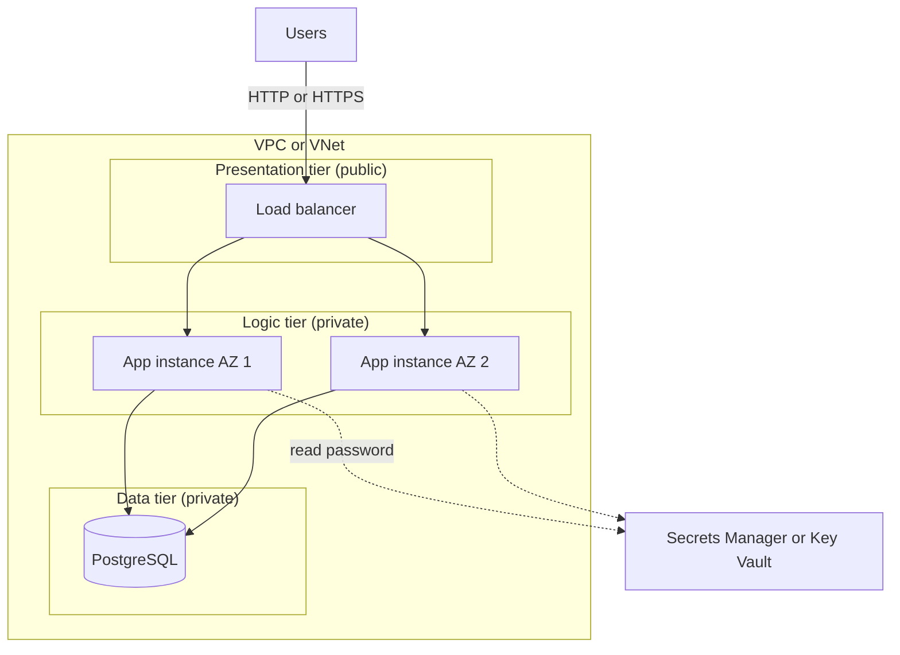

# Project: Three-Tier Web Application

## Introduction

The **three-tier architecture** is the most common shape for business applications, and it is still what most "lift and shift" migrations land on:

1. **Presentation tier:** the entry point that receives HTTP traffic (a load balancer, often with a CDN or WAF in front).
2. **Logic tier:** the application servers that run your code.
3. **Data tier:** a relational database.

The key rule is that each tier only talks to the one next to it. The internet can reach the load balancer, the load balancer can reach the app servers, and only the app servers can reach the database. In the cloud you enforce that rule with private subnets and firewall rules, not just with good intentions.

In this project you build an order-tracking web app for a small online shop, with **Terraform** on both clouds:

- **On AWS:** an Application Load Balancer, an EC2 Auto Scaling group in private subnets, and Amazon RDS for PostgreSQL with a password that AWS manages in Secrets Manager.
- **On Azure:** App Service on Linux (which provides both the presentation and logic tiers), VNet integration, and Azure Database for PostgreSQL Flexible Server with private access, with the password in Key Vault.

The AWS version is closer to "classic" infrastructure: you manage VMs, a load balancer and an image. The Azure version swaps the VMs for PaaS. Building both shows you the IaaS versus PaaS trade-off in practice.

Background pages: [VPCs and VNets](../8-cloud-networking/1-cloud-vpc-and-vnet.mdx), [Load Balancers](../8-cloud-networking/4-cloud-load-balancers.mdx), [Auto Scaling Groups and Scale Sets](../3-cloud-compute/3-cloud-autoscaling.mdx) and [Managed Relational Databases: RDS, Aurora and Azure SQL](../7-cloud-databases/1-cloud-rds-and-azure-sql.mdx).

:::warning Cost and cleanup
Unlike the serverless projects, this one has **resources that bill by the hour even when idle**: EC2 instances, a NAT gateway, a load balancer and an RDS instance on AWS, and an App Service plan and a PostgreSQL server on Azure. Data processed by the NAT gateway and load balancer is billed too. Leaving this running for a month is noticeably more expensive than the earlier projects. Set a budget alert ([Budgets and Billing Alerts](../1-cloud-getting-started/7-cloud-budgets-and-alerts.mdx)), and run `terraform destroy` when you finish. Estimate costs with the [AWS Pricing Calculator](https://calculator.aws/) and the [Azure Pricing Calculator](https://azure.microsoft.com/pricing/calculator/).
:::

## Architecture



| Tier | AWS | Azure |
| --- | --- | --- |
| Presentation | Application Load Balancer in public subnets | App Service front ends (built in), optionally Front Door or Application Gateway |
| Logic | EC2 Auto Scaling group in private subnets | App Service plan with two instances and VNet integration |
| Data | RDS for PostgreSQL in database subnets | PostgreSQL Flexible Server in a delegated subnet |
| Tier isolation | Security groups that reference each other | Delegated subnets, private DNS, no public endpoint on the database |
| Database credential | RDS-managed secret in Secrets Manager | Key Vault secret plus a Key Vault reference app setting |
| Admin access to servers | Systems Manager Session Manager (no SSH keys) | Not needed for PaaS (`az webapp ssh` for debugging) |

## Step 1: The Application

The application is a tiny Flask app with a shallow health check, a deep health check and two order endpoints. The same code runs on both clouds. The only difference is where the database password comes from.

```python
# app/app.py
import json
import os
from functools import lru_cache

import psycopg
from flask import Flask, jsonify, request

app = Flask(__name__)


@lru_cache(maxsize=1)
def db_settings() -> dict:
    """Read connection settings once per process.

    On AWS the password comes from the RDS-managed secret in Secrets Manager.
    On Azure, App Service resolves a Key Vault reference into DB_PASSWORD.
    """
    settings = {
        "host": os.environ["DB_HOST"],
        "dbname": os.environ.get("DB_NAME", "portal"),
        "user": os.environ.get("DB_USER", "portaladmin"),
        "password": os.environ.get("DB_PASSWORD"),
        "sslmode": "require",
        "connect_timeout": 5,
    }
    secret_arn = os.environ.get("DB_SECRET_ARN")
    if secret_arn:
        import boto3  # only needed on AWS
        secret = boto3.client("secretsmanager").get_secret_value(SecretId=secret_arn)
        creds = json.loads(secret["SecretString"])
        settings.update(user=creds["username"], password=creds["password"])
    return settings


def connect():
    return psycopg.connect(**db_settings())


@app.get("/health")
def health():
    # Shallow check for the load balancer: the process is up and serving
    return {"status": "ok"}


@app.get("/health/deep")
def deep_health():
    with connect() as conn:
        conn.execute("SELECT 1")
    return {"status": "ok", "database": "reachable"}


@app.post("/orders")
def create_order():
    body = request.get_json(force=True)
    with connect() as conn:
        row = conn.execute(
            "INSERT INTO orders (customer, amount_cents) VALUES (%s, %s) RETURNING id, created_at",
            (body["customer"], int(body["amount_cents"])),
        ).fetchone()
    return {"id": row[0], "created_at": row[1].isoformat()}, 201


@app.get("/orders")
def list_orders():
    with connect() as conn:
        rows = conn.execute(
            "SELECT id, customer, amount_cents FROM orders ORDER BY id DESC LIMIT 20"
        ).fetchall()
    return jsonify([{"id": r[0], "customer": r[1], "amount_cents": r[2]} for r in rows])
```

```sql
-- app/schema.sql
CREATE TABLE IF NOT EXISTS orders (
    id           BIGSERIAL PRIMARY KEY,
    customer     TEXT        NOT NULL,
    amount_cents INTEGER     NOT NULL CHECK (amount_cents >= 0),
    created_at   TIMESTAMPTZ NOT NULL DEFAULT now()
);
```

```python
# app/migrate.py
"""Apply schema.sql once. Run it from inside the VPC or VNet."""
from pathlib import Path

from app import connect

with connect() as conn:
    conn.execute(Path(__file__).with_name("schema.sql").read_text())
print("schema applied")
```

Design choices in the code:

- **Two health checks.** The load balancer calls `/health`, which does not touch the database. If it did, a short database blip would make the load balancer mark *every* instance unhealthy and replace them all, turning a small problem into an outage. Use `/health/deep` for monitoring and alerts instead.
- **Settings are cached per process** with `lru_cache`, so the app does not call Secrets Manager on every request. If you enable automatic password rotation, clear the cache and retry once when authentication fails.
- **`sslmode=require`** encrypts traffic to the database even inside the private network.
- **One connection per request** keeps the example short. In production use a pool (`psycopg_pool`) so each worker reuses connections.

## Part A: Build It on AWS

### A1. The Terraform configuration

Put the app files in `app/`, and the following in `aws/main.tf` and `aws/user_data.sh.tftpl`. The configuration uses the community [terraform-aws-modules VPC module](https://registry.terraform.io/modules/terraform-aws-modules/vpc/aws) to create the network in a few lines.

```hcl
terraform {
  required_version = ">= 1.10"
  required_providers {
    aws = { source = "hashicorp/aws", version = "~> 6.0" }
  }
}

provider "aws" {
  region = var.region
  default_tags {
    tags = { project = "portal", env = var.env, managed_by = "terraform" }
  }
}

variable "region" { default = "eu-west-1" }
variable "env" { default = "dev" }
variable "multi_az_db" { default = false } # true for production

data "aws_availability_zones" "available" { state = "available" }

# ---------- Network: public, private-app and private-db subnets in 2 AZs ----------
module "vpc" {
  source  = "terraform-aws-modules/vpc/aws"
  version = "~> 6.0"

  name             = "portal-${var.env}"
  cidr             = "10.10.0.0/16"
  azs              = slice(data.aws_availability_zones.available.names, 0, 2)
  public_subnets   = ["10.10.0.0/24", "10.10.1.0/24"]
  private_subnets  = ["10.10.10.0/24", "10.10.11.0/24"]
  database_subnets = ["10.10.20.0/24", "10.10.21.0/24"]

  enable_nat_gateway = true
  single_nat_gateway = true # one NAT saves money, use one per AZ for production
}

# ---------- Security groups: each tier only accepts traffic from the tier in front ----------
resource "aws_security_group" "alb" {
  name   = "portal-${var.env}-alb"
  vpc_id = module.vpc.vpc_id
  ingress {
    from_port   = 80
    to_port     = 80
    protocol    = "tcp"
    cidr_blocks = ["0.0.0.0/0"]
  }
  egress {
    from_port   = 0
    to_port     = 0
    protocol    = "-1"
    cidr_blocks = ["0.0.0.0/0"]
  }
}

resource "aws_security_group" "app" {
  name   = "portal-${var.env}-app"
  vpc_id = module.vpc.vpc_id
  ingress {
    from_port       = 8000
    to_port         = 8000
    protocol        = "tcp"
    security_groups = [aws_security_group.alb.id]
  }
  egress {
    from_port   = 0
    to_port     = 0
    protocol    = "-1"
    cidr_blocks = ["0.0.0.0/0"]
  }
}

resource "aws_security_group" "db" {
  name   = "portal-${var.env}-db"
  vpc_id = module.vpc.vpc_id
  ingress {
    from_port       = 5432
    to_port         = 5432
    protocol        = "tcp"
    security_groups = [aws_security_group.app.id]
  }
}

# ---------- Data tier: RDS for PostgreSQL with an AWS-managed master password ----------
resource "aws_db_instance" "main" {
  identifier                  = "portal-${var.env}"
  engine                      = "postgres"
  engine_version              = "17"
  instance_class              = "db.t4g.micro"
  allocated_storage           = 20
  storage_encrypted           = true
  db_name                     = "portal"
  username                    = "portaladmin"
  manage_master_user_password = true # password lives only in Secrets Manager
  db_subnet_group_name        = module.vpc.database_subnet_group_name
  vpc_security_group_ids      = [aws_security_group.db.id]
  multi_az                    = var.multi_az_db
  backup_retention_period     = 7
  deletion_protection         = var.env == "prod"
  skip_final_snapshot         = var.env != "prod"
  final_snapshot_identifier   = "portal-${var.env}-final"
}

# ---------- Logic tier: EC2 Auto Scaling group behind an ALB ----------
data "aws_ssm_parameter" "al2023" {
  name = "/aws/service/ami-amazon-linux-latest/al2023-ami-kernel-default-x86_64"
}

resource "aws_iam_role" "app" {
  name = "portal-${var.env}-app"
  assume_role_policy = jsonencode({
    Version   = "2012-10-17"
    Statement = [{ Effect = "Allow", Action = "sts:AssumeRole", Principal = { Service = "ec2.amazonaws.com" } }]
  })
}

resource "aws_iam_role_policy_attachment" "ssm" {
  role       = aws_iam_role.app.name
  policy_arn = "arn:aws:iam::aws:policy/AmazonSSMManagedInstanceCore" # Session Manager instead of SSH
}

resource "aws_iam_role_policy" "read_db_secret" {
  role = aws_iam_role.app.id
  policy = jsonencode({
    Version = "2012-10-17"
    Statement = [{
      Effect   = "Allow"
      Action   = "secretsmanager:GetSecretValue"
      Resource = aws_db_instance.main.master_user_secret[0].secret_arn
    }]
  })
}

resource "aws_iam_instance_profile" "app" {
  name = "portal-${var.env}-app"
  role = aws_iam_role.app.name
}

resource "aws_launch_template" "app" {
  name_prefix            = "portal-${var.env}-"
  image_id               = data.aws_ssm_parameter.al2023.value
  instance_type          = "t3.small"
  vpc_security_group_ids = [aws_security_group.app.id]
  iam_instance_profile { arn = aws_iam_instance_profile.app.arn }
  metadata_options {
    http_tokens = "required" # IMDSv2 only
  }
  user_data = base64encode(templatefile("${path.module}/user_data.sh.tftpl", {
    app_py        = file("${path.module}/../app/app.py")
    migrate_py    = file("${path.module}/../app/migrate.py")
    schema_sql    = file("${path.module}/../app/schema.sql")
    db_host       = aws_db_instance.main.address
    db_secret_arn = aws_db_instance.main.master_user_secret[0].secret_arn
    region        = var.region
  }))
}

resource "aws_lb" "web" {
  name               = "portal-${var.env}"
  load_balancer_type = "application"
  subnets            = module.vpc.public_subnets
  security_groups    = [aws_security_group.alb.id]
}

resource "aws_lb_target_group" "app" {
  name     = "portal-${var.env}-app"
  port     = 8000
  protocol = "HTTP"
  vpc_id   = module.vpc.vpc_id
  health_check {
    path                = "/health"
    healthy_threshold   = 2
    unhealthy_threshold = 3
    interval            = 15
  }
  deregistration_delay = 30
}

resource "aws_lb_listener" "http" {
  load_balancer_arn = aws_lb.web.arn
  port              = 80
  protocol          = "HTTP"
  default_action {
    type             = "forward"
    target_group_arn = aws_lb_target_group.app.arn
  }
}

resource "aws_autoscaling_group" "app" {
  name                      = "portal-${var.env}-app"
  min_size                  = 2
  max_size                  = 4
  vpc_zone_identifier       = module.vpc.private_subnets
  target_group_arns         = [aws_lb_target_group.app.arn]
  health_check_type         = "ELB"
  health_check_grace_period = 120
  launch_template {
    id      = aws_launch_template.app.id
    version = aws_launch_template.app.latest_version
  }
  instance_refresh {
    strategy = "Rolling"
    preferences { min_healthy_percentage = 50 }
  }
}

resource "aws_autoscaling_policy" "cpu" {
  name                   = "cpu-target-50"
  autoscaling_group_name = aws_autoscaling_group.app.name
  policy_type            = "TargetTrackingScaling"
  target_tracking_configuration {
    predefined_metric_specification { predefined_metric_type = "ASGAverageCPUUtilization" }
    target_value = 50
  }
}

output "url" { value = "http://${aws_lb.web.dns_name}" }
output "db_secret_arn" { value = aws_db_instance.main.master_user_secret[0].secret_arn }
```

The instances bootstrap themselves with user data. The template writes the app files, installs dependencies and starts the app under systemd:

```bash
#!/bin/bash
set -euo pipefail
dnf install -y python3-pip
python3 -m pip install flask gunicorn "psycopg[binary]" boto3

mkdir -p /opt/portal
cat > /opt/portal/app.py <<'PY'
${app_py}
PY
cat > /opt/portal/migrate.py <<'PY'
${migrate_py}
PY
cat > /opt/portal/schema.sql <<'SQL'
${schema_sql}
SQL

cat > /opt/portal/portal.env <<ENV
DB_HOST=${db_host}
DB_SECRET_ARN=${db_secret_arn}
AWS_DEFAULT_REGION=${region}
ENV

cat > /etc/systemd/system/portal.service <<UNIT
[Unit]
Description=Portal app
After=network-online.target

[Service]
WorkingDirectory=/opt/portal
EnvironmentFile=/opt/portal/portal.env
ExecStart=/usr/local/bin/gunicorn --workers 2 --bind 0.0.0.0:8000 app:app
Restart=always
User=nobody

[Install]
WantedBy=multi-user.target
UNIT

systemctl daemon-reload
systemctl enable --now portal
```

### A2. What the configuration does

- **Three subnet layers in two Availability Zones.** Public subnets hold only the load balancer and the NAT gateway. App instances live in private subnets with no public IPs. The database gets its own subnet group, so it cannot accidentally receive a public route.
- **Chained security groups.** The app security group allows port 8000 only *from the ALB's security group*, and the database allows 5432 only *from the app's security group*. Referencing groups instead of IP ranges keeps the rules correct as instances come and go.
- **`manage_master_user_password = true`.** RDS generates the master password and stores it in Secrets Manager. The password never appears in Terraform state or in your shell history. The instance role may read only that one secret.
- **IMDSv2 required** and **Session Manager instead of SSH.** There is no key pair and no port 22 open anywhere.
- **ELB health checks, instance refresh and target tracking.** The group replaces instances that fail the load balancer check, rolls out new launch template versions gradually, and scales on average CPU.
- **Production switches.** `multi_az_db`, `deletion_protection` and the final snapshot are tied to the environment, so a `dev` stack is cheap and disposable while `prod` is protected. [Managing Dev, Staging and Production](../11-cloud-devops/3-cloud-environments.mdx) expands on this.

:::caution HTTP only for the demo
The listener above uses plain HTTP on port 80 to keep the example short. For anything real, request an ACM certificate in the same Region as the load balancer, add an HTTPS listener on 443 that forwards to the target group, and change the port 80 listener to redirect to HTTPS. Better still, put CloudFront and AWS WAF in front.
:::

### A3. Deploy

```bash
cd aws
terraform init
terraform plan -out tfplan
terraform apply tfplan
```

Example output (trimmed):

```text
Plan: 41 to add, 0 to change, 0 to destroy.
...
Apply complete! Resources: 41 added, 0 changed, 0 destroyed.

Outputs:

db_secret_arn = "arn:aws:secretsmanager:eu-west-1:111122223333:secret:rds!db-1a2b3c4d-5e6f-7a8b-9c0d-1e2f3a4b5c6d-AbCdEf"
url = "http://portal-dev-1234567890.eu-west-1.elb.amazonaws.com"
```

Creating the RDS instance takes the longest.

### A4. Create the schema from inside the VPC

The database has no public endpoint, so you cannot connect from your laptop directly. Run the migration on one app instance through Systems Manager:

```bash
INSTANCE_ID=$(aws autoscaling describe-auto-scaling-groups \
  --auto-scaling-group-names portal-dev-app \
  --query 'AutoScalingGroups[0].Instances[0].InstanceId' --output text)

aws ssm send-command --instance-ids "$INSTANCE_ID" \
  --document-name AWS-RunShellScript \
  --parameters 'commands=["cd /opt/portal && set -a && . ./portal.env && python3 migrate.py"]' \
  --query 'Command.CommandId' --output text
```

Running migrations by hand like this works for a demo, but teams usually move them into the deployment pipeline (for example a one-off ECS task or a CodeBuild job inside the VPC) instead of running them by hand. For interactive debugging, `aws ssm start-session --target "$INSTANCE_ID"` gives you a shell without SSH.

### A5. Test

```bash
URL=$(terraform output -raw url)
curl -s "$URL/health"
curl -s "$URL/health/deep"
curl -s -X POST "$URL/orders" -H 'content-type: application/json' \
  -d '{"customer":"ada@example.com","amount_cents":4599}'
curl -s "$URL/orders"
```

Example output:

```text
{"status":"ok"}
{"database":"reachable","status":"ok"}
{"created_at":"2026-10-11T10:02:44.512908+00:00","id":1}
[{"amount_cents":4599,"customer":"ada@example.com","id":1}]
```

Test resilience too: terminate one instance with `aws ec2 terminate-instances` while a loop calls `/health`. The load balancer stops routing to it within a few health-check intervals, the other instance keeps answering, and the Auto Scaling group launches a replacement.

## Part B: Build It on Azure

### B1. The Terraform configuration

On Azure, App Service replaces the load balancer, the VMs, the image and the Auto Scaling group with one managed resource. Put this in `azure/main.tf`:

```hcl
terraform {
  required_version = ">= 1.10"
  required_providers {
    azurerm = { source = "hashicorp/azurerm", version = "~> 5.0" }
    random  = { source = "hashicorp/random", version = "~> 3.6" }
  }
}

provider "azurerm" {
  features {}
  subscription_id = var.subscription_id
}

variable "subscription_id" { type = string }
variable "location" { default = "westeurope" }
variable "env" { default = "dev" }

locals {
  name = "portal-${var.env}"
  tags = { project = "portal", env = var.env, managed_by = "terraform" }
}

data "azurerm_client_config" "current" {}

resource "random_string" "suffix" {
  length  = 5
  special = false
  upper   = false
}

resource "azurerm_resource_group" "main" {
  name     = "rg-${local.name}"
  location = var.location
  tags     = local.tags
}

# ---------- Network: one subnet for App Service outbound traffic, one for PostgreSQL ----------
resource "azurerm_virtual_network" "main" {
  name                = "vnet-${local.name}"
  location            = azurerm_resource_group.main.location
  resource_group_name = azurerm_resource_group.main.name
  address_space       = ["10.20.0.0/16"]
}

resource "azurerm_subnet" "app" {
  name                 = "snet-app"
  resource_group_name  = azurerm_resource_group.main.name
  virtual_network_name = azurerm_virtual_network.main.name
  address_prefixes     = ["10.20.1.0/24"]
  delegation {
    name = "appservice"
    service_delegation {
      name    = "Microsoft.Web/serverFarms"
      actions = ["Microsoft.Network/virtualNetworks/subnets/action"]
    }
  }
}

resource "azurerm_subnet" "db" {
  name                 = "snet-db"
  resource_group_name  = azurerm_resource_group.main.name
  virtual_network_name = azurerm_virtual_network.main.name
  address_prefixes     = ["10.20.2.0/24"]
  delegation {
    name = "postgres"
    service_delegation {
      name    = "Microsoft.DBforPostgreSQL/flexibleServers"
      actions = ["Microsoft.Network/virtualNetworks/subnets/join/action"]
    }
  }
}

resource "azurerm_private_dns_zone" "pg" {
  name                = "${local.name}.private.postgres.database.azure.com"
  resource_group_name = azurerm_resource_group.main.name
}

resource "azurerm_private_dns_zone_virtual_network_link" "pg" {
  name                = "pg-link"
  private_dns_zone_id = azurerm_private_dns_zone.pg.id
  virtual_network_id  = azurerm_virtual_network.main.id
}

# ---------- Data tier: PostgreSQL flexible server with private access only ----------
resource "random_password" "db" {
  length  = 32
  special = false
}

resource "azurerm_postgresql_flexible_server" "main" {
  name                          = "psql-${local.name}-${random_string.suffix.result}"
  resource_group_name           = azurerm_resource_group.main.name
  location                      = azurerm_resource_group.main.location
  version                       = "17"
  sku_name                      = "B_Standard_B1ms"
  storage_mb                    = 32768
  backup_retention_days         = 7
  zone                          = "1"
  delegated_subnet_id           = azurerm_subnet.db.id
  private_dns_zone_id           = azurerm_private_dns_zone.pg.id
  public_network_access_enabled = false
  administrator_login           = "portaladmin"
  administrator_password        = random_password.db.result
  tags                          = local.tags
  depends_on                    = [azurerm_private_dns_zone_virtual_network_link.pg]
}

resource "azurerm_postgresql_flexible_server_database" "portal" {
  name      = "portal"
  server_id = azurerm_postgresql_flexible_server.main.id
}

# ---------- Secret storage: Key Vault with Azure RBAC ----------
resource "azurerm_key_vault" "main" {
  name                       = "kv-${local.name}-${random_string.suffix.result}"
  location                   = azurerm_resource_group.main.location
  resource_group_name        = azurerm_resource_group.main.name
  tenant_id                  = data.azurerm_client_config.current.tenant_id
  sku_name                   = "standard"
  rbac_authorization_enabled = true
  purge_protection_enabled   = false # true for production
}

resource "azurerm_role_assignment" "deployer_secrets" {
  scope                = azurerm_key_vault.main.id
  role_definition_name = "Key Vault Secrets Officer"
  principal_id         = data.azurerm_client_config.current.object_id
}

resource "azurerm_key_vault_secret" "db_password" {
  name         = "db-password"
  value        = random_password.db.result
  key_vault_id = azurerm_key_vault.main.id
  depends_on   = [azurerm_role_assignment.deployer_secrets]
}

# ---------- Logic tier: App Service on Linux with VNet integration ----------
resource "azurerm_service_plan" "main" {
  name                = "asp-${local.name}"
  location            = azurerm_resource_group.main.location
  resource_group_name = azurerm_resource_group.main.name
  os_type             = "Linux"
  sku_name            = "P0v3"
  worker_count        = 2 # two instances for availability
}

resource "azurerm_linux_web_app" "app" {
  name                      = "app-${local.name}-${random_string.suffix.result}"
  location                  = azurerm_resource_group.main.location
  resource_group_name       = azurerm_resource_group.main.name
  service_plan_id           = azurerm_service_plan.main.id
  https_only                = true
  virtual_network_subnet_id = azurerm_subnet.app.id

  identity { type = "SystemAssigned" }

  site_config {
    always_on                         = true
    health_check_path                 = "/health"
    health_check_eviction_time_in_min = 2
    app_command_line                  = "gunicorn --workers 2 --bind 0.0.0.0:8000 app:app"
    ftps_state                        = "Disabled"
    application_stack { python_version = "3.12" }
  }

  app_settings = {
    DB_HOST                        = azurerm_postgresql_flexible_server.main.fqdn
    DB_NAME                        = "portal"
    DB_USER                        = "portaladmin"
    DB_PASSWORD                    = "@Microsoft.KeyVault(SecretUri=${azurerm_key_vault_secret.db_password.versionless_id})"
    SCM_DO_BUILD_DURING_DEPLOYMENT = "true"
  }
  tags = local.tags
}

resource "azurerm_role_assignment" "app_reads_secrets" {
  scope                = azurerm_key_vault.main.id
  role_definition_name = "Key Vault Secrets User"
  principal_id         = azurerm_linux_web_app.app.identity[0].principal_id
}

output "url" { value = "https://${azurerm_linux_web_app.app.default_hostname}" }
output "app_name" { value = azurerm_linux_web_app.app.name }
output "resource_group" { value = azurerm_resource_group.main.name }
```

### B2. What the configuration does

- **Delegated subnets.** App Service VNet integration needs a subnet delegated to `Microsoft.Web/serverFarms`, and it carries the app's *outbound* traffic into the VNet. PostgreSQL Flexible Server with private access needs its own subnet delegated to `Microsoft.DBforPostgreSQL/flexibleServers`.
- **Private DNS zone.** The server's hostname resolves to a private IP only inside the linked VNet. With `public_network_access_enabled = false` there is no public endpoint at all.
- **Key Vault reference.** The `DB_PASSWORD` app setting holds `@Microsoft.KeyVault(SecretUri=...)`. App Service resolves it with the app's managed identity at startup, so the code just reads an environment variable. Using the versionless ID means a new secret version is picked up automatically (after a refresh period or a restart).
- **Health check and two workers.** `health_check_path` makes App Service stop routing to an instance that fails `/health` and replace it after the eviction time. With `worker_count = 2`, one instance can fail without downtime. App Service spreads instances across zones only when zone redundancy is enabled on a supported plan.

:::caution The password is in Terraform state
On Azure, `random_password` puts the database password into Terraform state. Store state in a protected backend (an encrypted, access-controlled storage account, see [Project: Multi-Environment Infrastructure as Code](./5-cloud-project-multi-env-iac.mdx)). A stronger design is **Microsoft Entra authentication** for PostgreSQL: the app's managed identity gets a database role and requests short-lived tokens, so there is no password at all. It needs a one-time step to create the database role for the identity. See [Encryption and KMS](../12-cloud-observability-and-security/5-cloud-encryption-and-kms.mdx) and [Secrets Management](../11-cloud-devops/4-cloud-secrets-management.mdx).
:::

### B3. Deploy the infrastructure and the code

```bash
cd azure
terraform init
terraform apply -var "subscription_id=$(az account show --query id -o tsv)"

cd ../app
printf "flask\ngunicorn\npsycopg[binary]\n" > requirements.txt
zip -r ../app.zip app.py migrate.py schema.sql requirements.txt

cd ..
APP=$(terraform -chdir=azure output -raw app_name)
RG=$(terraform -chdir=azure output -raw resource_group)
az webapp deploy -g "$RG" -n "$APP" --src-path app.zip --type zip
```

Example output (trimmed):

```text
Apply complete! Resources: 17 added, 0 changed, 0 destroyed.
url = "https://app-portal-dev-k3x9q.azurewebsites.net"
Deployment has completed successfully
```

Check that the Key Vault reference resolved: open **Environment variables** for the app in the portal. Each Key Vault reference shows its resolution status and the reason for a failure, which is usually a missing role assignment or a role that has not propagated yet.

### B4. Create the schema and test

The database is reachable only from the VNet, which includes the app's outbound traffic. Open an SSH session into the app container and run the migration there:

```bash
az webapp ssh -g "$RG" -n "$APP"
# inside the container:
cd /home/site/wwwroot && python migrate.py
```

It prints `schema applied`. Then run the same `curl` tests as on AWS against the HTTPS URL from the Terraform output.

## IaaS Versus PaaS: What You Just Felt

| Concern | AWS build (IaaS) | Azure build (PaaS) |
| --- | --- | --- |
| Resources you defined | About 40 | About 17 |
| OS patching | Your job: bake new AMIs or rely on fresh launches | Platform's job |
| Runtime choice | Anything you can install | Supported stacks or a custom container |
| Scaling | Auto Scaling group with any metric | Plan-level autoscale rules or automatic scaling |
| HTTPS | Add an ACM certificate and listener | Built in on `*.azurewebsites.net`, free managed certificates for custom domains |
| Fixed cost floor | Instances, NAT gateway, ALB, RDS | App Service plan, PostgreSQL server |

The same split exists inside each cloud. AWS has Elastic Beanstalk and ECS Express Mode as PaaS-style options, and Azure has Virtual Machine Scale Sets behind an Application Gateway for an IaaS design. [PaaS App Hosting: Elastic Beanstalk and App Service](../3-cloud-compute/5-cloud-paas-app-hosting.mdx) compares them.

## Real-World Scenario

A regional retailer runs its order portal on two physical servers and a PostgreSQL box in a colocation facility. The hardware lease ends in four months. The app is a standard Python web app with server-rendered pages, and the team is three developers with no dedicated operations engineer.

**The solution:** the team picks the Azure PaaS design (their identity and Office tools are already on Microsoft) and rehosts the app with minimal code changes: read settings from environment variables, add a health endpoint, and run migrations in the pipeline. The database moves with Azure Database Migration Service. Front Door with a WAF policy goes in front for the public domain.

**Why this approach:**

- Three developers cannot afford to patch VMs and maintain images. App Service removes that work.
- The three-tier shape matches the existing app, so the migration is a **replatform**, not a rewrite. See [Migration Strategies: The 7 Rs](../13-cloud-architecture/6-cloud-migration-strategies.mdx).
- Private networking keeps the database off the internet, which the retailer's payment auditor requires.

**When to use it / when not to:**

- Use the three-tier pattern for traditional web apps with relational data, steady traffic and server-side rendering.
- Prefer the IaaS (VM) variant when you need custom OS agents, unusual runtimes or licensed software tied to VMs.
- Prefer containers or serverless when you have many small services, very spiky traffic, or want per-request billing.

**Alternatives and trade-offs:**

| Approach | Pros | Cons | Best for |
| --- | --- | --- | --- |
| VMs + load balancer + managed DB (AWS build) | Full control, any software, familiar to ops teams | Patching, images, more resources to manage | Lift-and-shift, special OS needs |
| App Service or Elastic Beanstalk + managed DB (Azure build) | Little to operate, built-in deploys and TLS | Less control, platform limits | Small teams, standard web stacks |
| Containers (ECS Fargate, Container Apps) + managed DB | Portable images, fast deploys, per-service scaling | Container skills needed, registry and image pipeline | Teams already using Docker |
| Kubernetes (EKS, AKS) + managed DB | Maximum flexibility, ecosystem | Highest operational complexity | Many services, platform teams |
| Serverless + NoSQL | Near-zero idle cost | Rewrite needed, different data model | New, spiky workloads |

## Common Mistakes

- **Health checks that hit the database.** One slow query or failover marks every instance unhealthy at the same time. Keep the load balancer check shallow.
- **Putting the database in a public subnet "temporarily".** Use Session Manager, `az webapp ssh`, a bastion or a VPN instead.
- **A single NAT gateway in production.** If its Availability Zone fails, instances in the other zone lose outbound internet access. Use one per AZ, or VPC endpoints for AWS services.
- **Forgetting that Terraform state holds secrets.** Use managed passwords or identity-based auth where possible, and protect the state backend.
- **Installing packages at boot from the internet.** It makes scale-out slow and fragile. Bake a machine image (see [Machine Images and Bootstrapping](../3-cloud-compute/6-cloud-images-and-bootstrapping.mdx)) or switch to containers.

## Cleanup

```bash
# AWS (dev has deletion protection off and skips the final snapshot)
terraform -chdir=aws destroy

# Azure
terraform -chdir=azure destroy -var "subscription_id=$(az account show --query id -o tsv)"
```

If you set `env=prod` on AWS, deletion protection blocks the destroy. Turn it off with a targeted apply first, and remember that a final snapshot is kept (and billed) until you delete it. On Azure, a soft-deleted Key Vault keeps its name reserved for the retention period. Purge it with `az keyvault purge` if you want to reuse the name.

## Summary

- A three-tier app separates **presentation, logic and data**, and the cloud enforces that separation with **private subnets and tier-to-tier firewall rules**.
- On AWS you assembled an **ALB, an EC2 Auto Scaling group and RDS**, with an **RDS-managed password** in Secrets Manager and **Session Manager** instead of SSH.
- On Azure, **App Service with VNet integration** and **PostgreSQL Flexible Server with private access** delivered the same design with far fewer resources, using a **Key Vault reference** for the password.
- Keep load balancer health checks **shallow**, cache secrets per process, and run **migrations in the pipeline**.
- These stacks bill by the hour when idle, so **destroy them** when you finish.

## Exercises

1. Add HTTPS to the AWS build: an ACM certificate, a 443 listener, and a redirect on port 80. Then add AWS WAF with the AWS managed core rule set.
2. Replace the password on Azure with Microsoft Entra authentication for PostgreSQL and the app's managed identity. Remove `random_password` and the Key Vault secret.
3. Turn on `multi_az_db = true` on AWS, then reboot the database with failover (`aws rds reboot-db-instance --force-failover`) while running the `curl` loop. How long are requests failing?
4. Move migrations into a CI job that runs inside the VPC or VNet before the new app version is deployed.

**Related pages:** [Subnets, Route Tables and Gateways](../8-cloud-networking/2-cloud-subnets-and-routing.mdx), [Security Groups and Network Security Groups](../8-cloud-networking/3-cloud-security-groups-nsgs.mdx), [Database High Availability and Backups](../7-cloud-databases/4-cloud-database-ha-and-backups.mdx), [Terraform for AWS and Azure](../10-cloud-infrastructure-as-code/4-cloud-terraform-multi-cloud.mdx), and the next project, [Project: Containerized App on Managed Containers](./3-cloud-project-containerized-app.mdx).
