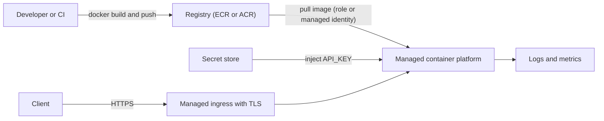
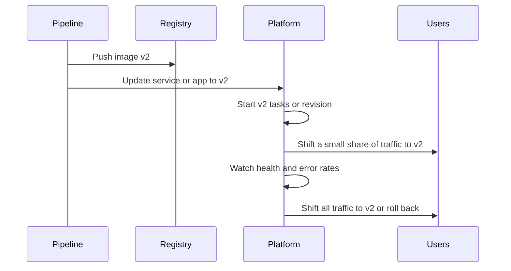

# Project: Containerized App on Managed Containers

## Introduction

Containers package your code, runtime and dependencies into one image that runs the same way on a laptop, in CI and in the cloud. The hard part has never been `docker build`. It is everything around the container: a registry, a load balancer with TLS, health checks, autoscaling, secrets, logs and safe rollouts.

**Managed container platforms** handle that surrounding work for you. In this project you take one small web service and run it on:

- **AWS:** Amazon ECR for the image and **Amazon ECS Express Mode** to run it. Express Mode creates a Fargate service, an HTTPS Application Load Balancer, autoscaling and canary deployments from a single command.
- **Azure:** Azure Container Registry (ACR) for the image and **Azure Container Apps** to run it, with scale-to-zero, revisions and traffic splitting.

Both versions pull a secret API key from the platform's secret store, so no secret is baked into the image.

Background pages: [Container Options in the Cloud](../5-cloud-containers/0-cloud-container-options.mdx), [Container Registries: ECR and ACR](../5-cloud-containers/1-cloud-container-registries.mdx), [Amazon ECS and Fargate](../5-cloud-containers/2-cloud-ecs-and-fargate.mdx) and [Azure Container Apps and Container Instances](../5-cloud-containers/3-cloud-azure-container-apps.mdx). If Docker itself is new to you, start with the [Docker tutorial](/docs/devops/docker).

:::warning Cost and cleanup
On AWS you pay for Fargate vCPU and memory per second while tasks run, plus the Application Load Balancer per hour and per capacity unit, plus ECR storage and data transfer. The load balancer bills even with no traffic. On Azure, Container Apps on the Consumption plan bills per vCPU-second and GiB-second with a monthly free grant, and an app scaled to zero costs very little. ACR bills a daily fee per registry tier. Set a budget alert ([Budgets and Billing Alerts](../1-cloud-getting-started/7-cloud-budgets-and-alerts.mdx)) and run the **Cleanup** section afterwards. Use the [AWS Pricing Calculator](https://calculator.aws/) and the [Azure Pricing Calculator](https://azure.microsoft.com/pricing/calculator/) for estimates.
:::

:::info Recent changes
**AWS App Runner is no longer open to new customers**, so older tutorials that use it will not work for new accounts. AWS points new users to **ECS Express Mode**, launched in late 2025. On Azure, Container Apps is the recommended serverless container platform. Azure Container Instances remains for single, short-lived containers. Check the [App Runner availability notice](https://docs.aws.amazon.com/apprunner/latest/dg/apprunner-availability-change.html) and [ECS Express Mode docs](https://docs.aws.amazon.com/AmazonECS/latest/developerguide/express-service-overview.html) for current details.
:::

## What You Will Build

A product catalog API for an outdoor gear shop. Other services call it with an API key.



| Building block | AWS | Azure |
| --- | --- | --- |
| Registry | Amazon ECR (private repository) | Azure Container Registry (Basic tier) |
| Runtime | ECS Express Mode service on Fargate | Container Apps (Consumption plan) |
| HTTPS ingress | Application Load Balancer created by Express Mode, URL like `name.ecs.region.on.aws` | Built-in Envoy ingress, URL like `name.region.azurecontainerapps.io` |
| Pull permission | Task execution role | User-assigned managed identity with `AcrPull` |
| Secret injection | `secrets` with a Secrets Manager ARN | Key Vault reference secret plus `secretref:` env var |
| Autoscaling | Target tracking on CPU, memory or requests per target | KEDA-based rules, for example HTTP concurrency, including scale to zero |
| Rollouts | Canary deployments with automatic rollback on 5xx alarms | Revisions with weighted traffic splitting |

## Step 1: Build the Container Image

The service is a small FastAPI app with a health endpoint, a version endpoint and one protected route:

```python
# main.py
import logging
import os
import secrets

from fastapi import FastAPI, Header, HTTPException

logging.basicConfig(level=logging.INFO, format="%(asctime)s %(levelname)s %(message)s")
log = logging.getLogger("catalog")

APP_VERSION = os.environ.get("APP_VERSION", "dev")
API_KEY = os.environ.get("API_KEY", "")          # injected from Secrets Manager or Key Vault

app = FastAPI(title="catalog")

PRODUCTS = {
    "sku-100": {"name": "Trail running shoe", "price_cents": 12900},
    "sku-200": {"name": "Rain jacket", "price_cents": 18900},
}


@app.get("/healthz")
def healthz():
    return {"status": "ok"}


@app.get("/version")
def version():
    return {"version": APP_VERSION}


@app.get("/products/{sku}")
def get_product(sku: str, x_api_key: str = Header(default="")):
    if not API_KEY or not secrets.compare_digest(x_api_key, API_KEY):
        raise HTTPException(status_code=401, detail="invalid API key")
    product = PRODUCTS.get(sku)
    if product is None:
        raise HTTPException(status_code=404, detail="unknown sku")
    log.info("served %s", sku)
    return {"sku": sku, **product}
```

```text
# requirements.txt
fastapi==0.143.*
uvicorn[standard]==0.54.*
```

A multi-stage Dockerfile keeps build tools out of the final image and runs as a non-root user:

```dockerfile
# ---- build stage: install dependencies into a virtual environment ----
FROM python:3.13-slim AS build
WORKDIR /app
RUN python -m venv /venv
COPY requirements.txt .
RUN /venv/bin/pip install --no-cache-dir -r requirements.txt

# ---- runtime stage: small image, non-root user ----
FROM python:3.13-slim
ENV PATH="/venv/bin:$PATH" PYTHONUNBUFFERED=1
COPY --from=build /venv /venv
WORKDIR /app
COPY main.py .
RUN useradd --uid 10001 --no-create-home appuser
USER 10001
EXPOSE 8080
CMD ["uvicorn", "main:app", "--host", "0.0.0.0", "--port", "8080", "--proxy-headers"]
```

Build and test locally:

```bash
docker build -t catalog:v1 .
docker run --rm -d -p 8080:8080 -e API_KEY=local-test -e APP_VERSION=v1 --name catalog catalog:v1
curl -s localhost:8080/version
curl -s -H 'x-api-key: local-test' localhost:8080/products/sku-200
docker rm -f catalog
```

Output:

```text
{"version":"v1"}
{"sku":"sku-200","name":"Rain jacket","price_cents":18900}
```

Image habits that pay off on any platform:

- **Listen on `0.0.0.0`**, not `127.0.0.1`, or the platform's health checks cannot reach the app.
- **Log to stdout.** Both platforms collect container output automatically.
- **Handle `SIGTERM`.** Platforms stop containers with `SIGTERM` and a grace period. Uvicorn finishes in-flight requests when it receives it.
- **Build for the right CPU architecture.** An image built on an Apple Silicon laptop is `arm64` by default. Use `--platform linux/amd64` or build in CI, or deliberately target ARM (Graviton on AWS).
- **Use immutable, meaningful tags** such as a Git SHA or `v1`, never only `latest`.

## Part A: Run It on AWS with ECS Express Mode

### A1. Create the repository and push the image

```bash
export AWS_REGION=eu-west-1
ACCOUNT_ID=$(aws sts get-caller-identity --query Account --output text)
REPO="$ACCOUNT_ID.dkr.ecr.$AWS_REGION.amazonaws.com/catalog"

aws ecr create-repository --repository-name catalog \
  --image-scanning-configuration scanOnPush=true \
  --image-tag-mutability IMMUTABLE

aws ecr get-login-password | docker login --username AWS --password-stdin "${REPO%/catalog}"

docker build --platform linux/amd64 -t "$REPO:v1" .
docker push "$REPO:v1"
```

Example output (trimmed):

```text
Login Succeeded
v1: digest: sha256:8d7be4d7663152830d7c51c1e1b22c1359de9418d31a41593170c7d78f30c6bd size: 1789
```

`IMMUTABLE` tags stop anyone from pushing a different image under an existing tag, so `v1` always means the same bytes. Add a lifecycle policy to expire old untagged images (see [Container Registries: ECR and ACR](../5-cloud-containers/1-cloud-container-registries.mdx)).

### A2. Store the API key in Secrets Manager

```bash
SECRET_ARN=$(aws secretsmanager create-secret --name catalog/api-key \
  --secret-string "$(openssl rand -hex 24)" --query ARN --output text)
echo "$SECRET_ARN"
```

Example output:

```text
arn:aws:secretsmanager:eu-west-1:111122223333:secret:catalog/api-key-Ab12Cd
```

### A3. Create the two IAM roles

Express Mode needs a **task execution role** (used by ECS to pull the image, write logs and read secrets for the container) and an **infrastructure role** (used by ECS to create and manage the load balancer, target groups, security groups and scaling policies):

```bash
aws iam create-role --role-name catalogTaskExecutionRole \
  --assume-role-policy-document '{"Version":"2012-10-17","Statement":[{"Effect":"Allow","Principal":{"Service":"ecs-tasks.amazonaws.com"},"Action":"sts:AssumeRole"}]}'
aws iam attach-role-policy --role-name catalogTaskExecutionRole \
  --policy-arn arn:aws:iam::aws:policy/service-role/AmazonECSTaskExecutionRolePolicy
aws iam put-role-policy --role-name catalogTaskExecutionRole --policy-name read-api-key \
  --policy-document "{\"Version\":\"2012-10-17\",\"Statement\":[{\"Effect\":\"Allow\",\"Action\":\"secretsmanager:GetSecretValue\",\"Resource\":\"$SECRET_ARN\"}]}"

aws iam create-role --role-name ecsInfrastructureRoleForExpressServices \
  --assume-role-policy-document '{"Version":"2012-10-17","Statement":[{"Effect":"Allow","Principal":{"Service":"ecs.amazonaws.com"},"Action":"sts:AssumeRole"}]}'
aws iam attach-role-policy --role-name ecsInfrastructureRoleForExpressServices \
  --policy-arn arn:aws:iam::aws:policy/service-role/AmazonECSInfrastructureRoleforExpressGatewayServices
```

The execution role can read exactly one secret. If your application code also called AWS APIs (for example S3), you would add a separate **task role** with those permissions. Keeping "what the platform needs" and "what my code needs" in separate roles is a core least-privilege habit ([Least Privilege in Practice](../2-cloud-identity/3-cloud-least-privilege.mdx)).

IAM changes take a short time to propagate. If the next command fails with an assume-role error, wait a minute and retry.

### A4. Create the service

```bash
aws ecs create-express-gateway-service \
  --service-name catalog \
  --execution-role-arn "arn:aws:iam::$ACCOUNT_ID:role/catalogTaskExecutionRole" \
  --infrastructure-role-arn "arn:aws:iam::$ACCOUNT_ID:role/ecsInfrastructureRoleForExpressServices" \
  --health-check-path /healthz \
  --primary-container "{\"image\":\"$REPO:v1\",\"containerPort\":8080,
    \"environment\":[{\"name\":\"APP_VERSION\",\"value\":\"v1\"}],
    \"secrets\":[{\"name\":\"API_KEY\",\"valueFrom\":\"$SECRET_ARN\"}]}" \
  --scaling-target '{"minTaskCount":2,"maxTaskCount":6,"autoScalingMetric":"REQUEST_COUNT_PER_TARGET","autoScalingTargetValue":200}' \
  --monitor-resources
```

Example output (trimmed):

```text
{
    "service": {
        "serviceName": "catalog",
        "serviceArn": "arn:aws:ecs:eu-west-1:111122223333:service/default/catalog",
        "status": { "statusCode": "ACTIVE" }
    }
}
```

What Express Mode created for you, all visible in your own account:

- A Fargate-based ECS service in the `default` cluster, with a task definition built from your container settings.
- An internet-facing Application Load Balancer in the **default VPC's public subnets**, with an HTTPS listener and a certificate for the generated hostname. Express services with the same network settings share a load balancer to reduce cost.
- Target tracking autoscaling between 2 and 6 tasks, here on requests per target.
- CloudWatch logs, plus 5xx alarms that roll back a bad deployment automatically.

If your account has no default VPC, or you want private tasks, pass `--network-configuration` with your own subnets and security groups. We did not set `--cpu` and `--memory`, so the service uses Express Mode's defaults. Check the [ECS Express Mode documentation](https://docs.aws.amazon.com/AmazonECS/latest/developerguide/express-service-overview.html) for current defaults and allowed sizes.

### A5. Test it

```bash
SERVICE_ARN="arn:aws:ecs:$AWS_REGION:$ACCOUNT_ID:service/default/catalog"
URL=$(aws ecs describe-express-gateway-service --service-arn "$SERVICE_ARN" \
  --query 'service.activeConfigurations[0].ingressPaths[0].endpoint' --output text)
KEY=$(aws secretsmanager get-secret-value --secret-id catalog/api-key --query SecretString --output text)

curl -s "https://$URL/version"
curl -s -o /dev/null -w "%{http_code}\n" "https://$URL/products/sku-100"
curl -s -H "x-api-key: $KEY" "https://$URL/products/sku-100"
```

Example output:

```text
{"version":"v1"}
401
{"sku":"sku-100","name":"Trail running shoe","price_cents":12900}
```

Depending on your CLI version, the endpoint value may already include the `https://` prefix. Adjust the `curl` commands if it does.

### A6. Roll out a new version

Change something visible, build `v2`, push it, and update the service:

```bash
docker build --platform linux/amd64 -t "$REPO:v2" . && docker push "$REPO:v2"

aws ecs update-express-gateway-service --service-arn "$SERVICE_ARN" \
  --primary-container "{\"image\":\"$REPO:v2\",\"containerPort\":8080,
    \"environment\":[{\"name\":\"APP_VERSION\",\"value\":\"v2\"}],
    \"secrets\":[{\"name\":\"API_KEY\",\"valueFrom\":\"$SECRET_ARN\"}]}" \
  --monitor-resources
```

Express Mode shifts traffic to the new tasks gradually and watches the 5xx alarms. If errors spike, it rolls back to `v1` without you doing anything. Run `curl "https://$URL/version"` in a loop during the update to watch the switch.

:::tip When to graduate from Express Mode
Express Mode is a set of good defaults on top of regular ECS resources, so you can keep it for a long time. Move to a standard ECS service (defined in Terraform, CDK or CloudFormation) when you need several containers per task, service-to-service networking with Service Connect, blue/green with custom test traffic, or very specific load balancer rules. [Amazon ECS and Fargate](../5-cloud-containers/2-cloud-ecs-and-fargate.mdx) shows the full setup.
:::

## Part B: Run It on Azure Container Apps

### B1. Create the registry and build the image in the cloud

`az acr build` uploads your source folder and builds the image inside ACR, so you do not even need Docker locally:

```bash
RG=rg-catalog
LOC=westeurope
ACR=catalogacr$RANDOM            # 5-50 alphanumeric characters, globally unique

az group create -n "$RG" -l "$LOC" --tags project=catalog
az acr create -n "$ACR" -g "$RG" --sku Basic --admin-enabled false
az acr build -r "$ACR" -t catalog:v1 --platform linux/amd64 .
```

Example output (trimmed):

```text
Run ID: ca1 was successful after 41s
- image:
    registry: catalogacr12345.azurecr.io
    repository: catalog
    tag: v1
```

Keep the registry's **admin user disabled**. Pulls use a managed identity, never the admin password.

### B2. Create an identity, a Key Vault secret and role assignments

A Key Vault secret reference must be resolvable when the app is created. A system-assigned identity does not exist until after creation, so use a **user-assigned managed identity** that you prepare first:

```bash
KV=catalog-kv-$RANDOM
az identity create -n id-catalog -g "$RG"
ID_RESOURCE=$(az identity show -n id-catalog -g "$RG" --query id -o tsv)
ID_PRINCIPAL=$(az identity show -n id-catalog -g "$RG" --query principalId -o tsv)

az keyvault create -n "$KV" -g "$RG" -l "$LOC" --enable-rbac-authorization true
az role assignment create --assignee "$(az ad signed-in-user show --query id -o tsv)" \
  --role "Key Vault Secrets Officer" --scope "$(az keyvault show -n "$KV" --query id -o tsv)"
az keyvault secret set --vault-name "$KV" -n api-key --value "$(openssl rand -hex 24)" -o none
SECRET_URI="https://$KV.vault.azure.net/secrets/api-key"

az role assignment create --assignee-object-id "$ID_PRINCIPAL" --assignee-principal-type ServicePrincipal \
  --role AcrPull --scope "$(az acr show -n "$ACR" --query id -o tsv)"
az role assignment create --assignee-object-id "$ID_PRINCIPAL" --assignee-principal-type ServicePrincipal \
  --role "Key Vault Secrets User" --scope "$(az keyvault show -n "$KV" --query id -o tsv)"
```

Using a versionless secret URI means a new secret version is picked up automatically, and Container Apps restarts revisions that use it as an environment variable.

### B3. Create the environment and the app

```bash
az containerapp env create -n cae-catalog -g "$RG" -l "$LOC"

az containerapp create -n catalog -g "$RG" --environment cae-catalog \
  --image "$ACR.azurecr.io/catalog:v1" \
  --user-assigned "$ID_RESOURCE" \
  --registry-server "$ACR.azurecr.io" --registry-identity "$ID_RESOURCE" \
  --secrets "api-key=keyvaultref:$SECRET_URI,identityref:$ID_RESOURCE" \
  --env-vars API_KEY=secretref:api-key APP_VERSION=v1 \
  --ingress external --target-port 8080 \
  --cpu 0.5 --memory 1.0Gi \
  --min-replicas 0 --max-replicas 5 \
  --scale-rule-name http-concurrency --scale-rule-type http --scale-rule-http-concurrency 50 \
  --revision-suffix v1 \
  --query properties.configuration.ingress.fqdn -o tsv
```

Example output:

```text
catalog.happyriver-1a2b3c4d.westeurope.azurecontainerapps.io
```

Notes on the choices:

- **The environment** is the security and networking boundary. Apps in one environment share a virtual network and a Log Analytics workspace (created for you here). Put production in its own environment with your own VNet.
- **`--min-replicas 0`** lets the app scale to zero when idle, so you pay almost nothing between calls. The first request after idle waits for a replica to start. Set it to 1 or more for latency-sensitive production APIs.
- **The HTTP scale rule** adds a replica for every 50 concurrent requests, up to 5.
- **Health probes** default to TCP checks on the target port. Define HTTP liveness and readiness probes on `/healthz` with a YAML definition (`az containerapp update --yaml app.yaml`) for production.

### B4. Test it

```bash
FQDN=catalog.happyriver-1a2b3c4d.westeurope.azurecontainerapps.io
KEY=$(az keyvault secret show --vault-name "$KV" -n api-key --query value -o tsv)

curl -s "https://$FQDN/version"
curl -s -H "x-api-key: $KEY" "https://$FQDN/products/sku-100"
az containerapp logs show -n catalog -g "$RG" --tail 5
```

Example output (trimmed):

```text
{"version":"v1"}
{"sku":"sku-100","name":"Trail running shoe","price_cents":12900}
{"TimeStamp": "2026-10-11T11:20:31Z", "Log": "INFO served sku-100"}
```

### B5. Canary a new version with revisions

Container Apps creates a new **revision** on every change to the container template. In multiple-revision mode, you choose how traffic is split between them:

```bash
az containerapp revision set-mode -n catalog -g "$RG" --mode multiple

az acr build -r "$ACR" -t catalog:v2 --platform linux/amd64 .
az containerapp update -n catalog -g "$RG" \
  --image "$ACR.azurecr.io/catalog:v2" --set-env-vars APP_VERSION=v2 --revision-suffix v2

# Send 10 percent of traffic to v2, keep 90 percent on v1
az containerapp ingress traffic set -n catalog -g "$RG" \
  --revision-weight catalog--v1=90 catalog--v2=10

for i in $(seq 1 20); do curl -s "https://$FQDN/version"; echo; done | sort | uniq -c
```

Example output:

```text
     18 {"version":"v1"}
      2 {"version":"v2"}
```

When v2 looks healthy, move to 100 percent with `--revision-weight catalog--v2=100`, then deactivate the old revision with `az containerapp revision deactivate`. Rolling back is just another traffic change. Unlike Express Mode, the traffic shifting here is manual (or scripted in your pipeline), which gives you control at the cost of automation. [Deployment Strategies in the Cloud](../11-cloud-devops/2-cloud-deployment-strategies.mdx) compares canary, blue/green and rolling patterns.

## How the Two Platforms Compare



| Concern | ECS Express Mode | Azure Container Apps |
| --- | --- | --- |
| Setup effort | One command after two IAM roles | Environment plus app, a few commands |
| Scale to zero | Not the intended model, and the ALB bills hourly regardless | Yes, with HTTP or event-based KEDA rules |
| Rollout model | Automatic canary with alarm-based rollback | Revisions with manual or scripted traffic weights |
| Networking default | Default VPC public subnets, shared ALB | Managed environment, optional custom VNet |
| Escape hatch | Underlying ECS, ALB and scaling resources are yours to customize | Full YAML or Bicep definition, or move to AKS |
| Event-driven jobs | Use ECS scheduled tasks or Lambda | Container Apps jobs (scheduled, manual, event-driven) |

## Real-World Scenario

An outdoor gear retailer has three internal services (catalog, pricing and inventory) running in Docker Compose on one VM. The VM is a single point of failure, deployments mean SSH plus `docker compose pull`, and secrets sit in a `.env` file on disk.

**The solution:** each service gets its own repository and image. On AWS, each becomes an ECS Express Mode service, and the services share one ALB because they use the same network settings. Secrets move into Secrets Manager, and the GitHub Actions pipeline builds, scans, pushes and calls `update-express-gateway-service` using OIDC. The retailer's analytics team, which works on Azure, runs its nightly batch jobs as Container Apps jobs using the same images from a replicated registry.

**Why this approach:**

- No VM, no SSH, no `.env` files. The platform restarts failed containers and spreads tasks across Availability Zones.
- Canary rollouts with automatic rollback replace "deploy and hope".
- The images are portable. Moving a service to standard ECS, Container Apps or Kubernetes later does not require code changes.

**When to use it / when not to:**

- Use managed containers for web APIs and workers that already run in Docker, need steady capacity, or exceed serverless limits (long requests, large dependencies, custom binaries).
- Prefer Lambda or Azure Functions for small, event-driven handlers with very spiky traffic.
- Prefer Kubernetes (EKS or AKS) when you run many services and need its ecosystem (operators, service mesh, custom schedulers) and have a team to run it.

**Alternatives and trade-offs:**

| Approach | Pros | Cons | Best for |
| --- | --- | --- | --- |
| ECS Express Mode | Minimal setup, HTTPS, autoscaling and canary built in | Always-on cost, opinionated defaults | Web services on AWS |
| Standard ECS on Fargate (IaC) | Full control of networking, sidecars and deployments | More resources to define and maintain | Mature AWS teams |
| Azure Container Apps | Scale to zero, revisions, KEDA, Dapr, jobs | Fewer low-level knobs than Kubernetes | Microservices and workers on Azure |
| EKS or AKS | Maximum flexibility and portability | Cluster operations, upgrades, higher base cost | Large platforms with many services |
| Lambda or Azure Functions with container images | Per-request billing | Execution time limits, cold starts | Event-driven or spiky workloads |

See [Choosing a Container Platform](../5-cloud-containers/6-cloud-choosing-container-platform.mdx) for a deeper comparison.

## Common Mistakes

- **Baking secrets into images or Dockerfiles.** Anyone who can pull the image can read them. Inject secrets at runtime from Secrets Manager or Key Vault.
- **Wrong CPU architecture.** An `arm64` image on `X86_64` tasks fails with `exec format error`. Build with `--platform` or set the matching CPU architecture.
- **Using `latest` as the only tag.** You cannot tell what is running or roll back reliably. Use immutable version or SHA tags.
- **Enabling the ACR admin user or using registry passwords.** Use `AcrPull` with a managed identity, and IAM roles on AWS.
- **Health check path mismatch.** Express Mode defaults to `/ping`. If your app does not serve it, every task fails its health check. Set `--health-check-path`.
- **Scale to zero for latency-sensitive APIs.** The first request after idle is slow. Keep one warm replica where it matters.
- **Forgetting the load balancer is always on.** On AWS, an idle Express service still bills for its tasks and ALB.

## Cleanup

### On AWS

```bash
aws ecs delete-express-gateway-service --service-arn "$SERVICE_ARN" --monitor-resources
aws ecr delete-repository --repository-name catalog --force
aws secretsmanager delete-secret --secret-id catalog/api-key --force-delete-without-recovery

aws iam delete-role-policy --role-name catalogTaskExecutionRole --policy-name read-api-key
aws iam detach-role-policy --role-name catalogTaskExecutionRole \
  --policy-arn arn:aws:iam::aws:policy/service-role/AmazonECSTaskExecutionRolePolicy
aws iam delete-role --role-name catalogTaskExecutionRole
```

Deleting the Express service removes the resources it created, including the load balancer once no other Express service uses it. Run `aws ecs delete-express-gateway-service help` if your CLI version differs. Keep the infrastructure role if you plan to create more Express services, or detach its policy and delete it the same way.

### On Azure

```bash
az group delete -n rg-catalog --yes --no-wait
az keyvault purge -n "$KV"      # after deletion completes, frees the vault name
```

## Summary

- Package the app once as an image that listens on `0.0.0.0`, logs to stdout, runs as non-root and is built for the right architecture.
- **AWS:** push to **ECR**, then let **ECS Express Mode** create the Fargate service, HTTPS load balancer, autoscaling and canary deployments. App Runner is closed to new customers.
- **Azure:** build in **ACR**, run on **Container Apps** with a user-assigned identity for pulls and Key Vault references, scale on HTTP concurrency, and roll out with **revisions and traffic weights**.
- Inject secrets at runtime, use immutable tags, and keep platform permissions separate from application permissions.
- Remember what bills while idle: the ALB and running tasks on AWS, and the registry on both clouds.

## Exercises

1. Add a GitHub Actions workflow that uses OIDC ([Keyless CI/CD with OIDC](../2-cloud-identity/6-cloud-oidc-for-ci.mdx)) to build, scan, push and deploy on every merge to `main`, for one of the two clouds.
2. Switch the AWS service to `ARM64` with `--cpu-architecture ARM64` and an `arm64` image. Compare startup time and cost per task.
3. Write an `app.yaml` for the Container App that adds HTTP readiness and liveness probes on `/healthz`, and apply it with `az containerapp update --yaml`.
4. Break `/healthz` in a `v3` image (return 500) and deploy it on both platforms. Observe how each one protects users and how you roll back.

**Related pages:** [Amazon EKS](../5-cloud-containers/4-cloud-eks.mdx), [Azure Kubernetes Service](../5-cloud-containers/5-cloud-aks.mdx), [Secrets Management: Secrets Manager and Key Vault](../11-cloud-devops/4-cloud-secrets-management.mdx), the previous project [Project: Three-Tier Web Application](./2-cloud-project-three-tier-app.mdx), and the next one, [Project: Event-Driven Image Processing Pipeline](./4-cloud-project-event-pipeline.mdx).
