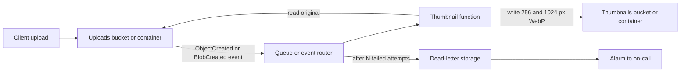
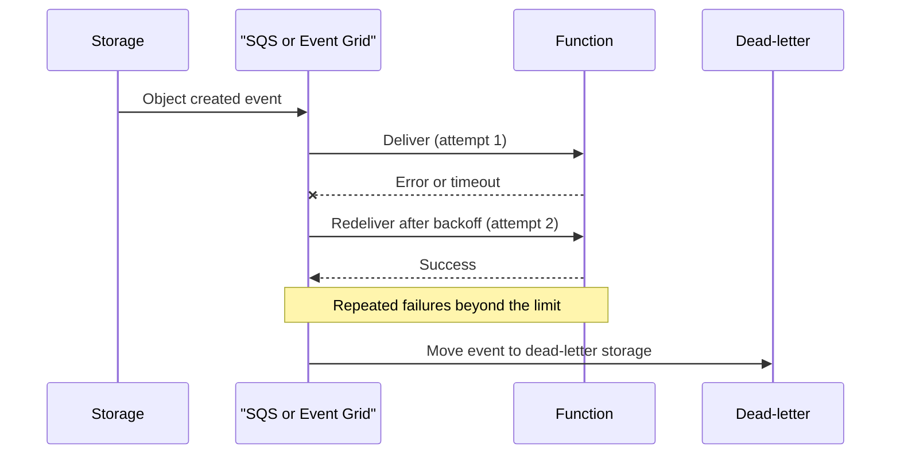

# Project: Event-Driven Image Processing Pipeline

## Introduction

When a user uploads a profile photo, the upload request should finish in milliseconds. Resizing the photo into thumbnails can happen a moment later, in the background. That is the core idea of an **event-driven pipeline**: one component announces "something happened" (a file arrived), and other components react to it on their own schedule.

This decoupling buys you three things:

- **Fast user-facing requests,** because slow work moves out of the request path.
- **Independent scaling,** because the processing side scales with the backlog, not with web traffic.
- **Resilience,** because a failure in processing does not lose the upload. The event waits in a queue and is retried.

In this project you build a thumbnail pipeline twice:

- **On AWS:** an upload lands in **S3**, S3 sends an event to an **SQS** queue, and **Lambda** reads the queue, creates two WebP thumbnails with Pillow and writes them to a second bucket. Failed messages go to a **dead-letter queue** (DLQ) with an alarm.
- **On Azure:** an upload lands in **Blob Storage**, **Event Grid** delivers a `BlobCreated` event to an **Azure Functions** blob trigger on the Flex Consumption plan, and output bindings write the thumbnails. Identity-based connections mean no storage keys.

Background pages: [Event Sources and Triggers](../4-cloud-serverless/3-cloud-serverless-triggers.mdx), [Queues: SQS and Azure Service Bus](../9-cloud-messaging-and-integration/1-cloud-sqs-and-service-bus.mdx), [Pub/Sub: SNS, EventBridge and Event Grid](../9-cloud-messaging-and-integration/2-cloud-sns-and-event-grid.mdx) and [Event-Driven Patterns in the Cloud](../9-cloud-messaging-and-integration/4-cloud-event-driven-patterns.mdx).

:::warning Cost and cleanup
Everything here is pay-per-use: storage per GB-month, requests per thousand, queue and event deliveries, and function execution time. Image processing is CPU-heavy, so execution time is the main cost driver. The biggest risk is a **loop**, where the function's output triggers the function again and runs up a bill quickly. This design prevents loops by writing to a separate bucket or container, but double-check your filters. Set a budget alert ([Budgets and Billing Alerts](../1-cloud-getting-started/7-cloud-budgets-and-alerts.mdx)) and run the **Cleanup** section afterwards. See the [AWS Pricing Calculator](https://calculator.aws/) and the [Azure Pricing Calculator](https://azure.microsoft.com/pricing/calculator/).
:::

## Architecture



| Building block | AWS | Azure |
| --- | --- | --- |
| Upload storage | S3 bucket `...-uploads-...` with prefix `uploads/` | Storage account container `uploads` |
| Event delivery | S3 event notification to an SQS queue | Event Grid system topic with a webhook subscription |
| Buffering and retries | SQS visibility timeout, `maxReceiveCount`, DLQ | Event Grid retry policy and dead-letter container, plus Functions blob retries |
| Compute | Lambda with an SQS event source mapping | Functions Flex Consumption blob trigger with `source="EventGrid"` |
| Output | `put_object` to a second bucket | Blob output bindings to a `thumbnails` container |
| Identity | Lambda execution role with SAM policy templates | Managed identity with Storage Blob Data Owner and Storage Queue Data Contributor |
| IaC used here | AWS SAM | Azure CLI |

### Why a queue in the middle on AWS?

S3 can invoke Lambda directly. Putting SQS in between costs one more hop but gives you:

- **Durable buffering.** If Lambda is throttled or failing, messages wait in the queue for up to the retention period instead of being retried a few times and dropped.
- **Batching and concurrency control.** You decide the batch size and cap concurrency so a burst of 50,000 uploads does not overload anything downstream.
- **A dead-letter queue** that collects messages that failed repeatedly, so you can inspect and replay them.

On Azure, Event Grid provides retries and dead-lettering itself, and the Functions blob extension adds its own retry and poison-message handling, so no separate queue is needed for this design. For heavier workloads, an Azure Storage queue or Service Bus queue between Event Grid and the function plays the same role as SQS.

## Step 1: The Shared Image Logic

As in the earlier projects, the real work is plain Python that knows nothing about the cloud:

```python
# thumbnails.py
"""Cloud-neutral image logic: bytes in, thumbnails out."""
import io

from PIL import Image, ImageOps

SIZES = (256, 1024)                 # longest edge in pixels
MAX_INPUT_BYTES = 20 * 1024 * 1024  # refuse anything over 20 MB
Image.MAX_IMAGE_PIXELS = 50_000_000 # guard against decompression bombs


class UnsupportedImage(ValueError):
    pass


def make_thumbnails(data: bytes) -> dict[int, bytes]:
    if len(data) > MAX_INPUT_BYTES:
        raise UnsupportedImage("file too large")
    try:
        img = Image.open(io.BytesIO(data))
        img = ImageOps.exif_transpose(img)   # respect phone camera rotation
    except Exception as err:                 # Pillow raises several error types
        raise UnsupportedImage("not a supported image") from err

    results = {}
    for size in SIZES:
        thumb = img.copy()
        thumb.thumbnail((size, size))        # keeps aspect ratio, never upscales
        buf = io.BytesIO()
        thumb.convert("RGB").save(buf, format="WEBP", quality=80)
        results[size] = buf.getvalue()
    return results
```

A quick test with Pillow and pytest:

```python
# test_thumbs.py
import io
from PIL import Image
import pytest
from thumbnails import UnsupportedImage, make_thumbnails

def png(w, h):
    buf = io.BytesIO(); Image.new("RGB", (w, h), "orange").save(buf, "PNG"); return buf.getvalue()

def test_sizes():
    out = make_thumbnails(png(3000, 2000))
    assert Image.open(io.BytesIO(out[256])).size == (256, 171)
    assert Image.open(io.BytesIO(out[1024])).size == (1024, 683)

def test_not_image():
    with pytest.raises(UnsupportedImage):
        make_thumbnails(b"hello")
```

```bash
pip install pillow pytest
python -m pytest -q test_thumbs.py
```

Output:

```text
..                                                                       [100%]
2 passed in 0.19s
```

Security matters for any code that parses user uploads. The size limit and `MAX_IMAGE_PIXELS` protect you from "decompression bomb" files that are small on disk but expand to gigabytes in memory. Re-encoding to WebP also strips most metadata, including GPS coordinates from phone cameras.

## Part A: Build It on AWS

### A1. The Lambda handler

```python
# src/app.py
import json
import logging
import os
import urllib.parse
from pathlib import PurePosixPath

import boto3

from thumbnails import UnsupportedImage, make_thumbnails

log = logging.getLogger()
log.setLevel(logging.INFO)
s3 = boto3.client("s3")
OUTPUT_BUCKET = os.environ["THUMBNAIL_BUCKET"]


def process_object(bucket: str, key: str) -> None:
    data = s3.get_object(Bucket=bucket, Key=key)["Body"].read()
    stem = PurePosixPath(key).with_suffix("").name
    for size, image in make_thumbnails(data).items():
        out_key = f"thumbs/{size}/{stem}.webp"
        s3.put_object(Bucket=OUTPUT_BUCKET, Key=out_key, Body=image,
                      ContentType="image/webp", CacheControl="public, max-age=31536000")
        log.info(json.dumps({"event": "thumbnail_written", "source": key, "target": out_key}))


def handler(event, context):
    failures = []
    for message in event["Records"]:               # one SQS message per S3 notification
        try:
            body = json.loads(message["body"])
            for record in body.get("Records", []):  # S3 sends a test event without Records
                bucket = record["s3"]["bucket"]["name"]
                key = urllib.parse.unquote_plus(record["s3"]["object"]["key"])
                try:
                    process_object(bucket, key)
                except UnsupportedImage as err:
                    # Retrying will never fix a bad file: log it and move on
                    log.warning(json.dumps({"event": "skipped", "key": key, "reason": str(err)}))
        except Exception:
            log.exception("failed message %s", message["messageId"])
            failures.append({"itemIdentifier": message["messageId"]})
    # Only failed messages return to the queue, the rest are deleted
    return {"batchItemFailures": failures}
```

Three patterns in this handler are worth learning:

1. **Partial batch responses.** With `ReportBatchItemFailures`, the function returns only the IDs of failed messages. SQS deletes the successful ones and makes only the failures visible again. Without it, one bad message would cause the whole batch to be retried.
2. **Separate "bad input" from "temporary failure".** A text file renamed to `.jpg` will never succeed, so the handler logs and skips it instead of retrying. A network error or throttling, on the other hand, raises and the message is retried.
3. **Idempotent output.** Each thumbnail key is derived from the source key. S3 events are delivered *at least once*, so the same upload can be processed twice. Writing the same bytes to the same key again is harmless.

Also note `unquote_plus`: S3 URL-encodes keys in event notifications, so `my cat.jpg` arrives as `my+cat.jpg`.

### A2. The SAM template

```yaml
AWSTemplateFormatVersion: "2010-09-09"
Transform: AWS::Serverless-2016-10-31
Description: Image pipeline - S3 upload -> SQS -> Lambda -> S3 thumbnails

Resources:
  # Queue that buffers upload events, with a dead-letter queue for poison messages
  UploadEventsDLQ:
    Type: AWS::SQS::Queue
    Properties:
      MessageRetentionPeriod: 1209600          # 14 days to investigate failures

  UploadEventsQueue:
    Type: AWS::SQS::Queue
    Properties:
      VisibilityTimeout: 180                   # at least 6x the function timeout
      RedrivePolicy:
        deadLetterTargetArn: !GetAtt UploadEventsDLQ.Arn
        maxReceiveCount: 5

  UploadEventsQueuePolicy:
    Type: AWS::SQS::QueuePolicy
    Properties:
      Queues: [!Ref UploadEventsQueue]
      PolicyDocument:
        Version: "2012-10-17"
        Statement:
          - Effect: Allow
            Principal: { Service: s3.amazonaws.com }
            Action: sqs:SendMessage
            Resource: !GetAtt UploadEventsQueue.Arn
            Condition:
              ArnLike:
                aws:SourceArn: !Sub "arn:aws:s3:::${AWS::StackName}-uploads-${AWS::AccountId}"
              StringEquals:
                aws:SourceAccount: !Ref AWS::AccountId

  # Two buckets: writing thumbnails to a different bucket prevents an infinite loop
  UploadsBucket:
    Type: AWS::S3::Bucket
    DependsOn: UploadEventsQueuePolicy
    Properties:
      BucketName: !Sub "${AWS::StackName}-uploads-${AWS::AccountId}"
      LifecycleConfiguration:
        Rules:
          - { Id: expire-originals, Status: Enabled, ExpirationInDays: 30 }
      NotificationConfiguration:
        QueueConfigurations:
          - Event: s3:ObjectCreated:*
            Queue: !GetAtt UploadEventsQueue.Arn
            Filter:
              S3Key:
                Rules:
                  - { Name: prefix, Value: uploads/ }

  ThumbnailsBucket:
    Type: AWS::S3::Bucket

  ThumbnailFunction:
    Type: AWS::Serverless::Function
    Properties:
      CodeUri: src/
      Handler: app.handler
      Runtime: python3.13
      Architectures: [x86_64]
      MemorySize: 1024                        # image work is CPU bound, more memory = more CPU
      Timeout: 30
      ReservedConcurrentExecutions: 20        # protect downstream systems and your bill
      Environment:
        Variables:
          THUMBNAIL_BUCKET: !Ref ThumbnailsBucket
      Policies:
        - S3ReadPolicy:
            BucketName: !Sub "${AWS::StackName}-uploads-${AWS::AccountId}"
        - S3WritePolicy:
            BucketName: !Ref ThumbnailsBucket
      Events:
        Uploads:
          Type: SQS
          Properties:
            Queue: !GetAtt UploadEventsQueue.Arn
            BatchSize: 5
            FunctionResponseTypes: [ReportBatchItemFailures]

  DLQNotEmptyAlarm:
    Type: AWS::CloudWatch::Alarm
    Properties:
      AlarmDescription: Messages are landing in the image pipeline DLQ
      Namespace: AWS/SQS
      MetricName: ApproximateNumberOfMessagesVisible
      Dimensions:
        - { Name: QueueName, Value: !GetAtt UploadEventsDLQ.QueueName }
      Statistic: Maximum
      Period: 300
      EvaluationPeriods: 1
      Threshold: 0
      ComparisonOperator: GreaterThanThreshold

Outputs:
  UploadsBucket:
    Value: !Ref UploadsBucket
  ThumbnailsBucket:
    Value: !Ref ThumbnailsBucket
  DeadLetterQueueUrl:
    Value: !Ref UploadEventsDLQ
```

Design notes:

- **The bucket name is built with `!Sub`** instead of `!Ref UploadsBucket` in the queue policy. That breaks the circular dependency between the bucket (which needs the queue) and the queue policy (which needs the bucket), a classic CloudFormation puzzle. `DependsOn` makes sure the policy exists before S3 validates the notification.
- **The `aws:SourceAccount` condition** prevents a bucket with the same name in another account from sending messages to your queue.
- **Visibility timeout of 180 seconds**, at least six times the function timeout, as AWS recommends for SQS event sources. Otherwise a message can become visible again while still being processed.
- **`maxReceiveCount: 5`** moves a message to the DLQ after five failed receives, and the CloudWatch alarm fires as soon as the DLQ is not empty. Connect the alarm to SNS or your paging tool.
- **Reserved concurrency of 20** caps parallel executions. It protects your account's concurrency pool and your bill during a flood of uploads.
- **1024 MB of memory.** Lambda allocates CPU in proportion to memory, so image work often finishes faster and costs about the same or less with more memory. Measure with [AWS Lambda Power Tuning](https://github.com/aws-samples/aws-lambda-power-tuning) before settling.
- **Two buckets.** Writing thumbnails back into the uploads bucket would create new events and an endless loop. Lambda's recursive loop detection can stop some loops, but do not rely on it as your design.

### A3. Build and deploy

Pillow includes compiled code, so build it for the Lambda environment, not your laptop:

```bash
mkdir -p src && cp app.py thumbnails.py src/ && echo "pillow" > src/requirements.txt
sam build --use-container
sam deploy --guided --stack-name thumbs --region eu-west-1
```

Example output (trimmed):

```text
Outputs
--------------------------------------------------------------------------
Key                 UploadsBucket
Value               thumbs-uploads-111122223333
Key                 ThumbnailsBucket
Value               thumbs-thumbnailsbucket-a1b2c3d4e5f6
Key                 DeadLetterQueueUrl
Value               https://sqs.eu-west-1.amazonaws.com/111122223333/thumbs-UploadEventsDLQ-AbCdEf
--------------------------------------------------------------------------
Successfully created/updated stack - thumbs in eu-west-1
```

Use a lowercase stack name, because it becomes part of the bucket name.

### A4. Test the pipeline

```bash
# Use any JPEG photo you have, saved as mountain.jpg
aws s3 cp mountain.jpg s3://thumbs-uploads-111122223333/uploads/mountain.jpg
echo "not an image" > broken.jpg
aws s3 cp broken.jpg s3://thumbs-uploads-111122223333/uploads/broken.jpg

sleep 10
aws s3 ls s3://thumbs-thumbnailsbucket-a1b2c3d4e5f6/ --recursive --human-readable
sam logs --stack-name thumbs --name ThumbnailFunction --start-time '5min ago'
```

Example output (trimmed):

```text
2026-10-11 12:01:07   12.4 KiB thumbs/256/mountain.webp
2026-10-11 12:01:07   98.1 KiB thumbs/1024/mountain.webp
{"event": "thumbnail_written", "source": "uploads/mountain.jpg", "target": "thumbs/256/mountain.webp"}
{"event": "thumbnail_written", "source": "uploads/mountain.jpg", "target": "thumbs/1024/mountain.webp"}
{"event": "skipped", "key": "uploads/broken.jpg", "reason": "not a supported image"}
```

The broken file is skipped, not retried, so it never reaches the DLQ. To test the DLQ, temporarily remove the `s3:PutObject` permission from the role: every message then fails, is retried five times and lands in the DLQ, and the alarm fires. Once the permission is fixed, use **DLQ redrive** in the SQS console (or `aws sqs start-message-move-task`) to send the messages back to the source queue.

## Part B: Build It on Azure

### B1. Create storage and the function app

Use two storage accounts: one for your data and one for the Functions host's internal state. Keeping them separate means the app's own housekeeping traffic never mixes with your data or your event subscriptions.

```bash
RG=rg-thumbs
LOC=westeurope
IMG_SA=thumbsdata$RANDOM
FN_SA=thumbshost$RANDOM
APP=thumbs-fn-$RANDOM

az group create -n "$RG" -l "$LOC" --tags project=thumbs

az storage account create -n "$IMG_SA" -g "$RG" -l "$LOC" --sku Standard_LRS \
  --kind StorageV2 --allow-blob-public-access false
for c in uploads thumbnails deadletter; do
  az storage container create --account-name "$IMG_SA" -n "$c" --auth-mode login -o none
done

az storage account create -n "$FN_SA" -g "$RG" -l "$LOC" --sku Standard_LRS \
  --allow-blob-public-access false
az functionapp create -g "$RG" -n "$APP" --storage-account "$FN_SA" \
  --flexconsumption-location "$LOC" --runtime python --runtime-version 3.12 \
  --instance-memory 2048
```

`--instance-memory 2048` gives each instance more memory (and proportionally more CPU) for image work. The Flex Consumption plan only supports the **Event Grid-based** blob trigger. The older polling blob trigger is not available there, and it was slower anyway.

### B2. Identity-based storage connection

The code uses `connection="ImageStorage"`. Instead of a connection string, define the connection by service URIs, and grant roles to the app's managed identity:

```bash
PRINCIPAL_ID=$(az functionapp identity assign -g "$RG" -n "$APP" --query principalId -o tsv)
IMG_ID=$(az storage account show -n "$IMG_SA" -g "$RG" --query id -o tsv)

for role in "Storage Blob Data Owner" "Storage Queue Data Contributor"; do
  az role assignment create --assignee-object-id "$PRINCIPAL_ID" \
    --assignee-principal-type ServicePrincipal --role "$role" --scope "$IMG_ID"
done

az functionapp config appsettings set -g "$RG" -n "$APP" --settings \
  "ImageStorage__blobServiceUri=https://$IMG_SA.blob.core.windows.net" \
  "ImageStorage__queueServiceUri=https://$IMG_SA.queue.core.windows.net"
```

The double underscore (`__`) groups settings under the `ImageStorage` connection name. The blob trigger needs queue access as well as blob access because the extension keeps track of processed blobs and poison messages in queues and blobs of that account. Check [identity-based connections for Azure Functions](https://learn.microsoft.com/azure/azure-functions/functions-reference#configure-an-identity-based-connection) for the current role requirements of each binding.

### B3. The function

```python
# function_app.py
import json
import logging

import azure.functions as func

from thumbnails import UnsupportedImage, make_thumbnails

app = func.FunctionApp()


@app.blob_trigger(arg_name="upload", path="uploads/{stem}.{ext}",
                  source="EventGrid", connection="ImageStorage")
@app.blob_output(arg_name="small", path="thumbnails/256/{stem}.webp", connection="ImageStorage")
@app.blob_output(arg_name="large", path="thumbnails/1024/{stem}.webp", connection="ImageStorage")
def make_thumbnails_fn(upload: func.InputStream,
                       small: func.Out[bytes], large: func.Out[bytes]) -> None:
    try:
        thumbs = make_thumbnails(upload.read())
    except UnsupportedImage as err:
        # Returning normally means "handled": no retry for a file that can never work
        logging.warning(json.dumps({"event": "skipped", "blob": upload.name, "reason": str(err)}))
        return
    small.set(thumbs[256])
    large.set(thumbs[1024])
    logging.info(json.dumps({"event": "thumbnails_written", "blob": upload.name}))
```

```text
thumbs-azure/
├── function_app.py
├── thumbnails.py      # same file as on AWS
├── host.json          # extensionBundle version [4.0.0, 5.0.0)
└── requirements.txt   # azure-functions, pillow
```

The trigger path `uploads/{stem}.{ext}` splits the blob name into binding expressions. The output paths reuse `{stem}`, so `uploads/mountain.jpg` produces `thumbnails/256/mountain.webp` without any SDK calls. Output bindings are convenient for simple writes. Switch to the `azure-storage-blob` SDK when you need custom content types, metadata or conditional writes.

Deploy it:

```bash
func azure functionapp publish "$APP"
```

### B4. Subscribe the function to blob events

Event Grid needs the function's blob extension webhook URL, which is protected by a system key named `blobs_extension`:

```bash
HOST=$(az functionapp show -g "$RG" -n "$APP" --query defaultHostName -o tsv)
KEY=$(az functionapp keys list -g "$RG" -n "$APP" --query "systemKeys.blobs_extension" -o tsv)

az eventgrid event-subscription create --name uploads-to-thumbnails \
  --source-resource-id "$IMG_ID" \
  --endpoint-type webhook \
  --endpoint "https://$HOST/runtime/webhooks/blobs?functionName=Host.Functions.make_thumbnails_fn&code=$KEY" \
  --included-event-types Microsoft.Storage.BlobCreated \
  --subject-begins-with /blobServices/default/containers/uploads/ \
  --max-delivery-attempts 10 \
  --deadletter-endpoint "$IMG_ID/blobServices/default/containers/deadletter"
```

Example output (trimmed):

```text
{
  "destination": { "endpointType": "WebHook", ... },
  "filter": { "includedEventTypes": [ "Microsoft.Storage.BlobCreated" ],
              "subjectBeginsWith": "/blobServices/default/containers/uploads/" },
  "provisioningState": "Succeeded",
  ...
}
```

- **`--subject-begins-with`** restricts events to the `uploads` container. Without it, thumbnails written to `thumbnails` would trigger events too. They would not match the function's path, but you would still pay for the deliveries.
- **Retries and dead-lettering.** Event Grid retries failed deliveries with exponential backoff, up to `--max-delivery-attempts` or the event time-to-live, then writes the event to the `deadletter` container. Separately, the Functions host retries a failing blob a limited number of times and then records it as a poison blob.
- The webhook must be deployed and reachable when you create the subscription, because Event Grid performs a validation handshake with the endpoint.

### B5. Test it

```bash
az storage blob upload --account-name "$IMG_SA" --auth-mode login \
  -c uploads -n mountain.jpg -f mountain.jpg
sleep 10
az storage blob list --account-name "$IMG_SA" --auth-mode login -c thumbnails \
  --query "[].{name:name, size:properties.contentLength}" -o table
```

Example output:

```text
Name                     Size
-----------------------  ------
1024/mountain.webp       100433
256/mountain.webp        12698
```

View the function's logs in Application Insights (**Investigate > Transaction search**), or stream them with `func azure functionapp logstream "$APP"`.

## Delivery Semantics Side by Side



| Concern | AWS: S3 to SQS to Lambda | Azure: Blob to Event Grid to Functions |
| --- | --- | --- |
| Delivery guarantee | At least once | At least once |
| Ordering | Not guaranteed (standard queue) | Not guaranteed |
| Retry control | Visibility timeout and `maxReceiveCount` | Max delivery attempts, event TTL, Functions retry count |
| Failed events | SQS DLQ, with console or API redrive | Dead-letter blobs (replay with a script) plus poison blob tracking |
| Backpressure | Queue absorbs bursts, reserved concurrency caps workers | Flex Consumption scales out up to the configured maximum instance count |
| Partial failures | `ReportBatchItemFailures` per message | One event per invocation |

## Real-World Scenario

A real-estate listing site lets agents upload 20 to 40 photos per property. Today, the web server resizes every photo inside the upload request. Upload pages time out on slow connections, and on busy Monday mornings the web servers spend most of their CPU on image resizing instead of serving pages.

**The solution:** browsers upload directly to S3 with presigned URLs ([Amazon S3](../6-cloud-storage/1-cloud-s3.mdx)), and the Part A pipeline produces thumbnails. The listing page shows a placeholder until both sizes exist. A DLQ alarm pages the on-call engineer, who can redrive messages after fixing the cause.

**Why this approach:**

- The web tier no longer does CPU-heavy work, so page latency stays flat during upload peaks.
- The queue absorbs Monday-morning bursts, and reserved concurrency keeps the processing rate predictable.
- Partial batch responses and the DLQ mean one corrupt photo never blocks the others.

**When to use it / when not to:**

- Use event-driven pipelines for work that can finish a few seconds after the triggering action: thumbnails, virus scanning, document text extraction, notifications and search indexing.
- Do not use it when the user must see the result in the same response, or when strict ordering across events matters. Use a synchronous call, or a FIFO queue or session-based Service Bus queue for ordering.
- For multi-step workflows with branching and human approval, use an orchestrator ([Workflows: Step Functions and Durable Functions](../4-cloud-serverless/5-cloud-step-functions-durable.mdx)).

**Alternatives and trade-offs:**

| Approach | Pros | Cons | Best for |
| --- | --- | --- | --- |
| Storage event to queue to function (Part A) | Durable buffer, batching, DLQ, concurrency control | One more component | High-volume or bursty uploads |
| Storage event directly to function | Simplest, lowest latency | Limited retries, harder backpressure | Low-volume, non-critical work |
| Storage event to EventBridge or Event Grid with many subscribers | Fan-out to several consumers with filtering | Per-event charges, more to configure | Several independent reactions to one upload |
| Step Functions or Durable Functions | Visual workflows, retries per step, long-running | More cost and complexity | Multi-step processing with branching |
| Batch job on a schedule | Simple and efficient for big batches | High latency | Nightly bulk processing |

## Common Mistakes

- **Writing output back to the triggering location.** It creates an infinite loop. Use a separate bucket or container, or strict prefix and subject filters.
- **SQS visibility timeout shorter than processing time.** Messages reappear while still being processed and get handled twice. Use at least six times the function timeout.
- **No DLQ or no alarm on it.** Failures then disappear silently after the retry limit, or sit unnoticed.
- **Retrying permanent errors.** A corrupt file fails every time. Classify errors and skip or quarantine bad input.
- **Assuming exactly-once delivery.** Both platforms deliver at least once. Make processing idempotent.
- **Building native dependencies on a laptop.** Use `sam build --use-container` or the Functions remote build so Pillow matches the Linux runtime.
- **Forgetting URL-decoding** of S3 keys, which breaks file names with spaces or special characters.

## Cleanup

### On AWS

```bash
aws s3 rm s3://thumbs-uploads-111122223333 --recursive
aws s3 rm s3://thumbs-thumbnailsbucket-a1b2c3d4e5f6 --recursive
sam delete --stack-name thumbs --region eu-west-1
```

CloudFormation cannot delete non-empty buckets, so empty them first.

### On Azure

```bash
az group delete -n rg-thumbs --yes --no-wait
```

Deleting the resource group also deletes the Event Grid system topic and its subscription.

## Summary

- An event-driven pipeline **decouples** the upload from the processing, which keeps user requests fast and lets processing scale and fail independently.
- On AWS, **S3 to SQS to Lambda** with **partial batch responses**, a **DLQ** and an alarm gives durable, controllable processing.
- On Azure, **Blob Storage to Event Grid to Functions** (Flex Consumption requires the Event Grid-based blob trigger) with **identity-based connections**, subject filters and a dead-letter container gives the same result without keys.
- Design for **at-least-once delivery**: idempotent outputs, separate permanent from temporary errors, and never write output where it re-triggers the pipeline.
- Keep the image logic cloud-neutral and well-guarded against malicious files.

## Exercises

1. Add a third output on both clouds: extract the image's width, height and dominant color, and write them as JSON next to the thumbnails.
2. On AWS, replace the S3-to-SQS notification with S3 to EventBridge, and add a second rule that sends the same event to a "virus scan" queue. What changes in the template?
3. On Azure, put an Azure Storage queue between Event Grid and a queue-triggered function. Compare the retry and poison-message behavior with the blob trigger.
4. Write a small script that replays events from the Azure `deadletter` container, and compare the effort with SQS DLQ redrive.

**Related pages:** [Streaming: Kinesis and Event Hubs](../9-cloud-messaging-and-integration/3-cloud-kinesis-and-event-hubs.mdx), [Choosing a Messaging Service](../9-cloud-messaging-and-integration/0-cloud-messaging-options.mdx), [Monitoring: CloudWatch and Azure Monitor](../12-cloud-observability-and-security/0-cloud-monitoring.mdx), the previous project [Project: Containerized App on Managed Containers](./3-cloud-project-containerized-app.mdx), and the next one, [Project: Multi-Environment Infrastructure as Code](./5-cloud-project-multi-env-iac.mdx).
