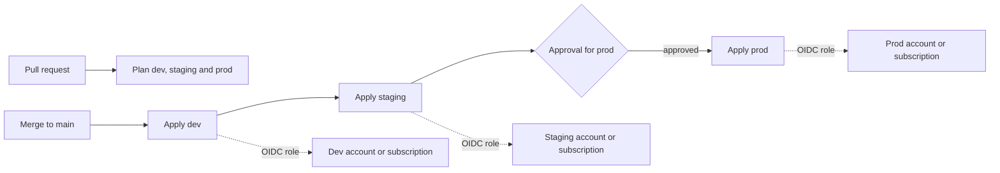
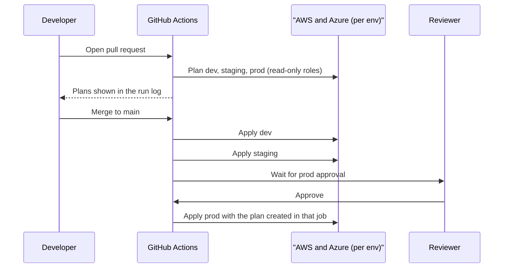

# Project: Multi-Environment Infrastructure as Code

## Introduction

Every earlier project in this section built **one** copy of something. Real teams need at least three: **dev** for experiments, **staging** to rehearse releases, and **prod** for customers. The hard requirement is that they stay *the same shape*. When staging differs from prod in some unknown way, a test that passes in staging tells you very little.

Infrastructure as Code (IaC) solves this only if you organize it well. Copy-pasting a Terraform folder three times and editing each copy is how environments drift apart. In this project you build a layout and a pipeline that keep environments consistent:

- **One set of modules** used by every environment. Environments differ only in a small file of values.
- **Separate state per environment**, stored in the environment's own AWS account or Azure subscription, with locking.
- **A GitHub Actions pipeline** that plans every environment on pull requests, applies to dev automatically, then staging, then prod after a human approval. It uses **OIDC** with a different role per environment, so no cloud keys are stored anywhere.
- **Drift detection** that tells you when someone changed something by hand.

The example application is deliberately small (a bucket or storage account, a queue with a dead-letter queue, and log retention), because the subject here is *how environments are managed*, not the resources themselves.

Background pages: [Terraform for AWS and Azure](../10-cloud-infrastructure-as-code/4-cloud-terraform-multi-cloud.mdx), [Managing Dev, Staging and Production](../11-cloud-devops/3-cloud-environments.mdx), [Keyless CI/CD with OIDC](../2-cloud-identity/6-cloud-oidc-for-ci.mdx) and [Multi-Account and Landing Zone Strategy](../2-cloud-identity/7-cloud-multi-account-strategy.mdx). For Terraform itself, see the [Terraform tutorial](/docs/devops/terraform).

:::warning Cost and cleanup
The resources in this project are cheap (storage, queues and logs bill per use), but you create them in three environments on two clouds, and the state backends keep a little data too. Production settings such as longer log retention and geo-redundant storage cost more than dev settings, which is exactly the point of per-environment values. Destroy each environment when you are done (see **Cleanup**), and use the [AWS Pricing Calculator](https://calculator.aws/) and the [Azure Pricing Calculator](https://azure.microsoft.com/pricing/calculator/) to compare environment costs.
:::

## The Target Setup



| Concern | AWS | Azure |
| --- | --- | --- |
| Isolation boundary per environment | Separate AWS accounts in AWS Organizations | Separate subscriptions under a management group |
| State storage | S3 bucket in each account, versioned | Storage account container per environment |
| State locking | S3 native lock file (`use_lockfile = true`) | Blob lease (built into the `azurerm` backend) |
| CI identity | IAM role per environment trusting GitHub's OIDC provider | User-assigned managed identity per environment with a federated credential |
| Guardrails | Service control policies | Azure Policy assignments |

Why separate **accounts and subscriptions** instead of just separate resource names? Because the account or subscription is the strongest boundary each cloud has. A mistake in dev, such as a runaway script or an overly broad IAM policy, cannot touch prod resources if they live in another account. Quotas, budgets and audit logs separate cleanly too. [Organizing Resources: Accounts, Subscriptions and Resource Groups](../1-cloud-getting-started/5-cloud-resource-organization.mdx) covers this in depth.

## Step 1: Repository Layout

```text
infra/
├── modules/
│   ├── aws-app/main.tf          # what an "orders" environment contains on AWS
│   └── azure-app/main.tf        # the same on Azure
├── aws/
│   ├── main.tf                  # root: provider + module call, partial backend
│   ├── dev.tfvars  staging.tfvars  prod.tfvars
│   └── backend-dev.hcl  backend-staging.hcl  backend-prod.hcl
└── azure/
    ├── main.tf
    ├── dev.tfvars  staging.tfvars  prod.tfvars
    └── backend-dev.hcl  backend-staging.hcl  backend-prod.hcl
```

The key ideas:

- **Modules hold all resource definitions.** Roots only wire providers, backends and variables together.
- **One root per cloud**, so an Azure outage or credential problem never blocks AWS changes, and each state file stays small.
- **The same root code for every environment.** Only `<env>.tfvars` (values) and `backend-<env>.hcl` (where state lives) differ. A reviewer can see every difference between staging and prod by diffing two short files.

## Step 2: The Modules

The AWS module creates an uploads bucket, a job queue with a dead-letter queue, and a log group. Notice that the environment-specific behavior is driven by variables, not by copies of code:

```hcl
terraform {
  required_providers {
    aws = { source = "hashicorp/aws", version = "~> 6.0" }
  }
}

variable "name" { type = string }
variable "env" { type = string }
variable "log_retention_days" { type = number }
variable "versioning" { type = bool }
variable "queue_max_receive_count" {
  type    = number
  default = 5
}

locals {
  prefix = "${var.name}-${var.env}"
}

resource "aws_s3_bucket" "uploads" {
  bucket_prefix = "${local.prefix}-uploads-"
  force_destroy = var.env != "prod" # dev and staging can be torn down freely
}

resource "aws_s3_bucket_versioning" "uploads" {
  bucket = aws_s3_bucket.uploads.id
  versioning_configuration {
    status = var.versioning ? "Enabled" : "Suspended"
  }
}

resource "aws_sqs_queue" "dlq" {
  name                      = "${local.prefix}-jobs-dlq"
  message_retention_seconds = 1209600
}

resource "aws_sqs_queue" "jobs" {
  name                       = "${local.prefix}-jobs"
  visibility_timeout_seconds = 180
  redrive_policy = jsonencode({
    deadLetterTargetArn = aws_sqs_queue.dlq.arn
    maxReceiveCount     = var.queue_max_receive_count
  })
}

resource "aws_cloudwatch_log_group" "app" {
  name              = "/app/${local.prefix}"
  retention_in_days = var.log_retention_days
}

output "bucket_name" { value = aws_s3_bucket.uploads.bucket }
output "queue_url" { value = aws_sqs_queue.jobs.url }
```

The Azure module has the same purpose and interface style. Input validation catches typos such as `storage_replication = "ZSR"` at plan time, not halfway through an apply:

```hcl
terraform {
  required_providers {
    azurerm = { source = "hashicorp/azurerm", version = "~> 5.0" }
    random  = { source = "hashicorp/random", version = "~> 3.6" }
  }
}

variable "name" { type = string }
variable "env" { type = string }
variable "location" { type = string }
variable "log_retention_days" { type = number }
variable "storage_replication" {
  type        = string
  description = "LRS for dev, ZRS or GZRS for production"
  validation {
    condition     = contains(["LRS", "ZRS", "GRS", "GZRS"], var.storage_replication)
    error_message = "storage_replication must be LRS, ZRS, GRS or GZRS."
  }
}

locals {
  prefix = "${var.name}-${var.env}"
  tags   = { app = var.name, env = var.env, managed_by = "terraform" }
}

resource "random_string" "sa" {
  length  = 6
  special = false
  upper   = false
}

resource "azurerm_resource_group" "app" {
  name     = "rg-${local.prefix}"
  location = var.location
  tags     = local.tags
}

resource "azurerm_storage_account" "app" {
  name                            = substr(replace("${local.prefix}${random_string.sa.result}", "-", ""), 0, 24)
  resource_group_name             = azurerm_resource_group.app.name
  location                        = azurerm_resource_group.app.location
  account_tier                    = "Standard"
  account_replication_type        = var.storage_replication
  min_tls_version                 = "TLS1_2"
  allow_nested_items_to_be_public = false
  shared_access_key_enabled       = false # Entra ID only
  tags                            = local.tags
}

resource "azurerm_storage_queue" "jobs" {
  name               = "jobs"
  storage_account_id = azurerm_storage_account.app.id
}

resource "azurerm_log_analytics_workspace" "app" {
  name                = "log-${local.prefix}"
  location            = azurerm_resource_group.app.location
  resource_group_name = azurerm_resource_group.app.name
  retention_in_days   = var.log_retention_days
  tags                = local.tags
}

output "resource_group" { value = azurerm_resource_group.app.name }
output "storage_account" { value = azurerm_storage_account.app.name }
```

`shared_access_key_enabled = false` means the storage account only accepts Microsoft Entra ID authentication. That is why the root module sets `storage_use_azuread = true` on the provider: Terraform itself must then use Entra ID for data-plane calls such as creating the queue.

## Step 3: The Roots, Values and Backends

The AWS root:

```hcl
terraform {
  required_version = ">= 1.10"
  required_providers {
    aws = { source = "hashicorp/aws", version = "~> 6.0" }
  }
  backend "s3" {} # filled in per environment by backend-<env>.hcl
}

variable "env" { type = string }
variable "region" { type = string }
variable "log_retention_days" { type = number }
variable "versioning" { type = bool }

provider "aws" {
  region = var.region
  default_tags {
    tags = { app = "orders", env = var.env, managed_by = "terraform" }
  }
}

module "app" {
  source             = "../modules/aws-app"
  name               = "orders"
  env                = var.env
  log_retention_days = var.log_retention_days
  versioning         = var.versioning
}

output "bucket_name" { value = module.app.bucket_name }
output "queue_url" { value = module.app.queue_url }
```

The values for two environments:

```hcl
# aws/dev.tfvars
env                = "dev"
region             = "eu-west-1"
log_retention_days = 7
versioning         = false
```

```hcl
# aws/prod.tfvars
env                = "prod"
region             = "eu-west-1"
log_retention_days = 365
versioning         = true
```

And where each environment's state lives. Note that the bucket is in a different AWS account for each environment:

```hcl
# aws/backend-dev.hcl
bucket       = "acme-tfstate-111122223333-eu-west-1"   # state bucket in the dev account
key          = "orders/aws/terraform.tfstate"
region       = "eu-west-1"
use_lockfile = true                                     # native S3 locking
```

```hcl
# aws/backend-prod.hcl
bucket       = "acme-tfstate-444455556666-eu-west-1"   # state bucket in the prod account
key          = "orders/aws/terraform.tfstate"
region       = "eu-west-1"
use_lockfile = true
```

The Azure root follows the same pattern:

```hcl
terraform {
  required_version = ">= 1.10"
  required_providers {
    azurerm = { source = "hashicorp/azurerm", version = "~> 5.0" }
  }
  backend "azurerm" {} # filled in per environment by backend-<env>.hcl
}

variable "env" { type = string }
variable "subscription_id" { type = string }
variable "location" { type = string }
variable "log_retention_days" { type = number }
variable "storage_replication" { type = string }

provider "azurerm" {
  features {}
  subscription_id     = var.subscription_id
  storage_use_azuread = true # the module disables shared keys
}

module "app" {
  source              = "../modules/azure-app"
  name                = "orders"
  env                 = var.env
  location            = var.location
  log_retention_days  = var.log_retention_days
  storage_replication = var.storage_replication
}

output "resource_group" { value = module.app.resource_group }
```

```hcl
# azure/prod.tfvars
env                 = "prod"
subscription_id     = "55555555-6666-7777-8888-999999999999"
location            = "westeurope"
log_retention_days  = 365
storage_replication = "GZRS"
```

```hcl
# azure/backend-dev.hcl
resource_group_name  = "rg-tfstate"
storage_account_name = "acmetfstatedev"
container_name       = "tfstate"
key                  = "orders/azure.tfstate"
use_azuread_auth     = true   # Entra ID instead of storage account keys
```

:::info State locking has changed
On AWS, Terraform's S3 backend now supports **native locking** with `use_lockfile = true`, which writes a `.tflock` object next to the state. The older DynamoDB-based locking (`dynamodb_table`) is **deprecated** and will be removed in a future version, so new setups do not need a DynamoDB table. The `azurerm` backend locks state with blob leases and supports Entra ID authentication (`use_azuread_auth`) and OIDC. See the [S3 backend](https://developer.hashicorp.com/terraform/language/backend/s3) and [azurerm backend](https://developer.hashicorp.com/terraform/language/backend/azurerm) docs.
:::

## Step 4: Bootstrap the State Backends

The state storage has to exist before Terraform can use it. This is the classic "chicken and egg" of IaC. Create it once per account or subscription with the CLI (or a tiny separate Terraform config with local state):

### On AWS (run in each environment account)

```bash
ACCOUNT_ID=$(aws sts get-caller-identity --query Account --output text)
BUCKET="acme-tfstate-${ACCOUNT_ID}-eu-west-1"

aws s3api create-bucket --bucket "$BUCKET" --region eu-west-1 \
  --create-bucket-configuration LocationConstraint=eu-west-1
aws s3api put-bucket-versioning --bucket "$BUCKET" \
  --versioning-configuration Status=Enabled
aws s3api put-public-access-block --bucket "$BUCKET" --public-access-block-configuration \
  BlockPublicAcls=true,IgnorePublicAcls=true,BlockPublicPolicy=true,RestrictPublicBuckets=true
```

**Versioning** is essential. If a bad apply or a bug corrupts the state file, you can restore the previous version.

### On Azure (run in each environment subscription)

```bash
az group create -n rg-tfstate -l westeurope
az storage account create -n acmetfstatedev -g rg-tfstate -l westeurope \
  --sku Standard_ZRS --min-tls-version TLS1_2 \
  --allow-blob-public-access false --allow-shared-key-access false
az storage account blob-service-properties update -n acmetfstatedev -g rg-tfstate \
  --enable-versioning true --enable-delete-retention true --delete-retention-days 30
az storage container create --account-name acmetfstatedev -n tfstate --auth-mode login
```

Grant the pipeline identity for that environment **Storage Blob Data Contributor** on the container, and give your own user the same role if you run Terraform locally.

## Step 5: Run It Locally

```bash
cd infra/aws
terraform init -backend-config=backend-dev.hcl
terraform plan -var-file=dev.tfvars -out=tfplan
terraform apply tfplan
```

Example output (trimmed):

```text
Initializing the backend...
Successfully configured the backend "s3"! Terraform will automatically
use this backend unless the backend configuration changes.
...
Plan: 5 to add, 0 to change, 0 to destroy.
...
Apply complete! Resources: 5 added, 0 changed, 0 destroyed.

Outputs:

bucket_name = "orders-dev-uploads-20261011101544123400000001"
queue_url = "https://sqs.eu-west-1.amazonaws.com/111122223333/orders-dev-jobs"
```

To switch environments locally, you **must** re-initialize with the other backend:

```bash
terraform init -reconfigure -backend-config=backend-prod.hcl
terraform plan -var-file=prod.tfvars
```

:::warning The classic mix-up
If you forget `-reconfigure`, or pass `dev.tfvars` while the prod backend is configured, Terraform will happily plan to turn prod into dev. Two defenses: use credentials that can only reach one environment at a time (separate accounts make this natural), and let the pipeline, not people, apply to staging and prod. A small wrapper script or `Makefile` target that always pairs the backend file and the values file also helps.
:::

## Step 6: The Pipeline

### Trust GitHub in each environment

Each environment gets its own cloud identity, and each identity trusts **only** GitHub jobs that run in the matching GitHub environment. The OIDC token's `sub` claim contains the environment name, so the trust condition pins it down.

On AWS, the prod role's trust policy (in the prod account):

```json
{
  "Version": "2012-10-17",
  "Statement": [
    {
      "Effect": "Allow",
      "Principal": {
        "Federated": "arn:aws:iam::444455556666:oidc-provider/token.actions.githubusercontent.com"
      },
      "Action": "sts:AssumeRoleWithWebIdentity",
      "Condition": {
        "StringEquals": {
          "token.actions.githubusercontent.com:aud": "sts.amazonaws.com",
          "token.actions.githubusercontent.com:sub": "repo:acme/orders-infra:environment:prod"
        }
      }
    }
  ]
}
```

On Azure, a user-assigned managed identity per environment with a federated credential:

```bash
az identity create -n id-gh-orders-prod -g rg-cicd
az identity federated-credential create -n github-prod \
  --identity-name id-gh-orders-prod -g rg-cicd \
  --issuer https://token.actions.githubusercontent.com \
  --subject repo:acme/orders-infra:environment:prod \
  --audiences api://AzureADTokenExchange
```

Then assign that identity a role on the prod subscription (for example **Contributor**, plus **Role Based Access Control Administrator** only if Terraform must create role assignments) and **Storage Blob Data Contributor** on the state container.

Create a second, **read-only** identity per environment for plans on pull requests (`environment:prod-plan`). A pull request should never be able to change production, even by accident.

### The workflows

In GitHub, create the environments `dev`, `staging`, `prod` (with **required reviewers**) and `dev-plan`, `staging-plan`, `prod-plan`. Store each environment's role ARN or client ID as environment variables (`AWS_ROLE_ARN`, `AZURE_CLIENT_ID`, `AZURE_TENANT_ID`). They are identifiers, not secrets.

A reusable workflow does the Terraform work for one environment:

```yaml
# .github/workflows/terraform.yml
name: terraform
on:
  workflow_call:
    inputs:
      env: { type: string, required: true }
      apply: { type: boolean, required: true }

jobs:
  aws:
    runs-on: ubuntu-latest
    # Applies use the protected environment (prod has required reviewers).
    # Plans use a separate "-plan" environment mapped to a read-only role.
    environment: ${{ inputs.apply && inputs.env || format('{0}-plan', inputs.env) }}
    defaults:
      run:
        working-directory: infra/aws
    steps:
      - uses: actions/checkout@v4
      - uses: hashicorp/setup-terraform@v3
      - uses: aws-actions/configure-aws-credentials@v4
        with:
          role-to-assume: ${{ vars.AWS_ROLE_ARN }}   # set per GitHub environment
          aws-region: eu-west-1
      - run: terraform init -input=false -backend-config=backend-${{ inputs.env }}.hcl
      - run: terraform plan -input=false -var-file=${{ inputs.env }}.tfvars -out=tfplan
      - if: inputs.apply
        run: terraform apply -input=false tfplan

  azure:
    runs-on: ubuntu-latest
    environment: ${{ inputs.apply && inputs.env || format('{0}-plan', inputs.env) }}
    env:
      ARM_USE_OIDC: "true"
      ARM_CLIENT_ID: ${{ vars.AZURE_CLIENT_ID }}
      ARM_TENANT_ID: ${{ vars.AZURE_TENANT_ID }}
    defaults:
      run:
        working-directory: infra/azure
    steps:
      - uses: actions/checkout@v4
      - uses: hashicorp/setup-terraform@v3
      - run: terraform init -input=false -backend-config=backend-${{ inputs.env }}.hcl
      - run: terraform plan -input=false -var-file=${{ inputs.env }}.tfvars -out=tfplan
      - if: inputs.apply
        run: terraform apply -input=false tfplan
```

The main workflow decides what runs when:

```yaml
# .github/workflows/infra.yml
name: infra
on:
  pull_request:
    paths: ["infra/**"]
  push:
    branches: [main]
    paths: ["infra/**"]

permissions:
  id-token: write   # allow the job to request a GitHub OIDC token
  contents: read

jobs:
  plan:
    if: github.event_name == 'pull_request'
    strategy:
      matrix:
        env: [dev, staging, prod]
    uses: ./.github/workflows/terraform.yml
    with:
      env: ${{ matrix.env }}
      apply: false
    secrets: inherit

  dev:
    if: github.event_name == 'push'
    uses: ./.github/workflows/terraform.yml
    with: { env: dev, apply: true }
    secrets: inherit

  staging:
    needs: dev
    uses: ./.github/workflows/terraform.yml
    with: { env: staging, apply: true }
    secrets: inherit

  prod:
    needs: staging
    uses: ./.github/workflows/terraform.yml
    with: { env: prod, apply: true }
    secrets: inherit
```



Why this shape works:

- **Every change goes through every environment in order.** Prod never receives a change that has not been applied to dev and staging first.
- **The plan that is applied is the plan that was produced** in the same job (`-out=tfplan`), so nothing changes between review and apply within a run.
- **Environment protection rules** (required reviewers, a wait timer, restricting which branches can deploy) are enforced by GitHub before the job even gets an OIDC token.
- **No secrets.** Role ARNs and client IDs are useless without a valid GitHub token for the right repository and environment.

### Drift detection

Someone will eventually change something in the console during an incident. Catch it with a scheduled plan that uses `-detailed-exitcode`, which returns **0** for no changes, **1** for errors and **2** when the real infrastructure differs from the code:

```bash
terraform plan -input=false -var-file=prod.tfvars -detailed-exitcode -lock=false
status=$?
if [ "$status" -eq 2 ]; then
  echo "Drift detected in prod" >&2
  # for example: open a GitHub issue or post to the team channel
fi
```

Example output when someone raised the queue's visibility timeout by hand:

```text
  # module.app.aws_sqs_queue.jobs will be updated in-place
  ~ resource "aws_sqs_queue" "jobs" {
      ~ visibility_timeout_seconds = 600 -> 180
    }
Plan: 0 to add, 1 to change, 0 to destroy.
Drift detected in prod
```

Then decide: either put the manual change into code, or apply to revert it.

## Comparing Ways to Organize Environments

| Approach | Pros | Cons | Best for |
| --- | --- | --- | --- |
| One root + per-env `.tfvars` and backend files (this project) | Identical code everywhere, tiny diffs between envs | Easy to mix files when running locally | Most teams with a pipeline |
| Directory per environment calling shared modules | Each env is explicit, can pin different module versions | Some duplicated wiring, envs can drift in the root code | Teams that promote module versions env by env |
| Terraform workspaces | Built in, one directory | All envs share one backend and credentials, easy to apply to the wrong one | Short-lived feature environments, not dev/prod separation |
| Terragrunt or HCP Terraform / Terraform Enterprise | DRY configs, remote runs, policy, UI | Extra tool or paid platform | Larger organizations with many stacks |
| Native tools: CloudFormation StackSets, Bicep with deployment stacks | No third-party tool, deep cloud integration | One cloud only | Single-cloud shops standardizing on native IaC |

HashiCorp's own guidance warns against using CLI workspaces as the only separation between environments that need different credentials and access controls. [Choosing an IaC Tool](../10-cloud-infrastructure-as-code/5-cloud-choosing-iac-tool.mdx) compares the tools themselves.

## Real-World Scenario

A fintech startup grew from one AWS account to a product with paying customers. Their infrastructure is a single Terraform folder applied from laptops with long-lived admin keys. Last quarter, an engineer ran `terraform destroy` in what they thought was a dev workspace and deleted a production queue. An auditor has also flagged the shared admin keys.

**The solution:**

1. Create separate dev, staging and prod accounts with AWS Organizations and IAM Identity Center, plus an Azure subscription per environment for their analytics workload.
2. Restructure the code into modules plus per-cloud roots with per-environment values and backends, exactly as in this project.
3. Move state into a versioned bucket in each account, with native locking.
4. Remove all long-lived keys. People get read-only access to prod through Identity Center, and only the pipeline's prod role can change it, after a reviewer approves.
5. Add a nightly drift check and an SCP that denies deleting the state buckets.

**Why this approach:** the blast radius of a mistake is now one account. The audit trail shows who approved each prod change. Environments stay consistent because they share code.

**When to use it / when not to:**

- Use it as soon as you have more than one long-lived environment or more than one person changing infrastructure.
- For a weekend prototype, a single environment with local state is fine. Adopt this structure before the first real customer.
- If your organization has a platform team offering a standard pipeline (HCP Terraform, Spacelift, Atlantis, Azure DevOps templates), use it instead of building your own.

## Common Mistakes

- **Copy-pasting environment folders.** The copies drift. Keep resource code in modules and let environments differ only in values.
- **All environments in one account or subscription.** One bad IAM policy or script can affect everything. Use account and subscription boundaries.
- **One state file for everything.** Slow plans, huge blast radius and lock contention. Split by cloud, by environment and, as you grow, by component.
- **Unversioned or public state storage.** State often contains secrets and resource IDs. Version it, block public access and restrict who can read it.
- **Pipeline identities with access to every environment.** Give each environment its own identity, and pin trust to the GitHub environment.
- **Applying prod from a laptop "just this once".** It bypasses review and leaves no trail. Fix the pipeline instead.
- **Ignoring drift.** Small manual changes accumulate until an apply unexpectedly reverts an incident fix.

## Cleanup

Destroy environments in reverse order, then remove the bootstrap resources if you no longer need them:

```bash
cd infra/aws
for env in prod staging dev; do
  terraform init -reconfigure -backend-config=backend-$env.hcl
  terraform destroy -var-file=$env.tfvars
done

cd ../azure
for env in prod staging dev; do
  terraform init -reconfigure -backend-config=backend-$env.hcl
  terraform destroy -var-file=$env.tfvars
done
```

Example output (per environment):

```text
Destroy complete! Resources: 5 destroyed.
```

The prod bucket has `force_destroy = false`, so empty it first if it holds objects. Finally, delete the state buckets (empty all object versions first) and the `rg-tfstate` resource groups, and remove the GitHub OIDC roles and managed identities.

## Summary

- Keep **resource code in modules** and let environments differ only in **small value files** and **backend files**.
- Give each environment its **own account or subscription**, its **own state** with versioning and locking, and its **own CI identity**.
- On AWS, use the S3 backend with **`use_lockfile = true`**, since DynamoDB locking is deprecated. On Azure, use the `azurerm` backend with **Entra ID auth** and OIDC.
- Promote changes **dev, then staging, then prod**, with plans on pull requests, reusable workflows and **required reviewers** for prod.
- Pin OIDC trust to the GitHub environment, use read-only identities for plans, and run **scheduled drift detection**.

## Exercises

1. Add a `staging.tfvars` and `backend-staging.hcl` for both clouds, and verify with `terraform plan` that staging differs from prod only where you intended.
2. Add `tflint` and a policy scanner such as Checkov or Trivy to the plan job, and make the pull request fail on high-severity findings.
3. Post the plan output as a pull request comment so reviewers do not have to open the run logs.
4. Create a short-lived "preview" environment per pull request (for example `pr-123`) that is destroyed automatically when the pull request closes. Which parts of this layout need to change?

**Related pages:** [AWS CloudFormation](../10-cloud-infrastructure-as-code/1-cloud-cloudformation.mdx), [Azure Bicep and ARM Templates](../10-cloud-infrastructure-as-code/3-cloud-bicep-and-arm.mdx), [Policies and Governance: SCPs and Azure Policy](../12-cloud-observability-and-security/7-cloud-compliance-and-governance.mdx), [CI/CD on AWS](../11-cloud-devops/0-cloud-ci-cd-on-aws.mdx), the previous project [Project: Event-Driven Image Processing Pipeline](./4-cloud-project-event-pipeline.mdx), and the next one, [Project: Cost Monitoring and Alerts](./6-cloud-project-cost-dashboard.mdx).
