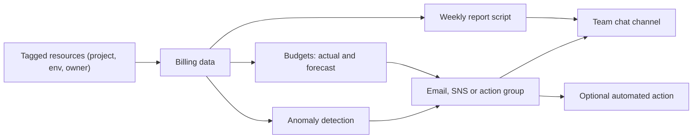

# Project: Cost Monitoring and Alerts

## Introduction

Cloud bills rarely explode because of one big decision. They grow from many small ones: a test database nobody deleted, a log level left on `DEBUG`, a NAT gateway carrying traffic that could have used a VPC endpoint, a function stuck in a retry loop over a weekend. The cloud will not stop you, because from its point of view you are simply using what you asked for.

The defense is **visibility plus fast feedback**: know who spends what, find out within hours (not at the end of the month) when spending changes, and make the right team look at it. In this project you build that feedback loop on both clouds:

1. **Attribution:** make costs traceable to projects with tags.
2. **Budgets:** alert on actual and *forecasted* spend for each project.
3. **Anomaly detection:** let machine learning flag unusual spikes that a budget would miss.
4. **A weekly cost report:** a small Python script that pulls cost by project from AWS Cost Explorer and Azure Cost Management, compares it with the previous week, and posts it to the team chat.

Background pages: [Cloud Pricing Models](../0-cloud-fundamentals/7-cloud-pricing-models.mdx), [Tagging Strategies](../1-cloud-getting-started/6-cloud-tagging.mdx), [Budgets and Billing Alerts](../1-cloud-getting-started/7-cloud-budgets-and-alerts.mdx) and [Cost Optimization and FinOps](../13-cloud-architecture/4-cloud-cost-optimization.mdx).

:::warning Cost and cleanup
Budgets, anomaly detection and cost analysis in the consoles are free or nearly free, but some parts of this project are billed: the **AWS Cost Explorer API charges per request**, and the scheduled function, its logs and the SNS topic bill per use. Keep the report weekly rather than every few minutes. Cleanup commands are at the end. Check current terms on the [AWS Cost Management pricing page](https://aws.amazon.com/aws-cost-management/pricing/) and the [Azure Cost Management documentation](https://learn.microsoft.com/azure/cost-management-billing/).
:::

:::caution Budgets are alarms, not limits
Neither AWS budgets nor Azure budgets stop your spending by default. They send notifications. Cost data also arrives with a delay (typically several hours, sometimes up to a day), so a budget alert is never instant. For hard protection against runaway resources you need automated actions (shown below) and guardrails such as quotas and policies.
:::

## The Feedback Loop



| Capability | AWS | Azure |
| --- | --- | --- |
| Cost attribution | Cost allocation tags (must be activated) | Resource tags in Cost Management (tag inheritance optional) |
| Budgets | AWS Budgets, with budget actions | Cost Management budgets with action groups |
| Anomaly detection | AWS Cost Anomaly Detection (monitors plus alert subscriptions) | Cost anomaly alerts in Cost Management |
| Query API | Cost Explorer API (`ce:GetCostAndUsage`) | Cost Management Query API |
| Bulk data for dashboards | Data Exports (CUR 2.0, FOCUS) to S3 | Cost exports (including FOCUS) to a storage account |
| Least-privilege read role | IAM policy with `ce:Get*` actions | Cost Management Reader |

## Step 1: Make Costs Attributable with Tags

Every resource from the earlier projects carried tags like `project=orders` and `env=dev`. Tags are only useful for cost if the billing system uses them.

### On AWS

User-defined tags appear in billing data only after you **activate them as cost allocation tags** in the management (payer) account. Activation is not retroactive, so do it early:

```bash
aws ce update-cost-allocation-tags-status \
  --cost-allocation-tags-status TagKey=project,Status=Active TagKey=env,Status=Active

aws ce list-cost-allocation-tags --status Active --query 'CostAllocationTags[].TagKey'
```

Example output:

```text
{
    "Errors": []
}
[
    "env",
    "project"
]
```

A tag key only shows up for activation after it has been used on at least one resource. Newly activated tags can take up to a day to appear in Cost Explorer.

### On Azure

Resource tags flow into Cost Management automatically. Two settings make them more useful:

- **Tag inheritance** (in Cost Management settings) applies subscription and resource group tags to the cost records of resources underneath. Tag the resource group once and every resource's costs carry the tag.
- **Azure Policy** can *require* tags such as `project` and `owner` on new resource groups, so untagged spend does not appear in the first place. See [Policies and Governance: SCPs and Azure Policy](../12-cloud-observability-and-security/7-cloud-compliance-and-governance.mdx).

Not every charge can be tagged on either cloud (for example some support, marketplace and data transfer charges). Expect an "(untagged)" bucket and work to keep it small.

## Step 2: Budgets with Forecast Alerts

A good budget setup alerts at several points: early on actual spend (50 percent), late on actual spend (90 percent), and on the **forecast** exceeding 100 percent. The forecast alert is the most valuable, because it fires days or weeks before the money is actually spent.

### On AWS

Create an SNS topic so alerts can reach chat and paging tools, not just email:

```bash
TOPIC_ARN=$(aws sns create-topic --name cost-alerts --query TopicArn --output text)
aws sns subscribe --topic-arn "$TOPIC_ARN" --protocol email --notification-endpoint finops@example.com
```

The topic needs a policy that lets AWS Budgets publish to it (`budgets.amazonaws.com` as the principal, with `aws:SourceAccount` set to your account). The console adds this for you. For the CLI, copy the topic policy from the [AWS Budgets section of the Cost Management user guide](https://docs.aws.amazon.com/cost-management/latest/userguide/).

Then describe the budget and its notifications in two files. The amount is your choice, in your billing currency:

```json
{
  "BudgetName": "orders-monthly",
  "BudgetType": "COST",
  "TimeUnit": "MONTHLY",
  "BudgetLimit": { "Amount": "500", "Unit": "USD" },
  "CostFilters": { "TagKeyValue": ["user:project$orders"] }
}
```

```json
[
  {
    "Notification": { "NotificationType": "ACTUAL", "ComparisonOperator": "GREATER_THAN", "Threshold": 50, "ThresholdType": "PERCENTAGE" },
    "Subscribers": [{ "SubscriptionType": "EMAIL", "Address": "finops@example.com" }]
  },
  {
    "Notification": { "NotificationType": "ACTUAL", "ComparisonOperator": "GREATER_THAN", "Threshold": 90, "ThresholdType": "PERCENTAGE" },
    "Subscribers": [{ "SubscriptionType": "SNS", "Address": "arn:aws:sns:us-east-1:111122223333:cost-alerts" }]
  },
  {
    "Notification": { "NotificationType": "FORECASTED", "ComparisonOperator": "GREATER_THAN", "Threshold": 100, "ThresholdType": "PERCENTAGE" },
    "Subscribers": [{ "SubscriptionType": "SNS", "Address": "arn:aws:sns:us-east-1:111122223333:cost-alerts" }]
  }
]
```

```bash
aws budgets create-budget \
  --account-id "$(aws sts get-caller-identity --query Account --output text)" \
  --budget file://budget.json \
  --notifications-with-subscribers file://notifications.json
```

The command prints nothing on success. `user:project$orders` means "the user-defined tag `project` with value `orders`".

**Budget actions** can go further when a threshold is crossed: apply an IAM policy or a service control policy that blocks new resource creation, or stop specific EC2 or RDS instances. Use them for sandbox and training accounts where a hard stop is better than a surprise bill. Avoid them in production, where stopping things can be worse than the cost.

### On Azure

Create an **action group** first. Action groups are reusable notification targets for Azure Monitor alerts and budgets (email, SMS, webhooks, Logic Apps, Functions, Automation runbooks):

```bash
az group create -n rg-finops -l westeurope
az monitor action-group create -g rg-finops -n ag-finops --short-name finops \
  --action email finops finops@example.com
AG_ID=$(az monitor action-group show -g rg-finops -n ag-finops --query id -o tsv)
```

Then deploy the budget with Bicep at subscription scope. The `filter` limits it to resources tagged `project=orders`:

```bicep
targetScope = 'subscription'

@description('Monthly budget in the billing currency of the subscription')
param amount int = 500

@description('First day of the current month, for example 2026-10-01')
param startDate string

@description('Resource ID of the action group that receives alerts')
param actionGroupId string

param contactEmails array = [
  'finops@example.com'
]

resource budget 'Microsoft.Consumption/budgets@2023-11-01' = {
  name: 'orders-monthly'
  properties: {
    category: 'Cost'
    amount: amount
    timeGrain: 'Monthly'
    timePeriod: {
      startDate: startDate
    }
    filter: {
      tags: {
        name: 'project'
        operator: 'In'
        values: [
          'orders'
        ]
      }
    }
    notifications: {
      actual50: {
        enabled: true
        operator: 'GreaterThanOrEqualTo'
        threshold: 50
        thresholdType: 'Actual'
        contactEmails: contactEmails
      }
      actual90: {
        enabled: true
        operator: 'GreaterThanOrEqualTo'
        threshold: 90
        thresholdType: 'Actual'
        contactEmails: contactEmails
        contactGroups: [
          actionGroupId
        ]
      }
      forecast100: {
        enabled: true
        operator: 'GreaterThan'
        threshold: 100
        thresholdType: 'Forecasted'
        contactEmails: contactEmails
        contactGroups: [
          actionGroupId
        ]
      }
    }
  }
}

output budgetId string = budget.id
```

```bash
az deployment sub create --location westeurope --template-file budget.bicep \
  --parameters startDate=2026-10-01 actionGroupId="$AG_ID"
```

Example output (trimmed):

```text
{
  "name": "budget",
  "properties": {
    "outputs": { "budgetId": { "value": "/subscriptions/.../providers/Microsoft.Consumption/budgets/orders-monthly" } },
    "provisioningState": "Succeeded"
  }
}
```

The start date must be the first day of a month. Defining budgets in Bicep (rather than with the `az consumption budget` commands, which are still marked preview) keeps them versioned alongside the rest of your infrastructure.

Because the 90 percent and forecast notifications call the action group, they can also trigger automation, such as a runbook that deallocates tagged dev VMs in the evening. That is Azure's equivalent of AWS budget actions.

## Step 3: Anomaly Detection

Budgets catch "we will spend more than planned this month". They miss "this service jumped from small to ten times that overnight" if the monthly total is still under budget. Anomaly detection learns your normal spending pattern and flags unusual changes per service, account or tag value.

### On AWS

Create a monitor for all AWS services and a subscription that alerts on significant anomalies:

```bash
MONITOR_ARN=$(aws ce create-anomaly-monitor --anomaly-monitor \
  '{"MonitorName":"all-services","MonitorType":"DIMENSIONAL","MonitorDimension":"SERVICE"}' \
  --query MonitorArn --output text)

cat > anomaly-sub.json <<EOF
{
  "SubscriptionName": "cost-anomalies-immediate",
  "MonitorArnList": ["$MONITOR_ARN"],
  "Subscribers": [{"Address": "$TOPIC_ARN", "Type": "SNS"}],
  "Frequency": "IMMEDIATE",
  "ThresholdExpression": {
    "And": [
      {"Dimensions": {"Key": "ANOMALY_TOTAL_IMPACT_ABSOLUTE", "MatchOptions": ["GREATER_THAN_OR_EQUAL"], "Values": ["50"]}},
      {"Dimensions": {"Key": "ANOMALY_TOTAL_IMPACT_PERCENTAGE", "MatchOptions": ["GREATER_THAN_OR_EQUAL"], "Values": ["40"]}}
    ]
  }
}
EOF
aws ce create-anomaly-subscription --anomaly-subscription file://anomaly-sub.json
```

Example output:

```text
{
    "SubscriptionArn": "arn:aws:ce::111122223333:anomalysubscription/1a2b3c4d-5e6f-7a8b-9c0d-1e2f3a4b5c6d"
}
```

The `And` threshold alerts only when an anomaly is both large in absolute terms (at least 50 in your billing currency) and large relative to normal spend (at least 40 percent above expected). That combination filters out noise from tiny services and from normal growth of big ones. `IMMEDIATE` alerts go to SNS. Daily and weekly summaries go to email. The older `Threshold` field is deprecated in favor of `ThresholdExpression`.

AWS also offers **AWS managed monitors** for linked accounts, cost allocation tags and cost categories, which automatically include new accounts or tag values as they appear. A managed monitor on the `project` tag is a natural next step.

### On Azure

Cost Management evaluates subscriptions for anomalies daily. Turn on alerts in the portal under **Cost Management > Cost alerts**, adding an anomaly alert for each subscription with your team's email (menu names change from time to time). Anomaly alerts can also be created through the Scheduled Actions API, which you can call from Bicep or the REST API if you manage many subscriptions. Check [Identify anomalies and unexpected changes in cost](https://learn.microsoft.com/azure/cost-management-billing/understand/analyze-unexpected-charges) for current options and scopes.

## Step 4: A Weekly Cost Report

Alerts tell you when something is wrong. A short weekly report builds the habit of looking at cost when nothing is wrong, which is where most savings come from. The script below pulls the last 7 days and the 7 days before that from both clouds, groups by the `project` tag, and flags projects that grew by 25 percent or more.

```python
# cost_report.py
"""Weekly cost by `project` tag from AWS Cost Explorer and Azure Cost Management."""
import datetime as dt
import json
import os
import urllib.request
from collections import defaultdict

TAG = "project"


def aws_costs_by_tag(start: dt.date, end: dt.date) -> dict[str, float]:
    import boto3

    ce = boto3.client("ce", region_name="us-east-1")   # Cost Explorer is a global API
    totals: dict[str, float] = defaultdict(float)
    kwargs = {
        "TimePeriod": {"Start": start.isoformat(), "End": end.isoformat()},  # End is exclusive
        "Granularity": "DAILY",
        "Metrics": ["UnblendedCost"],
        "GroupBy": [{"Type": "TAG", "Key": TAG}],
    }
    while True:
        resp = ce.get_cost_and_usage(**kwargs)
        for day in resp["ResultsByTime"]:
            for group in day["Groups"]:
                value = group["Keys"][0].split("$", 1)[1] or "(untagged)"  # "project$orders"
                totals[value] += float(group["Metrics"]["UnblendedCost"]["Amount"])
        if "NextPageToken" not in resp:
            return dict(totals)
        kwargs["NextPageToken"] = resp["NextPageToken"]


def azure_costs_by_tag(subscription_id: str, start: dt.date, end: dt.date) -> dict[str, float]:
    from azure.identity import DefaultAzureCredential
    from azure.mgmt.costmanagement import CostManagementClient
    from azure.mgmt.costmanagement.models import (
        QueryAggregation, QueryDataset, QueryDefinition, QueryGrouping, QueryTimePeriod)

    utc = dt.timezone.utc
    query = QueryDefinition(
        type="ActualCost",
        timeframe="Custom",
        time_period=QueryTimePeriod(
            from_property=dt.datetime.combine(start, dt.time.min, tzinfo=utc),
            to=dt.datetime.combine(end - dt.timedelta(days=1), dt.time.max, tzinfo=utc),
        ),
        dataset=QueryDataset(
            granularity="None",
            aggregation={"totalCost": QueryAggregation(name="Cost", function="Sum")},
            grouping=[QueryGrouping(type="TagKey", name=TAG)],
        ),
    )
    client = CostManagementClient(DefaultAzureCredential())
    result = client.query.usage(scope=f"/subscriptions/{subscription_id}", parameters=query)
    props = getattr(result, "properties", None) or result   # newer SDKs nest rows under properties
    names = [c.name for c in props.columns]
    totals: dict[str, float] = defaultdict(float)
    for row in props.rows or []:
        record = dict(zip(names, row))
        totals[record.get("TagValue") or "(untagged)"] += float(record["Cost"])
    return dict(totals)


def render(this_week: dict[str, float], last_week: dict[str, float], alert_pct: float = 25.0) -> str:
    lines = [f"{'project':<14}{'this week':>12}{'last week':>12}{'change':>9}"]
    for project in sorted(this_week, key=this_week.get, reverse=True):
        now, before = this_week[project], last_week.get(project, 0.0)
        change = ((now - before) / before * 100) if before else float("inf")
        flag = "  <-- check" if change >= alert_pct and now >= 1 else ""
        pct = "new" if before == 0 else f"{change:+.0f}%"
        lines.append(f"{project:<14}{now:>12.2f}{before:>12.2f}{pct:>9}{flag}")
    lines.append(f"{'total':<14}{sum(this_week.values()):>12.2f}{sum(last_week.values()):>12.2f}")
    return "\n".join(lines)


def merge(*sources: dict[str, float]) -> dict[str, float]:
    merged: dict[str, float] = defaultdict(float)
    for source in sources:
        for key, value in source.items():
            merged[key] += value
    return dict(merged)


def post_to_chat(text: str, webhook_url: str) -> None:
    body = json.dumps({"text": f"```{text}```"}).encode()
    req = urllib.request.Request(webhook_url, data=body, headers={"Content-Type": "application/json"})
    urllib.request.urlopen(req, timeout=10)


def main() -> None:
    today = dt.date.today()
    this_start, last_start = today - dt.timedelta(days=7), today - dt.timedelta(days=14)
    sub = os.environ["AZURE_SUBSCRIPTION_ID"]
    this_week = merge(aws_costs_by_tag(this_start, today), azure_costs_by_tag(sub, this_start, today))
    last_week = merge(aws_costs_by_tag(last_start, this_start), azure_costs_by_tag(sub, last_start, this_start))
    report = render(this_week, last_week)
    print(report)
    if os.environ.get("CHAT_WEBHOOK_URL"):
        post_to_chat(report, os.environ["CHAT_WEBHOOK_URL"])


if __name__ == "__main__":
    main()
```

Things to notice:

- **Pagination.** Cost Explorer returns `NextPageToken` for large results. The loop follows it.
- **Untagged costs are made visible** instead of being dropped. On AWS an untagged group comes back as `project$`. On Azure the tag value is empty.
- **Different SDK shapes.** Newer versions of `azure-mgmt-costmanagement` return rows under `result.properties`, older ones on the result itself. The `getattr` line handles both.
- **End dates differ.** Cost Explorer's `End` is exclusive. The Azure query uses an inclusive range, so the code ends at the last second of the previous day.
- **Amounts are in each account's billing currency.** If your AWS and Azure accounts bill in different currencies, convert before merging.

Run it locally after signing in to both clouds:

```bash
pip install boto3 azure-identity azure-mgmt-costmanagement
export AZURE_SUBSCRIPTION_ID=00000000-1111-2222-3333-444444444444
python cost_report.py
```

Example output (made-up numbers):

```text
project          this week   last week   change
orders               96.40       92.10      +5%
thumbs               41.25       12.60    +227%  <-- check
catalog              18.10       18.40      -2%
(untagged)            7.95        6.20     +28%  <-- check
total               163.70      129.30
```

Here `thumbs` more than tripled. Opening Cost Explorer filtered by `project=thumbs` and grouped by usage type would show, for example, that Lambda duration jumped after someone raised the function's memory, or that a retry loop kept reprocessing a poison message. That is exactly the kind of change the report is meant to surface.

### Least-privilege access for the report

- **AWS:** a role with only `ce:GetCostAndUsage` (Cost Explorer has no resource-level permissions, so the resource is `*`).
- **Azure:** the **Cost Management Reader** role on the subscription for the identity that runs the script.

### Schedule it

Run the report as a scheduled function so nobody has to remember it:

- **AWS:** package `cost_report.py` as a Lambda function and trigger it with **EventBridge Scheduler**, for example `cron(0 8 ? * MON *)` for 08:00 UTC every Monday. Keep the chat webhook URL in Secrets Manager and grant the Azure side access through workload identity federation, or run two separate reports.
- **Azure:** use a timer-triggered function. Azure Functions uses six-field NCRONTAB expressions with seconds first:

```python
import azure.functions as func

import cost_report

app = func.FunctionApp()


@app.timer_trigger(schedule="0 0 8 * * Mon", arg_name="timer", run_on_startup=False)
def weekly_cost_report(timer: func.TimerRequest) -> None:
    cost_report.main()
```

## Step 5: Dashboards for Deeper Analysis

The consoles cover most needs: **Cost Explorer** saved reports on AWS and **Cost analysis** saved views on Azure, both filterable by tag. When you need custom dashboards across both clouds:

- Export detailed billing data on a schedule: **AWS Data Exports** (CUR 2.0 or the FOCUS format) to S3, and **Cost Management exports** (including FOCUS) to a storage account.
- Query it with Athena or Synapse/Fabric, and visualize in QuickSight, Power BI or Grafana.
- **FOCUS** (the FinOps Open Cost and Usage Specification) gives both clouds' data the same column names, which makes a combined dashboard much simpler.

## Real-World Scenario

A SaaS company spends on both clouds: the product on AWS and the data platform on Azure. Finance gets one surprise per quarter, and each time it takes a week of detective work to find the cause. The most recent one was a forgotten GPU VM in a data science subscription that ran for six weeks.

**The solution:**

1. Enforce `project`, `env` and `owner` tags with Azure Policy and AWS tag policies, and activate them as cost allocation tags.
2. Give every project a monthly budget with 50 and 90 percent actual alerts and a 100 percent forecast alert to the owning team's channel.
3. Turn on anomaly detection on both clouds with thresholds that combine absolute and percentage impact.
4. Post the weekly report every Monday, and review the top three movers in the team's planning meeting.
5. Attach a budget action (AWS) and an action group runbook (Azure) to the **sandbox** accounts only, to stop or deallocate resources when the forecast is exceeded.

**Why this approach:** spending changes are caught within a day by anomaly alerts and within a week by the report, instead of at quarter end. Ownership is clear because every cost line has a project and an owner. Automation is limited to sandboxes, where stopping resources is safe.

**When to use it / when not to:**

- Every account that spends real money needs at least budgets and anomaly alerts. They are cheap and fast to set up.
- The custom report and exports pay off once you have several teams or both clouds. A solo developer can rely on the consoles.
- Do not use automated shutdown actions on production workloads unless you have carefully decided that an outage is preferable to the cost.

**Alternatives and trade-offs:**

| Approach | Pros | Cons | Best for |
| --- | --- | --- | --- |
| Native budgets and anomaly alerts | Free or nearly free, quick to set up | Notification only, delayed data, one cloud each | Everyone, as a baseline |
| Custom report script (this project) | Tailored to your tags and channels, both clouds in one view | Code to maintain, API costs on AWS | Teams that want a regular cost review habit |
| Exports + BI dashboards (FOCUS) | Full detail, custom allocations, history | Data pipeline and BI tool to run | Larger organizations with FinOps practice |
| Third-party FinOps platforms | Multi-cloud views, recommendations, showback | Subscription cost, data sharing | Many accounts, central FinOps team |
| Budget actions and automated shutdown | Hard stop on runaway spend | Can cause outages, needs careful scoping | Sandboxes, training and dev |

## Common Mistakes

- **Not activating cost allocation tags on AWS.** Tags exist on resources but never show up in Cost Explorer or budgets.
- **Only alerting on actual spend.** By the time actual spend crosses 100 percent, the month's money is gone. Add forecast alerts.
- **Budgets that email one person.** That person goes on holiday. Send alerts to a team channel or a shared mailbox through SNS or action groups.
- **Thresholds that fire constantly.** Teams learn to ignore noisy alerts. Combine absolute and percentage thresholds, and tune them after a few weeks.
- **Polling the Cost Explorer API every few minutes.** Each request is billed, and the data only refreshes a few times a day anyway.
- **Expecting budgets to cap spending.** They notify. Use quotas, policies and actions for hard limits.
- **Ignoring untagged spend.** It grows quietly. Report it explicitly and enforce tags with policy.

## Cleanup

### On AWS

```bash
ACCOUNT_ID=$(aws sts get-caller-identity --query Account --output text)
aws budgets delete-budget --account-id "$ACCOUNT_ID" --budget-name orders-monthly
SUB_ARN=$(aws ce get-anomaly-subscriptions --query "AnomalySubscriptions[?SubscriptionName=='cost-anomalies-immediate'].SubscriptionArn" --output text)
aws ce delete-anomaly-subscription --subscription-arn "$SUB_ARN"
aws ce delete-anomaly-monitor --monitor-arn "$MONITOR_ARN"
aws sns delete-topic --topic-arn "$TOPIC_ARN"
```

Keep the cost allocation tags active. They cost nothing and you will want the history later.

### On Azure

```bash
az consumption budget delete --budget-name orders-monthly
az group delete -n rg-finops --yes --no-wait
```

Turn off the anomaly alert in the portal if you created one only for this exercise.

## Summary

- Cost control starts with **attribution**: tag everything, activate cost allocation tags on AWS, and use tag inheritance and policy on Azure.
- **Budgets** should alert on actual spend early and late, and on **forecasted** spend. They are notifications, not limits.
- **Anomaly detection** catches sudden changes that budgets miss. Combine absolute and percentage thresholds to reduce noise.
- A small **weekly report** across both clouds, using the Cost Explorer API and the Cost Management Query API with least-privilege roles, builds a habit of reviewing cost.
- Use **automated actions** (AWS budget actions, Azure action groups with runbooks) only where stopping resources is safe, such as sandboxes.

## Exercises

1. Extend `cost_report.py` to group by both `project` and `env`, and highlight any `dev` environment that costs more than its `prod` counterpart.
2. Create an AWS managed anomaly monitor on the `project` cost allocation tag, and compare its alerts with the service monitor over two weeks.
3. Build an Azure Automation runbook (or a Function) that deallocates VMs tagged `env=dev` and connect it to the forecast notification of a sandbox budget.
4. Set up FOCUS exports on both clouds into storage, query a month of data, and produce a single chart of daily cost per project across AWS and Azure.

**Related pages:** [Spot, Reserved and Savings Plans](../3-cloud-compute/4-cloud-spot-and-reserved.mdx), [Alerting and Dashboards](../12-cloud-observability-and-security/3-cloud-alerting.mdx), [Serverless Trade-offs and Costs](../4-cloud-serverless/7-cloud-serverless-trade-offs.mdx), the previous project [Project: Multi-Environment Infrastructure as Code](./5-cloud-project-multi-env-iac.mdx), and the final project, [Capstone: Production-Ready Cloud Application](./7-cloud-capstone.mdx).
