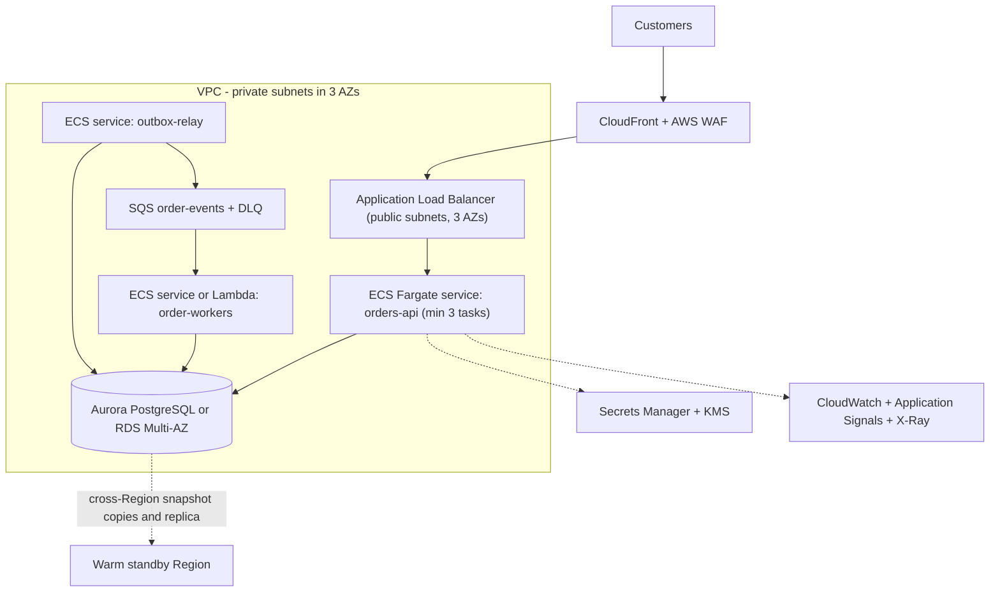
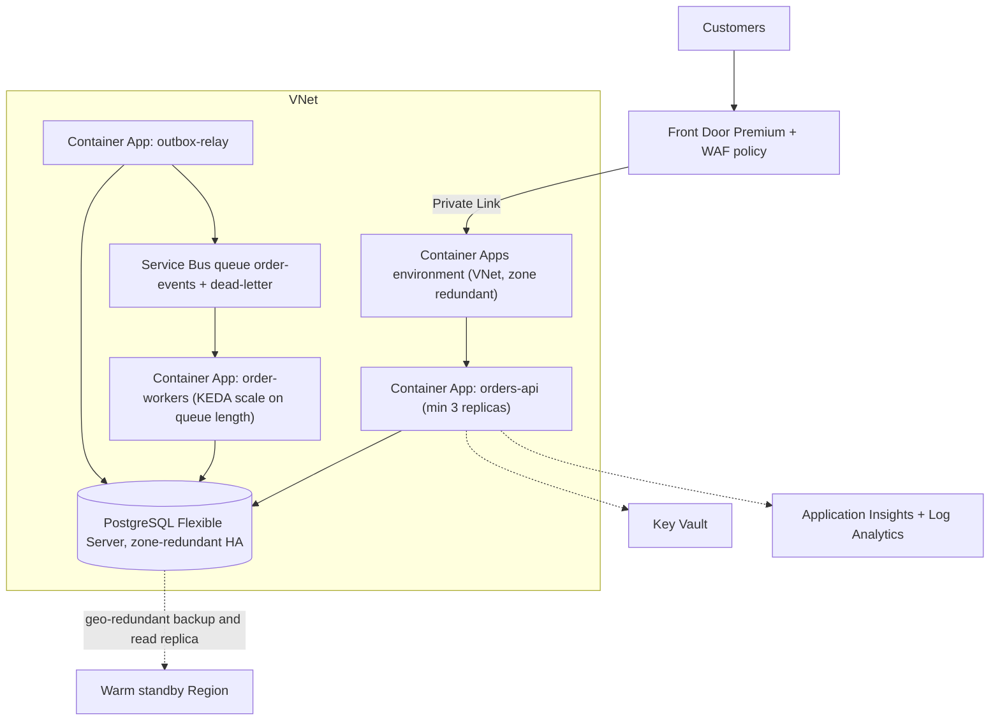
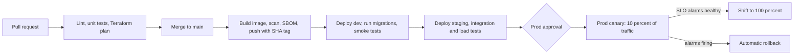

# Capstone: Production-Ready Cloud Application

## Introduction

The earlier projects each focused on one skill: a static site, a serverless API, a three-tier app, containers, events, multi-environment IaC and cost control. Real systems need all of them at once, plus the parts that only matter in production: what happens at 3 a.m. when a database fails over, how you know users are affected before they tell you, how you roll back a bad release in minutes, and how you prove to an auditor who changed what.

This capstone pulls the course together. You design and build an **order service** for an online store and take it to a production-ready state on **one** cloud of your choice, with the design shown for both AWS and Azure so you can compare. Unlike the earlier projects, this page is less of a click-by-click guide and more of a **blueprint with key implementation pieces and a checklist**. You assemble the infrastructure from the earlier projects and the concept pages, and the checklist tells you when you are done.

"Production-ready" here means the service is:

- **Secure:** no long-lived credentials, least privilege, encrypted data, protected edge, audited changes.
- **Reliable:** survives the loss of an instance or an Availability Zone, retries safely, degrades gracefully.
- **Observable:** you can answer "is it working for users, and if not, why?" from dashboards, traces and logs.
- **Operable:** every change goes through a pipeline with automated checks and a fast rollback.
- **Recoverable:** backups are tested, and you know your recovery time and data loss limits.
- **Cost-aware:** spending is attributed, budgeted and reviewed.

These map directly to the pillars of the [AWS Well-Architected Framework and the Azure Well-Architected Framework](../13-cloud-architecture/0-cloud-well-architected.mdx).

:::warning Cost and cleanup
A production-shaped deployment is the most expensive thing in this tutorial. Multi-AZ databases, a WAF, a CDN, always-on container replicas, NAT gateways or private endpoints, log ingestion and backups all bill continuously, and several of them bill by the hour even with no traffic. Build it in a dedicated account or subscription, set a budget with forecast alerts first ([Project: Cost Monitoring and Alerts](./6-cloud-project-cost-dashboard.mdx)), estimate it with the [AWS Pricing Calculator](https://calculator.aws/) or the [Azure Pricing Calculator](https://azure.microsoft.com/pricing/calculator/), and destroy it with `terraform destroy` when you finish. Leaving it running for a month is a real expense.
:::

## Step 1: Requirements

Good architecture starts from requirements, not from services. Write them down before choosing anything:

| Type | Requirement |
| --- | --- |
| Functional | Customers create orders (`POST /orders`) and check status (`GET /orders/{id}`). Creating an order triggers payment, inventory and email processing asynchronously. |
| Availability | 99.9 percent of requests succeed each month, measured at the edge. Survive the loss of one Availability Zone without manual action. |
| Latency | 95 percent of `POST /orders` requests complete in under 300 ms at expected peak load. |
| Durability | An accepted order is never lost. A retried request never creates a duplicate order. |
| Recovery | Recovery point objective (RPO) of 5 minutes and recovery time objective (RTO) of 1 hour for a full Region outage. |
| Security | No long-lived keys anywhere. Database not reachable from the internet. WAF at the edge. All changes audited. |
| Operations | Deploy several times a day with zero downtime. Roll back in under 10 minutes. |
| Cost | Every resource tagged. Monthly budget with forecast alerts. Weekly cost review. |

A **99.9 percent** monthly target allows about **43 minutes** of failed requests per 30-day month. That **error budget** guides decisions: if you have used most of it, you slow down releases and invest in reliability. [High Availability Design](../13-cloud-architecture/1-cloud-high-availability.mdx) explains how targets translate into architecture.

## Step 2: Architecture Decisions

Record each major choice as a short decision record: the options, the decision and why. Here are the decisions for this capstone.

| Decision | Options considered | Choice | Why |
| --- | --- | --- | --- |
| Compute | Functions, containers, VMs, Kubernetes | Managed containers (ECS Fargate or Container Apps) | Steady traffic, existing Docker skills, long-lived connections to the database, no cluster to operate |
| Database | DynamoDB or Cosmos DB, managed PostgreSQL | Managed PostgreSQL with zone-redundant HA | Orders are relational and need transactions. The team knows SQL. |
| Async processing | Direct calls, queue, event bus | Queue fed by a transactional outbox | Durable, decoupled, no lost events if the queue is briefly unavailable |
| Edge | Load balancer only, CDN + WAF | CDN with WAF in front of the load balancer or ingress | TLS at the edge, bot and injection protection, caching for static assets |
| Identity | Keys, roles and managed identities | IAM roles, managed identities, OIDC for CI | No secrets to rotate or leak |
| IaC | Console, native IaC, Terraform | Terraform with per-environment state | Same tool on both clouds, layout from [Project: Multi-Environment Infrastructure as Code](./5-cloud-project-multi-env-iac.mdx) |
| Observability | Logs only, logs + metrics + traces | OpenTelemetry traces, structured logs, metrics, SLO-based alerts | Faster diagnosis across the API, database and queue |
| DR | Backup and restore, pilot light, warm standby, active-active | Warm standby in a second Region | Meets a 1-hour RTO at a fraction of active-active cost and complexity |

[Choosing a Compute Option](../3-cloud-compute/0-cloud-compute-options.mdx), [Choosing a Cloud Database](../7-cloud-databases/0-cloud-database-options.mdx) and [Disaster Recovery Strategies](../13-cloud-architecture/2-cloud-disaster-recovery.mdx) go deeper on each trade-off.

## Step 3: Reference Architecture

### On AWS



### On Azure



| Concern | AWS | Azure |
| --- | --- | --- |
| Edge, TLS and WAF | CloudFront + AWS WAF managed rule groups | Front Door Premium + WAF policy with managed rule sets |
| Origin protection | Origin only accepts traffic from CloudFront (managed prefix list or VPC origin) | Private Link origin, no public ingress on the environment |
| API compute | ECS Fargate across 3 AZs, target tracking autoscaling | Container Apps in a zone-redundant environment, HTTP scale rule |
| Database | Aurora PostgreSQL (or RDS Multi-AZ), PITR, deletion protection | PostgreSQL Flexible Server with zone-redundant HA, PITR |
| Messaging | SQS standard queue with DLQ | Service Bus queue with dead-letter subqueue |
| Workers | ECS service scaling on queue depth, or Lambda | Container Apps with a KEDA Service Bus scale rule |
| Secrets and keys | Secrets Manager, KMS customer-managed keys | Key Vault, customer-managed keys where required |
| Workload identity | ECS task roles | User-assigned managed identities |
| Telemetry | CloudWatch Logs and metrics, Application Signals, X-Ray | Application Insights (OpenTelemetry), Log Analytics |
| Threat detection and posture | GuardDuty, Security Hub, AWS Config | Microsoft Defender for Cloud, Azure Policy |
| Audit | CloudTrail organization trail | Activity Log exported to Log Analytics |
| Backup and DR | AWS Backup with cross-Region copy, standby stack | Geo-redundant backups, read replica, standby stack |

## Step 4: Build the Application for Production

The code is where many "cloud" reliability problems actually live. Three patterns matter most for this service.

### Idempotent writes and the transactional outbox

Clients, load balancers and SDKs all retry. Without protection, a retried `POST /orders` after a timeout creates a second order. And if the service writes the order and then fails before publishing the "order created" event, payment never happens. Both problems are solved inside **one database transaction**:

```sql
-- schema.sql
CREATE TABLE orders (
    id          UUID PRIMARY KEY,
    customer_id TEXT NOT NULL,
    sku         TEXT NOT NULL,
    quantity    INT  NOT NULL CHECK (quantity > 0),
    status      TEXT NOT NULL,
    created_at  TIMESTAMPTZ NOT NULL DEFAULT now()
);
CREATE TABLE idempotency (
    key        TEXT PRIMARY KEY,
    order_id   UUID NOT NULL,
    created_at TIMESTAMPTZ NOT NULL DEFAULT now()
);
CREATE TABLE outbox (
    id           UUID PRIMARY KEY,
    topic        TEXT NOT NULL,
    payload      JSONB NOT NULL,
    created_at   TIMESTAMPTZ NOT NULL DEFAULT now(),
    published_at TIMESTAMPTZ
);
CREATE INDEX outbox_unpublished ON outbox (created_at) WHERE published_at IS NULL;
```

```python
# orders.py (excerpt)
import json
import uuid

import psycopg
from fastapi import FastAPI, Header, HTTPException
from pydantic import BaseModel, Field

app = FastAPI(title="orders")
DSN = "postgresql://..."  # built from env vars and the secret store at startup


class OrderIn(BaseModel):
    customer_id: str
    sku: str
    quantity: int = Field(gt=0, le=100)


@app.post("/orders", status_code=201)
def create_order(order: OrderIn, idempotency_key: str = Header(min_length=8, max_length=64)):
    order_id = str(uuid.uuid4())
    with psycopg.connect(DSN) as conn, conn.transaction():
        # 1. Idempotency: a retried request with the same key returns the first result
        row = conn.execute(
            "INSERT INTO idempotency (key, order_id) VALUES (%s, %s) "
            "ON CONFLICT (key) DO NOTHING RETURNING order_id",
            (idempotency_key, order_id),
        ).fetchone()
        if row is None:
            existing = conn.execute(
                "SELECT order_id FROM idempotency WHERE key = %s", (idempotency_key,)
            ).fetchone()
            return {"order_id": existing[0], "replayed": True}

        # 2. Business write and outbox event in the SAME transaction
        conn.execute(
            "INSERT INTO orders (id, customer_id, sku, quantity, status) "
            "VALUES (%s, %s, %s, %s, 'pending')",
            (order_id, order.customer_id, order.sku, order.quantity),
        )
        conn.execute(
            "INSERT INTO outbox (id, topic, payload) VALUES (%s, 'order-created', %s)",
            (str(uuid.uuid4()), json.dumps({"order_id": order_id, **order.model_dump()})),
        )
    return {"order_id": order_id, "replayed": False}


@app.get("/healthz/live")
def live():
    return {"status": "ok"}                 # process is running


@app.get("/healthz/ready")
def ready():
    try:
        with psycopg.connect(DSN, connect_timeout=2) as conn:
            conn.execute("SELECT 1")
    except psycopg.Error:
        raise HTTPException(503, "database unavailable")
    return {"status": "ready"}              # safe to receive traffic
```

- The `Idempotency-Key` header, generated once by the client per logical order, makes retries safe. A replay returns the original order ID.
- The order and its event are committed together. Either both exist or neither does.
- **Liveness** (`/healthz/live`) only says "the process runs", so the platform restarts truly stuck containers. **Readiness** (`/healthz/ready`) checks the database, so an instance that cannot reach it stops receiving traffic but is not killed. Configure the load balancer or ingress to use readiness, and keep liveness shallow, for the reasons explained in [Project: Three-Tier Web Application](./2-cloud-project-three-tier-app.mdx).

A small relay process moves outbox rows to the queue. `FOR UPDATE SKIP LOCKED` lets several relay replicas run without publishing the same row twice at the same moment:

```python
# relay.py
import json
import os
import time

import psycopg


def relay_once(conn: psycopg.Connection, publish) -> int:
    """Publish up to 50 unsent outbox rows. Safe to run in several replicas."""
    with conn.transaction():
        rows = conn.execute(
            "SELECT id, topic, payload FROM outbox WHERE published_at IS NULL "
            "ORDER BY created_at LIMIT 50 FOR UPDATE SKIP LOCKED"
        ).fetchall()
        for row_id, topic, payload in rows:
            publish(topic, json.dumps(payload))          # at-least-once: consumers must be idempotent
            conn.execute("UPDATE outbox SET published_at = now() WHERE id = %s", (row_id,))
    return len(rows)


def aws_publisher():
    import boto3
    sqs, url = boto3.client("sqs"), os.environ["ORDER_EVENTS_QUEUE_URL"]
    return lambda topic, body: sqs.send_message(
        QueueUrl=url, MessageBody=body, MessageAttributes={"topic": {"DataType": "String", "StringValue": topic}})


def azure_publisher():
    from azure.identity import DefaultAzureCredential
    from azure.servicebus import ServiceBusClient, ServiceBusMessage
    client = ServiceBusClient(os.environ["SERVICEBUS_FQDN"], DefaultAzureCredential())
    sender = client.get_queue_sender(queue_name="order-events")
    return lambda topic, body: sender.send_messages(ServiceBusMessage(body, subject=topic))


if __name__ == "__main__":
    publish = aws_publisher() if os.environ.get("CLOUD") == "aws" else azure_publisher()
    with psycopg.connect(os.environ["DATABASE_URL"], autocommit=True) as conn:
        while True:
            if relay_once(conn, publish) == 0:
                time.sleep(1)
```

The relay delivers **at least once**: if it crashes after publishing but before marking the row, the event is sent again. The workers must therefore be idempotent too, for example by recording processed event IDs. [Event-Driven Patterns in the Cloud](../9-cloud-messaging-and-integration/4-cloud-event-driven-patterns.mdx) covers outbox, idempotent consumers and sagas in more detail.

### Telemetry with OpenTelemetry

Instrument once with OpenTelemetry and send the data to each cloud's backend:

- **Azure:** install `azure-monitor-opentelemetry` and call `configure_azure_monitor()` at startup. It reads `APPLICATIONINSIGHTS_CONNECTION_STRING`, and automatically collects requests, dependencies (including PostgreSQL calls through supported instrumentations), exceptions and logs.
- **AWS:** use the AWS Distro for OpenTelemetry (ADOT) Python package with **CloudWatch Application Signals**, which gives service maps, SLOs and traces in X-Ray without changing application code.

```python
# Azure: first lines of the API's entry point
from azure.monitor.opentelemetry import configure_azure_monitor

configure_azure_monitor()   # must run before the web framework is imported

from orders import app      # noqa: E402  (FastAPI app is now auto-instrumented)
```

Log in **JSON** with a correlation ID (the trace ID) on every line, so you can jump from an alert to a trace to the exact log lines. [Distributed Tracing: X-Ray and Application Insights](../12-cloud-observability-and-security/2-cloud-tracing.mdx) shows the setup on both clouds.

### Graceful behavior under stress

- Set **timeouts** on every outbound call (database, queue, other services), shorter than the caller's timeout.
- Use **retries with exponential backoff and jitter**, and only for errors that can succeed on retry.
- Use a **connection pool** sized for `replicas x pool size` to stay under the database's connection limit.
- Handle `SIGTERM`: stop accepting new requests, finish in-flight ones, then exit. Both platforms send it before stopping a container.

## Step 5: Infrastructure as Code

Reuse the multi-environment layout from [Project: Multi-Environment Infrastructure as Code](./5-cloud-project-multi-env-iac.mdx) and add modules for each building block:

```text
infra/
├── modules/
│   ├── network/          # VPC or VNet, subnets in 3 AZs, endpoints
│   ├── edge/             # CloudFront + WAF, or Front Door + WAF
│   ├── database/         # Aurora/RDS or PostgreSQL Flexible Server, backups, alarms
│   ├── messaging/        # SQS + DLQ, or Service Bus namespace + queue
│   ├── service/          # one container service: image, scaling, identity, secrets
│   ├── observability/    # dashboards, alarms, log retention, action groups or SNS
│   └── budget/           # budgets and anomaly alerts from the cost project
└── aws/ or azure/
    ├── main.tf           # wires modules together
    ├── dev.tfvars  staging.tfvars  prod.tfvars
    └── backend-dev.hcl  backend-staging.hcl  backend-prod.hcl
```

Environment differences belong in the `.tfvars` files only. For example, prod sets three minimum replicas, zone-redundant database HA, deletion protection, 35-day backup retention and 365-day log retention, while dev uses one replica, a small single-zone database and 7-day retention. The earlier projects contain working Terraform for networks, databases, Key Vault references, container services and budgets that you can turn into these modules.

## Step 6: CI/CD with Safe Releases



Key rules:

- **Build once, deploy the same image everywhere.** Tag images with the Git SHA, and promote that exact image from dev to prod. Never rebuild per environment.
- **Scan images** (for example Amazon Inspector for ECR, Microsoft Defender for container registries, or Trivy in the pipeline) and fail the build on critical findings.
- **Run database migrations as a separate pipeline step** before the new version takes traffic, and make them backward compatible (expand first, contract later), so the old and new versions can run side by side during a canary.
- **Canary with automatic rollback.** On AWS, ECS deployments can use the deployment circuit breaker plus CloudWatch alarms for rollback, or blue/green with CodeDeploy. On Azure, shift Container Apps revision weights from the pipeline and roll back if alerts fire. [Deployment Strategies in the Cloud](../11-cloud-devops/2-cloud-deployment-strategies.mdx) compares the options.
- **OIDC everywhere.** The pipeline assumes per-environment roles or managed identities, as in [Keyless CI/CD with OIDC](../2-cloud-identity/6-cloud-oidc-for-ci.mdx).

## Step 7: SLOs, Dashboards and Alerts

Alert on **symptoms users feel**, not on every internal metric. For this service, page someone when:

1. The **error rate** at the edge or load balancer is high enough to burn the error budget quickly.
2. **Latency** at the 95th percentile exceeds the target for several minutes.
3. Messages are piling up in the **dead-letter queue**.

Everything else (high CPU, a single failed task) goes to a dashboard or a ticket, not a pager.

### On AWS

```bash
aws cloudwatch put-metric-alarm --alarm-name orders-api-5xx \
  --namespace AWS/ApplicationELB --metric-name HTTPCode_Target_5XX_Count \
  --dimensions Name=LoadBalancer,Value=app/orders-prod/0123456789abcdef \
  --statistic Sum --period 60 --evaluation-periods 5 --datapoints-to-alarm 3 \
  --threshold 10 --comparison-operator GreaterThanThreshold \
  --treat-missing-data notBreaching \
  --alarm-actions arn:aws:sns:eu-west-1:111122223333:orders-oncall
```

"Three of the last five minutes had more than 10 server errors" filters out single blips. Application Signals can also define the 99.9 percent availability SLO directly and alert on its burn rate.

### On Azure

```bash
az monitor metrics alert create -n orders-api-failed-requests -g rg-orders-prod \
  --scopes "$APPINSIGHTS_ID" \
  --condition "count requests/failed > 10" \
  --window-size 5m --evaluation-frequency 1m --severity 2 \
  --action "$ONCALL_ACTION_GROUP_ID"
```

Build one dashboard per service with the **four golden signals** (traffic, errors, latency and saturation) plus queue depth and DLQ count. [Alerting and Dashboards](../12-cloud-observability-and-security/3-cloud-alerting.mdx) covers burn-rate alerts and dashboard design.

## Step 8: Security Baseline

Work through this list for the production account or subscription. Each item links to the page that explains it.

| Area | AWS | Azure | Learn more |
| --- | --- | --- | --- |
| Human access | IAM Identity Center with MFA, no IAM users | Entra ID with MFA and Conditional Access, PIM for admin roles | [Federation, SSO and Identity Center](../2-cloud-identity/5-cloud-federation-and-sso.mdx) |
| Workload access | Task roles scoped per service | Managed identity per app, data-plane RBAC | [Workload Identity](../2-cloud-identity/4-cloud-workload-identity.mdx) |
| Network | Private subnets, security groups by reference, VPC endpoints | VNet integration, private endpoints, NSGs | [Private Endpoints, Peering and Transit](../8-cloud-networking/7-cloud-private-connectivity.mdx) |
| Edge | AWS WAF managed rules, rate limiting | Front Door WAF managed rules, rate limiting | [CDNs: CloudFront and Azure Front Door](../8-cloud-networking/6-cloud-cdn.mdx) |
| Secrets | Secrets Manager with rotation | Key Vault with RBAC, references | [Secrets Management](../11-cloud-devops/4-cloud-secrets-management.mdx) |
| Encryption | KMS keys for database, queue, logs, backups | Platform or customer-managed keys | [Encryption and KMS](../12-cloud-observability-and-security/5-cloud-encryption-and-kms.mdx) |
| Detection | GuardDuty, Security Hub, Inspector | Defender for Cloud plans | [Cloud Security Services](../12-cloud-observability-and-security/4-cloud-security-services.mdx) |
| Audit | Organization CloudTrail to a locked log archive account | Activity Log and resource logs to a central workspace | [Audit Logging](../12-cloud-observability-and-security/6-cloud-audit-logging.mdx) |
| Guardrails | SCPs: deny leaving Regions, deny disabling CloudTrail | Azure Policy: allowed Regions, required tags, deny public IPs | [Policies and Governance](../12-cloud-observability-and-security/7-cloud-compliance-and-governance.mdx) |

## Step 9: Disaster Recovery

High availability (surviving an AZ failure) and disaster recovery (surviving a Region failure, a bad migration or deleted data) are different problems. Zone redundancy does nothing for `DROP TABLE orders`.

| Strategy | What runs in the second Region | Typical recovery speed | Relative cost |
| --- | --- | --- | --- |
| Backup and restore | Nothing, only backup copies | Hours | Lowest |
| Pilot light | Data replication, infrastructure defined but scaled to zero | Tens of minutes to hours | Low |
| **Warm standby (chosen)** | Data replica plus a small running copy of the app | Minutes | Medium |
| Multi-site active-active | Full capacity in both Regions | Near zero | Highest, plus data consistency complexity |

For this capstone:

- **Point-in-time restore** covers data mistakes: practice restoring the database to "five minutes before the bad migration" into a new instance.
- **Cross-Region replicas or backup copies** cover Region loss (Aurora Global Database or RDS cross-Region read replicas, AWS Backup copies, or a PostgreSQL Flexible Server read replica and geo-redundant backups on Azure).
- **The same Terraform** deploys the standby stack with small capacity. Failover means promoting the replica, scaling up the standby and switching DNS or the CDN origin.
- **Test it.** A DR plan that has never been executed is a hope, not a plan. Run a failover drill each quarter and measure the real RTO and RPO.

## Step 10: Prove It: Load Tests and Game Days

Verify the latency target and autoscaling with a load test against staging:

```javascript
// load.mjs, run with: k6 run -e BASE_URL=https://staging.example.com load.mjs
import http from "k6/http";
import { check, sleep } from "k6";

export const options = {
  stages: [
    { duration: "2m", target: 50 },   // ramp up to 50 virtual users
    { duration: "10m", target: 50 },  // hold
    { duration: "1m", target: 0 },    // ramp down
  ],
  thresholds: {
    http_req_failed: ["rate<0.001"],   // fewer than 0.1 percent errors
    http_req_duration: ["p(95)<300"],  // 95 percent of requests under 300 ms
  },
};

export default function () {
  const body = JSON.stringify({ customer_id: `c-${__VU}`, sku: "sku-100", quantity: 1 });
  const res = http.post(`${__ENV.BASE_URL}/orders`, body, {
    headers: { "Content-Type": "application/json", "Idempotency-Key": `load-${__VU}-${__ITER}-${Date.now()}` },
  });
  check(res, { "created": (r) => r.status === 201 });
  sleep(1);
}
```

Example output (trimmed):

```text
     ✓ created

     http_req_duration..............: avg=84ms  p(95)=212ms
     http_req_failed................: 0.00%
     iterations.....................: 30412
```

Then run **game days**: inject failures on purpose and watch whether alarms fire, autoscaling reacts and runbooks work. AWS Fault Injection Service and Azure Chaos Studio can stop tasks or replicas, add latency, or force a database failover in a controlled way. Start in staging, always with a stop condition tied to an alarm.

## Step 11: Go-Live Checklist

Use this as the definition of done for the capstone:

- [ ] Requirements and architecture decision records are written and reviewed.
- [ ] All infrastructure is in Terraform with separate dev, staging and prod state, deployed only by the pipeline.
- [ ] No long-lived credentials exist. CI uses OIDC, and workloads use roles or managed identities.
- [ ] The database has no public endpoint, has zone-redundant HA, PITR, deletion protection and encrypted backups.
- [ ] The edge has TLS, a WAF with managed rules and a rate limit.
- [ ] `POST /orders` is idempotent and uses the outbox. Workers are idempotent. A DLQ exists with an alarm.
- [ ] Liveness and readiness probes are configured correctly.
- [ ] Traces, structured logs and metrics flow to the cloud backend. A dashboard shows the golden signals.
- [ ] SLO-based alerts page on-call. Each alert links to a runbook.
- [ ] Canary deployments with automatic or one-command rollback have been tested with a broken build.
- [ ] A load test at expected peak passed in staging.
- [ ] A database restore and a Region failover drill have been executed and timed.
- [ ] Tags, a budget with forecast alerts, anomaly detection and the weekly cost report are in place.
- [ ] Threat detection and audit logging are on, and guardrail policies are assigned.

## Real-World Scenario

A mid-sized outdoor retailer is replatforming its order system from a monolith in a colocation facility. Black Friday traffic is roughly five times a normal day, last year's outage cost a day of sales, and the payment provider requires evidence of encryption, access control and audit logging.

**The solution:** the team builds exactly this capstone on AWS, where most of their other systems run. They start with the multi-environment IaC skeleton and the pipeline, then build the order API and outbox, then the workers. Before go-live they run a load test at five times normal traffic, a failover drill and a game day that kills tasks during the test. The Azure design is kept as an evaluated alternative in the decision records, because the data team runs on Azure and may want to host the reporting side there later.

**Why this approach:**

- Managed containers and a managed database remove server and database administration, so a small team can focus on the order logic.
- The outbox and idempotency keys meet the "never lose or duplicate an order" requirement without distributed transactions.
- Warm standby meets the one-hour RTO without paying for full active-active capacity.
- The checklist gives the payment provider's auditor concrete evidence for each control.

**When to use it / when not to:**

- Use this level of rigor for revenue-critical or customer-facing services with an availability target and a compliance requirement.
- It is too much for an internal tool used by ten people. A single serverless stack with backups and an alarm (like [Project: Serverless REST API](./1-cloud-project-serverless-api.mdx)) is often enough.
- Before going multi-cloud for resilience, read [Multi-Cloud and Hybrid Strategy](../13-cloud-architecture/5-cloud-multi-cloud-strategy.mdx). For most teams, multi-Region on one cloud gives better resilience per unit of effort.

**Alternatives and trade-offs:**

| Approach | Pros | Cons | Best for |
| --- | --- | --- | --- |
| Managed containers + managed PostgreSQL (this capstone) | Balanced control and operations effort, portable images | Always-on cost, container pipeline to maintain | Most production web services |
| Serverless (Lambda or Functions + DynamoDB or Cosmos DB) | Scales to zero, minimal operations | Different data model, cold starts, platform limits | Spiky workloads, small teams |
| Kubernetes (EKS or AKS) | Maximum flexibility, ecosystem, multi-service platform | Cluster operations and upgrades, steeper learning curve | Organizations with a platform team and many services |
| PaaS web app (App Service or Elastic Beanstalk) | Simplest deployment model | Less control over networking and rollout details | Smaller monoliths |
| Active-active multi-Region | Highest availability | Data consistency challenges, roughly double cost | Services where minutes of downtime are unacceptable |

## Common Mistakes

- **Starting with services instead of requirements.** Without an availability target, RPO and RTO, every design discussion becomes opinion.
- **Treating zone redundancy as disaster recovery.** It does not protect against Region outages, bad deployments or deleted data.
- **Health checks that kill healthy instances.** A deep liveness check restarts everything during a database blip. Separate liveness from readiness.
- **No idempotency.** Retries are guaranteed to happen. Without idempotency keys and idempotent consumers, they create duplicates.
- **Alerting on causes instead of symptoms.** Hundreds of CPU alerts train people to ignore pages. Alert on user-facing SLOs.
- **Migrations that break the old version.** During a canary both versions run. Make schema changes backward compatible.
- **Untested backups and failover.** The first restore should not happen during a real incident.
- **"Temporary" manual changes in prod.** They cause drift and surprise reverts. Everything goes through the pipeline.

## Cleanup

When you finish the capstone, destroy all environments in reverse order through the pipeline or locally:

```bash
cd infra/aws        # or infra/azure
for env in prod staging dev; do
  terraform init -reconfigure -backend-config=backend-$env.hcl
  terraform destroy -var-file=$env.tfvars
done
```

Example output (per environment):

```text
Destroy complete! Resources: 87 destroyed.
```

Prod resources with deletion protection (database, state bucket, Key Vault purge protection) need protection turned off first, through a reviewed change. Also delete:

- Manual and final database snapshots, and AWS Backup recovery points or Azure backup vault items (they are billed).
- Images in ECR or ACR, and log groups or workspaces with long retention.
- The standby Region's resources, if you deployed them separately.
- DNS records that pointed to the service, to avoid dangling records.

## Summary

- Production readiness is a **set of properties** (secure, reliable, observable, operable, recoverable and cost-aware), not a single service choice. The Well-Architected pillars on both clouds give you the checklist.
- Start from **requirements and SLOs**, then record **architecture decisions** with their trade-offs.
- The reference design uses a **CDN with WAF, managed containers across zones, managed PostgreSQL with HA, a queue fed by a transactional outbox, and managed identities** on both AWS and Azure.
- Build **idempotency, liveness and readiness probes, timeouts and OpenTelemetry** into the application itself.
- Ship through a **pipeline** that builds once, scans, migrates safely and releases with **canaries and automatic rollback**.
- Alert on **user-facing symptoms**, **test restores and failover**, and keep **cost** visible with tags, budgets and reviews.

## Exercises

These are the capstone deliverables. Complete them on the cloud of your choice:

1. **Design:** write the requirements table and at least five architecture decision records for your own variant of the order service (for example a booking or ticketing system).
2. **Build:** implement the reference architecture with Terraform modules and the multi-environment pipeline. Deploy dev and staging, and prod in a separate account or subscription.
3. **Operate:** create the dashboard and SLO alerts, then run a game day that stops one Availability Zone's tasks or replicas and a database failover. Write a short incident report with timelines.
4. **Recover and review:** perform a point-in-time restore and a Region failover drill, record the measured RTO and RPO, and present a one-page cost breakdown by tag with one concrete saving you implemented.

**Where to go next:** revisit [Scalability Patterns](../13-cloud-architecture/3-cloud-scalability-patterns.mdx) and [Cost Optimization and FinOps](../13-cloud-architecture/4-cloud-cost-optimization.mdx) to tune the system, explore [Cloud AI Services: Bedrock and Azure AI Foundry](../13-cloud-architecture/7-cloud-ai-services.mdx) to add intelligent features, and go deeper on the tooling with the [Terraform](/docs/devops/terraform), [Docker](/docs/devops/docker) and [CI/CD](/docs/devops/cicd) tutorials.
