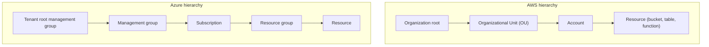
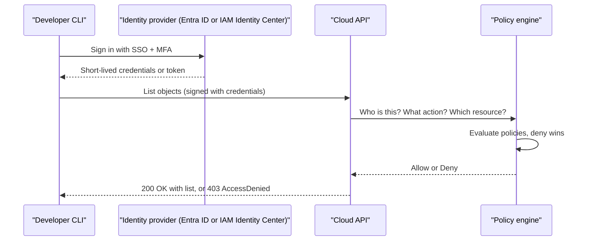
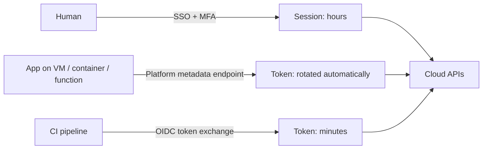

# Cloud IAM Concepts

## Introduction

Every request you send to a cloud provider has to answer two questions before anything happens:

1. **Who are you?** This is **authentication** (AuthN).
2. **Are you allowed to do this, to this thing, right now?** This is **authorization** (AuthZ).

**Identity and Access Management (IAM)** is the system that answers both questions. In the cloud it matters more than almost anything else, because there is no physical data center door to lock. If someone gets a valid credential with broad permissions, they can delete your databases, read your customer data, or start hundreds of expensive virtual machines from anywhere in the world.

A useful analogy is an office building with key cards:

- The **identity** is the person holding the card.
- The **credential** is the card itself, or a fingerprint.
- The **policy** is the list of doors the card opens.
- The **scope** is which floors or buildings the list applies to.
- A **temporary credential** is a visitor badge that stops working at 6 p.m.

AWS and Azure implement these ideas very differently. AWS IAM grew up around **JSON policy documents** attached to identities and resources. Azure grew up around **Microsoft Entra ID** (formerly Azure Active Directory) as a directory of users and apps, plus **Azure role-based access control (RBAC)** for permissions on resources. Learning the shared concepts first makes both platforms much easier to understand.

This page teaches the vocabulary. The rest of this section goes deep on each platform:

- [AWS IAM Users, Groups, Roles and Policies](./1-cloud-aws-iam.mdx)
- [Microsoft Entra ID and Azure RBAC](./2-cloud-azure-entra-id.mdx)

## The Building Blocks

### Principals: who is asking

A **principal** is anything that can make a request. There are two big families:

| Kind | Examples | How they usually sign in |
| --- | --- | --- |
| Human identities | Developers, operators, auditors | Browser login with MFA, SSO through a company identity provider |
| Workload (machine) identities | A web app, a Lambda function, a CI pipeline, a Kubernetes pod | Platform-issued tokens, roles, managed identities, OIDC federation |

The single most important habit in cloud IAM is to treat these two families differently. Humans should sign in through single sign-on with multi-factor authentication. Workloads should get **short-lived credentials from the platform**, never a password or access key pasted into a config file.

### Credentials: how they prove it

| Credential type | Lifetime | Risk if leaked | Typical use today |
| --- | --- | --- | --- |
| Password + MFA | Long (until changed) | Medium (MFA helps) | Human console sign-in |
| Long-lived access key / client secret | Months or years | High | Legacy scripts. Avoid. |
| Temporary security credentials / access tokens | Minutes to hours | Lower, they expire | Roles, SSO sessions, managed identities |
| Federated token (OIDC / SAML) | Minutes | Lower | CI/CD, SSO, cross-cloud |
| Certificate | Months | Medium | Some service-to-service auth |

:::warning
Long-lived access keys (AWS) and client secrets (Azure app registrations) are the most common cause of cloud breaches in public incident reports. They end up in Git repositories, laptop backups and CI logs. This tutorial never uses them as the recommended approach. Prefer SSO for people and roles, managed identities or OIDC for workloads.
:::

### Permissions: what they can do

A permission is usually a combination of:

- **Action**: what operation, such as `s3:GetObject` on AWS or `Microsoft.Storage/storageAccounts/read` on Azure.
- **Resource**: which thing, such as one bucket or one resource group.
- **Effect**: allow or deny.
- **Condition** (optional): extra rules, such as "only from our corporate network" or "only if the resource has tag `env=dev`".

Permissions are grouped into **policies** (AWS) or **role definitions** (Azure).

### Scope: where it applies

Both clouds have a hierarchy, and permissions can be granted at different levels:



On Azure, a role assigned at a higher scope is **inherited** by everything below it. On AWS, the **account** is the main security boundary. Organization-level policies (service control policies) set the maximum permissions for accounts, but they don't grant anything by themselves.

## Authentication vs Authorization in One Request

Here is what happens when a developer runs a command to list the files in a storage bucket:



Two details matter:

1. Authentication happens **once per session**. The CLI then reuses the short-lived credentials until they expire.
2. Authorization happens **on every single API call**. Changing a policy takes effect for the next call, usually within seconds to minutes, because policy data is replicated.

## How the Two Clouds Model Permissions

### On AWS

AWS uses **JSON policy documents**. You attach them to identities (users, groups, roles) or to resources (S3 buckets, SQS queues, KMS keys).

```json
{
  "Version": "2012-10-17",
  "Statement": [
    {
      "Sid": "ReadReportsBucket",
      "Effect": "Allow",
      "Action": ["s3:GetObject", "s3:ListBucket"],
      "Resource": [
        "arn:aws:s3:::acme-reports",
        "arn:aws:s3:::acme-reports/*"
      ]
    }
  ]
}
```

Each resource has an **ARN** (Amazon Resource Name), such as `arn:aws:s3:::acme-reports`. The policy engine combines several policy types, and **an explicit deny always wins**. If nothing allows an action, it is denied by default.

You can check who you currently are with:

```bash
aws sts get-caller-identity
```

Example output:

```text
{
    "UserId": "AROAEXAMPLEID:alice@example.com",
    "Account": "111122223333",
    "Arn": "arn:aws:sts::111122223333:assumed-role/AWSReservedSSO_ReadOnly_abc123/alice@example.com"
}
```

Notice the `assumed-role` in the ARN. Alice signed in through SSO and is using a **role** with temporary credentials, not an IAM user with a permanent key. That is the pattern you want.

### On Azure

Azure separates **identity** from **resource permissions**:

- **Microsoft Entra ID** stores users, groups, app registrations, service principals and managed identities. It issues tokens.
- **Azure RBAC** decides what those identities can do to Azure resources. You create a **role assignment** that combines three things: a security principal, a role definition, and a scope.

```bash
az role assignment create \
  --assignee "alice@example.com" \
  --role "Storage Blob Data Reader" \
  --scope "/subscriptions/00000000-0000-0000-0000-000000000000/resourceGroups/rg-reports"
```

Example output (trimmed):

```text
{
  "principalType": "User",
  "roleDefinitionId": "/subscriptions/0000.../providers/Microsoft.Authorization/roleDefinitions/2a2b9908-...",
  "scope": "/subscriptions/00000000-0000-0000-0000-000000000000/resourceGroups/rg-reports",
  "type": "Microsoft.Authorization/roleAssignments"
}
```

And the equivalent of "who am I":

```bash
az account show --query "{user:user.name, subscription:name, tenant:tenantId}" -o json
```

Example output:

```text
{
  "subscription": "contoso-dev",
  "tenant": "11111111-2222-3333-4444-555555555555",
  "user": "alice@example.com"
}
```

Azure RBAC is **additive**: your effective permissions are the sum of all your role assignments. Explicit **deny assignments** exist but are mostly created by Azure itself (for example by managed applications or deployment stacks), not by you directly.

### Side-by-side mapping

| Concept | AWS | Azure |
| --- | --- | --- |
| Identity directory | IAM (per account) + IAM Identity Center (org-wide) | Microsoft Entra ID (per tenant) |
| Human user | IAM Identity Center user (preferred) or IAM user | Entra ID user |
| Group | IAM group / Identity Center group | Entra ID group |
| Machine identity | IAM role (assumed by a service) | Managed identity or service principal |
| Permission bundle | Policy (JSON) | Role definition |
| Grant | Attach policy to identity or resource | Role assignment at a scope |
| Default | Deny unless allowed | No access unless assigned |
| Explicit deny | `"Effect": "Deny"` in any policy | Deny assignments (limited) |
| Org-wide guardrail | Service control policies (SCPs), resource control policies (RCPs) | Azure Policy, management group structure |
| Temporary credentials | AWS STS | Entra ID access tokens |
| Audit log | AWS CloudTrail | Azure Activity Log + Entra sign-in logs |

## Identity-Based vs Resource-Based Permissions

There are two places you can write "who can do what":

- **Identity-based**: attached to the principal. "Alice can read bucket X."
- **Resource-based**: attached to the resource. "Bucket X can be read by Alice."

AWS uses both heavily. S3 bucket policies, SQS queue policies, KMS key policies and Lambda resource policies are all resource-based, and they are how you grant **cross-account** access.

Azure mostly uses role assignments, which are stored separately from both the identity and the resource, but scoped to the resource. Some data services such as Storage and Key Vault also have legacy access methods (shared keys, SAS tokens, access policies). Microsoft now recommends Entra ID authentication with Azure RBAC for these where it is supported.

## Temporary Credentials Are the Default

Modern cloud IAM is built around one idea: **nobody should hold a permanent secret if a short-lived one will do.**



| Who | AWS mechanism | Azure mechanism | Covered in |
| --- | --- | --- | --- |
| Humans | IAM Identity Center | Entra ID sign-in (+ PIM for admin roles) | [Federation, SSO and Identity Center](./5-cloud-federation-and-sso.mdx) |
| Apps on cloud compute | IAM roles for EC2, ECS, Lambda, EKS | Managed identities | [Workload Identity](./4-cloud-workload-identity.mdx) |
| CI/CD outside the cloud | OIDC identity provider + role | Workload identity federation | [Keyless CI/CD with OIDC](./6-cloud-oidc-for-ci.mdx) |

## A First Look From Code

Both SDKs follow a **default credential chain**: they look for credentials in a fixed order (environment, config files, SSO cache, platform identity). Your code never names a secret.

```python
# whoami.py
# pip install boto3 azure-identity
import boto3
from azure.identity import DefaultAzureCredential


def aws_whoami() -> None:
    sts = boto3.client("sts")
    ident = sts.get_caller_identity()
    print(f"AWS account={ident['Account']} arn={ident['Arn']}")


def azure_token_check() -> None:
    cred = DefaultAzureCredential()
    token = cred.get_token("https://management.azure.com/.default")
    print(f"Azure token acquired, expires_on={token.expires_on}")


if __name__ == "__main__":
    aws_whoami()
    azure_token_check()
```

Example output:

```text
AWS account=111122223333 arn=arn:aws:sts::111122223333:assumed-role/AWSReservedSSO_ReadOnly_abc123/alice@example.com
Azure token acquired, expires_on=1760202000
```

The exact same code works on a laptop (using your SSO session) and in production (using the role or managed identity attached to the compute). That portability is one of the biggest wins of doing IAM properly.

## Control Plane vs Data Plane

One more distinction will save you hours of debugging. Cloud APIs come in two flavors:

- **Control plane** (management plane): creating, configuring and deleting resources. "Create a storage account", "change a VM size", "delete a bucket".
- **Data plane**: using what's inside a resource. "Read this blob", "put a message on this queue", "query this table".

| Example | AWS action | Azure permission |
| --- | --- | --- |
| Create a bucket / storage account | `s3:CreateBucket` | `Microsoft.Storage/storageAccounts/write` (an `Action`) |
| Read an object / blob | `s3:GetObject` | `Microsoft.Storage/storageAccounts/blobServices/containers/blobs/read` (a `DataAction`) |
| Create a queue | `sqs:CreateQueue` | `Microsoft.ServiceBus/namespaces/queues/write` |
| Send a message | `sqs:SendMessage` | `Microsoft.ServiceBus/namespaces/queues/send/action` (a `DataAction`) |

On AWS both kinds of action live in the same policy language, so one policy can mix them. On Azure, role definitions list them separately as `Actions` and `DataActions`. That is why an Azure user with the **Owner** role on a storage account can still get a 403 when reading a blob with Entra ID auth: Owner grants control-plane actions, but reading data needs a data role such as **Storage Blob Data Reader**.

:::tip
When you get an access-denied error, first ask "was this a control-plane or data-plane call?" It often tells you which kind of permission is missing.
:::

## Real-World Scenario

Your team is a five-person startup building a SaaS invoicing app. Today, everyone logs in as the AWS root user, and the Azure subscription has one shared "admin" account whose password lives in a team chat. A contractor is about to join, and a customer's security questionnaire asks: "How do you control and audit access to production?"

**The solution in four steps:**

1. **Separate humans from workloads.** Every person gets their own identity in a central directory (IAM Identity Center on AWS, Entra ID on Azure), with MFA enforced. The root user and shared admin account are locked away for emergencies only.
2. **Use groups and roles, not individual grants.** Create groups such as `Developers`, `Operators`, `ReadOnlyAuditors`. Grant permissions to groups. The contractor joins `Developers` in the dev environment only.
3. **Give workloads their own identities.** The app's API servers use an IAM role (AWS) or a managed identity (Azure) that can read only the invoices bucket or storage account.
4. **Turn on audit logs.** CloudTrail and the Azure Activity Log record every management action, so you can answer "who deleted that?" later.

**Why this approach:** each person and workload is individually accountable, access can be removed in one place when someone leaves, and no long-lived secret is shared.

**When to use it:** from day one, on any account that holds real data or a credit card. **When not to:** a throwaway sandbox you'll delete in an hour can tolerate less ceremony, but still never use the root user for daily work.

**Alternatives and trade-offs:**

| Approach | Pros | Cons | Best for |
| --- | --- | --- | --- |
| Shared admin login | Zero setup | No accountability, no MFA per person, impossible to offboard cleanly | Nothing. Avoid. |
| Individual IAM users / cloud-only users with keys | Simple to understand | Long-lived keys, per-account sprawl | Legacy setups being migrated |
| Central SSO + groups + roles | Auditable, easy offboarding, short-lived credentials | Some initial setup | Almost every team |
| External IdP (Okta, Google Workspace) federated to both clouds | One login for everything | Another system to manage and pay for | Companies already using that IdP |

## Common Mistakes

- **Using the root user or Global Administrator daily.** These accounts can't be fully restricted. Use them only for the few tasks that require them.
- **Granting permissions directly to individuals.** Grant to groups so that onboarding and offboarding are one change.
- **Wildcards everywhere.** `"Action": "*"` on `"Resource": "*"` or Owner at subscription scope "to make it work" is how small mistakes become big incidents. See [Least Privilege in Practice](./3-cloud-least-privilege.mdx).
- **Confusing Entra roles with Azure RBAC roles.** "Global Administrator" is an Entra directory role. It does not automatically grant access to Azure subscriptions (although it can elevate itself to do so).
- **Forgetting that deny wins on AWS.** A single explicit deny in an SCP, permissions boundary or bucket policy overrides every allow.
- **Not reading the error message.** Both clouds tell you which action was denied. `AccessDenied ... is not authorized to perform: s3:PutObject` tells you exactly what's missing.

## Summary

- IAM answers **who you are** (authentication) and **what you can do** (authorization) on every request.
- Principals are either **humans** or **workloads**. Treat them differently.
- AWS uses **JSON policies** attached to identities and resources. Explicit deny wins and the default is deny.
- Azure uses **Entra ID** for identities and **Azure RBAC role assignments** (principal + role + scope) for resource access. Permissions are additive and inherited down the hierarchy.
- Prefer **temporary credentials** everywhere: SSO for people, roles or managed identities for apps, OIDC for CI.
- Turn on audit logging so every action can be traced back to an individual identity.

## Exercises

1. Run `aws sts get-caller-identity` and `az account show`. Is your current AWS identity a user or an assumed role? Which tenant and subscription are you using on Azure?
2. Write down three humans and three workloads in a project you know. For each, decide which credential type from the table above they should use.
3. Translate this sentence into both an AWS policy statement and an Azure role assignment command: "The reporting service can read objects in the `reports` storage, but nothing else."
4. Read about the account and subscription hierarchy in [Organizing Resources: Accounts, Subscriptions and Resource Groups](../1-cloud-getting-started/5-cloud-resource-organization.mdx), then sketch where you would assign your team's permissions.

**Next:** [AWS IAM Users, Groups, Roles and Policies](./1-cloud-aws-iam.mdx). For general security background, see the [Security fundamentals tutorial](/docs/fundamental/security).
