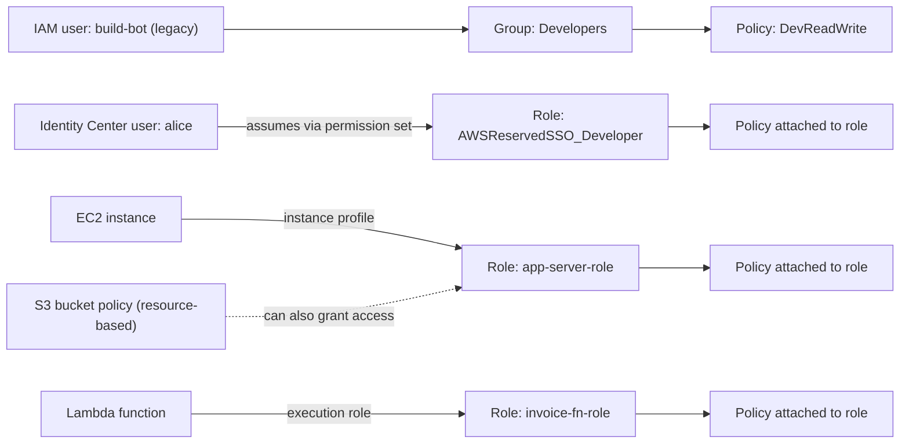
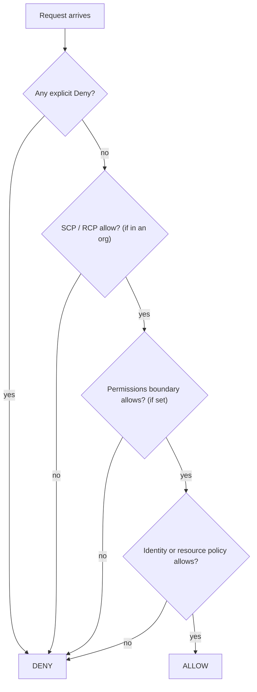

# AWS IAM Users, Groups, Roles and Policies

## Introduction

**AWS Identity and Access Management (IAM)** controls who can do what inside an AWS account. It is free to use, global (not tied to a Region), and every single AWS API call passes through it.

IAM has four core building blocks:

| Building block | What it is | Analogy |
| --- | --- | --- |
| **IAM user** | A long-lived identity in one account, with a password and/or access keys | A permanent employee badge |
| **IAM group** | A collection of users that share policies | A department |
| **IAM role** | An identity with no permanent credentials. Someone or something *assumes* it to get temporary credentials | A hard hat you put on for a specific job, then hand back |
| **Policy** | A JSON document that allows or denies actions on resources | The rulebook for a badge or hat |

The most important thing to learn on this page is that **roles are the center of modern AWS IAM**. AWS's own guidance is to have humans sign in through federation (IAM Identity Center) and to have workloads use roles. IAM users with access keys still exist, but are now for narrow cases such as a third-party tool that can't use anything else.

If the general vocabulary is new to you, read [Cloud IAM Concepts](./0-cloud-iam-concepts.mdx) first.

## How IAM Fits Together



## Policies in Depth

### Anatomy of a policy

```json
{
  "Version": "2012-10-17",
  "Statement": [
    {
      "Sid": "AllowReadInvoices",
      "Effect": "Allow",
      "Action": ["s3:GetObject"],
      "Resource": "arn:aws:s3:::acme-invoices/*",
      "Condition": {
        "StringEquals": { "aws:PrincipalTag/team": "billing" }
      }
    },
    {
      "Sid": "DenyDeleteAlways",
      "Effect": "Deny",
      "Action": ["s3:DeleteObject"],
      "Resource": "arn:aws:s3:::acme-invoices/*"
    }
  ]
}
```

| Element | Meaning |
| --- | --- |
| `Version` | Policy language version. Always use `2012-10-17`. It is not today's date. |
| `Statement` | A list of rules |
| `Sid` | Optional label for humans |
| `Effect` | `Allow` or `Deny` |
| `Action` | API operations, written `service:Operation`, wildcards allowed |
| `Resource` | ARNs the statement applies to |
| `Condition` | Optional extra checks (tags, source IP, MFA, time, VPC endpoint) |
| `Principal` | Only in resource-based and trust policies: who the statement applies to |

### Types of policies

| Policy type | Attached to | Grants permissions? | Typical use |
| --- | --- | --- | --- |
| AWS managed policy | Users, groups, roles | Yes | Quick start (`ReadOnlyAccess`, `AmazonS3ReadOnlyAccess`) |
| Customer managed policy | Users, groups, roles | Yes | Your own reusable, versioned policies |
| Inline policy | One user, group or role | Yes | Tight one-off coupling. Use sparingly. |
| Resource-based policy | S3 bucket, SQS queue, KMS key, Lambda function... | Yes | Cross-account access, service access |
| Trust policy | A role | Controls who can **assume** the role | Every role has exactly one |
| Permissions boundary | User or role | No, it sets a **maximum** | Safe delegation of role creation |
| Service control policy (SCP) | OU or account in AWS Organizations | No, sets a maximum for principals | Org-wide guardrails |
| Resource control policy (RCP) | OU or account in AWS Organizations | No, sets a maximum for resources | Stop external access to your data |
| Session policy | Passed when assuming a role | No, narrows the session | Temporary down-scoping |

### How AWS decides: policy evaluation

The rules for a request inside a single account are:

1. Start with an **implicit deny**.
2. If **any** applicable policy has an explicit `Deny` that matches, the answer is **Deny**. Done.
3. Organization guardrails (SCPs, RCPs), permissions boundaries and session policies must each **allow** the action, if they apply.
4. An identity-based or resource-based policy must **allow** it.
5. Otherwise, it stays denied.



This is simplified. Cross-account requests need an allow on **both** sides (the caller's identity policy and the resource policy in the other account). See the official [policy evaluation logic](https://docs.aws.amazon.com/IAM/latest/UserGuide/reference_policies_evaluation-logic.html) for every edge case.

## Roles and Trust Policies

A role has two policies that answer two different questions:

- The **trust policy**: *who may put on this hat?*
- The **permissions policies**: *what can you do while wearing it?*

### Example: a role that EC2 instances can use

`trust-ec2.json`:

```json
{
  "Version": "2012-10-17",
  "Statement": [
    {
      "Effect": "Allow",
      "Principal": { "Service": "ec2.amazonaws.com" },
      "Action": "sts:AssumeRole"
    }
  ]
}
```

`invoices-read.json`:

```json
{
  "Version": "2012-10-17",
  "Statement": [
    {
      "Effect": "Allow",
      "Action": ["s3:GetObject", "s3:ListBucket"],
      "Resource": [
        "arn:aws:s3:::acme-invoices",
        "arn:aws:s3:::acme-invoices/*"
      ]
    }
  ]
}
```

Create the role and its permissions with the AWS CLI v2:

```bash
# 1. Create the role with its trust policy
aws iam create-role \
  --role-name invoice-reader-role \
  --assume-role-policy-document file://trust-ec2.json \
  --description "Lets app servers read invoices"

# 2. Create a customer managed policy
aws iam create-policy \
  --policy-name InvoicesReadOnly \
  --policy-document file://invoices-read.json

# 3. Attach the policy to the role
aws iam attach-role-policy \
  --role-name invoice-reader-role \
  --policy-arn arn:aws:iam::111122223333:policy/InvoicesReadOnly
```

Example output of step 1 (trimmed):

```text
{
    "Role": {
        "Path": "/",
        "RoleName": "invoice-reader-role",
        "RoleId": "AROAEXAMPLE123",
        "Arn": "arn:aws:iam::111122223333:role/invoice-reader-role",
        "CreateDate": "2026-10-11T09:15:02+00:00"
    }
}
```

EC2 needs one more wrapper object, an **instance profile**, which the console creates automatically. From the CLI you create it yourself. This is covered in [Workload Identity](./4-cloud-workload-identity.mdx).

### Example: a role that people in another account can assume

Cross-account roles are how AWS organizations let an operator in a "tools" account work in a "prod" account without a second login.

```json
{
  "Version": "2012-10-17",
  "Statement": [
    {
      "Effect": "Allow",
      "Principal": { "AWS": "arn:aws:iam::444455556666:root" },
      "Action": "sts:AssumeRole",
      "Condition": {
        "Bool": { "aws:MultiFactorAuthPresent": "true" }
      }
    }
  ]
}
```

`arn:aws:iam::444455556666:root` means "the account 444455556666", not its root user. That account must still grant its own principals `sts:AssumeRole` on this role ARN, so both sides agree.

### Assuming a role

With the CLI, the cleanest approach is a profile that chains from your SSO profile:

```text
# ~/.aws/config
[profile tools]
sso_session = corp
sso_account_id = 444455556666
sso_role_name = Operator
region = eu-west-1

[profile prod-ops]
role_arn = arn:aws:iam::111122223333:role/ProdOperator
source_profile = tools
region = eu-west-1

[sso-session corp]
sso_start_url = https://my-company.awsapps.com/start
sso_region = eu-west-1
sso_registration_scopes = sso:account:access
```

```bash
aws sso login --sso-session corp
aws sts get-caller-identity --profile prod-ops
```

Example output:

```text
{
    "UserId": "AROAPRODEXAMPLE:botocore-session-1760170000",
    "Account": "111122223333",
    "Arn": "arn:aws:sts::111122223333:assumed-role/ProdOperator/botocore-session-1760170000"
}
```

The same thing in Python with `boto3`, useful in scripts that hop between accounts:

```python
# assume_role.py
import boto3


def session_for_role(role_arn: str, session_name: str) -> boto3.Session:
    sts = boto3.client("sts")
    resp = sts.assume_role(
        RoleArn=role_arn,
        RoleSessionName=session_name,
        DurationSeconds=3600,
    )
    creds = resp["Credentials"]
    return boto3.Session(
        aws_access_key_id=creds["AccessKeyId"],
        aws_secret_access_key=creds["SecretAccessKey"],
        aws_session_token=creds["SessionToken"],
    )


if __name__ == "__main__":
    prod = session_for_role(
        "arn:aws:iam::111122223333:role/ProdOperator", "alice-audit"
    )
    print(prod.client("sts").get_caller_identity()["Arn"])
```

Example output:

```text
arn:aws:sts::111122223333:assumed-role/ProdOperator/alice-audit
```

The session name (`alice-audit`) appears in CloudTrail, so use something that identifies the human or job.

## Users and Groups (and When You Still Need Them)

You can still create IAM users and groups:

```bash
aws iam create-group --group-name Auditors
aws iam attach-group-policy \
  --group-name Auditors \
  --policy-arn arn:aws:iam::aws:policy/SecurityAudit
aws iam create-user --user-name legacy-scanner
aws iam add-user-to-group --user-name legacy-scanner --group-name Auditors
```

But think hard before you do. Prefer:

| Need | Prefer instead of an IAM user |
| --- | --- |
| A person signing in | IAM Identity Center user or federated user. See [Federation, SSO and Identity Center](./5-cloud-federation-and-sso.mdx) |
| Code on EC2, ECS, Lambda, EKS | An IAM role for that service. See [Workload Identity](./4-cloud-workload-identity.mdx) |
| GitHub Actions, GitLab CI, Azure DevOps | OIDC federation to a role. See [Keyless CI/CD with OIDC](./6-cloud-oidc-for-ci.mdx) |
| On-premises servers | IAM Roles Anywhere (certificate-based temporary credentials) |
| A SaaS vendor that only accepts keys | An IAM user with a tight policy, key rotation and monitoring |

If you must have an access key, rotate it, scope it narrowly, and watch it with IAM Access Analyzer's unused access findings or the credential report:

```bash
aws iam generate-credential-report
aws iam get-credential-report --query Content --output text | base64 --decode | cut -d, -f1,9,10,11 | head
```

Example output:

```text
user,access_key_1_active,access_key_1_last_rotated,access_key_1_last_used_date
<root_account>,false,N/A,N/A
legacy-scanner,true,2026-03-02T10:11:00+00:00,2026-10-10T22:04:00+00:00
```

## Testing Policies Before You Ship Them

Two tools catch mistakes before they become incidents.

**Validate syntax and best practices** with IAM Access Analyzer:

```bash
aws accessanalyzer validate-policy \
  --policy-type IDENTITY_POLICY \
  --policy-document file://invoices-read.json \
  --query "findings[].{type:findingType,issue:issueCode}"
```

Example output:

```text
[]
```

An empty list means no findings. A policy with `"Action": "s3:*"` and `"Resource": "*"` would typically produce a security warning.

**Simulate** whether a principal can perform an action:

```bash
aws iam simulate-principal-policy \
  --policy-source-arn arn:aws:iam::111122223333:role/invoice-reader-role \
  --action-names s3:GetObject s3:PutObject \
  --resource-arns "arn:aws:s3:::acme-invoices/2026/inv-001.pdf" \
  --query "EvaluationResults[].{action:EvalActionName,decision:EvalDecision}"
```

Example output:

```text
[
    { "action": "s3:GetObject", "decision": "allowed" },
    { "action": "s3:PutObject", "decision": "implicitDeny" }
]
```

The simulator doesn't evaluate every policy type in every situation (for example, some resource-based policies and SCP details), so treat it as a fast check, not a proof.

## Comparing With Azure

AWS IAM and Azure identity are organized differently, and the differences trip people up when they move between clouds.

| Topic | AWS IAM | Azure | Why it matters |
| --- | --- | --- | --- |
| Where identities live | Per account (IAM) plus org-wide Identity Center | One Entra ID tenant shared by many subscriptions | Azure users exist once. AWS IAM users exist per account. |
| Machine identity | Role assumed by a service | Managed identity (a special service principal) | Similar idea, different mechanics |
| Permission format | JSON policy with actions and ARNs | Role definition (`Actions`, `DataActions`) + assignment at a scope | Azure separates "what" from "where" |
| Deny | First-class, you write it | Deny assignments mostly created by platform features | On Azure, restrict by not assigning, or use Azure Policy |
| Resource-based policies | Common (S3, SQS, KMS) | Rare. Role assignments are scoped to resources instead | Cross-account on AWS often needs resource policies |
| Data vs control plane | Same policy language for both | Separate `DataActions` (for example, reading blobs) | On Azure, Owner of a storage account can't read blobs without a data role |

The Azure side is covered in [Microsoft Entra ID and Azure RBAC](./2-cloud-azure-entra-id.mdx).

## Real-World Scenario

Your team runs a document-processing service. An EC2-based API writes uploaded PDFs to S3, and a Lambda function extracts text and stores it in DynamoDB. An auditor from a separate security account needs read-only access to everything. Currently the API uses an IAM user's access key stored in an environment file.

**The solution:**

1. Create `api-server-role` (trusted by `ec2.amazonaws.com`) with `s3:PutObject` on `arn:aws:s3:::acme-uploads/incoming/*` only. Attach it through an instance profile and delete the old access key.
2. Create `extractor-fn-role` (trusted by `lambda.amazonaws.com`) with `s3:GetObject` on the same prefix, `dynamodb:PutItem` on one table, and the AWS managed policy `AWSLambdaBasicExecutionRole` for logs.
3. Create `SecurityAuditor` in the workload account, trusted by the security account with an MFA condition, with the AWS managed `SecurityAudit` and `ReadOnlyAccess` policies.
4. Run `validate-policy` and `simulate-principal-policy` in CI before applying changes.

**Why this approach:** each component has exactly the permissions it needs, no permanent credentials exist on the servers, and the auditor's access is visible and revocable in one place.

**When to use it:** any time AWS services call other AWS services. **When not to:** if the auditors already sign in through IAM Identity Center, give them a permission set instead of a hand-made cross-account role.

**Alternatives and trade-offs:**

| Approach | Pros | Cons | Best for |
| --- | --- | --- | --- |
| IAM user + access key in env file | Works anywhere | Long-lived secret, manual rotation, leak risk | Last resort for external tools |
| Service role (instance profile, execution role) | No secrets, auto-rotated credentials | Only works on AWS compute | Apps running on AWS |
| Cross-account role with trust policy | Clear boundary, auditable | One more ARN to manage per account | Tooling accounts, auditors, pipelines |
| IAM Identity Center permission sets | Central management for humans across accounts | Requires AWS Organizations | All human access at scale |

## Common Mistakes

- **Treating `Version` as a date to update.** `2012-10-17` is the current policy language version.
- **Forgetting the bucket ARN vs object ARN.** `s3:ListBucket` applies to `arn:aws:s3:::bucket`. `s3:GetObject` applies to `arn:aws:s3:::bucket/*`. You usually need both.
- **Trust policies that are too broad.** `"Principal": {"AWS": "*"}` without strong conditions lets any AWS account try to assume your role.
- **Using inline policies everywhere.** They can't be reused or easily reviewed. Prefer customer managed policies.
- **Attaching `AdministratorAccess` "temporarily".** Temporary admin access tends to become permanent. Use permission sets with separate admin roles and short sessions.
- **Ignoring the error's action name.** Copy the denied action from the error message straight into your policy draft, then validate it.

## Summary

- IAM users and groups still exist, but **roles** are the primary building block for both humans (via SSO) and workloads.
- Every role has a **trust policy** (who can assume it) and **permissions policies** (what it can do).
- Policy evaluation starts at deny, **explicit deny always wins**, and guardrails such as SCPs, RCPs and permissions boundaries limit but never grant.
- Use `aws sts get-caller-identity`, `aws accessanalyzer validate-policy` and `aws iam simulate-principal-policy` to understand and test permissions.
- Avoid long-lived access keys. If you must use one, scope it tightly and monitor it.

## Exercises

1. Write a policy that lets a role read and write objects only under `s3://acme-data/team-a/`, and list only that prefix. Hint: look up the `s3:prefix` condition key.
2. Create a trust policy that allows only the Lambda service to assume a role, then run `aws accessanalyzer validate-policy --policy-type RESOURCE_POLICY --validate-policy-resource-type AWS::IAM::AssumeRolePolicyDocument` on it. What does it report?
3. Use `simulate-principal-policy` to prove your role from exercise 1 cannot delete objects.
4. Compare your policy from exercise 1 with an Azure role assignment that grants the same access, after reading [Microsoft Entra ID and Azure RBAC](./2-cloud-azure-entra-id.mdx).

**Next:** [Microsoft Entra ID and Azure RBAC](./2-cloud-azure-entra-id.mdx). Then learn how to shrink permissions in [Least Privilege in Practice](./3-cloud-least-privilege.mdx).
