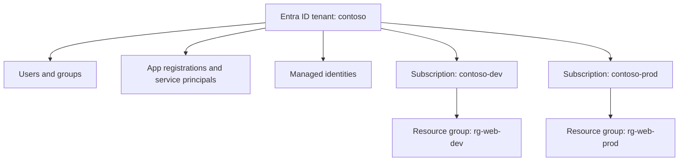
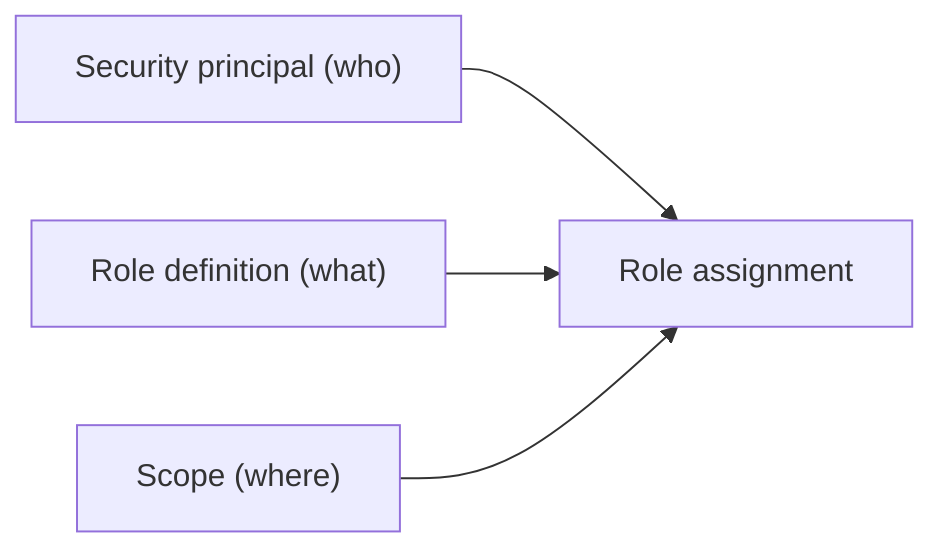
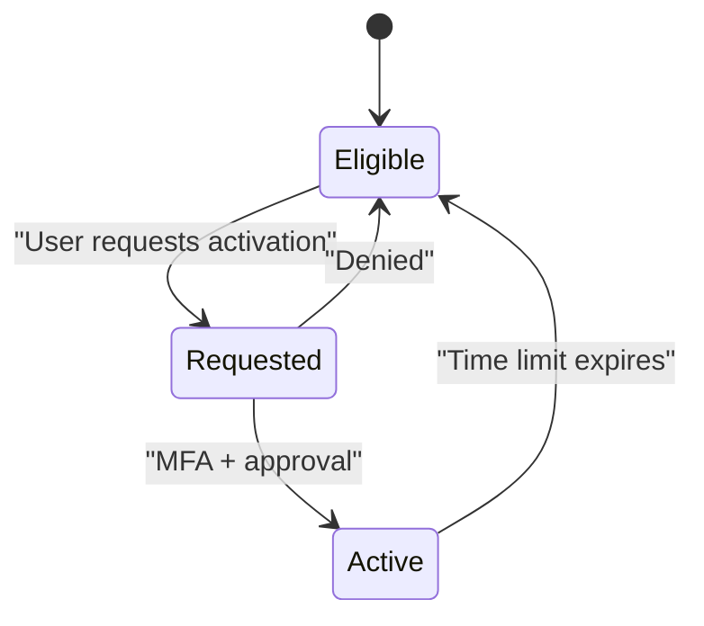

# Microsoft Entra ID and Azure RBAC

## Introduction

On Azure, identity and permissions are split across two systems that work together:

1. **Microsoft Entra ID** (the new name for Azure Active Directory since 2023) is the **directory**. It stores users, groups, applications and managed identities, and it issues the tokens they use to sign in.
2. **Azure role-based access control (Azure RBAC)** is the **authorization system** for Azure resources. It decides whether a token's owner can create a VM, read a blob, or delete a resource group.

Think of a hotel. Entra ID is the front desk that checks your ID and hands you a key card. Azure RBAC is the programming on the card that says which rooms, floors and gym doors it opens.

If you come from AWS, the biggest mental shift is this: on AWS you write a JSON policy and attach it to an identity. On Azure you **assign** an existing role to an identity **at a scope**. The "what" (role) and the "where" (scope) are separate.

This page covers both halves and shows them with the Azure CLI. For the AWS equivalent, see [AWS IAM Users, Groups, Roles and Policies](./1-cloud-aws-iam.mdx).

## Entra ID: The Directory

### Tenants and subscriptions

A **tenant** is one Entra ID directory, usually one per organization (for example `contoso.onmicrosoft.com`). Each Azure **subscription** trusts exactly one tenant. One tenant can have many subscriptions.



### Identity types in Entra ID

| Identity type | What it represents | AWS rough equivalent |
| --- | --- | --- |
| User | A person (member or guest) | Identity Center user |
| Group | Collection of users, service principals or other groups | Identity Center group |
| App registration | The global definition of an application | No direct match |
| Service principal | The app's identity inside a tenant, used for sign-in | IAM role assumed by an external app |
| Managed identity | A service principal managed by Azure for a resource, with no secret you can see | IAM role for a service (instance profile, execution role) |

The app registration and service principal pair confuses many newcomers. An **app registration** is like a class definition, and a **service principal** is the instance of it in your tenant. When you grant permissions, you grant them to the service principal (its **object ID**), not to the app's **client ID**.

### Two kinds of "roles"

Azure has two completely separate role systems, and mixing them up is a classic mistake.

| | Microsoft Entra roles | Azure RBAC roles |
| --- | --- | --- |
| Controls | The directory itself: users, groups, apps, licenses | Azure resources: VMs, storage, databases |
| Examples | Global Administrator, User Administrator, Application Administrator | Owner, Contributor, Reader, Storage Blob Data Reader |
| Scope | Tenant (or administrative unit) | Management group, subscription, resource group, resource |
| Managed with | Entra admin center, Microsoft Graph | Azure portal, `az role assignment`, ARM/Bicep/Terraform |

A Global Administrator can manage every user, but does not automatically have access to any subscription. They can elevate themselves to User Access Administrator at the root scope, which is an audited emergency action.

## Azure RBAC: The Role Assignment

Every grant in Azure RBAC is a **role assignment** made of three parts:



- **Security principal**: a user, group, service principal or managed identity.
- **Role definition**: a named collection of permissions.
- **Scope**: management group, subscription, resource group, or a single resource.

### Scopes and inheritance

Roles assigned at a scope are inherited by everything below it.

| Scope | Format | Example use |
| --- | --- | --- |
| Management group | `/providers/Microsoft.Management/managementGroups/<name>` | Platform team, security readers |
| Subscription | `/subscriptions/<subId>` | Billing readers, subscription owners |
| Resource group | `/subscriptions/<subId>/resourceGroups/<rg>` | Most application team access |
| Resource | `/subscriptions/<subId>/resourceGroups/<rg>/providers/Microsoft.Storage/storageAccounts/<name>` | One app reading one storage account |

Azure RBAC is **additive**. If you have Reader at the subscription and Contributor on one resource group, you are effectively a Contributor in that resource group and a Reader everywhere else.

### Important built-in roles

| Role | Can do | Cannot do |
| --- | --- | --- |
| **Owner** | Everything, including granting access to others | Nothing is excluded within scope |
| **Contributor** | Create and manage all resources | Grant access, assign Azure Policy |
| **Reader** | View resources | Change anything |
| **User Access Administrator** | Manage role assignments | Manage resources themselves |
| **Role Based Access Control Administrator** | Manage role assignments, and can be limited with conditions to specific roles or principals | Manage resources |
| Service-specific roles | For example Virtual Machine Contributor, Key Vault Secrets User, Storage Blob Data Contributor | Anything outside that service |

The built-in role list changes regularly. Check the [Azure built-in roles reference](https://learn.microsoft.com/azure/role-based-access-control/built-in-roles) for current names.

### Actions vs DataActions

Role definitions have four permission lists:

- `Actions` and `NotActions`: **control plane** (manage the resource).
- `DataActions` and `NotDataActions`: **data plane** (use what's inside it).

Effective permissions are `Actions - NotActions` plus `DataActions - NotDataActions`. That is why the **Owner** of a storage account can't read blobs using Entra ID authentication until someone assigns a data role such as **Storage Blob Data Reader**.

## Hands-On with the Azure CLI

:::caution
The commands below create Entra groups and role assignments. They are free, but they change who can access your resources. Use a sandbox subscription, and run the cleanup commands at the end.
:::

### Step 1: Sign in and look around

```bash
az login
az account show --query "{name:name, id:id, tenant:tenantId}" -o table
az ad signed-in-user show --query "{upn:userPrincipalName, id:id}" -o table
```

Example output:

```text
Name          Id                                    Tenant
------------  ------------------------------------  ------------------------------------
contoso-dev   00000000-0000-0000-0000-000000000000  11111111-2222-3333-4444-555555555555

Upn                  Id
-------------------  ------------------------------------
alice@contoso.com    aaaaaaaa-bbbb-cccc-dddd-eeeeeeeeeeee
```

### Step 2: Create a group and a resource group

```bash
SUB_ID=$(az account show --query id -o tsv)
az group create --name rg-iam-demo --location westeurope -o none

GROUP_ID=$(az ad group create \
  --display-name "iam-demo-developers" \
  --mail-nickname "iam-demo-developers" \
  --query id -o tsv)

ME=$(az ad signed-in-user show --query id -o tsv)
az ad group member add --group "$GROUP_ID" --member-id "$ME"
echo "$GROUP_ID"
```

Example output:

```text
3f1c2d4e-5a6b-7c8d-9e0f-112233445566
```

### Step 3: Assign a role to the group at resource group scope

```bash
az role assignment create \
  --assignee-object-id "$GROUP_ID" \
  --assignee-principal-type Group \
  --role "Contributor" \
  --scope "/subscriptions/$SUB_ID/resourceGroups/rg-iam-demo"
```

Example output (trimmed):

```text
{
  "principalId": "3f1c2d4e-5a6b-7c8d-9e0f-112233445566",
  "principalType": "Group",
  "roleDefinitionName": "Contributor",
  "scope": "/subscriptions/0000.../resourceGroups/rg-iam-demo"
}
```

Using `--assignee-object-id` with `--assignee-principal-type` avoids an extra directory lookup and prevents failures caused by replication delay right after creating a new principal.

### Step 4: List what someone can do

```bash
az role assignment list \
  --assignee "$ME" \
  --include-groups \
  --all \
  --query "[].{role:roleDefinitionName, scope:scope}" -o table
```

Example output:

```text
Role          Scope
------------  ------------------------------------------------------------
Owner         /subscriptions/00000000-0000-0000-0000-000000000000
Contributor   /subscriptions/0000.../resourceGroups/rg-iam-demo
```

### Step 5: A custom role

When no built-in role fits, define your own. This one lets operators restart and view VMs, but not create or delete them.

`vm-operator.json`:

```json
{
  "Name": "VM Operator (demo)",
  "IsCustom": true,
  "Description": "Start, stop and restart VMs. View VM details.",
  "Actions": [
    "Microsoft.Compute/virtualMachines/read",
    "Microsoft.Compute/virtualMachines/start/action",
    "Microsoft.Compute/virtualMachines/powerOff/action",
    "Microsoft.Compute/virtualMachines/restart/action",
    "Microsoft.Compute/virtualMachines/deallocate/action",
    "Microsoft.Resources/subscriptions/resourceGroups/read"
  ],
  "NotActions": [],
  "DataActions": [],
  "NotDataActions": [],
  "AssignableScopes": [
    "/subscriptions/00000000-0000-0000-0000-000000000000"
  ]
}
```

```bash
az role definition create --role-definition @vm-operator.json
az role definition list --custom-role-only true --query "[].roleName" -o tsv
```

Example output:

```text
VM Operator (demo)
```

The same assignment in Bicep, which is how you'd normally manage it (see [Azure Bicep and ARM Templates](../10-cloud-infrastructure-as-code/3-cloud-bicep-and-arm.mdx)):

```bicep
param principalId string
param roleDefinitionId string

resource ra 'Microsoft.Authorization/roleAssignments@2022-04-01' = {
  name: guid(resourceGroup().id, principalId, roleDefinitionId)
  properties: {
    principalId: principalId
    principalType: 'Group'
    roleDefinitionId: subscriptionResourceId('Microsoft.Authorization/roleDefinitions', roleDefinitionId)
  }
}
```

The `guid()` call gives each assignment a stable, deterministic name, so redeploying doesn't create duplicates.

### Cleanup

```bash
az group delete --name rg-iam-demo --yes --no-wait
az role definition delete --name "VM Operator (demo)"
az ad group delete --group "$GROUP_ID"
```

Deleting the resource group also removes role assignments scoped to it.

## Privileged Identity Management (PIM)

Permanent Owner or Global Administrator assignments are risky. **Microsoft Entra Privileged Identity Management** makes privileged roles **eligible** instead of **active**. A user activates the role only when needed, for a limited time, optionally with MFA, a justification and an approval.



PIM works for Entra roles, Azure resource roles and groups. It requires a premium Entra license (Microsoft Entra ID P2 or Microsoft Entra ID Governance at the time of writing). Licensing changes, so check the [PIM documentation](https://learn.microsoft.com/entra/id-governance/privileged-identity-management/pim-configure) before you plan around it.

On AWS the closest equivalent is using separate permission sets for admin work with short session durations, sometimes combined with a third-party or AWS-provided temporary elevated access solution.

## Using Entra ID from Code

The `azure-identity` library's `DefaultAzureCredential` tries several credential sources in order: environment variables, workload identity, managed identity, then developer tools such as the Azure CLI login. Your code stays the same everywhere.

```python
# list_blobs.py
# pip install azure-identity azure-storage-blob
from azure.identity import DefaultAzureCredential
from azure.storage.blob import BlobServiceClient

ACCOUNT_URL = "https://stinvoicesdemo.blob.core.windows.net"

credential = DefaultAzureCredential()
service = BlobServiceClient(account_url=ACCOUNT_URL, credential=credential)
container = service.get_container_client("invoices")

for blob in container.list_blobs(name_starts_with="2026/"):
    print(blob.name, blob.size)
```

Example output:

```text
2026/inv-0001.pdf 48213
2026/inv-0002.pdf 51022
```

If this fails with `AuthorizationPermissionMismatch`, your identity has a control-plane role but no data-plane role on the storage account. Assign **Storage Blob Data Reader**.

## AWS vs Azure at a Glance

| Task | AWS | Azure |
| --- | --- | --- |
| Who am I? | `aws sts get-caller-identity` | `az account show`, `az ad signed-in-user show` |
| Grant read access to storage | Policy with `s3:GetObject` attached to a role | Role assignment of Storage Blob Data Reader at a scope |
| Custom permissions | Customer managed policy (JSON) | Custom role definition (JSON) |
| Group-based access | IAM group or Identity Center group + permission set | Entra group + role assignment |
| Just-in-time admin | Separate admin permission set, short sessions | PIM eligible assignments |
| Inspect effective access | IAM policy simulator, Access Analyzer | `az role assignment list --include-groups`, portal "Check access" |

## Real-World Scenario

Your company has three teams on Azure: a web team, a data team and a platform team. Today, everyone is Owner on the single subscription "because it's easier". An intern recently deleted a production database by running a cleanup script in the wrong subscription.

**The solution:**

1. Split into two subscriptions, `contoso-dev` and `contoso-prod`, under a management group. See [Multi-Account and Landing Zone Strategy](./7-cloud-multi-account-strategy.mdx).
2. Create Entra groups `web-devs`, `data-devs`, `platform-admins`, `all-readers`.
3. In dev, give `web-devs` Contributor on `rg-web-dev` and `data-devs` Contributor on `rg-data-dev`.
4. In prod, give developers **Reader** only. Deployments go through a pipeline whose managed identity has Contributor on the prod resource groups.
5. Make `platform-admins` **eligible** (via PIM) for Owner on the prod subscription, with approval and a short activation window.
6. Add a resource lock (`CanNotDelete`) on the production database as an extra safety net.

**Why this approach:** people get broad freedom in dev, prod changes flow through reviewed pipelines, and nobody holds standing Owner rights in prod.

**When to use it:** as soon as more than one team or more than one environment shares Azure. **When not to:** a solo developer's personal subscription doesn't need PIM. Simple role assignments are enough.

**Alternatives and trade-offs:**

| Approach | Pros | Cons | Best for |
| --- | --- | --- | --- |
| Everyone Owner on one subscription | No friction | No guardrails, accidents hit prod | Nothing beyond a personal sandbox |
| Built-in roles at resource group scope | Simple, well documented | Built-in roles can be broader than you need | Most teams |
| Custom roles | Exact permissions | Maintenance as services add actions | Repeated, well-understood tasks |
| PIM for privileged roles | Just-in-time, audited | License cost, activation friction | Owner, User Access Administrator, Global Administrator |
| Azure Policy plus RBAC | Prevents bad configurations, not just bad actors | More to learn | Organizations with compliance needs |

## Common Mistakes

- **Granting the client ID instead of the object ID.** Role assignments need the service principal's object ID. With the CLI, `--assignee` accepts several forms, but `--assignee-object-id` is unambiguous.
- **Assigning roles to individual users.** Assign to groups so access follows team membership.
- **Too-high scope.** Contributor at subscription scope "for now" quietly grants access to every future resource group too.
- **Forgetting data-plane roles.** Owner and Contributor don't include blob, queue or Key Vault secret data access when using Entra ID authentication.
- **Mixing up Entra roles and Azure roles.** Making someone Global Administrator to "fix" a storage permission is a big overreach.
- **Expecting instant effect.** Role assignment changes can take a few minutes to propagate. Sign out and back in (or get a new token) if a fresh assignment seems ignored.
- **Not cleaning up orphaned assignments.** When a principal is deleted, its assignments show as "Identity not found". Remove them.

## Summary

- **Entra ID** is the directory and token issuer. **Azure RBAC** authorizes actions on Azure resources.
- A role assignment is **principal + role definition + scope**. Scopes inherit downward and permissions add up.
- Control-plane permissions (`Actions`) and data-plane permissions (`DataActions`) are separate.
- Prefer groups, the narrowest useful scope, and built-in roles before custom ones.
- Use **PIM** to make powerful roles just-in-time instead of permanent.
- `DefaultAzureCredential` lets the same code run on a laptop and in Azure without secrets.

## Exercises

1. Run `az role assignment list --assignee <your-upn> --include-groups --all -o table`. Which of your assignments are broader than they need to be?
2. Write a custom role JSON that allows reading Key Vault secrets in one vault but not listing or changing the vault's configuration. Compare it with the built-in **Key Vault Secrets User** role.
3. Write a Bicep file that assigns **Storage Blob Data Reader** to a user-assigned managed identity at the scope of a single storage account.
4. Map your answer from exercise 3 to an AWS IAM policy that grants the same access, using [AWS IAM Users, Groups, Roles and Policies](./1-cloud-aws-iam.mdx).

**Next:** [Least Privilege in Practice](./3-cloud-least-privilege.mdx).
