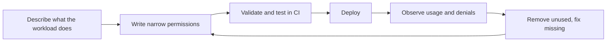

# Least Privilege in Practice

## Introduction

The **principle of least privilege** says every identity should have only the permissions it needs to do its job, and no more. Everyone agrees with it. Very few teams actually practice it, because "give it admin and move on" is faster today and the cost shows up later.

The cost is real. Excess permissions turn a small problem into a big one:

- A bug in a deploy script deletes the wrong resource group, because the script's identity was Owner on the whole subscription.
- A leaked CI token lets an attacker read every S3 bucket, because the pipeline role had `s3:*` on `*`.
- A compromised web server mines cryptocurrency on 200 VMs, because its role could launch instances.

Least privilege is about **limiting the blast radius**. Think of a hotel cleaner's key card: it opens the rooms on their floor during their shift, not the safe, not the manager's office, and not at 3 a.m.

This page is practical. It shows a repeatable process for both AWS and Azure:

1. Start from what the workload actually does.
2. Narrow actions, resources and scope.
3. Add conditions.
4. Add guardrails that limit even admins.
5. Find and remove unused access.
6. Test policies automatically.

It builds on [AWS IAM Users, Groups, Roles and Policies](./1-cloud-aws-iam.mdx) and [Microsoft Entra ID and Azure RBAC](./2-cloud-azure-entra-id.mdx).

## The Least Privilege Loop

You won't get permissions perfect on the first try. Treat it as a loop:



A practical rule: in **development**, start a little broader (for example, full access to one service in one sandbox account) and observe. Before **production**, tighten to what you observed.

## Step 1: Describe the Job in Plain Words

Before writing any JSON, write a sentence per capability:

> The invoice API **reads** and **writes** objects under `invoices/` in one bucket, **sends** messages to one queue, and **reads** one secret.

Each sentence maps to a verb (action), a noun (resource) and often a constraint (condition). Anything not in the description should not be in the policy.

## Step 2: Narrow Actions, Resources and Scope

### On AWS

A too-broad policy:

```json
{
  "Version": "2012-10-17",
  "Statement": [
    { "Effect": "Allow", "Action": ["s3:*", "sqs:*", "secretsmanager:*"], "Resource": "*" }
  ]
}
```

The same job, done properly:

```json
{
  "Version": "2012-10-17",
  "Statement": [
    {
      "Sid": "InvoiceObjects",
      "Effect": "Allow",
      "Action": ["s3:GetObject", "s3:PutObject"],
      "Resource": "arn:aws:s3:::acme-billing/invoices/*"
    },
    {
      "Sid": "ListInvoicePrefix",
      "Effect": "Allow",
      "Action": "s3:ListBucket",
      "Resource": "arn:aws:s3:::acme-billing",
      "Condition": { "StringLike": { "s3:prefix": "invoices/*" } }
    },
    {
      "Sid": "SendToQueue",
      "Effect": "Allow",
      "Action": "sqs:SendMessage",
      "Resource": "arn:aws:sqs:eu-west-1:111122223333:invoice-events"
    },
    {
      "Sid": "ReadDbSecret",
      "Effect": "Allow",
      "Action": "secretsmanager:GetSecretValue",
      "Resource": "arn:aws:secretsmanager:eu-west-1:111122223333:secret:invoice-db-*"
    }
  ]
}
```

The trailing `-*` on the secret ARN is needed because Secrets Manager appends a random suffix to secret ARNs.

In Terraform, the `aws_iam_policy_document` data source keeps this readable and lets you reference real resource ARNs instead of hard-coding them:

```hcl
data "aws_iam_policy_document" "invoice_api" {
  statement {
    sid       = "InvoiceObjects"
    actions   = ["s3:GetObject", "s3:PutObject"]
    resources = ["${aws_s3_bucket.billing.arn}/invoices/*"]
  }

  statement {
    sid       = "SendToQueue"
    actions   = ["sqs:SendMessage"]
    resources = [aws_sqs_queue.invoice_events.arn]
  }
}

resource "aws_iam_role_policy" "invoice_api" {
  name   = "invoice-api"
  role   = aws_iam_role.invoice_api.id
  policy = data.aws_iam_policy_document.invoice_api.json
}
```

### On Azure

On Azure, narrowing mostly means choosing **a smaller role** and **a smaller scope**.

| Too broad | Better | Best |
| --- | --- | --- |
| Contributor on the subscription | Contributor on the app's resource group | Storage Blob Data Contributor on one storage account |
| Owner for the CI pipeline | Contributor on target resource groups | Contributor on target resource groups, plus a narrowly scoped Role Based Access Control Administrator if it must assign roles |
| Key Vault Administrator for the app | Key Vault Secrets User on the vault | Key Vault Secrets User on the single secret (supported at secret scope) |

```bash
APP_MI=$(az identity show -g rg-billing -n id-invoice-api --query principalId -o tsv)
SA_ID=$(az storage account show -g rg-billing -n stbillingdemo --query id -o tsv)

az role assignment create \
  --assignee-object-id "$APP_MI" \
  --assignee-principal-type ServicePrincipal \
  --role "Storage Blob Data Contributor" \
  --scope "$SA_ID/blobServices/default/containers/invoices"
```

Example output (trimmed):

```text
{
  "principalType": "ServicePrincipal",
  "roleDefinitionName": "Storage Blob Data Contributor",
  "scope": "/subscriptions/.../storageAccounts/stbillingdemo/blobServices/default/containers/invoices"
}
```

Scoping to a single **container** is the Azure equivalent of the S3 prefix restriction above.

## Step 3: Add Conditions

Conditions let you say "allowed, but only when...". They are powerful because they scale: one policy can cover many resources without listing each one.

### Attribute-based access control (ABAC) on AWS

Tag principals and resources, then compare the tags in the policy. This lets a single policy say "teams may manage only their own resources".

```json
{
  "Version": "2012-10-17",
  "Statement": [
    {
      "Sid": "ManageOwnTeamInstances",
      "Effect": "Allow",
      "Action": ["ec2:StartInstances", "ec2:StopInstances", "ec2:RebootInstances"],
      "Resource": "arn:aws:ec2:*:111122223333:instance/*",
      "Condition": {
        "StringEquals": { "aws:ResourceTag/team": "${aws:PrincipalTag/team}" }
      }
    }
  ]
}
```

When a person from the `payments` team signs in through IAM Identity Center with the session tag `team=payments`, they can stop only instances tagged `team=payments`. Other useful condition keys include `aws:SourceVpce` (only through a VPC endpoint), `aws:MultiFactorAuthPresent`, `aws:RequestedRegion` and `aws:PrincipalOrgID`.

### Role assignment conditions on Azure

Azure supports **conditions on role assignments** for some data actions, most notably Azure Storage blobs, and for delegating role assignment rights. This example lets an identity read blobs only from the `invoices` container, even though the assignment is at the storage account scope:

```bash
az role assignment create \
  --assignee-object-id "$APP_MI" \
  --assignee-principal-type ServicePrincipal \
  --role "Storage Blob Data Reader" \
  --scope "$SA_ID" \
  --condition-version "2.0" \
  --condition "((!(ActionMatches{'Microsoft.Storage/storageAccounts/blobServices/containers/blobs/read'})) OR (@Resource[Microsoft.Storage/storageAccounts/blobServices/containers:name] StringEquals 'invoices'))"
```

Blob index tags can be used in conditions too, which gives you a tag-based model similar to AWS ABAC. The condition syntax is verbose, so build it in the portal's condition editor first and copy the generated expression. See [Azure ABAC conditions](https://learn.microsoft.com/azure/role-based-access-control/conditions-overview) for supported actions.

Conditions on the **Role Based Access Control Administrator** role are also how you safely let a pipeline assign roles: allow it to assign only specific roles (for example, Storage Blob Data Reader) to specific principal types.

## Step 4: Guardrails That Limit Everyone

Even well-written policies can be changed by someone with admin rights. Guardrails sit **above** individual permissions and can't be bypassed by account or subscription admins.

| Guardrail | AWS | Azure |
| --- | --- | --- |
| Cap what principals can do across accounts | Service control policies (SCPs) | Azure Policy (deny effect), management group structure |
| Cap who can access your resources | Resource control policies (RCPs) | Azure Policy, private endpoints, network rules |
| Cap what a delegated admin can grant | Permissions boundaries | Conditions on RBAC Administrator role assignments |
| Prevent deletion of critical resources | SCP deny + resource policies | Resource locks (`CanNotDelete`, `ReadOnly`) |

### Permissions boundary example (AWS)

You want developers to create roles for their Lambda functions, but never roles more powerful than they are. A permissions boundary caps the maximum:

```json
{
  "Version": "2012-10-17",
  "Statement": [
    {
      "Sid": "AllowCreateRoleOnlyWithBoundary",
      "Effect": "Allow",
      "Action": ["iam:CreateRole", "iam:PutRolePolicy", "iam:AttachRolePolicy"],
      "Resource": "arn:aws:iam::111122223333:role/app-*",
      "Condition": {
        "StringEquals": {
          "iam:PermissionsBoundary": "arn:aws:iam::111122223333:policy/AppWorkloadBoundary"
        }
      }
    }
  ]
}
```

Any role a developer creates must carry the `AppWorkloadBoundary` policy, so its effective permissions can never exceed that boundary. Organization-level guardrails such as SCPs and Azure Policy are covered in [Multi-Account and Landing Zone Strategy](./7-cloud-multi-account-strategy.mdx) and [Policies and Governance: SCPs and Azure Policy](../12-cloud-observability-and-security/7-cloud-compliance-and-governance.mdx).

## Step 5: Find and Remove Unused Access

Permissions tend to grow and never shrink. Both clouds give you data to fight that.

### On AWS

**Last accessed information** shows when each service was last used by a role:

```bash
JOB=$(aws iam generate-service-last-accessed-details \
  --arn arn:aws:iam::111122223333:role/invoice-api-role \
  --query JobId --output text)

aws iam get-service-last-accessed-details --job-id "$JOB" \
  --query "ServicesLastAccessed[].{svc:ServiceNamespace,last:LastAuthenticated}" \
  --output table
```

Example output:

```text
---------------------------------------------
|      GetServiceLastAccessedDetails        |
+------------------+------------------------+
|       last       |          svc           |
+------------------+------------------------+
|  2026-10-10T21:58|  s3                    |
|  2026-10-10T21:58|  sqs                   |
|  None            |  dynamodb              |
|  None            |  ec2                   |
+------------------+------------------------+
```

`dynamodb` and `ec2` were never used, so remove them.

**IAM Access Analyzer** goes further:

- **Unused access analyzers** continuously report unused roles, unused access keys and passwords, and unused services and actions. They are a paid feature, billed per IAM role and user analyzed per month.
- **Policy generation** reads your CloudTrail history for a role and drafts a policy containing only the actions it actually used.
- **External access analyzers** flag resources (buckets, keys, roles) shared outside your account or organization.

### On Azure

- **Access reviews** in Microsoft Entra ID Governance ask group owners or managers to confirm whether members still need access, and can remove them automatically.
- **PIM** alerts flag roles assigned but never activated.
- **Microsoft Defender for Cloud** recommendations highlight over-permissioned identities and external accounts with owner permissions.
- You can export role assignments and compare them with the **Activity Log** to see who actually used their write permissions:

```bash
az role assignment list --all --include-inherited \
  --query "[?roleDefinitionName=='Owner'].{who:principalName, scope:scope}" -o table
```

Example output:

```text
Who                         Scope
--------------------------  -----------------------------------------------
alice@contoso.com           /subscriptions/0000...
old-deploy-sp               /subscriptions/0000...
```

An old service principal with Owner on the subscription is exactly the kind of finding you want to remove.

## Step 6: Test Policies in CI

Treat permissions like code: review them in pull requests and test them automatically.

### AWS custom policy checks

```bash
# Fail the build if the new policy grants anything the old one didn't
aws accessanalyzer check-no-new-access \
  --existing-policy-document file://policy-main.json \
  --new-policy-document file://policy-pr.json \
  --policy-type IDENTITY_POLICY \
  --query result --output text

# Fail the build if the policy allows dangerous actions
aws accessanalyzer check-access-not-granted \
  --policy-document file://policy-pr.json \
  --access actions="iam:PassRole","s3:DeleteBucket" \
  --policy-type IDENTITY_POLICY \
  --query result --output text
```

Example output:

```text
FAIL
PASS
```

`FAIL` on the first check means the pull request adds new access. That doesn't block it outright, but it should trigger a human review. Custom policy checks are billed per API call, so run them on policy changes, not every commit.

### A simple local lint

You can also write a quick local check that catches the worst patterns before any cloud call:

```python
# lint_policies.py
import json
import pathlib
import sys

DANGEROUS = {"*", "iam:*", "s3:*", "ec2:*"}


def problems(doc: dict) -> list[str]:
    found = []
    for i, st in enumerate(doc.get("Statement", [])):
        if st.get("Effect") != "Allow":
            continue
        actions = st.get("Action", [])
        actions = [actions] if isinstance(actions, str) else actions
        resources = st.get("Resource", [])
        resources = [resources] if isinstance(resources, str) else resources
        for a in actions:
            if a in DANGEROUS:
                found.append(f"statement {i}: broad action {a}")
        if "*" in resources and "Condition" not in st:
            found.append(f"statement {i}: Resource '*' without a Condition")
    return found


if __name__ == "__main__":
    failed = False
    for path in pathlib.Path(sys.argv[1]).glob("*.json"):
        for p in problems(json.loads(path.read_text())):
            print(f"{path.name}: {p}")
            failed = True
    sys.exit(1 if failed else 0)
```

Example output:

```text
legacy-admin.json: statement 0: broad action *
legacy-admin.json: statement 0: Resource '*' without a Condition
```

For Azure, the equivalent is reviewing role assignments in Bicep or Terraform pull requests, and using Azure Policy to deny assignments of Owner outside approved groups.

## Real-World Scenario

Your team runs a data pipeline on both clouds. On AWS, a nightly ETL job runs in ECS and its task role has `AdministratorAccess` "because it kept failing". On Azure, a Function App's managed identity is Contributor on the subscription. A penetration test flags both.

**The solution:**

1. **Observe.** On AWS, generate last-accessed details and run Access Analyzer policy generation over 30 days of CloudTrail. On Azure, query the Activity Log for operations by the managed identity's object ID.
2. **Rewrite.** The ETL role becomes: read from one S3 prefix, write to one Glue database, and write logs. The Function's identity gets Storage Blob Data Contributor on two containers and Key Vault Secrets User on one vault.
3. **Guardrail.** Add a permissions boundary to all `app-*` roles on AWS, and an Azure Policy assignment that denies Owner role assignments to service principals.
4. **Automate.** Add `check-no-new-access` to the infrastructure pipeline and schedule quarterly access reviews.

**Why this approach:** it is driven by evidence of real usage, so you remove access confidently instead of guessing, and the guardrails stop the same problem from coming back.

**When to use it:** for every production workload, and before any compliance audit. **When not to:** don't spend days hand-tuning permissions for a prototype that will be thrown away next week. Isolate it in a sandbox account or subscription instead, which gives you a blast radius limit for free.

**Alternatives and trade-offs:**

| Approach | Pros | Cons | Best for |
| --- | --- | --- | --- |
| Broad managed roles (Admin, Contributor) | Fast, never blocks work | Huge blast radius | Personal sandboxes only |
| Hand-written narrow policies | Precise | Time-consuming, drifts as code changes | Small number of critical workloads |
| Usage-based generation (Access Analyzer, activity logs) | Evidence-driven | Misses rare code paths (yearly jobs, error handlers) | Tightening existing workloads |
| ABAC with tags | Scales to many teams with few policies | Requires disciplined tagging, harder to reason about | Large organizations |
| Account or subscription isolation | Strong boundary, simple | More accounts to manage | Separating environments and teams |

## Common Mistakes

- **"We'll tighten it later."** Later rarely comes. Write a narrow policy first, and widen it when an `AccessDenied` proves you need to.
- **Generating policies from too short a window.** Monthly or quarterly jobs won't appear in a one-week CloudTrail sample.
- **Forgetting `iam:PassRole`.** On AWS, letting someone pass any role to a service is equivalent to giving them that role's permissions. Scope `iam:PassRole` to specific role ARNs.
- **Ignoring data-plane roles on Azure.** Least privilege often means *replacing* Contributor with a data role, not adding one.
- **Scoping too narrowly for your own operations.** Make sure break-glass and on-call roles still exist so you can fix incidents.
- **Not testing denials.** Test that forbidden things fail, not only that allowed things work.

## Summary

- Least privilege limits the **blast radius** of mistakes and compromises.
- Describe the job in plain words, then narrow **actions**, **resources** and **scope**.
- Use **conditions** (ABAC tags, prefixes, network sources) to express rules that scale.
- Add **guardrails** (SCPs, RCPs, permissions boundaries, Azure Policy, resource locks) that even admins can't bypass.
- Use **usage data** (last accessed, Access Analyzer, Activity Log, access reviews) to remove unused permissions.
- Test permission changes in **CI** like any other code.

## Exercises

1. Take an existing broad AWS policy or Azure role assignment you know of and rewrite it using the six-step process on this page.
2. Write an AWS ABAC policy that lets developers manage Lambda functions only when the function's `project` tag matches their own `project` session tag.
3. Assign an Azure role with a condition that allows reading blobs only from containers whose name starts with `public-`. Hint: look for `StringStartsWith`.
4. Add `lint_policies.py` to a CI workflow and make it fail a build when a policy contains `"Action": "*"`.

**Next:** [Workload Identity: Instance Roles and Managed Identities](./4-cloud-workload-identity.mdx).
