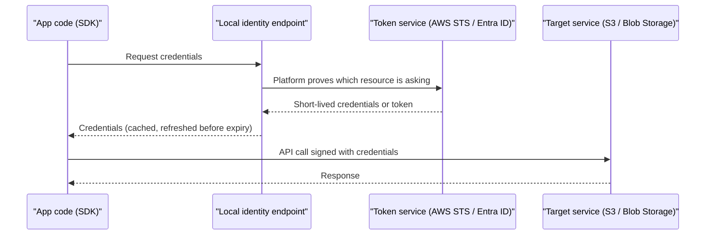

# Workload Identity: Instance Roles and Managed Identities

## Introduction

Your application needs to talk to other cloud services: read from storage, write to a queue, fetch a secret. To do that it must authenticate. The old way was to create a key or client secret and put it in an environment variable or config file. That approach has three problems:

1. **Secrets leak.** They end up in Git history, container images, logs and screenshots.
2. **Secrets don't rotate themselves.** Someone has to remember, and rotation often breaks things.
3. **Secrets are hard to trace.** If five apps share one key, the audit log can't tell you which one did something.

**Workload identity** solves this. The cloud platform gives your compute resource (VM, container, function, pod) its own identity and hands it **short-lived, automatically rotated credentials** through a local endpoint. Your code never sees a long-lived secret.

- On **AWS**, this is an **IAM role** attached to the compute: an instance profile for EC2, a task role for ECS, an execution role for Lambda, and Pod Identity or IRSA for EKS.
- On **Azure**, this is a **managed identity**: system-assigned or user-assigned, attached to a VM, App Service, Functions app, Container App or AKS workload.

An analogy: instead of giving a delivery driver a copy of your house key (which they might lose or copy), you install a smart lock that issues a one-time code each day to whichever driver is on the route.

## How It Works Under the Hood

Both clouds use the same basic pattern: a metadata or identity endpoint, reachable only from inside the compute resource, that returns a fresh token.



| | AWS | Azure |
| --- | --- | --- |
| Endpoint on VMs | Instance Metadata Service (IMDS) at `169.254.169.254` | Azure IMDS at `169.254.169.254` |
| Token type | Temporary access key, secret key and session token from STS | OAuth 2.0 access token from Entra ID |
| Where permissions live | Policies on the IAM role | Azure RBAC role assignments to the managed identity |
| SDK support | Default credential provider chain in every AWS SDK | `DefaultAzureCredential` or `ManagedIdentityCredential` in `azure-identity` |

You almost never call these endpoints yourself. The SDKs do it for you.

## On AWS

### Which role mechanism for which compute?

| Compute | Mechanism | Trust principal |
| --- | --- | --- |
| EC2 | Instance profile wrapping a role | `ec2.amazonaws.com` |
| ECS / Fargate | **Task role** (for your app) and **task execution role** (for ECS to pull images and write logs) | `ecs-tasks.amazonaws.com` |
| Lambda | Execution role | `lambda.amazonaws.com` |
| EKS | **EKS Pod Identity** (newer, simpler) or IAM roles for service accounts (IRSA, OIDC-based) | `pods.eks.amazonaws.com` for Pod Identity |
| App Runner, Elastic Beanstalk, etc. | Service-specific instance or service roles | Varies |

### EC2: instance profile

:::caution
Launching an EC2 instance costs money while it runs. The commands below only create IAM objects (free) and attach the profile to an instance you already have. If you launch an instance to try this, terminate it afterwards.
:::

```bash
# trust-ec2.json allows ec2.amazonaws.com to assume the role
aws iam create-role --role-name app-server-role \
  --assume-role-policy-document file://trust-ec2.json

aws iam attach-role-policy --role-name app-server-role \
  --policy-arn arn:aws:iam::aws:policy/AmazonS3ReadOnlyAccess

aws iam create-instance-profile --instance-profile-name app-server-profile
aws iam add-role-to-instance-profile \
  --instance-profile-name app-server-profile \
  --role-name app-server-role

aws ec2 associate-iam-instance-profile \
  --instance-id i-0123456789abcdef0 \
  --iam-instance-profile Name=app-server-profile
```

Example output of the last command (trimmed):

```text
{
    "IamInstanceProfileAssociation": {
        "AssociationId": "iip-assoc-0abc123def4567890",
        "InstanceId": "i-0123456789abcdef0",
        "IamInstanceProfile": {
            "Arn": "arn:aws:iam::111122223333:instance-profile/app-server-profile"
        },
        "State": "associating"
    }
}
```

`AmazonS3ReadOnlyAccess` keeps the demo short. In production, write a narrow policy as shown in [Least Privilege in Practice](./3-cloud-least-privilege.mdx).

### IMDSv2: protect the metadata endpoint

The metadata endpoint is a target for attackers. A server-side request forgery (SSRF) bug can trick your app into fetching `http://169.254.169.254/...` and leaking the role's credentials. **IMDSv2** requires a session token obtained with a `PUT` request first, which blocks most SSRF attacks.

Require IMDSv2 on new instances:

```bash
aws ec2 run-instances \
  --image-id ami-0abcdef1234567890 \
  --instance-type t3.micro \
  --iam-instance-profile Name=app-server-profile \
  --metadata-options "HttpEndpoint=enabled,HttpTokens=required,HttpPutResponseHopLimit=2"
```

Or set it as the default for the whole account and Region:

```bash
aws ec2 modify-instance-metadata-defaults \
  --http-tokens required \
  --http-put-response-hop-limit 2
```

Example output:

```text
{
    "Return": true
}
```

A hop limit of 2 lets containers on the instance reach IMDS. Use 1 if no containers need it. This is what the SDK does internally, shown for understanding only:

```bash
TOKEN=$(curl -s -X PUT "http://169.254.169.254/latest/api/token" \
  -H "X-aws-ec2-metadata-token-ttl-seconds: 21600")
curl -s -H "X-aws-ec2-metadata-token: $TOKEN" \
  http://169.254.169.254/latest/meta-data/iam/security-credentials/
```

Example output:

```text
app-server-role
```

### ECS: task role vs task execution role

These two are easy to confuse:

```json
{
  "family": "invoice-api",
  "taskRoleArn": "arn:aws:iam::111122223333:role/invoice-api-task-role",
  "executionRoleArn": "arn:aws:iam::111122223333:role/ecsTaskExecutionRole",
  "networkMode": "awsvpc",
  "requiresCompatibilities": ["FARGATE"],
  "cpu": "256",
  "memory": "512",
  "containerDefinitions": [
    {
      "name": "api",
      "image": "111122223333.dkr.ecr.eu-west-1.amazonaws.com/invoice-api:1.4.0",
      "essential": true
    }
  ]
}
```

- `executionRoleArn`: used by **ECS itself** to pull the image from ECR, write logs to CloudWatch and fetch secrets referenced in the task definition.
- `taskRoleArn`: used by **your code** inside the container to call AWS services.

More in [Amazon ECS and Fargate](../5-cloud-containers/2-cloud-ecs-and-fargate.mdx).

### EKS: Pod Identity

EKS Pod Identity maps an IAM role to a Kubernetes service account. Its trust policy uses one fixed service principal for every cluster, which makes roles reusable:

```json
{
  "Version": "2012-10-17",
  "Statement": [
    {
      "Effect": "Allow",
      "Principal": { "Service": "pods.eks.amazonaws.com" },
      "Action": ["sts:AssumeRole", "sts:TagSession"]
    }
  ]
}
```

```bash
aws eks create-pod-identity-association \
  --cluster-name prod-cluster \
  --namespace billing \
  --service-account invoice-api \
  --role-arn arn:aws:iam::111122223333:role/invoice-api-pod-role
```

The cluster needs the EKS Pod Identity Agent add-on (preinstalled with EKS Auto Mode). Older clusters often use **IRSA**, which relies on an OIDC provider per cluster. Both work. Pod Identity is simpler for new setups. Details in [Amazon EKS](../5-cloud-containers/4-cloud-eks.mdx).

### Code: nothing special

```python
# read_invoice.py  (runs on EC2, ECS, Lambda or EKS unchanged)
import boto3

s3 = boto3.client("s3")
obj = s3.get_object(Bucket="acme-invoices", Key="2026/inv-0001.pdf")
print(obj["ContentLength"], "bytes")
```

Example output:

```text
48213 bytes
```

No keys appear anywhere. `boto3` walks its credential chain and finds the role credentials.

## On Azure

### System-assigned vs user-assigned

| | System-assigned | User-assigned |
| --- | --- | --- |
| Created | As part of a resource (switch it on) | As a standalone resource |
| Lifecycle | Deleted with the resource | Independent, delete explicitly |
| Sharing | One resource only | Can be attached to many resources |
| Pre-grant permissions before the app exists | No | Yes |
| Good for | A single VM or app with its own permissions | Fleets, scale sets, blue/green slots, apps recreated often |

Microsoft's guidance recommends **user-assigned** identities for most production use, because permissions survive when you recreate compute, and you can set up role assignments before deployment.

### Create and use a user-assigned managed identity

:::caution
Managed identities themselves are free, but the compute you attach them to is not. Run the cleanup commands at the end of this section.
:::

```bash
RG=rg-mi-demo
az group create -n $RG -l westeurope -o none

az identity create -g $RG -n id-invoice-api
MI_PRINCIPAL=$(az identity show -g $RG -n id-invoice-api --query principalId -o tsv)
MI_CLIENT=$(az identity show -g $RG -n id-invoice-api --query clientId -o tsv)
MI_ID=$(az identity show -g $RG -n id-invoice-api --query id -o tsv)
```

Example output of `az identity create` (trimmed):

```text
{
  "clientId": "9a8b7c6d-1111-2222-3333-444455556666",
  "id": "/subscriptions/.../resourceGroups/rg-mi-demo/providers/Microsoft.ManagedIdentity/userAssignedIdentities/id-invoice-api",
  "name": "id-invoice-api",
  "principalId": "0f1e2d3c-aaaa-bbbb-cccc-ddddeeeeffff",
  "tenantId": "11111111-2222-3333-4444-555555555555"
}
```

Note the two IDs: **principalId** (object ID) is used for role assignments, **clientId** is what your code passes to select this identity.

Grant it access to a storage account, then attach it to compute:

```bash
SA_ID=$(az storage account show -g rg-billing -n stbillingdemo --query id -o tsv)
az role assignment create \
  --assignee-object-id "$MI_PRINCIPAL" \
  --assignee-principal-type ServicePrincipal \
  --role "Storage Blob Data Reader" \
  --scope "$SA_ID"

# Attach to an existing VM
az vm identity assign -g $RG -n vm-api-01 --identities "$MI_ID"

# Or to an App Service / Functions app
az webapp identity assign -g $RG -n app-invoice-api --identities "$MI_ID"

# Or to a Container App
az containerapp identity assign -g $RG -n ca-invoice-api --user-assigned "$MI_ID"
```

To use a **system-assigned** identity instead, run `az vm identity assign -g $RG -n vm-api-01` with no `--identities`, and use the returned `systemAssignedIdentity` value as the principal ID.

### Code: select the identity explicitly

```python
# read_invoice_azure.py
# pip install azure-identity azure-storage-blob
import os
from azure.identity import DefaultAzureCredential
from azure.storage.blob import BlobClient

credential = DefaultAzureCredential(
    managed_identity_client_id=os.environ.get("AZURE_CLIENT_ID")
)
blob = BlobClient(
    account_url="https://stbillingdemo.blob.core.windows.net",
    container_name="invoices",
    blob_name="2026/inv-0001.pdf",
    credential=credential,
)
print(blob.get_blob_properties().size, "bytes")
```

Example output:

```text
48213 bytes
```

When a resource has more than one user-assigned identity, you must tell the SDK which one to use. Setting `AZURE_CLIENT_ID` in the app settings is the common convention. On your laptop, the same code falls back to your `az login` session.

What the SDK does internally on a VM, for understanding only:

```bash
curl -s -H "Metadata: true" \
  "http://169.254.169.254/metadata/identity/oauth2/token?api-version=2018-02-01&resource=https://storage.azure.com/&client_id=$MI_CLIENT" \
  | python3 -c "import sys, json; t=json.load(sys.stdin); print(t['token_type'], t['expires_in'])"
```

Example output:

```text
Bearer 86399
```

The required `Metadata: true` header plays a similar role to IMDSv2's token: a naive SSRF request without custom headers is rejected.

### AKS: Microsoft Entra Workload ID

For pods on AKS, use **Microsoft Entra Workload ID**. It federates a Kubernetes service account with a user-assigned managed identity. The older *pod-managed identity* add-on is deprecated.

```bash
OIDC_ISSUER=$(az aks show -g rg-aks -n aks-prod --query "oidcIssuerProfile.issuerUrl" -o tsv)

az identity federated-credential create \
  --name fic-invoice-api \
  --identity-name id-invoice-api \
  --resource-group $RG \
  --issuer "$OIDC_ISSUER" \
  --subject "system:serviceaccount:billing:invoice-api" \
  --audiences "api://AzureADTokenExchange"
```

```yaml
apiVersion: v1
kind: ServiceAccount
metadata:
  name: invoice-api
  namespace: billing
  annotations:
    azure.workload.identity/client-id: "9a8b7c6d-1111-2222-3333-444455556666"
---
apiVersion: v1
kind: Pod
metadata:
  name: invoice-api
  namespace: billing
  labels:
    azure.workload.identity/use: "true"
spec:
  serviceAccountName: invoice-api
  containers:
    - name: api
      image: myregistry.azurecr.io/invoice-api:1.4.0
```

The `azure.workload.identity/use: "true"` label is required. Without it the webhook doesn't inject the token, and the pod fails to authenticate. More in [Azure Kubernetes Service](../5-cloud-containers/5-cloud-aks.mdx).

### Cleanup

```bash
az group delete -n rg-mi-demo --yes --no-wait
```

On AWS, detach and delete the demo objects:

```bash
aws iam remove-role-from-instance-profile --instance-profile-name app-server-profile --role-name app-server-role
aws iam delete-instance-profile --instance-profile-name app-server-profile
aws iam detach-role-policy --role-name app-server-role --policy-arn arn:aws:iam::aws:policy/AmazonS3ReadOnlyAccess
aws iam delete-role --role-name app-server-role
```

## AWS vs Azure Mapping

| Compute | AWS identity | Azure identity |
| --- | --- | --- |
| Virtual machine | Instance profile + role | System- or user-assigned managed identity |
| Scale set / auto scaling group | Launch template with instance profile | User-assigned managed identity on the scale set |
| Containers (serverless) | ECS task role | Container Apps managed identity |
| Functions | Lambda execution role | Functions app managed identity |
| PaaS web app | Elastic Beanstalk instance profile, App Runner instance role | App Service managed identity |
| Kubernetes pods | EKS Pod Identity or IRSA | Microsoft Entra Workload ID |
| Outside the cloud | IAM Roles Anywhere, OIDC federation | Workload identity federation |

## Real-World Scenario

Your team runs the same order-processing service on AWS (ECS Fargate) and Azure (Container Apps) for two different regions' customers. Both read a database password from a config file baked into the image, plus a storage access key. A former contractor still has a copy of the image.

**The solution:**

1. **AWS:** create `orders-task-role` with `secretsmanager:GetSecretValue` on one secret and `s3:PutObject` on one prefix. Set it as `taskRoleArn`. Load the DB password from Secrets Manager at startup. Better still, use RDS IAM authentication if your database supports it.
2. **Azure:** create `id-orders` (user-assigned), grant Key Vault Secrets User on the vault and Storage Blob Data Contributor on one container. Attach it to the Container App and set `AZURE_CLIENT_ID`. Consider Entra authentication for Azure Database for PostgreSQL or Azure SQL instead of passwords.
3. Rebuild the image with no secrets, **rotate** the old password and storage key, and disable shared key access on the storage account.

**Why this approach:** the image becomes safe to share, credentials rotate automatically, and the audit logs show which service did what.

**When to use it:** whenever code runs on cloud compute. **When not to:** workloads running outside the cloud (on-premises servers, other clouds, CI) can't use instance roles or managed identities directly. Use federation instead, as described in [Keyless CI/CD with OIDC](./6-cloud-oidc-for-ci.mdx).

**Alternatives and trade-offs:**

| Approach | Pros | Cons | Best for |
| --- | --- | --- | --- |
| Static keys in config or env vars | Works everywhere | Leak risk, manual rotation | Avoid |
| Keys in a secrets manager | Central, auditable, rotatable | You still need an identity to read the secret | Third-party API keys, legacy DB passwords |
| Instance role / managed identity | No secret at all, auto-rotation | Only on that cloud's compute | Default for cloud workloads |
| User-assigned identity shared across many apps | Fewer identities to manage | One compromise affects all apps | Truly identical replicas only |
| Federation (OIDC, Roles Anywhere) | No secret, works across environments | More setup | CI/CD, multi-cloud, on-premises |

## Common Mistakes

- **Leaving IMDSv1 enabled.** Require IMDSv2 so SSRF bugs can't easily steal role credentials.
- **Mixing up ECS task role and execution role.** Your app's permissions go in the task role.
- **One identity for everything.** Give each service its own identity so you can scope and audit it.
- **Using the clientId in role assignments.** Assign roles to the principal (object) ID. Pass the client ID in code.
- **Expecting instant permissions.** New role assignments can take a few minutes. Tokens already issued keep their old claims until they expire.
- **Forgetting the pod label on AKS** or the Pod Identity Agent on EKS. Both fail with confusing authentication errors.
- **Giving the node role broad permissions on Kubernetes.** Pods that can reach the node's metadata endpoint can inherit it. Keep node roles minimal and restrict IMDS access from pods.

## Summary

- Workload identity gives compute **its own identity with short-lived, auto-rotated credentials**, so your code holds no secrets.
- AWS uses **IAM roles** attached through instance profiles, task roles, execution roles and EKS Pod Identity.
- Azure uses **managed identities**, preferably **user-assigned** for production, plus **Entra Workload ID** for AKS.
- SDK default credential chains (`boto3`, `DefaultAzureCredential`) make the same code work locally and in the cloud.
- Protect metadata endpoints: **IMDSv2** on AWS, the required `Metadata` header on Azure, and minimal node roles in Kubernetes.

## Exercises

1. Write the trust policy and permissions policy for a Lambda function that reads one DynamoDB table. Which AWS managed policy gives it permission to write logs?
2. Create a user-assigned managed identity, grant it Reader on a resource group, and list its role assignments with `az role assignment list --assignee <principalId>`.
3. Explain in two sentences why a user-assigned identity is a better fit for a VM scale set than a system-assigned one.
4. Look at a container image you build. Does it contain any credentials? Plan how to replace them with a task role or managed identity.

**Next:** [Federation, SSO and Identity Center](./5-cloud-federation-and-sso.mdx) for human access, and [Secrets Management: Secrets Manager and Key Vault](../11-cloud-devops/4-cloud-secrets-management.mdx) for secrets that must still exist.
