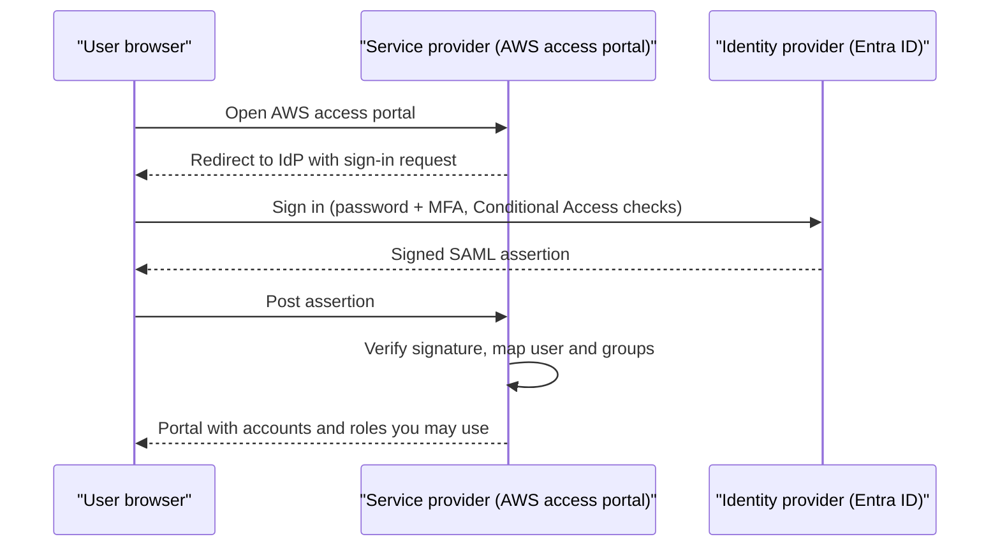
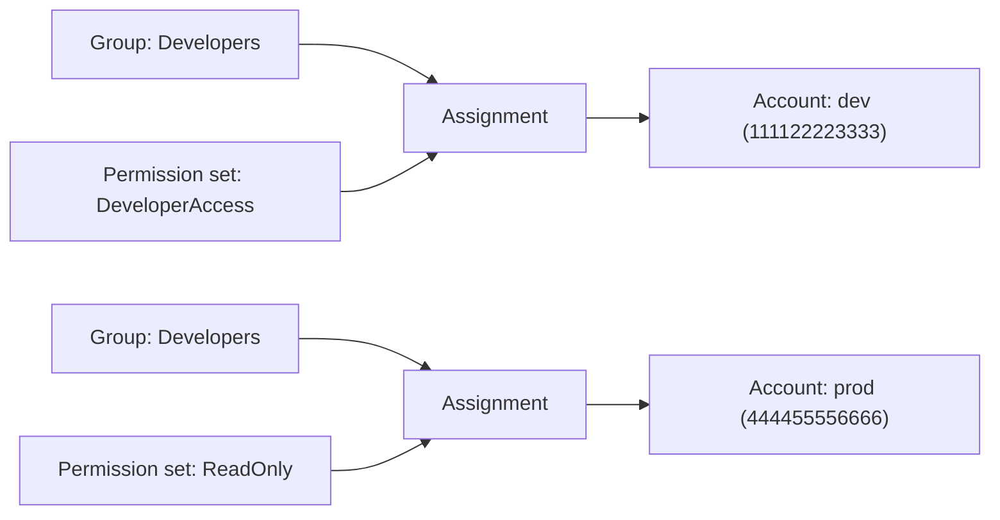
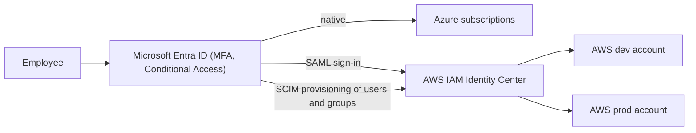

# Federation, SSO and Identity Center

## Introduction

In a growing company, people need access to many systems: AWS accounts, Azure subscriptions, GitHub, Slack, monitoring tools. If each system has its own username and password, you get:

- Dozens of passwords per person, reused and written down.
- Offboarding that misses one system, leaving a former employee with production access.
- No single place to enforce MFA or see who has access to what.

**Single sign-on (SSO)** fixes this. People sign in **once** to a central **identity provider (IdP)**, and every other system trusts that IdP. This trust relationship is called **federation**.

An analogy: a passport. Your home country (the IdP) verifies who you are and issues a passport. Other countries (service providers) don't re-check your birth certificate. They trust the passport issuer, then decide what you are allowed to do while visiting.

In this page you will learn:

- How federation protocols (SAML 2.0, OpenID Connect) work at a high level.
- How **AWS IAM Identity Center** provides SSO across many AWS accounts with **permission sets**.
- How **Microsoft Entra ID** acts as the identity provider for Azure, and often for AWS too.
- How developers use SSO from the command line, so nobody needs access keys.

## Federation Concepts

| Term | Meaning | Examples |
| --- | --- | --- |
| Identity provider (IdP) | Authenticates users and issues signed assertions or tokens | Microsoft Entra ID, Okta, Google Workspace, IAM Identity Center's own directory |
| Service provider (SP) / relying party | Trusts the IdP and grants access | AWS, GitHub, Salesforce |
| SAML 2.0 | XML-based federation protocol, common for enterprise web SSO | AWS console SSO, many SaaS apps |
| OpenID Connect (OIDC) | JSON/JWT-based protocol on top of OAuth 2.0 | Modern web apps, CI/CD federation, mobile apps |
| SCIM | Protocol to **provision** users and groups from the IdP into the SP automatically | Entra ID to IAM Identity Center user sync |
| Claims / attributes | Facts about the user inside the token: email, groups, department | `email`, `groups`, `department` |

Federation answers **authentication**. The service provider still makes its own **authorization** decision based on group membership or claims.



## AWS IAM Identity Center

**AWS IAM Identity Center** (formerly AWS Single Sign-On) is the recommended way for people to access AWS. It works across all accounts in an **AWS Organization**.

### Core building blocks

| Concept | What it is |
| --- | --- |
| Identity source | Where users and groups come from: the built-in Identity Center directory, Active Directory, or an external IdP (Entra ID, Okta, Google Workspace) |
| Permission set | A template of permissions (AWS managed policies, customer managed policies, inline policy, permissions boundary, session duration) |
| Account assignment | "Group X gets permission set Y in account Z" |
| AWS access portal | The web page where users pick an account and role |
| Provisioned role | Identity Center creates an IAM role named `AWSReservedSSO_<PermissionSet>_<suffix>` in each assigned account |



The same group can have different permission sets in different accounts. That is how you give developers broad rights in dev and read-only access in prod.

### Creating a permission set and assignment with the CLI

:::note
IAM Identity Center itself has no additional charge at the time of writing, but always confirm on the [IAM Identity Center pricing page](https://aws.amazon.com/iam/identity-center/). Run these commands from the management account or a delegated administrator account.
:::

```bash
INSTANCE_ARN=$(aws sso-admin list-instances --query "Instances[0].InstanceArn" --output text)
STORE_ID=$(aws sso-admin list-instances --query "Instances[0].IdentityStoreId" --output text)

PS_ARN=$(aws sso-admin create-permission-set \
  --instance-arn "$INSTANCE_ARN" \
  --name DeveloperAccess \
  --description "Developers in non-production accounts" \
  --session-duration PT8H \
  --query "PermissionSet.PermissionSetArn" --output text)

aws sso-admin attach-managed-policy-to-permission-set \
  --instance-arn "$INSTANCE_ARN" \
  --permission-set-arn "$PS_ARN" \
  --managed-policy-arn arn:aws:iam::aws:policy/PowerUserAccess

GROUP_ID=$(aws identitystore get-group-id \
  --identity-store-id "$STORE_ID" \
  --alternate-identifier '{"UniqueAttribute":{"AttributePath":"displayName","AttributeValue":"Developers"}}' \
  --query GroupId --output text)

aws sso-admin create-account-assignment \
  --instance-arn "$INSTANCE_ARN" \
  --target-id 111122223333 \
  --target-type AWS_ACCOUNT \
  --permission-set-arn "$PS_ARN" \
  --principal-type GROUP \
  --principal-id "$GROUP_ID"
```

Example output of the last command (trimmed):

```text
{
    "AccountAssignmentCreationStatus": {
        "Status": "IN_PROGRESS",
        "RequestId": "a1b2c3d4-5678-90ab-cdef-EXAMPLE11111",
        "TargetId": "111122223333",
        "PermissionSetArn": "arn:aws:sso:::permissionSet/ssoins-1234567890abcdef/ps-0123456789abcdef"
    }
}
```

In practice most teams define permission sets and assignments in Terraform or CloudFormation rather than by hand. For example, with Terraform:

```hcl
resource "aws_ssoadmin_permission_set" "developer" {
  name             = "DeveloperAccess"
  instance_arn     = local.sso_instance_arn
  session_duration = "PT8H"
}

resource "aws_ssoadmin_managed_policy_attachment" "developer_poweruser" {
  instance_arn       = local.sso_instance_arn
  permission_set_arn = aws_ssoadmin_permission_set.developer.arn
  managed_policy_arn = "arn:aws:iam::aws:policy/PowerUserAccess"
}

resource "aws_ssoadmin_account_assignment" "dev_developers" {
  instance_arn       = local.sso_instance_arn
  permission_set_arn = aws_ssoadmin_permission_set.developer.arn
  principal_type     = "GROUP"
  principal_id       = local.developers_group_id
  target_type        = "AWS_ACCOUNT"
  target_id          = "111122223333"
}
```

`PowerUserAccess` keeps the example short. It allows almost everything except IAM and Organizations management, so in production you'd usually narrow it.

### Using SSO from the AWS CLI

Developers configure the CLI once:

```bash
aws configure sso
```

Example session:

```text
SSO session name (Recommended): corp
SSO start URL [None]: https://my-company.awsapps.com/start
SSO region [None]: eu-west-1
SSO registration scopes [None]: sso:account:access
Attempting to automatically open the SSO authorization page in your default browser.
There are 2 AWS accounts available to you.
> dev, aws-dev@example.com (111122223333)
  prod, aws-prod@example.com (444455556666)
Using the account ID 111122223333
There are 2 roles available to you.
> DeveloperAccess
  ReadOnly
Default client Region [None]: eu-west-1
CLI default output format (json if not specified) [None]: json
Profile name [DeveloperAccess-111122223333]: dev
```

The resulting `~/.aws/config`:

```text
[profile dev]
sso_session = corp
sso_account_id = 111122223333
sso_role_name = DeveloperAccess
region = eu-west-1
output = json

[sso-session corp]
sso_region = eu-west-1
sso_start_url = https://my-company.awsapps.com/start
sso_registration_scopes = sso:account:access
```

Daily use:

```bash
aws sso login --sso-session corp
aws s3 ls --profile dev
```

Since AWS CLI v2.22.0, `aws sso login` uses the **PKCE** authorization flow by default, which opens a browser on the same machine. On a remote server without a browser, add `--use-device-code` to use the device authorization flow instead. SDKs such as `boto3` read the same SSO cache, so `boto3.Session(profile_name="dev")` just works.

## Microsoft Entra ID as the Identity Provider

### For Azure

Azure is federated with Entra ID by design. Every subscription trusts one Entra tenant, so SSO to the Azure portal and CLI comes built in:

```bash
az login                       # opens a browser, supports MFA and Conditional Access
az login --use-device-code     # for machines without a browser
az account list -o table
```

Example output:

```text
Name          CloudName    SubscriptionId                        State    IsDefault
------------  -----------  ------------------------------------  -------  -----------
contoso-dev   AzureCloud   00000000-0000-0000-0000-000000000000  Enabled  True
contoso-prod  AzureCloud   99999999-0000-0000-0000-000000000000  Enabled  False
```

If your company already uses another IdP (Okta, Ping, Google), Entra ID can federate with it so that users still sign in there. External partners can be invited as **B2B guest users**, who sign in with their own organization's credentials.

### Conditional Access

**Conditional Access** is Entra ID's policy engine for sign-ins. It can require MFA, a compliant device or a trusted location, or block legacy authentication. It requires a premium Entra ID license (P1 or higher at the time of writing). A typical baseline:

| Policy | Applies to | Effect |
| --- | --- | --- |
| Require MFA for admins | Users in privileged roles | Grant only with MFA |
| Require MFA for Azure management | Azure portal, CLI, PowerShell | Grant only with MFA |
| Block legacy authentication | All users | Block |
| Require compliant device for prod | Production admin group | Grant only from managed devices |

Microsoft has been rolling out **mandatory MFA** for Azure sign-ins to the portal, CLI and other management tools in phases. Check the current status in the Microsoft Learn documentation, and plan for MFA on every human account.

### Entra ID as the IdP for AWS

A very common setup in companies that already use Microsoft 365: **Entra ID is the single IdP for both clouds.**



The setup, at a high level:

1. In IAM Identity Center, change the identity source to **External identity provider** and download the AWS SAML metadata.
2. In Entra ID, add the **AWS IAM Identity Center** enterprise application from the gallery, upload the metadata, and download Entra's federation metadata back into AWS.
3. Enable **automatic provisioning (SCIM)** in the Entra app using the SCIM endpoint and access token from Identity Center.
4. Assign Entra groups to the enterprise app. They sync into Identity Center, where you create account assignments for them.

Follow the official tutorial for the exact current steps: [Configure SAML and SCIM with Microsoft Entra ID and IAM Identity Center](https://docs.aws.amazon.com/singlesignon/latest/userguide/idp-microsoft-entra.html).

:::warning
The SCIM access token used for provisioning has an expiry date, which the Identity Center console shows. Put a reminder in your calendar and monitor provisioning errors, otherwise new joiners silently stop appearing in AWS.
:::

When someone leaves, you disable them in Entra ID, and they lose access to Azure, AWS and every other federated app at once.

## Using SSO Sessions From Code

Because the SDKs read the same SSO cache as the CLI, local scripts need no keys at all. A small helper that checks both clouds before a script does real work:

```python
# check_sessions.py
# pip install boto3 azure-identity
import boto3
from botocore.exceptions import SSOTokenLoadError, TokenRetrievalError, UnauthorizedSSOTokenError
from azure.identity import AzureCliCredential, CredentialUnavailableError


def check_aws(profile: str) -> None:
    try:
        arn = boto3.Session(profile_name=profile).client("sts").get_caller_identity()["Arn"]
        print(f"AWS [{profile}] OK: {arn}")
    except (SSOTokenLoadError, TokenRetrievalError, UnauthorizedSSOTokenError):
        print(f"AWS [{profile}] session expired. Run: aws sso login --profile {profile}")


def check_azure() -> None:
    try:
        AzureCliCredential().get_token("https://management.azure.com/.default")
        print("Azure OK: token from az login session")
    except CredentialUnavailableError:
        print("Azure session missing. Run: az login")


if __name__ == "__main__":
    check_aws("dev")
    check_azure()
```

Example output:

```text
AWS [dev] OK: arn:aws:sts::111122223333:assumed-role/AWSReservedSSO_DeveloperAccess_1a2b3c4d5e6f7a8b/alice@example.com
Azure OK: token from az login session
```

## Break-Glass Access

SSO puts all your eggs in one basket: if the IdP is down or misconfigured, nobody can sign in. Plan for that with **break-glass** (emergency) accounts:

| | AWS | Azure |
| --- | --- | --- |
| Emergency identity | Root user of the management account, or one IAM user with MFA and admin rights, used only for emergencies | Two cloud-only Entra accounts with Global Administrator, excluded from most Conditional Access policies |
| Protection | Hardware MFA, credentials in a physical safe or secure vault | Phishing-resistant MFA (for example FIDO2 keys), credentials split between people |
| Monitoring | CloudTrail alert on any sign-in by these identities | Alert on any sign-in by these accounts via Azure Monitor / Entra sign-in logs |
| Testing | Test sign-in on a schedule, then rotate | Test sign-in on a schedule, then rotate |

Document who may use them, when, and how to report it afterwards.

## AWS and Azure Comparison

| Feature | AWS | Azure |
| --- | --- | --- |
| Central SSO service | IAM Identity Center | Microsoft Entra ID |
| Built-in user directory | Identity Center directory | Entra ID |
| External IdP support | SAML 2.0 + SCIM | Federation with SAML/WS-Fed IdPs, B2B guests |
| Permission bundle for SSO users | Permission set (provisioned as a role per account) | Azure RBAC role assignment (group-based) |
| CLI login | `aws configure sso`, `aws sso login` | `az login` |
| Sign-in policies | Basic MFA settings in Identity Center, richer controls in the external IdP | Conditional Access |
| Just-in-time elevation | Separate admin permission sets, temporary access solutions | Privileged Identity Management |

## Real-World Scenario

A 200-person company uses Microsoft 365 and has 12 AWS accounts and 6 Azure subscriptions. AWS access today is a mix of IAM users in each account, some with access keys older than two years. Offboarding is a 15-step checklist that is often incomplete.

**The solution:**

1. Make **Entra ID the single IdP**. Azure already uses it.
2. Enable **IAM Identity Center** in the AWS management account, connect it to Entra ID with SAML and SCIM, and sync groups like `aws-developers`, `aws-platform`, `aws-readonly`.
3. Define permission sets `DeveloperAccess`, `PlatformAdmin` (short session duration) and `ReadOnly`, and assign them per account type.
4. Enforce MFA and compliant devices for admin groups with Conditional Access.
5. Migrate scripts from IAM user keys to `aws sso login` profiles, then disable and delete the old IAM users.

**Why this approach:** one identity, one MFA policy, one offboarding action, short-lived credentials everywhere.

**When to use it:** whenever you have more than a few people or more than one account or subscription. **When not to:** for **machine** identities. SSO is for humans. Pipelines should use OIDC federation, as covered in [Keyless CI/CD with OIDC](./6-cloud-oidc-for-ci.mdx).

**Alternatives and trade-offs:**

| Approach | Pros | Cons | Best for |
| --- | --- | --- | --- |
| IAM users per AWS account | Simple to start | Sprawl, long-lived keys, painful offboarding | Single-account hobby projects |
| Identity Center with built-in directory | No external dependency | Separate passwords from your company directory | Small teams without a corporate IdP |
| Identity Center + Entra ID (SAML + SCIM) | One identity for both clouds, Conditional Access | Setup effort, SCIM token maintenance | Microsoft-centric companies |
| Identity Center + Okta or Google | Same benefits with a different IdP | Another vendor to manage | Companies already on that IdP |
| Direct SAML federation to IAM roles per account | No Identity Center needed | Must configure every account separately | Legacy setups, special cases |

## Common Mistakes

- **Keeping IAM users "just in case" after moving to SSO.** Keep only documented break-glass access, stored securely and monitored.
- **Assigning permission sets to individual users.** Assign to groups so access follows team membership from the IdP.
- **Long session durations for admin permission sets.** Use short sessions for powerful roles.
- **Relying on nested groups.** Entra ID provisioning to Identity Center syncs only direct members of assigned groups. Members of a group nested inside an assigned group are not provisioned.
- **Forgetting SCIM.** SAML alone handles sign-in. Without SCIM, users and groups must be created manually in Identity Center.
- **Editing provisioned `AWSReservedSSO_` roles directly.** Identity Center manages them and will overwrite changes. Edit the permission set.
- **Not protecting the IdP.** If your IdP is compromised, everything federated is too. Protect IdP admin accounts with the strongest MFA and PIM.

## Summary

- **Federation** lets services trust a central identity provider, so people sign in once with MFA.
- **SAML 2.0** and **OIDC** handle sign-in. **SCIM** keeps users and groups in sync.
- **AWS IAM Identity Center** gives SSO across all accounts in an organization using **permission sets** and **account assignments**.
- **Entra ID** is Azure's built-in IdP and is often used as the IdP for AWS too, with **Conditional Access** enforcing sign-in rules.
- Developers should use `aws sso login` and `az login` instead of long-lived keys.

## Exercises

1. Run `aws configure sso` against a sandbox Identity Center and inspect the generated `~/.aws/config`. Create a second profile for a different account using the same `sso-session`.
2. Design a permission set matrix for three groups (developers, operators, auditors) across three account types (sandbox, dev, prod).
3. Write a Conditional Access policy description (users, cloud apps, conditions, grant controls) that requires MFA for anyone using Azure management tools.
4. Draw the offboarding flow for an employee in the Entra ID + Identity Center setup above. How many systems do you have to touch?

**Next:** [Keyless CI/CD with OIDC](./6-cloud-oidc-for-ci.mdx). For account structure behind all this, see [Multi-Account and Landing Zone Strategy](./7-cloud-multi-account-strategy.mdx).
