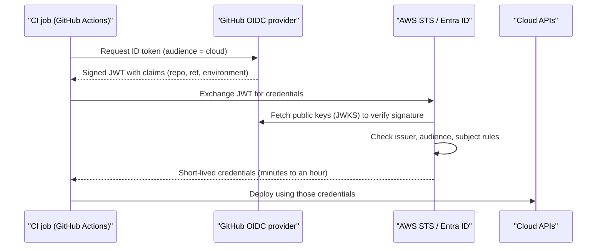

# Keyless CI/CD with OIDC

## Introduction

A CI/CD pipeline needs cloud permissions to deploy: push images, update functions, run Terraform. For years the standard approach was to create an AWS access key or an Azure service principal secret and paste it into the CI system's secret store. That works, but it means:

- A **long-lived, powerful secret** sits in a third-party system.
- Anyone who can modify a workflow file can often print or exfiltrate it.
- Rotation is manual, so it rarely happens.
- If the secret leaks, it works from anywhere until someone notices.

**OpenID Connect (OIDC) federation** removes the stored secret entirely. The CI platform issues a short-lived, signed **identity token** for each job, describing exactly which repository, branch or environment is running. The cloud verifies the signature, checks the token's claims against rules you configured, and returns short-lived cloud credentials.

An analogy: instead of giving the courier a permanent key to your warehouse, the courier company issues a signed delivery slip for each trip ("Driver 42, route 7, today only"). Your warehouse checks the slip's signature and the route number, then opens the door for that delivery only.

This page shows the full setup for **GitHub Actions** on both AWS and Azure, then explains how the same idea applies to GitLab CI and Azure DevOps. For pipeline design in general, see the [CI/CD tutorial](/docs/devops/cicd).

## How OIDC Federation Works



The token is a JWT. A trimmed, decoded example of its claims:

```json
{
  "iss": "https://token.actions.githubusercontent.com",
  "aud": "sts.amazonaws.com",
  "sub": "repo:acme/invoice-api:environment:production",
  "repository": "acme/invoice-api",
  "ref": "refs/heads/main",
  "environment": "production",
  "workflow": "deploy",
  "exp": 1760200000
}
```

The three claims that matter most:

| Claim | Meaning | Checked against |
| --- | --- | --- |
| `iss` (issuer) | Who signed the token | The OIDC provider you registered |
| `aud` (audience) | Who the token is meant for | `sts.amazonaws.com` for AWS, `api://AzureADTokenExchange` for Azure |
| `sub` (subject) | Which repo and branch, tag, environment or PR is running | Your trust policy conditions or federated credential subject |

The `sub` claim is your main security control. Getting it wrong is the most common way OIDC setups end up too permissive.

### Subject claim formats in GitHub Actions

| Workflow situation | `sub` format |
| --- | --- |
| Job uses an environment | `repo:ORG/REPO:environment:ENV_NAME` |
| Push to a branch (no environment) | `repo:ORG/REPO:ref:refs/heads/BRANCH` |
| Tag (no environment) | `repo:ORG/REPO:ref:refs/tags/TAG` |
| Pull request (no environment) | `repo:ORG/REPO:pull_request` |

When a job references an environment, the environment form wins. That is useful: GitHub environments can require reviewers and restrict which branches may deploy, so binding cloud trust to an **environment** gives you an approval gate for free.

:::note
GitHub introduced **immutable subject claims** that include numeric owner and repository IDs, for example `repo:acme@123456/invoice-api@456789:environment:production`. According to GitHub's documentation, repositories created after July 15, 2026 use this format by default, and older repositories can opt in. This prevents a renamed or re-created repository from inheriting trust. Check which format your repository emits (the `configure-aws-credentials` and `azure/login` actions log it on failure) and match it exactly. See [GitHub's OIDC reference](https://docs.github.com/en/actions/reference/security/oidc).
:::

## On AWS

### Step 1: Register GitHub as an OIDC identity provider (once per account)

```bash
aws iam create-open-id-connect-provider \
  --url https://token.actions.githubusercontent.com \
  --client-id-list sts.amazonaws.com
```

Example output:

```text
{
    "OpenIDConnectProviderArn": "arn:aws:iam::111122223333:oidc-provider/token.actions.githubusercontent.com"
}
```

You no longer need to look up and pass a certificate thumbprint. `--thumbprint-list` is optional, and AWS verifies well-known providers like GitHub using its library of trusted root certificate authorities.

### Step 2: Create a deploy role with a strict trust policy

`trust-github.json`:

```json
{
  "Version": "2012-10-17",
  "Statement": [
    {
      "Effect": "Allow",
      "Principal": {
        "Federated": "arn:aws:iam::111122223333:oidc-provider/token.actions.githubusercontent.com"
      },
      "Action": "sts:AssumeRoleWithWebIdentity",
      "Condition": {
        "StringEquals": {
          "token.actions.githubusercontent.com:aud": "sts.amazonaws.com",
          "token.actions.githubusercontent.com:sub": "repo:acme/invoice-api:environment:production"
        }
      }
    }
  ]
}
```

```bash
aws iam create-role \
  --role-name gha-invoice-api-prod-deploy \
  --assume-role-policy-document file://trust-github.json \
  --max-session-duration 3600

aws iam put-role-policy \
  --role-name gha-invoice-api-prod-deploy \
  --policy-name deploy-lambda \
  --policy-document file://deploy-lambda.json
```

`deploy-lambda.json` grants only what the pipeline does, for example updating one function:

```json
{
  "Version": "2012-10-17",
  "Statement": [
    {
      "Effect": "Allow",
      "Action": ["lambda:UpdateFunctionCode", "lambda:GetFunction", "lambda:PublishVersion"],
      "Resource": "arn:aws:lambda:eu-west-1:111122223333:function:invoice-api"
    }
  ]
}
```

:::warning
Never use `StringLike` with `"repo:acme/*"` or, worse, omit the `sub` condition. Without a tight subject, **any repository** in the organization (or on all of GitHub, if you leave out the org) could assume your production role. Use `StringEquals` where possible, and `StringLike` only with narrow patterns such as `repo:acme/invoice-api:ref:refs/heads/release-*`.
:::

### Step 3: The workflow

```yaml
name: deploy
on:
  push:
    branches: [main]

permissions:
  id-token: write   # allow the job to request an OIDC token
  contents: read

jobs:
  deploy:
    runs-on: ubuntu-latest
    environment: production
    steps:
      - uses: actions/checkout@v4

      - name: Configure AWS credentials
        uses: aws-actions/configure-aws-credentials@v6
        with:
          role-to-assume: arn:aws:iam::111122223333:role/gha-invoice-api-prod-deploy
          aws-region: eu-west-1

      - name: Who am I
        run: aws sts get-caller-identity

      - name: Deploy
        run: |
          zip -r function.zip src/
          aws lambda update-function-code \
            --function-name invoice-api \
            --zip-file fileb://function.zip
```

Example log output from the "Who am I" step:

```text
{
    "UserId": "AROAEXAMPLEDEPLOY:GitHubActions",
    "Account": "111122223333",
    "Arn": "arn:aws:sts::111122223333:assumed-role/gha-invoice-api-prod-deploy/GitHubActions"
}
```

Action versions move quickly. Check the [configure-aws-credentials README](https://github.com/aws-actions/configure-aws-credentials) for the current major version, and consider pinning actions to a full commit SHA for supply-chain safety.

### The same thing in Terraform

```hcl
resource "aws_iam_openid_connect_provider" "github" {
  url            = "https://token.actions.githubusercontent.com"
  client_id_list = ["sts.amazonaws.com"]
}

data "aws_iam_policy_document" "gha_trust" {
  statement {
    actions = ["sts:AssumeRoleWithWebIdentity"]
    principals {
      type        = "Federated"
      identifiers = [aws_iam_openid_connect_provider.github.arn]
    }
    condition {
      test     = "StringEquals"
      variable = "token.actions.githubusercontent.com:aud"
      values   = ["sts.amazonaws.com"]
    }
    condition {
      test     = "StringEquals"
      variable = "token.actions.githubusercontent.com:sub"
      values   = ["repo:acme/invoice-api:environment:production"]
    }
  }
}

resource "aws_iam_role" "gha_deploy" {
  name               = "gha-invoice-api-prod-deploy"
  assume_role_policy = data.aws_iam_policy_document.gha_trust.json
}
```

Older versions of the AWS Terraform provider required `thumbprint_list`. Recent versions make it optional. Check the [provider documentation](https://registry.terraform.io/providers/hashicorp/aws/latest/docs/resources/iam_openid_connect_provider) for the version you use.

## On Azure

Azure calls this **workload identity federation**. You add a **federated identity credential** to either a **user-assigned managed identity** or an **Entra app registration**. The user-assigned managed identity route is simpler because it needs no app registration and no directory-level permissions.

### Step 1: Create an identity and grant it access

```bash
RG=rg-invoice-api-prod
az identity create -g $RG -n id-gha-invoice-api-prod

CLIENT_ID=$(az identity show -g $RG -n id-gha-invoice-api-prod --query clientId -o tsv)
PRINCIPAL_ID=$(az identity show -g $RG -n id-gha-invoice-api-prod --query principalId -o tsv)
SUB_ID=$(az account show --query id -o tsv)
TENANT_ID=$(az account show --query tenantId -o tsv)

az role assignment create \
  --assignee-object-id "$PRINCIPAL_ID" \
  --assignee-principal-type ServicePrincipal \
  --role "Website Contributor" \
  --scope "/subscriptions/$SUB_ID/resourceGroups/$RG"
```

**Website Contributor** lets the pipeline deploy to App Service and Functions apps in that resource group without managing anything else. Pick the narrowest built-in role that covers your deployment.

### Step 2: Add the federated credential

```bash
az identity federated-credential create \
  --name gha-production \
  --identity-name id-gha-invoice-api-prod \
  --resource-group $RG \
  --issuer "https://token.actions.githubusercontent.com" \
  --subject "repo:acme/invoice-api:environment:production" \
  --audiences "api://AzureADTokenExchange"
```

Example output (trimmed):

```text
{
  "audiences": ["api://AzureADTokenExchange"],
  "issuer": "https://token.actions.githubusercontent.com",
  "name": "gha-production",
  "subject": "repo:acme/invoice-api:environment:production"
}
```

Entra ID matches `issuer` and `subject` **exactly**. Wildcards are not supported, and a typo does not produce an error at creation time. The failure only shows up later, when the token exchange is rejected. Each identity or app supports up to 20 federated credentials, so create one per environment or branch you deploy from.

For an Entra app registration, the equivalent command is `az ad app federated-credential create --id <app-id> --parameters credential.json`, with the same `issuer`, `subject` and `audiences` fields in the JSON.

### Step 3: The workflow

Store the three IDs as GitHub variables or secrets. They are identifiers, not credentials, but keeping them out of the workflow file is tidy.

```yaml
name: deploy-azure
on:
  push:
    branches: [main]

permissions:
  id-token: write
  contents: read

jobs:
  deploy:
    runs-on: ubuntu-latest
    environment: production
    steps:
      - uses: actions/checkout@v4

      - name: Azure login (OIDC)
        uses: azure/login@v3
        with:
          client-id: ${{ secrets.AZURE_CLIENT_ID }}
          tenant-id: ${{ secrets.AZURE_TENANT_ID }}
          subscription-id: ${{ secrets.AZURE_SUBSCRIPTION_ID }}

      - name: Deploy function app
        run: |
          zip -r app.zip .
          az functionapp deployment source config-zip \
            -g rg-invoice-api-prod -n func-invoice-api-prod --src app.zip
```

Example log output from the login step (trimmed):

```text
Federated token details:
 issuer - https://token.actions.githubusercontent.com
 subject claim - repo:acme/invoice-api:environment:production
Login successful.
```

The `azure/login` README marks v3 as current and v2 as maintenance-only at the time of writing. Check the [azure/login repository](https://github.com/Azure/login) for the latest guidance.

### Cleanup

```bash
az identity federated-credential delete --name gha-production \
  --identity-name id-gha-invoice-api-prod --resource-group rg-invoice-api-prod
az identity delete -g rg-invoice-api-prod -n id-gha-invoice-api-prod
```

On AWS:

```bash
aws iam delete-role-policy --role-name gha-invoice-api-prod-deploy --policy-name deploy-lambda
aws iam delete-role --role-name gha-invoice-api-prod-deploy
aws iam delete-open-id-connect-provider \
  --open-id-connect-provider-arn arn:aws:iam::111122223333:oidc-provider/token.actions.githubusercontent.com
```

Only delete the OIDC provider if no other roles use it.

## Other CI Systems

The pattern is identical everywhere; only the issuer URL and subject format change.

| CI system | Issuer | Typical subject | Notes |
| --- | --- | --- | --- |
| GitHub Actions | `https://token.actions.githubusercontent.com` | `repo:ORG/REPO:environment:ENV` | Needs `id-token: write` permission |
| GitLab CI | `https://gitlab.com` (or your instance URL) | `project_path:GROUP/PROJECT:ref_type:branch:ref:main` | Declare `id_tokens` with an `aud` in `.gitlab-ci.yml` |
| Azure DevOps | Entra-managed | Service connection specific | Use a **workload identity federation** service connection instead of a secret-based one |
| Bitbucket Pipelines, CircleCI, others | Vendor-specific | Vendor-specific | Check vendor docs for claims |
| Kubernetes, other clouds | Cluster or cloud issuer | Service account or principal ID | Same mechanism as workload identity |

## AWS vs Azure Summary

| Step | AWS | Azure |
| --- | --- | --- |
| Trust the issuer | `create-open-id-connect-provider` (once per account) | Implicit, set per federated credential |
| Identity used | IAM role | User-assigned managed identity or app registration |
| Subject check | Trust policy `Condition` (`StringEquals` / `StringLike`) | Exact `subject` match (no wildcards) |
| Audience | `sts.amazonaws.com` | `api://AzureADTokenExchange` |
| Permissions | IAM policies on the role | Azure RBAC role assignments |
| GitHub action | `aws-actions/configure-aws-credentials` | `azure/login` |

## Real-World Scenario

Your team has 15 repositories deploying to AWS and Azure. Each repo has `AWS_ACCESS_KEY_ID`, `AWS_SECRET_ACCESS_KEY` and `AZURE_CREDENTIALS` (a service principal secret in JSON) stored as GitHub secrets. A security review finds that the same AWS key, with `AdministratorAccess`, is shared by all repos, and the Azure secret expires next month.

**The solution:**

1. Register the GitHub OIDC provider in each AWS account (or through your landing zone automation).
2. Create **one deploy role per repository and environment**, for example `gha-invoice-api-prod-deploy`, trusted only for `repo:acme/invoice-api:environment:production`, with permissions for that app's resources only.
3. On Azure, create one user-assigned managed identity per repository and environment, with a federated credential per environment and role assignments on that app's resource groups.
4. Require GitHub **environment protection rules** (reviewers, branch restrictions) for `production`.
5. Update workflows, verify deployments, then **delete** the old access key and service principal secret.

**Why this approach:** there are no secrets left to leak or rotate, each repo can only touch its own resources, and production deploys require an approval that the cloud trust policy enforces.

**When to use it:** any CI/CD system that supports OIDC tokens, which today covers all major hosted CI platforms. **When not to:** self-hosted runners that are shared across many repositories need extra care. A compromised shared runner can request tokens for whichever job it runs. Isolate production runners or use ephemeral ones.

**Alternatives and trade-offs:**

| Approach | Pros | Cons | Best for |
| --- | --- | --- | --- |
| Static keys or client secrets in CI | Universal, simple | Long-lived, leakable, manual rotation | Legacy CI without OIDC support |
| OIDC federation, one role for all repos | Keyless, quick to set up | Broad blast radius | Small teams, early stages |
| OIDC federation, role per repo and environment | Keyless, tight blast radius, approval gates | More roles to manage (automate with IaC) | Most production setups |
| Self-hosted runner on cloud compute with instance role or managed identity | No federation needed | Runner itself becomes a high-value target | Private network deployments |
| Cloud-native CI (CodePipeline, Azure Pipelines) with service roles | Tight cloud integration | Vendor lock-in, less flexible | Teams standardized on one cloud's tooling |

## Common Mistakes

- **Missing `id-token: write`.** Without it the job can't request a token, and the login step fails with a vague error.
- **Wildcard subjects.** `repo:acme/*` lets every repo in the org deploy to production. Bind to a specific repo **and** environment or branch.
- **Trusting pull requests for production.** A `pull_request` subject can come from code that hasn't been reviewed. Only trust protected environments or protected branches for deploy roles.
- **Subject mismatch after changes.** Adding `environment:` to a job changes its `sub`. So does a repository rename or switching to immutable subject claims. Update the trust to match.
- **One giant deploy role.** OIDC removes the secret, not the need for least privilege.
- **Forgetting the old secrets.** Delete the access keys and client secrets once OIDC works, or the old risk remains.

## Summary

- OIDC federation lets CI jobs exchange a **short-lived, signed identity token** for cloud credentials, with **no stored secrets**.
- Security depends on checking **issuer**, **audience** and especially **subject** (repo plus environment or branch).
- On AWS: register the OIDC provider, then create roles with `sts:AssumeRoleWithWebIdentity` trust policies.
- On Azure: add **federated identity credentials** to a user-assigned managed identity or app registration, and grant it Azure RBAC roles.
- Use **GitHub environments** with protection rules to add an approval gate that the cloud enforces.
- Create one role or identity **per repository and environment**, and delete old static secrets.

## Exercises

1. Set up a sandbox AWS role trusted only for `repo:<you>/<repo>:ref:refs/heads/main` and confirm that a workflow on another branch fails to assume it.
2. Add a second federated credential on Azure for a `staging` environment, with a role assignment scoped to a staging resource group only.
3. Write a GitLab CI job that requests an ID token with `aud: sts.amazonaws.com` and assumes an AWS role. What subject would you put in the trust policy?
4. Audit one of your repositories: list every cloud secret stored in CI and plan its replacement with OIDC.

**Next:** [Multi-Account and Landing Zone Strategy](./7-cloud-multi-account-strategy.mdx). See also [CI/CD on AWS](../11-cloud-devops/0-cloud-ci-cd-on-aws.mdx) and [CI/CD with Azure DevOps and GitHub Actions](../11-cloud-devops/1-cloud-ci-cd-on-azure.mdx).
