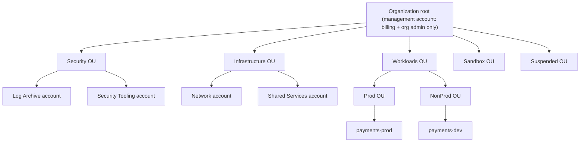
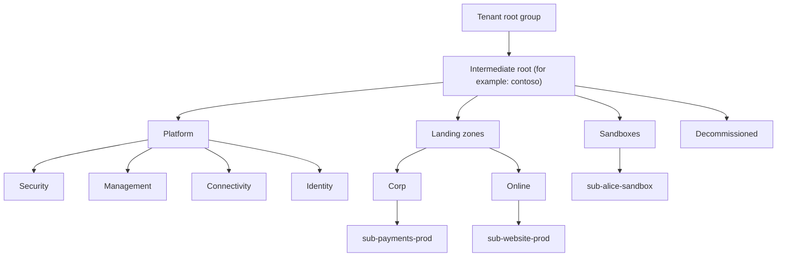

# Multi-Account and Landing Zone Strategy

## Introduction

When you start in the cloud, one AWS account or one Azure subscription feels like plenty. Everything lives together: dev, test, production, the experiment someone forgot about. As you grow, that single container causes problems:

- **Blast radius.** A script that deletes "all unused resources" in dev also sees production.
- **Permissions.** It is hard to give developers freedom in dev while keeping prod locked down when both share the same boundary.
- **Cost tracking.** "What does the payments team spend?" becomes a tagging archaeology project.
- **Quotas.** Service limits are per account or subscription, so a load test can starve production.
- **Compliance.** Auditors want regulated workloads isolated and logs kept somewhere developers can't touch.

The answer on both clouds is to use **many accounts or subscriptions**, organized in a hierarchy, with central guardrails, logging and identity. This prepared, governed environment is called a **landing zone**: the place where new workloads "land" already wired for security, networking, logging and billing.

An analogy: a business park. Each company gets its own building (account or subscription) with its own keys, but the park provides shared security guards, roads, power and rules ("no open fires") that every tenant must follow.

This page connects everything in this section. Identity (from [Federation, SSO and Identity Center](./5-cloud-federation-and-sso.mdx)) and least privilege (from [Least Privilege in Practice](./3-cloud-least-privilege.mdx)) become far easier when the account structure does part of the isolation for you. For the basic resource hierarchy, see [Organizing Resources: Accounts, Subscriptions and Resource Groups](../1-cloud-getting-started/5-cloud-resource-organization.mdx).

## The Isolation Unit on Each Cloud

| | AWS | Azure |
| --- | --- | --- |
| Hard isolation unit | **Account** | **Subscription** |
| Grouping layer | Organizational units (OUs) in AWS Organizations | Management groups |
| Top of the tree | Organization root, owned by the **management account** | Tenant root management group, in one Entra ID tenant |
| Identity across units | IAM Identity Center | Entra ID (one tenant for all subscriptions) |
| Guardrails | SCPs, RCPs, declarative policies, Control Tower controls | Azure Policy, RBAC at management groups |
| Prescriptive blueprint | AWS Control Tower, Landing Zone Accelerator on AWS | Azure landing zones (Cloud Adoption Framework) |
| Account / subscription vending | Control Tower Account Factory, Account Factory for Terraform | Subscription vending modules (Bicep, Terraform) |

One important difference: an AWS account has its **own IAM** namespace, so it is a very strong boundary. An Azure subscription shares the tenant's Entra ID, and subscriptions are a **billing and RBAC boundary** inside that tenant. Separate Entra tenants are possible but add significant identity overhead, so most organizations use one tenant with many subscriptions.

## On AWS: Organizations and OUs

### A recommended starting structure

AWS's [Organizing Your AWS Environment](https://docs.aws.amazon.com/whitepapers/latest/organizing-your-aws-environment/recommended-ous-and-accounts.html) whitepaper recommends grouping accounts by function and governance needs, not by org chart:



| OU / account | Purpose |
| --- | --- |
| Management account | Billing and organization management only. No workloads. Very few people have access. |
| Security OU: Log Archive | Central, immutable copies of CloudTrail and Config logs |
| Security OU: Security Tooling | Delegated admin for GuardDuty, Security Hub, IAM Access Analyzer |
| Infrastructure OU | Shared networking (Transit Gateway, DNS), CI/CD tooling |
| Workloads OU (Prod / NonProd) | Application accounts, typically one per application per environment |
| Sandbox OU | Experiments with spending limits and looser rules, isolated from prod |
| Suspended OU | Accounts being closed, with a deny-all SCP |

The whitepaper also describes procedural OUs such as Policy Staging, Exceptions and Transitional. Start small and add OUs when you actually need different guardrails.

### Building it with the CLI

:::caution
Creating an organization and accounts is free, but each new account can start incurring charges as soon as resources are created in it. Account closure has a waiting period during which the account can be reopened. Plan carefully and use a test organization if you can.
:::

```bash
# From the management account
aws organizations create-organization --feature-set ALL

ROOT_ID=$(aws organizations list-roots --query "Roots[0].Id" --output text)

aws organizations create-organizational-unit --parent-id "$ROOT_ID" --name Security
aws organizations create-organizational-unit --parent-id "$ROOT_ID" --name Workloads
aws organizations create-organizational-unit --parent-id "$ROOT_ID" --name Sandbox

aws organizations create-account \
  --email aws-payments-dev@example.com \
  --account-name payments-dev
```

Example output of `create-account` (trimmed):

```text
{
    "CreateAccountStatus": {
        "Id": "car-0123456789abcdef0123456789abcdef",
        "AccountName": "payments-dev",
        "State": "IN_PROGRESS",
        "RequestedTimestamp": "2026-10-11T10:02:44+00:00"
    }
}
```

New accounts get an `OrganizationAccountAccessRole` that the management account can assume. In a mature setup, you remove routine use of that role and give people access through IAM Identity Center permission sets instead.

### Service control policies (SCPs)

SCPs set the **maximum** permissions for every principal in the accounts below where they are attached (except the management account). They never grant anything. A few common guardrails in one policy:

```json
{
  "Version": "2012-10-17",
  "Statement": [
    {
      "Sid": "DenyLeavingOrg",
      "Effect": "Deny",
      "Action": "organizations:LeaveOrganization",
      "Resource": "*"
    },
    {
      "Sid": "ProtectAuditTrail",
      "Effect": "Deny",
      "Action": ["cloudtrail:StopLogging", "cloudtrail:DeleteTrail"],
      "Resource": "*"
    },
    {
      "Sid": "DenyRootUser",
      "Effect": "Deny",
      "Action": "*",
      "Resource": "*",
      "Condition": {
        "StringLike": { "aws:PrincipalArn": "arn:aws:iam::*:root" }
      }
    }
  ]
}
```

```bash
POLICY_ID=$(aws organizations create-policy \
  --name baseline-guardrails \
  --type SERVICE_CONTROL_POLICY \
  --description "Org-wide baseline" \
  --content file://baseline-scp.json \
  --query "Policy.PolicySummary.Id" --output text)

aws organizations attach-policy --policy-id "$POLICY_ID" --target-id ou-abcd-11112222
```

A popular addition is a **Region restriction** SCP that denies actions outside approved Regions. Write it carefully: global services such as IAM, Organizations, Route 53 and CloudFront must be excluded with `NotAction`, or you will break them. Start from the examples in the [AWS SCP documentation](https://docs.aws.amazon.com/organizations/latest/userguide/orgs_manage_policies_scps_examples.html), and test in a policy-staging OU before attaching to production.

### Resource control policies (RCPs)

SCPs limit **your principals**. **RCPs** (introduced in late 2024) limit access to **your resources**, including requests from principals outside your organization. They help build a **data perimeter**: "our S3 buckets, KMS keys and secrets can only be accessed by identities in our organization, even if someone writes a careless bucket policy".

An illustrative example (test before use):

```json
{
  "Version": "2012-10-17",
  "Statement": [
    {
      "Sid": "EnforceOrgIdentityPerimeter",
      "Effect": "Deny",
      "Principal": "*",
      "Action": ["s3:*", "sqs:*", "kms:*", "secretsmanager:*", "sts:AssumeRole"],
      "Resource": "*",
      "Condition": {
        "StringNotEqualsIfExists": { "aws:PrincipalOrgID": "o-exampleorgid" },
        "BoolIfExists": { "aws:PrincipalIsAWSService": "false" }
      }
    }
  ]
}
```

```bash
aws organizations enable-policy-type --root-id "$ROOT_ID" --policy-type RESOURCE_CONTROL_POLICY
```

RCPs support a specific list of services, don't affect the management account, and need exceptions for legitimate third-party access (for example a vendor's monitoring role). See the [RCP documentation](https://docs.aws.amazon.com/organizations/latest/userguide/orgs_manage_policies_rcps.html) and the [aws-samples RCP examples](https://github.com/aws-samples/resource-control-policy-examples).

### AWS Control Tower

Building all of this by hand is a lot of work. **AWS Control Tower** sets up a landing zone for you: it creates the organization structure, a Log Archive and an Audit account, configures IAM Identity Center, centralizes CloudTrail and AWS Config, and applies **controls** (guardrails) that are:

- **Preventive**: implemented with SCPs or RCPs, block actions.
- **Detective**: implemented with AWS Config rules, report drift.
- **Proactive**: implemented with CloudFormation hooks, check resources before deployment.

Its **Account Factory** (and **Account Factory for Terraform**, AFT) vends new accounts with the baseline already applied.

:::warning
Control Tower enables services such as AWS Config and CloudTrail across accounts and Regions. These services are billed by usage (for example Config rule evaluations and configuration items recorded). Costs vary by Region and activity and may change. Check the [AWS Pricing Calculator](https://calculator.aws/) before enabling it widely, and use the Sandbox OU to limit what gets recorded.
:::

## On Azure: Management Groups and Landing Zones

### The Azure landing zone hierarchy

Microsoft's Cloud Adoption Framework defines a reference **management group hierarchy** for Azure landing zones:



| Management group | Holds |
| --- | --- |
| Intermediate root | Everything your organization manages, so you don't assign policy at the tenant root |
| Platform: Security | Security and SIEM tooling, for example Microsoft Sentinel |
| Platform: Management | Central Log Analytics workspace, monitoring |
| Platform: Connectivity | Hub networking: Azure Firewall, Virtual WAN, DNS private zones |
| Platform: Identity | Domain controllers or Entra Domain Services if needed |
| Landing zones: Corp | Workloads connected to the corporate network through the hub |
| Landing zones: Online | Internet-facing workloads that don't need corporate connectivity |
| Sandboxes | Experiments, isolated from corp and online, with fewer policies |
| Decommissioned | Subscriptions being cancelled |

Microsoft's guidance is to keep the hierarchy **flat** (three to four levels), **not** to create separate management groups for dev, test and prod (use separate subscriptions instead), and to use management groups mainly for **Azure Policy** assignments rather than for granting team RBAC. The hierarchy supports up to six levels below the tenant root.

### Building it with the CLI

```bash
az account management-group create --name contoso --display-name "Contoso"
az account management-group create --name contoso-landingzones \
  --display-name "Landing zones" --parent contoso
az account management-group create --name contoso-sandboxes \
  --display-name "Sandboxes" --parent contoso

az account management-group subscription add \
  --name contoso-sandboxes \
  --subscription 00000000-0000-0000-0000-000000000000
```

Example output of the first command (trimmed):

```text
{
  "displayName": "Contoso",
  "id": "/providers/Microsoft.Management/managementGroups/contoso",
  "name": "contoso",
  "type": "Microsoft.Management/managementGroups"
}
```

By default, new subscriptions land under the tenant root and any user can create management groups. Microsoft recommends setting a **default management group** (such as Sandboxes) for new subscriptions and requiring authorization for management group creation in the hierarchy settings.

### Guardrails with Azure Policy

Azure Policy is the Azure counterpart to SCPs and Control Tower controls. Policies can **deny**, **audit**, **append**, **modify** or **deploy if not exists**. A common first guardrail is restricting Regions:

```bash
az policy assignment create \
  --name allowed-locations \
  --display-name "Allowed locations" \
  --policy "e56962a6-4747-49cd-b67b-bf8b01975c4c" \
  --scope "/providers/Microsoft.Management/managementGroups/contoso-landingzones" \
  --params '{ "listOfAllowedLocations": { "value": ["westeurope", "northeurope"] } }'
```

Example output (trimmed):

```text
{
  "displayName": "Allowed locations",
  "enforcementMode": "Default",
  "name": "allowed-locations",
  "scope": "/providers/Microsoft.Management/managementGroups/contoso-landingzones"
}
```

The GUID is the built-in **Allowed locations** policy definition. Assigning it at the landing zones management group applies it to every subscription below, including ones created later. Policy design is covered in depth in [Policies and Governance: SCPs and Azure Policy](../12-cloud-observability-and-security/7-cloud-compliance-and-governance.mdx).

### Deploying a landing zone

Microsoft provides **Azure landing zone** implementations as a portal accelerator and as infrastructure-as-code modules for Bicep and Terraform. They create the management group hierarchy, policy assignments, central logging and (optionally) hub networking.

:::warning
A full landing zone can deploy billable resources such as Azure Firewall, VPN or ExpressRoute gateways, DDoS protection and Log Analytics ingestion. Some of these are charged per hour whether you use them or not. Review the options and the [Azure Pricing Calculator](https://azure.microsoft.com/pricing/calculator/) before deploying, and leave expensive connectivity components off in a learning environment.
:::

## Comparing the Two Approaches

| Concern | AWS | Azure |
| --- | --- | --- |
| Isolate environments | Separate accounts per app and environment | Separate subscriptions per app and environment |
| Central logs | Log Archive account (CloudTrail org trail, Config) | Management subscription (Log Analytics, Activity Log export) |
| Security tooling | Security Tooling / Audit account as delegated admin | Security subscription, Defender for Cloud at management group scope |
| Network hub | Network account (Transit Gateway) | Connectivity subscription (Virtual WAN or hub VNet) |
| Prevent dangerous actions | SCPs, RCPs | Azure Policy deny, resource locks |
| Detect drift | AWS Config rules, Control Tower detective controls | Azure Policy audit, Defender for Cloud |
| Vend new units | Control Tower Account Factory, AFT | Subscription vending (Bicep / Terraform modules) |
| Human access | IAM Identity Center permission sets per account | Entra groups + RBAC per subscription, PIM |
| Pipeline access | OIDC role per account | Managed identity with federated credential per subscription |

## Real-World Scenario

A fintech startup with 40 engineers has one AWS account and one Azure subscription. They are about to pursue a security certification and must show that production data is isolated, logs are tamper-resistant, and access is controlled. Their main app runs on AWS; analytics and Power BI run on Azure.

**The solution:**

1. **AWS:** Enable Control Tower. Use its Security OU (Log Archive and Audit accounts), add Infrastructure, Workloads (Prod and NonProd) and Sandbox OUs. Vend `app-dev`, `app-staging` and `app-prod` accounts with Account Factory for Terraform. Move the existing account into Workloads/Prod after cleanup, or migrate workloads into fresh accounts.
2. **Azure:** Create the intermediate root, Platform (Management, Security) and Landing zones (Corp) management groups. Create `sub-analytics-dev` and `sub-analytics-prod`. Assign Allowed locations and a policy initiative for diagnostic settings at the landing zones level.
3. **Identity:** Entra ID as the IdP for both clouds (see [Federation, SSO and Identity Center](./5-cloud-federation-and-sso.mdx)). Developers get broad rights in dev, read-only in prod, and admins use short-session permission sets or PIM.
4. **Pipelines:** One OIDC deploy role or managed identity per account or subscription (see [Keyless CI/CD with OIDC](./6-cloud-oidc-for-ci.mdx)).
5. **Guardrails:** SCPs to protect CloudTrail and deny root user use, an RCP data perimeter for S3 and KMS, and Azure Policy denying public network access on storage in prod.

**Why this approach:** environments are isolated by hard boundaries instead of naming conventions, guardrails apply automatically to new accounts and subscriptions, and auditors get one place to look for logs.

**When to use it:** once you have production data, more than one team, or compliance requirements. **When not to:** a solo developer or a two-week prototype doesn't need Control Tower or a full landing zone. One sandbox account or subscription with a budget alert is enough. Many teams start with three accounts or subscriptions (dev, prod, and a shared/management one) and grow from there.

**Alternatives and trade-offs:**

| Approach | Pros | Cons | Best for |
| --- | --- | --- | --- |
| Single account or subscription, separated by naming and tags | Simplest, cheapest | Weak isolation, messy permissions and costs | Prototypes, personal learning |
| A few accounts or subscriptions, hand-built | Real isolation, low overhead | Manual guardrails, drift over time | Small teams with one or two apps |
| Control Tower or Azure landing zone accelerator | Prescriptive, fast, includes guardrails and logging | Opinionated, some baseline cost, learning curve | Growing companies, compliance needs |
| Custom IaC landing zone (Terraform, LZA, ALZ modules) | Full control, version-controlled | Requires platform engineering capacity | Larger organizations with platform teams |
| Separate Entra tenants per environment | Strongest Azure identity isolation | Duplicate identities, complex collaboration | Very strict regulatory separation only |

## Best Practices

- **Keep the management account and tenant root empty of workloads.** Treat them as the keys to the kingdom.
- **One application per environment per account or subscription** is a good default. It makes cost, quota and permission boundaries line up.
- **Automate vending.** If creating a new account or subscription takes a ticket and two weeks, teams will cram things into existing ones.
- **Centralize logs in a separate account or subscription** that workload admins can't modify.
- **Roll out guardrails gradually.** Attach new SCPs, RCPs or deny policies to a staging OU or management group first, watch for denied requests, then expand.
- **Use group-based access** with IAM Identity Center or Entra groups at account or subscription scope, not individual users.
- **Budget alerts per account or subscription.** See [Budgets and Billing Alerts](../1-cloud-getting-started/7-cloud-budgets-and-alerts.mdx).

## Summary

- Use **many accounts (AWS) or subscriptions (Azure)** as hard isolation boundaries for environments, teams and compliance scopes.
- Organize them with **OUs** in AWS Organizations or **management groups** in Azure, grouped by governance needs, not org chart.
- Apply guardrails at the top: **SCPs and RCPs** on AWS, **Azure Policy** on Azure. Guardrails limit, they never grant.
- A **landing zone** bundles structure, identity, logging, networking and guardrails. **Control Tower** and **Azure landing zones** provide prescriptive starting points.
- Watch the baseline cost of landing zone services, and roll out deny policies gradually.

## Exercises

1. Draw an OU structure (AWS) and a management group structure (Azure) for a company with two products, each with dev, staging and prod environments, plus a data team.
2. Write an SCP that denies `ec2:RunInstances` for any instance type outside a small approved list. Hint: look up the `ec2:InstanceType` condition key.
3. Assign the built-in **Allowed locations** policy to a test management group, then try to create a storage account in a different Region. What error do you get?
4. Compare the costs of enabling AWS Config in every Region versus only the Regions you use, using the AWS Pricing Calculator. Do the same for Log Analytics ingestion on Azure.

**Next:** This completes the Identity and Access Management section. Continue to [Choosing a Compute Option](../3-cloud-compute/0-cloud-compute-options.mdx). For infrastructure-as-code to build all this, see [Terraform for AWS and Azure](../10-cloud-infrastructure-as-code/4-cloud-terraform-multi-cloud.mdx) and the [Terraform tutorial](/docs/devops/terraform).
