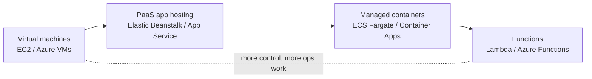
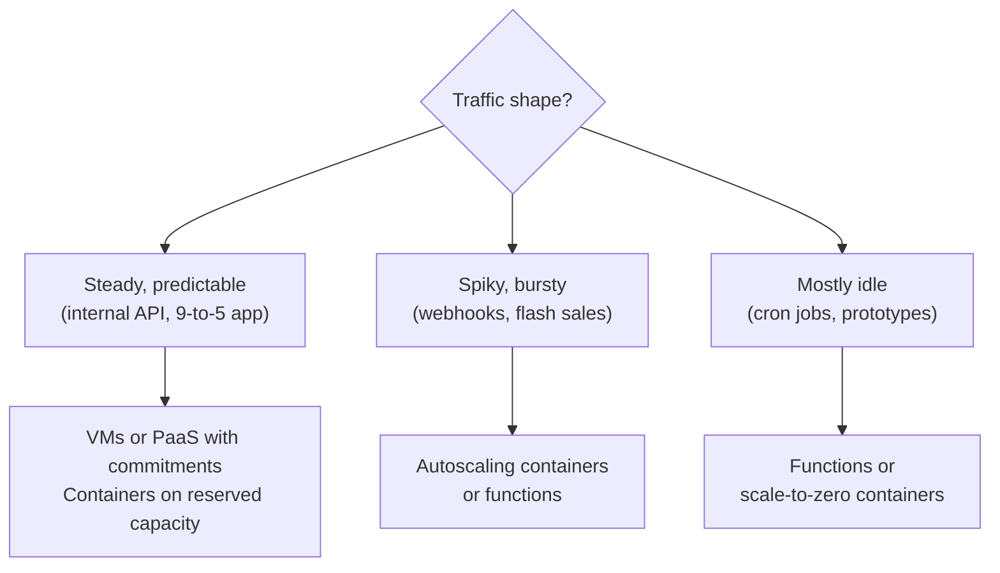
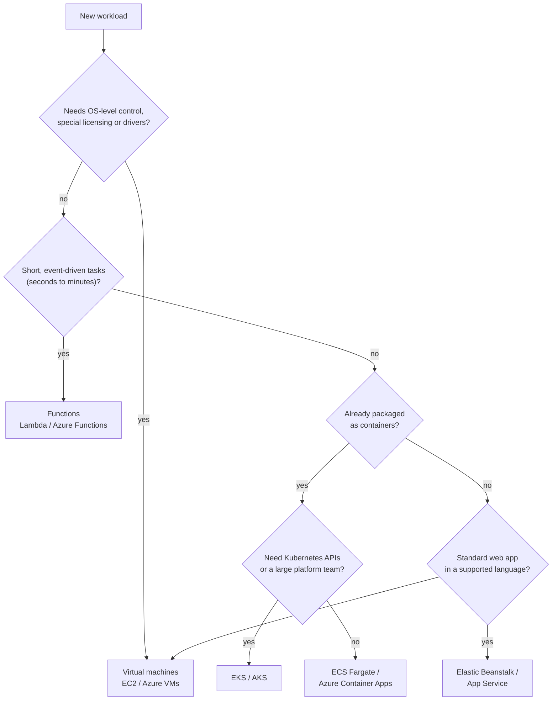
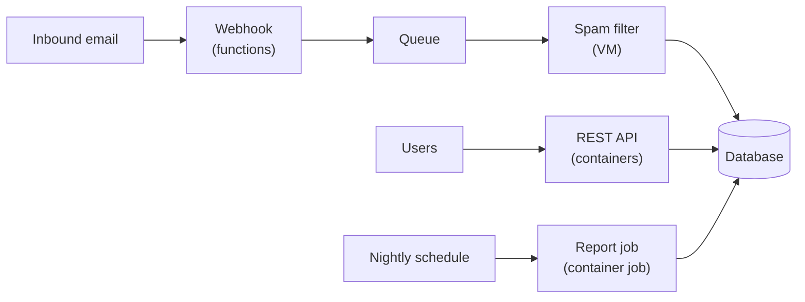

# Choosing a Compute Option

## Introduction

Every application needs somewhere to run. In the cloud, "somewhere" is not one thing. AWS and Azure each offer a whole menu of compute services, from raw virtual machines that you manage down to the kernel, to functions that run for a few hundred milliseconds and then vanish.

Picking from that menu is one of the first real architecture decisions you will make, and it is hard to undo. The choice decides:

- **What you operate.** Do you patch an operating system, or does the provider?
- **How you pay.** Do you pay per hour that a server exists, per vCPU-second that a container runs, or per request?
- **How you scale.** Do you add servers, add container replicas, or let the platform run more copies of your function?
- **What you can run.** Can you install a custom kernel module, run a 6-hour job, or keep a WebSocket open all day?

A useful analogy is getting around a city:

- **Virtual machines** are like buying a car. You choose the model, you fuel it, you service it, and it sits in the garage (costing money) even when you are not driving.
- **PaaS app hosting** is like leasing a car with maintenance included. You still have the car all month, but someone else changes the oil.
- **Managed containers** are like a car-sharing service. You pick up a standard car when you need one and pay for the time you use it.
- **Serverless functions** are like taxis. You pay per trip, you never think about the vehicle, and you cannot customize it much.

None of these is "best". This page gives you a mental model and a decision process. The rest of the Compute section goes deep on virtual machines and PaaS. Serverless and containers have their own sections: [Serverless](../4-cloud-serverless/0-cloud-serverless-introduction.mdx) and [Containers](../5-cloud-containers/0-cloud-container-options.mdx).

## The Compute Spectrum

All compute options sit on one spectrum: **control** on one end, **convenience** on the other. As you move right, the provider takes on more of the work, and you give up some control.



| Layer | You manage | Provider manages |
|-------|-----------|------------------|
| Virtual machines (IaaS) | OS, patches, runtime, app, scaling setup | Hardware, hypervisor, physical network |
| PaaS app hosting | App code, config, scaling rules | OS, runtime patching, load balancer |
| Managed containers | Container image, scaling rules | Servers, cluster control plane |
| Functions (FaaS) | Function code, triggers | Servers, runtime, scaling, almost everything |

Kubernetes (EKS and AKS) sits slightly off this line. It gives you a powerful, portable platform, but you still own a lot of cluster configuration. The [Containers section](../5-cloud-containers/6-cloud-choosing-container-platform.mdx) covers when that trade is worth it.

:::note
This spectrum is the same idea as the IaaS / PaaS / FaaS service models from [IaaS, PaaS, SaaS and FaaS](../0-cloud-fundamentals/1-cloud-service-models.mdx), applied specifically to compute.
:::

## AWS and Azure Compute Services Side by Side

Both clouds offer close equivalents at every layer. The names differ, and so do some details.

| What you want | AWS | Azure |
|---------------|-----|-------|
| A virtual machine | Amazon EC2 | Azure Virtual Machines |
| A fleet of identical VMs that scales | EC2 Auto Scaling groups | Virtual Machine Scale Sets |
| Upload code, platform runs it on VMs | AWS Elastic Beanstalk | Azure App Service |
| Run a container without managing servers | Amazon ECS on AWS Fargate | Azure Container Apps, Azure Container Instances |
| Managed Kubernetes | Amazon EKS | Azure Kubernetes Service (AKS) |
| Event-driven functions | AWS Lambda | Azure Functions |
| Batch jobs at scale | AWS Batch | Azure Batch |
| Dedicated physical server | EC2 Dedicated Hosts | Azure Dedicated Host |

A few differences matter when you choose:

- **Elastic Beanstalk vs App Service.** Elastic Beanstalk creates ordinary EC2 instances, a load balancer and an Auto Scaling group in your account, and you can see and change all of them. App Service hides the VMs behind an "App Service plan". That makes App Service simpler to run, and Elastic Beanstalk easier to customize. See [PaaS App Hosting](./5-cloud-paas-app-hosting.mdx).
- **Container Apps vs Fargate.** Azure Container Apps can scale an app down to zero replicas when idle and back up on HTTP traffic or events. ECS services on Fargate do not scale to zero on HTTP traffic by themselves. That makes Container Apps closer to serverless.
- **Function hosting plans.** Azure Functions offers several hosting plans (Flex Consumption, Premium, Dedicated and others) with different scaling and networking features. Lambda has a single model, with options such as provisioned concurrency layered on top.

## How Each Option Is Billed

You do not need exact prices to reason about cost. You need to know **what the meter counts**. Prices vary by region and change over time. Check the [AWS Pricing Calculator](https://calculator.aws/) and the [Azure Pricing Calculator](https://azure.microsoft.com/pricing/calculator/) for current numbers.

| Option | What you pay for | Cost when idle |
|--------|------------------|----------------|
| VMs (EC2, Azure VMs) | Each second or hour the VM is running, by size, plus disks and data transfer | Full price while running. Disks are billed even when stopped |
| PaaS (Elastic Beanstalk) | The EC2 instances, load balancer and other resources it creates. Beanstalk itself has no extra charge | Same as the underlying VMs |
| PaaS (App Service) | Each instance in the App Service plan, by tier | Full plan price, even with no traffic |
| Fargate | vCPU and memory per second while tasks run | Full price for running tasks |
| Container Apps | vCPU-seconds and GiB-seconds of active replicas, plus requests (consumption profile) | Near zero when scaled to zero |
| Lambda / Azure Functions (consumption-style plans) | Number of requests plus compute time (memory multiplied by duration) | Near zero |

:::warning
"Near zero when idle" does not mean free. Logs, storage, load balancers, NAT gateways, public IP addresses and data egress keep billing even when your code is idle. Always look at the whole bill, not just the compute line.
:::

The pattern to remember: **always-on options charge for capacity; serverless options charge for usage.** Steady, busy workloads are usually cheaper on capacity. Spiky or mostly-idle workloads are usually cheaper on usage.

## The Questions That Decide It

Work through these questions in order. They eliminate options quickly.

### 1. Does the workload need OS-level control?

Some software only runs on a full VM:

- A vendor product that ships as an installer for a specific OS
- Software that needs a kernel module, a custom driver, or a GPU driver version you choose
- Licensed software tied to a machine (sometimes even a dedicated host)
- Legacy apps you are lifting and shifting without code changes

If the answer is yes, you are choosing between [virtual machines](./1-cloud-virtual-machines.mdx) and, occasionally, dedicated hosts.

### 2. How long does one unit of work run?

- **Under a few minutes, triggered by events**: functions fit well. AWS Lambda has a hard maximum timeout of 15 minutes per invocation. Azure Functions limits depend on the hosting plan.
- **A long-running web server or worker**: containers, PaaS or VMs.
- **Hours-long batch jobs**: VMs, containers, or a batch service, often on Spot capacity.

### 3. What is the traffic shape?



### 4. Is the app already containerized?

If your team already builds Docker images, managed containers are often the shortest path to production. If not, PaaS hosting lets you deploy source code directly, and functions let you deploy a single handler. See the [Docker tutorial](/docs/devops/docker) if you want to containerize first.

### 5. What can your team operate?

This is the question teams skip most often. A two-person startup cannot patch 40 VMs, tune a Kubernetes cluster and still ship features. Choose the most managed option that meets your technical requirements, and move "down" the spectrum only when you hit a real limit.

## A Decision Flowchart

Here is the whole process as one diagram. Treat it as a starting point, not a rule.



## A Tiny Decision Helper

Reasoning is easier when you write the criteria down. The following script scores each option against a workload profile. The weights are opinions, not facts, so change them to match your team. It does not call any cloud API.

```python
# compute_advisor.py - score compute options for a workload profile
from dataclasses import dataclass

@dataclass
class Workload:
    needs_os_control: bool
    max_task_minutes: int       # longest single unit of work
    traffic: str                # "steady", "spiky" or "idle"
    containerized: bool
    ops_people: int             # people available to run infrastructure

def score(w: Workload) -> dict[str, int]:
    scores = {"vm": 0, "paas": 0, "containers": 0, "functions": 0}

    if w.needs_os_control:
        scores["vm"] += 5
        for k in ("paas", "containers", "functions"):
            scores[k] -= 5

    if w.max_task_minutes > 15:
        scores["functions"] -= 5    # Lambda's hard limit is 15 minutes

    if w.traffic == "steady":
        scores["vm"] += 2
        scores["paas"] += 2
    elif w.traffic == "spiky":
        scores["containers"] += 2
        scores["functions"] += 3
    elif w.traffic == "idle":
        scores["functions"] += 4
        scores["containers"] += 1   # only if the platform can scale to zero

    if w.containerized:
        scores["containers"] += 3
    else:
        scores["paas"] += 2

    if w.ops_people < 2:
        scores["vm"] -= 3           # small teams struggle to patch fleets
        scores["functions"] += 1
        scores["paas"] += 1

    return dict(sorted(scores.items(), key=lambda kv: kv[1], reverse=True))

if __name__ == "__main__":
    profiles = {
        "Webhook receiver": Workload(False, 1, "spiky", False, 1),
        "Legacy ERP": Workload(True, 600, "steady", False, 3),
        "Containerized API": Workload(False, 1, "steady", True, 2),
    }
    for name, w in profiles.items():
        print(f"{name:20} -> {score(w)}")
```

Output:

```text
Webhook receiver     -> {'functions': 4, 'paas': 3, 'containers': 2, 'vm': -3}
Legacy ERP           -> {'vm': 7, 'paas': -1, 'containers': -5, 'functions': -10}
Containerized API    -> {'containers': 3, 'vm': 2, 'paas': 2, 'functions': 0}
```

The script is deliberately simple. Its real value is that it forces a conversation: "Why did we give spiky traffic 3 points for functions?" Put your team's version in your architecture decision records.

## Seeing What You Already Run

Before choosing something new, check what already exists. Both CLIs can list compute resources across services. These commands only read data.

### On AWS

```bash
# EC2 instances in the current Region
aws ec2 describe-instances \
  --query "Reservations[].Instances[].{Id:InstanceId,Type:InstanceType,State:State.Name}" \
  --output table

# Lambda functions
aws lambda list-functions --query "Functions[].{Name:FunctionName,Runtime:Runtime}" --output table

# ECS clusters
aws ecs list-clusters
```

Example output:

```text
-------------------------------------------------
|               DescribeInstances               |
+----------------------+-----------+------------+
|          Id          |   State   |   Type     |
+----------------------+-----------+------------+
|  i-0a1b2c3d4e5f67890 |  running  |  t3.small  |
|  i-0f9e8d7c6b5a43210 |  stopped  |  m7i.large |
+----------------------+-----------+------------+
```

### On Azure

```bash
# Virtual machines in the current subscription
az vm list --show-details \
  --query "[].{Name:name, Size:hardwareProfile.vmSize, Power:powerState}" \
  --output table

# App Service apps and Function apps
az webapp list --query "[].{Name:name, Kind:kind, State:state}" --output table
az functionapp list --query "[].{Name:name, State:state}" --output table

# Container Apps (requires the containerapp extension)
az containerapp list --query "[].{Name:name, RG:resourceGroup}" --output table
```

Example output:

```text
Name        Size             Power
----------  ---------------  ----------
legacy-erp  Standard_D4s_v5  VM running
build-01    Standard_B2s     VM deallocated
```

## Real-World Scenario

Your team runs a SaaS helpdesk product. The system has four parts:

1. **A public REST API** used by the web and mobile apps. Traffic is steady during business hours across several time zones, with peaks on Monday mornings.
2. **An email ingestion webhook.** Customers' emails arrive as webhook calls. Volume is spiky: a quiet hour, then a burst of thousands when a customer's outage hits.
3. **A nightly report generator** that builds PDF reports. Some large accounts take 40 minutes.
4. **A third-party spam filter** that ships only as a Linux installer requiring a specific kernel version.

The team is five developers and no dedicated operations engineer. The API is already containerized.

### The solution

| Component | AWS choice | Azure choice | Why |
|-----------|-----------|--------------|-----|
| REST API | ECS on Fargate behind an Application Load Balancer | Azure Container Apps | Already containerized; steady traffic; no servers to patch |
| Email webhook | Lambda behind API Gateway or a function URL | Azure Functions (Flex Consumption) | Spiky, short work; pay per request; scales out automatically |
| Nightly reports | ECS scheduled task on Fargate (or AWS Batch) | Container Apps job | Runs longer than Lambda's 15-minute limit; only runs at night |
| Spam filter | One EC2 instance in an Auto Scaling group of 1 to 2 | One Azure VM in a scale set | Needs a specific kernel; only a VM gives that control |



### Why this approach

- Each component gets the most managed option that still meets its technical needs. Only the spam filter, which truly needs OS control, runs on a VM.
- The spiky webhook would waste money on always-on servers, and would struggle to scale fast enough on VMs. Functions absorb bursts naturally.
- A queue between the webhook and the spam filter means a slow VM never makes the webhook time out. The [Messaging section](../9-cloud-messaging-and-integration/0-cloud-messaging-options.mdx) covers that pattern.

### When to use this, and when not to

- **Use a mix like this** when components have clearly different shapes, as here.
- **Do not mix** when the team is tiny and every component is similar. Four compute models means four deployment pipelines, four sets of logs and four sets of alerts. For a simple CRUD app, one PaaS service for everything is often the better trade.

### Alternatives and trade-offs

| Approach | Pros | Cons | Best for |
|----------|------|------|----------|
| Everything on VMs | Full control; one ops model; predictable cost with commitments | Patching, scaling and failover are your job; idle capacity is wasted | Lift-and-shift, licensed software, teams with ops experience |
| Everything on PaaS (Beanstalk / App Service) | One simple deploy model; built-in scaling and TLS | Less control; long jobs and spiky webhooks fit awkwardly | Classic web apps and small teams |
| Everything on containers | Portable images; consistent tooling; good scaling | Needs container skills; some idle cost unless scale-to-zero | Teams already using Docker |
| Everything serverless | Lowest idle cost; minimal ops | Duration limits, cold starts, harder local testing, more vendor-specific code | Event-driven and spiky workloads |
| Mixed (as above) | Best fit per component | More moving parts to monitor and deploy | Systems with clearly different workloads |

### Lambda vs Fargate vs EC2, and Functions vs Container Apps vs App Service

These are the two questions people ask most. A short summary:

| Question | Lambda / Azure Functions | Fargate / Container Apps | EC2 / App Service or Azure VMs |
|----------|--------------------------|--------------------------|--------------------------------|
| Max run time | Lambda: 15 min. Functions: depends on plan | No hard limit | No hard limit |
| Scale to zero | Yes | Container Apps: yes. Fargate: not on HTTP traffic alone | No (App Service plans and VMs bill while allocated) |
| Startup latency | Cold starts possible | Seconds to start a new task or replica | Minutes to boot a new VM |
| Packaging | Zip or container image | Container image | Code (PaaS) or anything (VM) |
| Ops effort | Lowest | Low | Medium (PaaS) to high (VMs) |

## Common Mistakes

1. **Choosing by hype instead of workload.** "Serverless everything" fails for a 2-hour video transcode. "Kubernetes everything" overwhelms a three-person team. Start from the workload's shape.
2. **Ignoring the idle bill.** An App Service plan or a VM bills all month, even at 2% CPU. Look at your traffic curve before picking always-on capacity.
3. **Forgetting the hidden costs of serverless.** Very high, steady request volumes can cost more on functions than on a few well-used containers. Model both with the pricing calculators.
4. **Treating the choice as permanent.** Write your code so the business logic does not depend on the hosting model, for example by keeping the Lambda or Functions handler a thin wrapper. Then moving later is a refactor, not a rewrite.
5. **Comparing only compute.** Networking, logging, load balancers and data transfer often cost as much as the compute. Compare whole architectures.
6. **Skipping the ops question.** If no one on the team can be paged at 3 a.m. to fix a VM, do not build on VMs.

## Summary

- Cloud compute sits on a spectrum from **virtual machines** (most control) through **PaaS** and **managed containers** to **functions** (least operations).
- AWS and Azure have close equivalents at every layer: EC2 and Azure VMs, Elastic Beanstalk and App Service, Fargate and Container Apps, Lambda and Azure Functions.
- Billing differs by layer: always-on options charge for **capacity**, serverless options charge for **usage**. Check current prices in the official calculators.
- Decide with a few questions: OS control, task duration, traffic shape, packaging, and what your team can operate.
- Real systems often mix options, one per component, but every extra model adds operational overhead.

## Exercises

1. **Classify five workloads.** For each one, pick a compute option on AWS and on Azure and justify it in one sentence: a Slack bot, a Minecraft server, a nightly database backup export, a Django e-commerce site, and an ML model that serves predictions on a GPU.
2. **Extend the decision helper.** Add a `needs_gpu` field and a `budget_sensitivity` field to `compute_advisor.py`, adjust the scoring, and add two new profiles.
3. **Cost-shape thinking.** Without using any prices, sketch a graph of monthly cost vs requests per month for a function and for one always-on VM. Where do the lines cross, and what moves that crossing point?
4. **Inventory.** Run the read-only listing commands above in your own AWS account or Azure subscription. Is anything running that you forgot about?

Next, read [Virtual Machines: EC2 and Azure VMs](./1-cloud-virtual-machines.mdx) to launch your first VM on both clouds. Related pages: [Serverless Introduction](../4-cloud-serverless/0-cloud-serverless-introduction.mdx), [Container Options in the Cloud](../5-cloud-containers/0-cloud-container-options.mdx), and [Cloud Pricing Models](../0-cloud-fundamentals/7-cloud-pricing-models.mdx).
