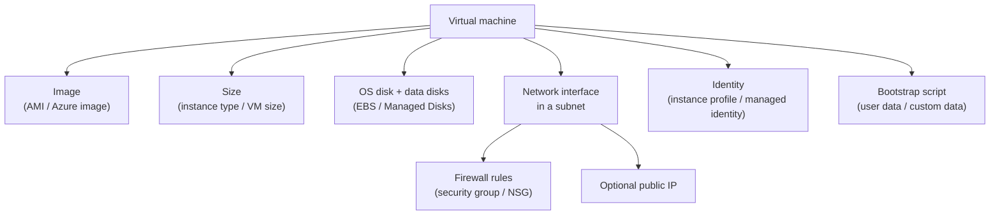
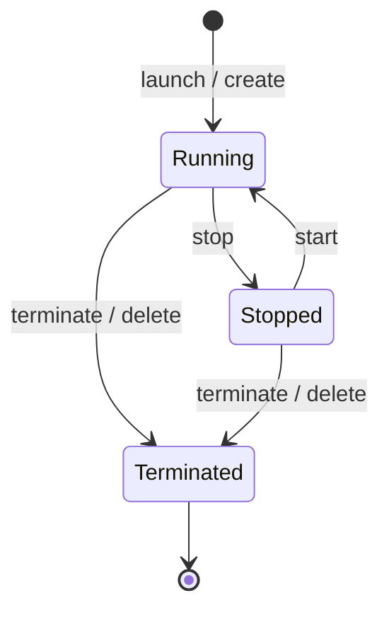

# Virtual Machines: EC2 and Azure VMs

## Introduction

A **virtual machine (VM)** is a computer that exists only in software. The cloud provider runs a hypervisor on a large physical server and slices it into many isolated VMs. Each VM gets its own virtual CPUs, memory, disks and network interface, and from the inside it looks and behaves like a normal server. You can SSH into it, install packages and run anything that runs on that operating system.

On AWS the service is **Amazon Elastic Compute Cloud (EC2)**, and a VM is called an **instance**. On Azure the service is **Azure Virtual Machines**, and a VM is simply a **virtual machine**.

VMs are the most flexible compute option and also the one that asks the most of you. The provider looks after the hardware. You look after everything from the operating system up: patches, security hardening, the runtime, your app, monitoring and backups. That is the IaaS side of the [Shared Responsibility Model](../0-cloud-fundamentals/3-cloud-shared-responsibility.mdx).

Think of a VM as an empty, furnished-on-request apartment. The building (the data center) is managed for you, but once you have the keys you decide what goes inside, and you are responsible for locking the door.

In this page you will:

- Learn the parts that make up a VM on both clouds
- Launch a small Linux web server on EC2 and on Azure with the CLI
- Understand VM lifecycle states and exactly when you are billed
- List VMs from Python with `boto3` and the Azure SDK
- Clean everything up

:::warning Cost warning
The commands on this page create billable resources: VMs, disks and public IP addresses. Small sizes cost little per hour, but they bill until you delete them. Some new accounts include free-tier or credit offers, and the terms of those offers change, so check the [AWS Free Tier](https://aws.amazon.com/free/) and [Azure free account](https://azure.microsoft.com/pricing/purchase-options/azure-account) pages. Run the cleanup steps at the end of this page when you are done, and set up [Budgets and Billing Alerts](../1-cloud-getting-started/7-cloud-budgets-and-alerts.mdx) first.
:::

## The Anatomy of a Cloud VM

Every VM, on either cloud, is assembled from the same building blocks.



| Building block | AWS term | Azure term | What it decides |
|----------------|----------|------------|-----------------|
| Template for the OS disk | Amazon Machine Image (AMI) | Image (Marketplace, custom, or Azure Compute Gallery) | Which OS and preinstalled software you start with |
| Hardware shape | Instance type, such as `t3.small` | VM size, such as `Standard_B2s` | vCPUs, memory, network bandwidth, price |
| Disks | Amazon EBS volumes | Azure Managed Disks | Persistent storage that survives reboots |
| Network placement | Subnet in a VPC | Subnet in a virtual network (VNet) | Private IP range and routing |
| Firewall | Security group | Network security group (NSG) | Which ports are open to whom |
| Grouping and cleanup | Tags (no container required) | Resource group (required) | How you find and delete related resources |
| Cloud permissions for code on the VM | IAM role via an instance profile | Managed identity | Which cloud APIs the VM can call without keys |
| First-boot script | User data | Custom data (cloud-init) | Packages and config applied at launch |

Two differences are worth noticing early:

- **Azure requires a resource group.** Every Azure VM lives in a resource group, and `az vm create` also creates a VNet, NSG, public IP and NIC for you by default. Deleting the resource group deletes them all. On AWS, a VM launches into an existing VPC (your account has a default VPC in most Regions), and you track related resources with tags.
- **Azure creates more separate resources.** On Azure the NIC, public IP and OS disk are separate top-level resources you can see in the resource group. On AWS they exist too, but feel more like parts of the instance.

Images, sizes and bootstrapping each have their own page: [Instance Types and Sizing](./2-cloud-instance-types.mdx) and [Machine Images and Bootstrapping](./6-cloud-images-and-bootstrapping.mdx). Networking is covered in [VPCs and VNets](../8-cloud-networking/1-cloud-vpc-and-vnet.mdx).

## A Bootstrap Script for Both Clouds

You will launch the same tiny web server on both clouds. This `cloud-init` file installs nginx and writes a home page. Both AWS (on Amazon Linux and Ubuntu) and Azure (on Ubuntu and other cloud-init enabled images) understand the `#cloud-config` format.

Save it as `web-init.yaml`:

```yaml
#cloud-config
package_update: true
packages:
  - nginx
write_files:
  - path: /usr/share/nginx/html/index.html
    content: |
      <h1>Hello from a cloud VM</h1>
      <p>Bootstrapped by cloud-init.</p>
  - path: /var/www/html/index.html
    content: |
      <h1>Hello from a cloud VM</h1>
      <p>Bootstrapped by cloud-init.</p>
runcmd:
  - systemctl enable --now nginx
```

The file writes the page to two paths because Amazon Linux's nginx serves `/usr/share/nginx/html` and Ubuntu's nginx serves `/var/www/html`. cloud-init picks the right package manager (`dnf` or `apt`) automatically.

## Launching a VM on AWS

You need the AWS CLI v2 configured with short-lived credentials, ideally through IAM Identity Center (`aws sso login`). See [The AWS CLI](../1-cloud-getting-started/2-cloud-aws-cli.mdx).

### Step 1: Create a security group

This security group allows HTTP from anywhere. It deliberately does **not** open SSH (port 22). You will connect through AWS Systems Manager Session Manager or EC2 Instance Connect instead, which avoids exposing SSH to the internet.

```bash
export AWS_REGION=us-east-1
VPC_ID=$(aws ec2 describe-vpcs --filters Name=is-default,Values=true \
  --query "Vpcs[0].VpcId" --output text)

SG_ID=$(aws ec2 create-security-group \
  --group-name demo-web-sg \
  --description "Demo web server: HTTP only" \
  --vpc-id "$VPC_ID" \
  --query GroupId --output text)

aws ec2 authorize-security-group-ingress \
  --group-id "$SG_ID" --protocol tcp --port 80 --cidr 0.0.0.0/0

echo "$SG_ID"
```

Example output:

```text
sg-0123456789abcdef0
```

If your account has no default VPC, create a VPC and subnet first, or pass `--subnet-id` in the next step.

### Step 2: Launch the instance

Instead of hard-coding an AMI ID (which differs per Region and changes with every release), resolve the latest Amazon Linux 2023 AMI from a public Systems Manager parameter:

```bash
INSTANCE_ID=$(aws ec2 run-instances \
  --image-id resolve:ssm:/aws/service/ami-amazon-linux-latest/al2023-ami-kernel-default-x86_64 \
  --instance-type t3.micro \
  --security-group-ids "$SG_ID" \
  --user-data file://web-init.yaml \
  --metadata-options "HttpTokens=required,HttpEndpoint=enabled" \
  --tag-specifications 'ResourceType=instance,Tags=[{Key=Name,Value=demo-web},{Key=project,Value=compute-demo}]' \
  --query "Instances[0].InstanceId" --output text)

aws ec2 wait instance-running --instance-ids "$INSTANCE_ID"

aws ec2 describe-instances --instance-ids "$INSTANCE_ID" \
  --query "Reservations[0].Instances[0].{State:State.Name,Type:InstanceType,PublicIp:PublicIpAddress,AZ:Placement.AvailabilityZone}" \
  --output table
```

Example output:

```text
-------------------------------------------------------------
|                     DescribeInstances                     |
+-------------+-----------------+-----------+---------------+
|     AZ      |    PublicIp     |   State   |     Type      |
+-------------+-----------------+-----------+---------------+
|  us-east-1c |  203.0.113.24   |  running  |  t3.micro     |
+-------------+-----------------+-----------+---------------+
```

Key flags:

- `--image-id resolve:ssm:...` always gets the current Amazon Linux 2023 image for the Region.
- `--metadata-options "HttpTokens=required"` enforces **IMDSv2**, the session-based version of the instance metadata service. It blocks a class of server-side request forgery attacks that could steal the instance's temporary credentials. Always set it.
- `--user-data file://web-init.yaml` passes the cloud-init file. The CLI base64-encodes it for you.
- `--tag-specifications` tags the instance so you can find and clean it up later.

Give cloud-init a minute or two to install nginx, then test:

```bash
curl -s http://203.0.113.24 | head -n 2
```

Output:

```text
<h1>Hello from a cloud VM</h1>
<p>Bootstrapped by cloud-init.</p>
```

### Step 3: Connect without SSH keys

For an interactive shell, prefer one of these over SSH key pairs:

- **Session Manager** (`aws ssm start-session --target "$INSTANCE_ID"`). It needs the SSM Agent (preinstalled on Amazon Linux 2023), an instance profile with the `AmazonSSMManagedInstanceCore` managed policy, outbound HTTPS from the instance, and the Session Manager plugin for the AWS CLI on your machine. No inbound ports are needed.
- **EC2 Instance Connect**, which pushes a temporary SSH key for 60 seconds. It still needs port 22 reachable, for example through an EC2 Instance Connect Endpoint in a private subnet.

Attaching roles to instances is covered in [Workload Identity: Instance Roles and Managed Identities](../2-cloud-identity/4-cloud-workload-identity.mdx).

## Launching a VM on Azure

You need the Azure CLI signed in with `az login`. See [The Azure CLI](../1-cloud-getting-started/3-cloud-azure-cli.mdx).

### Step 1: Create a resource group

```bash
RG=rg-compute-demo
LOCATION=eastus
az group create --name $RG --location $LOCATION --tags project=compute-demo --output table
```

Output:

```text
Location    Name
----------  ---------------
eastus      rg-compute-demo
```

### Step 2: Create the VM

```bash
az vm create \
  --resource-group $RG \
  --name demo-web \
  --image Ubuntu2204 \
  --size Standard_B2s \
  --admin-username azureuser \
  --generate-ssh-keys \
  --custom-data web-init.yaml \
  --public-ip-sku Standard \
  --nsg-rule NONE \
  --tags project=compute-demo
```

Example output (trimmed):

```json
{
  "fqdns": "",
  "id": "/subscriptions/xxxxxxxx-xxxx-xxxx-xxxx-xxxxxxxxxxxx/resourceGroups/rg-compute-demo/providers/Microsoft.Compute/virtualMachines/demo-web",
  "location": "eastus",
  "powerState": "VM running",
  "privateIpAddress": "10.0.0.4",
  "publicIpAddress": "198.51.100.17",
  "resourceGroup": "rg-compute-demo"
}
```

Key flags:

- `--image Ubuntu2204` is an **image alias**, a short name the CLI maps to a full Marketplace URN (`publisher:offer:sku:version`). Run `az vm image list --output table` to see the aliases your CLI version knows. For an image without an alias, pass the full URN, for example Ubuntu 24.04 as `Canonical:ubuntu-24_04-lts:server:latest`. Confirm URNs with `az vm image list --publisher Canonical --all --output table` because offers and SKUs change.
- `--size Standard_B2s` picks a small burstable size. If you omit `--size`, the CLI currently defaults to `Standard_D2s_v5`, which costs more.
- `--generate-ssh-keys` uses or creates a key pair in `~/.ssh`. Azure Linux VMs need an admin credential at creation time even if you later sign in with Microsoft Entra ID.
- `--nsg-rule NONE` stops the CLI from opening SSH (port 22) to the internet, which it does by default for Linux VMs.
- `--custom-data web-init.yaml` passes the cloud-init file.

### Step 3: Open HTTP and test

```bash
az vm open-port --resource-group $RG --name demo-web --port 80 --priority 100 --output none

IP=$(az vm show --show-details --resource-group $RG --name demo-web --query publicIps --output tsv)
curl -s "http://$IP" | head -n 2
```

Output:

```text
<h1>Hello from a cloud VM</h1>
<p>Bootstrapped by cloud-init.</p>
```

For a shell, prefer **Azure Bastion** or Microsoft Entra ID login (the `AADSSHLoginForLinux` VM extension plus `az ssh vm`) over opening port 22 to the internet.

:::note Outbound internet access on Azure is changing
Historically, Azure gave VMs without a public IP an implicit "default outbound access" IP. Microsoft is retiring that behavior: for API versions released after March 31, 2026, subnets in **new** virtual networks are private by default, so VMs in them need an explicit outbound method such as a NAT gateway or a public IP. The VM above has a public IP, so it is not affected. See [Default outbound access in Azure](https://learn.microsoft.com/azure/virtual-network/ip-services/default-outbound-access).
:::

## VM Lifecycle and Billing

This is the part that surprises beginners most. "Stopped" does not mean the same thing on both clouds.



| State | AWS (EC2) | Azure VMs |
|-------|-----------|-----------|
| Running | Compute billed per second (Linux, with a 60-second minimum) or per hour depending on OS and purchase option; disks billed | Compute billed; disks billed |
| Stopped from inside the OS (`shutdown`) | The instance stops; compute billing stops; EBS volumes still billed | **Stopped but still allocated: compute is still billed** |
| Stopped from the API | `aws ec2 stop-instances`: compute billing stops; EBS still billed | `az vm deallocate` gives "Stopped (deallocated)": compute billing stops; disks still billed |
| Deleted | `terminate-instances`: root EBS volume deleted by default | `az vm delete`: the VM is removed; disks, NIC and public IP may remain unless deleted too |

The Azure rule to remember: **use `az vm deallocate`, not `az vm stop`**, if you want to stop paying for compute. `az vm stop` powers off the guest but keeps the hardware reserved for you, so you keep paying for it.

Other things that keep billing on both clouds:

- Disks, including OS disks of stopped VMs
- Snapshots and images
- Public IPv4 addresses (AWS charges for public IPv4 addresses, including those attached to running instances; Azure Standard public IPs bill while they exist)
- Data transfer out to the internet

Stopping and starting also has side effects. On EC2, an auto-assigned public IP changes after a stop and start. Data on instance store volumes is lost. On Azure, a dynamic public IP can also change, and the temporary disk is wiped on deallocation.

### Stopping on each cloud

```bash
# AWS: stop (compute billing stops, EBS remains)
aws ec2 stop-instances --instance-ids "$INSTANCE_ID" \
  --query "StoppingInstances[0].CurrentState.Name" --output text

# Azure: deallocate (compute billing stops, disks remain)
az vm deallocate --resource-group $RG --name demo-web
az vm get-instance-view --resource-group $RG --name demo-web \
  --query "instanceView.statuses[1].displayStatus" --output tsv
```

Output:

```text
stopping
VM deallocated
```

## Working with VMs from Python

The CLI is great for exploring. For automation, use the SDKs. Both examples use your existing CLI sign-in, so no keys appear in code.

### On AWS with boto3

```python
# list_ec2.py - pip install boto3
import boto3

ec2 = boto3.client("ec2", region_name="us-east-1")
paginator = ec2.get_paginator("describe_instances")

filters = [{"Name": "tag:project", "Values": ["compute-demo"]}]
for page in paginator.paginate(Filters=filters):
    for reservation in page["Reservations"]:
        for inst in reservation["Instances"]:
            name = next((t["Value"] for t in inst.get("Tags", []) if t["Key"] == "Name"), "-")
            print(f'{inst["InstanceId"]}  {name:10} {inst["InstanceType"]:10} {inst["State"]["Name"]}')
```

Example output:

```text
i-0a1b2c3d4e5f67890  demo-web   t3.micro   running
```

### On Azure with the Azure SDK

```python
# list_azure_vms.py - pip install azure-identity azure-mgmt-compute
import os
from azure.identity import DefaultAzureCredential
from azure.mgmt.compute import ComputeManagementClient

subscription_id = os.environ["AZURE_SUBSCRIPTION_ID"]
client = ComputeManagementClient(DefaultAzureCredential(), subscription_id)

for vm in client.virtual_machines.list("rg-compute-demo"):
    view = client.virtual_machines.instance_view("rg-compute-demo", vm.name)
    power = next((s.display_status for s in view.statuses if s.code.startswith("PowerState/")), "unknown")
    print(f"{vm.name:10} {vm.hardware_profile.vm_size:15} {power}")
```

Example output:

```text
demo-web   Standard_B2s    VM running
```

`DefaultAzureCredential` tries several sign-in methods in order: environment variables, workload or managed identity, then your Azure CLI login. The same code therefore works on your laptop and, later, on a VM with a managed identity. [Using Cloud SDKs from Code](../1-cloud-getting-started/4-cloud-sdks.mdx) explains credential chains on both clouds.

## Real-World Scenario

Your company is moving a 10-year-old internal invoicing application to the cloud. It is a Java app on Tomcat that writes PDF files to a local folder and calls a licensed PDF library that only supports a specific Linux distribution. The app has no tests, and the team that wrote it has moved on. The business wants it out of the data center within three months, before the hardware lease ends.

### The solution

Run it on a VM ("rehost" or "lift and shift"), with a few cloud improvements around it:

1. Build a VM on the supported distribution, sized from the current server's measured CPU and memory use, not its nominal specs.
2. Keep the PDF output folder on a separate data disk (EBS volume or Azure Managed Disk) and enable scheduled snapshots or backups.
3. Put the VM in a private subnet behind a load balancer or an internal application gateway. Do not give it a public IP.
4. Use Session Manager (AWS) or Azure Bastion (Azure) for admin access, so no SSH port is exposed.
5. Use an instance profile or managed identity for any cloud API calls, such as uploading PDFs to object storage later.
6. Wrap it in an Auto Scaling group or scale set with a size of exactly 1. If the VM fails a health check, the platform replaces it automatically. See [Auto Scaling Groups and Scale Sets](./3-cloud-autoscaling.mdx).

### Why this approach

- The licensed library and the distribution requirement rule out PaaS and functions without a rewrite.
- A VM lets the team copy the existing setup almost exactly, which matters when no one fully understands the app.
- The cloud improvements (private networking, no keys, backups, self-healing) are cheap to add and fix the old server's biggest risks.

### When to use VMs, and when not to

Use VMs when you need OS control, specific licensing, special hardware, or a fast lift-and-shift. Avoid them for new, stateless web apps, where PaaS or containers remove patching work, and for spiky or mostly-idle workloads, where you would pay for idle capacity.

### Alternatives and trade-offs

| Approach | Pros | Cons | Best for |
|----------|------|------|----------|
| Rehost on a VM | Fastest migration; no code changes | You still patch the OS; idle cost | Legacy apps with tight deadlines |
| Replatform to PaaS (Beanstalk / App Service) | No OS patching; built-in scaling | May need config changes; licensed library may not install | Apps on standard runtimes |
| Containerize and run on Fargate / Container Apps | Portable; repeatable builds | Needs Dockerfile and testing effort | Teams ready to modernize |
| Rewrite as cloud-native services | Best long-term fit | Slowest and riskiest | Apps with a long future and active owners |

[Migration Strategies: The 7 Rs](../13-cloud-architecture/6-cloud-migration-strategies.mdx) goes deeper into these choices.

## Common Mistakes

1. **Opening SSH or RDP to `0.0.0.0/0`.** Bots scan the whole internet for open port 22 and 3389 within minutes. Use Session Manager, Bastion, Instance Connect Endpoint or a VPN.
2. **Using `az vm stop` to save money.** It keeps compute allocated and billed. Use `az vm deallocate`.
3. **Forgetting orphaned resources.** Deleting an Azure VM can leave its disk, NIC and public IP behind. Deleting an EC2 instance can leave extra EBS volumes, Elastic IPs and snapshots. Delete the resource group on Azure, and use tags to find leftovers on AWS.
4. **Hard-coding AMI IDs or image versions.** They differ by Region and go stale. Use SSM public parameters on AWS and `latest` or gallery image versions on Azure.
5. **Leaving IMDSv1 enabled.** Set `HttpTokens=required` on every EC2 instance, or set it as the account default.
6. **Treating a VM like a pet.** If rebuilding the VM would take a day of manual work, you cannot recover quickly. Script the build with user data, images and infrastructure as code.
7. **Storing access keys on the VM.** Use an instance profile or managed identity instead.

## Cleanup

Delete everything you created on this page.

### On AWS

```bash
aws ec2 terminate-instances --instance-ids "$INSTANCE_ID" \
  --query "TerminatingInstances[0].CurrentState.Name" --output text
aws ec2 wait instance-terminated --instance-ids "$INSTANCE_ID"
aws ec2 delete-security-group --group-id "$SG_ID"
```

Output:

```text
shutting-down
```

### On Azure

```bash
az group delete --name rg-compute-demo --yes --no-wait
```

Deleting the resource group removes the VM, OS disk, NIC, public IP, NSG and VNet together. Check the portal or run `az group exists --name rg-compute-demo` a few minutes later. It returns `false` when deletion is complete.

## Summary

- A cloud VM is assembled from an **image**, a **size**, **disks**, a **network interface** with firewall rules, an optional **public IP**, an **identity** and a **bootstrap script**. The building blocks map closely between EC2 and Azure VMs.
- Azure requires a resource group, and `az vm create` creates supporting network resources for you. AWS launches into an existing VPC and relies on tags for grouping.
- Use secure defaults: no open SSH, IMDSv2 on EC2, instance profiles or managed identities, and current images resolved at launch time.
- Billing follows the lifecycle. On Azure, only **deallocated** VMs stop compute billing. On both clouds, disks and public IPs keep billing until deleted.
- VMs give maximum control in exchange for the most operational work. Use them when you need that control.

## Exercises

1. **Launch on both clouds.** Run the AWS and Azure walkthroughs. Then stop (AWS) and deallocate (Azure) the VMs, start them again, and compare the public IP addresses before and after.
2. **Find the leftovers.** On Azure, delete only the VM with `az vm delete` (not the resource group) and list what remains with `az resource list --resource-group rg-compute-demo --output table`. Then clean up properly.
3. **Session Manager.** Create an IAM role with the `AmazonSSMManagedInstanceCore` policy, attach it to an EC2 instance through an instance profile, and open a shell with `aws ssm start-session`. Confirm no inbound port is open.
4. **Extend the Python scripts.** Make `list_ec2.py` and `list_azure_vms.py` print a warning for any VM that has been running for more than 7 days. Use `LaunchTime` on AWS and `time_created` on Azure.

Next: [Instance Types and Sizing](./2-cloud-instance-types.mdx). Related: [Block Storage: EBS and Managed Disks](../6-cloud-storage/4-cloud-block-storage.mdx) and [Security Groups and Network Security Groups](../8-cloud-networking/3-cloud-security-groups-nsgs.mdx).
