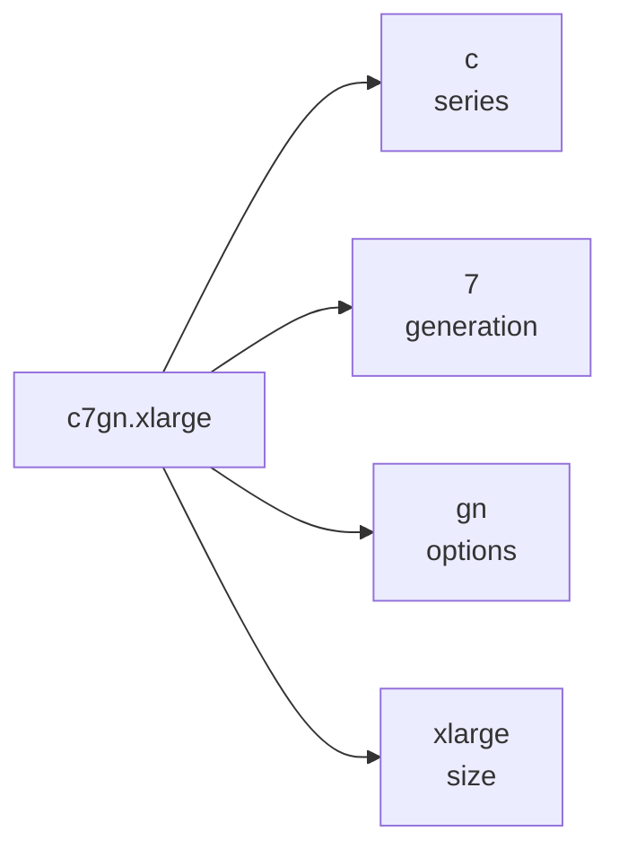
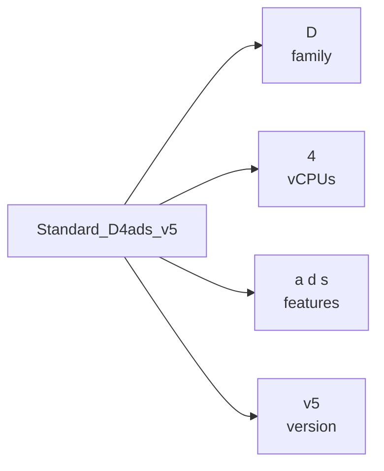
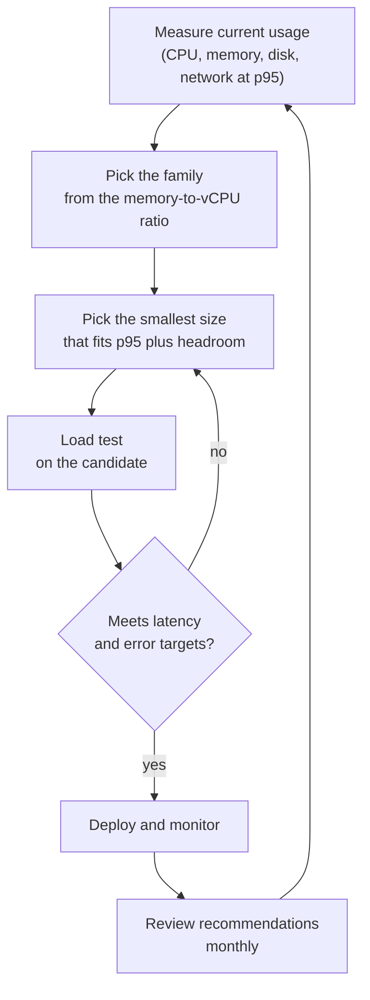

# Instance Types and Sizing

## Introduction

When you create a VM you have to choose its **shape**: how many vCPUs, how much memory, what kind of processor, how much network bandwidth, and whether it has fast local disks or a GPU. AWS calls this the **instance type** (for example `m7g.large`). Azure calls it the **VM size** (for example `Standard_D4s_v5`).

There are hundreds of options on each cloud, and new generations appear every year. That sounds overwhelming, but the names follow a pattern. Once you can read the pattern, you can narrow hundreds of choices down to three or four in a minute.

Choosing well matters because:

- **Too small** and your app is slow or crashes with out-of-memory errors.
- **Too big** and you pay for idle capacity every hour. Oversized VMs are one of the most common sources of cloud waste.
- **The wrong family** (for example, compute-optimized for a memory-hungry cache) can be both slow and expensive.

Think of instance types like shipping containers and trucks. You can rent a small van, a box truck or a refrigerated trailer. Each one has a sweet spot. You would not rent a refrigerated trailer to move books, and you would not move frozen food in a van with no cooling.

## Reading an EC2 Instance Type Name

An EC2 instance type has two parts separated by a dot: the **instance family** and the **size**.



According to the AWS naming convention:

- **Series** (first letter or letters): what the instance is optimized for.
- **Generation** (number): higher is newer. Newer generations usually give better price-performance.
- **Options** (letters after the number): processor and extra capabilities.
- **Size** (after the dot): `nano`, `micro`, `small`, `medium`, `large`, `xlarge`, `2xlarge` and up, or `metal` for bare metal. Each step up within a family roughly doubles vCPUs and memory.

| Series letter | Meaning |
|---------------|---------|
| M | General purpose |
| T | Burstable performance |
| C | Compute optimized |
| R | Memory optimized |
| X, U, Z | High memory or high frequency |
| I, D, Im, Is | Storage optimized |
| P, G | GPU accelerated (P for training and HPC, G for graphics and inference) |
| Inf, Trn | AWS Inferentia (inference) and AWS Trainium (training) |
| Hpc | High performance computing |

| Option letter | Meaning |
|---------------|---------|
| g | AWS Graviton (Arm) processor |
| a | AMD processor |
| i | Intel processor |
| d | Local NVMe instance store volumes |
| n | Higher network and EBS bandwidth |
| e | Extra memory or extra storage |
| z | High CPU frequency |
| b | Block storage optimized |
| flex | Flex instance, a lower-cost variant for workloads that do not need full CPU all the time |

So `c7gn.xlarge` is a compute-optimized, 7th-generation, Graviton, network-optimized instance in the `xlarge` size. And `m7i-flex.large` is a general purpose, 7th-generation, Intel, Flex instance.

AWS keeps adding generations. At the time of writing, AWS lists 8th-generation families such as M8g, C8g, R8g, M8i and M8a, and Graviton-based 9th-generation families have started to appear. Check [Amazon EC2 instance types](https://aws.amazon.com/ec2/instance-types/) for the current list instead of memorizing it.

## Reading an Azure VM Size Name

Azure names are longer because they pack more information into one string. The documented pattern is:

**Family** + optional **Subfamily** + **number of vCPUs** + optional **constrained vCPUs** + **additive features** + optional **accelerator** + **version**

All sizes in the public API also have a `Standard_` prefix.



| Family | Meaning |
|--------|---------|
| B | Burstable (CPU credits) |
| D | General purpose |
| F | Compute optimized |
| E | Memory optimized |
| M | Very large memory |
| L | Storage optimized (local NVMe) |
| N (NC, ND, NV, NG) | GPU accelerated |
| H (HB, HX) | High performance computing |
| DC, EC | Confidential computing variants |

| Feature letter | Meaning |
|----------------|---------|
| a | AMD processor |
| p | Arm processor (Microsoft Cobalt or Ampere Altra) |
| d | Local temporary disk |
| s | Supports Premium SSD disks |
| l | Low memory per vCPU |
| m | Memory intensive |
| i | Isolated size |
| t | Tiny memory |
| b | Remote storage bandwidth optimized |
| n | Network optimized |
| e | Confidential (TDX) capabilities |

If there is no processor letter, the size uses Intel x86-64 processors. So `Standard_D4ads_v5` is a general purpose, 4-vCPU, AMD, local-temp-disk, Premium-SSD-capable, version 5 size. `Standard_D4ps_v6` is the Arm-based (Cobalt) equivalent in version 6.

Azure also has newer versions rolling out, such as Dsv6, Dasv7 and Esv7, and retires old series on published schedules. Check [Virtual machine sizes overview](https://learn.microsoft.com/azure/virtual-machines/sizes/overview) for the current list and retirement notices.

:::tip The "s" is almost always what you want
On Azure, sizes without an `s` cannot use Premium SSD disks. Unless you have a specific reason, pick sizes with `s` in the name.
:::

## Families Mapped Across Clouds

The families line up well between the two clouds:

| Workload shape | AWS series | Azure family | Typical uses |
|----------------|-----------|--------------|--------------|
| Burstable, mostly idle | T (t3, t4g, t8i) | B (B, Bsv2, Basv2, Bpsv2) | Dev boxes, small sites, low-traffic APIs |
| Balanced CPU and memory | M | D | Web and app servers, small databases |
| CPU heavy | C | F | Batch processing, video encoding, high-traffic web front ends |
| Memory heavy | R, X | E, M | Databases, in-memory caches, analytics |
| Fast local storage | I, D | L | NoSQL databases, data warehouses |
| GPU | P, G | NC, ND, NV | ML training and inference, rendering |
| Arm processor | Graviton (`g` option) | Cobalt or Ampere (`p` feature) | Most Linux workloads with Arm builds |

### Burstable instances

T-series (AWS) and B-series (Azure) VMs give you a **baseline** CPU level and let you **burst** above it using **CPU credits**. You earn credits while running below the baseline and spend them while running above it.

- On AWS, T instances can run in **standard** mode (when credits run out, CPU drops to the baseline) or **unlimited** mode (you can keep bursting and pay for the extra CPU time). T3 and newer launch in unlimited mode by default, so a busy T instance can cost more than you expect.
- On Azure, B-series VMs are throttled back to the baseline when they run out of credits.

Burstable VMs are great for workloads that are idle most of the time. They are a poor fit for anything that runs hot for long stretches, like a build server or a busy database.

### Arm processors

AWS Graviton and Azure Cobalt are Arm-based processors. Both providers position them as their best price-performance options for many Linux workloads. The catch is compatibility: your OS, runtime and every native dependency need Arm builds. Interpreted languages (Python, Node.js, Java, .NET) usually work with no changes. Compiled binaries and some native Python wheels may need rebuilding. Always benchmark your own workload before switching.

## Exploring Sizes from the CLI

You do not need the web console to compare sizes. Both CLIs can query the full catalog.

### On AWS

```bash
# Specs for a few candidate types
aws ec2 describe-instance-types \
  --instance-types m7i.large m7g.large c7g.large r7g.large \
  --query "InstanceTypes[].{Type:InstanceType,vCPU:VCpuInfo.DefaultVCpus,MemMiB:MemoryInfo.SizeInMiB,Arch:ProcessorInfo.SupportedArchitectures[0],Net:NetworkInfo.NetworkPerformance}" \
  --output table
```

Example output:

```text
------------------------------------------------------------------
|                     DescribeInstanceTypes                      |
+--------+---------+----------------------+------------+--------+
|  Arch  | MemMiB  |         Net          |    Type    | vCPU   |
+--------+---------+----------------------+------------+--------+
|  arm64 |  4096   |  Up to 12.5 Gigabit  |  c7g.large |  2     |
|  arm64 |  8192   |  Up to 12.5 Gigabit  |  m7g.large |  2     |
|  x86_64|  8192   |  Up to 12.5 Gigabit  |  m7i.large |  2     |
|  arm64 |  16384  |  Up to 12.5 Gigabit  |  r7g.large |  2     |
+--------+---------+----------------------+------------+--------+
```

Notice the pattern at the same size: C has 2 GiB per vCPU, M has 4 GiB per vCPU and R has 8 GiB per vCPU. That ratio is the fastest way to tell the general families apart.

You can also check which types are offered in which Availability Zones:

```bash
aws ec2 describe-instance-type-offerings \
  --location-type availability-zone \
  --filters Name=instance-type,Values=m7g.large \
  --query "InstanceTypeOfferings[].Location" --output text
```

Example output:

```text
us-east-1a  us-east-1b  us-east-1c  us-east-1d  us-east-1f
```

### On Azure

```bash
# All D-family sizes with 4 vCPUs in a region (list-skus is the current command;
# the older "az vm list-sizes" is deprecated)
az vm list-skus --location eastus --resource-type virtualMachines \
  --size Standard_D4 \
  --query "[].{Name:name, vCPUs:capabilities[?name=='vCPUs'].value | [0], MemoryGB:capabilities[?name=='MemoryGB'].value | [0]}" \
  --output table
```

Example output (trimmed):

```text
Name               VCPUs    MemoryGB
-----------------  -------  ----------
Standard_D4ads_v5  4        16
Standard_D4as_v5   4        16
Standard_D4ds_v5   4        16
Standard_D4ps_v6   4        16
Standard_D4s_v5    4        16
Standard_D4s_v6    4        16
```

By default the command hides sizes your subscription cannot use in that region. Add `--all` to include them. Size availability varies by region and by subscription, and some sizes need a quota increase before you can use them. Check your quota with `az vm list-usage --location eastus --output table`.

## A Name Decoder in Python

To make the naming rules stick, here is a small, offline decoder for both clouds. It covers the common cases, not every special series.

```python
# decode_sizes.py - decode EC2 instance types and Azure VM sizes (offline)
import re

AWS_SERIES = {"m": "general purpose", "t": "burstable", "c": "compute optimized",
              "r": "memory optimized", "x": "memory intensive", "i": "storage optimized",
              "d": "dense storage", "p": "GPU", "g": "graphics GPU"}
AWS_OPTS = {"g": "Graviton (Arm)", "a": "AMD", "i": "Intel", "d": "local NVMe",
            "n": "network optimized", "e": "extra memory/storage", "z": "high frequency",
            "b": "block storage optimized"}

AZ_FAMILY = {"B": "burstable", "D": "general purpose", "F": "compute optimized",
             "E": "memory optimized", "M": "large memory", "L": "storage optimized"}
AZ_FEATS = {"a": "AMD", "p": "Arm", "d": "local temp disk", "s": "Premium SSD capable",
            "l": "low memory", "m": "memory intensive", "i": "isolated", "t": "tiny memory"}

def decode_aws(name: str) -> str:
    m = re.fullmatch(r"([a-z]+?)(\d+)([a-z]*)(-flex)?\.(\w+)", name)
    if not m:
        return "unrecognized"
    series, gen, opts, flex, size = m.groups()
    parts = [AWS_SERIES.get(series, series), f"gen {gen}"]
    parts += [AWS_OPTS.get(o, o) for o in opts]
    if flex:
        parts.append("Flex")
    parts.append(f"size {size}")
    return ", ".join(parts)

def decode_azure(name: str) -> str:
    m = re.fullmatch(r"Standard_([A-Z])(\d+)([a-z]*)(?:_v(\d+))?", name)
    if not m:
        return "unrecognized"
    family, vcpus, feats, version = m.groups()
    parts = [AZ_FAMILY.get(family, family), f"{vcpus} vCPUs"]
    parts += [AZ_FEATS.get(f, f) for f in feats]
    if "a" not in feats and "p" not in feats:
        parts.append("Intel")
    parts.append(f"v{version or 1}")
    return ", ".join(parts)

for n in ["m7g.large", "c7gn.xlarge", "m7i-flex.large", "r8g.2xlarge"]:
    print(f"{n:18} {decode_aws(n)}")
for n in ["Standard_D4s_v5", "Standard_D4ads_v5", "Standard_E8ps_v6", "Standard_B2s"]:
    print(f"{n:18} {decode_azure(n)}")
```

Output:

```text
m7g.large          general purpose, gen 7, Graviton (Arm), size large
c7gn.xlarge        compute optimized, gen 7, Graviton (Arm), network optimized, size xlarge
m7i-flex.large     general purpose, gen 7, Intel, Flex, size large
r8g.2xlarge        memory optimized, gen 8, Graviton (Arm), size 2xlarge
Standard_D4s_v5    general purpose, 4 vCPUs, Premium SSD capable, Intel, v5
Standard_D4ads_v5  general purpose, 4 vCPUs, AMD, local temp disk, Premium SSD capable, v5
Standard_E8ps_v6   memory optimized, 8 vCPUs, Arm, Premium SSD capable, v6
Standard_B2s       burstable, 2 vCPUs, Premium SSD capable, Intel, v1
```

## A Sizing Process That Works

Guessing sizes leads to waste. Use a loop of measure, choose, test and adjust.



1. **Measure.** Look at the 95th percentile (p95), not the average, for CPU, memory, disk IOPS and network over at least two weeks. Averages hide peaks. Note that EC2 does not report memory usage to CloudWatch by default. Install the CloudWatch agent. Azure Monitor VM insights or the Azure Monitor Agent does the same on Azure.
2. **Pick the family** from the memory-to-vCPU ratio you measured. Needs about 2 GiB per vCPU? Compute optimized. About 4? General purpose. 8 or more? Memory optimized.
3. **Pick the size** that covers p95 with headroom. A common rule of thumb is to target around 60 to 70% peak CPU, so there is room for spikes and for losing one instance in a group.
4. **Load test** the candidate with realistic traffic.
5. **Monitor and revisit.** Workloads change.

### Let the platform help

Both clouds analyze your usage and suggest changes:

- **AWS Compute Optimizer** analyzes 14 days of CloudWatch metrics by default (up to 93 days with a paid enhanced metrics option) and classifies each instance as under-provisioned, over-provisioned or optimized. You must opt in first.
- **Azure Advisor** gives cost recommendations to resize or shut down underused VMs, based on CPU, memory and network use.

```bash
# AWS: opt in once, then read EC2 recommendations
aws compute-optimizer update-enrollment-status --status Active
aws compute-optimizer get-ec2-instance-recommendations \
  --query "instanceRecommendations[].{Instance:instanceArn,Finding:finding,Current:currentInstanceType,Suggested:recommendationOptions[0].instanceType}" \
  --output table

# Azure: cost recommendations, including VM right-sizing
az advisor recommendation list --category Cost \
  --query "[].{Resource:impactedValue, Problem:shortDescription.problem}" --output table
```

Example output:

```text
Finding           Current     Suggested
----------------  ----------  ----------
OVER_PROVISIONED  m5.2xlarge  m7g.large
OPTIMIZED         c6i.large   c7g.large

Resource      Problem
------------  ----------------------------------------------------------
build-agent   Right-size or shutdown underutilized virtual machines
```

Recommendations are based on history and do not forecast growth. Treat them as a starting point, then test.

### Changing size later

Resizing is not free of disruption:

- **EC2**: stop the instance, change the type with `aws ec2 modify-instance-attribute --instance-type`, then start it. Moving between architectures (x86 to Arm) needs a different AMI, so it is a rebuild, not a resize.
- **Azure**: `az vm resize --size Standard_D4s_v5` restarts the VM. If the new size is not available on the current hardware cluster, you may need to deallocate first. Check options with `az vm list-vm-resize-options`.

In an Auto Scaling group or scale set, change the launch template or scale set model and roll the instances instead. See [Auto Scaling Groups and Scale Sets](./3-cloud-autoscaling.mdx).

## Real-World Scenario

Your team runs a Node.js REST API for an online learning platform on four `m5.2xlarge` instances (8 vCPUs, 32 GiB each) on AWS, and a mirror deployment on Azure on four `Standard_D8s_v4` VMs for a customer that requires Azure. Finance says compute costs grew 40% this year. You have been asked to cut cost without hurting latency.

### Walking through it

1. **Measure.** After installing the CloudWatch agent and Azure Monitor Agent, two weeks of data show p95 CPU at 22% and p95 memory at 5 GiB per instance. The VMs are heavily oversized on both clouds.
2. **Family.** 5 GiB of memory needed at about 2 vCPUs of real load suggests general purpose (4 GiB per vCPU) at 2 to 4 vCPUs, not 8.
3. **Generation and processor.** Node.js runs on Arm without changes. The only native module, an image library, has Arm builds.
4. **Candidates.** On AWS, `m7g.xlarge` (4 vCPU, 16 GiB, Graviton). On Azure, `Standard_D4ps_v6` (4 vCPU, 16 GiB, Cobalt).
5. **Load test.** Both candidates meet the p99 latency target at twice the normal peak traffic.
6. **Roll out** by updating the launch template and scale set model, then rolling instances one at a time.

### Why this approach

- It starts with measurements, so the decision is defensible.
- Moving down in size and up in generation captures two savings at once: fewer idle resources and better price-performance.
- Keeping four instances preserves redundancy across Availability Zones. Smaller instances are fine; fewer instances would reduce fault tolerance.

### When not to do this

- If the app has a memory leak or rare large spikes that p95 misses, look at the maximums as well before downsizing.
- If you plan to buy a 3-year commitment, decide the family first. Some commitments lock you to a family. See [Spot, Reserved and Savings Plans](./4-cloud-spot-and-reserved.mdx).

### Alternatives and trade-offs

| Approach | Pros | Cons | Best for |
|----------|------|------|----------|
| Downsize within the same family | Lowest risk; no compatibility changes | Misses newer generation gains | Quick wins |
| Move to newer generation, same architecture | Better price-performance, same binaries | Requires testing on new hardware | Most x86 fleets |
| Move to Arm (Graviton / Cobalt) | Often the best price-performance | Native dependencies and images must support Arm | Linux apps on interpreted or JIT runtimes |
| Switch to burstable (T / B) | Cheap for idle workloads | Throttling or extra charges under sustained load | Low and spiky CPU use |
| Move off VMs entirely | No sizing to manage | Larger change; different operational model | Apps that fit containers or functions |

## Best Practices

1. **Prefer current generations.** Older generations are often both slower and more expensive per unit of work.
2. **Size from p95 measurements, not specs of the old server.** On-premises servers are usually oversized because buying hardware is slow.
3. **Keep at least two instances** across zones for anything production, even if one small instance would handle the load.
4. **Use flexible selection where possible.** Auto Scaling groups can use several instance types or attribute-based selection, and Azure Flexible scale sets can mix sizes. This improves availability, especially for Spot capacity.
5. **Check quotas early.** New subscriptions and accounts have vCPU quotas per family and region. Request increases before launch day.
6. **Revisit sizes regularly**, for example after major releases or every quarter, using Compute Optimizer and Azure Advisor.

## Summary

- EC2 names follow **series + generation + options . size** (for example `c7gn.xlarge`). Azure names follow **family + vCPUs + features + version** (for example `Standard_D4ads_v5`).
- Families map across clouds: T and B (burstable), M and D (general), C and F (compute), R and E (memory), I and L (storage), P/G and N (GPU).
- The memory-to-vCPU ratio is the quickest way to pick a family. Size from measured p95 usage plus headroom, then load test.
- Arm processors (Graviton, Cobalt) often give better price-performance but require Arm-compatible software.
- Compute Optimizer and Azure Advisor provide right-sizing recommendations based on history. Use them as input, not as final answers.

## Exercises

1. **Decode by hand.** Without running code, decode `r7iz.large`, `i4i.xlarge`, `Standard_E16as_v5` and `Standard_L8s_v3`. Then check your answers in the official docs.
2. **Extend the decoder.** Add support for Azure constrained vCPU sizes (for example `Standard_M8-2ms_v2`) and for AWS `metal` sizes.
3. **Ratio table.** Use `aws ec2 describe-instance-types` and `az vm list-skus` to build a table of memory per vCPU for the `large` / 2-vCPU sizes of M, C and R on AWS and D, F and E on Azure.
4. **Right-sizing report.** Write a script that reads CPU utilization for your instances from CloudWatch (`get_metric_statistics` in boto3) and flags any instance with p95 CPU under 20% over 14 days.

Next: [Auto Scaling Groups and Scale Sets](./3-cloud-autoscaling.mdx). Related: [Cost Optimization and FinOps](../13-cloud-architecture/4-cloud-cost-optimization.mdx) and [Monitoring: CloudWatch and Azure Monitor](../12-cloud-observability-and-security/0-cloud-monitoring.mdx).
