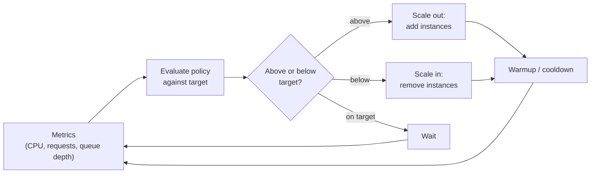

# Auto Scaling Groups and Scale Sets

## Introduction

One VM is a single point of failure. If it crashes, your app is down. If traffic doubles, it slows to a crawl. If traffic drops at night, you keep paying for capacity nobody uses.

The cloud's answer is to stop thinking about individual VMs and start thinking about **fleets**. You describe what one VM should look like, set how many you want, and let the platform keep that many running, replacing any that fail, and adding or removing VMs as load changes.

- On AWS this is an **EC2 Auto Scaling group (ASG)**, built from a **launch template**.
- On Azure this is a **Virtual Machine Scale Set (VMSS)**, built from a **scale set model** and scaled by **Azure Monitor autoscale**.

A good analogy is a restaurant manager with a staffing plan. The plan says "never fewer than 2 cooks, never more than 10, and aim to keep each cook about half busy". The manager calls in extra cooks when orders pile up, sends people home when it is quiet, and replaces anyone who calls in sick. You write the plan once. The manager handles the rest.

Autoscaling gives you three things at once:

1. **Self-healing.** Failed instances are replaced automatically.
2. **Elasticity.** Capacity follows demand.
3. **Cost control.** Minimum and maximum limits cap both under- and over-spending.

:::warning Cost warning
The walkthroughs on this page create several VMs and, on Azure, a load balancer. They bill while they exist, and a misconfigured scaling policy can launch many instances quickly. Keep `max` values small while experimenting, and run the cleanup commands at the end.
:::

## Core Concepts

The concepts are almost identical on both clouds. Only the names change.

| Concept | AWS | Azure |
|---------|-----|-------|
| The fleet | Auto Scaling group | Virtual Machine Scale Set |
| What each VM looks like | Launch template (versioned) | Scale set model (image, size, custom data, extensions) |
| Limits | Min size, max size, desired capacity | Minimum, maximum and default instance count in the autoscale profile |
| Where VMs go | Subnets in multiple Availability Zones | Availability Zones and fault domains |
| Health | EC2 status checks, plus optional ELB health checks | Application Health extension or load balancer probe, plus automatic instance repairs |
| Scaling logic | Scaling policies (target tracking, step, simple, predictive) and scheduled actions | Autoscale settings with metric rules, schedule profiles and predictive autoscale |
| Updating VMs | Instance refresh | Upgrade policy (Manual, Automatic, Rolling) |

### How a scaling loop works



Two timing ideas prevent the fleet from thrashing:

- **Warmup** (AWS) is how long a new instance needs before its metrics count. A freshly booted VM shows high CPU while it installs packages, which could trigger more scale-out by mistake.
- **Cooldown** (both clouds) is a pause after a scaling action so the fleet can settle before the next decision.

### Types of scaling policy

| Policy type | How it works | AWS | Azure |
|-------------|-------------|-----|-------|
| Target tracking | "Keep average CPU near 50%." The platform calculates how many instances to add or remove | Target tracking scaling policy | Not built in as a single setting; approximate it with paired scale-out and scale-in rules |
| Rule / step | "If CPU over 70% for 5 minutes, add 2" | Step scaling policy | Autoscale rule (`--condition`, `--scale out`) |
| Scheduled | "Weekdays at 08:00, minimum 6" | Scheduled actions | Recurring or fixed-date autoscale profile |
| Predictive | Forecasts load from history and scales ahead of time | Predictive scaling policy | Predictive autoscale (CPU-based) |

Target tracking is the easiest to get right. With rules you must tune both the scale-out and the scale-in rule, or you risk "flapping", where the fleet bounces up and down.

## Building an Auto Scaling Group on AWS

You will create a launch template, an Auto Scaling group across subnets in different Availability Zones, and a target tracking policy. Reuse the `web-init.yaml` cloud-init file from [Virtual Machines: EC2 and Azure VMs](./1-cloud-virtual-machines.mdx), and a security group that allows HTTP.

### Step 1: The launch template

Launch template user data must be base64-encoded by you (unlike `run-instances`, which encodes it for you).

```bash
USER_DATA=$(base64 -w0 web-init.yaml)   # on macOS: base64 -i web-init.yaml

cat > lt-data.json <<EOF
{
  "ImageId": "resolve:ssm:/aws/service/ami-amazon-linux-latest/al2023-ami-kernel-default-x86_64",
  "InstanceType": "t3.micro",
  "SecurityGroupIds": ["$SG_ID"],
  "UserData": "$USER_DATA",
  "MetadataOptions": {"HttpTokens": "required", "HttpEndpoint": "enabled"},
  "TagSpecifications": [
    {"ResourceType": "instance", "Tags": [{"Key": "project", "Value": "asg-demo"}]}
  ]
}
EOF

aws ec2 create-launch-template \
  --launch-template-name web-lt \
  --launch-template-data file://lt-data.json \
  --query "LaunchTemplate.{Id:LaunchTemplateId,Version:LatestVersionNumber}" --output table
```

Example output:

```text
------------------------------------
|       CreateLaunchTemplate       |
+-----------------------+----------+
|          Id           | Version  |
+-----------------------+----------+
|  lt-0abc1234def567890 |  1       |
+-----------------------+----------+
```

Launch templates are **versioned**. Each change creates a new version, and the group can follow a specific version, the default version, or `$Latest`. That makes rollbacks easy.

### Step 2: The Auto Scaling group

Pick subnets in at least two Availability Zones. The group spreads instances across them and rebalances if one zone has problems.

```bash
SUBNETS=$(aws ec2 describe-subnets \
  --filters Name=vpc-id,Values="$VPC_ID" Name=default-for-az,Values=true \
  --query "Subnets[0:3].SubnetId" --output text | tr '\t' ',')

aws autoscaling create-auto-scaling-group \
  --auto-scaling-group-name web-asg \
  --launch-template "LaunchTemplateName=web-lt,Version=\$Latest" \
  --min-size 2 --max-size 4 --desired-capacity 2 \
  --vpc-zone-identifier "$SUBNETS" \
  --default-instance-warmup 120 \
  --tags "Key=project,Value=asg-demo,PropagateAtLaunch=true"

aws autoscaling describe-auto-scaling-groups --auto-scaling-group-names web-asg \
  --query "AutoScalingGroups[0].Instances[].{Id:InstanceId,AZ:AvailabilityZone,State:LifecycleState,Health:HealthStatus}" \
  --output table
```

Example output:

```text
------------------------------------------------------------------
|                  DescribeAutoScalingGroups                     |
+------------+-----------+-----------------------+---------------+
|     AZ     |  Health   |          Id           |    State      |
+------------+-----------+-----------------------+---------------+
|  us-east-1a|  Healthy  |  i-0a1b2c3d4e5f67890  |  InService    |
|  us-east-1b|  Healthy  |  i-0f9e8d7c6b5a43210  |  InService    |
+------------+-----------+-----------------------+---------------+
```

In production you would also attach the group to a load balancer target group with `--target-group-arns` and set `--health-check-type ELB --health-check-grace-period 300`. Then an instance that is running but failing HTTP health checks is replaced too, not just one whose VM has crashed. Load balancers are covered in [Load Balancers](../8-cloud-networking/4-cloud-load-balancers.mdx).

### Step 3: A target tracking policy

```json
{
  "PredefinedMetricSpecification": {
    "PredefinedMetricType": "ASGAverageCPUUtilization"
  },
  "TargetValue": 50.0
}
```

Save that as `cpu50.json` and attach it:

```bash
aws autoscaling put-scaling-policy \
  --auto-scaling-group-name web-asg \
  --policy-name cpu-50 \
  --policy-type TargetTrackingScaling \
  --target-tracking-configuration file://cpu50.json \
  --query "Alarms[].AlarmName" --output text
```

Example output:

```text
TargetTracking-web-asg-AlarmHigh-1a2b3c...  TargetTracking-web-asg-AlarmLow-4d5e6f...
```

Amazon EC2 Auto Scaling creates and manages the CloudWatch alarms for you. Do not edit them by hand. Other predefined metrics are `ASGAverageNetworkIn`, `ASGAverageNetworkOut` and `ALBRequestCountPerTarget`. For a web tier behind a load balancer, **requests per target** often tracks real load better than CPU.

### Step 4: A scheduled action

If you know traffic rises every weekday morning, scale ahead of it instead of waiting for metrics:

```bash
aws autoscaling put-scheduled-update-group-action \
  --auto-scaling-group-name web-asg \
  --scheduled-action-name weekday-morning \
  --recurrence "0 8 * * MON-FRI" \
  --time-zone "America/New_York" \
  --min-size 3 --desired-capacity 3
```

Scheduled actions set the floor. Target tracking still adds instances above it when needed.

### Rolling out a new version

When you change the launch template (new AMI, new instance type), replace the instances gradually with an **instance refresh**:

```bash
aws autoscaling start-instance-refresh \
  --auto-scaling-group-name web-asg \
  --preferences '{"MinHealthyPercentage": 90, "InstanceWarmup": 120}'
```

## Building a Scale Set on Azure

### Step 1: Create a Flexible scale set

Azure scale sets have two **orchestration modes**. **Flexible** is the recommended mode for new scale sets. Its instances are standard Azure VMs, so normal VM commands, tags, RBAC and Azure Backup work on them. **Uniform** is the older mode, still used by some services such as AKS node pools. The mode is chosen at creation and cannot be changed later.

```bash
RG=rg-vmss-demo
az group create --name $RG --location eastus --tags project=vmss-demo --output none

az vmss create \
  --resource-group $RG \
  --name web-vmss \
  --orchestration-mode Flexible \
  --image Ubuntu2204 \
  --vm-sku Standard_B2s \
  --instance-count 2 \
  --zones 1 2 3 \
  --admin-username azureuser \
  --generate-ssh-keys \
  --custom-data web-init.yaml \
  --tags project=vmss-demo

az vm list --resource-group $RG --query "[].{Name:name, Zone:zones[0]}" --output table
```

Example output:

```text
Name              Zone
----------------  ------
web-vmss_3f2a1b0  1
web-vmss_9c8d7e6  2
```

Because Flexible scale set instances are regular VMs, `az vm list` shows them. By default `az vmss create` also creates a virtual network and, for most configurations, a load balancer. Check the command output and `az resource list --resource-group $RG --output table` to see exactly what was created. Flexible scale set VMs do not get Azure's implicit default outbound internet access, so they need an explicit outbound path such as a load balancer with outbound rules or a NAT gateway.

### Step 2: Add autoscale with rules

Azure autoscale is a separate resource, an **autoscale setting**, that points at the scale set.

```bash
az monitor autoscale create \
  --resource-group $RG \
  --resource web-vmss \
  --resource-type Microsoft.Compute/virtualMachineScaleSets \
  --name web-autoscale \
  --min-count 2 --max-count 4 --count 2

az monitor autoscale rule create \
  --resource-group $RG --autoscale-name web-autoscale \
  --condition "Percentage CPU > 70 avg 5m" --scale out 1

az monitor autoscale rule create \
  --resource-group $RG --autoscale-name web-autoscale \
  --condition "Percentage CPU < 30 avg 10m" --scale in 1
```

Example output (trimmed, from the last command):

```json
{
  "metricTrigger": {
    "metricName": "Percentage CPU",
    "operator": "LessThan",
    "threshold": 30.0,
    "timeAggregation": "Average",
    "timeWindow": "PT10M"
  },
  "scaleAction": {
    "cooldown": "PT5M",
    "direction": "Decrease",
    "type": "ChangeCount",
    "value": "1"
  }
}
```

Notice the gap between 70% and 30%, and the longer window for scale-in. That gap prevents flapping: after a scale-out, CPU drops, but not below 30%, so the fleet does not immediately scale back in. Azure autoscale also checks this itself. Before scaling in, it estimates whether the remaining instances would cross the scale-out threshold, and skips the scale-in if so.

### Step 3: Add a schedule profile

Autoscale settings can hold several **profiles**. A recurring profile applies on certain days and times, and can copy the rules from the default profile:

```bash
az monitor autoscale profile create \
  --resource-group $RG --autoscale-name web-autoscale \
  --name weekday-business-hours \
  --copy-rules default \
  --min-count 3 --count 3 --max-count 4 \
  --recurrence week mon tue wed thu fri \
  --start 08:00 --end 18:00 \
  --timezone "Eastern Standard Time"
```

### Updating instances

Change the scale set model (for example, a new image version) with `az vmss update`. How the change reaches existing VMs depends on the scale set's **upgrade policy**: Manual (you update or reimage instances yourself), Automatic, or Rolling (batches, with health checks between batches). Rolling is the production-friendly choice, and pairs well with the Application Health extension so Azure knows whether each new batch is healthy.

## The Same Fleet in Terraform

Clicking or scripting CLI commands is fine for learning. For real environments, define fleets as code so they are reviewed and repeatable. Here is the AWS group in Terraform. Azure's `azurerm_orchestrated_virtual_machine_scale_set` resource fills the same role for Flexible scale sets. See [Terraform for AWS and Azure](../10-cloud-infrastructure-as-code/4-cloud-terraform-multi-cloud.mdx).

```hcl
resource "aws_launch_template" "web" {
  name_prefix   = "web-"
  image_id      = data.aws_ssm_parameter.al2023.value
  instance_type = "t3.micro"
  user_data     = filebase64("${path.module}/web-init.yaml")

  metadata_options {
    http_tokens   = "required"
    http_endpoint = "enabled"
  }
}

data "aws_ssm_parameter" "al2023" {
  name = "/aws/service/ami-amazon-linux-latest/al2023-ami-kernel-default-x86_64"
}

resource "aws_autoscaling_group" "web" {
  name                      = "web-asg"
  min_size                  = 2
  max_size                  = 4
  desired_capacity          = 2
  vpc_zone_identifier       = var.private_subnet_ids
  default_instance_warmup   = 120
  health_check_type         = "ELB"
  health_check_grace_period = 300
  target_group_arns         = [var.target_group_arn]

  launch_template {
    id      = aws_launch_template.web.id
    version = aws_launch_template.web.latest_version
  }

  instance_refresh {
    strategy = "Rolling"
    preferences {
      min_healthy_percentage = 90
    }
  }
}

resource "aws_autoscaling_policy" "cpu50" {
  name                   = "cpu-50"
  autoscaling_group_name = aws_autoscaling_group.web.name
  policy_type            = "TargetTrackingScaling"

  target_tracking_configuration {
    predefined_metric_specification {
      predefined_metric_type = "ASGAverageCPUUtilization"
    }
    target_value = 50
  }
}
```

With `instance_refresh` set, changing the launch template version in Terraform triggers a rolling replacement automatically.

## Simulating Target Tracking

Target tracking can feel like magic. This small offline simulation shows the core idea: the desired capacity is proportional to how far the metric is from the target, rounded up, and clamped to min and max. The real algorithm has more safeguards, such as warmup and gradual scale-in.

```python
# target_tracking_sim.py - a simplified model of target tracking
import math

MIN, MAX, TARGET = 2, 10, 50.0   # instances, instances, percent CPU

def next_capacity(current: int, avg_cpu: float) -> int:
    # total "work" is current * avg_cpu; spread it so each instance is near TARGET
    desired = math.ceil(current * avg_cpu / TARGET)
    if desired < current:
        desired = max(desired, current - 1)   # scale in gently, one at a time
    return max(MIN, min(MAX, desired))

capacity = 2
load_units = [60, 90, 160, 240, 240, 150, 80, 40]   # total CPU demand, in "percent of one instance"
for minute, load in enumerate(load_units):
    avg_cpu = load / capacity
    new_cap = next_capacity(capacity, avg_cpu)
    print(f"t={minute:2}  load={load:3}  instances={capacity}  avgCPU={avg_cpu:5.1f}%  -> {new_cap}")
    capacity = new_cap
```

Output:

```text
t= 0  load= 60  instances=2  avgCPU= 30.0%  -> 2
t= 1  load= 90  instances=2  avgCPU= 45.0%  -> 2
t= 2  load=160  instances=2  avgCPU= 80.0%  -> 4
t= 3  load=240  instances=4  avgCPU= 60.0%  -> 5
t= 4  load=240  instances=5  avgCPU= 48.0%  -> 5
t= 5  load=150  instances=5  avgCPU= 30.0%  -> 4
t= 6  load= 80  instances=4  avgCPU= 20.0%  -> 3
t= 7  load= 40  instances=3  avgCPU= 13.3%  -> 2
```

Notice how scale-out jumps several instances at once, while scale-in steps down one at a time. Both clouds deliberately scale in more cautiously than they scale out, because removing capacity too fast hurts users, while adding a little too much only costs a little money.

## Real-World Scenario

Your team runs the storefront for an online ticketing company on VMs. Normal traffic needs 3 web servers. When a popular concert goes on sale, traffic jumps tenfold within two minutes, at announced times. Last year the site went down during a big on-sale event because the team was adding servers by hand.

### The solution

1. **A fleet across three zones**: an Auto Scaling group (AWS) or Flexible scale set (Azure) with a minimum of 3, one per zone.
2. **Scheduled scaling for known events**: 30 minutes before each announced on-sale, a scheduled action raises the minimum to 20. Booting and warming up VMs takes minutes, which is too slow to react to a two-minute spike after it starts.
3. **Metric-based scaling for everything else**: target tracking on `ALBRequestCountPerTarget` on AWS, and CPU rules (or a custom request metric) on Azure.
4. **Health checks from the load balancer**, so instances that boot but fail to serve are replaced.
5. **Fast boot** using a prebuilt machine image rather than installing everything at startup. See [Machine Images and Bootstrapping](./6-cloud-images-and-bootstrapping.mdx).
6. **A virtual waiting room** in front of the checkout, because no autoscaling is instant.

### Why this approach

- Reactive scaling alone cannot keep up with a spike that arrives faster than VMs boot. Scheduled scaling covers the known spikes, and reactive scaling covers the unknown ones.
- Spreading across zones means one zone's outage does not take the storefront down.
- The minimum of 3 keeps a baseline that survives losing an instance at any time.

### When not to use VM autoscaling

- If traffic is truly unpredictable and spikes within seconds, containers (which start in seconds) or functions (which scale per request) react faster than VMs.
- If the app keeps user sessions in local memory, scale-in will log users out. Move session state to a shared cache first. See [Managed Caching](../7-cloud-databases/3-cloud-caching.mdx).

### Alternatives and trade-offs

| Approach | Pros | Cons | Best for |
|----------|------|------|----------|
| Fixed fleet, manual scaling | Simple and predictable | Slow to react; pays for peak all the time or fails at peak | Very steady internal apps |
| Reactive autoscaling (target tracking / rules) | Follows demand automatically | Lags behind fast spikes by VM boot time | Gradual daily patterns |
| Scheduled plus reactive | Handles known spikes and surprises | Needs a calendar of events | Retail, ticketing, business hours |
| Predictive autoscaling | Learns recurring patterns; scales ahead | Needs history; less help with one-off events | Strong daily or weekly cycles |
| Containers or functions | Scale in seconds | Different platform and operating model | Spiky, stateless workloads |

## Common Mistakes

1. **Min and max set equal.** Then nothing ever scales. That can be useful for self-healing a single VM (min = max = 1), but it is not autoscaling.
2. **No warmup or grace period.** New instances fail health checks while still booting and get terminated in a loop. Set a health check grace period and a default instance warmup that match real boot time.
3. **Storing state on instances.** Local uploads, sessions or caches disappear when an instance is scaled in or replaced. Keep instances stateless.
4. **Scaling on the wrong metric.** CPU is a poor signal for I/O-bound or queue-driven work. Use request count per target, queue depth per instance, or custom metrics.
5. **Symmetric rules on Azure.** Scale-out at 60% and scale-in at 50% will flap. Leave a wide gap and use a longer window for scale-in.
6. **Unbounded maximums.** A bug that pins CPU at 100% will scale to your maximum. Pick a maximum you can afford and set a budget alert.
7. **Single-zone fleets.** Always use at least two Availability Zones for production.

## Cleanup

### On AWS

```bash
aws autoscaling delete-auto-scaling-group --auto-scaling-group-name web-asg --force-delete
aws ec2 delete-launch-template --launch-template-name web-lt
# after the instances have terminated:
aws ec2 delete-security-group --group-id "$SG_ID"
```

`--force-delete` terminates the group's instances along with the group.

### On Azure

```bash
az group delete --name rg-vmss-demo --yes --no-wait
```

## Summary

- **Auto Scaling groups** (AWS) and **Virtual Machine Scale Sets** (Azure) manage fleets of identical VMs: they replace failed instances and scale with demand within min and max limits.
- AWS uses versioned **launch templates** and **scaling policies** (target tracking, step, scheduled, predictive). Azure uses a **scale set model** plus an **autoscale setting** with rules and schedule profiles.
- Use **Flexible** orchestration for new Azure scale sets. Its instances are normal VMs.
- Target tracking is the easiest policy. Rule-based scaling needs a wide gap between scale-out and scale-in thresholds.
- Combine scheduled and reactive scaling for known spikes, spread across zones, use load balancer health checks, and keep instances stateless.

## Exercises

1. **Watch it scale.** Build the AWS or Azure fleet above, connect to one instance, and generate CPU load (for example `for i in 1 2; do yes > /dev/null & done`). Watch the fleet scale out, then stop the load and watch it scale in.
2. **Requests instead of CPU.** Put an Application Load Balancer in front of the AWS group and switch the policy to `ALBRequestCountPerTarget`. Which value of `TargetValue` would you choose, and how would you measure it?
3. **Tune the simulator.** Change `target_tracking_sim.py` to allow scale-in of up to 2 instances at a time. What happens to the instance count when load oscillates between 100 and 200?
4. **Rolling update.** Change the image or size in your launch template or scale set model, and roll it out with an instance refresh or a rolling upgrade policy. Measure how long a full rollout takes.

Next: [Spot, Reserved and Savings Plans](./4-cloud-spot-and-reserved.mdx). Related: [Scalability Patterns](../13-cloud-architecture/3-cloud-scalability-patterns.mdx) and [High Availability Design](../13-cloud-architecture/1-cloud-high-availability.mdx).
