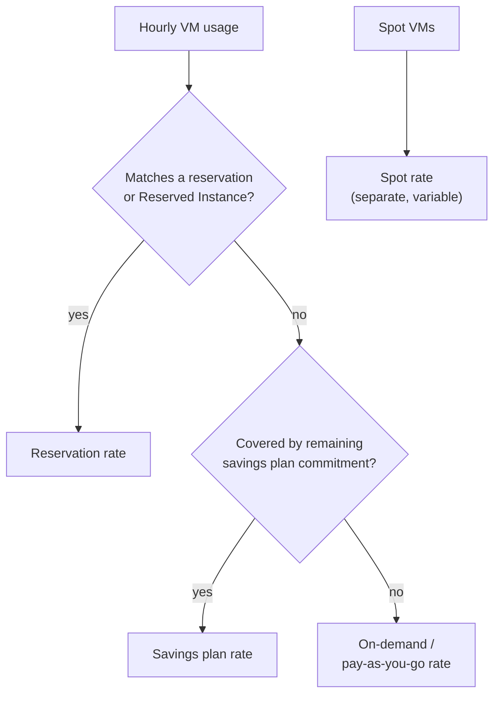
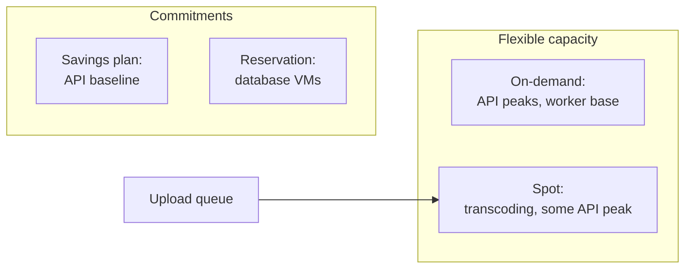

# Spot, Reserved and Savings Plans

## Introduction

By default you pay **on-demand** (AWS) or **pay-as-you-go** (Azure) rates for VMs: no commitment, start and stop any time, pay for what runs. That flexibility is valuable, but it is also the most expensive way to buy compute.

Both clouds offer two big levers to pay less:

1. **Spare capacity (Spot).** The provider sells unused capacity at a steep discount, with one catch: it can take the VM back with little warning when it needs the capacity.
2. **Commitments (Reserved Instances, reservations, savings plans).** You promise to use, or spend, a certain amount for one or three years. In return you get a lower rate.

Think of airline tickets. A flexible, refundable fare is the on-demand price. Booking months ahead with no refunds is a commitment discount. A standby ticket is Spot: very cheap, but you might be bumped if the plane fills up.

This page explains how each option works on AWS and Azure, how they are billed, and how to combine them. It does not quote prices. Discounts vary by region, instance family, term and payment option, and change over time. Use the [AWS Pricing Calculator](https://calculator.aws/), the [Azure Pricing Calculator](https://azure.microsoft.com/pricing/calculator/), and the recommendation tools in AWS Cost Explorer and Azure Advisor for real numbers.

:::warning Commitments cannot be undone
Savings plans and Reserved Instance purchases generally **cannot be canceled or refunded**. Some types can be exchanged or modified, with limits. Never buy a commitment while experimenting. Buy one only after you have weeks or months of steady usage data, and start smaller than the recommendation suggests.
:::

## The Purchase Options at a Glance

| Option | AWS | Azure | Commitment | Can be interrupted? |
|--------|-----|-------|------------|---------------------|
| Pay per use | On-Demand Instances | Pay-as-you-go | None | No |
| Spare capacity | Spot Instances | Azure Spot Virtual Machines | None | **Yes** |
| Spend commitment | Savings Plans (Compute, EC2 Instance, Database, SageMaker AI) | Savings plan for compute, savings plan for databases | 1 or 3 years of hourly spend | No |
| Resource commitment | Reserved Instances (Standard, Convertible) | Azure Reservations (Reserved VM Instances and others) | 1 or 3 years of a specific resource | No |
| Guaranteed capacity, no discount by itself | On-Demand Capacity Reservations | On-demand capacity reservation | None or flexible | No |
| Bring your licenses | Bring your own license (BYOL) on Dedicated Hosts and other options | Azure Hybrid Benefit | Existing licenses | No |

The key insight is that **these are billing constructs, not different VMs**. A Spot VM is a normal VM with an eviction risk. A Reserved Instance or savings plan is a discount that the billing system applies to normal VMs that match. You do not "launch a savings plan".



On both clouds, resource-specific reservations are applied first, and the savings plan covers eligible usage that remains, up to the hourly commitment. Anything above that is billed at the normal rate. Unused commitment for an hour is lost. It does not roll over.

## Spot Capacity

### How Spot works

| Behavior | AWS Spot Instances | Azure Spot VMs |
|----------|--------------------|----------------|
| Discount | Large discount from on-demand, varies by type, zone and time | Large discount from pay-as-you-go, varies by size, region and time |
| Interruption warning | **2 minutes**, via instance metadata and an EventBridge event | **Up to 30 seconds**, best effort, via Scheduled Events |
| What happens | Terminate (default for one-time requests), stop, or hibernate | Deallocate (default) or delete, per your eviction policy |
| Price cap | Optional max price. AWS recommends not setting one, because a cap can increase interruptions | Optional max price, or `-1` to never be evicted for price reasons (you pay up to the standard price) |
| SLA | None | None |
| Notable limits | Some instance types have little spare capacity | B-series and promo sizes are not supported; Spot can only be set at creation time |
| Extra signal | Rebalance recommendation, sent when interruption risk rises | Eviction rate history per size and region in the portal and Azure Resource Graph |

The warning time is the biggest practical difference. Two minutes on AWS is enough to drain connections and checkpoint a small job. Thirty seconds on Azure means your workload must already be built to lose a VM at almost any moment.

### Good and bad fits for Spot

Spot works for workloads that are **fault-tolerant and flexible**:

- Stateless web servers behind a load balancer, as part of a mixed fleet
- CI/CD build agents and test runners
- Batch processing, rendering, data transformation and ML training with checkpoints
- Dev and test environments

Spot is a bad fit for:

- Single-instance databases or anything stateful without replication
- Long jobs that cannot checkpoint and would restart from zero
- Anything with a strict uptime SLA unless it runs on mixed capacity

### Launching Spot capacity

#### On AWS

```bash
aws ec2 run-instances \
  --image-id resolve:ssm:/aws/service/ami-amazon-linux-latest/al2023-ami-kernel-default-x86_64 \
  --instance-type m7i.large \
  --instance-market-options '{"MarketType":"spot","SpotOptions":{"SpotInstanceType":"one-time"}}' \
  --metadata-options "HttpTokens=required" \
  --tag-specifications 'ResourceType=instance,Tags=[{Key=project,Value=spot-demo}]' \
  --query "Instances[0].{Id:InstanceId,Lifecycle:InstanceLifecycle}" --output table
```

Example output:

```text
-------------------------------------
|          RunInstances             |
+-----------------------+-----------+
|          Id           | Lifecycle |
+-----------------------+-----------+
|  i-0c1d2e3f4a5b6c7d8  |  spot     |
+-----------------------+-----------+
```

In practice, you rarely launch single Spot instances. You put Spot inside an Auto Scaling group with a **mixed instances policy**, so the group can use several instance types and fall back to on-demand.

```json
{
  "AutoScalingGroupName": "workers-asg",
  "MinSize": 2,
  "MaxSize": 20,
  "VPCZoneIdentifier": "subnet-aaa111,subnet-bbb222,subnet-ccc333",
  "CapacityRebalance": true,
  "MixedInstancesPolicy": {
    "LaunchTemplate": {
      "LaunchTemplateSpecification": {
        "LaunchTemplateName": "worker-lt",
        "Version": "$Latest"
      },
      "Overrides": [
        {"InstanceType": "m7i.large"},
        {"InstanceType": "m7a.large"},
        {"InstanceType": "m6i.large"},
        {"InstanceType": "m6a.large"}
      ]
    },
    "InstancesDistribution": {
      "OnDemandBaseCapacity": 2,
      "OnDemandPercentageAboveBaseCapacity": 20,
      "SpotAllocationStrategy": "price-capacity-optimized"
    }
  }
}
```

```bash
aws autoscaling create-auto-scaling-group --cli-input-json file://workers-asg.json
```

What this does:

- The first 2 instances are always on-demand (`OnDemandBaseCapacity`), so a baseline survives any Spot interruption.
- Above that, 20% on-demand and 80% Spot.
- Four interchangeable instance types across three zones give the group many Spot pools to choose from, which lowers interruption risk.
- `price-capacity-optimized` picks the pools least likely to be interrupted, then the lowest price among them. AWS recommends this strategy for most workloads.
- `CapacityRebalance` lets the group launch a replacement when it receives a rebalance recommendation, before the interruption arrives.

#### On Azure

```bash
az vm create \
  --resource-group rg-spot-demo \
  --name spot-worker-1 \
  --image Ubuntu2204 \
  --size Standard_D2s_v5 \
  --priority Spot \
  --eviction-policy Deallocate \
  --max-price -1 \
  --admin-username azureuser \
  --generate-ssh-keys \
  --nsg-rule NONE
```

`--max-price -1` means "never evict me for price reasons, only for capacity". With `--eviction-policy Deallocate`, an evicted VM keeps its disks (which you keep paying for) and can be restarted later if capacity returns. With `Delete`, the VM and its disks are removed.

For fleets, Flexible scale sets support **Spot Priority Mix**, which keeps a percentage of instances as regular-priority VMs and the rest as Spot, similar to AWS's mixed instances policy. Check `az vmss create --help` in your CLI version for the related parameters, and see [Spot Priority Mix](https://learn.microsoft.com/azure/virtual-machine-scale-sets/spot-priority-mix).

### Handling interruptions in code

Your app should notice the warning and shut down cleanly: stop taking new work, finish or checkpoint the current item, and deregister from the load balancer. Both clouds expose the warning through the instance metadata endpoint at `169.254.169.254`, reachable only from inside the VM.

```python
# spot_watcher.py - poll for Spot interruption notices on AWS or Azure (stdlib only)
import json
import time
import urllib.error
import urllib.request

IMDS = "http://169.254.169.254"

def aws_interruption():
    # IMDSv2: get a session token first
    req = urllib.request.Request(f"{IMDS}/latest/api/token", method="PUT",
                                 headers={"X-aws-ec2-metadata-token-ttl-seconds": "300"})
    token = urllib.request.urlopen(req, timeout=2).read().decode()
    req = urllib.request.Request(f"{IMDS}/latest/meta-data/spot/instance-action",
                                 headers={"X-aws-ec2-metadata-token": token})
    try:
        return json.loads(urllib.request.urlopen(req, timeout=2).read())
    except urllib.error.HTTPError as err:
        if err.code == 404:          # 404 means no interruption is scheduled
            return None
        raise

def azure_interruption():
    url = f"{IMDS}/metadata/scheduledevents?api-version=2020-07-01"
    req = urllib.request.Request(url, headers={"Metadata": "true"})
    events = json.loads(urllib.request.urlopen(req, timeout=2).read())["Events"]
    preempts = [e for e in events if e["EventType"] == "Preempt"]
    return preempts[0] if preempts else None

def drain_and_exit(notice):
    print(f"Interruption notice received: {notice}")
    print("Stopping new work, checkpointing, deregistering...")
    # your shutdown logic goes here

def watch(cloud: str, interval: float = 5.0):
    check = aws_interruption if cloud == "aws" else azure_interruption
    while True:
        notice = check()
        if notice:
            drain_and_exit(notice)
            return
        time.sleep(interval)

if __name__ == "__main__":
    import sys
    watch(sys.argv[1] if len(sys.argv) > 1 else "aws")
```

Example output on an AWS Spot instance that is about to be interrupted:

```text
Interruption notice received: {'action': 'terminate', 'time': '2026-10-11T14:22:00Z'}
Stopping new work, checkpointing, deregistering...
```

Notes:

- AWS recommends checking every 5 seconds. Notices are delivered on a best-effort basis, so design for interruptions that arrive with no warning at all.
- On Azure, the first call to the Scheduled Events endpoint enables the feature for the VM, and events then appear for subsequent calls. Scheduled Events also reports other events such as maintenance reboots.
- Better than polling in every app: use platform integrations. EC2 Auto Scaling can react to rebalance recommendations, and Kubernetes clusters can use node termination handlers. See [Amazon EKS](../5-cloud-containers/4-cloud-eks.mdx) and [Azure Kubernetes Service](../5-cloud-containers/5-cloud-aks.mdx).

## Commitment Discounts

### AWS Savings Plans and Reserved Instances

AWS now **recommends Savings Plans over Reserved Instances** for most compute purchases. With a Savings Plan you commit to a consistent amount of spend per hour (in USD) for one or three years.

| Type | What it covers | Flexibility |
|------|----------------|-------------|
| Compute Savings Plans | EC2, Fargate and Lambda | Any instance family, size, OS, tenancy or Region |
| EC2 Instance Savings Plans | EC2 in one instance family in one Region | Any size, OS and tenancy within that family and Region; bigger discount than Compute |
| Database Savings Plans | Many database services, including Aurora, RDS, DynamoDB and ElastiCache | Across engines, families, sizes and Regions for eligible usage |
| SageMaker AI Savings Plans | SageMaker AI instances | Across families, sizes, components and Regions |

Payment options are All Upfront, Partial Upfront or No Upfront. More upfront usually means a bigger discount.

**Reserved Instances (RIs)** commit to a specific instance configuration (type, Region, tenancy, platform). **Standard** RIs give the biggest discount but can only be modified, not exchanged. **Convertible** RIs give a smaller discount and can be exchanged for different attributes. A **zonal** RI also reserves capacity in a specific Availability Zone. Reserved purchase options also still exist for several database and caching services, and many teams have existing RI portfolios, so you will meet RIs in real bills.

### Azure reservations and savings plans

| Type | What it covers | Flexibility |
|------|----------------|-------------|
| Savings plan for compute | VMs, App Service, Functions Premium, Container Instances, Container Apps, Dedicated Host and more | Across eligible services, sizes and regions, up to the hourly commitment |
| Savings plan for databases | Azure SQL, Cosmos DB, PostgreSQL, MySQL and more | Across eligible database services |
| Reservations (for example Reserved VM Instances) | A specific resource type, size group and region | Instance size flexibility within a size series group; deeper discount than a savings plan |

Azure savings plans can be paid up front or monthly, with the same total either way. Microsoft notes that savings plan rates, like pay-as-you-go prices, are subject to change. Savings plans are available for Enterprise Agreement, Microsoft Customer Agreement and Microsoft Partner Agreement customers. Check eligibility for your account type.

### Comparing the commitment models

| Question | Savings plans (both clouds) | Reservations / RIs |
|----------|----------------------------|--------------------|
| What you commit to | A spend amount per hour | A specific resource configuration |
| Discount depth | Good | Usually deeper for the same term |
| Survives a family or size change? | Yes (Compute Savings Plan, Azure compute savings plan) | Limited (size flexibility within a family or series) |
| Survives a move to containers or serverless? | AWS Compute: Fargate and Lambda. Azure: Container Apps, Functions Premium and more | No |
| Best when | Workloads are steady in spend but evolving in shape | Workloads are steady and unlikely to change for the whole term |

## A Coverage Model in Python

How much should you commit? The common approach is to commit to your **baseline**, the usage that never goes away, and leave peaks on on-demand and Spot. This offline script uses relative cost units rather than real prices, so you can see the shape of the trade-off. Replace the rates with figures from the pricing calculators for your region and family.

```python
# coverage_model.py - compare commitment levels using relative rates (not real prices)
ON_DEMAND = 1.00      # cost per instance-hour, normalized
COMMITTED = 0.65      # hypothetical committed rate; check your real rate
SPOT = 0.35           # hypothetical average Spot rate; varies over time

# instances running in each hour of a typical day
hourly_usage = [4, 4, 4, 4, 4, 5, 8, 12, 16, 18, 18, 18,
                18, 18, 17, 16, 14, 12, 10, 8, 6, 5, 4, 4]

def daily_cost(commit: int, spot_share: float = 0.0) -> float:
    total = 0.0
    for used in hourly_usage:
        total += commit * COMMITTED           # you pay for the commitment even if unused
        extra = max(0, used - commit)
        total += extra * spot_share * SPOT
        total += extra * (1 - spot_share) * ON_DEMAND
    return total

baseline = daily_cost(0)
for commit in (0, 4, 8, 12, 18):
    for spot_share in (0.0, 0.5):
        cost = daily_cost(commit, spot_share)
        saving = 100 * (1 - cost / baseline)
        print(f"commit={commit:2}  spot_share={spot_share:.1f}  cost={cost:6.1f}  saving={saving:6.1f}%")
```

Output:

```text
commit= 0  spot_share=0.0  cost= 247.0  saving=   0.0%
commit= 0  spot_share=0.5  cost= 166.7  saving=  32.5%
commit= 4  spot_share=0.0  cost= 213.4  saving=  13.6%
commit= 4  spot_share=0.5  cost= 164.3  saving=  33.5%
commit= 8  spot_share=0.0  cost= 215.8  saving=  12.6%
commit= 8  spot_share=0.5  cost= 186.2  saving=  24.6%
commit=12  spot_share=0.0  cost= 232.2  saving=   6.0%
commit=12  spot_share=0.5  cost= 217.6  saving=  11.9%
commit=18  spot_share=0.0  cost= 280.8  saving= -13.7%
commit=18  spot_share=0.5  cost= 280.8  saving= -13.7%
```

With these made-up rates, committing to the overnight baseline (4 instances) gives the best result, and combining it with Spot for the peaks does better still. Committing higher than the baseline starts to lose money, because the extra commitment sits idle for part of every day. Committing to the peak (18) costs **more** than pure on-demand. Notice also that once you use Spot for peaks, a large commitment hurts even more, because it displaces cheaper Spot hours. The exact sweet spot depends on your real rates and usage curve, but the shape is typical.

## Getting Recommendations from the Platform

Both clouds analyze your history and recommend commitment levels. These commands only read data.

```bash
# AWS: Savings Plans purchase recommendation based on the last 30 days
aws ce get-savings-plans-purchase-recommendation \
  --savings-plans-type COMPUTE_SP \
  --term-in-years ONE_YEAR \
  --payment-option NO_UPFRONT \
  --lookback-period-in-days THIRTY_DAYS \
  --query "SavingsPlansPurchaseRecommendation.SavingsPlansPurchaseRecommendationSummary.{HourlyCommitment:HourlyCommitmentToPurchase,EstSavingsPct:EstimatedSavingsPercentage}"

# Azure: cost recommendations from Advisor, including reservation and savings plan suggestions
az advisor recommendation list --category Cost --output table
```

Example output from the AWS command (illustrative values):

```text
{
    "HourlyCommitment": "1.85",
    "EstSavingsPct": "21.4"
}
```

Always sanity-check recommendations against your plans. If you intend to migrate a workload to Arm instances, containers or another region next quarter, a flexible savings plan is safer than a family-specific commitment.

## Real-World Scenario

Your team runs a video-on-demand platform. The system has three compute workloads:

1. **API servers**: 6 instances overnight, 20 at the evening peak, every day, for the foreseeable future.
2. **Transcoding workers**: process uploaded videos from a queue. Volume varies a lot. Each job takes 2 to 20 minutes and can be retried.
3. **A PostgreSQL primary on a VM** with a hot standby. It has run on the same size for two years.

Monthly compute spend is growing and the CFO asks for a plan.

### The solution

| Workload | Purchase strategy | Why |
|----------|-------------------|-----|
| API servers | Savings plan covering the overnight baseline (about 6 instances' worth of spend). Peaks on on-demand, with some Spot in the mixed fleet | Baseline is steady; peaks are not. A savings plan survives future instance-family changes |
| Transcoding workers | Mostly Spot in a mixed fleet with diverse instance types, plus a small on-demand base | Jobs are retryable and short; queue-driven work tolerates interruptions |
| Database VMs | Reserved Instance or Azure reservation for the exact size, 1-year term first | Stable configuration for years; deepest discount for a fixed resource |



Interruption handling for the transcoders: each worker deletes a message from the queue only after the job finishes. If a worker is interrupted, the message becomes visible again and another worker retries it. See [Queues: SQS and Azure Service Bus](../9-cloud-messaging-and-integration/1-cloud-sqs-and-service-bus.mdx).

### Why this approach

- It matches each pricing model to each workload's shape: commitments for the steady base, Spot for interruptible work, on-demand for the rest.
- It keeps flexibility where the future is uncertain (a savings plan for the API) and locks in the deepest discount where it is not (a reservation for the database).

### When not to do this

- Do not commit while usage is still changing fast, for example in the first months after a migration. Wait until the baseline is clear.
- Do not put a stateful, single-instance service on Spot because "it has been fine for weeks". Eviction risk is real even when rare.

### Alternatives and trade-offs

| Approach | Pros | Cons | Best for |
|----------|------|------|----------|
| All on-demand | Maximum flexibility; no risk | Highest cost | Early-stage or rapidly changing workloads |
| Reservations / RIs | Deepest discount for fixed resources | Locks you to a configuration | Stable databases and legacy VMs |
| Savings plans | Good discount; survives many changes | Commits spend for 1 or 3 years | Steady but evolving fleets |
| Spot | Largest discount | Interruptions; needs fault-tolerant design | Batch, CI, stateless scale-out |
| Mixed (as above) | Best overall cost | More to manage and monitor | Most mature production estates |

## Common Mistakes

1. **Committing to peak usage.** You pay for the commitment every hour, used or not. Commit to the baseline.
2. **Buying commitments before right-sizing.** Right-size first, then commit. Otherwise you lock in waste. See [Instance Types and Sizing](./2-cloud-instance-types.mdx).
3. **Choosing one Spot instance type.** A single pool can run dry. Diversify across types and zones.
4. **Assuming the Spot warning always arrives.** Notices are best effort. Design so that losing a VM without warning is survivable.
5. **Forgetting that deallocated Azure Spot VMs keep disks.** With the Deallocate policy you still pay for storage while evicted.
6. **Not tracking utilization.** Both clouds report commitment utilization and coverage. Low utilization means you overbought. Review it monthly.
7. **Ignoring license costs.** Windows and SQL Server licensing can be a large share of VM cost. Look at Azure Hybrid Benefit or AWS license options if you already own licenses.

## Summary

- **Spot** capacity offers deep discounts for interruptible workloads. AWS gives a 2-minute warning, Azure up to 30 seconds. Use diverse instance types, mixed fleets and checkpointing.
- **Savings plans** commit to a spend per hour for 1 or 3 years. They are flexible across instance types and, on both clouds, some other compute services. AWS recommends them over Reserved Instances for most compute.
- **Reservations and Reserved Instances** commit to a specific resource and usually give deeper discounts in exchange for less flexibility.
- These are billing constructs applied to normal usage. Reservations apply first, then savings plans, then on-demand rates. Unused commitment is lost each hour.
- A practical strategy: right-size, commit to the baseline, run interruptible work on Spot, and leave peaks on on-demand. Re-check monthly with Cost Explorer and Azure Advisor.

## Exercises

1. **Run the model with your numbers.** Replace the rates in `coverage_model.py` with real figures from the AWS or Azure pricing calculator for one instance family in your region, and replace `hourly_usage` with your own data. Where is your sweet spot?
2. **Spot-safe worker.** Write a queue worker that processes one message at a time, runs `spot_watcher.py` logic in a background thread, and stops taking new messages when a notice arrives.
3. **Compare warnings.** Design a shutdown sequence that fits within 30 seconds (Azure) and one that uses the full 2 minutes (AWS). Which steps would you drop for Azure?
4. **Read the recommendations.** In a test account with some usage history, run the AWS Cost Explorer recommendation command or open Azure Advisor's cost recommendations. Explain in two sentences why you would or would not follow them.

Next: [PaaS App Hosting: Elastic Beanstalk and App Service](./5-cloud-paas-app-hosting.mdx). Related: [Cloud Pricing Models](../0-cloud-fundamentals/7-cloud-pricing-models.mdx) and [Cost Optimization and FinOps](../13-cloud-architecture/4-cloud-cost-optimization.mdx).
