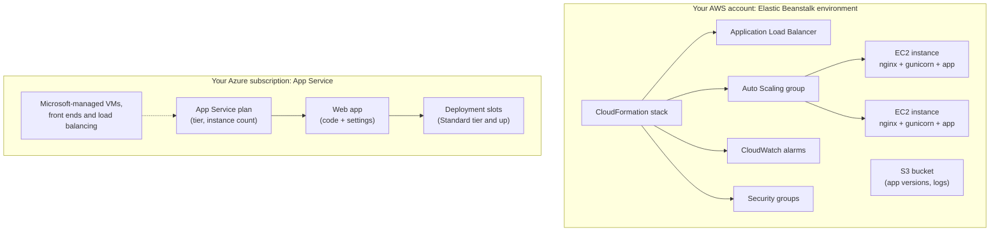
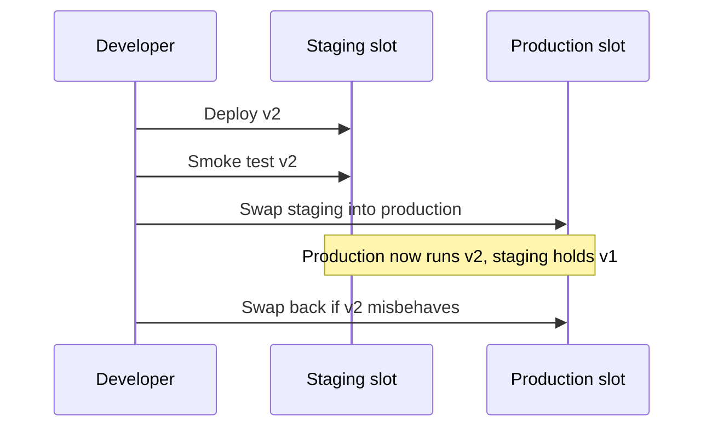

# PaaS App Hosting: Elastic Beanstalk and App Service

## Introduction

Running a web app on raw VMs means a lot of chores: install the runtime, configure a reverse proxy, set up a load balancer, wire up autoscaling, rotate logs, patch the OS, and build a deployment process. Most web apps need exactly the same chores.

**Platform as a Service (PaaS) app hosting** does those chores for you. You hand the platform your code (or a container image), tell it which language and version, and it runs the app behind a load balancer with health checks, logs and scaling built in.

- On AWS the classic option is **AWS Elastic Beanstalk**.
- On Azure it is **Azure App Service** (often called "Web Apps").

The analogy is a serviced office. You bring your laptop and your team. The building provides desks, internet, cleaning, reception and security. You can rearrange the furniture a little, but you cannot knock down walls.

The two services look similar from the outside but are built quite differently, and that difference shapes when to use each one:

- **Elastic Beanstalk is an orchestrator.** It creates ordinary AWS resources in your account (EC2 instances, an Auto Scaling group, a load balancer, security groups, CloudWatch alarms) using CloudFormation, and manages them for you. You can see and tweak every piece.
- **App Service is a managed platform.** Your app runs on VMs that Azure manages inside an **App Service plan**. You see the plan and the app, not the underlying VMs.

:::warning Cost warning
Both walkthroughs create billable resources. Elastic Beanstalk itself has no extra charge, but the EC2 instances, load balancer and storage it creates are billed normally. App Service bills for each instance in the App Service plan, by pricing tier, whether or not the app receives traffic. The Free tier exists for experiments but has limits. Run the cleanup steps at the end.
:::

## What Each Platform Creates



| Concept | Elastic Beanstalk | App Service |
|---------|-------------------|-------------|
| Top-level container | Application | Resource group, then App Service plan |
| A running deployment | Environment (for example `api-prod`) | Web app, plus optional deployment slots |
| What sets size and price | EC2 instance type and count | Plan pricing tier (Basic, Standard, Premium v3/v4, Isolated v2) and instance count |
| Supported stacks | Platform branches: Python, Node.js, Java, .NET, PHP, Ruby, Go, Docker and more | Built-in runtimes on Linux and Windows, plus custom containers |
| Load balancer | Application, Network or Classic LB, or single-instance with none | Built in, not a separate resource |
| Scaling | The Auto Scaling group with triggers you configure | Manual, rule-based autoscale, or automatic scaling (Premium tiers) |
| Zero-downtime deploys | Rolling, rolling with additional batch, immutable, traffic splitting, or blue/green via CNAME swap | Deployment slots with swap |
| Escape hatch | Full access to EC2, `.ebextensions` and `.platform` hooks | Startup command, app settings, custom containers |
| Pricing | Pay for the underlying resources | Pay per plan instance per hour by tier |

Both platforms run your app on Linux behind a reverse proxy. Both keep the OS and language runtime patched for you within a platform version, although on Elastic Beanstalk you choose when to apply platform updates (or turn on managed platform updates).

## A Shared Sample App

You will deploy the same small Flask app to both platforms. Create a folder with three files.

`application.py`:

```python
import os
import socket
from flask import Flask, jsonify

# Elastic Beanstalk looks for a callable named "application" in application.py.
# App Service's default Gunicorn command looks for "app". Expose both names.
application = Flask(__name__)
app = application

@application.get("/")
def index():
    return jsonify(
        message="Hello from PaaS",
        host=socket.gethostname(),
        environment=os.environ.get("APP_ENV", "unknown"),
    )

@application.get("/health")
def health():
    return {"status": "ok"}

if __name__ == "__main__":
    application.run(port=8000, debug=True)
```

`requirements.txt`:

```text
flask==3.1.*
gunicorn==23.*
```

Run it locally first:

```bash
python3 -m venv .venv && source .venv/bin/activate
pip install -r requirements.txt
python application.py &
curl -s http://127.0.0.1:8000/
```

Output:

```text
{"environment":"unknown","host":"my-laptop","message":"Hello from PaaS"}
```

Keep the app **stateless**: no files written to local disk that must survive, and no in-memory sessions. Both platforms add, remove and replace instances, and local state will vanish.

## Deploying to AWS Elastic Beanstalk

### Install the EB CLI

AWS recommends installing the EB CLI with its setup script, which isolates its Python dependencies:

```bash
git clone https://github.com/aws/aws-elastic-beanstalk-cli-setup.git
python ./aws-elastic-beanstalk-cli-setup/scripts/ebcli_installer.py
eb --version
```

Output:

```text
EB CLI 3.x.x (Python 3.12)
```

(`pip install awsebcli` in a virtual environment also works.) The EB CLI uses the same credentials as the AWS CLI, so `aws sso login` first.

### Initialize and create an environment

```bash
eb init -p python-3.13 helpdesk-api --region us-east-1
eb create helpdesk-dev --single --instance-types t3.small
```

- `eb init` creates the **application** and saves settings in `.elasticbeanstalk/config.yml`. The platform name `python-3.13` selects the current "Python 3.13 running on 64bit Amazon Linux 2023" platform branch. Run `eb platform list` to see what is available.
- `eb create` creates an **environment**. `--single` gives one instance with no load balancer, which is cheaper and fine for development. Omit it for a load-balanced, autoscaling environment.
- Environments need an EC2 instance profile (by default named `aws-elasticbeanstalk-ec2-role`) and a service role. If your account does not have them yet, the console's first-run experience or the docs on [managing Elastic Beanstalk instance profiles](https://docs.aws.amazon.com/elasticbeanstalk/latest/dg/iam-instanceprofile.html) explain how to create them.

Example output (trimmed):

```text
Creating application version archive "app-251011_101500".
Uploading helpdesk-api/app-251011_101500.zip to S3. This may take a while.
Environment details for: helpdesk-dev
  Application name: helpdesk-api
  Region: us-east-1
  Platform: arn:aws:elasticbeanstalk:us-east-1::platform/Python 3.13 running on 64bit Amazon Linux 2023/4.x.x
  Tier: WebServer-Standard-1.0
  CNAME: helpdesk-dev.us-east-1.elasticbeanstalk.com
...
2026-10-11 10:19:42    INFO    Successfully launched environment: helpdesk-dev
```

Test it, and set an environment variable:

```bash
eb setenv APP_ENV=dev
curl -s http://helpdesk-dev.us-east-1.elasticbeanstalk.com/
```

Output:

```text
{"environment":"dev","host":"ip-172-31-20-15.ec2.internal","message":"Hello from PaaS"}
```

### Day-to-day commands

```bash
eb deploy            # zip the current folder, upload, and roll out
eb status            # environment health, platform, CNAME
eb health            # per-instance health and request metrics
eb logs              # fetch recent logs from the instances
eb open              # open the app in a browser
```

### Customizing the platform

Elastic Beanstalk gives you several layers of control, from light to heavy:

1. **A `Procfile`** to control the start command. By default the Python platform runs Gunicorn against `application:application`, behind nginx on port 80 that forwards to port 8000.

   ```text
   web: gunicorn --bind :8000 --workers 3 --threads 2 application:application
   ```

2. **Configuration files in `.ebextensions/`** to set environment options such as instance type, scaling limits and deployment policy:

   ```yaml
   # .ebextensions/01-scaling.config
   option_settings:
     aws:autoscaling:asg:
       MinSize: 2
       MaxSize: 4
     aws:elasticbeanstalk:command:
       DeploymentPolicy: Immutable
     aws:elasticbeanstalk:application:
       Application Healthcheck URL: /health
   ```

3. **Platform hooks in `.platform/`** to run scripts at specific deployment stages, or to add nginx configuration.
4. **Direct access** to the EC2 instances, security groups and load balancer, because they are normal resources in your account. Change them through Elastic Beanstalk settings, though, not by hand, or your changes may be overwritten.

## Deploying to Azure App Service

### Create and deploy in one command

From the app folder:

```bash
az webapp up \
  --name helpdesk-api-$RANDOM \
  --resource-group rg-paas-demo \
  --location eastus \
  --runtime PYTHON:3.13 \
  --sku B1
```

`az webapp up` creates the resource group, an App Service plan and the web app if they do not exist, zips the folder, and deploys it. The build service installs `requirements.txt` during deployment. It caches the settings in `.azure/config` so later runs only need `az webapp up`.

Example output (trimmed):

```json
{
  "URL": "http://helpdesk-api-12345.azurewebsites.net",
  "appserviceplan": "user_asp_Linux_eastus_0",
  "location": "eastus",
  "name": "helpdesk-api-12345",
  "os": "Linux",
  "resourcegroup": "rg-paas-demo",
  "runtime_version": "python|3.13",
  "sku": "BASIC"
}
```

Run `az webapp list-runtimes --os linux --output table` to see current runtime strings. Microsoft's Python quickstart also shows `PYTHON:3.14`.

App Service detects Flask apps from `application.py` or `app.py` and starts Gunicorn automatically. For other frameworks, or to tune workers, set a startup command:

```bash
az webapp config set \
  --name helpdesk-api-12345 --resource-group rg-paas-demo \
  --startup-file "gunicorn --bind=0.0.0.0 --workers 3 --timeout 120 application:app"
```

### Settings, logs and scaling

```bash
APP=helpdesk-api-12345
RG=rg-paas-demo

# Environment variables (app settings)
az webapp config appsettings set --name $APP --resource-group $RG --settings APP_ENV=dev

# Stream logs
az webapp log config --name $APP --resource-group $RG --docker-container-logging filesystem
az webapp log tail --name $APP --resource-group $RG

# Scale up (bigger tier) and out (more instances)
PLAN=$(az webapp show --name $APP --resource-group $RG --query appServicePlanId --output tsv)
az appservice plan update --ids $PLAN --sku S1 --number-of-workers 2
```

Scaling is a **plan** setting, not an app setting. Every app in the same plan runs on all the plan's instances and scales together. To scale an app independently, give it its own plan.

### Deployment slots

Slots are live copies of your app with their own hostname, available on Standard tier and above. You deploy to a `staging` slot, test it, then **swap** it into production. Azure warms up the staging instances before switching traffic, and a swap back is your rollback.

```bash
az webapp deployment slot create --name $APP --resource-group $RG --slot staging
# deploy new code to the staging slot (for example with az webapp deploy --slot staging)
az webapp deployment slot swap --name $APP --resource-group $RG --slot staging --target-slot production
```



Elastic Beanstalk's closest equivalent is running two environments and using `eb swap` to exchange their CNAMEs, or using the **immutable** or **traffic splitting** deployment policies, which launch fresh instances for the new version before shifting traffic.

## Choosing Between Them

| Question | Elastic Beanstalk | App Service |
|----------|-------------------|-------------|
| How much can I customize the host? | A lot: hooks, nginx config, instance type, any EC2 feature | Limited: startup command, settings, or move to a custom container |
| How much infrastructure do I see? | All of it (and must understand some of it) | Very little |
| Cheapest way to run several small apps | One environment per app means at least one instance each | Many apps can share one plan's instances |
| Zero-downtime deploys | Immutable, traffic splitting, or blue/green with two environments | Slots and swap, very simple |
| Scale to zero | No | No (the plan bills while it exists) |
| Containers | Docker platform (single container or Docker Compose) | Custom containers on Linux |
| Momentum | Mature and stable; AWS also offers newer options for containers | Actively developed; a core Azure service with frequent new features |

On AWS, many new projects that would once have picked Elastic Beanstalk now pick ECS on Fargate instead, because teams already build containers. On Azure, App Service remains a common default for web apps, with Container Apps as the container-native alternative. See [Container Options in the Cloud](../5-cloud-containers/0-cloud-container-options.mdx).

## Real-World Scenario

Your team of four builds a customer-support portal: a Django web app with a PostgreSQL database. You need production and staging environments, HTTPS on a custom domain, zero-downtime deployments and automatic scaling for Monday-morning peaks. No one on the team wants to manage servers. Some customers require AWS hosting, and one large customer requires Azure.

### The solution

On AWS:

1. An Elastic Beanstalk application with two environments, `portal-staging` and `portal-prod`, each load-balanced and spread across at least two Availability Zones.
2. The database in Amazon RDS, not inside the Beanstalk environment, so deleting an environment never deletes data. See [Managed Relational Databases](../7-cloud-databases/1-cloud-rds-and-azure-sql.mdx).
3. `DeploymentPolicy: Immutable` for production, so a bad deploy never touches the running instances.
4. Secrets in AWS Secrets Manager, read at startup through the instance profile.

On Azure:

1. One App Service plan (Premium v3 or v4) for production, with a `staging` slot.
2. The database in Azure Database for PostgreSQL.
3. Deploy to `staging`, run smoke tests, then swap.
4. Secrets in Key Vault, referenced from app settings, read with the app's managed identity.

Both pipelines are driven from GitHub Actions with OIDC, so no long-lived keys are stored. See [Keyless CI/CD with OIDC](../2-cloud-identity/6-cloud-oidc-for-ci.mdx).

### Why this approach

- A standard Django app fits PaaS perfectly. The team gets load balancing, scaling, health checks and patched runtimes without writing infrastructure code for each.
- Keeping the database outside the PaaS environment separates the stateless, replaceable part from the stateful, precious part.
- Both platforms provide a safe deployment path (immutable deployments, slots) with little effort.

### When not to use PaaS hosting

- When you need OS-level changes the platform does not allow, such as kernel modules or unusual system packages. Use VMs or containers.
- When traffic is near zero most of the time. A plan or environment bills while it exists. Functions or scale-to-zero containers may be cheaper.
- When your organization has standardized on containers and Kubernetes, adding a separate PaaS platform adds another operating model.

### Alternatives and trade-offs

| Approach | Pros | Cons | Best for |
|----------|------|------|----------|
| Elastic Beanstalk | Simple deploys with full access to underlying AWS resources | Slower deploys (VM-based); more AWS concepts visible | Classic web apps on AWS that may need customization |
| App Service | Very simple; slots; many apps per plan | Less host control; plan bills when idle | Web apps and APIs on Azure |
| ECS on Fargate / Container Apps | Container-native; fast scaling; Container Apps scales to zero | Must build and maintain images | Teams using Docker |
| Functions | Pay per use; no idle cost | Not a fit for full web frameworks with long requests | Small APIs and event handlers |
| VMs with your own tooling | Total control | Most operational work | Special requirements only |

## Common Mistakes

1. **Putting the database inside the Elastic Beanstalk environment.** Beanstalk can create an RDS instance tied to the environment, which is deleted with the environment. Create the database separately for anything that matters.
2. **Writing files to local disk.** Instances are replaced during scaling and deployments. Use object storage for uploads and a cache for sessions.
3. **Packing too many busy apps into one App Service plan.** They share CPU and memory and scale together. A noisy app slows the others.
4. **Leaving idle environments running.** A forgotten Beanstalk environment or App Service plan bills every hour. Tag them and review regularly.
5. **Editing Beanstalk-managed resources by hand.** Manual changes to its load balancer or Auto Scaling group can be overwritten. Use `.ebextensions` or environment settings.
6. **Skipping health check paths.** Point the platform at a `/health` endpoint that checks the app, so broken instances are detected and replaced.
7. **Not pinning the platform or runtime version.** Upgrade deliberately and test in staging first.

## Cleanup

### On AWS

```bash
eb terminate helpdesk-dev
```

This deletes the environment's EC2 instances, load balancer, security groups and alarms. The S3 bucket that stores application versions is shared and is not deleted. Remove old application versions or the bucket's contents if you no longer need them.

### On Azure

```bash
az group delete --name rg-paas-demo --yes --no-wait
```

## Summary

- **Elastic Beanstalk** and **App Service** let you deploy code without managing servers directly. Both give you load balancing, health checks, scaling and patched runtimes.
- Elastic Beanstalk **orchestrates normal AWS resources** in your account and is very customizable. App Service runs apps in a **managed App Service plan** and hides the VMs.
- Billing differs: Elastic Beanstalk has no extra charge, but you pay for its EC2 instances and load balancer. App Service bills per plan instance by tier, and many apps can share a plan.
- Use immutable or traffic-splitting deployments on Beanstalk, and deployment slots on App Service, for zero-downtime releases.
- Keep apps stateless and keep databases outside the PaaS environment.

## Exercises

1. **Deploy to both.** Deploy the sample app to both platforms, then change the `message` text and redeploy. Time how long each deployment takes.
2. **Zero-downtime check.** While a deployment runs, run `while true; do curl -s -o /dev/null -w "%{http_code}\n" $URL; sleep 0.5; done`. Compare `AllAtOnce` vs `Immutable` on Beanstalk, and a direct deploy vs a slot swap on App Service.
3. **Scale rules.** Configure Beanstalk to scale on `NetworkOut` or CPU between 2 and 4 instances, and configure App Service autoscale on the plan for the same range. Which was easier, and which gives you more control?
4. **Plan sharing.** Deploy a second small app into the same App Service plan. What happens to each app's performance under load on the first one?

Next: [Machine Images and Bootstrapping](./6-cloud-images-and-bootstrapping.mdx). Related: [Choosing a Compute Option](./0-cloud-compute-options.mdx), [Deployment Strategies in the Cloud](../11-cloud-devops/2-cloud-deployment-strategies.mdx) and [Secrets Management: Secrets Manager and Key Vault](../11-cloud-devops/4-cloud-secrets-management.mdx).
