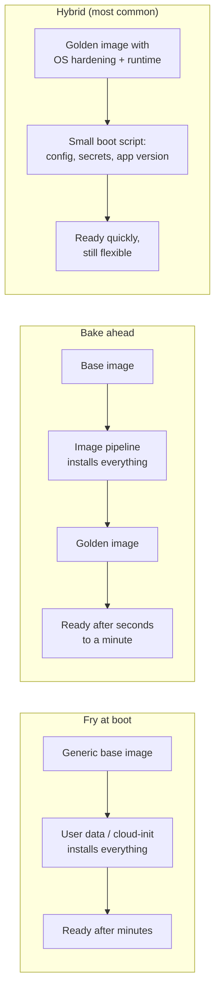
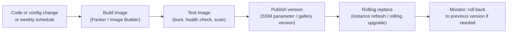

# Machine Images and Bootstrapping

## Introduction

Every VM starts from a **machine image**: a template of the operating system disk, plus any software already installed on it. On AWS this is an **Amazon Machine Image (AMI)**. On Azure it is an **image**, which can come from the Azure Marketplace, a managed image, or an image version in an **Azure Compute Gallery** (formerly Shared Image Gallery).

The image is only the starting point. After boot, your VM usually needs more: packages, configuration files, your application, and secrets. Getting a fresh VM from "blank OS" to "serving traffic" is called **bootstrapping**, and there are two broad ways to do it:

- **Fry at boot**: start from a generic image and install everything when the VM first boots, using a script.
- **Bake ahead**: build a custom image that already contains everything, so the VM is ready almost immediately after boot.

Think of a restaurant. Frying to order means every dish is fresh and fully customizable, but customers wait. Prepping ingredients in the morning (baking) means dishes come out fast, but you have to plan ahead and re-prep when the menu changes. Most kitchens do both: prep the slow parts ahead, finish the fast parts to order.

This page shows both approaches on AWS and Azure, and when to use each one. It builds on [Virtual Machines: EC2 and Azure VMs](./1-cloud-virtual-machines.mdx), where you already used a small cloud-init file.

:::warning Cost warning
Image builds launch temporary VMs, and stored images keep billing for their disk snapshots (AWS) or image storage and replicas (Azure). EC2 Image Builder and Azure VM Image Builder do not charge for the service itself, but you pay for the build VMs, storage, logs and any cross-region replication. Delete images you no longer need, using the cleanup steps at the end.
:::

## Fry, Bake, or Both



| Approach | Boot time | Flexibility | Consistency | Risk at boot |
|----------|-----------|-------------|-------------|--------------|
| Fry at boot | Slow (package installs) | High: change a script, done | Lower: package repos change between boots | Repos or downloads may be unavailable |
| Bake ahead | Fast | Lower: rebuild the image for every change | High: every VM is identical | Low |
| Hybrid | Fast | Good | High for the base, flexible for config | Low |

For autoscaling fleets, boot time matters a lot. If a new VM takes 8 minutes to become healthy, your fleet cannot react to a spike in less than 8 minutes. That is the main reason teams bake images. See [Auto Scaling Groups and Scale Sets](./3-cloud-autoscaling.mdx).

## Bootstrapping at Boot: User Data and Custom Data

Both clouds let you pass a script or configuration to a VM at creation time.

| | AWS | Azure |
|---|-----|-------|
| Name | User data | Custom data (also a separate "user data" feature) |
| CLI flag | `--user-data` on `run-instances`; base64 `UserData` in launch templates | `--custom-data` on `az vm create` and `az vmss create` |
| Processed by | cloud-init on Linux (EC2Launch on Windows) | cloud-init on most Linux images; Azure Linux Agent otherwise |
| Size limit | 16 KB (before base64 encoding) | 64 KB (base64-encoded) |
| Runs | Once, on first boot, by default | Once, on first boot |
| Logs | `/var/log/cloud-init-output.log` | `/var/log/cloud-init.log` and `/var/log/cloud-init-output.log` |

Two formats are common:

- A **shell script** starting with `#!/bin/bash`. Simple, but you write everything yourself.
- A **`#cloud-config`** YAML document. Declarative, portable across distributions (cloud-init uses the right package manager), and supported on both clouds.

:::caution Never put secrets in user data
User data and custom data can be read by anyone who can view the instance configuration, and on AWS by any process on the instance through the metadata service. Fetch secrets at boot from AWS Secrets Manager or Azure Key Vault, using the instance profile or managed identity. See [Secrets Management](../11-cloud-devops/4-cloud-secrets-management.mdx).
:::

### A realistic cloud-init file

This file prepares a VM for a Python web app. It creates a user, installs packages, writes a systemd unit and starts the app. It uses only cloud-init features that work on both clouds.

```yaml
#cloud-config
package_update: true
packages:
  - python3
  - python3-pip
  - git

users:
  - default
  - name: appuser
    system: true
    shell: /usr/sbin/nologin

write_files:
  - path: /etc/systemd/system/webapp.service
    permissions: "0644"
    content: |
      [Unit]
      Description=Demo web app
      After=network-online.target

      [Service]
      User=appuser
      WorkingDirectory=/opt/webapp
      ExecStart=/opt/webapp/.venv/bin/gunicorn --bind 0.0.0.0:8000 application:app
      Restart=always

      [Install]
      WantedBy=multi-user.target

runcmd:
  - mkdir -p /opt/webapp
  - git clone --depth 1 https://github.com/your-org/webapp.git /opt/webapp
  - python3 -m venv /opt/webapp/.venv
  - /opt/webapp/.venv/bin/pip install -r /opt/webapp/requirements.txt
  - chown -R appuser /opt/webapp
  - systemctl daemon-reload
  - systemctl enable --now webapp
```

You can validate the file before launching anything. If cloud-init is installed locally (it is on most Ubuntu machines), run its schema check:

```bash
cloud-init schema --config-file webapp-init.yaml
```

Output:

```text
Valid schema webapp-init.yaml
```

Passing it to a VM uses the same flags you saw earlier:

```bash
# AWS
aws ec2 run-instances --image-id resolve:ssm:/aws/service/ami-amazon-linux-latest/al2023-ami-kernel-default-x86_64 \
  --instance-type t3.small --user-data file://webapp-init.yaml \
  --metadata-options "HttpTokens=required" --security-group-ids "$SG_ID"

# Azure
az vm create --resource-group rg-images-demo --name web-1 --image Ubuntu2204 \
  --size Standard_B2s --custom-data webapp-init.yaml --generate-ssh-keys --nsg-rule NONE
```

### Debugging a boot script

When a boot script fails, the VM often still reports "running". Always check:

```bash
# On the VM (both clouds)
cloud-init status --long
sudo tail -n 50 /var/log/cloud-init-output.log
```

Example output:

```text
status: error
extended_status: error - done
boot_status_code: enabled-by-generator
detail: DataSourceEc2Local
errors:
	- ('scripts_user', RuntimeError('Runparts: 1 failures (part-001) in /var/lib/cloud/instance/scripts'))
```

From your machine, AWS can show the serial console output with `aws ec2 get-console-output --instance-id i-0abc... --latest --output text`, and Azure can show boot diagnostics with `az vm boot-diagnostics get-boot-log --resource-group rg-images-demo --name web-1`.

## Finding Base Images

Do not hard-code image IDs. They differ by Region and are replaced with every patch release.

### On AWS

AWS publishes the latest Amazon Linux AMI IDs as public Systems Manager parameters. Launch templates and `run-instances` can resolve them directly with `resolve:ssm:`, and you can read them yourself:

```bash
aws ssm get-parameter \
  --name /aws/service/ami-amazon-linux-latest/al2023-ami-kernel-default-arm64 \
  --query "Parameter.Value" --output text

# Find the latest Ubuntu 24.04 AMI from Canonical's official account
aws ec2 describe-images --owners 099720109477 \
  --filters "Name=name,Values=ubuntu/images/hvm-ssd-gp3/ubuntu-noble-24.04-amd64-server-*" \
  --query "sort_by(Images, &CreationDate)[-1].{Id:ImageId,Name:Name}" --output table
```

Example output:

```text
ami-0123456789abcdef0
----------------------------------------------------------------------------------
|                                 DescribeImages                                 |
+------------------------+-------------------------------------------------------+
|           Id           |                         Name                          |
+------------------------+-------------------------------------------------------+
|  ami-0fedcba9876543210 |  ubuntu/images/hvm-ssd-gp3/ubuntu-noble-24.04-amd64-server-20260920 |
+------------------------+-------------------------------------------------------+
```

Always filter by **owner**. Anyone can publish a public AMI with a convincing name, and malicious look-alike images do exist. `099720109477` is Canonical's well-known account ID, and `amazon` is a valid owner alias for Amazon's own images.

### On Azure

Marketplace images are identified by a URN: `publisher:offer:sku:version`. The CLI also knows short aliases such as `Ubuntu2204`.

```bash
# Aliases known to your CLI version (offline list)
az vm image list --output table

# Live search for Ubuntu 24.04 images from Canonical
az vm image list --publisher Canonical --offer ubuntu-24_04-lts --all \
  --query "[?sku=='server'].urn | [-1]" --output tsv
```

Example output:

```text
Architecture    Offer                         Publisher               Sku                                 Urn                                                                             UrnAlias            Version
--------------  ----------------------------  ----------------------  ----------------------------------  ------------------------------------------------------------------------------  ------------------  ---------
x64             0001-com-ubuntu-server-jammy  Canonical               22_04-lts-gen2                      Canonical:0001-com-ubuntu-server-jammy:22_04-lts-gen2:latest                    Ubuntu2204          latest
...
Canonical:ubuntu-24_04-lts:server:24.04.202609180
```

Using `latest` as the version in a URN always gets the newest patch. For production fleets, pin a specific version (or a gallery image version) so every VM in a fleet is identical, and update deliberately.

## Baking Images

### The manual way (for understanding)

The simplest way to make a custom image is to configure a VM and capture it. Do this once to understand the process, then automate it.

On AWS:

```bash
aws ec2 create-image --instance-id "$INSTANCE_ID" \
  --name "webapp-$(date +%Y%m%d-%H%M)" --description "Web app golden image" \
  --tag-specifications 'ResourceType=image,Tags=[{Key=project,Value=images-demo}]' \
  --query ImageId --output text
```

Output:

```text
ami-0aa11bb22cc33dd44
```

By default `create-image` reboots the instance to get a consistent file system. The AMI is backed by EBS snapshots, which are billed for storage.

On Azure, a **generalized** image removes machine-specific data (host keys, the admin user if you choose, machine IDs) so each VM created from it starts fresh:

```bash
# 1. Inside the VM: deprovision (removes the admin user too with +user)
sudo waagent -deprovision+user -force

# 2. From your machine: deallocate, mark generalized, and capture into a gallery
az vm deallocate --resource-group rg-images-demo --name web-1
az vm generalize --resource-group rg-images-demo --name web-1

az sig create --resource-group rg-images-demo --gallery-name webGallery
az sig image-definition create --resource-group rg-images-demo --gallery-name webGallery \
  --gallery-image-definition webapp --publisher Contoso --offer WebApp --sku ubuntu2204 \
  --os-type Linux --os-state Generalized --hyper-v-generation V2

VM_ID=$(az vm show --resource-group rg-images-demo --name web-1 --query id --output tsv)
az sig image-version create --resource-group rg-images-demo --gallery-name webGallery \
  --gallery-image-definition webapp --gallery-image-version 1.0.0 \
  --virtual-machine "$VM_ID" --target-regions eastus westus3
```

A generalized VM cannot be started again. Azure Compute Gallery has three levels: the **gallery**, an **image definition** (the "product", identified by publisher, offer and SKU), and **image versions** in `Major.Minor.Patch` format. Versions can be replicated to multiple regions. There is no charge for the gallery itself, only for image storage and replication egress.

### The automated way: image pipelines

Manual capture does not scale. You want a pipeline that rebuilds images on a schedule (to pick up OS patches) and whenever your configuration changes, tests them, and publishes them with a version.

| Capability | EC2 Image Builder | Azure VM Image Builder | HashiCorp Packer |
|------------|-------------------|------------------------|------------------|
| Type | Managed AWS service | Managed Azure service (built on Packer) | Open-source tool you run |
| Clouds | AWS (AMIs and container images) | Azure (gallery, managed image, VHD) | AWS, Azure and many more |
| Defined in | Recipes and components (YAML documents) | Image template resource (JSON, Bicep) | HCL templates |
| Testing | Built-in test phase and test components | Validation customizers | Your own provisioners and tests |
| Scheduling | Built-in pipeline schedules | Trigger runs from a pipeline or automation | Your CI/CD system |
| Distribution | Multiple Regions and accounts | Compute Gallery with multi-region replication | Per builder settings |
| Service cost | None for the service; pay for resources used | Pay for build VM, storage and networking | Free tool; pay for build resources |

If you only use one cloud, the managed service on that cloud is a good default. If you build images for both clouds, **Packer** lets you describe both in one template.

### One Packer template, two clouds

This template builds the same golden image on AWS and Azure. Shared provisioning steps run on both builds.

```hcl
packer {
  required_plugins {
    amazon = {
      source  = "github.com/hashicorp/amazon"
      version = ">= 1.3.0"
    }
    azure = {
      source  = "github.com/hashicorp/azure"
      version = ">= 2.1.0"
    }
  }
}

variable "version" {
  type    = string
  default = "1.0.0"
}

source "amazon-ebs" "webapp" {
  region        = "us-east-1"
  instance_type = "t3.small"
  ssh_username  = "ubuntu"
  ami_name      = "webapp-${var.version}-{{timestamp}}"

  source_ami_filter {
    filters = {
      name                = "ubuntu/images/hvm-ssd-gp3/ubuntu-noble-24.04-amd64-server-*"
      virtualization-type = "hvm"
    }
    owners      = ["099720109477"]
    most_recent = true
  }

  tags = {
    project = "images-demo"
    version = var.version
  }
}

source "azure-arm" "webapp" {
  use_azure_cli_auth = true
  location           = "eastus"
  vm_size            = "Standard_B2s"
  os_type            = "Linux"

  image_publisher = "Canonical"
  image_offer     = "ubuntu-24_04-lts"
  image_sku       = "server"

  shared_image_gallery_destination {
    resource_group       = "rg-images-demo"
    gallery_name         = "webGallery"
    image_name           = "webapp"
    image_version        = var.version
    replication_regions  = ["eastus"]
  }

  azure_tags = {
    project = "images-demo"
  }
}

build {
  sources = ["source.amazon-ebs.webapp", "source.azure-arm.webapp"]

  provisioner "shell" {
    inline = [
      "sudo apt-get update",
      "sudo DEBIAN_FRONTEND=noninteractive apt-get -y upgrade",
      "sudo DEBIAN_FRONTEND=noninteractive apt-get -y install python3-venv nginx",
      "sudo systemctl enable nginx"
    ]
  }

  provisioner "shell" {
    only   = ["azure-arm.webapp"]
    inline = ["sudo /usr/sbin/waagent -force -deprovision+user && export HISTSIZE=0 && sync"]
  }
}
```

Run it:

```bash
packer init webapp.pkr.hcl
packer validate webapp.pkr.hcl
packer build -var "version=1.0.1" webapp.pkr.hcl
```

Example output (trimmed):

```text
The configuration is valid.
amazon-ebs.webapp: output will be in this color.
azure-arm.webapp: output will be in this color.
...
==> Builds finished. The artifacts of successful builds are:
--> amazon-ebs.webapp: AMIs were created:
us-east-1: ami-0bb22cc33dd44ee55
--> azure-arm.webapp: Azure.ResourceManagement.VMImage:
ManagedImageSharedImageGalleryId: /subscriptions/.../galleries/webGallery/images/webapp/versions/1.0.1
```

Notes:

- `use_azure_cli_auth = true` reuses your `az login` session. On AWS, Packer uses the standard credential chain, so `aws sso login` works. In CI, use OIDC federation on both clouds instead of stored keys.
- The Azure image definition `webapp` must already exist in the gallery, with settings that match the build (Linux, generalized, Hyper-V generation).
- The final Azure step generalizes the VM with `waagent`, as Microsoft's Packer guidance recommends.
- Plugin versions change. Run `packer init -upgrade` and check the [Packer integrations](https://developer.hashicorp.com/packer/integrations) docs for current options.

### Using a baked image in a fleet

On AWS, publish the new AMI ID somewhere your infrastructure can read it, commonly an SSM parameter you own, and reference it from the launch template:

```bash
aws ssm put-parameter --name /images/webapp/latest --type String \
  --data-type "aws:ec2:image" --value ami-0bb22cc33dd44ee55 --overwrite
```

Launch templates can then use `resolve:ssm:/images/webapp/latest`. Start an instance refresh to roll it out.

On Azure, point the scale set model at a gallery image version, for example `.../galleries/webGallery/images/webapp/versions/1.0.1` (or `.../images/webapp` for the latest version), and roll it out with the scale set's upgrade policy.



## Real-World Scenario

Your team runs a fleet of 10 to 60 VMs that serve a Java API, on both AWS and Azure. Today each VM installs Java, an observability agent, security tools and the application at boot from a 300-line shell script. New VMs take about 9 minutes to become healthy. Twice last quarter, a package mirror was slow during a traffic spike and new VMs failed to boot at all, exactly when they were needed.

### The solution

Move to the hybrid model:

1. **Golden image, rebuilt weekly and on change.** A Packer template (or EC2 Image Builder and Azure VM Image Builder) installs OS updates, Java, the observability agent and security hardening. Each build gets a version number.
2. **Automated tests on every image.** Boot a test VM, check that services start and that a vulnerability scan passes, then publish.
3. **Small cloud-init at boot.** It only writes environment-specific configuration, fetches secrets from Secrets Manager or Key Vault using the VM's identity, downloads the application artifact for the requested version, and starts the service.
4. **Versioned rollouts.** Fleets reference an image version. Rollouts use instance refresh (AWS) or rolling upgrades (Azure). Rollback means pointing back at the previous version.

Result: new VMs become healthy in around 1 to 2 minutes instead of 9 (your numbers will depend on the app), and boots no longer depend on external package mirrors.

### Why this approach

- Baking moves slow, failure-prone steps out of the critical path of a scale-out event.
- Keeping the app version and configuration outside the image means you do not need a new image for every app release or every environment.
- Versioned images make every VM in a fleet identical and make rollbacks fast.

### When to use it, and when not to

- **Use golden images** for autoscaling fleets, regulated environments that require hardened and scanned images, and anything where boot time matters.
- **Do not bother** for a single long-lived VM, or for early experiments where the setup changes daily. A boot script is simpler there.
- **Consider containers** if your main goal is consistent app packaging. A container image gives the same "bake once, run anywhere" benefit at the application level and starts faster than a VM. See the [Docker tutorial](/docs/devops/docker).

### Alternatives and trade-offs

| Approach | Pros | Cons | Best for |
|----------|------|------|----------|
| Boot scripts only (user data / cloud-init) | Simple; easy to change | Slow boots; depends on external repos at boot | Dev, single VMs, low scale |
| Golden image, everything baked | Fastest boot; most consistent | Rebuild for every change; image sprawl | Immutable infrastructure with frequent rebuilds |
| Hybrid: baked base + boot config | Fast and flexible | Two mechanisms to maintain | Most production fleets |
| Configuration management (Ansible and similar) after boot | Powerful; can also fix drift on running VMs | Extra tooling; still slow at boot | Long-lived servers |
| Containers on a container platform | Fast start; portable app packaging | Different platform and skills | New and modernized applications |

## Common Mistakes

1. **Hard-coding image IDs.** Use SSM parameters, owner-filtered lookups, or gallery image versions.
2. **Trusting public images by name.** Filter by owner or publisher. Look-alike images can contain malware.
3. **Baking secrets into images.** Anyone who can launch the image can read them. Fetch secrets at boot using the VM's identity.
4. **Never rebuilding images.** An image built six months ago is six months behind on patches. Rebuild on a schedule.
5. **Forgetting to generalize on Azure.** Capturing a non-generalized VM as a generalized image leads to failed or duplicate provisioning. Use `waagent -deprovision` and `az vm generalize`, or let Image Builder handle it.
6. **Image sprawl.** Hundreds of old AMIs and gallery versions cost storage money. Use EC2 Image Builder lifecycle policies, Amazon Data Lifecycle Manager, or an end-of-life date and cleanup job for gallery versions.
7. **Ignoring boot script failures.** cloud-init errors do not stop the VM from reporting "running". Use load balancer health checks so broken instances are replaced, and alert on cloud-init errors.

## Cleanup

### On AWS

```bash
# Find the snapshots behind the AMI, then deregister the AMI and delete them
SNAPS=$(aws ec2 describe-images --image-ids ami-0aa11bb22cc33dd44 \
  --query "Images[0].BlockDeviceMappings[].Ebs.SnapshotId" --output text)
aws ec2 deregister-image --image-id ami-0aa11bb22cc33dd44
for s in $SNAPS; do aws ec2 delete-snapshot --snapshot-id "$s"; done

aws ec2 terminate-instances --instance-ids "$INSTANCE_ID"
```

Deregistering an AMI does not delete its snapshots automatically, so delete them explicitly.

### On Azure

```bash
az group delete --name rg-images-demo --yes --no-wait
```

This removes the gallery, image definitions, image versions and VMs in the resource group. Delete any images replicated into other resource groups separately.

## Summary

- A **machine image** (AMI or Azure image) is the starting disk for a VM. **Bootstrapping** gets it from base OS to ready-to-serve.
- **User data** (AWS) and **custom data** (Azure) pass a script or `#cloud-config` to cloud-init on first boot. The same cloud-config file works on both clouds. Never put secrets in it.
- **Baking** golden images makes boots fast and consistent. Build them with EC2 Image Builder, Azure VM Image Builder (built on Packer), or Packer directly for both clouds.
- Publish images with versions (an SSM parameter on AWS, Azure Compute Gallery image versions on Azure) and roll them out with instance refresh or rolling upgrades.
- The common production pattern is **hybrid**: bake the slow, stable parts, and configure environment-specific details at boot.

## Exercises

1. **Validate and launch.** Write a cloud-config that installs nginx and writes a custom page, validate it with `cloud-init schema`, and launch it on both clouds. Break it on purpose (for example, a typo in a package name) and find the error in the logs.
2. **Measure the difference.** Launch one VM that installs nginx and Python at boot, and one from an image that already has them. Measure time from launch to a successful `curl`.
3. **Build with Packer.** Build the Packer template for one cloud. Then change the version variable and build again. List your image versions with `aws ec2 describe-images --owners self` or `az sig image-version list`.
4. **Plan a cleanup policy.** Write a script that lists your AMIs or gallery image versions older than 90 days and not used by any launch template or scale set. Print them first, and only delete after review.

Related pages: [Auto Scaling Groups and Scale Sets](./3-cloud-autoscaling.mdx), [Workload Identity: Instance Roles and Managed Identities](../2-cloud-identity/4-cloud-workload-identity.mdx), [Infrastructure as Code in the Cloud](../10-cloud-infrastructure-as-code/0-cloud-iac-introduction.mdx), and the [Terraform tutorial](/docs/devops/terraform). Next section: [Serverless Introduction](../4-cloud-serverless/0-cloud-serverless-introduction.mdx).
