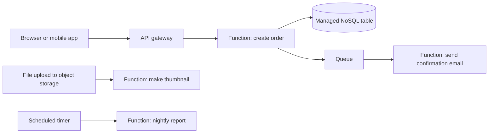
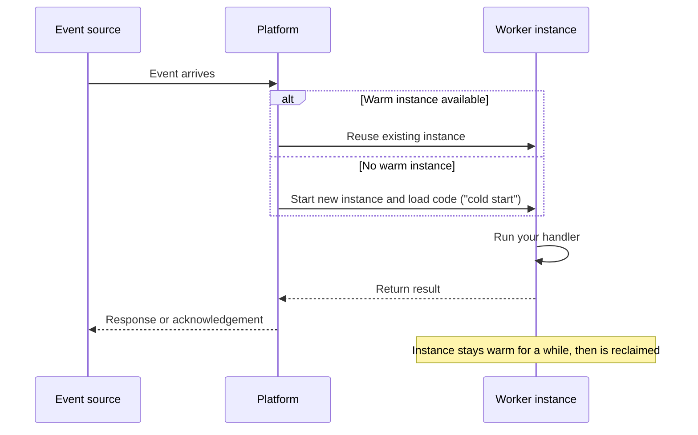
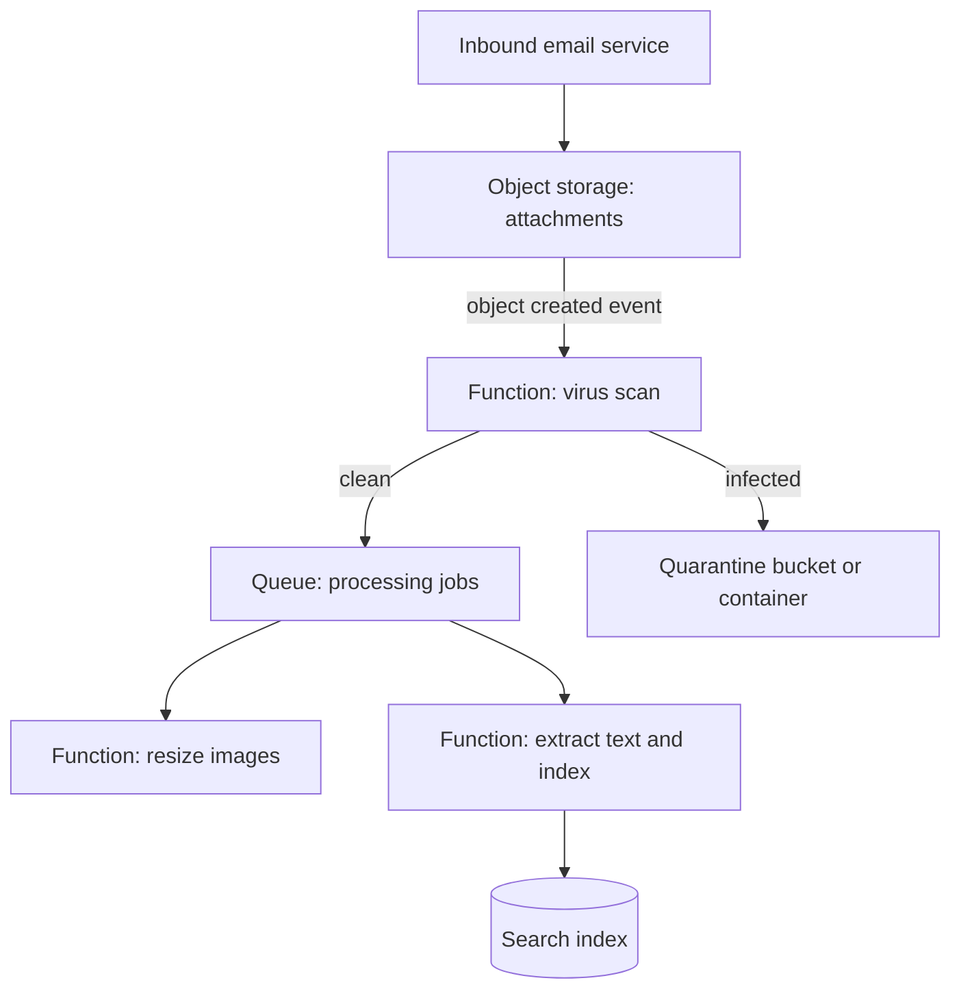

# Serverless Introduction

## Introduction

"Serverless" does not mean there are no servers. It means **you never see, size, patch or pay for idle servers**. You hand the cloud provider a piece of code (or a container) and a rule that says when to run it, and the provider does everything else: it starts machines, scales them out when traffic spikes, scales them back to zero when nobody is calling, and bills you only for the work that actually happened.

A useful analogy is a taxi compared with owning a car. When you own a car (a virtual machine), you pay for it every month whether you drive or not, and you handle the oil changes. A taxi (a serverless function) shows up when you call it, you pay per trip, and someone else worries about the engine. Taxis are wonderful for occasional trips and terrible value if you drive eight hours a day, every day. That trade-off is the heart of this whole section.

In this section you will learn:

- What makes a service "serverless" and which AWS and Azure services fit that label
- How **AWS Lambda** and **Azure Functions** work, and how they differ
- How events trigger functions, and how API gateways, workflows and cold starts affect your design
- When serverless saves money and effort, and when it quietly costs more

This page gives you the mental model. The following pages go deep on each piece.

## What Makes Something "Serverless"

Most definitions agree on four properties:

| Property | What it means for you |
| --- | --- |
| No server management | No operating system patching, no capacity planning, no SSH |
| Event-driven execution | Code runs in response to an event: an HTTP request, a file upload, a queue message, a timer |
| Automatic scaling, including to zero | The platform adds instances under load and removes them when idle |
| Pay for use | You are billed per request and per unit of compute time, not per hour of uptime |

Serverless is a spectrum, not a single product. Functions-as-a-Service (FaaS) like Lambda and Azure Functions are the best-known example, but many other services share the same properties:

| Category | AWS | Azure |
| --- | --- | --- |
| Functions (FaaS) | AWS Lambda | Azure Functions (Flex Consumption plan) |
| Serverless containers | AWS Fargate (with ECS), App Runner | Azure Container Apps |
| API front door | Amazon API Gateway | Azure API Management (Consumption and v2 tiers) |
| Workflow orchestration | AWS Step Functions, Lambda durable functions | Durable Functions, Azure Logic Apps |
| Object storage | Amazon S3 | Azure Blob Storage |
| NoSQL database | Amazon DynamoDB (on-demand) | Azure Cosmos DB (serverless) |
| Queues and events | Amazon SQS, SNS, EventBridge | Azure Service Bus, Event Grid, Storage Queues |

:::note
Service names and plan names change. In particular, Azure now recommends the **Flex Consumption** plan for new serverless function apps and calls the original Consumption plan "legacy". Linux apps on the original Consumption plan are scheduled for retirement. Always check the current [Azure Functions hosting options](https://learn.microsoft.com/en-us/azure/azure-functions/functions-scale) and the [Lambda documentation](https://docs.aws.amazon.com/lambda/latest/dg/welcome.html) before you start a new project.
:::

## How a Serverless Application Fits Together

A typical serverless application is a set of small, managed building blocks connected by events. Your code lives in functions; state lives in managed storage; the platform glues them together.



Notice three things about this picture:

1. **Each function does one job.** It is triggered by one kind of event and finishes quickly.
2. **Functions are stateless.** Anything that must survive between calls goes into a database, a queue or object storage.
3. **Functions talk through events, not direct calls.** The "create order" function drops a message on a queue rather than calling the email function. If email is slow or broken, orders still succeed.

### The request lifecycle

What happens when an event arrives? Both AWS and Azure follow the same broad pattern:



The extra startup work on a fresh instance is called a **cold start**. It is usually small, but it matters for latency-sensitive APIs. The [Cold Starts and Performance](./6-cloud-cold-starts.mdx) page covers it in detail.

## Your First Function on Each Cloud

The best way to understand the model is to look at the smallest possible function on each platform. The full deployment walkthroughs are on the [AWS Lambda](./1-cloud-aws-lambda.mdx) and [Azure Functions](./2-cloud-azure-functions.mdx) pages; here we focus on the *shape* of the code.

### On AWS

A Lambda function is a handler that receives an `event` (a dictionary describing what happened) and a `context` (metadata about the invocation).

```python
# lambda_function.py
import json

def lambda_handler(event, context):
    name = (event.get("queryStringParameters") or {}).get("name", "world")
    return {
        "statusCode": 200,
        "headers": {"Content-Type": "application/json"},
        "body": json.dumps({"message": f"Hello, {name}!"}),
    }

if __name__ == "__main__":
    # Local smoke test: simulate an API Gateway HTTP event
    fake_event = {"queryStringParameters": {"name": "Ada"}}
    print(lambda_handler(fake_event, None))
```

Run it locally:

```bash
python3 lambda_function.py
```

Output:

```text
{'statusCode': 200, 'headers': {'Content-Type': 'application/json'}, 'body': '{"message": "Hello, Ada!"}'}
```

The trigger (API Gateway, S3, SQS and so on) is configured *outside* the code. The same handler can be wired to different event sources, as long as it understands the event shape.

### On Azure

Azure Functions with the Python v2 programming model declares the trigger *in the code* with decorators. A `FunctionApp` object holds all functions in the app.

```python
# function_app.py
import json
import azure.functions as func

app = func.FunctionApp(http_auth_level=func.AuthLevel.ANONYMOUS)

@app.route(route="hello", methods=["GET"])
def hello(req: func.HttpRequest) -> func.HttpResponse:
    name = req.params.get("name", "world")
    return func.HttpResponse(
        json.dumps({"message": f"Hello, {name}!"}),
        mimetype="application/json",
        status_code=200,
    )
```

```text
# requirements.txt
azure-functions
```

Run it locally with Azure Functions Core Tools:

```bash
func start
curl "http://localhost:7071/api/hello?name=Ada"
```

Example output:

```text
Functions:
        hello: [GET] http://localhost:7071/api/hello

{"message": "Hello, Ada!"}
```

### The key difference in style

| Aspect | AWS Lambda | Azure Functions |
| --- | --- | --- |
| Unit of deployment | One function (or one container image) | A **function app** containing many functions |
| Where triggers are defined | Outside the code: event source mappings, permissions, API routes | In the code with decorators (Python v2) or attributes (.NET) |
| Talking to other services | You call SDKs such as `boto3` yourself | **Bindings** can read and write data declaratively, or you call SDKs |
| Scaling unit | Each function scales independently | Flex Consumption scales per function group; other plans scale the whole app |

Neither style is "better". Lambda's model keeps each function tiny and isolated. Azure's function app model makes it easy to group related endpoints and share code and configuration.

## How Serverless Is Billed

Prices vary by region and change over time, so this tutorial never quotes numbers. Use the [AWS Pricing Calculator](https://calculator.aws/) and the [Azure Pricing Calculator](https://azure.microsoft.com/pricing/calculator/) for real estimates. What you should understand is **how** you are billed:

| Billing dimension | AWS Lambda | Azure Functions (Flex Consumption) |
| --- | --- | --- |
| Per request | Charge per million requests | Charge per execution |
| Compute time | GB-seconds: configured memory multiplied by duration | Memory of active instances multiplied by execution time |
| Pre-warmed capacity | Provisioned concurrency is billed while configured | Always ready instances are billed while configured |
| Free grant | A monthly free tier exists; check the current terms | A monthly free grant exists; check the current terms |
| Hidden extras | CloudWatch Logs, data transfer out, API Gateway, NAT gateway | Storage account, Application Insights, data transfer out, API Management |

:::caution
The function itself is rarely the biggest line on a serverless bill. Logging volume, API gateway requests, data egress and especially **NAT gateways** for functions inside a private network often cost more than the compute. The [Serverless Trade-offs and Costs](./7-cloud-serverless-trade-offs.mdx) page shows how to estimate the full picture.
:::

A quick mental model you can compute yourself:

```python
# serverless_cost_model.py
# Illustrative only: plug in real unit prices from the official calculators.
def monthly_compute_units(requests_per_month: int, avg_ms: float, memory_mb: int) -> dict:
    gb_seconds = requests_per_month * (avg_ms / 1000) * (memory_mb / 1024)
    return {"requests": requests_per_month, "gb_seconds": round(gb_seconds, 1)}

for label, reqs in [("side project", 50_000), ("busy API", 50_000_000)]:
    print(label, monthly_compute_units(reqs, avg_ms=120, memory_mb=512))
```

Output:

```text
side project {'requests': 50000, 'gb_seconds': 3000.0}
busy API {'requests': 50000000, 'gb_seconds': 3000000.0}
```

Multiply those units by the current unit prices from the calculator. You will see that small workloads often fit inside the free grant, while sustained heavy traffic can make an always-on container or VM cheaper.

## Strengths and Limits at a Glance

| Strength | Why it matters |
| --- | --- |
| No idle cost | Development, staging and low-traffic tools cost almost nothing |
| Fast scale-out | Traffic spikes are absorbed without capacity planning |
| Less operations work | No OS patching, no cluster upgrades |
| Built-in integrations | Storage, queue and database events trigger code with little glue |

| Limit | AWS Lambda | Azure Functions |
| --- | --- | --- |
| Maximum run time per invocation | 15 minutes | Default 30 minutes on Flex Consumption, configurable; HTTP responses must return within about 230 seconds |
| Memory | 128 MB to 10,240 MB | Flex Consumption instance sizes of 512 MB, 2,048 MB or 4,096 MB |
| Statelessness | Instances are recycled; no durable local state | Same |
| Cold starts | Occur on new instances; mitigations available | Occur on new instances; mitigations available |

These limits come from the official quota pages ([Lambda quotas](https://docs.aws.amazon.com/lambda/latest/dg/gettingstarted-limits.html), [Azure Functions service limits](https://learn.microsoft.com/en-us/azure/azure-functions/functions-scale#service-limits)) and may change.

## Common Serverless Patterns

Most serverless systems are combinations of a handful of patterns. You will see each of them again later in this tutorial:

| Pattern | How it works | AWS example | Azure example |
| --- | --- | --- | --- |
| HTTP API | Gateway routes requests to functions | API Gateway + Lambda | API Management + Azure Functions |
| File processing | Storage event triggers a function | S3 notification to Lambda | Event Grid blob trigger |
| Queue worker | Function consumes messages in the background | SQS + Lambda | Service Bus + Azure Functions |
| Scheduled job | Timer runs a function on a cron schedule | EventBridge Scheduler + Lambda | Timer trigger |
| Fan-out | One event notifies many independent consumers | SNS or EventBridge | Event Grid |
| Orchestrated workflow | A workflow engine coordinates many steps | Step Functions | Durable Functions |
| Stream processing | Function reads ordered records in batches | Kinesis + Lambda | Event Hubs + Azure Functions |

When you design a new feature, start by asking which of these patterns it is. That usually tells you which services to combine and which page of this section to read next.

## The Serverless Developer Toolchain

Clicking through a web console is fine for a first experiment, but real serverless projects are defined in code and deployed by a pipeline. These are the tools you will meet in the rest of this section:

| Job | AWS | Azure | Cross-cloud |
| --- | --- | --- | --- |
| Run functions locally | `sam local invoke`, `sam local start-api` | Azure Functions Core Tools (`func start`), Azurite storage emulator | Plain unit tests that call the handler |
| Define infrastructure | AWS SAM, CloudFormation, AWS CDK | Bicep, ARM templates, Azure Developer CLI (`azd`) templates | Terraform, Pulumi |
| Deploy from the command line | `sam deploy`, `aws lambda update-function-code` | `func azure functionapp publish`, `az functionapp deploy` | Terraform `apply` |
| Deploy from CI/CD | GitHub Actions or CodePipeline with OIDC roles | GitHub Actions or Azure Pipelines with workload identity federation | Any CI with OIDC |
| Observe | CloudWatch Logs and metrics, X-Ray | Application Insights, Azure Monitor | OpenTelemetry |

:::tip
Write your handler so the business logic lives in plain functions that do not know about the cloud. The handler then only translates the event into arguments and the result into a response. This makes local unit testing trivial and keeps you portable between clouds.
:::

### A design checklist for every function

Before you write a new function, answer these questions. They map directly to the pages that follow.

1. **What triggers it, and does the caller wait?** This decides retries and timeouts. See [Event Sources and Triggers](./3-cloud-serverless-triggers.mdx).
2. **What happens if it runs twice?** Assume it will, and make it idempotent.
3. **How long can it run?** If the answer is "it depends" or "maybe an hour", consider a workflow or a container.
4. **Who can call it?** Decide between public, authenticated or internal-only access. See [API Gateway and Azure API Management](./4-cloud-api-gateway.mdx).
5. **What identity does it run as?** Give it a role or managed identity with only the permissions it needs.
6. **How fast must the first response be?** If tight, plan for cold starts. See [Cold Starts and Performance](./6-cloud-cold-starts.mdx).
7. **What does it cost at ten times today's traffic?** Run the numbers before you are surprised by them.

## Real-World Scenario

**Your team runs a small SaaS helpdesk.** Customers email attachments (screenshots, logs) that are stored in object storage. Support agents want each attachment virus-scanned, resized if it is an image, and indexed for search. Traffic is bursty: almost nothing at night, hundreds of uploads per minute when a customer has an outage.

### The design



- **On AWS:** S3 bucket, S3 event notification to a Lambda scanner, SQS queue, two Lambda consumers using event source mappings, OpenSearch Serverless or DynamoDB for the index.
- **On Azure:** Blob Storage container, an Event Grid-based blob trigger on a Flex Consumption function app, a Service Bus queue, two queue-triggered functions, Azure AI Search for the index.

### Why this approach

- **Bursty traffic.** Functions scale out during an outage spike and back to zero at night. A VM sized for the peak would sit idle most of the day.
- **Small, independent steps.** Each job finishes in seconds, well under any timeout.
- **Failure isolation.** The queue between scanning and processing absorbs slowdowns. If the indexer breaks, uploads still succeed and messages wait.

### When to use it, and when not to

Use serverless here because the workload is event-driven, spiky and made of short tasks. Do **not** use it if the virus scanner needs a multi-gigabyte signature database loaded into memory on every cold start, or if uploads are a constant high stream all day. In those cases a container service with a minimum number of warm replicas is usually faster and cheaper.

### Alternatives and trade-offs

| Approach | Pros | Cons | Best for |
| --- | --- | --- | --- |
| Functions (Lambda or Azure Functions) | Scale to zero, per-use billing, rich triggers | Time and memory limits, cold starts | Spiky, short, event-driven tasks |
| Serverless containers (Fargate, Container Apps) | Any runtime, longer tasks, scale to zero on Container Apps | More packaging work, slower scale-out than functions | Heavier processing, custom binaries |
| VMs with autoscaling | Full control, predictable cost at steady load | Patching, idle cost, slower scaling | Constant high load, special hardware |
| Managed SaaS scanning service | Least code | Less control, per-file pricing, data leaves your account | Teams without ops capacity |

## Common Mistakes

1. **Treating a function like a tiny server.** Storing session data in memory or on local disk breaks as soon as the platform recycles or adds instances. Put state in a database or cache.
2. **Chaining functions with direct synchronous calls.** You pay for the caller to wait, and one slow function stalls the chain. Use queues, events or a workflow service.
3. **Ignoring the non-compute bill.** Verbose logging, a NAT gateway or an API gateway can dwarf function costs.
4. **Using long-lived access keys inside functions.** Use the function's execution role on AWS or a managed identity on Azure. See [Workload Identity](../2-cloud-identity/4-cloud-workload-identity.mdx).
5. **Forgetting retries make duplicates.** Most event sources deliver *at least once*. Make handlers idempotent.
6. **Picking serverless for steady, heavy traffic without doing the math.** Run the numbers in the pricing calculators first.

## Summary

- Serverless means no server management, event-driven execution, automatic scaling (often to zero) and pay-per-use billing.
- **AWS Lambda** and **Azure Functions** are the core FaaS offerings; serverless containers, gateways, workflows, storage and queues complete the picture.
- Lambda defines triggers outside the code and deploys one function at a time; Azure Functions groups functions into a function app and declares triggers with decorators.
- Billing is per request plus compute time (memory multiplied by duration); always check the official calculators, and watch logging, gateway, egress and NAT costs.
- Serverless shines for spiky, short, event-driven work and is a poor fit for long-running or steady, heavy workloads.

## Further Learning

### Exercises

1. Run the Lambda handler above locally with three different fake events: no query string, an empty `name`, and `name=Grace`. Fix any crash you find.
2. Draw the helpdesk scenario for a workload you know (for example, a photo-sharing app). Mark which steps are synchronous and which should go through a queue.
3. Using the `serverless_cost_model.py` script and the official pricing calculators, estimate the monthly compute cost of 1 million requests at 200 ms and 1,024 MB on each cloud. Then add an estimate for logs.

### Related pages

- [AWS Lambda](./1-cloud-aws-lambda.mdx)
- [Azure Functions](./2-cloud-azure-functions.mdx)
- [Event Sources and Triggers](./3-cloud-serverless-triggers.mdx)
- [Serverless Trade-offs and Costs](./7-cloud-serverless-trade-offs.mdx)
- [Choosing a Compute Option](../3-cloud-compute/0-cloud-compute-options.mdx)
- [IaaS, PaaS, SaaS and FaaS](../0-cloud-fundamentals/1-cloud-service-models.mdx)
