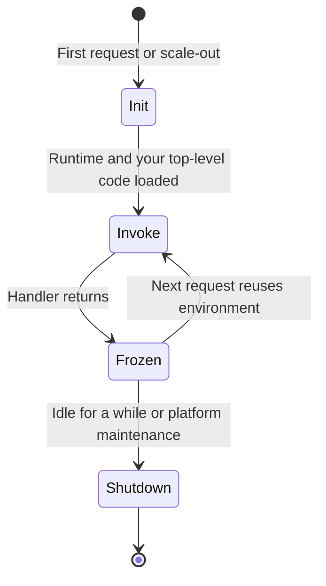
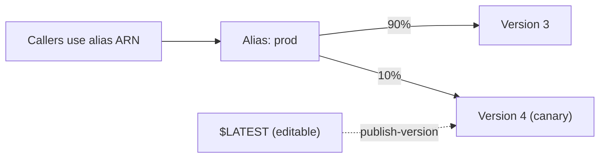

# AWS Lambda

## Introduction

**AWS Lambda** is Amazon's Functions-as-a-Service platform. You upload code, choose a runtime such as Python or Node.js, and tell Lambda which events should run it. Lambda handles servers, scaling and patching of the managed runtime, and bills you per request and per millisecond of compute.

Think of Lambda as a vending machine for compute. Each request drops in a coin, a fresh or reused "slot" runs your code, and when nobody is buying, the machine costs you nothing.

This page walks through a complete Lambda lifecycle:

1. Writing a handler
2. Giving it an **execution role** (its identity)
3. Deploying with the AWS CLI, then with **AWS SAM** (infrastructure as code)
4. Configuring memory, timeouts, environment variables and architecture
5. Publishing **versions** and **aliases** for safe releases
6. Exposing it over HTTP with a **function URL**
7. Cleaning up

If you are new to serverless, read the [Serverless Introduction](./0-cloud-serverless-introduction.mdx) first. The Azure equivalent of this page is [Azure Functions](./2-cloud-azure-functions.mdx).

:::caution Cost warning
The commands on this page create real AWS resources. Lambda has a free tier, but logs, data transfer and other services you attach can incur charges. Run the **Cleanup** section when you finish, and set up a budget alert first (see [Budgets and Billing Alerts](../1-cloud-getting-started/7-cloud-budgets-and-alerts.mdx)).
:::

## How Lambda Runs Your Code

Lambda runs each function inside an **execution environment**: a lightweight, isolated micro-VM (built on Firecracker) that contains your code, the runtime and any extensions.



- **Init** runs once per environment: starting extensions, bootstrapping the runtime and running your module-level code (imports, SDK clients). This is the "cold start".
- **Invoke** runs your handler for each request.
- One standard execution environment handles **one request at a time**. Ten concurrent requests need ten environments.
- Environments are reused, so module-level objects such as database connections survive between invocations. They are also recycled every few hours, so never rely on them for durable state.

### Key limits

These come from the [Lambda quotas page](https://docs.aws.amazon.com/lambda/latest/dg/gettingstarted-limits.html) and may change:

| Setting | Limit |
| --- | --- |
| Timeout | Up to 900 seconds (15 minutes) |
| Memory | 128 MB to 10,240 MB; CPU scales with memory (about one vCPU at 1,769 MB) |
| `/tmp` storage | 512 MB to 10,240 MB |
| Synchronous payload | 6 MB request and 6 MB response |
| Asynchronous payload | 1 MB |
| Zip package | 50 MB zipped upload, 250 MB unzipped including layers |
| Container image | Up to 10 GB |
| Default concurrency | 1,000 per Region per account (new accounts may start lower) |

## Choosing a Runtime

Each language version has a **runtime identifier**. At the time of writing, current managed runtimes include `python3.14`, `python3.13`, `python3.12`, `nodejs24.x`, `nodejs22.x`, `java25`, `java21`, `dotnet10`, `dotnet8`, `ruby4.0` and `provided.al2023` (for Go, Rust and custom runtimes). Older identifiers such as `python3.9` and `nodejs20.x` are already deprecated.

:::tip
Amazon Linux 2 reached end of life in June 2026, and runtimes based on it are on deprecation schedules. Prefer runtimes built on **Amazon Linux 2023**. Check the [Lambda runtimes table](https://docs.aws.amazon.com/lambda/latest/dg/lambda-runtimes.html) before you pick one, because deprecation dates move.
:::

All supported runtimes run on both `x86_64` and `arm64` (AWS Graviton). Graviton is often cheaper per GB-second; test your dependencies on it before switching.

## Step 1: Write the Handler

We will build a tiny "URL shortener lookup" function. It reads a short code from the request and returns the long URL from a dictionary. A real version would read from DynamoDB.

```python
# app.py
import json
import os
import logging

logger = logging.getLogger()
logger.setLevel(os.environ.get("LOG_LEVEL", "INFO"))

# Module-level code runs once per execution environment (during Init)
LINKS = {
    "docs": "https://docs.aws.amazon.com/lambda/",
    "cnr": "https://www.compilenrun.com",
}
GREETING = os.environ.get("GREETING", "hello")

def handler(event, context):
    code = (event.get("pathParameters") or {}).get("code") \
        or (event.get("queryStringParameters") or {}).get("code")
    logger.info("lookup code=%s request_id=%s", code,
                getattr(context, "aws_request_id", "local"))

    if code not in LINKS:
        return {"statusCode": 404, "body": json.dumps({"error": "unknown code"})}

    return {
        "statusCode": 200,
        "headers": {"Content-Type": "application/json"},
        "body": json.dumps({"greeting": GREETING, "url": LINKS[code]}),
    }

if __name__ == "__main__":
    print(handler({"queryStringParameters": {"code": "cnr"}}, None))
    print(handler({"queryStringParameters": {"code": "nope"}}, None))
```

```bash
python3 app.py
```

Output:

```text
{'statusCode': 200, 'headers': {'Content-Type': 'application/json'}, 'body': '{"greeting": "hello", "url": "https://www.compilenrun.com"}'}
{'statusCode': 404, 'body': '{"error": "unknown code"}'}
```

The handler string you give Lambda is `module.function`, so this one is `app.handler`.

## Step 2: Create an Execution Role

Every Lambda function runs **as an IAM role**. The role decides which AWS APIs the code may call. Lambda gets temporary credentials for it automatically, so you never put access keys in your code.

```json
{
  "Version": "2012-10-17",
  "Statement": [
    {
      "Effect": "Allow",
      "Principal": { "Service": "lambda.amazonaws.com" },
      "Action": "sts:AssumeRole"
    }
  ]
}
```

Save that as `trust-policy.json`, then:

```bash
aws iam create-role \
  --role-name cnr-lookup-role \
  --assume-role-policy-document file://trust-policy.json

aws iam attach-role-policy \
  --role-name cnr-lookup-role \
  --policy-arn arn:aws:iam::aws:policy/service-role/AWSLambdaBasicExecutionRole
```

Example output (trimmed):

```text
{
    "Role": {
        "RoleName": "cnr-lookup-role",
        "Arn": "arn:aws:iam::123456789012:role/cnr-lookup-role",
        ...
    }
}
```

`AWSLambdaBasicExecutionRole` only allows writing logs to CloudWatch. When the function later needs DynamoDB, add a policy scoped to that one table. See [Least Privilege in Practice](../2-cloud-identity/3-cloud-least-privilege.mdx).

## Step 3: Deploy with the AWS CLI

Zip the code and create the function:

```bash
zip function.zip app.py

aws lambda create-function \
  --function-name cnr-lookup \
  --runtime python3.13 \
  --architectures arm64 \
  --handler app.handler \
  --role arn:aws:iam::123456789012:role/cnr-lookup-role \
  --zip-file fileb://function.zip \
  --memory-size 256 \
  --timeout 10 \
  --environment "Variables={GREETING=hi,LOG_LEVEL=INFO}"
```

Example output (trimmed):

```text
{
    "FunctionName": "cnr-lookup",
    "FunctionArn": "arn:aws:lambda:us-east-1:123456789012:function:cnr-lookup",
    "Runtime": "python3.13",
    "Handler": "app.handler",
    "MemorySize": 256,
    "Timeout": 10,
    "Architectures": ["arm64"],
    "State": "Pending"
}
```

:::note
If `create-function` fails with "The role defined for the function cannot be assumed by Lambda", wait a few seconds and retry. New IAM roles take a moment to propagate.
:::

Invoke it directly:

```bash
aws lambda invoke \
  --function-name cnr-lookup \
  --cli-binary-format raw-in-base64-out \
  --payload '{"queryStringParameters": {"code": "docs"}}' \
  response.json && cat response.json
```

Output:

```text
{
    "StatusCode": 200,
    "ExecutedVersion": "$LATEST"
}
{"statusCode": 200, "headers": {"Content-Type": "application/json"}, "body": "{\"greeting\": \"hi\", \"url\": \"https://docs.aws.amazon.com/lambda/\"}"}
```

Read the logs:

```bash
aws logs tail /aws/lambda/cnr-lookup --since 5m
```

Example output:

```text
2026-10-11T09:12:03 INIT_START Runtime Version: python:3.13...
2026-10-11T09:12:03 START RequestId: 6f1c... Version: $LATEST
2026-10-11T09:12:03 [INFO] lookup code=docs request_id=6f1c...
2026-10-11T09:12:03 END RequestId: 6f1c...
2026-10-11T09:12:03 REPORT RequestId: 6f1c... Duration: 2.31 ms Billed Duration: 3 ms Memory Size: 256 MB Max Memory Used: 41 MB Init Duration: 98.20 ms
```

The `REPORT` line tells you the billed duration, the memory actually used and, on cold starts, the `Init Duration`.

### Updating code and configuration

```bash
zip function.zip app.py
aws lambda update-function-code --function-name cnr-lookup --zip-file fileb://function.zip
aws lambda wait function-updated --function-name cnr-lookup
aws lambda update-function-configuration --function-name cnr-lookup --memory-size 512
```

## Step 4: Versions and Aliases

Editing `$LATEST` in production is risky. Lambda lets you **publish immutable versions** and point **aliases** at them.



```bash
aws lambda publish-version --function-name cnr-lookup --description "first release"
aws lambda create-alias --function-name cnr-lookup --name prod --function-version 1
```

Later, shift 10 percent of traffic to version 2 as a canary:

```bash
aws lambda update-alias \
  --function-name cnr-lookup \
  --name prod \
  --function-version 1 \
  --routing-config '{"AdditionalVersionWeights": {"2": 0.1}}'
```

Rolling back is just pointing the alias at the old version again. Features such as SnapStart and provisioned concurrency also work on versions and aliases, not on `$LATEST` (see [Cold Starts and Performance](./6-cloud-cold-starts.mdx)).

## Step 5: Expose It over HTTP

You have three main options to put a Lambda function behind HTTPS:

| Option | Good for | Notes |
| --- | --- | --- |
| Function URL | One function, simple webhook or internal tool | Free built-in HTTPS endpoint, IAM or no auth, no routing or throttling features |
| API Gateway HTTP API | Most REST-style APIs | Routing, JWT authorizers, CORS, cheaper than REST APIs |
| API Gateway REST API | APIs needing API keys, usage plans, WAF, caching | More features, more cost |

A function URL takes one command:

```bash
aws lambda create-function-url-config \
  --function-name cnr-lookup \
  --qualifier prod \
  --auth-type AWS_IAM
```

Example output:

```text
{
    "FunctionUrl": "https://abc123xyz.lambda-url.us-east-1.on.aws/",
    "AuthType": "AWS_IAM",
    ...
}
```

:::warning
`--auth-type NONE` makes the URL callable by anyone on the internet, and every call costs you money. Use `AWS_IAM` unless you deliberately want a public endpoint, and then add your own validation (for example, a webhook signature check).
:::

API Gateway is covered on [API Gateway and Azure API Management](./4-cloud-api-gateway.mdx).

## Step 6: The Same Function with AWS SAM

Clicking and typing CLI commands does not scale. **AWS SAM** (Serverless Application Model) is a CloudFormation extension for serverless resources. One template creates the function, its role, its log group and an HTTP API.

```yaml
# template.yaml
AWSTemplateFormatVersion: "2010-09-09"
Transform: AWS::Serverless-2016-10-31
Description: CNR link lookup

Globals:
  Function:
    Runtime: python3.13
    Architectures: [arm64]
    MemorySize: 256
    Timeout: 10

Resources:
  LookupFunction:
    Type: AWS::Serverless::Function
    Properties:
      CodeUri: src/
      Handler: app.handler
      AutoPublishAlias: prod
      Environment:
        Variables:
          GREETING: hi
      Events:
        GetLink:
          Type: HttpApi
          Properties:
            Path: /links/{code}
            Method: GET

  LookupLogs:
    Type: AWS::Logs::LogGroup
    Properties:
      LogGroupName: !Sub /aws/lambda/${LookupFunction}
      RetentionInDays: 14

Outputs:
  ApiUrl:
    Value: !Sub https://${ServerlessHttpApi}.execute-api.${AWS::Region}.amazonaws.com/
```

```bash
sam build
sam deploy --guided      # first time; answers are saved to samconfig.toml
curl "$(aws cloudformation describe-stacks --stack-name cnr-lookup \
  --query "Stacks[0].Outputs[?OutputKey=='ApiUrl'].OutputValue" --output text)links/cnr"
```

Example output:

```text
{"greeting": "hi", "url": "https://www.compilenrun.com"}
```

`AutoPublishAlias` publishes a new version and moves the `prod` alias on every deploy. Setting a log retention period stops logs from piling up forever, which is a common hidden cost. Terraform and CDK can do the same job; see [Choosing an IaC Tool](../10-cloud-infrastructure-as-code/5-cloud-choosing-iac-tool.mdx).

## Beyond the Basics

A few Lambda features you will meet as your functions grow:

- **Layers** share libraries between functions (up to five per function). Container images are often simpler for large dependencies.
- **Container image functions** let you package up to 10 GB with a Dockerfile, pushed to Amazon ECR.
- **VPC access** lets functions reach private databases. Outbound internet then needs a NAT gateway or VPC endpoints, which add cost.
- **Lambda durable functions** (launched in late 2025) let a single function checkpoint its progress and run multi-step workflows for up to a year. See [Workflows: Step Functions and Durable Functions](./5-cloud-step-functions-durable.mdx).
- **Lambda Managed Instances** run your functions on EC2 instances in your account, with EC2 pricing and multi-concurrent execution environments. They suit steady, high-volume workloads; see [Serverless Trade-offs and Costs](./7-cloud-serverless-trade-offs.mdx).

## Real-World Scenario

**Your team runs a marketing site** and wants a link-tracking endpoint: short links in emails like `/l/spring-sale` redirect to a landing page and record the click. Traffic is near zero most of the month and spikes to thousands of requests per minute right after each campaign email.

### The solution

- An **HTTP API** route `GET /l/{code}` invokes a Lambda function.
- The function reads the target URL from **DynamoDB** (on-demand capacity), writes a click record asynchronously to an **SQS** queue, and returns a `302` redirect.
- A second function consumes the queue in batches and aggregates clicks.
- Everything is defined in a SAM template, deployed by CI with OIDC credentials (see [Keyless CI/CD with OIDC](../2-cloud-identity/6-cloud-oidc-for-ci.mdx)).

### Why this approach

- **Spiky traffic** is exactly what Lambda's per-request billing and fast scale-out handle well.
- **Tiny handlers** finish in milliseconds, so compute cost stays small.
- **Queues decouple** analytics from the redirect path, so slow analytics never delay users.

### When to use it, and when not to

Use Lambda for short, stateless request handlers and event processing. Avoid it for long-running jobs (over 15 minutes), workloads that need GPUs, or services with constant high traffic where per-request billing exceeds the cost of always-on containers.

### Alternatives and trade-offs

| Approach | Pros | Cons | Best for |
| --- | --- | --- | --- |
| Lambda + HTTP API | Scales to zero, minimal ops | Cold starts, 15-minute limit | Spiky APIs and webhooks |
| Lambda function URL | Simplest, no gateway cost | No routing, throttling or API keys | Single-purpose endpoints |
| ECS on Fargate | Long-running, any binary | Pays per running task, no scale to zero by default | Steady APIs, background workers |
| EC2 with Auto Scaling | Full control, Savings Plans | Patching and capacity work | Constant heavy load |
| Lambda Managed Instances | EC2 pricing with Lambda programming model | Minimum instances always running | High, predictable volume |

## Common Mistakes

1. **Creating SDK clients inside the handler.** Create them at module level so warm invocations reuse connections.
2. **Setting the timeout to the maximum "just in case".** A stuck call then bills for 15 minutes. Set a timeout slightly above your real p99.
3. **Under-sizing memory to save money.** More memory also means more CPU; a function at 1,024 MB can finish so much faster that it costs less than at 128 MB. Measure.
4. **Never setting log retention.** CloudWatch log groups keep data forever by default.
5. **Public function URLs with no auth.** Anyone can call them and run up your bill.
6. **Deploying to `$LATEST` in production.** Use versions and aliases so you can roll back instantly.
7. **Pinning a deprecated runtime.** Track the runtime deprecation table and upgrade early.

## Cleanup

```bash
aws lambda delete-function-url-config --function-name cnr-lookup --qualifier prod
aws lambda delete-function --function-name cnr-lookup
aws logs delete-log-group --log-group-name /aws/lambda/cnr-lookup
aws iam detach-role-policy --role-name cnr-lookup-role \
  --policy-arn arn:aws:iam::aws:policy/service-role/AWSLambdaBasicExecutionRole
aws iam delete-role --role-name cnr-lookup-role

# If you used SAM:
sam delete --stack-name cnr-lookup
```

## Summary

- Lambda runs your handler in isolated execution environments that go through Init, Invoke and Shutdown phases; module-level code runs once per environment.
- Every function has an **execution role**; never embed access keys.
- Deploy with the CLI to learn, then with **SAM**, CDK or Terraform for anything real.
- Use **versions and aliases** for safe releases and canaries.
- Expose HTTP with a **function URL** for simple cases or **API Gateway** for real APIs.
- Respect the limits: 15 minutes, 10,240 MB memory, 6 MB synchronous payloads, and pick a current Amazon Linux 2023 runtime.

## Further Learning

### Exercises

1. Deploy the lookup function, invoke it ten times quickly, and use `aws logs tail` to count how many invocations show an `Init Duration`. Explain the result.
2. Change memory from 256 MB to 1,024 MB and compare `Duration` in the `REPORT` lines. Compute GB-seconds for both.
3. Convert the in-memory `LINKS` dictionary to a DynamoDB table lookup. Add the narrowest IAM policy possible to the execution role.
4. Publish two versions and configure the `prod` alias to send 20 percent of traffic to the newer one. Invoke the alias 20 times and check `ExecutedVersion`.

### Related pages

- [Azure Functions](./2-cloud-azure-functions.mdx)
- [Event Sources and Triggers](./3-cloud-serverless-triggers.mdx)
- [Cold Starts and Performance](./6-cloud-cold-starts.mdx)
- [AWS IAM Users, Groups, Roles and Policies](../2-cloud-identity/1-cloud-aws-iam.mdx)
- [Project: Serverless REST API](../14-cloud-projects/1-cloud-project-serverless-api.mdx)
