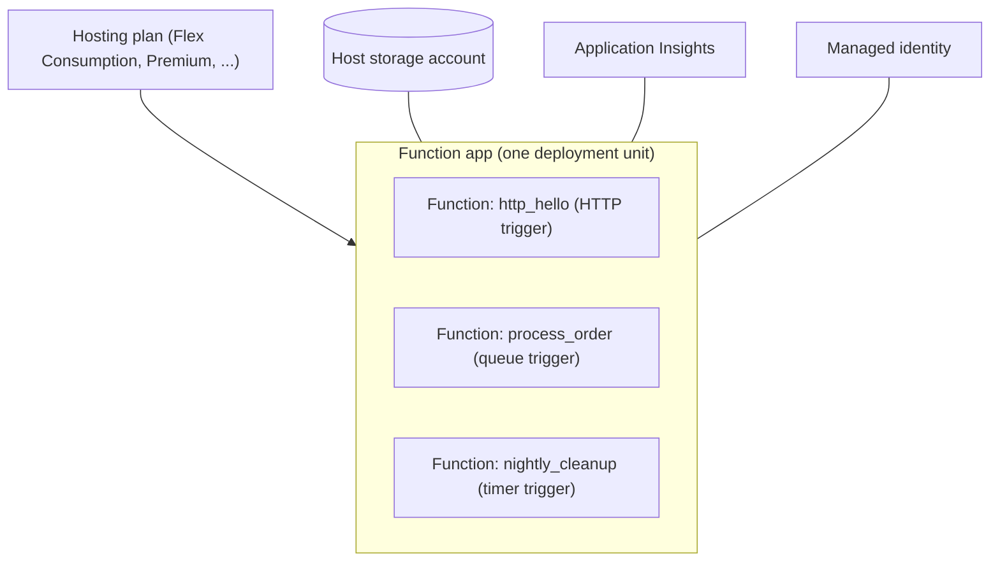

# Azure Functions

## Introduction

**Azure Functions** is Microsoft's Functions-as-a-Service platform. Like AWS Lambda, it runs your code in response to events and bills you for what you use. Unlike Lambda, it groups functions into a **function app**: one deployable unit that shares configuration, a runtime, a hosting plan and an identity.

If Lambda is a vending machine where each product has its own slot, a function app is a food truck. One truck (the app) carries a menu of dishes (functions). The whole menu shares a kitchen, a licence and a driver, but you can still order each dish separately.

This page covers:

1. The building blocks: function apps, triggers, bindings and hosting plans
2. Writing functions with the **Python v2 programming model**
3. Running locally with **Azure Functions Core Tools**
4. Creating Azure resources with the **Azure CLI** on the **Flex Consumption** plan
5. Identity, configuration and monitoring
6. Cleanup

Read [Serverless Introduction](./0-cloud-serverless-introduction.mdx) first if the serverless model is new to you. The AWS counterpart is [AWS Lambda](./1-cloud-aws-lambda.mdx).

:::caution Cost warning
The Azure commands below create a resource group, storage account, function app and Application Insights resource. Flex Consumption bills per execution and per active memory time, and there is a monthly free grant, but storage, monitoring data and any **always ready** instances cost money. Delete the resource group when you finish (see **Cleanup**).
:::

## Building Blocks



| Concept | What it is | Lambda equivalent |
| --- | --- | --- |
| Function app | Container for one or more functions sharing settings and runtime | Roughly a group of Lambda functions in one SAM stack |
| Trigger | The event that starts a function; exactly one per function | Event source or trigger configuration |
| Binding | Declarative input or output to another service (blob, queue, Cosmos DB...) | No direct equivalent; you call the SDK |
| Hosting plan | Decides scaling, limits, networking and billing | Lambda default vs Lambda Managed Instances |
| Host storage account | Storage the Functions runtime uses for its own state and deployment packages | Managed by Lambda for you |
| `host.json` | App-wide runtime configuration (timeouts, logging, extensions) | Function configuration |
| App settings | Environment variables for the app | Lambda environment variables |

## Hosting Plans

Choosing the plan is the most important Azure Functions decision. The current options, from the official [hosting comparison](https://learn.microsoft.com/en-us/azure/azure-functions/functions-scale):

| Plan | Scale to zero | Max instances | Default / max timeout | VNet integration | Typical use |
| --- | --- | --- | --- | --- | --- |
| **Flex Consumption** (recommended serverless) | Yes | Up to 1,000 per function group | 30 min / unbounded | Yes | New serverless apps |
| Premium (Elastic Premium) | No, at least one warm instance | Up to 100 (varies) | 30 min / unbounded | Yes | Always-warm, high-throughput apps |
| Dedicated (App Service plan) | No | 10 to 30 (100 on ASE) | 30 min / unbounded with Always On | Yes | Reusing existing App Service capacity |
| Azure Container Apps | Optional | Up to 1,000 replicas | Depends on configuration | Yes | Containerized functions next to microservices |
| Consumption (legacy) | Yes | 200 Windows / 100 Linux | 5 min / 10 min | No | Existing Windows apps only |

:::warning
The original **Consumption plan is now legacy**. Linux apps on it get no new language versions and the option is scheduled to retire on 30 September 2028. Create new serverless apps on **Flex Consumption**, which supports Linux only and code-only deployment (no custom containers). Check the [hosting options page](https://learn.microsoft.com/en-us/azure/azure-functions/functions-scale) for the latest dates.
:::

Regardless of plan, an **HTTP-triggered** function must respond within about 230 seconds because of the Azure load balancer idle timeout. For longer work, return `202 Accepted` and continue in the background or use [Durable Functions](./5-cloud-step-functions-durable.mdx).

### Flex Consumption in one paragraph

Flex Consumption scales **per function group**: all HTTP functions scale together, all Event Grid blob triggers scale together, Durable Functions scale together, and every other trigger scales on its own. You choose an **instance memory size** (512 MB, 2,048 MB or 4,096 MB) and can configure **always ready** instances to cut cold starts. Billing is per execution plus memory-time while executing, plus the cost of any always ready instances.

## Step 1: Create a Project Locally

Install [Azure Functions Core Tools](https://learn.microsoft.com/en-us/azure/azure-functions/functions-run-local) v4 and Python (Azure Functions supports Python 3.10 to 3.14 at the time of writing; Python apps run on Linux only).

```bash
func init orders-app --worker-runtime python
cd orders-app
python3 -m venv .venv && source .venv/bin/activate
pip install -r requirements.txt
```

Example output (trimmed):

```text
Found Python version 3.13.1 (python3).
Writing requirements.txt
Writing function_app.py
Writing .gitignore
Writing host.json
Writing local.settings.json
```

The generated project:

```text
orders-app/
├── function_app.py        # all functions, declared with decorators
├── host.json              # runtime configuration
├── local.settings.json    # local-only settings, never deployed
├── requirements.txt
└── .funcignore
```

## Step 2: Write Functions with Triggers and Bindings

We will build a mini order intake: an HTTP function accepts an order and drops it on a Storage queue through an **output binding**, and a queue-triggered function processes it.

```python
# function_app.py
import json
import logging
import uuid
import azure.functions as func

app = func.FunctionApp(http_auth_level=func.AuthLevel.FUNCTION)

@app.route(route="orders", methods=["POST"])
@app.queue_output(arg_name="msg", queue_name="orders", connection="AzureWebJobsStorage")
def create_order(req: func.HttpRequest, msg: func.Out[str]) -> func.HttpResponse:
    try:
        body = req.get_json()
    except ValueError:
        return func.HttpResponse("Body must be JSON", status_code=400)

    if "item" not in body or "qty" not in body:
        return func.HttpResponse("Fields 'item' and 'qty' are required", status_code=400)

    order = {"id": str(uuid.uuid4()), "item": body["item"], "qty": int(body["qty"])}
    msg.set(json.dumps(order))          # output binding writes to the queue
    logging.info("Queued order %s", order["id"])
    return func.HttpResponse(json.dumps(order), status_code=202, mimetype="application/json")

@app.queue_trigger(arg_name="message", queue_name="orders", connection="AzureWebJobsStorage")
def process_order(message: func.QueueMessage) -> None:
    order = json.loads(message.get_body().decode("utf-8"))
    logging.info("Processing order %s: %s x %s", order["id"], order["qty"], order["item"])

@app.timer_trigger(schedule="0 0 2 * * *", arg_name="timer", run_on_startup=False)
def nightly_cleanup(timer: func.TimerRequest) -> None:
    logging.info("Nightly cleanup ran. Past due: %s", timer.past_due)
```

Things to notice:

- `@app.route` defines an HTTP trigger. The URL becomes `/api/orders`.
- `@app.queue_output` is a **binding**: you call `msg.set(...)` and the runtime writes the queue message. No storage SDK code needed.
- The timer schedule is an **NCRONTAB** expression with six fields (seconds first). `0 0 2 * * *` means 02:00 every day, in UTC by default.
- `AuthLevel.FUNCTION` means callers need a function key. Keys are fine for simple cases; for real APIs put [API Management](./4-cloud-api-gateway.mdx) or Entra ID authentication in front.

## Step 3: Run Locally

Functions needs a storage emulator locally. Run **Azurite** in Docker:

```bash
docker run -d --name azurite -p 10000:10000 -p 10001:10001 -p 10002:10002 \
  mcr.microsoft.com/azure-storage/azurite
```

Check `local.settings.json` points at it:

```json
{
  "IsEncrypted": false,
  "Values": {
    "AzureWebJobsStorage": "UseDevelopmentStorage=true",
    "FUNCTIONS_WORKER_RUNTIME": "python"
  }
}
```

Start the host and send an order:

```bash
func start
# in another terminal
curl -X POST http://localhost:7071/api/orders \
  -H "Content-Type: application/json" \
  -d '{"item": "keyboard", "qty": 2}'
```

Example output from the host (trimmed):

```text
Functions:
        create_order: [POST] http://localhost:7071/api/orders
        nightly_cleanup: timerTrigger
        process_order: queueTrigger

[2026-10-11T09:30:01Z] Executing 'Functions.create_order' (Reason='This function was programmatically called via the host APIs.', Id=...)
[2026-10-11T09:30:01Z] Queued order 3b1e9f0c-...
[2026-10-11T09:30:01Z] Executed 'Functions.create_order' (Succeeded, Duration=41ms)
[2026-10-11T09:30:02Z] Executing 'Functions.process_order' (Reason='New queue message detected on 'orders'.', Id=...)
[2026-10-11T09:30:02Z] Processing order 3b1e9f0c-...: 2 x keyboard
```

Locally, function keys are not enforced, so the `curl` works without a key.

## Step 4: Create Azure Resources with the CLI

Sign in with `az login` (see [The Azure CLI](../1-cloud-getting-started/3-cloud-azure-cli.mdx)). First check which regions support Flex Consumption:

```bash
az functionapp list-flexconsumption-locations --query "sort_by(@, &name)[].{Region:name}" -o table
```

Then create the resources. Storage account and function app names must be globally unique, so change the suffix.

```bash
RG=rg-orders-demo
LOCATION=eastus
STORAGE=stordersdemo$RANDOM
APP=func-orders-demo-$RANDOM

az group create --name $RG --location $LOCATION

az storage account create \
  --name $STORAGE --resource-group $RG --location $LOCATION \
  --sku Standard_LRS --allow-blob-public-access false

az functionapp create \
  --resource-group $RG \
  --name $APP \
  --storage-account $STORAGE \
  --flexconsumption-location $LOCATION \
  --runtime python \
  --runtime-version 3.12 \
  --instance-memory 2048
```

Example output (trimmed):

```text
{
  "defaultHostName": "func-orders-demo-12345.azurewebsites.net",
  "kind": "functionapp,linux",
  "name": "func-orders-demo-12345",
  "state": "Running",
  ...
}
```

`az functionapp create` also creates an Application Insights resource by default, unless you pass `--disable-app-insights`.

## Step 5: Deploy

From the project folder:

```bash
func azure functionapp publish $APP
```

Example output (trimmed):

```text
Getting site publishing info...
Creating archive for current directory...
Uploading 2.1 KB [####################]
Remote build succeeded!
Functions in func-orders-demo-12345:
    create_order - [httpTrigger]
        Invoke url: https://func-orders-demo-12345.azurewebsites.net/api/orders
    nightly_cleanup - [timerTrigger]
    process_order - [queueTrigger]
```

Get a function key and call the deployed endpoint:

```bash
KEY=$(az functionapp function keys list -g $RG -n $APP --function-name create_order --query default -o tsv)
curl -X POST "https://$APP.azurewebsites.net/api/orders?code=$KEY" \
  -H "Content-Type: application/json" -d '{"item": "mouse", "qty": 1}'
```

Output:

```text
{"id": "c0a8f5d2-...", "item": "mouse", "qty": 1}
```

For CI/CD, use the `Azure/functions-action` GitHub Action or the `AzureFunctionApp` Azure Pipelines task with OIDC federated credentials rather than publish profiles. See [CI/CD with Azure DevOps and GitHub Actions](../11-cloud-devops/1-cloud-ci-cd-on-azure.mdx).

## Step 6: Identity, Settings and Scaling

### Managed identity instead of connection strings

The example above uses `AzureWebJobsStorage`, which `az functionapp create` fills with a connection string containing an account key. For production, switch to a **managed identity** so no secret is stored:

```bash
az functionapp identity assign -g $RG -n $APP
```

Then grant the identity a data-plane role, such as **Storage Queue Data Contributor**, on the storage account and configure identity-based connections (settings like `AzureWebJobsStorage__accountName`). The exact settings per binding are in [Use identity-based connections](https://learn.microsoft.com/en-us/azure/azure-functions/functions-reference#configure-an-identity-based-connection). Background on identities is in [Workload Identity](../2-cloud-identity/4-cloud-workload-identity.mdx).

### App settings

```bash
az functionapp config appsettings set -g $RG -n $APP --settings "FEATURE_X=on"
```

In Python, read them with `os.environ["FEATURE_X"]`. For secrets, use Key Vault references (see [Secrets Management](../11-cloud-devops/4-cloud-secrets-management.mdx)).

### Scaling controls on Flex Consumption

```bash
# Change instance memory
az functionapp scale config set -g $RG -n $APP --instance-memory 4096

# Keep one HTTP instance always ready (billed even when idle)
az functionapp scale config always-ready set -g $RG -n $APP --settings http=1

# Limit concurrent HTTP requests per instance
az functionapp scale config set -g $RG -n $APP --trigger-type http \
  --trigger-settings perInstanceConcurrency=16
```

### Monitoring

Python `logging` output goes to **Application Insights** automatically. Open **Live Metrics** in the Application Insights resource to watch requests and logs in near real time, or query recent traces with the CLI (the `application-insights` extension installs on first use):

```bash
az monitor app-insights query --app $APP -g $RG \
  --analytics-query "traces | where timestamp > ago(15m) | project timestamp, message | take 20"
```

Log streaming support differs by plan, so check [Monitor executions in Azure Functions](https://learn.microsoft.com/en-us/azure/azure-functions/functions-monitoring) for the options on your plan.

## Infrastructure as Code with Bicep

Define the plan and app in Bicep for repeatable environments. This sketch shows the Flex Consumption-specific parts; Microsoft publishes complete, maintained [Flex Consumption IaC samples](https://learn.microsoft.com/en-us/azure/azure-functions/flex-consumption-how-to) that also wire up storage roles and monitoring.

```bicep
param location string = resourceGroup().location
param appName string
param deploymentStorageBlobEndpoint string

resource plan 'Microsoft.Web/serverfarms@2024-04-01' = {
  name: '${appName}-plan'
  location: location
  kind: 'functionapp'
  sku: {
    tier: 'FlexConsumption'
    name: 'FC1'
  }
  properties: {
    reserved: true
  }
}

resource app 'Microsoft.Web/sites@2024-04-01' = {
  name: appName
  location: location
  kind: 'functionapp,linux'
  identity: { type: 'SystemAssigned' }
  properties: {
    serverFarmId: plan.id
    functionAppConfig: {
      deployment: {
        storage: {
          type: 'blobContainer'
          value: '${deploymentStorageBlobEndpoint}deployments'
          authentication: { type: 'SystemAssignedIdentity' }
        }
      }
      scaleAndConcurrency: {
        maximumInstanceCount: 100
        instanceMemoryMB: 2048
      }
      runtime: {
        name: 'python'
        version: '3.12'
      }
    }
  }
}
```

More on Bicep in [Azure Bicep and ARM Templates](../10-cloud-infrastructure-as-code/3-cloud-bicep-and-arm.mdx).

## Real-World Scenario

**Your team runs an internal HR portal** on Azure. HR wants three automations: a webhook that receives signed documents from an e-signature provider, a nightly job that reminds managers about pending approvals, and a processor that converts uploaded CSV timesheets into rows in Azure SQL.

### The solution

One **Flex Consumption** function app named `hr-automation` with three functions:

1. `signature_webhook`: HTTP trigger that validates the provider's signature and stores the PDF with a blob output binding.
2. `approval_reminders`: timer trigger at 07:00 that queries Azure SQL and sends emails through a queue.
3. `import_timesheet`: Event Grid-based blob trigger that parses CSV files (Flex Consumption supports only the event-based blob trigger, which also has lower latency than polling).

The app uses a managed identity for Storage, SQL and Key Vault, and VNet integration to reach the private SQL database.

### Why this approach

- The three automations share configuration, identity and network access, so **one function app** keeps them together.
- Traffic is light and irregular; **scale to zero** keeps cost near zero most of the day.
- **Bindings** remove boilerplate for blobs and queues, which helps a small team.
- Flex Consumption supports **VNet integration**, which the legacy Consumption plan does not.

### When to use it, and when not to

Use Azure Functions for event-driven glue, webhooks, scheduled jobs and light APIs. Prefer **Azure Container Apps** when you need a custom container image, long-running background workers or a mix of microservices. Prefer **App Service** for a full web application with steady traffic.

### Alternatives and trade-offs

| Approach | Pros | Cons | Best for |
| --- | --- | --- | --- |
| Functions on Flex Consumption | Scale to zero, VNet, per-use billing | Linux and code-only, cold starts unless always ready | New serverless apps |
| Functions on Premium | Always warm, more CPU and memory | Pays for at least one instance 24/7 | Latency-sensitive, steady traffic |
| Functions on Container Apps | Your own image, runs next to microservices | More packaging, container concepts to learn | Teams already on Container Apps |
| Azure Logic Apps | Low-code designer, many connectors | Less control, per-action billing | Business workflows with SaaS connectors |
| App Service web app | Familiar web hosting, slots | No scale to zero | Full web apps and APIs |

## Common Mistakes

1. **Creating new apps on the legacy Consumption plan.** Use Flex Consumption; Linux Consumption is retiring.
2. **Putting many unrelated functions in one app.** They share deployments, settings and (on most plans) scaling. Group by bounded context.
3. **Long HTTP functions.** Responses over about 230 seconds fail. Offload to a queue or Durable Functions.
4. **Committing `local.settings.json`.** It often contains connection strings. Keep it in `.gitignore`.
5. **Relying on account keys.** Use managed identity and RBAC for storage, Service Bus and databases.
6. **Forgetting always ready instances cost money.** They are billed whether or not functions run.

## Cleanup

Delete everything at once by removing the resource group, then stop Azurite:

```bash
az group delete --name $RG --yes --no-wait
docker stop azurite && docker rm azurite
```

## Summary

- Azure Functions groups functions into a **function app** with a shared plan, settings, identity and storage account.
- Each function has exactly one **trigger** and optional input and output **bindings**.
- The Python v2 model declares everything with decorators in `function_app.py`.
- **Flex Consumption** is the recommended serverless plan: scale to zero, per-function-group scaling, VNet integration, selectable memory and optional always ready instances.
- Use Core Tools and Azurite locally, the Azure CLI or Bicep to provision, and `func azure functionapp publish` or CI/CD to deploy.
- Prefer managed identity over connection strings, and delete the resource group to clean up.

## Further Learning

### Exercises

1. Add a `GET /api/orders/{order_id}` function that reads the order from Azure Table Storage using an input binding. Read the route parameter from `req.route_params`.
2. Change the queue trigger so that orders with `qty` over 100 raise an exception. Watch what happens after five failed attempts (look for the `orders-poison` queue in Azurite).
3. Deploy the app, then configure one always ready HTTP instance. Compare first-request latency before and after, and note the cost implication.
4. Convert the resource creation commands into a Bicep file and deploy it with `az deployment group create`.

### Related pages

- [AWS Lambda](./1-cloud-aws-lambda.mdx)
- [Event Sources and Triggers](./3-cloud-serverless-triggers.mdx)
- [Workflows: Step Functions and Durable Functions](./5-cloud-step-functions-durable.mdx)
- [Microsoft Entra ID and Azure RBAC](../2-cloud-identity/2-cloud-azure-entra-id.mdx)
- [Azure Container Apps and Container Instances](../5-cloud-containers/3-cloud-azure-container-apps.mdx)
