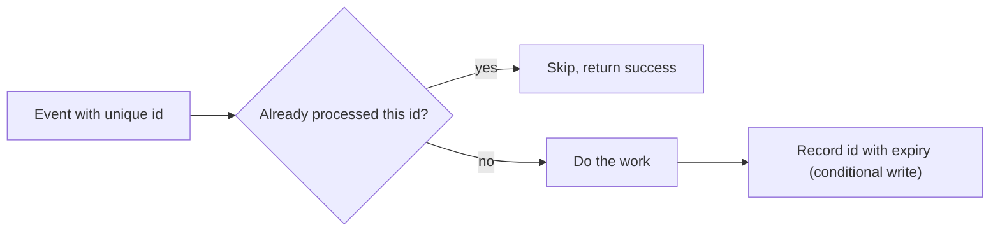

# Event Sources and Triggers

## Introduction

A serverless function does nothing until something **triggers** it. That something might be an HTTP request, a new file in storage, a message on a queue, a database change or a clock ticking. The way an event reaches your function decides a lot about your design:

- Does the caller wait for an answer?
- What happens if your function throws an error? Is the event retried, dropped or parked somewhere?
- Can the same event arrive twice?
- Does the function receive one event or a batch of a hundred?

Think of it like mail delivery. Some messages are phone calls (the caller waits on the line), some are letters pushed through your door (delivered and forgotten), and some sit in a PO box that you check on a schedule. Each needs a different way of handling. This page teaches the three invocation models, then maps the common triggers on AWS Lambda and Azure Functions, with working examples for queues, storage events and schedules.

## The Three Invocation Models

```mermaid
flowchart TD
    subgraph Sync["1. Synchronous (request-response)"]
        C1["Caller (API Gateway, function URL, SDK)"] -- "waits" --> S1["Function"]
        S1 -- "response or error" --> C1
    end
    subgraph Async["2. Asynchronous (push and forget)"]
        C2["Producer (S3, SNS, EventBridge, Event Grid)"] --> Q2["Platform internal queue"]
        Q2 --> S2["Function"]
        S2 -. "on failure: retry, then dead-letter" .-> D2["DLQ or failure destination"]
    end
    subgraph Poll["3. Poll-based (queues and streams)"]
        Src["Queue or stream (SQS, Kinesis, Service Bus, Event Hubs)"] <-- "platform polls" --> P3["Poller"]
        P3 -- "batch of records" --> S3["Function"]
    end
```



| Model | Who retries on error | Typical sources (AWS) | Typical sources (Azure) |
| --- | --- | --- | --- |
| Synchronous | The **caller** | API Gateway, function URLs, ALB, direct `Invoke` | HTTP trigger, API Management |
| Asynchronous | The **platform**, a limited number of times | S3 notifications, SNS, EventBridge | Event Grid (with its own retry policy) |
| Poll-based | The **platform**, until success or the message expires or moves to a DLQ | SQS, Kinesis, DynamoDB Streams, MSK, Kafka, MQ, DocumentDB | Storage Queues, Service Bus, Event Hubs, Cosmos DB change feed, Kafka |

On AWS, poll-based sources use a Lambda resource called an **event source mapping**: Lambda runs pollers that read from the queue or stream and invoke your function with batches. Push-based sources such as S3 and SNS are configured on the *source* service and call Lambda directly. On Azure, the trigger extension inside the Functions host plays the poller role, and the scale controller adds instances based on queue length or event volume.

## Mapping Common Triggers

| Event | AWS Lambda | Azure Functions | Notes |
| --- | --- | --- | --- |
| HTTP request | API Gateway, function URL, ALB | `@app.route` HTTP trigger | Synchronous; caller handles retries |
| File created in storage | S3 event notification (or via EventBridge) | Blob trigger with Event Grid source, or Event Grid trigger | Flex Consumption supports only the event-based blob trigger |
| Queue message | SQS event source mapping | Storage Queue trigger, Service Bus trigger | At-least-once delivery |
| Pub/sub event | SNS, EventBridge rule | Event Grid trigger | Fan-out to many subscribers |
| Stream records | Kinesis, DynamoDB Streams, MSK | Event Hubs trigger, Cosmos DB change feed, Kafka | Ordered per shard or partition |
| Schedule | EventBridge Scheduler | Timer trigger (NCRONTAB) | Use UTC unless configured otherwise |
| Database change | DynamoDB Streams | Cosmos DB trigger | Change data capture |

Choosing *which* messaging service to use is covered in [Choosing a Messaging Service](../9-cloud-messaging-and-integration/0-cloud-messaging-options.mdx). This page focuses on how functions consume them.

## Example 1: Processing a Queue in Batches

Queues are the workhorse of serverless designs. The key things to get right are **batch size**, **partial failures** and **dead-letter queues**.

### On AWS

Create an SQS queue with a dead-letter queue, then connect it to a function with an event source mapping:

```bash
aws sqs create-queue --queue-name orders-dlq
DLQ_ARN=$(aws sqs get-queue-attributes --queue-url \
  "$(aws sqs get-queue-url --queue-name orders-dlq --query QueueUrl --output text)" \
  --attribute-names QueueArn --query Attributes.QueueArn --output text)

aws sqs create-queue --queue-name orders \
  --attributes "{\"RedrivePolicy\":\"{\\\"deadLetterTargetArn\\\":\\\"$DLQ_ARN\\\",\\\"maxReceiveCount\\\":\\\"5\\\"}\",\"VisibilityTimeout\":\"60\"}"

aws lambda create-event-source-mapping \
  --function-name process-orders \
  --event-source-arn arn:aws:sqs:us-east-1:123456789012:orders \
  --batch-size 10 \
  --maximum-batching-window-in-seconds 5 \
  --function-response-types ReportBatchItemFailures
```

Example output (trimmed):

```text
{
    "UUID": "a1b2c3d4-...",
    "BatchSize": 10,
    "MaximumBatchingWindowInSeconds": 5,
    "EventSourceArn": "arn:aws:sqs:us-east-1:123456789012:orders",
    "FunctionResponseTypes": ["ReportBatchItemFailures"],
    "State": "Creating"
}
```

The function's execution role needs `sqs:ReceiveMessage`, `sqs:DeleteMessage` and `sqs:GetQueueAttributes` on the queue (the managed policy `AWSLambdaSQSQueueExecutionRole` covers this). Set the queue's visibility timeout to at least six times the function timeout, as the Lambda docs recommend, so messages are not redelivered while still being processed.

With `ReportBatchItemFailures`, the handler tells Lambda **which** messages failed, so only those return to the queue:

```python
# process_orders.py
import json

def handler(event, context):
    failures = []
    for record in event["Records"]:
        try:
            order = json.loads(record["body"])
            if order["qty"] <= 0:
                raise ValueError("qty must be positive")
            print(f"processed order {order['id']}")
        except Exception as exc:  # noqa: BLE001 - report any failure for this record
            print(f"failed {record['messageId']}: {exc}")
            failures.append({"itemIdentifier": record["messageId"]})
    return {"batchItemFailures": failures}

if __name__ == "__main__":
    fake = {"Records": [
        {"messageId": "m1", "body": json.dumps({"id": "o1", "qty": 2})},
        {"messageId": "m2", "body": json.dumps({"id": "o2", "qty": 0})},
        {"messageId": "m3", "body": "not json"},
    ]}
    print(handler(fake, None))
```

Output:

```text
processed order o1
failed m2: qty must be positive
failed m3: Expecting value: line 1 column 1 (char 0)
{'batchItemFailures': [{'itemIdentifier': 'm2'}, {'itemIdentifier': 'm3'}]}
```

Without partial batch responses, one bad message would make Lambda retry the **whole batch**, reprocessing the good messages too.

### On Azure

Azure Functions delivers queue messages **one at a time** to your function for Storage Queue and Service Bus triggers (the host fetches them in batches behind the scenes). A Service Bus queue trigger:

```python
# function_app.py
import json
import logging
import azure.functions as func

app = func.FunctionApp()

@app.service_bus_queue_trigger(arg_name="msg", queue_name="orders",
                               connection="ServiceBusConnection")
def process_order(msg: func.ServiceBusMessage) -> None:
    order = json.loads(msg.get_body().decode("utf-8"))
    if order["qty"] <= 0:
        # Raising makes the message be retried; after MaxDeliveryCount it is dead-lettered
        raise ValueError("qty must be positive")
    logging.info("processed order %s (delivery %s)", order["id"], msg.delivery_count)
```

Create the namespace and queue:

```bash
az servicebus namespace create -g rg-orders-demo -n sb-orders-demo-$RANDOM --sku Standard
az servicebus queue create -g rg-orders-demo --namespace-name <namespace-name> \
  -n orders --max-delivery-count 5
```

Retry behavior differs by source:

| Source | What happens on exception | Where failures go |
| --- | --- | --- |
| Storage Queue | Message becomes visible again; retried up to 5 times by default (`maxDequeueCount`) | `<queue>-poison` queue |
| Service Bus | Lock is abandoned; retried up to the queue's `MaxDeliveryCount` | Built-in dead-letter subqueue |
| Event Hubs | Checkpoint is not advanced in the failing batch, but the stream moves on | Nothing automatic; use retry policies and your own error store |

For `ServiceBusConnection`, prefer identity-based settings such as `ServiceBusConnection__fullyQualifiedNamespace` plus a role assignment (**Azure Service Bus Data Receiver**) over a connection string.

## Example 2: Reacting to New Files

### On AWS

S3 pushes events asynchronously. Grant S3 permission to invoke the function, then add the notification:

```bash
aws lambda add-permission \
  --function-name make-thumbnail \
  --statement-id s3-invoke \
  --action lambda:InvokeFunction \
  --principal s3.amazonaws.com \
  --source-arn arn:aws:s3:::cnr-uploads-demo \
  --source-account 123456789012

aws s3api put-bucket-notification-configuration \
  --bucket cnr-uploads-demo \
  --notification-configuration file://notification.json
```

```json
{
  "LambdaFunctionConfigurations": [
    {
      "LambdaFunctionArn": "arn:aws:lambda:us-east-1:123456789012:function:make-thumbnail",
      "Events": ["s3:ObjectCreated:*"],
      "Filter": {
        "Key": { "FilterRules": [ { "Name": "prefix", "Value": "incoming/" } ] }
      }
    }
  ]
}
```

:::warning Avoid infinite loops
If the thumbnail function writes its output back into the **same prefix** it listens on, every output triggers another invocation, and the bill grows very quickly. Write outputs to a different bucket or a different prefix that the notification does not match. Lambda has built-in recursive loop detection for some services, but do not rely on it as your design.
:::

For asynchronous invocations, Lambda retries failed events twice by default and can send the failed event to an **on-failure destination** (SQS, SNS, EventBridge, S3 or another Lambda function):

```bash
aws lambda put-function-event-invoke-config \
  --function-name make-thumbnail \
  --maximum-retry-attempts 2 \
  --maximum-event-age-in-seconds 3600 \
  --destination-config '{"OnFailure":{"Destination":"arn:aws:sqs:us-east-1:123456789012:thumbnail-failures"}}'
```

### On Azure

Use the **event-based blob trigger**, which relies on an Event Grid subscription under the hood. It has lower latency than the older polling trigger and is the only blob trigger supported on Flex Consumption.

```python
import logging
import azure.functions as func

app = func.FunctionApp()

@app.blob_trigger(arg_name="blob", path="incoming/{name}",
                  connection="UploadsStorage", source=func.BlobSource.EVENT_GRID)
def make_thumbnail(blob: func.InputStream) -> None:
    logging.info("New blob %s (%s bytes)", blob.name, blob.length)
```

After deploying, you create an **Event Grid subscription** on the storage account that targets the function's blob extension endpoint. The CLI steps and the endpoint format are in the official tutorial, [Trigger Azure Functions on blob containers using an event subscription](https://learn.microsoft.com/en-us/azure/azure-functions/functions-event-grid-blob-trigger). The same infinite-loop warning applies: write output to a different container.

## Example 3: Schedules

### On AWS

**EventBridge Scheduler** is the current way to run Lambda on a schedule. It needs an IAM role that allows it to invoke the function.

```bash
aws scheduler create-schedule \
  --name nightly-report \
  --schedule-expression "cron(0 2 * * ? *)" \
  --schedule-expression-timezone "Europe/London" \
  --flexible-time-window '{"Mode": "OFF"}' \
  --target '{"Arn": "arn:aws:lambda:us-east-1:123456789012:function:nightly-report", "RoleArn": "arn:aws:iam::123456789012:role/scheduler-invoke-role"}'
```

EventBridge cron expressions have **six fields** (minutes, hours, day-of-month, month, day-of-week, year) and use `?` in one of the day fields.

### On Azure

The timer trigger uses **NCRONTAB** with six fields, starting with **seconds**:

```python
@app.timer_trigger(schedule="0 0 2 * * *", arg_name="timer")
def nightly_report(timer: func.TimerRequest) -> None:
    logging.info("Running nightly report; past_due=%s", timer.past_due)
```

| Schedule | EventBridge Scheduler | Azure NCRONTAB |
| --- | --- | --- |
| Every 15 minutes | `rate(15 minutes)` | `0 */15 * * * *` |
| 02:00 daily | `cron(0 2 * * ? *)` | `0 0 2 * * *` |
| 09:00 on weekdays | `cron(0 9 ? * MON-FRI *)` | `0 0 9 * * 1-5` |

Azure timer triggers use UTC by default. On some plans you can set the `WEBSITE_TIME_ZONE` app setting; check the [timer trigger docs](https://learn.microsoft.com/en-us/azure/azure-functions/functions-bindings-timer) for which plans support it.

## Designing for At-Least-Once Delivery

Almost every event source delivers **at least once**. Retries, network glitches and scaling events mean the same event can arrive twice. Your handler must be **idempotent**: processing an event twice must have the same effect as processing it once.



A simple, testable idempotency helper:

```python
# idempotency.py
import time

class InMemoryStore:
    """Stand-in for DynamoDB or Cosmos DB with a conditional insert."""
    def __init__(self):
        self.seen = {}

    def put_if_absent(self, key: str, ttl_seconds: int) -> bool:
        now = time.time()
        if key in self.seen and self.seen[key] > now:
            return False
        self.seen[key] = now + ttl_seconds
        return True

store = InMemoryStore()

def handle_payment(event: dict) -> str:
    if not store.put_if_absent(f"payment#{event['id']}", ttl_seconds=86400):
        return "duplicate ignored"
    # charge the card here
    return f"charged {event['amount']}"

if __name__ == "__main__":
    evt = {"id": "evt-42", "amount": 19.99}
    print(handle_payment(evt))
    print(handle_payment(evt))
```

Output:

```text
charged 19.99
duplicate ignored
```

In production, replace `InMemoryStore` with a conditional write: DynamoDB `PutItem` with `attribute_not_exists(pk)`, or a Cosmos DB `create_item` that fails on a duplicate `id`. On AWS, the open-source **Powertools for AWS Lambda** library has a ready-made idempotency utility.

## Real-World Scenario

**Your team runs an online bookstore.** When a customer pays, the payment provider sends a webhook. The order must then be confirmed by email, stock must be reserved and the warehouse notified. Last month, a provider outage caused webhooks to be resent, and several customers were charged and emailed twice.

### The solution

1. **HTTP trigger** receives the webhook, verifies the signature, writes the raw event to a **queue** and returns `200` immediately. The provider sees a fast success and stops resending.
2. A **queue-triggered** function processes payments with an **idempotency key** (the provider's event id) stored in DynamoDB or Cosmos DB.
3. On success it publishes an `OrderPaid` event to **EventBridge** or **Event Grid**, which fans out to the email, stock and warehouse functions.
4. Every queue has a **dead-letter queue** with an alarm on its depth.

### Why this approach

- **Fast acknowledgement** stops the provider from retrying because your function was slow.
- **The queue absorbs bursts** and gives automatic retries.
- **Idempotency** makes duplicates harmless, whichever layer causes them.
- **Pub/sub fan-out** lets you add a new consumer (say, analytics) without touching payment code.

### When to use it, and when not to

Use queue-plus-function designs whenever work can happen a few seconds later and must not be lost. Do not put a queue in front of operations where the user needs the result immediately, such as checking a password; those belong in the synchronous path.

### Alternatives and trade-offs

| Approach | Pros | Cons | Best for |
| --- | --- | --- | --- |
| Synchronous processing in the webhook | Simplest | Slow responses trigger provider retries; no buffering | Very low volume, idempotent work |
| Queue then function | Buffering, retries, DLQ | Eventual consistency, more parts | Most background work |
| Pub/sub fan-out (EventBridge, Event Grid, SNS) | Many independent consumers | Harder to trace end to end | Domain events with several reactions |
| Stream (Kinesis, Event Hubs) | Ordering, replay, high throughput | Shard and partition management | Telemetry, clickstreams |
| Workflow engine | Visible state, compensation | More cost and setup | Multi-step business processes |

## Common Mistakes

1. **No dead-letter queue.** Failed messages either vanish or retry forever. Always configure a DLQ or failure destination and alarm on it.
2. **Visibility timeout shorter than processing time.** SQS redelivers messages that are still being processed, causing duplicates.
3. **Failing the whole batch for one bad record.** Use `ReportBatchItemFailures` on Lambda.
4. **Recursive triggers.** A function that writes to the location it listens on can loop endlessly.
5. **Assuming exactly-once delivery.** Design for duplicates with idempotency keys.
6. **Using the polling blob trigger on new Azure apps.** Use the Event Grid-based trigger; it is faster and required on Flex Consumption.
7. **Forgetting time zones on schedules.** Both clouds default to UTC unless you configure otherwise.

## Cleanup

```bash
# AWS
MAPPING_UUID=$(aws lambda list-event-source-mappings --function-name process-orders --query "EventSourceMappings[0].UUID" --output text)
aws lambda delete-event-source-mapping --uuid "$MAPPING_UUID"
aws sqs delete-queue --queue-url "$(aws sqs get-queue-url --queue-name orders --query QueueUrl --output text)"
aws sqs delete-queue --queue-url "$(aws sqs get-queue-url --queue-name orders-dlq --query QueueUrl --output text)"
aws scheduler delete-schedule --name nightly-report

# Azure
az group delete --name rg-orders-demo --yes --no-wait
```

## Summary

- Functions are invoked **synchronously** (caller waits and retries), **asynchronously** (platform retries a few times) or by **polling** queues and streams (platform retries until success, expiry or DLQ).
- On AWS, poll-based sources use **event source mappings**; push sources such as S3 and SNS are configured on the source service.
- On Azure, triggers are declared in code; queue triggers move failures to poison queues or Service Bus dead-letter queues.
- Use **partial batch responses**, **dead-letter queues**, **failure destinations** and **idempotency keys**.
- Watch for **recursive loops** with storage triggers and for **time zones** on schedules.

## Further Learning

### Exercises

1. Run the SQS batch handler locally with a batch where every record fails. What does Lambda do with the batch, and where do the messages end up after five receives?
2. Rewrite the Azure Service Bus function to send invalid orders to a separate "rejected" queue using an output binding instead of raising an exception. When is each approach better?
3. Replace `InMemoryStore` with a DynamoDB conditional write using `boto3`. Test it against DynamoDB Local in Docker.
4. Translate these schedules into both EventBridge and NCRONTAB syntax: every 5 minutes; 18:30 every Friday; midnight on the first day of each month.

### Related pages

- [AWS Lambda](./1-cloud-aws-lambda.mdx)
- [Azure Functions](./2-cloud-azure-functions.mdx)
- [Queues: SQS and Azure Service Bus](../9-cloud-messaging-and-integration/1-cloud-sqs-and-service-bus.mdx)
- [Pub/Sub: SNS, EventBridge and Event Grid](../9-cloud-messaging-and-integration/2-cloud-sns-and-event-grid.mdx)
- [Event-Driven Patterns in the Cloud](../9-cloud-messaging-and-integration/4-cloud-event-driven-patterns.mdx)
- [Project: Event-Driven Image Processing Pipeline](../14-cloud-projects/4-cloud-project-event-pipeline.mdx)
