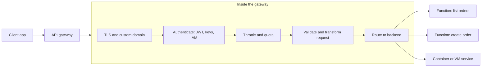
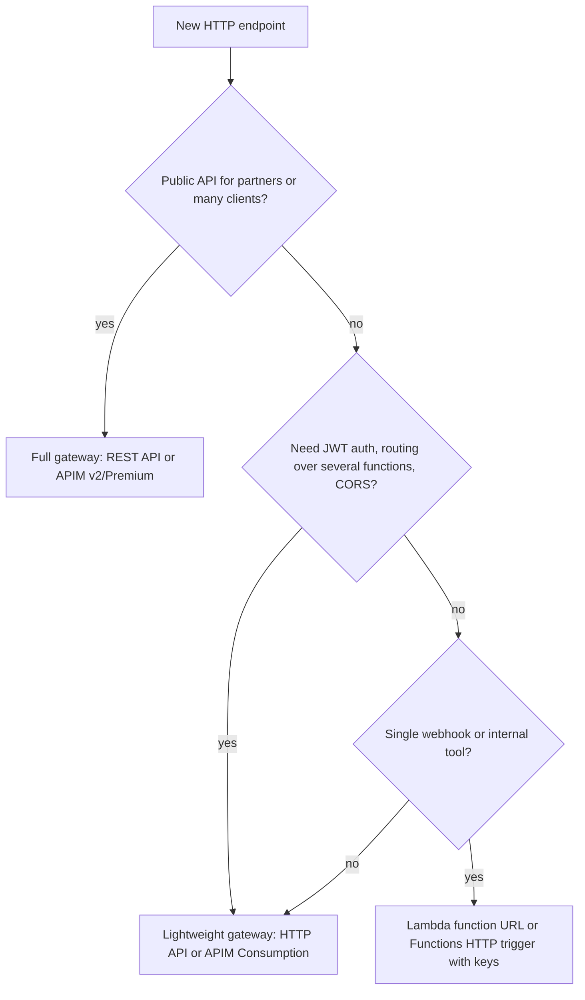

# API Gateway and Azure API Management

## Introduction

Once a function answers HTTP requests, you quickly need more than "a URL that runs code". You need routing (`GET /orders` to one function, `POST /orders` to another), authentication, rate limits so one client cannot drain your budget, CORS for browsers, request validation, custom domains, versioning and logging.

An **API gateway** is the managed front door that does all of that before a request ever reaches your function. Think of a hotel reception desk. Guests do not wander straight into the kitchen or the laundry. Reception checks who they are, sends them to the right place, enforces rules ("no visitors after midnight") and keeps a log of who came in.

On the two clouds:

- **Amazon API Gateway** offers **HTTP APIs** (lean and cheaper), **REST APIs** (feature-rich) and **WebSocket APIs**.
- **Azure API Management (APIM)** is a full API management platform with a gateway, a policy engine, a developer portal and several pricing tiers, from serverless **Consumption** to **v2** and classic dedicated tiers.

They overlap, but they are not identical. API Gateway is mostly a serverless request router with add-ons. APIM is an API *product* platform that also routes requests. This page shows both, when each is worth it, and when a simpler option (a Lambda function URL or a plain Azure Functions HTTP trigger) is enough.

## What a Gateway Does



| Capability | Amazon API Gateway | Azure API Management |
| --- | --- | --- |
| Routing to functions | Lambda proxy integration | Backend set to a Function App, Container App, App Service or any URL |
| JWT validation | HTTP API JWT authorizer; Lambda authorizer for REST | `validate-jwt` or `validate-azure-ad-token` policy |
| API keys and usage plans | REST APIs only | Subscriptions and products, all tiers |
| Rate limiting | Stage and route throttling; per-client usage plans on REST | `rate-limit`, `rate-limit-by-key`, `quota` policies (availability varies by tier) |
| Request and response transformation | REST mapping templates; HTTP API parameter mapping | Rich XML policies with C# expressions |
| Caching | REST APIs | Built-in cache (size varies by tier) or external Redis-compatible cache |
| WAF | AWS WAF on REST APIs | Put Azure Front Door or Application Gateway with WAF in front |
| Developer portal | API Gateway portals for REST APIs | Built in (not in Consumption tier) |
| Private APIs | REST private endpoints | VNet injection or private endpoints, depending on tier |

## Choosing the Right Flavor

### On AWS

The official guidance is short: choose **REST APIs** if you need API keys, per-client throttling, request validation, AWS WAF or private endpoints; otherwise choose **HTTP APIs**, which are designed with fewer features at a lower price.

| Need | HTTP API | REST API |
| --- | --- | --- |
| Simple Lambda backend with JWT auth | Yes | Possible, more setup |
| API keys and usage plans for partners | No | Yes |
| AWS WAF, caching, request validation | No | Yes |
| Private (VPC-only) endpoint | No | Yes |
| Edge-optimized endpoint | No | Yes |
| Automatic deployments | Yes | No, you create deployments |
| Bidirectional real-time messages | Use **WebSocket API** | Use **WebSocket API** |

### On Azure

APIM tiers differ in features, scaling and SLA. A simplified view based on the [feature comparison](https://learn.microsoft.com/en-us/azure/api-management/api-management-features):

| Tier | Billing model | Notable features | Typical use |
| --- | --- | --- | --- |
| Consumption | Per call, scales automatically | No developer portal, no built-in cache, fewer policies | Serverless APIs, low or spiky traffic |
| Developer | Per hour, no SLA | Most features for testing | Non-production evaluation |
| Basic v2 / Standard v2 | Per hour per unit | Faster provisioning; Standard v2 can reach VNet backends | Most production APIs |
| Premium / Premium v2 | Per hour per unit | VNet injection, availability zones; classic Premium adds multi-region and self-hosted gateway | Enterprise, regulated, global |
| Basic / Standard (classic) | Per hour per unit | Older dedicated tiers | Existing deployments |

:::note
Tier names, features and prices change. Prices vary by region; use the [Azure Pricing Calculator](https://azure.microsoft.com/pricing/calculator/) and [AWS Pricing Calculator](https://calculator.aws/) for estimates. In short: API Gateway HTTP and REST APIs bill **per request** (plus data transfer, and caching by the hour). APIM Consumption bills **per call**; other APIM tiers bill **per unit per hour** whether or not you receive traffic.
:::

### Timeouts to remember

- API Gateway has an **integration timeout** of about 29 to 30 seconds by default; REST APIs can request a longer timeout for Regional and private APIs. Check the [API Gateway quotas](https://docs.aws.amazon.com/apigateway/latest/developerguide/limits.html).
- Azure Functions HTTP triggers must respond within about **230 seconds**, and APIM has its own `forward-request` timeout.
- For anything slower, return `202 Accepted` with a status URL and do the work asynchronously.

## Building It on AWS: HTTP API with JWT Auth

Assume the `cnr-lookup` Lambda function from [AWS Lambda](./1-cloud-aws-lambda.mdx) exists.

:::caution Cost warning
API Gateway bills per request after any free tier. Keep test APIs private behind auth, and delete them when finished.
:::

**1. Quick-create an HTTP API** that sends every request to the function:

```bash
aws apigatewayv2 create-api \
  --name links-api \
  --protocol-type HTTP \
  --target arn:aws:lambda:us-east-1:123456789012:function:cnr-lookup
```

Example output (trimmed):

```text
{
    "ApiEndpoint": "https://a1b2c3d4e5.execute-api.us-east-1.amazonaws.com",
    "ApiId": "a1b2c3d4e5",
    "Name": "links-api",
    "ProtocolType": "HTTP",
    "RouteSelectionExpression": "$request.method $request.path"
}
```

Quick create adds a default route, a Lambda integration and an auto-deploying `$default` stage.

**2. Allow API Gateway to invoke the function:**

```bash
aws lambda add-permission \
  --function-name cnr-lookup \
  --statement-id apigw-links-api \
  --action lambda:InvokeFunction \
  --principal apigateway.amazonaws.com \
  --source-arn "arn:aws:execute-api:us-east-1:123456789012:a1b2c3d4e5/*"
```

**3. Add a JWT authorizer** that trusts your identity provider (Amazon Cognito, Microsoft Entra ID, Auth0 and others all issue JWTs):

```bash
AUTHORIZER_ID=$(aws apigatewayv2 create-authorizer \
  --api-id a1b2c3d4e5 \
  --name jwt-auth \
  --authorizer-type JWT \
  --identity-source '$request.header.Authorization' \
  --jwt-configuration Audience=links-api-client,Issuer=https://cognito-idp.us-east-1.amazonaws.com/us-east-1_EXAMPLE \
  --query AuthorizerId --output text)
```

Then attach it to the route:

```bash
ROUTE_ID=$(aws apigatewayv2 get-routes --api-id a1b2c3d4e5 --query "Items[0].RouteId" --output text)
aws apigatewayv2 update-route --api-id a1b2c3d4e5 --route-id $ROUTE_ID \
  --authorization-type JWT --authorizer-id "$AUTHORIZER_ID"
```

**4. Test it:**

```bash
curl -i "https://a1b2c3d4e5.execute-api.us-east-1.amazonaws.com/links?code=cnr"
```

Output:

```text
HTTP/2 401
content-type: application/json
{"message":"Unauthorized"}
```

With a valid token in `Authorization: Bearer ...`, the request reaches Lambda. Inside the function, the verified claims are available at `event["requestContext"]["authorizer"]["jwt"]["claims"]`, so your code can read the user id without re-validating the token.

**5. Throttle the stage** so a runaway client cannot generate unlimited Lambda invocations:

```bash
aws apigatewayv2 update-stage --api-id a1b2c3d4e5 --stage-name '$default' \
  --default-route-settings ThrottlingBurstLimit=50,ThrottlingRateLimit=100
```

In SAM, the same API is a few lines in `template.yaml` (an `HttpApi` event with an `Auth` section); see the [AWS SAM documentation](https://docs.aws.amazon.com/serverless-application-model/latest/developerguide/what-is-sam.html).

## Building It on Azure: APIM Consumption in Front of Functions

Assume the `orders` function app from [Azure Functions](./2-cloud-azure-functions.mdx) exists.

:::caution Cost warning
The Consumption tier bills per call and has no hourly charge, which makes it the safest choice for learning. Other tiers bill per hour from the moment they are created. Delete the APIM instance when finished.
:::

**1. Create an APIM instance:**

```bash
az apim create \
  --resource-group rg-orders-demo \
  --name apim-orders-demo-$RANDOM \
  --location eastus \
  --publisher-name "Compile N Run" \
  --publisher-email admin@example.com \
  --sku-name Consumption
```

Consumption instances usually provision in minutes; dedicated tiers can take much longer.

**2. Import the API.** The simplest path is the portal's **APIs, Add API, Function App** option, which discovers HTTP functions. From the CLI you can import an OpenAPI description:

```bash
az apim api import \
  --resource-group rg-orders-demo \
  --service-name <apim-name> \
  --api-id orders \
  --path orders \
  --display-name "Orders API" \
  --specification-format OpenApi \
  --specification-path ./openapi.yaml
```

**3. Add policies.** APIM policies are XML documents applied at global, product, API or operation scope. This one validates Entra ID tokens, limits callers, and forwards to the function app with a key stored as a **named value** (or, better, uses the managed identity of APIM if your function app accepts Entra authentication):

```xml
<policies>
  <inbound>
    <base />
    <validate-jwt header-name="Authorization" failed-validation-httpcode="401"
                  failed-validation-error-message="Unauthorized">
      <openid-config url="https://login.microsoftonline.com/contoso.onmicrosoft.com/v2.0/.well-known/openid-configuration" />
      <audiences>
        <audience>api://orders-api</audience>
      </audiences>
    </validate-jwt>
    <rate-limit calls="100" renewal-period="60" />
    <set-backend-service base-url="https://func-orders-demo-12345.azurewebsites.net/api" />
    <set-header name="x-functions-key" exists-action="override">
      <value>{{orders-func-key}}</value>
    </set-header>
  </inbound>
  <backend>
    <base />
  </backend>
  <outbound>
    <base />
    <set-header name="X-Powered-By" exists-action="delete" />
  </outbound>
  <on-error>
    <base />
  </on-error>
</policies>
```

`{{orders-func-key}}` refers to a named value, which can itself be a reference to a Key Vault secret. Some policies, such as `rate-limit-by-key`, are not available in every tier; check the [policy reference](https://learn.microsoft.com/en-us/azure/api-management/api-management-policies) for tier support.

**4. Call through APIM.** Consumers need a **subscription key** (unless you disable it) plus the JWT:

```bash
curl -i "https://<apim-name>.azure-api.net/orders/orders" \
  -H "Ocp-Apim-Subscription-Key: <key>" \
  -H "Authorization: Bearer <token>" \
  -X POST -d '{"item": "mouse", "qty": 1}' -H "Content-Type: application/json"
```

Example output:

```text
HTTP/1.1 202 Accepted
content-type: application/json
{"id": "8d2c...", "item": "mouse", "qty": 1}
```

## Versioning, Stages and Observability

A gateway is also where you manage change and watch traffic.

| Concern | Amazon API Gateway | Azure API Management |
| --- | --- | --- |
| Environments | **Stages** (for example `dev`, `prod`) with stage variables; HTTP APIs support auto-deploy | Separate APIM instances per environment, or workspaces; **revisions** for non-breaking changes |
| Breaking changes | New base path or a new API | **Versions** (path, header or query string versioning schemes) |
| Canary releases | REST API canary settings on a stage; or Lambda alias weights behind the gateway | Revisions, or traffic splitting at the backend (for example Container Apps revision weights) |
| Access logs | Access logging to CloudWatch Logs (both); Firehose for REST APIs | Azure Monitor resource logs and Application Insights |
| Metrics | CloudWatch metrics: count, latency, 4XX and 5XX errors | Azure Monitor metrics: requests, duration, capacity |
| Tracing | AWS X-Ray on REST APIs | Application Insights correlation |

Turn on access logs from day one. A structured access log line per request (request id, route, status, latency, caller identity) is the fastest way to answer "who is hammering our API?" or "which route started failing at 14:02?". Keep log retention short for high-volume APIs to control cost.

Example: enable JSON access logging for an HTTP API stage.

```bash
aws apigatewayv2 update-stage --api-id a1b2c3d4e5 --stage-name '$default' \
  --access-log-settings 'DestinationArn=arn:aws:logs:us-east-1:123456789012:log-group:/apigw/links-api,Format={"requestId":"$context.requestId","route":"$context.routeKey","status":"$context.status","latencyMs":"$context.responseLatency","ip":"$context.identity.sourceIp"}'
```

## Do You Even Need a Gateway?

Gateways add cost, latency and configuration. Sometimes the built-in HTTP endpoint is enough.



## Real-World Scenario

**Your team runs a B2B logistics platform.** Fifty partner companies call your shipment-tracking API. Each partner has a contract limiting them to a certain number of calls per day, wants documentation, and needs its own credentials. Internally, the API is implemented by a handful of functions plus one legacy service running on VMs.

### The solution

- **On Azure:** APIM **Standard v2** in front of Azure Functions and the legacy service. Each partner gets a **subscription** in a **product** with a `quota` policy. Partners authenticate with OAuth client credentials validated by `validate-jwt`, plus their subscription key. The **developer portal** publishes docs and lets partners rotate keys. Standard v2 reaches the private VNet where the legacy service lives.
- **On AWS:** an API Gateway **REST API** with **usage plans** and **API keys** per partner, a Lambda authorizer or Cognito for OAuth, **AWS WAF** attached, and a **VPC link** to the legacy service behind a Network Load Balancer. Partner docs come from the OpenAPI export or an API Gateway portal.

### Why this approach

- Per-partner **quotas and keys** are first-class features of APIM products and REST API usage plans. HTTP APIs and APIM Consumption are thinner and would push that logic into your code.
- The gateway gives a **single, versioned contract** even though the backend is a mix of functions and VMs. You can move the legacy service to a function later without changing partner URLs.
- **Central policies** keep auth, throttling and logging out of every function.

### When to use it, and when not to

Use a full API management tier when APIs are a product with external consumers, contracts and documentation. For an internal single-page app talking to its own backend, an HTTP API or APIM Consumption with JWT auth is cheaper and simpler. For one webhook, skip the gateway.

### Alternatives and trade-offs

| Approach | Pros | Cons | Best for |
| --- | --- | --- | --- |
| Function URL or plain HTTP trigger | Zero extra cost, lowest latency | No routing, quotas or central policy | Webhooks, internal tools |
| API Gateway HTTP API | Cheap, JWT auth, simple | No API keys, WAF or caching | Most first-party serverless APIs on AWS |
| API Gateway REST API | Usage plans, WAF, caching, private APIs | Higher per-request cost, more config | Partner APIs on AWS |
| APIM Consumption | Per-call billing, policies | No developer portal or built-in cache | Serverless APIs on Azure |
| APIM v2 or Premium | Full API product platform, VNet options | Hourly cost even when idle | Partner and enterprise APIs |
| Self-managed gateway (Kong, NGINX, Envoy) | Portable, full control | You run and patch it | Multi-cloud or Kubernetes-heavy teams |

## Common Mistakes

1. **Using REST APIs or premium APIM tiers by default.** Start with the lightest option that meets your needs.
2. **Leaving the backend publicly reachable.** If clients can bypass the gateway by calling the function directly, your gateway policies are pointless. Require function keys or Entra auth that only APIM has, or use private networking.
3. **Doing auth twice inconsistently.** Validate tokens at the gateway, then trust the forwarded claims in the function rather than writing your own JWT parser.
4. **No throttling.** A single buggy client can create unlimited function invocations. Set stage, route or policy limits.
5. **Ignoring the integration timeout.** Long-running work behind a gateway fails with 504 errors. Go asynchronous.
6. **Forgetting CORS.** Browser apps fail with confusing errors. Configure CORS at the gateway, not in each function.

## Cleanup

```bash
# AWS
aws apigatewayv2 delete-api --api-id a1b2c3d4e5
aws lambda remove-permission --function-name cnr-lookup --statement-id apigw-links-api

# Azure
az apim delete --resource-group rg-orders-demo --name <apim-name> --yes
```

On Azure, a deleted APIM instance may be kept in a soft-deleted state for a period; purge it if you need to reuse the name (see `az apim deletedservice purge`).

## Summary

- An API gateway handles routing, authentication, throttling, transformation, caching and logging in front of your functions.
- **API Gateway HTTP APIs** are the lean, cheaper default on AWS; **REST APIs** add API keys, usage plans, WAF, caching and private endpoints; **WebSocket APIs** handle real-time messaging.
- **Azure API Management** is a full API platform; **Consumption** bills per call, while **v2** and classic tiers bill per unit per hour and add VNet options, developer portal and more.
- Validate JWTs at the gateway, throttle every public API, and keep backends from being called directly.
- For a single webhook or internal tool, a Lambda function URL or a Functions HTTP trigger may be all you need.

## Further Learning

### Exercises

1. Create an HTTP API with two routes, `GET /links/{code}` and `POST /links`, pointing at two different Lambda functions. Add a JWT authorizer only to the `POST` route.
2. Write an APIM policy that returns a cached response for `GET` requests for 60 seconds (use `cache-lookup` and `cache-store`) and check which tiers support it.
3. Estimate the monthly gateway cost for 5 million requests on API Gateway HTTP API, API Gateway REST API, APIM Consumption and one unit of APIM Standard v2 using the official calculators. At what traffic level does the hourly tier become cheaper?
4. Make the Azure Function from the APIM example unreachable except through APIM. List two different ways to do it.

### Related pages

- [AWS Lambda](./1-cloud-aws-lambda.mdx)
- [Azure Functions](./2-cloud-azure-functions.mdx)
- [Load Balancers](../8-cloud-networking/4-cloud-load-balancers.mdx)
- [CDNs: CloudFront and Azure Front Door](../8-cloud-networking/6-cloud-cdn.mdx)
- [Federation, SSO and Identity Center](../2-cloud-identity/5-cloud-federation-and-sso.mdx)
- [Project: Serverless REST API](../14-cloud-projects/1-cloud-project-serverless-api.mdx)
