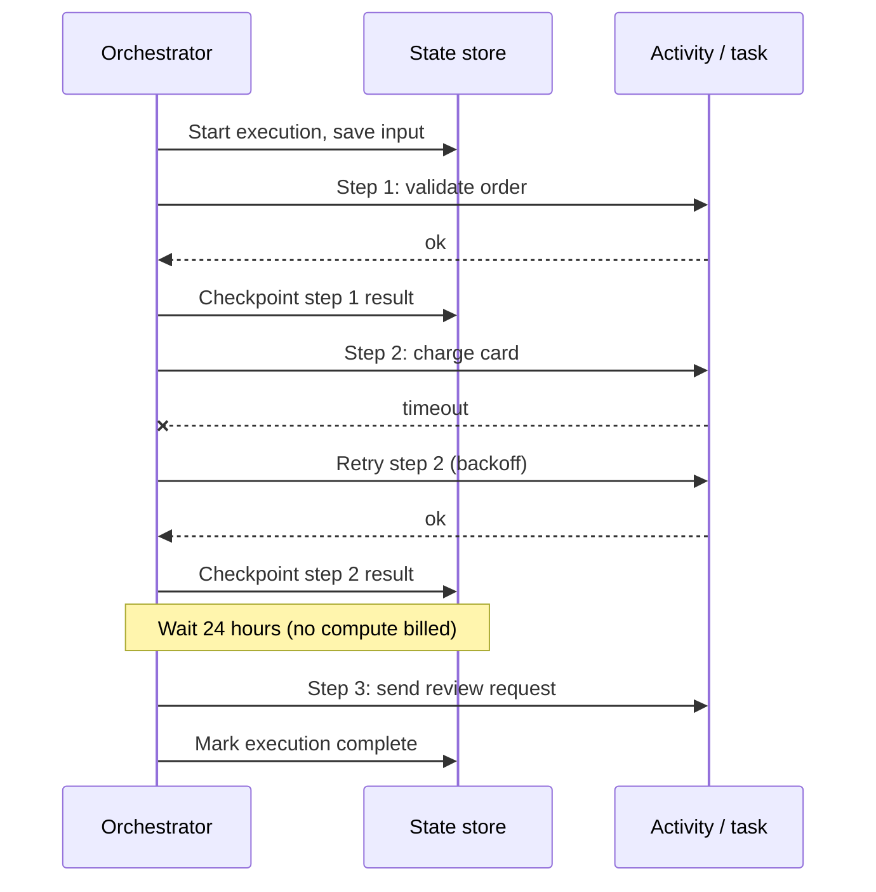
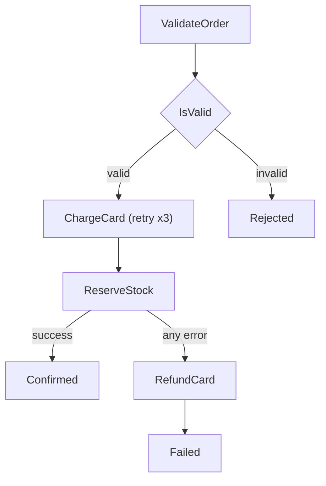

# Workflows: Step Functions and Durable Functions

## Introduction

Single functions are great at single jobs. Real business processes are rarely single jobs. An order needs to be validated, paid for, reserved in stock, shipped and confirmed, and if shipping fails, the payment must be refunded. A loan application waits days for a human to approve it. A video upload is split into chunks, each transcoded in parallel, then stitched back together.

You *could* chain functions by having each one call the next, but then:

- Who remembers how far the process got if something crashes halfway?
- Who retries step 3 without repeating steps 1 and 2?
- Where does a process "wait" for three days without paying for a function to sit idle?
- How does an operator see which orders are stuck, and where?

A **workflow orchestrator** answers those questions. It is like a project manager with a checklist: it tells each worker what to do, ticks off finished steps, chases failures, and can be asked at any moment "where are we?".

On the two clouds you have these main options:

| Approach | AWS | Azure |
| --- | --- | --- |
| Define workflow as a graph (JSON or visual designer) | **AWS Step Functions** | **Azure Logic Apps** (low-code, connector-focused) |
| Define workflow as ordinary code with checkpoints | **Lambda durable functions** | **Durable Functions** (extension of Azure Functions) |

This page focuses on Step Functions, Lambda durable functions and Azure Durable Functions, and shows when to pick each.

## The Core Idea: Checkpoint and Resume

All of these services share one trick. They **persist the progress** of a workflow after every step. If a worker crashes, the orchestrator resumes from the last completed step instead of starting over. Waits cost nothing because no code is running; the platform simply wakes the workflow up later.



Code-based orchestrators (Durable Functions and Lambda durable functions) implement this with **replay**: after each wake-up, your orchestrator code runs again from the top, but completed steps return their saved results instantly instead of executing again. That is why orchestrator code must be **deterministic**: no `datetime.now()`, random numbers or direct network calls in the orchestrator itself. Put those in steps or activities.

## AWS Step Functions

Step Functions workflows are **state machines** written in the **Amazon States Language** (ASL), a JSON format. You can also draw them in Workflow Studio in the console, which generates the same JSON.

### Standard vs Express

You choose the type when you create the state machine, and you cannot change it later.

| | Standard | Express |
| --- | --- | --- |
| Maximum duration | One year | Five minutes |
| Execution semantics | Exactly-once | At-least-once (async) or at-most-once (sync) |
| Billing basis | Per **state transition** | Per execution, plus duration and memory |
| Execution history | Kept by the service for 90 days | Only via CloudWatch Logs |
| Wait for callbacks (`.waitForTaskToken`) and `.sync` jobs | Yes | No |
| Best for | Long-running, auditable, non-idempotent business processes | High-volume, short event processing |

Source: [Choosing workflow type](https://docs.aws.amazon.com/step-functions/latest/dg/choosing-workflow-type.html). Prices vary by region; check the [Step Functions pricing page](https://aws.amazon.com/step-functions/pricing/) or the AWS Pricing Calculator.

### An order workflow in ASL

```json
{
  "Comment": "Order processing with retry, choice and compensation",
  "StartAt": "ValidateOrder",
  "States": {
    "ValidateOrder": {
      "Type": "Task",
      "Resource": "arn:aws:states:::lambda:invoke",
      "Parameters": {
        "FunctionName": "arn:aws:lambda:us-east-1:123456789012:function:validate-order",
        "Payload.$": "$"
      },
      "OutputPath": "$.Payload",
      "Next": "IsValid"
    },
    "IsValid": {
      "Type": "Choice",
      "Choices": [
        { "Variable": "$.valid", "BooleanEquals": true, "Next": "ChargeCard" }
      ],
      "Default": "Rejected"
    },
    "ChargeCard": {
      "Type": "Task",
      "Resource": "arn:aws:states:::lambda:invoke",
      "Parameters": {
        "FunctionName": "arn:aws:lambda:us-east-1:123456789012:function:charge-card",
        "Payload.$": "$"
      },
      "OutputPath": "$.Payload",
      "Retry": [
        {
          "ErrorEquals": ["States.TaskFailed"],
          "IntervalSeconds": 2,
          "MaxAttempts": 3,
          "BackoffRate": 2.0
        }
      ],
      "Next": "ReserveStock"
    },
    "ReserveStock": {
      "Type": "Task",
      "Resource": "arn:aws:states:::lambda:invoke",
      "Parameters": {
        "FunctionName": "arn:aws:lambda:us-east-1:123456789012:function:reserve-stock",
        "Payload.$": "$"
      },
      "OutputPath": "$.Payload",
      "Catch": [
        { "ErrorEquals": ["States.ALL"], "ResultPath": "$.error", "Next": "RefundCard" }
      ],
      "Next": "Confirmed"
    },
    "RefundCard": {
      "Type": "Task",
      "Resource": "arn:aws:states:::lambda:invoke",
      "Parameters": {
        "FunctionName": "arn:aws:lambda:us-east-1:123456789012:function:refund-card",
        "Payload.$": "$"
      },
      "Next": "Failed"
    },
    "Confirmed": { "Type": "Succeed" },
    "Rejected": { "Type": "Fail", "Error": "OrderInvalid", "Cause": "Validation failed" },
    "Failed": { "Type": "Fail", "Error": "StockUnavailable", "Cause": "Payment refunded" }
  }
}
```



The `Catch` on `ReserveStock` implements a **saga**: when a later step fails, a **compensating** step undoes the earlier one (refunding the charge). Step Functions also supports `Parallel`, `Map` (including Distributed Map for very large datasets), `Wait` and more than two hundred direct AWS service integrations, so many steps need no Lambda at all. Newer state machines can use **JSONata** instead of JSONPath for data transformations; the example above uses the default JSONPath style.

### Deploy and run with the CLI

:::caution Cost warning
Standard workflows bill per state transition; Express per execution and duration. The Lambda functions they call bill separately. Delete test state machines when finished.
:::

The state machine needs an IAM role that Step Functions can assume, with `lambda:InvokeFunction` on the four functions. Then:

```bash
aws stepfunctions create-state-machine \
  --name order-workflow \
  --type STANDARD \
  --definition file://order.asl.json \
  --role-arn arn:aws:iam::123456789012:role/order-workflow-role

aws stepfunctions start-execution \
  --state-machine-arn arn:aws:states:us-east-1:123456789012:stateMachine:order-workflow \
  --name order-1001 \
  --input '{"orderId": "1001", "amount": 42.5, "sku": "BOOK-7"}'
```

Example output (trimmed):

```text
{
    "executionArn": "arn:aws:states:us-east-1:123456789012:execution:order-workflow:order-1001",
    "startDate": "2026-10-11T10:02:11.123000+00:00"
}
```

Check the result:

```bash
aws stepfunctions describe-execution \
  --execution-arn arn:aws:states:us-east-1:123456789012:execution:order-workflow:order-1001 \
  --query "{status: status, output: output}"
```

```text
{
    "status": "SUCCEEDED",
    "output": "{\"orderId\": \"1001\", \"status\": \"confirmed\"}"
}
```

Using the order id as the execution `--name` gives you idempotency for free: a Standard workflow will not start a second running execution with the same name.

## Lambda Durable Functions

Introduced in late 2025, **Lambda durable functions** bring the code-first style to AWS. You enable durable execution when you create the function (it cannot be turned on later), wrap your handler with the Durable Execution SDK, and use **steps** and **waits**. An execution can run for up to one year, and you are not billed for compute while it waits.

```python
# lambda_function.py (Python durable function)
from aws_durable_execution_sdk_python import DurableContext, durable_execution, durable_step
from aws_durable_execution_sdk_python.config import Duration

@durable_step
def charge_card(step_context, order_id, amount):
    step_context.logger.info(f"Charging {amount} for {order_id}")
    return {"orderId": order_id, "charged": amount}

@durable_step
def send_review_request(step_context, order_id):
    step_context.logger.info(f"Asking for a review of {order_id}")
    return {"orderId": order_id, "review": "requested"}

@durable_execution
def lambda_handler(event, context: DurableContext):
    order_id = event["orderId"]
    payment = context.step(charge_card(order_id, event["amount"]))
    context.wait(Duration.from_seconds(60))      # no compute billed while waiting
    review = context.step(send_review_request(order_id))
    return {"payment": payment, "review": review}
```

Create it with the `--durable-config` option and invoke a **published version or alias**, never `$LATEST`, so replays always run the same code:

```bash
aws lambda create-function \
  --function-name order-durable \
  --runtime python3.14 \
  --handler lambda_function.lambda_handler \
  --role arn:aws:iam::123456789012:role/durable-function-role \
  --zip-file fileb://function.zip \
  --durable-config '{"ExecutionTimeout": 3600, "RetentionPeriodInDays": 7}'

aws lambda publish-version --function-name order-durable
aws lambda invoke --function-name order-durable:1 --invocation-type Event \
  --cli-binary-format raw-in-base64-out \
  --payload '{"orderId": "1001", "amount": 42.5}' response.json
```

The execution role needs the `AWSLambdaBasicDurableExecutionRolePolicy` managed policy for checkpoint operations. Supported runtimes include Python, Node.js and Java; see the [durable functions guide](https://docs.aws.amazon.com/lambda/latest/dg/durable-functions.html) for current details and quotas.

## Azure Durable Functions

**Durable Functions** is an extension of Azure Functions. A workflow is made of:

- **Client functions** that start orchestrations (often HTTP-triggered)
- **Orchestrator functions** that describe the workflow in code
- **Activity functions** that do the actual work
- Optional **entity functions** for small pieces of durable state

In Python, install `azure-functions-durable` and use the `DFApp` class:

```text
# requirements.txt
azure-functions
azure-functions-durable
```

```python
# function_app.py
import logging
import azure.functions as func
import azure.durable_functions as df

app = df.DFApp(http_auth_level=func.AuthLevel.FUNCTION)

@app.route(route="orders/start", methods=["POST"])
@app.durable_client_input(client_name="client")
async def start_order(req: func.HttpRequest, client) -> func.HttpResponse:
    order = req.get_json()
    instance_id = await client.start_new("order_orchestrator", client_input=order)
    logging.info("Started orchestration %s", instance_id)
    return client.create_check_status_response(req, instance_id)

@app.orchestration_trigger(context_name="context")
def order_orchestrator(context: df.DurableOrchestrationContext):
    order = context.get_input()
    retry = df.RetryOptions(first_retry_interval_in_milliseconds=2000, max_number_of_attempts=3)

    payment = yield context.call_activity_with_retry("charge_card", retry, order)

    # Fan-out: reserve each line item in parallel, then fan-in
    tasks = [context.call_activity("reserve_item", sku) for sku in order["skus"]]
    reservations = yield context.task_all(tasks)

    return {"payment": payment, "reservations": reservations}

@app.activity_trigger(input_name="order")
def charge_card(order: dict) -> str:
    return f"charged {order['amount']} for {order['orderId']}"

@app.activity_trigger(input_name="sku")
def reserve_item(sku: str) -> str:
    return f"reserved {sku}"
```

The orchestrator uses `yield` to hand control back to the framework at each step. Calling the start endpoint returns management URLs:

```bash
curl -X POST "http://localhost:7071/api/orders/start" \
  -H "Content-Type: application/json" \
  -d '{"orderId": "1001", "amount": 42.5, "skus": ["BOOK-7", "PEN-2"]}'
```

Example output (trimmed):

```text
{
  "id": "5f3c2a9e...",
  "statusQueryGetUri": "http://localhost:7071/runtime/webhooks/durabletask/instances/5f3c2a9e...?code=...",
  "sendEventPostUri": "...",
  "terminatePostUri": "...",
  "purgeHistoryDeleteUri": "..."
}
```

Querying `statusQueryGetUri` after completion:

```text
{
  "name": "order_orchestrator",
  "runtimeStatus": "Completed",
  "output": {"payment": "charged 42.5 for 1001", "reservations": ["reserved BOOK-7", "reserved PEN-2"]}
}
```

This is the built-in **async HTTP API pattern**: the client gets `202 Accepted` immediately and polls for status, which neatly avoids the 230-second HTTP limit.

### Storage backends

Durable Functions stores orchestration history in a **storage provider**. Microsoft now recommends the managed **Durable Task Scheduler**, which adds a monitoring dashboard and supports managed identity. The original **Azure Storage** provider needs no extra setup. **MSSQL** suits disconnected or portable deployments. Support for the **Netherite** backend ends on 31 March 2028. You cannot migrate data between providers, so choose early. See [storage providers](https://learn.microsoft.com/en-us/azure/durable-task/common/durable-task-storage-providers).

Other built-in patterns include **monitor** (polling with durable timers via `context.create_timer`), **human interaction** (`context.wait_for_external_event`, raised through `sendEventPostUri`) and **aggregator** (durable entities).

## Comparing the Options

| | Step Functions | Lambda durable functions | Azure Durable Functions | Azure Logic Apps |
| --- | --- | --- | --- | --- |
| Definition style | JSON (ASL) or visual designer | Code with steps and waits | Code with orchestrators and activities | Visual designer, JSON under the hood |
| Max duration | One year (Standard) | One year | No fixed limit (bounded by history size and retention) | Varies by plan |
| Visibility | Graph view of every execution | Console view of steps and checkpoints | Durable Task Scheduler dashboard or storage tooling | Run history in designer |
| Service integrations | Direct calls to hundreds of AWS APIs | Through SDK calls in steps | Through bindings and SDK calls | Hundreds of SaaS and Azure connectors |
| Testing | Local testing tools, but JSON is harder to unit test | Normal unit tests plus SDK test helpers | Normal unit tests; emulator for the backend | Mostly in the cloud |
| Billing | Per transition (Standard) or per execution and duration (Express) | Lambda compute plus durable operations | Function execution plus storage or scheduler costs | Per action or per plan |

## Real-World Scenario

**Your team runs an insurance claims portal.** A claim goes through automated fraud scoring, then waits for an adjuster's approval (which can take up to two weeks), then triggers a payout, and finally sends a letter. If the payout fails, the claim must go back to the adjuster with a note. Auditors want to see the full history of each claim.

### The solution

- **On AWS:** a **Standard** Step Functions workflow. The approval step uses the `.waitForTaskToken` callback pattern: the workflow sends a task token to the adjuster app and pauses until the app calls `SendTaskSuccess` or `SendTaskFailure`. Execution history gives auditors a visual trail. Because the payout is **not idempotent**, Standard's exactly-once semantics matter.
- **On Azure:** a **Durable Functions** orchestrator with `wait_for_external_event("AdjusterDecision")` combined with a durable timer for the two-week deadline. The adjuster app raises the event via the `sendEventPostUri`. The Durable Task Scheduler dashboard shows each instance.

### Why this approach

- **Long waits** with no compute cost are exactly what these services were built for.
- **Built-in retries and compensation** handle payout failures without custom state tables.
- **Per-execution history** answers "what happened to claim 4711?" for support and audit.

### When to use it, and when not to

Use an orchestrator when a process has multiple steps, needs retries with state, waits for humans or external systems, or must be auditable. Do not use one to chain two quick steps that could be a single function, or for high-throughput stream processing where a queue and a stateless function are simpler and cheaper.

### Alternatives and trade-offs

| Approach | Pros | Cons | Best for |
| --- | --- | --- | --- |
| Step Functions Standard | Visual, auditable, exactly-once, direct AWS integrations | JSON definitions, cost per transition at very high volume | Business processes on AWS |
| Step Functions Express | High volume, cheap for short runs | Five-minute limit, at-least-once | Event and data processing |
| Lambda durable functions | Plain code, familiar testing | Newer service; deterministic-code rules | Developer-centric workflows on AWS |
| Azure Durable Functions | Plain code, rich patterns, entities | Deterministic-code rules, backend choice matters | Workflows on Azure Functions |
| Azure Logic Apps | Low-code, huge connector library | Harder to version and test like code | Integration with SaaS systems |
| Hand-rolled queues and status tables | No new service | You rebuild retries, timeouts and visibility | Very simple two-step flows |

## Common Mistakes

1. **Non-deterministic orchestrator code.** Calling `datetime.now()`, `uuid4()` or an HTTP API directly in a Durable orchestrator breaks replay. Use `context.current_utc_datetime`, `context.new_uuid()` and activities.
2. **Choosing Express for non-idempotent steps.** At-least-once execution can charge a card twice.
3. **Passing large payloads between steps.** Step Functions has a payload size limit and Durable history grows with every result. Store big data in S3 or Blob Storage and pass references.
4. **Using `$LATEST` for Lambda durable functions.** Replays may hit new code. Invoke a version or alias.
5. **No compensation logic.** A saga without compensating steps leaves half-finished business transactions.
6. **Forgetting to purge history.** Durable Functions history in Azure Storage grows forever unless you purge completed instances.

## Cleanup

```bash
# AWS
aws stepfunctions delete-state-machine \
  --state-machine-arn arn:aws:states:us-east-1:123456789012:stateMachine:order-workflow
aws lambda delete-function --function-name order-durable

# Azure (deletes the function app, storage and any scheduler in the group)
az group delete --name rg-orders-demo --yes --no-wait
```

## Summary

- Orchestrators **checkpoint progress**, **retry** failed steps, **wait** without compute cost and give **per-execution visibility**.
- **Step Functions** defines workflows as ASL state machines; **Standard** (up to a year, exactly-once) vs **Express** (five minutes, high volume).
- **Lambda durable functions** and **Azure Durable Functions** let you write workflows as ordinary code using replay; orchestrator code must be deterministic.
- Durable Functions offers patterns such as chaining, fan-out/fan-in, async HTTP APIs, monitors, human interaction and entities; the **Durable Task Scheduler** is the recommended backend.
- Use **sagas** with compensating steps for multi-service business transactions.

## Further Learning

### Exercises

1. Add a `Wait` state of 30 seconds between `ChargeCard` and `ReserveStock`, deploy it as Standard, and watch the execution graph in the console.
2. Extend the Durable Functions orchestrator with a human approval step using `wait_for_external_event`, and a durable timer that cancels the order if no approval arrives within 10 minutes.
3. Rewrite the Lambda durable function so that `charge_card` failures are retried with backoff, and a refund step runs if `send_review_request` fails. Compare the code with the ASL version.
4. For one million short executions per day of a three-step workflow, compare the billing model of Step Functions Standard, Express and Lambda durable functions using the official pricing pages.

### Related pages

- [Event Sources and Triggers](./3-cloud-serverless-triggers.mdx)
- [Serverless Trade-offs and Costs](./7-cloud-serverless-trade-offs.mdx)
- [Event-Driven Patterns in the Cloud](../9-cloud-messaging-and-integration/4-cloud-event-driven-patterns.mdx)
- [Queues: SQS and Azure Service Bus](../9-cloud-messaging-and-integration/1-cloud-sqs-and-service-bus.mdx)
- [Project: Event-Driven Image Processing Pipeline](../14-cloud-projects/4-cloud-project-event-pipeline.mdx)
