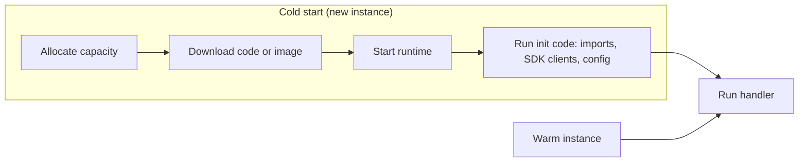

# Cold Starts and Performance

## Introduction

The first request to a serverless function after a quiet period is sometimes noticeably slower than the rest. That delay is a **cold start**: the platform has to find capacity, start a fresh execution environment, load the language runtime, load your code and run your initialization logic before your handler even begins.

Picture a food truck that parks for the night. The first customer in the morning waits while the cook switches on the grill. Everyone after that gets served quickly, until the lunch rush brings a second truck that also has to warm up. Serverless platforms behave the same way: each **new** instance, whether after idleness or during scale-out, pays the warm-up cost once.

For a nightly batch job, cold starts do not matter. For a checkout API where every 100 ms matters, they can. This page shows how to:

1. Understand what makes cold starts slow
2. Measure them on AWS and Azure
3. Reduce them with code changes first, then with platform features that cost money
4. Tune general performance: memory, concurrency and connection reuse

## Anatomy of a Cold Start



AWS states that cold starts typically occur in **under 1% of invocations** for production workloads, and range from under 100 ms to over a second ([Lambda execution environment](https://docs.aws.amazon.com/lambda/latest/dg/lambda-runtime-environment.html)). They are more common in development and low-traffic functions, because instances go idle and get reclaimed.

| Factor | Effect on cold start | What you control |
| --- | --- | --- |
| Runtime | Interpreted runtimes (Python, Node.js) start fast; JVM and .NET can be slower without optimizations | Runtime choice, SnapStart, ahead-of-time compilation |
| Package size | Bigger packages take longer to download and load | Trim dependencies, avoid huge layers |
| Init code | Imports and client creation run before the first request | Import only what you need, lazy-load rarely used modules |
| Memory size | On Lambda, CPU scales with memory, so init runs faster with more memory | Memory setting |
| Networking | Private networking setup can add work on some platforms | Use it only when needed |
| Plan or mode | Some plans keep instances warm | Provisioned concurrency, always ready, Premium |

:::note
On AWS Lambda, the Init phase is billed as part of duration for on-demand functions (AWS standardized init billing in 2025). Slow init code costs latency **and** money.
:::

## Measuring Cold Starts

Never optimize blind. Measure the percentage of cold starts and their duration first.

### On AWS

Every invocation writes a `REPORT` line to CloudWatch Logs. Cold starts include an `Init Duration` field:

```text
REPORT RequestId: 6f1c... Duration: 12.40 ms Billed Duration: 13 ms Memory Size: 512 MB Max Memory Used: 88 MB Init Duration: 412.77 ms
```

Use **CloudWatch Logs Insights** to summarize them:

```text
filter @type = "REPORT"
| stats count(*) as invocations,
        count(@initDuration) as coldStarts,
        avg(@initDuration) as avgInitMs,
        max(@initDuration) as maxInitMs,
        pct(@duration, 99) as p99DurationMs
  by bin(1h)
```

Run it from the CLI:

```bash
QUERY_ID=$(aws logs start-query \
  --log-group-name /aws/lambda/cnr-lookup \
  --start-time $(date -d '-24 hours' +%s) --end-time $(date +%s) \
  --query-string 'filter @type = "REPORT" | stats count(*) as invocations, count(@initDuration) as coldStarts, avg(@initDuration) as avgInitMs' \
  --query queryId --output text)
sleep 5
aws logs get-query-results --query-id $QUERY_ID
```

Example output (trimmed):

```text
{
    "results": [[
        {"field": "invocations", "value": "18234"},
        {"field": "coldStarts", "value": "57"},
        {"field": "avgInitMs", "value": "388.4"}
    ]],
    "status": "Complete"
}
```

Here 57 of 18,234 invocations (about 0.3%) were cold, averaging under 400 ms. Whether that matters depends on your latency target.

### On Azure

Azure Functions sends request telemetry to **Application Insights**. Cold starts show up as outliers in request duration, often right after periods of no traffic or when the scale controller adds instances. A KQL query in the Logs blade:

```text
requests
| where timestamp > ago(24h)
| summarize count(), p50 = percentile(duration, 50), p95 = percentile(duration, 95),
            p99 = percentile(duration, 99), instances = dcount(cloud_RoleInstance)
  by bin(timestamp, 1h)
| order by timestamp asc
```

A high p99 relative to p50, together with a rising `instances` count, usually points to cold starts during scale-out.

### A simple local experiment

You can see how much your imports cost before you deploy anything:

```python
# measure_init.py
import importlib
import time

def timed_import(name: str) -> float:
    start = time.perf_counter()
    importlib.import_module(name)
    return (time.perf_counter() - start) * 1000

for module in ["json", "decimal", "email.mime.multipart", "xml.dom.minidom"]:
    print(f"{module:25s} {timed_import(module):7.2f} ms")
```

Example output (numbers vary by machine):

```text
json                         0.85 ms
decimal                      2.10 ms
email.mime.multipart         6.42 ms
xml.dom.minidom              3.37 ms
```

Run it with your real dependencies (for example `pandas` or a large SDK) and you will often find one import responsible for most of your init time. You can also run `python -X importtime -c "import yourmodule"` for a detailed breakdown.

## Free Fixes: Optimize Your Code First

These apply to both clouds and cost nothing.

1. **Trim dependencies.** Remove unused packages; prefer smaller libraries.
2. **Create clients once, at module level,** so warm invocations reuse them.
3. **Lazy-load rarely used heavy modules** inside the code path that needs them.
4. **Avoid network calls during init** unless every request needs the result. If you must, cache with a time-to-live.
5. **Keep functions focused.** A function that handles one route loads less code than a monolith handling fifty.

```python
# handler_optimized.py
import json
import os

import boto3  # used on every request: load at init

TABLE = boto3.resource("dynamodb").Table(os.environ.get("TABLE_NAME", "links"))
_report_lib = None  # heavy and rarely used: load lazily

def _get_report_lib():
    global _report_lib
    if _report_lib is None:
        import csv  # stand-in for a heavy library such as a PDF generator
        _report_lib = csv
    return _report_lib

def handler(event, context):
    if event.get("rawPath") == "/report":
        csv = _get_report_lib()
        return {"statusCode": 200, "body": "report generated with " + csv.__name__}
    item = TABLE.get_item(Key={"code": event["pathParameters"]["code"]}).get("Item")
    return {"statusCode": 200 if item else 404, "body": json.dumps(item or {})}
```

## Paid Fixes on AWS

### Memory and architecture

More memory gives more CPU, which speeds up init and handler execution. The open-source [AWS Lambda Power Tuning](https://github.com/alexcasalboni/aws-lambda-power-tuning) tool runs your function at several memory sizes and charts cost against speed. Also try `arm64` (Graviton), which is often cheaper per GB-second.

### SnapStart

**SnapStart** initializes your function when you **publish a version**, takes a snapshot of the memory and disk state, and resumes new environments from that snapshot. It supports **Java 11 and later, Python 3.12 and later, and .NET 8 and later**.

```bash
aws lambda update-function-configuration \
  --function-name cnr-lookup \
  --snap-start ApplyOn=PublishedVersions
aws lambda wait function-updated --function-name cnr-lookup
aws lambda publish-version --function-name cnr-lookup
```

Things to know before enabling it:

- It works only on **published versions** and aliases, not `$LATEST`.
- It cannot be combined with provisioned concurrency, EFS, or ephemeral storage above 512 MB.
- Anything unique created during init (random seeds, unique ids, temporary credentials) is **shared by every restored environment**. Generate them in the handler or use runtime hooks.
- For Java there is no extra SnapStart charge. For Python and .NET you pay for **snapshot caching** (per published version, while active) and for each **restore**. Delete unused versions.

### Provisioned concurrency

**Provisioned concurrency** keeps a set number of execution environments initialized and ready. AWS recommends it when you need predictable start times, with double-digit millisecond responses.

```bash
aws lambda put-provisioned-concurrency-config \
  --function-name cnr-lookup \
  --qualifier prod \
  --provisioned-concurrent-executions 5
```

Example output:

```text
{
    "RequestedProvisionedConcurrentExecutions": 5,
    "Status": "IN_PROGRESS",
    ...
}
```

:::caution Cost warning
Provisioned concurrency is billed for every hour it is configured, whether or not requests arrive. Use Application Auto Scaling to raise it during business hours and lower it at night, and remove it with `aws lambda delete-provisioned-concurrency-config` when you no longer need it.
:::

### Lambda Managed Instances

For steady, high-volume workloads, **Lambda Managed Instances** run your functions on EC2 instances in your account. Execution environments are kept running and handle multiple concurrent requests, so there are no per-request cold starts, but you pay for the instances (EC2 pricing plus a management fee) even when idle.

## Paid Fixes on Azure

| Plan | Cold start behavior | How to reduce |
| --- | --- | --- |
| Flex Consumption | Scales to zero; improved cold start compared with legacy Consumption | Configure **always ready** instances per function group |
| Premium | Always at least one warm instance; prewarmed instances during scale-out | Set minimum and prewarmed instance counts |
| Dedicated (App Service) | No cold start if **Always On** is enabled | Enable Always On |
| Container Apps | Depends on minimum replicas | Set minimum replicas to 1 or more |
| Consumption (legacy) | Scales to zero; cold starts after idle | Migrate to Flex Consumption |

On Flex Consumption, set always ready instances with the CLI:

```bash
# Keep two warm instances for all HTTP-triggered functions
az functionapp scale config always-ready set \
  --resource-group rg-orders-demo --name func-orders-demo-12345 --settings http=2

# Optional: larger instances start and run faster for CPU-heavy work
az functionapp scale config set \
  --resource-group rg-orders-demo --name func-orders-demo-12345 --instance-memory 4096
```

:::caution Cost warning
Always ready instances are billed continuously, like provisioned concurrency on Lambda. Start with one, measure, and remove them with `az functionapp scale config always-ready delete` if they do not pay for themselves.
:::

Other Azure-specific tips:

- **Python apps:** keep `requirements.txt` small and use remote build so dependencies are compiled for the platform.
- **.NET apps:** use the isolated worker model (the in-process model reaches end of support on 10 November 2026) and consider ReadyToRun compilation.
- **Per-instance concurrency:** on Flex Consumption, HTTP functions can serve several requests per instance (`perInstanceConcurrency`). Higher values mean fewer instances, and therefore fewer cold starts, as long as your code is thread-safe and not CPU-bound.

## Performance Beyond Cold Starts

### Concurrency and throttling

| Concept | AWS Lambda | Azure Functions (Flex Consumption) |
| --- | --- | --- |
| Requests per instance | One at a time (default compute) | Configurable per-instance concurrency |
| Account or regional cap | Account concurrency quota per Region (default 1,000) | Regional subscription memory quota |
| Per-function cap | **Reserved concurrency** (also guarantees capacity) | `maximumInstanceCount` |
| Protect a downstream database | Reserved concurrency, SQS maximum concurrency | Max instance count, per-instance concurrency |

Capping concurrency is a performance tool too. A function that scales to 1,000 instances can overwhelm a relational database with connections. Use RDS Proxy on AWS or connection pooling and sensible limits on Azure.

### Connection reuse

Open database and HTTP connections at init and reuse them. For relational databases at high concurrency, put a pooler in front (Amazon RDS Proxy, or PgBouncer, which is built into Azure Database for PostgreSQL flexible server).

### Payload and dependency hygiene

Large request and response bodies add serialization time. Pass references (an S3 key or blob URL) instead of large documents.

## Real-World Scenario

**Your team runs a food-delivery app.** The "place order" API runs on serverless functions. Product managers complain that the first order after a quiet hour sometimes takes 2 seconds, and conversion drops when checkout is slow. Traffic is very high at lunch and dinner and near zero overnight.

### The solution

1. **Measure:** Logs Insights on AWS (or Application Insights on Azure) shows cold starts in about 2% of checkout requests, mostly at the start of each meal rush, with init around 1.5 seconds.
2. **Fix the code:** profiling with `python -X importtime` reveals a large analytics SDK imported at module level but used only for 1% of requests. Lazy-loading it cuts init by more than half.
3. **Add warm capacity only where it matters:** on AWS, enable **SnapStart** for the Python 3.13 checkout function, or use **provisioned concurrency** with a scheduled scaling action that raises it 15 minutes before lunch and dinner. On Azure, configure **always ready** HTTP instances on Flex Consumption during peak hours with a scheduled script.
4. **Leave non-critical functions alone:** email and analytics functions keep plain on-demand scaling.

### Why this approach

- Code fixes are free and help every invocation.
- Paid warm capacity is targeted at the one latency-critical path and the hours that matter.
- Measuring first avoids paying for warm instances that do not change user experience.

### When to use it, and when not to

Invest in cold-start mitigation for **user-facing, latency-sensitive** paths with uneven traffic. Skip it for asynchronous work (queues, batch jobs, nightly reports) where an extra second is irrelevant.

### Alternatives and trade-offs

| Approach | Pros | Cons | Best for |
| --- | --- | --- | --- |
| Code and dependency optimization | Free, helps everything | Engineering time | Always do this first |
| More memory (Lambda) | Faster init and execution | Higher GB-second rate | CPU-bound init |
| SnapStart | Large gains for Java; helps Python and .NET | Uniqueness caveats, caching and restore charges for Python/.NET | Heavy frameworks |
| Provisioned concurrency / always ready | Predictable latency | Paid while idle | Critical APIs with known peaks |
| Premium plan or Lambda Managed Instances | No cold starts at steady load | Minimum capacity always billed | Steady high traffic |
| Containers with minimum replicas | Full control, no cold start | Not scale-to-zero | Latency-critical services with steady load |
| "Warmer" pings on a schedule | Cheap hack | Warms only one instance, does not help scale-out | Avoid; use platform features |

## Common Mistakes

1. **Optimizing without measuring.** Many functions have so few cold starts that nobody notices them.
2. **Scheduled "keep-warm" pings.** They keep one instance warm, but a traffic burst still needs new instances that start cold.
3. **Over-provisioning warm capacity.** Provisioned concurrency or always ready instances left on 24/7 can cost more than the rest of the app.
4. **Ignoring uniqueness with SnapStart.** Ids or random seeds generated during init are cloned into every restored environment.
5. **Huge deployment packages.** Bundling test data, docs or unused libraries slows every cold start.
6. **Unbounded scale-out against a fragile database.** Cap concurrency and use connection pooling.

## Cleanup

```bash
# AWS
aws lambda delete-provisioned-concurrency-config --function-name cnr-lookup --qualifier prod
aws lambda update-function-configuration --function-name cnr-lookup --snap-start ApplyOn=None

# Azure
az functionapp scale config always-ready delete \
  --resource-group rg-orders-demo --name func-orders-demo-12345 --setting-names http
```

## Summary

- A cold start is the extra work to create a new execution environment: allocate, load code, start the runtime and run init code.
- Measure first: `Init Duration` in Lambda `REPORT` lines and Logs Insights; request percentiles and instance counts in Application Insights.
- Free fixes: trim dependencies, initialize clients once, lazy-load heavy modules, avoid init-time network calls.
- Paid fixes on AWS: more memory, **SnapStart** (Java, Python 3.12+, .NET 8+), **provisioned concurrency**, Lambda Managed Instances.
- Paid fixes on Azure: **always ready** instances on Flex Consumption, Premium plan, Always On, minimum replicas on Container Apps.
- Target warm capacity at latency-critical paths and peak hours only.

## Further Learning

### Exercises

1. Deploy a Python Lambda function that imports a large library at module level. Record `Init Duration` for five cold starts, then lazy-load the library and compare.
2. Run the Logs Insights query against one of your functions for the last week. What percentage of invocations were cold?
3. Enable SnapStart on a Python 3.13 function that generates a random token at init. Show that restored environments share the token, then fix it.
4. Write a script that raises Flex Consumption always ready instances to 2 at 11:00 and lowers them to 0 at 14:00. How would you run it on a schedule without a VM?

### Related pages

- [AWS Lambda](./1-cloud-aws-lambda.mdx)
- [Azure Functions](./2-cloud-azure-functions.mdx)
- [Serverless Trade-offs and Costs](./7-cloud-serverless-trade-offs.mdx)
- [Monitoring: CloudWatch and Azure Monitor](../12-cloud-observability-and-security/0-cloud-monitoring.mdx)
- [Scalability Patterns](../13-cloud-architecture/3-cloud-scalability-patterns.mdx)
