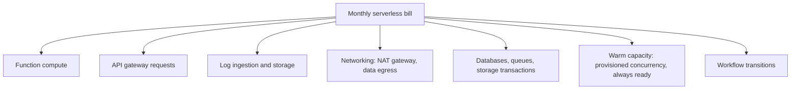
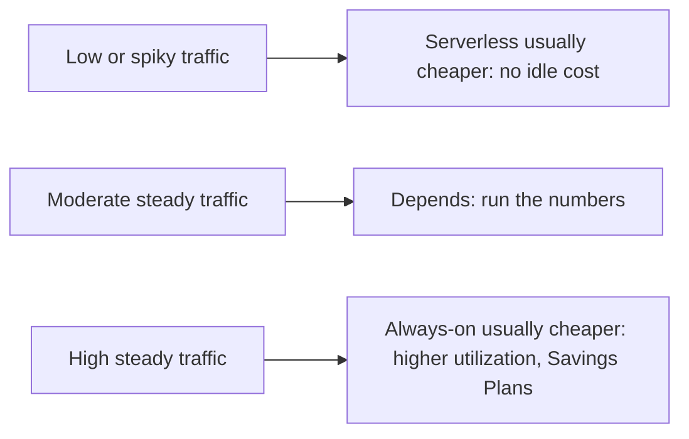
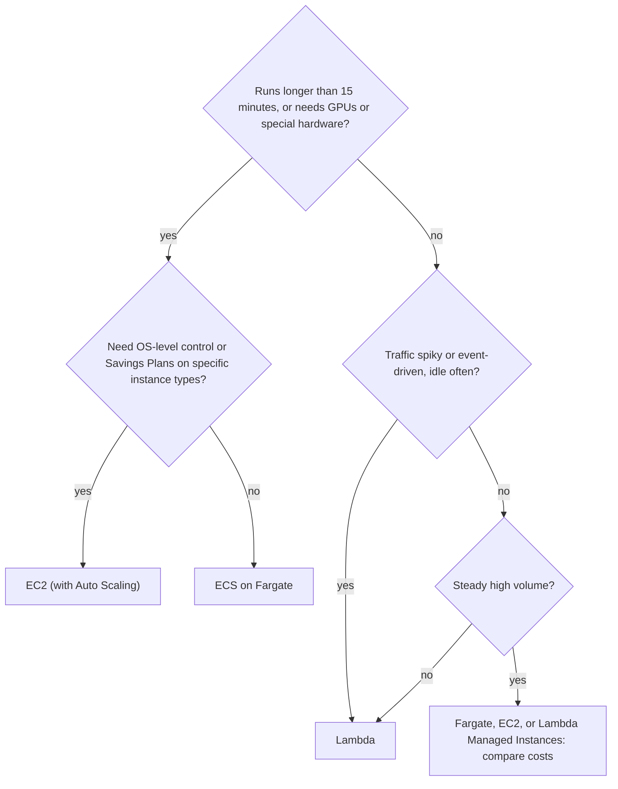

# Serverless Trade-offs and Costs

## Introduction

Serverless is often sold as "cheaper and simpler". Sometimes it is both. Sometimes it is neither. The honest answer is that serverless **moves** costs and complexity around:

- You stop paying for idle servers, but you pay a premium per unit of compute when busy.
- You stop patching operating systems, but you start managing many small functions, event wiring and IAM permissions.
- You gain automatic scaling, but you inherit platform limits, cold starts and a stronger tie to one provider.

Think of it like choosing between renting a car by the hour and leasing one. Hourly rental is unbeatable for a few trips a month. If you drive all day, every day, the lease wins, even though you now pay for the car while it sits in your driveway at night.

This page gives you the tools to make that call for real workloads: how each cloud bills, the costs that hide outside the function, a break-even model you can run yourself, the non-financial trade-offs, and decision guides for **Lambda vs Fargate vs EC2** and **Azure Functions vs Container Apps vs App Service**.

:::note
This tutorial never quotes prices: they vary by region and change over time. Use the [AWS Pricing Calculator](https://calculator.aws/) and the [Azure Pricing Calculator](https://azure.microsoft.com/pricing/calculator/) with your own numbers. What matters here is **how** things are billed.
:::

## How Serverless Is Billed

| Service | Billing dimensions |
| --- | --- |
| AWS Lambda (default) | Requests, plus GB-seconds (memory multiplied by duration, including init); architecture affects the rate; extra ephemeral storage; provisioned concurrency per hour; SnapStart caching and restores for Python and .NET |
| Lambda Managed Instances | EC2 instance cost plus a management fee; Savings Plans and Reserved Instances apply to the EC2 part |
| Azure Functions Flex Consumption | Executions, plus memory-time of instances while executing, plus always ready instances whenever configured |
| Azure Functions Premium | Core-seconds and memory of running instances, with at least one always on |
| API Gateway | Per request (HTTP and REST APIs at different rates), plus caching per hour and data transfer |
| Azure API Management | Consumption tier per call; other tiers per unit per hour |
| Step Functions | Standard: per state transition; Express: per execution, duration and memory |
| Durable Functions | Underlying function executions, plus storage transactions or Durable Task Scheduler charges |

The pattern: serverless compute is billed **per unit of work**, while the "warm capacity" features (provisioned concurrency, always ready, Premium, Managed Instances) are billed **per unit of time**, just like servers.

## The Costs Outside the Function

In real bills, the function line item is often small. Watch for these:



| Hidden cost | Why it surprises people | How to control it |
| --- | --- | --- |
| Logs | Debug logging on a busy function can ingest a lot of data; default retention is forever on CloudWatch | Log at INFO or WARN in production, use sampling, set retention |
| NAT gateway | Functions in private subnets need NAT for internet access, billed per hour and per GB | Use VPC endpoints or private endpoints; keep functions out of VPCs unless necessary |
| Data transfer out | Responses to the internet and cross-region traffic are billed per GB | Use a CDN, compress responses, keep data in one region |
| API gateway | Per-request charges can exceed function cost for tiny handlers | Use HTTP APIs or function URLs where features are not needed |
| Monitoring (Application Insights, X-Ray) | Telemetry volume grows with traffic | Configure sampling and daily caps |
| Retries and loops | A failing event retried many times, or a recursive trigger, multiplies cost | DLQs, max retry settings, loop-safe designs |
| Warm capacity left on | Provisioned concurrency or always ready instances bill 24/7 | Schedule them; review monthly |

## A Break-Even Model You Can Run

The question "is serverless cheaper for us?" is a calculation, not an opinion. This script compares a per-request model with an always-on model. **The unit prices are placeholders**: replace them with real values from the official calculators for your region before drawing any conclusion.

```python
# break_even.py
# All prices below are PLACEHOLDERS for illustration. Replace them with real
# values from the AWS or Azure pricing calculators for your region.
PRICES = {
    "per_million_requests": 1.0,     # placeholder currency units
    "per_gb_second": 0.00002,        # placeholder
    "always_on_per_hour": 0.05,      # placeholder: one small container or VM
}

HOURS_PER_MONTH = 730

def serverless_monthly(requests: int, avg_ms: float, memory_mb: int) -> float:
    gb_seconds = requests * (avg_ms / 1000) * (memory_mb / 1024)
    return requests / 1_000_000 * PRICES["per_million_requests"] + gb_seconds * PRICES["per_gb_second"]

def always_on_monthly(instances: int) -> float:
    return instances * HOURS_PER_MONTH * PRICES["always_on_per_hour"]

def break_even_requests(avg_ms: float, memory_mb: int, instances: int) -> int:
    per_request = serverless_monthly(1_000_000, avg_ms, memory_mb) / 1_000_000
    return int(always_on_monthly(instances) / per_request)

if __name__ == "__main__":
    for reqs in [100_000, 5_000_000, 50_000_000, 500_000_000]:
        s = serverless_monthly(reqs, avg_ms=100, memory_mb=512)
        a = always_on_monthly(instances=2)
        cheaper = "serverless" if s < a else "always-on"
        print(f"{reqs:>12,} req/month  serverless={s:9.2f}  always-on={a:7.2f}  -> {cheaper}")
    print("break-even:", f"{break_even_requests(100, 512, 2):,}", "requests/month")
```

```bash
python3 break_even.py
```

Output (with the placeholder prices above, **not real prices**):

```text
     100,000 req/month  serverless=     0.20  always-on=  73.00  -> serverless
   5,000,000 req/month  serverless=    10.00  always-on=  73.00  -> serverless
  50,000,000 req/month  serverless=   100.00  always-on=  73.00  -> always-on
 500,000,000 req/month  serverless=  1000.00  always-on=  73.00  -> always-on
break-even: 36,500,000 requests/month
```

The exact numbers are meaningless until you use real prices, but the **shape** is always the same:



Remember to add engineering time to both sides. Patching, scaling and on-call work for servers cost real salaries, and that often keeps serverless attractive even past the raw break-even point.

### Building a line-item estimate

The break-even script only covers compute. For a real decision, list every billable component for both options and fill in each cell from the calculators. Here is a worksheet for a typical serverless HTTP API compared with a container-based version of the same API:

| Line item | Serverless version: how it is billed | Container version: how it is billed |
| --- | --- | --- |
| Front door | API Gateway or APIM: per request | Load balancer: per hour plus capacity units |
| Compute | Requests plus GB-seconds (or executions plus memory-time) | vCPU and memory per second for each running task or replica |
| Warm capacity | Provisioned concurrency or always ready: per hour | Included: containers are always warm |
| Database | Same in both (for example DynamoDB on-demand or Cosmos DB serverless per request unit) | Same in both |
| Logs | Per GB ingested and stored | Per GB ingested and stored |
| Tracing and metrics | Per trace or per GB of telemetry | Per trace or per GB of telemetry |
| Networking | Egress per GB; NAT gateway if functions are in a VPC | Egress per GB; NAT gateway for private subnets |
| Engineering time | Function wiring, IAM per function, event debugging | Image builds, patching base images, scaling policies |

Work through the worksheet for **three traffic levels**: today, six months from now, and a "viral day" spike. Serverless often wins today and on the spike, while containers win at the six-month steady level. That result is a good reason for a hybrid design, or for planning a migration point in advance rather than discovering it on an invoice.

:::tip
Export your actual usage instead of guessing. On AWS, Cost Explorer can group costs by service and by tag; on Azure, Cost Management can group by resource and tag. A month of real data from a pilot beats any spreadsheet estimate.
:::

## Non-Financial Trade-offs

| Dimension | Serverless strength | Serverless weakness | Mitigation |
| --- | --- | --- | --- |
| Operations | No OS patching, built-in scaling and HA | Many small resources to manage | Infrastructure as code, naming and tagging standards |
| Latency | Fast for warm requests | Cold starts, gateway hops | See [Cold Starts and Performance](./6-cloud-cold-starts.mdx) |
| Limits | Generous for short tasks | Timeouts, payload sizes, memory caps | Workflows, containers for long jobs |
| Testing | Handlers are small and testable | Hard to reproduce full event wiring locally | Keep logic in plain functions; use emulators; test in a dev account |
| Observability | Logs and metrics out of the box | Requests hop across many functions | Distributed tracing with OpenTelemetry, X-Ray or Application Insights |
| Portability | Logic can be portable | Triggers, bindings, IAM and workflow definitions are provider-specific | Hexagonal design, containers, Terraform |
| Security | Small blast radius per function, managed patching of runtimes | Many identities and permissions to get right | Least-privilege roles per function, policy-as-code |

### Lock-in, honestly

Your **business logic** is rarely the lock-in. The lock-in is in the **glue**: event formats, triggers, bindings, IAM policies, Step Functions ASL, Durable Functions APIs. You can reduce it:

- Keep handlers thin; put logic in modules with no cloud imports.
- Use containers where portability matters: Lambda accepts container images, and Azure Functions can run on Container Apps.
- Use Terraform for infrastructure if you truly operate on more than one cloud (see [Terraform for AWS and Azure](../10-cloud-infrastructure-as-code/4-cloud-terraform-multi-cloud.mdx)).

But do not pay a large portability tax for a migration you may never do. See [Multi-Cloud and Hybrid Strategy](../13-cloud-architecture/5-cloud-multi-cloud-strategy.mdx).

## Function Granularity: How Many Functions?

A design question that affects cost, latency and maintenance: should each API route be its own function, or should one function handle a whole service?

| Style | Description | Pros | Cons |
| --- | --- | --- | --- |
| One function per route | `get-order`, `create-order`, `cancel-order` as separate functions | Least-privilege permissions per route, independent scaling and tuning, small packages | Many resources, duplicated config, more cold starts spread across functions |
| One function per service ("Lambdalith" or one function app per bounded context) | One handler with an internal router (for example a small web framework) | Fewer resources, shared warm instances, familiar web-framework code | Broader permissions, bigger package, one bad deploy affects all routes |
| Hybrid | Read paths in one function, sensitive writes in separate functions | Balance of both | Needs clear rules |

On Azure, the function app already groups related functions, and Flex Consumption scales all HTTP functions in an app together, so "one app per bounded context" is the natural default. On AWS, many teams start with one function per service using a lightweight router, then split out routes that need different memory, permissions or scaling. Either way, the trade-off is about **operational clarity**, not raw price: request and GB-second charges are about the same whichever way you slice the code.

## The Middle Ground: Warm Serverless

Both clouds now offer options between "pure pay-per-request" and "run your own servers":

| Option | What you get | What you give up |
| --- | --- | --- |
| Lambda provisioned concurrency | Pre-initialized environments, Lambda programming model | Hourly charge for the configured environments |
| Lambda Managed Instances | Functions on EC2 in your account, multi-concurrent environments, EC2 pricing and Savings Plans | Scale to zero; you pay for a minimum number of instances |
| Azure Functions Flex Consumption with always ready instances | Warm baseline plus on-demand burst | Charge for the always ready baseline |
| Azure Functions Premium plan | Always-warm instances, larger sizes, unbounded timeout | At least one instance billed at all times |

These are useful when a workload has a **steady baseline with bursts**. You pay a predictable amount for the baseline and still get serverless elasticity for spikes, without rewriting your code as a container service.

## Serverless Anti-Patterns

Some designs reliably produce high bills or poor reliability:

1. **Functions calling functions synchronously.** You pay for both while the caller waits, and errors cascade. Use queues, events or a workflow service.
2. **Polling in a loop inside a function.** Waiting for a job to finish by sleeping in a function bills idle time. Use a workflow wait, a callback or an event.
3. **Using a function as a long-lived connection holder.** WebSockets and streaming connections belong to services designed for them (API Gateway WebSocket APIs, Azure Web PubSub, SignalR Service).
4. **Fan-out without limits.** One event that triggers thousands of parallel functions, each opening a database connection, can take down the database.
5. **Shipping huge payloads through events.** Pass references to objects in storage instead of large messages.
6. **Treating every task as a function.** Batch jobs that run for hours, ML training and video encoding usually belong in containers or managed batch services.

## Decision Guide: Lambda vs Fargate vs EC2



| | AWS Lambda | ECS on Fargate | EC2 |
| --- | --- | --- | --- |
| Unit you manage | Function code or image | Container task | Virtual machine |
| Scale to zero | Yes | Not by default | No (unless you stop instances) |
| Max run time | 15 minutes per invocation | Unlimited | Unlimited |
| Billing | Per request and GB-second | Per vCPU and GB per second while tasks run | Per instance-second, with Savings Plans and Spot |
| Ops effort | Lowest | Low | Highest |
| Best for | Events, APIs with uneven traffic, glue | Long-running services and workers | Special hardware, full control, steady heavy load |

More detail on containers is in [Choosing a Container Platform](../5-cloud-containers/6-cloud-choosing-container-platform.mdx), and on VMs in [Choosing a Compute Option](../3-cloud-compute/0-cloud-compute-options.mdx).

## Decision Guide: Azure Functions vs Container Apps vs App Service

| | Azure Functions (Flex Consumption) | Azure Container Apps | Azure App Service |
| --- | --- | --- | --- |
| Unit you manage | Code in a function app | Container image | Code or container in a web app |
| Scale to zero | Yes | Yes (configurable minimum replicas) | No |
| Triggers | Rich trigger and binding model | HTTP and KEDA-based event scaling; can host Functions | HTTP; WebJobs for background work |
| Max run time | Long (HTTP responses limited to about 230 seconds) | Long-running apps and jobs | Long-running |
| Billing | Executions and memory-time; always ready extra | vCPU-seconds and GiB-seconds (consumption) or dedicated workload profiles | App Service plan per hour |
| Best for | Event-driven glue, webhooks, light APIs | Microservices, background workers, custom runtimes | Classic web apps and APIs with steady traffic |

Details: [Azure Container Apps and Container Instances](../5-cloud-containers/3-cloud-azure-container-apps.mdx) and [PaaS App Hosting: Elastic Beanstalk and App Service](../3-cloud-compute/5-cloud-paas-app-hosting.mdx).

## Keeping Serverless Costs Under Control

Serverless scales automatically, and so does the bill. Put guardrails in place from day one:

```bash
# AWS: cap one function's concurrency so a bug cannot scale it without limit
aws lambda put-function-concurrency --function-name cnr-lookup --reserved-concurrent-executions 50

# AWS: stop log groups from growing forever
aws logs put-retention-policy --log-group-name /aws/lambda/cnr-lookup --retention-in-days 14

# Azure: cap the maximum instances of a Flex Consumption app
az functionapp scale config set -g rg-orders-demo -n func-orders-demo-12345 --maximum-instance-count 20

# Azure: cap Application Insights daily ingestion (component name usually matches the app)
az monitor app-insights component billing update -g rg-orders-demo \
  --app func-orders-demo-12345 --cap 1
```

These commands are cheap insurance. A reserved concurrency limit turns a runaway bug into throttled requests instead of an unbounded bill, and a maximum instance count does the same on Azure. Pick limits a little above your real peak, and revisit them when traffic grows.

Also:

- Create **budgets and alerts** in both clouds (see [Budgets and Billing Alerts](../1-cloud-getting-started/7-cloud-budgets-and-alerts.mdx)).
- **Tag** every function and API with owner, environment and cost center (see [Tagging Strategies](../1-cloud-getting-started/6-cloud-tagging.mdx)).
- Review **warm capacity** monthly.
- Alarm on **DLQ depth** and **error rates**: retries cost money as well as reliability.

:::caution
Reserved concurrency on Lambda both **guarantees** and **limits** capacity, and it is subtracted from your account's unreserved pool. Setting it too low causes throttling; setting it on many functions can starve others. Treat it as a deliberate safety limit, not a default.
:::

## Real-World Scenario

**Your team runs a SaaS analytics product.** It has three workloads:

1. A **public ingestion API** receiving events from customer websites: very high, fairly steady volume (millions of small requests per hour), with daily peaks.
2. A **report generator** that customers trigger a few hundred times a day, each run taking 2 to 40 minutes.
3. **Integration webhooks** from about twenty SaaS tools: low, unpredictable volume.

The CFO asks whether "going fully serverless" would cut costs.

### The analysis

| Workload | Recommendation | Why |
| --- | --- | --- |
| Ingestion API | Containers (ECS on Fargate or EC2 with Savings Plans; Azure Container Apps dedicated profiles or App Service), or Lambda Managed Instances | Steady high volume is past the per-request break-even; a lightweight always-on service with batching to a stream is cheaper and avoids per-request gateway costs |
| Report generator | Containers as jobs (ECS tasks, Container Apps jobs) started from a queue, or a Step Functions / Durable Functions workflow coordinating chunks | Runs exceed the 15-minute Lambda limit; per-second container billing fits |
| Webhooks | Lambda or Azure Functions on Flex Consumption | Spiky, tiny, idle most of the time: the textbook serverless case |

### Why this approach

- **Match the billing model to the traffic shape.** Per-request pricing wins for spiky, idle-heavy work; per-hour pricing wins for steady, high-utilization work.
- **Respect hard limits.** Long reports do not belong in a 15-minute function.
- **Mix models.** Most mature cloud systems are hybrids of functions, containers and managed services.

### When to use serverless, and when not to

Choose serverless when traffic is spiky or low, tasks are short, the team is small and operational simplicity matters most. Avoid it when traffic is steady and heavy, tasks run long, latency budgets cannot tolerate cold starts without paying for warm capacity, or you need special hardware.

### Alternatives and trade-offs

| Approach | Pros | Cons | Best for |
| --- | --- | --- | --- |
| Fully serverless | Minimal ops, no idle cost | Expensive at steady scale, many limits | Startups, spiky products, glue |
| Containers everywhere | Uniform tooling, portable | Idle cost, more ops | Steady services, platform teams |
| VMs | Full control, cheapest at very high utilization with commitments | Most ops work | Legacy, special hardware |
| Hybrid (functions + containers + managed services) | Best fit per workload | More technologies to learn | Most production systems |

## Common Mistakes

1. **Comparing only compute prices.** Include gateways, logs, NAT, egress, monitoring and warm capacity.
2. **Ignoring engineering time.** Ops work on servers is a real cost; so is managing hundreds of functions.
3. **Going all-in on one model.** Mixing functions and containers is normal and healthy.
4. **No cost guardrails.** Without concurrency caps, budgets and log retention, a bug can produce a painful bill.
5. **Paying a big portability tax up front.** Keep logic portable cheaply; do not avoid every managed service "just in case".
6. **Re-evaluating never.** Traffic grows. Re-run the break-even analysis when usage changes significantly.

## Summary

- Serverless compute is billed per unit of work; warm capacity and always-on alternatives are billed per unit of time.
- The function is often not the biggest cost: watch gateways, logs, NAT gateways, egress, monitoring, retries and warm capacity.
- Run a **break-even analysis** with real prices: serverless usually wins for low or spiky traffic, always-on for steady heavy traffic.
- Non-financial trade-offs include limits, cold starts, testing, observability and lock-in in the event glue.
- Use the decision guides for Lambda vs Fargate vs EC2 and Functions vs Container Apps vs App Service, and mix models per workload.
- Add guardrails: concurrency and instance caps, log retention, telemetry caps, budgets and tags.
- Revisit the decision as traffic grows: the right answer for a prototype is often different from the right answer at scale.

## Further Learning

### Exercises

1. Replace the placeholder prices in `break_even.py` with real values for your region from the official calculators. Find the break-even point for a 200 ms, 1,024 MB function versus two small always-on containers.
2. Extend the script to include API gateway requests and log ingestion (assume 1 KB of logs per request). How does the break-even point move?
3. Take a system you know and classify each workload as "serverless", "container" or "VM" using the decision guides. Justify each choice in one sentence.
4. Set up a budget alert and a reserved concurrency cap for a test function. Write down what happens to requests when the cap is hit and how a caller would see it.

5. Pick one serverless function you run today. List every resource it touches (gateway, logs, queue, database, NAT, monitoring) and find each one's billing dimension in the official pricing pages. Which line item is largest?

### Related pages

- [Serverless Introduction](./0-cloud-serverless-introduction.mdx)
- [Cold Starts and Performance](./6-cloud-cold-starts.mdx)
- [Cloud Pricing Models](../0-cloud-fundamentals/7-cloud-pricing-models.mdx)
- [Cost Optimization and FinOps](../13-cloud-architecture/4-cloud-cost-optimization.mdx)
- [Spot, Reserved and Savings Plans](../3-cloud-compute/4-cloud-spot-and-reserved.mdx)
- [When the Cloud Makes Sense and When It Doesn't](../0-cloud-fundamentals/8-cloud-when-to-use.mdx)
- [Choosing a Compute Option](../3-cloud-compute/0-cloud-compute-options.mdx)
- [Workflows: Step Functions and Durable Functions](./5-cloud-step-functions-durable.mdx)
- [Project: Cost Monitoring and Alerts](../14-cloud-projects/6-cloud-project-cost-dashboard.mdx)
