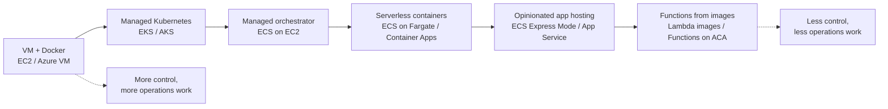
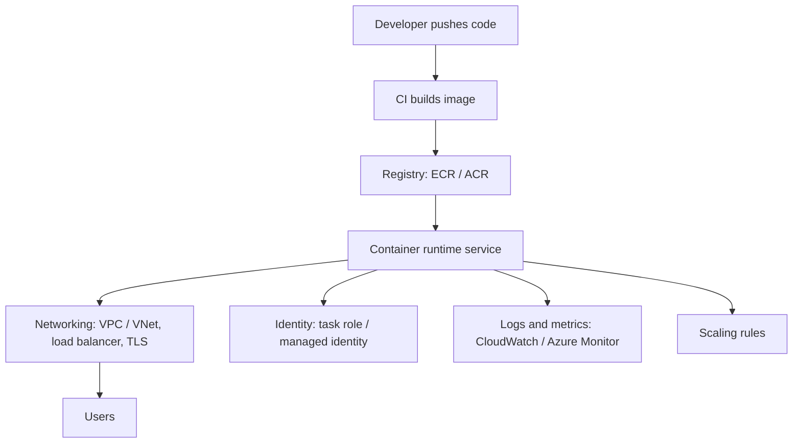
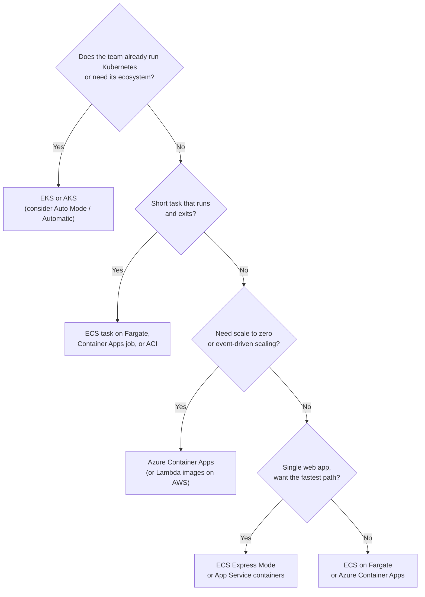

# Container Options in the Cloud

## Introduction

You have a working Docker image on your laptop. Now you want it running in the cloud, reachable by users, restarted when it crashes, and scaled when traffic spikes. Both AWS and Azure give you **many** ways to do this, and the names do not make the differences obvious: ECS, Fargate, EKS, App Runner, Container Apps, Container Instances, AKS, App Service, Lambda container images...

The good news is that they all sit on one spectrum. At one end, you get a raw virtual machine and install Docker yourself. At the other end, you hand the platform an image and a port number and it does everything else. Every step along that spectrum trades **control** for **convenience**.

Think of it like getting food delivered:

- **A VM with Docker** is buying groceries and cooking yourself. Total control, total effort.
- **Managed Kubernetes (EKS, AKS)** is renting a professional kitchen. The building and gas are handled, but you still run the kitchen.
- **ECS on Fargate or Azure Container Apps** is a meal-kit service. The hard parts are prepared, and you assemble the dish.
- **ECS Express Mode or `az containerapp up`** is ordering from a restaurant. You pick the dish and it shows up.

This page maps the whole landscape so the rest of the section makes sense. If you need a refresher on images and Dockerfiles first, see the [Docker tutorial](/docs/devops/docker). For the broader "VM vs PaaS vs serverless" decision, see [Choosing a Compute Option](../3-cloud-compute/0-cloud-compute-options.mdx).

## Why Containers in the Cloud?

A container image packages your code, runtime and dependencies into one artifact. That gives you three things the cloud cares about:

1. **Portability.** The same image runs on your laptop, in CI, on ECS, on Azure Container Apps and on any Kubernetes cluster.
2. **Fast, repeatable deploys.** A new version is a new image tag. Rolling back means pointing at the old tag.
3. **Density.** Many containers can share one machine, so you pay for fewer idle servers.

What containers do **not** give you is an answer to "who runs this?". Something still has to start containers, restart them, route traffic to them, give them network addresses and credentials, and scale them. That "something" is what the cloud services in this section provide.

## The Container Spectrum



Each level removes a layer of work from you:

| Level | You manage | Platform manages |
| --- | --- | --- |
| VM + Docker | OS, patching, Docker, restarts, scaling, load balancer | Hardware, hypervisor |
| Managed Kubernetes | Nodes (unless automated), add-ons, manifests, upgrades | Control plane (API server, etcd) |
| Managed orchestrator on your VMs | Instance fleet, task definitions | Scheduling, service health, placement |
| Serverless containers | Image, CPU/memory, scaling rules | Servers, OS patching, placement |
| Opinionated app hosting | Image and a few settings | Load balancer, TLS, scaling defaults, networking |
| Functions from images | Handler code inside an image | Everything else, including scale to zero |

## The Services, Side by Side

Here is the mapping between the two clouds. The rest of this section has a page for each main row.

| Need | AWS | Azure | Notes |
| --- | --- | --- | --- |
| Private image registry | Amazon ECR | Azure Container Registry (ACR) | See [Container Registries](./1-cloud-container-registries.mdx) |
| Run one container quickly, no orchestration | ECS `run-task` on Fargate | Azure Container Instances (ACI) | ACI is the simplest single-container service on either cloud |
| Long-running services without managing servers | Amazon ECS on AWS Fargate | Azure Container Apps | Both scale per task/replica |
| Opinionated "image to HTTPS URL" | Amazon ECS Express Mode | Azure Container Apps (`az containerapp up`), App Service for containers | App Runner is closed to new customers, see below |
| Container-based PaaS for web apps | Elastic Beanstalk (Docker platform) | Azure App Service (custom containers) | Covered in [PaaS App Hosting](../3-cloud-compute/5-cloud-paas-app-hosting.mdx) |
| Managed Kubernetes | Amazon EKS (with optional EKS Auto Mode) | Azure Kubernetes Service (AKS), including AKS Automatic | See [EKS](./4-cloud-eks.mdx) and [AKS](./5-cloud-aks.mdx) |
| Run functions packaged as images | AWS Lambda container images | Azure Functions on Container Apps | Covered in the [Serverless section](../4-cloud-serverless/0-cloud-serverless-introduction.mdx) |
| Batch and scheduled container jobs | ECS scheduled tasks, AWS Batch | Container Apps jobs, ACI | Jobs stop when the work is done |

:::caution Service changes to know about
- **AWS App Runner** no longer accepts new customers as of **April 30, 2026**. Existing services keep running, but AWS recommends **Amazon ECS Express Mode** for new "image to URL" workloads. You will still see App Runner in older blog posts and courses.
- **Amazon ECS Managed Instances** is a newer ECS capacity option: AWS runs and patches EC2 instances for you while you still choose instance types (for example, GPUs). It sits between Fargate and self-managed EC2.
- **EKS Auto Mode** and **AKS Automatic** both let the provider manage worker nodes too, not just the control plane.

Service names and features change often. Check the [Amazon ECS docs](https://docs.aws.amazon.com/AmazonECS/latest/developerguide/Welcome.html) and the [Azure Container Apps docs](https://learn.microsoft.com/azure/container-apps/) for the current state.
:::

## What Every Option Has in Common

Whatever you pick, a production container deployment needs the same building blocks. Learning them once makes every service easier.



1. **An image in a registry.** The runtime pulls from ECR or ACR, ideally with an identity instead of a password.
2. **A compute definition.** CPU, memory, port, environment variables. ECS calls this a *task definition*; Container Apps calls it a *template*; Kubernetes calls it a *Pod spec*.
3. **Networking.** Containers live in a VPC (AWS) or VNet (Azure). Public traffic usually goes through a load balancer or managed ingress. See [VPCs and VNets](../8-cloud-networking/1-cloud-vpc-and-vnet.mdx).
4. **Identity.** The container calls other cloud services (S3, Blob Storage, a database) with a role or managed identity, never with keys baked into the image. See [Workload Identity](../2-cloud-identity/4-cloud-workload-identity.mdx).
5. **Observability.** Logs go to CloudWatch Logs or Log Analytics. Health checks tell the platform when to restart a container.
6. **Scaling.** By CPU, memory, requests, or queue length.

## One Image, Many Hosts

The best way to see the spectrum is to run the same image on different services. Here is a tiny Python web app you can use throughout this section.

```python
# app.py
import os
import socket
from flask import Flask, jsonify

app = Flask(__name__)

@app.get("/")
def index():
    return jsonify(
        message="Hello from a container",
        host=socket.gethostname(),
        version=os.environ.get("APP_VERSION", "dev"),
    )

@app.get("/health")
def health():
    return jsonify(status="ok")

if __name__ == "__main__":
    app.run(host="0.0.0.0", port=int(os.environ.get("PORT", "8080")))
```

```text
# requirements.txt
flask==3.0.3
gunicorn==23.0.0
```

```dockerfile
# Dockerfile
FROM python:3.12-slim
WORKDIR /app
COPY requirements.txt .
RUN pip install --no-cache-dir -r requirements.txt
COPY app.py .
ENV PORT=8080
EXPOSE 8080
# Run as a non-root user
RUN useradd --create-home appuser
USER appuser
CMD ["gunicorn", "--bind", "0.0.0.0:8080", "--workers", "2", "app:app"]
```

Build and test it locally:

```bash
docker build -t hello-cloud:1.0.0 .
docker run --rm -p 8080:8080 -e APP_VERSION=1.0.0 hello-cloud:1.0.0
curl http://localhost:8080/
```

Example output:

```text
{"host":"3f2c9a1b7d4e","message":"Hello from a container","version":"1.0.0"}
```

:::tip Build for the right CPU architecture
If you build on an Apple Silicon Mac, your image is `arm64` by default. Azure Container Instances supports only `amd64` images, and Fargate tasks default to `X86_64` unless you set `ARM64`. Use `docker buildx build --platform linux/amd64 ...` (or build multi-arch images) to avoid "exec format error" at startup.
:::

### The Fastest Path on Each Cloud

Once the image is in a registry (next page), each cloud has a "just run it" command. These are shown here only to compare the shapes; each service has its own page with full detail and cleanup.

:::warning Cost
The commands below create billable resources: running containers, load balancers and log storage. Check pricing in the [AWS Pricing Calculator](https://calculator.aws/) or the [Azure Pricing Calculator](https://azure.microsoft.com/pricing/calculator/) and run the cleanup commands when you are done.
:::

### On AWS

ECS Express Mode creates a Fargate service, an Application Load Balancer with TLS, auto scaling and a URL in one call. It needs a task execution role and an infrastructure role (created on the [ECS and Fargate page](./2-cloud-ecs-and-fargate.mdx)).

```bash
aws ecs create-express-gateway-service \
    --primary-container '{"image":"123456789012.dkr.ecr.us-east-1.amazonaws.com/hello-cloud:1.0.0","containerPort":8080}' \
    --execution-role-arn arn:aws:iam::123456789012:role/ecsTaskExecutionRole \
    --infrastructure-role-arn arn:aws:iam::123456789012:role/ecsInfrastructureRoleForExpressServices \
    --health-check-path "/health" \
    --monitor-resources
```

Example output (trimmed):

```text
{
    "service": {
        "serviceName": "hello-cloud-4f1a",
        "status": { "statusCode": "ACTIVE" }
    }
}
```

The service URL follows the pattern `https://<service-name>.ecs.<region>.on.aws/`, for example `https://hello-cloud-4f1a.ecs.us-east-1.on.aws/`.

### On Azure

`az containerapp up` creates a Container Apps environment, a Log Analytics workspace and the app with external HTTPS ingress. This example uses Microsoft's public quickstart image (port 80) so it works before you have your own registry; with `hello-cloud` from ACR you would pass your ACR image and `--target-port 8080`.

```bash
az containerapp up \
  --name hello-cloud \
  --resource-group rg-containers-demo \
  --location eastus \
  --image mcr.microsoft.com/k8se/quickstart:latest \
  --target-port 80 \
  --ingress external \
  --query properties.configuration.ingress.fqdn
```

Example output:

```text
"hello-cloud.kindbay-1a2b3c4d.eastus.azurecontainerapps.io"
```

Notice the difference in shape: AWS Express Mode needs IAM roles up front because every AWS service acts through a role you create. Azure creates the identity plumbing for you inside the resource group. Neither is "better"; AWS is more explicit, Azure is more implicit.

### Cleanup

```bash
# AWS: deletes the Express Mode service and the infrastructure it created
aws ecs delete-express-gateway-service \
  --service-arn arn:aws:ecs:us-east-1:123456789012:service/default/hello-cloud-4f1a

# Azure: deletes everything in the resource group
az group delete --name rg-containers-demo --yes --no-wait
```

## Same Ideas, Different Words

Each platform names the same concepts differently. This table saves a lot of confusion when you read docs for more than one service.

| Concept | Amazon ECS | Azure Container Apps | Azure Container Instances | Kubernetes (EKS / AKS) |
| --- | --- | --- | --- | --- |
| Blueprint for what to run | Task definition | Container app template | Container group definition | Pod spec in a Deployment |
| One running copy | Task | Replica | Container group | Pod |
| Group of copies kept alive | Service | Container app (revision) | NGroups (or none) | Deployment / ReplicaSet |
| Shared boundary | Cluster | Environment | Resource group | Cluster / namespace |
| Run-to-completion work | Standalone or scheduled task | Job | Container group with restart policy `Never` | Job / CronJob |
| Identity for the workload | Task role | Managed identity | Managed identity | EKS Pod Identity / Entra Workload ID |
| Versioned rollout unit | Task definition revision | Revision | Redeploy | ReplicaSet |

## A Quick Decision Flow

You will get a full decision framework in [Choosing a Container Platform](./6-cloud-choosing-container-platform.mdx). For now, this rough flow covers most first decisions:



This is a starting point, not a rule. Team skills, existing cloud commitments, compliance needs and cost all shift the answer.

## How Billing Differs

Prices vary by region and change over time, so this tutorial never quotes numbers. What matters is **what you are billed for**:

| Option | Billed for | Idle cost |
| --- | --- | --- |
| VM + Docker (EC2, Azure VM) | Instance hours, disks, IPs | Full instance cost even with no traffic |
| ECS on Fargate | vCPU and memory per second while tasks run | Every running task, even idle ones |
| ECS Express Mode | Underlying Fargate, ALB, logs; no extra fee | ALB plus at least one task |
| ECS on EC2 / Managed Instances | The EC2 instances (plus a management fee for Managed Instances) | Whole instances |
| Azure Container Instances | vCPU and memory per second per container group | Running container groups |
| Azure Container Apps (Consumption) | vCPU-seconds, GiB-seconds, requests; lower idle rate; monthly free grant | **Zero** if scaled to zero |
| EKS | Per cluster-hour (higher in extended support) plus nodes | Control plane fee plus nodes |
| AKS | Control plane free on Free tier, hourly fee on Standard/Premium; plus nodes | Nodes (and tier fee) |

Two common surprises: **load balancers and NAT gateways** are billed by the hour whether or not traffic flows, and **data egress** (traffic leaving the cloud) is billed per GB. A "tiny" demo can cost more in networking than in compute. See [Cloud Pricing Models](../0-cloud-fundamentals/7-cloud-pricing-models.mdx).

## Real-World Scenario

Your team of six developers runs a B2B invoicing SaaS. Today it is a Python API, a React front end (served as static files), a nightly PDF-generation batch job, and a worker that processes uploaded CSV files from a queue. Everything runs with Docker Compose on two VMs that someone patches "when they remember". The CTO asks: "Which container service should we move to, on AWS or Azure?"

### Walking through the decision

1. **Do we need Kubernetes?** The team has no Kubernetes experience and four workloads. Kubernetes would add a control plane, upgrades, add-ons and YAML to learn. **Not yet.**
2. **Do we want to manage servers?** No. Patching is exactly the pain they want to remove. That rules out ECS on self-managed EC2 and plain VMs.
3. **Which workloads are always on?** The API: yes. The CSV worker: only when the queue has messages. The PDF job: once a night.
4. **Which platform matches that shape?**
   - On **Azure**, Container Apps covers all three: the API as an app with HTTP scaling, the worker as an app or event-driven job with a Service Bus scale rule (scales to zero), and the PDF generator as a scheduled job.
   - On **AWS**, ECS on Fargate covers all three: the API as a service behind an ALB (or via Express Mode), the worker as a service that scales on SQS queue depth, and the PDF job as an EventBridge-scheduled task.

### Why this approach

Serverless containers remove server patching, keep the existing Docker images unchanged, and leave a clear upgrade path. If the company later grows to dozens of services with a platform team, the same images run on EKS or AKS.

### When to use it, and when not to

- **Use serverless containers** when you have a handful to a few dozen services, want minimal operations, and your workloads fit the platform limits (CPU/memory per task or replica, supported networking).
- **Do not** pick them if you need Kubernetes-native tools (Helm charts from vendors, operators, service meshes you control), GPUs with very specific drivers, privileged containers, or strict per-node tuning. That points to EKS/AKS or ECS Managed Instances.

### Alternatives and trade-offs

| Approach | Pros | Cons | Best for |
| --- | --- | --- | --- |
| Docker on VMs | Full control, familiar | You patch, scale and heal everything | Legacy apps, very small single-server setups |
| ECS on Fargate | No servers, deep AWS integration, simple model | AWS-only API, no scale to zero for services | AWS teams wanting simple, reliable services |
| Azure Container Apps | Scale to zero, KEDA event scaling, jobs built in | Fewer low-level knobs than AKS | Microservices and event-driven apps on Azure |
| ECS Express Mode / App Service containers | Fastest path to an HTTPS URL | Opinionated defaults | Single web apps and APIs |
| EKS / AKS | Kubernetes ecosystem, portable manifests, maximum flexibility | Most to learn and operate, cluster fees | Many services, platform teams, multi-cloud |

## Common Mistakes

- **Starting with Kubernetes because it is popular.** Kubernetes solves the problems of many teams running many services. For a few services it mostly adds work. Start simpler and move up when you hit a real limit.
- **Baking secrets into images.** Anyone who can pull the image can read them. Use Secrets Manager or Key Vault references and workload identity. See [Secrets Management](../11-cloud-devops/4-cloud-secrets-management.mdx).
- **Using the `latest` tag in production.** You lose track of what is running and cannot roll back reliably. Tag with a version or Git SHA.
- **Forgetting health checks.** Without a health endpoint, the platform cannot tell a hung container from a healthy one.
- **Ignoring idle costs.** Load balancers, NAT gateways and always-on replicas cost money with zero traffic. Tear down demos.
- **Building `arm64` images for `amd64` hosts** (or the reverse). Set the platform explicitly in your build.

## Best Practices

- **Keep images small and boring.** Use slim base images, multi-stage builds and a non-root user. Smaller images pull faster, which shortens scale-out and cold starts.
- **Make containers stateless.** Store state in managed databases, object storage or caches, so any replica can be replaced at any time.
- **Log to stdout and stderr.** Every service in this section collects console output automatically.
- **Handle `SIGTERM`.** Platforms stop containers by sending `SIGTERM`, then kill them after a timeout. Finish in-flight requests and exit cleanly.
- **Define everything as code.** Use Terraform, CloudFormation/CDK or Bicep instead of console clicks. See [Infrastructure as Code in the Cloud](../10-cloud-infrastructure-as-code/0-cloud-iac-introduction.mdx).
- **Tag resources** with owner, environment and cost center so you can find and delete them. See [Tagging Strategies](../1-cloud-getting-started/6-cloud-tagging.mdx).

## Summary

- Cloud container services form a spectrum from **VMs with Docker** to **fully managed, opinionated hosting**. Each step trades control for less operational work.
- **AWS:** ECR, ECS (Fargate, EC2, Managed Instances, Express Mode), EKS (optionally Auto Mode), Lambda container images. App Runner is closed to new customers.
- **Azure:** ACR, Container Instances, Container Apps (apps and jobs), AKS (Standard or Automatic), App Service for containers.
- Every option needs the same building blocks: registry, compute definition, networking, identity, observability and scaling.
- Billing differs mainly in **idle cost**: per-second task billing, scale-to-zero, cluster fees, and always-on networking.
- Choose the **simplest option that meets your requirements**, and keep images portable so you can move later.

## Exercises

1. Build the `hello-cloud` image above for `linux/amd64` and `linux/arm64` with `docker buildx`. Inspect the manifest with `docker buildx imagetools inspect` and confirm both platforms are present.
2. List the workloads in a project you know (web app, workers, cron jobs). For each one, decide whether it is an always-on service, an event-driven worker or a scheduled job, and which AWS and Azure service you would map it to.
3. Using the billing table, explain in two sentences why a demo with one Fargate task behind an ALB still costs money overnight, while a Container Apps app with `--min-replicas 0` might not.
4. Write a one-paragraph recommendation for the invoicing SaaS scenario if the company later needs GPU-based OCR. Which option would you move that one workload to, and why?

**Next:** store your images in a private registry with [Container Registries: ECR and ACR](./1-cloud-container-registries.mdx), then compare [Amazon ECS and Fargate](./2-cloud-ecs-and-fargate.mdx) with [Azure Container Apps and Container Instances](./3-cloud-azure-container-apps.mdx). When you are ready to decide, read [Choosing a Container Platform](./6-cloud-choosing-container-platform.mdx).
