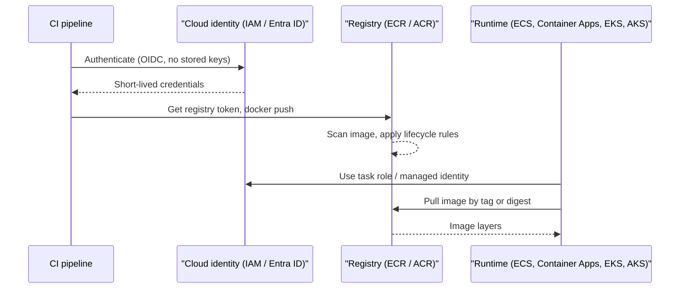

# Container Registries: ECR and ACR

## Introduction

Before any cloud service can run your container, it has to **pull the image from somewhere**. Public registries like Docker Hub work for open-source images, but your company's images belong in a **private registry** that sits close to where they run, enforces who can push and pull, scans for vulnerabilities, and cleans up old versions.

Each cloud has one:

- **Amazon Elastic Container Registry (ECR)** on AWS
- **Azure Container Registry (ACR)** on Azure

Think of a registry as a **warehouse for shipping containers**. Your CI pipeline is the factory that builds and drops off containers. ECS, Container Apps, EKS and AKS are the trucks that pick them up. The warehouse needs locks (identity), labels (tags), inspections (scanning) and a policy for throwing out old stock (lifecycle rules).

This page shows how both registries work, how to push and pull safely, and how to keep them from turning into an expensive junk drawer.

## Registry Vocabulary

| Term | Meaning | Example |
| --- | --- | --- |
| Registry | The service endpoint that holds repositories | `123456789012.dkr.ecr.us-east-1.amazonaws.com`, `myregistry.azurecr.io` |
| Repository | A named collection of related images | `invoicing/api` |
| Tag | A human-friendly, **movable** label | `1.4.2`, `git-3f2c9a1`, `latest` |
| Digest | The immutable content hash of an image manifest | `sha256:215d7e41...` |
| Manifest | JSON describing the image layers and config | One per platform |
| Image index (multi-arch) | A manifest that points to per-platform manifests | `amd64` + `arm64` in one tag |
| OCI artifact | Any non-image content stored in a registry | Helm charts, SBOMs, signatures |

The most important idea: **tags can move, digests cannot.** If someone pushes a new image as `1.4.2`, the tag now points to different content. A digest always refers to the exact same bytes. Production deployments should either use immutable tags or deploy by digest.

## How Push and Pull Work



Neither cloud uses a long-lived Docker password in the recommended setup. You authenticate to the cloud first, then exchange that identity for a short-lived registry token.

## On AWS: Amazon ECR

Every AWS account has one private ECR registry per Region, at `ACCOUNT_ID.dkr.ecr.REGION.amazonaws.com`. Inside it you create repositories.

:::warning Cost
ECR bills for **storage per GB-month** and for **data transfer out** (pulls across Regions or to the internet). Image scanning with Amazon Inspector has its own charges. Pulls from services in the same Region are generally not charged for transfer, but check the [ECR pricing page](https://aws.amazon.com/ecr/pricing/) because terms change.
:::

### Create a repository

```bash
export AWS_REGION=us-east-1
export ACCOUNT_ID=$(aws sts get-caller-identity --query Account --output text)

aws ecr create-repository \
    --repository-name invoicing/api \
    --image-tag-mutability IMMUTABLE \
    --encryption-configuration encryptionType=AES256 \
    --region "$AWS_REGION"
```

Example output (trimmed):

```text
{
    "repository": {
        "repositoryArn": "arn:aws:ecr:us-east-1:123456789012:repository/invoicing/api",
        "repositoryName": "invoicing/api",
        "repositoryUri": "123456789012.dkr.ecr.us-east-1.amazonaws.com/invoicing/api",
        "imageTagMutability": "IMMUTABLE",
        "encryptionConfiguration": { "encryptionType": "AES256" }
    }
}
```

`--image-tag-mutability` accepts `MUTABLE` (the default), `IMMUTABLE`, and the newer `IMMUTABLE_WITH_EXCLUSION` and `MUTABLE_WITH_EXCLUSION` modes that let you exempt specific tag patterns. Use `KMS` instead of `AES256` if you need a customer managed key (see [Encryption and KMS](../12-cloud-observability-and-security/5-cloud-encryption-and-kms.mdx)).

### Log in, tag and push

```bash
REGISTRY="$ACCOUNT_ID.dkr.ecr.$AWS_REGION.amazonaws.com"

# Exchange your AWS identity for a registry token (valid for 12 hours)
aws ecr get-login-password --region "$AWS_REGION" \
  | docker login --username AWS --password-stdin "$REGISTRY"

docker tag hello-cloud:1.0.0 "$REGISTRY/invoicing/api:1.0.0"
docker push "$REGISTRY/invoicing/api:1.0.0"
```

Example output:

```text
Login Succeeded
The push refers to repository [123456789012.dkr.ecr.us-east-1.amazonaws.com/invoicing/api]
5f70bf18a086: Pushed
e9ae3c220b23: Pushed
1.0.0: digest: sha256:9b1c6a3e4d5f... size: 1789
```

Your IAM principal needs `ecr:GetAuthorizationToken` plus push permissions on the repository. Get those from SSO or a role, not from access keys stored on disk (see [Setting Up an AWS Account Safely](../1-cloud-getting-started/0-cloud-aws-account-setup.mdx)).

### List images

```bash
aws ecr describe-images \
    --repository-name invoicing/api \
    --query 'imageDetails[].{tags:imageTags[0],digest:imageDigest,pushed:imagePushedAt}' \
    --output table
```

Example output:

```text
--------------------------------------------------------------------------------
|                                DescribeImages                                |
+----------------------------+------------------------------------+-----------+
|          pushed            |              digest                |   tags    |
+----------------------------+------------------------------------+-----------+
|  2026-10-11T09:14:02+00:00 |  sha256:9b1c6a3e4d5f...            |  1.0.0    |
+----------------------------+------------------------------------+-----------+
```

### Vulnerability scanning

ECR offers two scanning modes, configured at the **registry level** (the per-repository `--image-scanning-configuration` flag is being deprecated in favor of registry-level settings):

- **Basic scanning** scans for operating system CVEs, on push or manually.
- **Enhanced scanning** uses **Amazon Inspector** to scan OS and language packages (pip, npm, Maven and so on), on push and **continuously** as new CVEs are published, and sends findings to EventBridge.

```bash
aws ecr put-registry-scanning-configuration \
    --scan-type ENHANCED \
    --rules '[{"scanFrequency":"CONTINUOUS_SCAN","repositoryFilters":[{"filter":"invoicing/*","filterType":"WILDCARD"}]}]'
```

Read results with `aws ecr describe-image-scan-findings` (the newer basic scanning no longer reports results through `describe-images`).

### Lifecycle policies

Without cleanup, every CI build adds an image and storage grows forever. A lifecycle policy expires images automatically. Save this as `lifecycle.json`:

```json
{
  "rules": [
    {
      "rulePriority": 1,
      "description": "Remove untagged images after 7 days",
      "selection": {
        "tagStatus": "untagged",
        "countType": "sinceImagePushed",
        "countUnit": "days",
        "countNumber": 7
      },
      "action": { "type": "expire" }
    },
    {
      "rulePriority": 2,
      "description": "Keep only the 30 most recent git-* images",
      "selection": {
        "tagStatus": "tagged",
        "tagPatternList": ["git-*"],
        "countType": "imageCountMoreThan",
        "countNumber": 30
      },
      "action": { "type": "expire" }
    }
  ]
}
```

```bash
aws ecr put-lifecycle-policy \
    --repository-name invoicing/api \
    --lifecycle-policy-text file://lifecycle.json
```

ECR also has an **archive storage class**: lifecycle rules can `transition` images that have not been pulled in a while to archive, then expire them later. Archived images have a minimum storage duration and must be restored before they can be pulled or scanned.

:::tip Preview before you delete
Use `aws ecr start-lifecycle-policy-preview` to see which images a policy would expire before you apply it. Lifecycle mistakes can delete the exact image production is running.
:::

### Other ECR features worth knowing

- **Pull through cache** caches images from upstream registries (Docker Hub, GitHub Container Registry, Quay and others) inside your ECR. It reduces rate-limit problems and keeps builds working when the upstream is down.
- **Replication** copies images to other Regions or accounts automatically.
- **Repository policies** grant pull access to other AWS accounts, which is common in a [multi-account setup](../2-cloud-identity/7-cloud-multi-account-strategy.mdx).
- **ECR Public** (`public.ecr.aws`) hosts public images, including many official Docker library images.

## On Azure: Azure Container Registry

ACR is a resource you create inside a resource group. Each registry has a login server such as `myregistry.azurecr.io`.

:::warning Cost
ACR bills a **daily rate per registry** that depends on the SKU (Basic, Standard or Premium), which includes some storage, plus extra storage per GB and network egress. Geo-replication bills each replica. See the [Azure Container Registry pricing page](https://azure.microsoft.com/pricing/details/container-registry/).
:::

### Choose a SKU

| SKU | Good for | Notable features |
| --- | --- | --- |
| Basic | Learning, small projects | Lowest included storage and throughput |
| Standard | Most production workloads | More storage and throughput, artifact cache, anonymous pull |
| Premium | Large or regulated workloads | Geo-replication, private endpoints, customer-managed keys, retention policy for untagged manifests, connected registries |

All SKUs share the same APIs, so you can change SKU later with `az acr update --sku`.

### Create a registry

```bash
az group create --name rg-registry-demo --location eastus

az acr create \
  --resource-group rg-registry-demo \
  --name invoicingacr2026 \
  --sku Standard \
  --dnl-scope TenantReuse
```

Example output (trimmed):

```text
{
  "adminUserEnabled": false,
  "loginServer": "invoicingacr2026-e7ggejfuhzhgedc8.azurecr.io",
  "name": "invoicingacr2026",
  "provisioningState": "Succeeded",
  "sku": { "name": "Standard", "tier": "Standard" }
}
```

Registry names must be globally unique, 5 to 50 lowercase alphanumeric characters.

:::note The login server may include a hash
The optional `--dnl-scope` (Domain Name Label) setting protects against **subdomain takeover**: if a registry is deleted and someone else re-creates the same name, your old references will not silently pull their images. With any scope other than `Unsecure`, the login server looks like `name-hash.azurecr.io`, and the scope cannot be changed later. Always read `loginServer` from the output (or `az acr show --query loginServer`) instead of assuming `name.azurecr.io`.
:::

Notice `"adminUserEnabled": false`. The admin user is a shared username and password for the whole registry. Leave it off and use Microsoft Entra identities instead.

### Log in, tag and push

```bash
ACR_NAME=invoicingacr2026
LOGIN_SERVER=$(az acr show --name "$ACR_NAME" --query loginServer --output tsv)

# Uses your az login identity to get a registry token
az acr login --name "$ACR_NAME"

docker tag hello-cloud:1.0.0 "$LOGIN_SERVER/invoicing/api:1.0.0"
docker push "$LOGIN_SERVER/invoicing/api:1.0.0"
```

Example output:

```text
Login Succeeded
The push refers to repository [invoicingacr2026-e7ggejfuhzhgedc8.azurecr.io/invoicing/api]
5f70bf18a086: Pushed
1.0.0: digest: sha256:4c2d8e1f0a9b... size: 1789
```

Note that `az acr login` takes the **registry name**, not the full login server.

### Build in the cloud with ACR Tasks

ACR can build images for you, which is handy when your machine has no Docker daemon (for example, Azure Cloud Shell) or when you build on a laptop with a different CPU architecture:

```bash
az acr build \
  --registry "$ACR_NAME" \
  --image invoicing/api:1.0.1 \
  --platform linux/amd64 \
  .
```

Example output (trimmed):

```text
Packing source code into tar to upload...
Queued a build with ID: ca1
Step 1/9 : FROM python:3.12-slim
...
Successfully pushed image: invoicingacr2026-e7ggejfuhzhgedc8.azurecr.io/invoicing/api:1.0.1
Run ID: ca1 was successful after 48s
```

### List and import images

```bash
az acr repository list --name "$ACR_NAME" --output table
az acr repository show-tags --name "$ACR_NAME" --repository invoicing/api --output table

# Copy a public image into your registry (no local Docker needed)
az acr import \
  --name "$ACR_NAME" \
  --source docker.io/library/nginx:latest \
  --image base/nginx:stable
```

Example output:

```text
Result
-------------
invoicing/api

Result
--------
1.0.0
1.0.1
```

Importing base images into your own registry protects you from upstream rate limits and outages. ACR also offers **artifact cache** rules (Standard and Premium) that work like ECR's pull through cache.

### Cleaning up old images

ACR's options depend on SKU:

- **Retention policy for untagged manifests** (Premium) deletes untagged manifests after a number of days.
- **`acr purge`** runs as an ACR Task and deletes images by tag filter and age, on demand or on a schedule:

```bash
az acr run \
  --registry "$ACR_NAME" \
  --cmd "acr purge --filter 'invoicing/api:git-.*' --ago 30d --untagged" \
  /dev/null
```

Run it with `--dry-run` inside the command first to see what would be deleted.

### Security features

- **Microsoft Defender for Containers** scans ACR images for vulnerabilities (see [Cloud Security Services](../12-cloud-observability-and-security/4-cloud-security-services.mdx)).
- **Repository-scoped permissions** let you grant a pipeline push access to only one repository, either with Entra ABAC conditions (role assignment mode `rbac-abac`) or with scope-map tokens.
- **Private endpoints** (Premium) keep registry traffic off the public internet. See [Private Endpoints](../8-cloud-networking/7-cloud-private-connectivity.mdx).

## ECR vs ACR at a Glance

| Feature | Amazon ECR | Azure Container Registry |
| --- | --- | --- |
| Unit you create | Repository (registry exists per account and Region) | Registry, then repositories appear on push |
| Login | `aws ecr get-login-password` piped to `docker login` | `az acr login --name` |
| Auth model | IAM policies and repository policies | Entra ID roles (`AcrPull`, `AcrPush`, repository roles), ABAC |
| Tiers | One service, pay per use | Basic, Standard, Premium |
| Immutable tags | Per repository setting | Per image/repository lock (`az acr repository update --write-enabled false`) |
| Vulnerability scanning | Basic or Enhanced (Amazon Inspector) | Microsoft Defender for Containers |
| Cleanup | Lifecycle policies (expire, archive) | Retention policy (Premium), `acr purge` task |
| Cloud builds | Use CodeBuild | ACR Tasks (`az acr build`) |
| Cache upstream registries | Pull through cache | Artifact cache |
| Multi-Region | Replication rules | Geo-replication (Premium) |

## Using the Registry from Code

Sometimes you need to query a registry from a script, for example to find the newest image for a release report. Both SDKs use your existing cloud identity, so no passwords appear in code.

### On AWS (boto3)

```python
# list_ecr_images.py
import boto3

ecr = boto3.client("ecr", region_name="us-east-1")

def latest_images(repository: str, limit: int = 5):
    paginator = ecr.get_paginator("describe_images")
    images = []
    for page in paginator.paginate(repositoryName=repository):
        images.extend(page["imageDetails"])
    images.sort(key=lambda d: d["imagePushedAt"], reverse=True)
    for img in images[:limit]:
        tags = ",".join(img.get("imageTags", ["(untagged)"]))
        size_mb = img["imageSizeInBytes"] / 1_000_000
        print(f"{img['imagePushedAt']:%Y-%m-%d %H:%M}  {tags:<12} {size_mb:6.1f} MB  {img['imageDigest'][:19]}")

if __name__ == "__main__":
    latest_images("invoicing/api")
```

Example output:

```text
2026-10-11 09:14  1.0.0          52.3 MB  sha256:9b1c6a3e4d5f
```

### On Azure (azure-containerregistry)

```python
# list_acr_tags.py
# pip install azure-containerregistry azure-identity
from azure.containerregistry import ContainerRegistryClient
from azure.identity import DefaultAzureCredential

endpoint = "https://invoicingacr2026-e7ggejfuhzhgedc8.azurecr.io"
client = ContainerRegistryClient(
    endpoint,
    DefaultAzureCredential(),
    audience="https://management.azure.com",
)

for repo in client.list_repository_names():
    print(repo)
    for tag in client.list_tag_properties(repo):
        print(f"  {tag.name:<10} {tag.last_updated_on:%Y-%m-%d %H:%M}  {tag.digest[:19]}")
```

Example output:

```text
invoicing/api
  1.0.0      2026-10-11 09:20  sha256:4c2d8e1f0a9b
  1.0.1      2026-10-11 09:41  sha256:7d0e3b2a1c9f
```

`DefaultAzureCredential` picks up `az login` locally, and a managed identity when the script runs in Azure. See [Using Cloud SDKs from Code](../1-cloud-getting-started/4-cloud-sdks.mdx).

## Pushing from CI Without Secrets

The cleanest setup is a CI pipeline that authenticates with **OIDC federation**: GitHub Actions (or Azure Pipelines, GitLab, and so on) proves its identity to AWS or Azure and gets short-lived credentials. No access keys or registry passwords are stored as CI secrets. The setup on the cloud side is covered in [Keyless CI/CD with OIDC](../2-cloud-identity/6-cloud-oidc-for-ci.mdx); here is the registry part of a GitHub Actions workflow:

```yaml
name: build-and-push
on:
  push:
    branches: [main]
permissions:
  id-token: write   # required for OIDC
  contents: read
jobs:
  ecr:
    runs-on: ubuntu-latest
    steps:
      - uses: actions/checkout@v4
      - uses: aws-actions/configure-aws-credentials@v4
        with:
          role-to-assume: arn:aws:iam::123456789012:role/github-ecr-push
          aws-region: us-east-1
      - id: login
        uses: aws-actions/amazon-ecr-login@v2
      - run: |
          IMAGE=${{ steps.login.outputs.registry }}/invoicing/api:git-${GITHUB_SHA::7}
          docker build -t "$IMAGE" .
          docker push "$IMAGE"
  acr:
    runs-on: ubuntu-latest
    steps:
      - uses: actions/checkout@v4
      - uses: azure/login@v2
        with:
          client-id: ${{ secrets.AZURE_CLIENT_ID }}
          tenant-id: ${{ secrets.AZURE_TENANT_ID }}
          subscription-id: ${{ secrets.AZURE_SUBSCRIPTION_ID }}
      - run: |
          az acr build --registry invoicingacr2026 \
            --image invoicing/api:git-${GITHUB_SHA::7} .
```

The Azure IDs are not secrets in the password sense; they identify which app registration or managed identity to federate with.

## Real-World Scenario

Your company runs the invoicing SaaS in three environments (dev, staging, prod), each in its own AWS account or Azure subscription, following the [landing zone pattern](../2-cloud-identity/7-cloud-multi-account-strategy.mdx). Last month someone rebuilt `api:2.3.0` with a "small fix" and pushed it over the old tag. Production pulled the new image during a scale-out event, and half the tasks ran different code from the other half. Nobody could tell which.

### The solution

1. **One shared registry per cloud** in a dedicated "shared services" account or subscription. Builds happen once, in CI.
2. **Immutable tags.** ECR repositories use `IMMUTABLE`; on ACR, lock release tags with `az acr repository update --write-enabled false` after push. Re-pushing `2.3.0` now fails loudly.
3. **Tag by Git SHA, promote by digest.** CI pushes `git-3f2c9a1`. Promotion to staging and prod deploys the **same digest**, not a rebuild.
4. **Cross-account pull.** An ECR repository policy allows the dev, staging and prod accounts to pull. On Azure, the workloads' managed identities get `AcrPull` on the shared registry.
5. **Scanning gates.** Enhanced scanning (Inspector) or Defender for Containers runs on push; the pipeline blocks promotion if critical findings exist.
6. **Lifecycle rules** delete untagged images after 7 days and keep the last 30 SHA tags, while release tags matching `v*` are kept.

### Why this approach

Building once and promoting the exact digest guarantees that what you tested is what you run. Immutable tags turn a silent production mystery into a failed CI step.

### When not to use it

A single shared registry is a dependency for every environment. If you need strict isolation (for example, regulated workloads that must not share anything with dev), use one registry per environment and **copy** approved digests forward with replication or `az acr import`.

### Alternatives and trade-offs

| Approach | Pros | Cons | Best for |
| --- | --- | --- | --- |
| One shared registry, promote by digest | Build once, single source of truth | Cross-account permissions to manage | Most multi-environment teams |
| Registry per environment, copy on promote | Strong isolation, clear blast radius | More storage, copy step in pipeline | Regulated or high-security workloads |
| Docker Hub / GitHub Container Registry | Simple, works across clouds | Rate limits, egress, separate identity system | Open-source and public images |
| Self-hosted registry (Harbor) | Full control, any cloud | You operate, patch and back it up | Multi-cloud or on-premises platforms |

## Common Mistakes

- **Enabling the ACR admin user or storing ECR passwords in CI.** Use identities and OIDC. The admin user is all-or-nothing access with a shared password.
- **Deploying `latest`.** Different replicas can end up on different code. Use versioned or SHA tags, and immutable settings.
- **No lifecycle policy.** Registries quietly grow by gigabytes per month. Add cleanup rules on day one.
- **Lifecycle rules that delete running images.** Keep a generous count and protect release tags. Preview before applying.
- **Assuming the ACR login server is `name.azurecr.io`.** With DNL scopes it includes a hash. Read it from `az acr show`.
- **Cross-Region pulls by accident.** A cluster in `eu-west-1` pulling from `us-east-1` pays transfer costs and is slower. Replicate to where you run.
- **Ignoring scan results.** Scanning is only useful if a pipeline or person acts on the findings.

## Summary

- **ECR** gives every AWS account a registry per Region; you create repositories and authenticate with `aws ecr get-login-password`.
- **ACR** is a resource you create with a SKU (Basic, Standard, Premium); you authenticate with `az acr login` and can build in the cloud with `az acr build`.
- Use **immutable tags** or **digests** for anything that reaches production.
- Turn on **scanning** (Amazon Inspector enhanced scanning, Microsoft Defender for Containers) and **cleanup** (ECR lifecycle policies, ACR retention and `acr purge`).
- Avoid passwords: use **IAM roles, managed identities and OIDC** for both humans and pipelines.
- Cache or import upstream images (pull through cache, artifact cache, `az acr import`) to avoid rate limits and outages.

## Exercises

1. Create an ECR repository with `IMMUTABLE` tags, push `hello-cloud:1.0.0`, then try to push a different image with the same tag. Record the error message. Delete the repository with `aws ecr delete-repository --repository-name invoicing/api --force`.
2. Create a Basic ACR, run `az acr build` from a directory with the `hello-cloud` Dockerfile, and list tags with `az acr repository show-tags`. Clean up with `az group delete --name rg-registry-demo --yes --no-wait`.
3. Write an ECR lifecycle policy that keeps the 10 most recent images tagged `v*`, expires untagged images after 1 day, and expires anything else older than 60 days. Validate it with a lifecycle policy preview.
4. Modify `list_ecr_images.py` to print only images that have **no** tags, which are cleanup candidates.

**Related pages:** [Amazon ECS and Fargate](./2-cloud-ecs-and-fargate.mdx), [Azure Container Apps and Container Instances](./3-cloud-azure-container-apps.mdx), [Keyless CI/CD with OIDC](../2-cloud-identity/6-cloud-oidc-for-ci.mdx), [CI/CD on AWS](../11-cloud-devops/0-cloud-ci-cd-on-aws.mdx).
