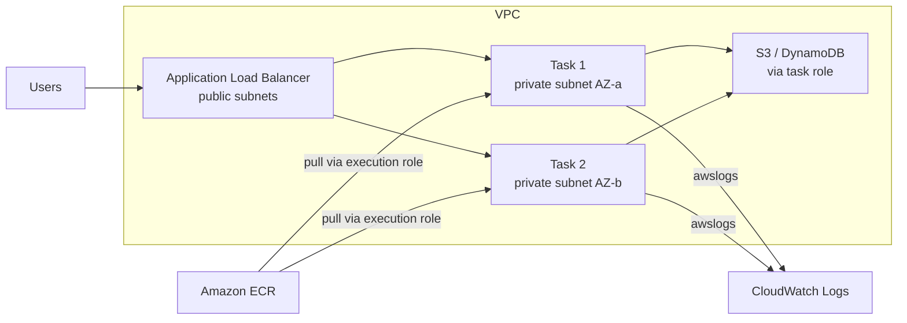

# Amazon ECS and Fargate

## Introduction

**Amazon Elastic Container Service (ECS)** is AWS's own container orchestrator. You tell it "keep three copies of this image running behind a load balancer", and it starts them, replaces them when they fail, and rolls out new versions. It is not Kubernetes; it has a smaller, AWS-specific API that many teams find easier to learn.

ECS needs compute to run containers on. You choose one of three **capacity** options:

- **AWS Fargate**: serverless. You never see a server. You pay for the vCPU and memory your tasks request, per second.
- **Amazon EC2**: your own Auto Scaling group of instances. More control (GPUs, instance types, daemons), more work.
- **Amazon ECS Managed Instances**: AWS launches, patches and replaces EC2 instances for you, while you can still pick instance types. A middle ground.

An analogy: ECS is a **dispatcher at a taxi company**. The task definition is the booking ("one car, four seats, to the airport"). Fargate is a ride-hailing app where any available car shows up and you never think about the fleet. EC2 capacity is owning your fleet of cars: cheaper per trip if you keep them busy, but you handle maintenance.

On Azure, the closest equivalent is **Azure Container Apps**, covered on the [next page](./3-cloud-azure-container-apps.mdx). This page explains ECS and maps every concept to its Azure counterpart.

## Core Concepts

| ECS concept | What it is | Azure Container Apps equivalent |
| --- | --- | --- |
| Cluster | Logical grouping of services and tasks, plus capacity providers | Container Apps environment |
| Task definition | Versioned JSON blueprint: image, CPU, memory, ports, env, logging, roles | Container app template |
| Task | One running instance of a task definition (one or more containers) | Replica |
| Service | Keeps N tasks running, integrates with a load balancer, does rolling deploys | Container app |
| Capacity provider | Where tasks run: `FARGATE`, `FARGATE_SPOT`, EC2 Auto Scaling group, Managed Instances | Workload profile (Consumption or Dedicated) |
| Task execution role | Role ECS uses to **pull the image and write logs** | Identity used for registry pull (`--registry-identity`) |
| Task role | Role **your application code** uses to call AWS APIs | Managed identity used by app code |

The two roles are the most common source of confusion, so remember this: the **execution role** is for ECS's plumbing; the **task role** is for your code.



With Fargate, every task uses the **`awsvpc` network mode**: it gets its own elastic network interface and private IP in your subnet, and you attach security groups per task. That makes tasks behave like small VMs on the network, which keeps security rules simple. See [Security Groups and NSGs](../8-cloud-networking/3-cloud-security-groups-nsgs.mdx).

## Hands-On: Deploy a Service on Fargate

This walkthrough deploys the `hello-cloud` image from [Container Registries](./1-cloud-container-registries.mdx) as an ECS service.

:::warning Cost
Fargate bills **vCPU and memory per second** from image download until the task stops (with a one-minute minimum), plus CloudWatch Logs ingestion and storage. Load balancers, NAT gateways and public IPv4 addresses are billed by the hour. Run the cleanup section when you finish. Estimate with the [AWS Pricing Calculator](https://calculator.aws/).
:::

### Step 1: Create the task execution role

```bash
cat > ecs-tasks-trust.json <<'EOF'
{
  "Version": "2012-10-17",
  "Statement": [
    {
      "Effect": "Allow",
      "Principal": { "Service": "ecs-tasks.amazonaws.com" },
      "Action": "sts:AssumeRole"
    }
  ]
}
EOF

aws iam create-role \
  --role-name ecsTaskExecutionRole \
  --assume-role-policy-document file://ecs-tasks-trust.json

aws iam attach-role-policy \
  --role-name ecsTaskExecutionRole \
  --policy-arn arn:aws:iam::aws:policy/service-role/AmazonECSTaskExecutionRolePolicy
```

The managed policy lets ECS pull from ECR and write to CloudWatch Logs. If your task definition references Secrets Manager secrets, add `secretsmanager:GetSecretValue` for those specific secret ARNs.

You would create a separate **task role** with the same trust policy and only the permissions your app needs (for example, `s3:GetObject` on one bucket). See [Least Privilege in Practice](../2-cloud-identity/3-cloud-least-privilege.mdx).

### Step 2: Register a task definition

Save as `taskdef.json`, replacing the account ID:

```json
{
  "family": "hello-cloud",
  "networkMode": "awsvpc",
  "requiresCompatibilities": ["FARGATE"],
  "cpu": "256",
  "memory": "512",
  "runtimePlatform": {
    "cpuArchitecture": "X86_64",
    "operatingSystemFamily": "LINUX"
  },
  "executionRoleArn": "arn:aws:iam::123456789012:role/ecsTaskExecutionRole",
  "containerDefinitions": [
    {
      "name": "web",
      "image": "123456789012.dkr.ecr.us-east-1.amazonaws.com/invoicing/api:1.0.0",
      "essential": true,
      "portMappings": [{ "containerPort": 8080, "protocol": "tcp" }],
      "environment": [{ "name": "APP_VERSION", "value": "1.0.0" }],
      "healthCheck": {
        "command": ["CMD-SHELL", "python -c \"import urllib.request; urllib.request.urlopen('http://localhost:8080/health')\" || exit 1"],
        "interval": 30,
        "timeout": 5,
        "retries": 3,
        "startPeriod": 10
      },
      "logConfiguration": {
        "logDriver": "awslogs",
        "options": {
          "awslogs-group": "/ecs/hello-cloud",
          "awslogs-region": "us-east-1",
          "awslogs-stream-prefix": "web",
          "awslogs-create-group": "true"
        }
      }
    }
  ]
}
```

```bash
aws ecs register-task-definition --cli-input-json file://taskdef.json \
  --query 'taskDefinition.{family:family,revision:revision,status:status}'
```

Example output:

```text
{
    "family": "hello-cloud",
    "revision": 1,
    "status": "ACTIVE"
}
```

Fargate only accepts certain CPU and memory combinations (for example, 256 CPU units with 512 MiB to 2 GiB of memory). Check the [task size table](https://docs.aws.amazon.com/AmazonECS/latest/developerguide/fargate-tasks-services.html) when you choose sizes. Every change to the task definition creates a new **revision** (`hello-cloud:2`, `hello-cloud:3`...), which makes rollback easy.

:::note `awslogs-create-group`
With `awslogs-create-group` set to `true`, the execution role also needs `logs:CreateLogGroup`. Alternatively, create the group yourself with `aws logs create-log-group --log-group-name /ecs/hello-cloud` and set a retention period, which you should do anyway to control log storage costs.
:::

### Step 3: Create a cluster with Fargate capacity providers

```bash
aws ecs create-cluster \
  --cluster-name demo-cluster \
  --capacity-providers FARGATE FARGATE_SPOT \
  --default-capacity-provider-strategy capacityProvider=FARGATE,weight=1 \
  --settings name=containerInsights,value=enabled
```

Example output (trimmed):

```text
{
    "cluster": {
        "clusterName": "demo-cluster",
        "status": "ACTIVE",
        "capacityProviders": ["FARGATE", "FARGATE_SPOT"],
        "settings": [{ "name": "containerInsights", "value": "enabled" }]
    }
}
```

Container Insights adds CPU, memory and task metrics in CloudWatch. It has its own cost; leave it off for throwaway demos if you prefer.

### Step 4: Create the service

For a quick test, run one task in a **public subnet with a public IP** so it can pull the image without a NAT gateway. For production, use private subnets behind a load balancer (see the scenario below).

```bash
aws ecs create-service \
  --cluster demo-cluster \
  --service-name hello-cloud \
  --task-definition hello-cloud:1 \
  --desired-count 1 \
  --launch-type FARGATE \
  --network-configuration "awsvpcConfiguration={subnets=[subnet-0abc1234],securityGroups=[sg-0abc1234],assignPublicIp=ENABLED}" \
  --deployment-configuration "deploymentCircuitBreaker={enable=true,rollback=true},maximumPercent=200,minimumHealthyPercent=100" \
  --enable-execute-command
```

The security group must allow inbound TCP 8080 from your IP. The **deployment circuit breaker** stops a deployment whose tasks keep failing and rolls back to the last working revision automatically.

Check the service:

```bash
aws ecs describe-services --cluster demo-cluster --services hello-cloud \
  --query 'services[0].{status:status,desired:desiredCount,running:runningCount,events:events[0:2].message}'
```

Example output:

```text
{
    "status": "ACTIVE",
    "desired": 1,
    "running": 1,
    "events": [
        "(service hello-cloud) has reached a steady state.",
        "(service hello-cloud) has started 1 tasks: (task 53c0de40ea3b489f)."
    ]
}
```

To find the task's public IP, use `aws ecs list-tasks`, then `aws ecs describe-tasks` to get the ENI ID, then `aws ec2 describe-network-interfaces`. With a load balancer you would use its DNS name instead.

### Step 5: Debug inside a running task with ECS Exec

```bash
TASK_ARN=$(aws ecs list-tasks --cluster demo-cluster --service-name hello-cloud --query 'taskArns[0]' --output text)

aws ecs execute-command \
  --cluster demo-cluster \
  --task "$TASK_ARN" \
  --container web \
  --interactive \
  --command "/bin/sh"
```

ECS Exec uses AWS Systems Manager under the hood: you need the Session Manager plugin installed locally, and the **task role** needs `ssmmessages` permissions. It replaces SSH; there is no SSH into Fargate tasks.

### Step 6: Deploy a new version

Register a new revision with the new image tag, then point the service at it:

```bash
aws ecs update-service \
  --cluster demo-cluster \
  --service hello-cloud \
  --task-definition hello-cloud:2
```

ECS starts new tasks first (up to `maximumPercent`), waits for them to pass health checks, then stops the old ones. For blue/green and canary options, see [Deployment Strategies in the Cloud](../11-cloud-devops/2-cloud-deployment-strategies.mdx).

### Step 7: Add auto scaling

ECS services scale through **Application Auto Scaling**. This target-tracking policy keeps average CPU near 60 percent with 2 to 10 tasks:

```bash
aws application-autoscaling register-scalable-target \
  --service-namespace ecs \
  --scalable-dimension ecs:service:DesiredCount \
  --resource-id service/demo-cluster/hello-cloud \
  --min-capacity 2 \
  --max-capacity 10

aws application-autoscaling put-scaling-policy \
  --service-namespace ecs \
  --scalable-dimension ecs:service:DesiredCount \
  --resource-id service/demo-cluster/hello-cloud \
  --policy-name cpu-target-60 \
  --policy-type TargetTrackingScaling \
  --target-tracking-scaling-policy-configuration '{"TargetValue":60.0,"PredefinedMetricSpecification":{"PredefinedMetricType":"ECSServiceAverageCPUUtilization"},"ScaleOutCooldown":60,"ScaleInCooldown":120}'
```

Other predefined metrics include `ECSServiceAverageMemoryUtilization` and `ALBRequestCountPerTarget`. For queue workers, scale on SQS queue depth with a custom metric. Unlike Azure Container Apps, an ECS **service** does not scale to zero on its own; the minimum is usually 1 or more.

### Step 8: Clean up

```bash
aws application-autoscaling deregister-scalable-target \
  --service-namespace ecs --scalable-dimension ecs:service:DesiredCount \
  --resource-id service/demo-cluster/hello-cloud

aws ecs delete-service --cluster demo-cluster --service hello-cloud --force
aws ecs delete-cluster --cluster demo-cluster
aws logs delete-log-group --log-group-name /ecs/hello-cloud
aws ecs deregister-task-definition --task-definition hello-cloud:1
```

If you created a load balancer or NAT gateway, delete those too: they are the most expensive pieces of a small demo.

## Monitoring a Deployment from Code

A deploy script often needs to wait until a new revision is fully rolled out. boto3 has a built-in waiter for that:

```python
# wait_for_deploy.py
import sys
import boto3

ecs = boto3.client("ecs", region_name="us-east-1")

def wait_for_stable(cluster: str, service: str) -> None:
    waiter = ecs.get_waiter("services_stable")
    print(f"Waiting for {service} to become stable...")
    waiter.wait(cluster=cluster, services=[service],
                WaiterConfig={"Delay": 15, "MaxAttempts": 40})
    svc = ecs.describe_services(cluster=cluster, services=[service])["services"][0]
    primary = next(d for d in svc["deployments"] if d["status"] == "PRIMARY")
    print(f"Stable: {primary['runningCount']}/{primary['desiredCount']} tasks on "
          f"{primary['taskDefinition'].split('/')[-1]}")
    if primary.get("rolloutState") == "FAILED":
        sys.exit("Deployment failed and was rolled back")

if __name__ == "__main__":
    wait_for_stable("demo-cluster", "hello-cloud")
```

Example output:

```text
Waiting for hello-cloud to become stable...
Stable: 2/2 tasks on hello-cloud:2
```

## Cheaper Capacity: Fargate Spot

**Fargate Spot** runs tasks on spare AWS capacity at a discount. AWS can reclaim it with a **two-minute warning**, delivered as a `SIGTERM` to your container and an EventBridge event. A capacity provider strategy mixes both:

```bash
aws ecs create-service \
  --cluster demo-cluster \
  --service-name csv-worker \
  --task-definition csv-worker:1 \
  --desired-count 6 \
  --capacity-provider-strategy capacityProvider=FARGATE,base=2,weight=1 capacityProvider=FARGATE_SPOT,weight=3 \
  --network-configuration "awsvpcConfiguration={subnets=[subnet-0priv1,subnet-0priv2],securityGroups=[sg-0worker]}"
```

Here the first 2 tasks (`base`) always run on regular Fargate. Beyond that, tasks are split 1:3 between Fargate and Fargate Spot. Use Spot for interruption-tolerant work: queue workers, batch jobs, dev environments. Avoid it for a single-task service that must stay up. Make sure the app handles `SIGTERM`, and set `stopTimeout` (up to 120 seconds on Fargate) so it can finish in-flight work. See [Spot, Reserved and Savings Plans](../3-cloud-compute/4-cloud-spot-and-reserved.mdx).

## The Shortcut: ECS Express Mode

For a typical HTTPS web app or API, **Amazon ECS Express Mode** sets up the service, an Application Load Balancer with TLS, auto scaling, logging and a URL in one call. It replaces AWS App Runner for new customers (App Runner stopped accepting new customers on April 30, 2026). Express Mode itself has no extra charge; you pay for the Fargate, load balancer and logging resources it creates.

```bash
# Requires the execution role from Step 1 and an infrastructure role
aws iam create-role --role-name ecsInfrastructureRoleForExpressServices \
  --assume-role-policy-document '{"Version":"2012-10-17","Statement":[{"Effect":"Allow","Principal":{"Service":"ecs.amazonaws.com"},"Action":"sts:AssumeRole"}]}'
aws iam attach-role-policy --role-name ecsInfrastructureRoleForExpressServices \
  --policy-arn arn:aws:iam::aws:policy/service-role/AmazonECSInfrastructureRoleforExpressGatewayServices

aws ecs create-express-gateway-service \
  --service-name hello-express \
  --primary-container '{"image":"123456789012.dkr.ecr.us-east-1.amazonaws.com/invoicing/api:1.0.0","containerPort":8080}' \
  --execution-role-arn arn:aws:iam::123456789012:role/ecsTaskExecutionRole \
  --infrastructure-role-arn arn:aws:iam::123456789012:role/ecsInfrastructureRoleForExpressServices \
  --health-check-path "/health" \
  --scaling-target '{"minTaskCount":1,"maxTaskCount":5}' \
  --monitor-resources

# Cleanup
aws ecs delete-express-gateway-service \
  --service-arn arn:aws:ecs:us-east-1:123456789012:service/default/hello-express
```

All resources Express Mode creates live in your account, so you can still tune them directly later. By default it uses your account's default VPC and public subnets; pass your own subnets for production.

## ECS vs Azure: Side-by-Side Commands

The equivalent tasks on Azure use Container Apps. This preview shows how the shapes line up; the [next page](./3-cloud-azure-container-apps.mdx) covers it fully.

| Task | AWS (ECS on Fargate) | Azure (Container Apps) |
| --- | --- | --- |
| Create the boundary | `aws ecs create-cluster` | `az containerapp env create` |
| Define and run | `register-task-definition` + `create-service` | `az containerapp create` (one command) |
| New version | New task definition revision + `update-service` | `az containerapp update --image` (new revision) |
| Scale | Application Auto Scaling policies | `--min-replicas`, `--max-replicas`, scale rules |
| Scale to zero | Not for services | Yes, default for HTTP apps |
| Shell into container | `aws ecs execute-command` | `az containerapp exec` |
| Logs | CloudWatch Logs (`awslogs`) | Log Analytics (`az containerapp logs show`) |
| Scheduled job | EventBridge Scheduler + `RunTask` | Container Apps job with `--trigger-type Schedule` |

## Real-World Scenario

Your team runs an e-commerce platform on AWS. A new feature generates thumbnail and watermark variants for every product photo a seller uploads. Uploads arrive in S3 and a message goes to an SQS queue. Volume is spiky: quiet at night, thousands per hour during seller onboarding campaigns. Each image takes 2 to 40 seconds to process and needs up to 2 GB of memory. Engineers ask: **Lambda, Fargate or EC2?**

### The solution

- An ECS service `image-worker` on **Fargate with Fargate Spot** (`base=1` on Fargate, the rest weighted to Spot), in private subnets.
- A **task role** allowing `s3:GetObject` on the uploads bucket, `s3:PutObject` on the variants bucket, and SQS receive/delete on one queue. No keys anywhere.
- **Auto scaling on queue depth**: a target-tracking policy on a custom metric (messages visible per running task), 1 to 50 tasks.
- The worker handles `SIGTERM` by stopping new receives and letting SQS redeliver unfinished messages (the visibility timeout covers it), so Spot interruptions lose nothing.

### Why this approach

- **Lambda** would work for short images, but the slowest jobs, large native libraries (ImageMagick, libvips) and memory needs make a container image more comfortable. Lambda can run container images too, so it remains an option for the short-job path. See [AWS Lambda](../4-cloud-serverless/1-cloud-aws-lambda.mdx).
- **EC2** would be cheapest per vCPU at steady high load, but the load is spiky and nobody wants to patch instances.
- **Fargate + Spot** gives per-second billing, no servers, and Spot savings for an interruption-tolerant workload.

### When to use ECS on Fargate, and when not to

- **Use it** for web services, APIs and workers on AWS when you want containers without managing servers or Kubernetes.
- **Do not use it** when you need GPUs or specific instance types (use ECS Managed Instances or EC2 capacity), when you must scale to zero for very spiky HTTP traffic at low cost (consider Lambda), or when you need the Kubernetes ecosystem (use [EKS](./4-cloud-eks.mdx)).

### Alternatives and trade-offs

| Approach | Pros | Cons | Best for |
| --- | --- | --- | --- |
| AWS Lambda | Scales to zero, per-request billing, zero servers | 15-minute max duration, memory and package limits, cold starts | Short, bursty, event-driven work |
| ECS on Fargate | No servers, per-second billing, Spot option | No scale to zero for services, fixed CPU/memory combos | Steady services and medium-length workers |
| ECS Managed Instances | Any instance type incl. GPU, AWS patches it, multiple tasks per instance | Billed per instance, instance lifetime limits | GPU or specialized workloads without self-managing EC2 |
| ECS on EC2 (self-managed) | Full control, Reserved/Savings Plans on instances | You patch, scale and right-size the fleet | Large steady fleets with ops capacity |
| Amazon EKS | Kubernetes ecosystem, portability | Cluster fee, steeper learning curve | Many teams and services, existing Kubernetes skills |

## Common Mistakes

- **Mixing up execution role and task role.** "AccessDenied pulling image" is an execution role problem; "AccessDenied calling S3 from my code" is a task role problem.
- **Tasks stuck in `PENDING` then `STOPPED` with `CannotPullContainerError`.** The task cannot reach ECR: in a public subnet it needs `assignPublicIp=ENABLED`; in a private subnet it needs a NAT gateway or VPC endpoints for ECR, S3 and CloudWatch Logs.
- **Using `instance` target type on the load balancer.** Fargate tasks with `awsvpc` need target groups with target type `ip`.
- **No log retention.** CloudWatch log groups keep logs forever by default. Set a retention period.
- **Health check grace period too short.** Slow-starting apps get killed in a restart loop. Set `healthCheckGracePeriodSeconds` on the service when using a load balancer.
- **Ignoring `SIGTERM`.** Deploys, scale-in and Spot interruptions all send `SIGTERM`. Handle it or you drop requests.
- **Putting secrets in `environment`.** Use the `secrets` field with Secrets Manager or SSM Parameter Store ARNs instead; they are injected at start and do not appear in the task definition.

## Summary

- **ECS** is AWS's container orchestrator: clusters, task definitions, tasks and services.
- **Fargate** runs tasks without servers and bills per second for requested vCPU and memory; **Fargate Spot** discounts interruption-tolerant tasks.
- **EC2** and **ECS Managed Instances** capacity give you instance choice (including GPUs) at the cost of paying per instance.
- The **execution role** lets ECS pull images and write logs; the **task role** is for your code.
- Use **deployment circuit breakers**, **health checks**, **Application Auto Scaling** and **ECS Exec** for safe operations.
- **ECS Express Mode** is the fastest path to an HTTPS URL and replaces App Runner for new customers.
- The Azure counterpart is **Azure Container Apps**, which adds scale to zero and event-driven scaling.

## Exercises

1. Deploy `hello-cloud` as a one-task Fargate service in a public subnet. Then change `APP_VERSION` in a new task definition revision, update the service, and watch the rolling deployment in `describe-services` events. Clean up afterwards.
2. Break the health check on purpose (point it to `/nope`) and deploy with the circuit breaker enabled. Observe the automatic rollback.
3. Create a capacity provider strategy with `base=1` on `FARGATE` and `weight=4` on `FARGATE_SPOT`. With `desired-count 9`, how many tasks do you expect on each provider? Verify with `describe-tasks`.
4. Write down the exact IAM permissions a task role needs for the image worker scenario, scoped to specific bucket and queue ARNs.

**Next:** compare with [Azure Container Apps and Container Instances](./3-cloud-azure-container-apps.mdx). For the full project, see [Project: Containerized App on Managed Containers](../14-cloud-projects/3-cloud-project-containerized-app.mdx).
