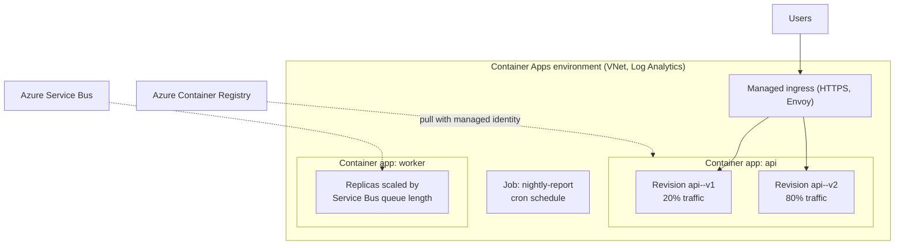

# Azure Container Apps and Container Instances

## Introduction

Azure has two "serverless container" services, and they solve different problems:

- **Azure Container Apps (ACA)** runs **applications**: web APIs, background workers, microservices and jobs. It handles HTTPS ingress, revisions, traffic splitting, and automatic scaling based on HTTP traffic or events, including **scaling to zero**. Under the hood it runs on Kubernetes with KEDA and Envoy, but you never see the cluster.
- **Azure Container Instances (ACI)** runs **a container (or a small group of containers)** with almost no setup. No load balancing, no autoscaling of a service, no revisions. It is the quickest way to run one container in Azure, billed per second.

An analogy: ACI is **renting a single food truck for the day**. You park it, serve food, and send it home. Container Apps is **a food court**: there is shared infrastructure, a front entrance that routes customers to the right stall, more staff appear at lunch rush, and the stalls close when nobody is around.

On AWS, Container Apps maps most closely to **ECS on Fargate** (plus ECS Express Mode for the quick path), and ACI maps to running a one-off **ECS task** on Fargate. See [Amazon ECS and Fargate](./2-cloud-ecs-and-fargate.mdx) for the AWS side.

## Azure Container Apps Concepts



| Concept | Meaning | AWS (ECS) equivalent |
| --- | --- | --- |
| Environment | Secure boundary shared by apps and jobs: network, logging, Dapr | Cluster (plus VPC settings) |
| Container app | A long-running service with optional ingress | Service |
| Revision | Immutable snapshot of an app's template, created on each change to image, env vars or scale rules | Task definition revision |
| Replica | One running instance of a revision | Task |
| Ingress | Built-in HTTPS endpoint with TLS, internal or external | Application Load Balancer |
| Scale rule | HTTP, TCP or custom KEDA rule (queues, Kafka, CPU, memory...) | Application Auto Scaling policy |
| Job | Runs to completion: manual, scheduled (cron) or event-driven | Standalone or scheduled task |
| Workload profile | Consumption (serverless) or Dedicated (chosen hardware, including GPU) | Fargate vs EC2/Managed Instances capacity |

### Plans and workload profiles

Container Apps has two plan types:

- **Consumption**: serverless, scale to zero, pay for vCPU-seconds, GiB-seconds and requests while replicas run. Idle replicas (kept alive by `minReplicas`) are billed at a lower idle rate, and there is a monthly free grant.
- **Dedicated**: you choose workload profiles (general purpose, memory optimized, GPU) and pay per profile instance plus a management fee. More predictable for steady, high-scale workloads, and needed for compute isolation.

A **workload profiles environment** (the default for new environments) can mix the Consumption profile and Dedicated profiles. **Serverless GPUs** are available for on-demand GPU work on the Consumption side. Plan details change, so check the [Container Apps plans page](https://learn.microsoft.com/azure/container-apps/plans).

### Revisions and traffic

Each change to the app's template creates a new revision named like `api--v2`. In **single revision mode** (the default), the new revision replaces the old one once it is healthy. In **multiple revision mode**, several revisions run at once and you split traffic by percentage, which gives you blue/green and canary deployments with no extra tooling.

## Hands-On: Deploy an App from ACR

:::warning Cost
Container Apps on the Consumption plan bills per second for vCPU and memory while replicas run, plus requests, with a lower idle rate and a monthly free grant. The environment's **Log Analytics workspace** bills for log ingestion and retention. Delete the resource group when you finish. Estimate with the [Azure Pricing Calculator](https://azure.microsoft.com/pricing/calculator/).
:::

### Step 1: Prepare the CLI

```bash
az extension add --name containerapp --upgrade
az provider register --namespace Microsoft.App
az provider register --namespace Microsoft.OperationalInsights

RG=rg-aca-demo
LOCATION=eastus
ENV=aca-env-demo
ACR_NAME=invoicingacr2026        # from the registries page
APP=hello-cloud

az group create --name $RG --location $LOCATION
```

Preview features in the extension are off by default. Add `--allow-preview true` only if you need a preview feature.

### Step 2: Create the environment

```bash
az containerapp env create \
  --name $ENV \
  --resource-group $RG \
  --location $LOCATION
```

Example output (trimmed):

```text
Creating Log Analytics workspace...
Container Apps environment created. To deploy a container app, use: az containerapp create --help
{
  "name": "aca-env-demo",
  "properties": {
    "defaultDomain": "kindbay-1a2b3c4d.eastus.azurecontainerapps.io",
    "provisioningState": "Succeeded"
  }
}
```

For production, pass `--infrastructure-subnet-resource-id` to put the environment in your own VNet, so apps can reach private databases. See [VPCs and VNets](../8-cloud-networking/1-cloud-vpc-and-vnet.mdx).

### Step 3: Create a user-assigned identity for image pulls

Using a managed identity means no registry password is stored anywhere. A user-assigned identity is recommended because it exists before the app does, so the first image pull already works.

```bash
az identity create --name id-$APP --resource-group $RG
IDENTITY_ID=$(az identity show --name id-$APP --resource-group $RG --query id --output tsv)
LOGIN_SERVER=$(az acr show --name $ACR_NAME --query loginServer --output tsv)
```

### Step 4: Create the container app

```bash
az containerapp create \
  --name $APP \
  --resource-group $RG \
  --environment $ENV \
  --image "$LOGIN_SERVER/invoicing/api:1.0.0" \
  --user-assigned "$IDENTITY_ID" \
  --registry-identity "$IDENTITY_ID" \
  --registry-server "$LOGIN_SERVER" \
  --target-port 8080 \
  --ingress external \
  --cpu 0.5 --memory 1.0Gi \
  --env-vars APP_VERSION=1.0.0 \
  --min-replicas 0 \
  --max-replicas 5 \
  --scale-rule-name http-rule \
  --scale-rule-type http \
  --scale-rule-http-concurrency 50 \
  --query properties.configuration.ingress.fqdn
```

Example output:

```text
"hello-cloud.kindbay-1a2b3c4d.eastus.azurecontainerapps.io"
```

The Azure CLI assigns the `AcrPull` role to the identity on the registry for you. (If your ACR uses the `rbac-abac` role assignment mode, the identity needs a repository-scoped role such as `Container Registry Repository Reader` instead.) Test it:

```bash
curl https://hello-cloud.kindbay-1a2b3c4d.eastus.azurecontainerapps.io/
```

Example output:

```text
{"host":"hello-cloud--8x2kq1p-6d9f7c8b5-abcde","message":"Hello from a container","version":"1.0.0"}
```

The HTTP rule adds a replica for roughly every 50 concurrent requests, up to 5. With `--min-replicas 0` the app scales to zero when idle, and the first request after that has a **cold start** while a replica starts. Set `--min-replicas 1` for latency-sensitive APIs.

:::note Default scale behavior
Without your own rule, an app with ingress gets an HTTP rule with 0 to 10 replicas. If you **disable ingress** and add no custom scale rule, set `--min-replicas 1` or more; otherwise the app scales to zero and nothing can wake it up.
:::

### Step 5: Roll out a new revision with traffic splitting

```bash
# Allow several revisions to run side by side
az containerapp revision set-mode --name $APP --resource-group $RG --mode multiple

# Deploy v2 as a new revision with a readable suffix
az containerapp update \
  --name $APP --resource-group $RG \
  --image "$LOGIN_SERVER/invoicing/api:1.0.1" \
  --set-env-vars APP_VERSION=1.0.1 \
  --revision-suffix v101

az containerapp revision list --name $APP --resource-group $RG \
  --query "[].{name:name, active:properties.active, traffic:properties.trafficWeight}" --output table
```

Example output:

```text
Name                  Active    Traffic
--------------------  --------  ---------
hello-cloud--8x2kq1p  True      100
hello-cloud--v101     True      0
```

Send 10 percent of traffic to the new revision, then shift fully once metrics look good:

```bash
az containerapp ingress traffic set --name $APP --resource-group $RG \
  --revision-weight hello-cloud--8x2kq1p=90 hello-cloud--v101=10

# Later, after checking error rates and latency
az containerapp ingress traffic set --name $APP --resource-group $RG \
  --revision-weight hello-cloud--v101=100
```

### Step 6: Logs and debugging

```bash
az containerapp logs show --name $APP --resource-group $RG --follow --tail 20
az containerapp exec --name $APP --resource-group $RG --command sh
```

Logs also land in the environment's Log Analytics workspace, where you can query them with KQL. See [Centralized Logging](../12-cloud-observability-and-security/1-cloud-logging.mdx).

### Step 7: Event-driven workers and jobs

A queue worker can scale on queue length with a KEDA rule, authenticating with its managed identity:

```bash
az containerapp create \
  --name csv-worker --resource-group $RG --environment $ENV \
  --image "$LOGIN_SERVER/invoicing/csv-worker:1.0.0" \
  --user-assigned "$IDENTITY_ID" \
  --registry-identity "$IDENTITY_ID" --registry-server "$LOGIN_SERVER" \
  --min-replicas 0 --max-replicas 20 \
  --scale-rule-name orders-queue \
  --scale-rule-type azure-servicebus \
  --scale-rule-metadata "queueName=csv-uploads" "namespace=sb-invoicing" "messageCount=10" \
  --scale-rule-identity "$IDENTITY_ID"
```

For work that runs and exits, use a **job** instead of an app. This one runs every night at 02:00 UTC:

```bash
az containerapp job create \
  --name nightly-report --resource-group $RG --environment $ENV \
  --trigger-type "Schedule" \
  --cron-expression "0 2 * * *" \
  --replica-timeout 1800 \
  --replica-retry-limit 1 \
  --replica-completion-count 1 \
  --parallelism 1 \
  --image "mcr.microsoft.com/k8se/quickstart-jobs:latest" \
  --cpu "0.25" --memory "0.5Gi"

# Run it once now to test
az containerapp job start --name nightly-report --resource-group $RG
az containerapp job execution list --name nightly-report --resource-group $RG --output table
```

Example output (trimmed):

```text
Name                    StartTime                  Status
----------------------  -------------------------  ---------
nightly-report-k3j9x2p  2026-10-11T10:02:11+00:00  Succeeded
```

Jobs can also be **event-driven** (one execution per queue message batch), which suits CI runners and heavy per-item processing. Cron schedules for jobs are always evaluated in UTC.

### Step 8: Clean up

```bash
az group delete --name $RG --yes --no-wait
```

This deletes the environment, apps, jobs, identity and Log Analytics workspace in the group. If your ACR lives in a different resource group, it is not affected.

## Using Managed Identity from Your Code

Your container's code uses the same managed identity to reach other Azure services. With the Azure SDK, `DefaultAzureCredential` finds it automatically. In a user-assigned setup, tell it which identity to use with the `AZURE_CLIENT_ID` environment variable.

```python
# list_invoices.py, runs inside the container app
# pip install azure-identity azure-storage-blob
import os
from azure.identity import DefaultAzureCredential
from azure.storage.blob import BlobServiceClient

account_url = os.environ["STORAGE_ACCOUNT_URL"]  # e.g. https://stinvoicing.blob.core.windows.net
credential = DefaultAzureCredential()            # uses AZURE_CLIENT_ID if set

service = BlobServiceClient(account_url=account_url, credential=credential)
container = service.get_container_client("invoices")

for blob in container.list_blobs(name_starts_with="2026/10/"):
    print(f"{blob.name:<40} {blob.size:>8} bytes")
```

```bash
CLIENT_ID=$(az identity show --name id-$APP --resource-group $RG --query clientId --output tsv)
az containerapp update --name $APP --resource-group $RG \
  --set-env-vars AZURE_CLIENT_ID=$CLIENT_ID STORAGE_ACCOUNT_URL=https://stinvoicing.blob.core.windows.net
```

Example output:

```text
2026/10/inv-10021.pdf                       48213 bytes
2026/10/inv-10022.pdf                       51877 bytes
```

The identity also needs the `Storage Blob Data Reader` role on the storage account. The AWS equivalent is an ECS **task role**, which boto3 picks up automatically. See [Workload Identity](../2-cloud-identity/4-cloud-workload-identity.mdx).

## Azure Container Instances

ACI runs a **container group**: one or more containers that share a host, network and lifecycle, like a Kubernetes pod. It has no built-in ingress controller, revision history or HTTP autoscaling. You get a container, an optional public IP or DNS name, and per-second billing.

### When ACI fits

- One-off or short **batch jobs** and scripts (`--restart-policy Never`)
- **Build agents** and test runners that start, work and exit
- Simple internal tools or demos where a single instance is fine
- **Bursting from AKS** through virtual nodes, which schedule pods onto ACI

ACI also offers **Spot containers** (interruptible, discounted), **confidential containers** (hardware-based trusted execution), **NGroups** for managing many related container groups with rolling upgrades, and **standby pools** for faster starts. ACI supports Linux and Windows containers but only **x64 (amd64)** images.

### Hands-on with ACI

:::warning Cost
ACI bills per second for the vCPU and memory allocated to each container group while it runs. A container group with `--restart-policy Always` keeps billing until you delete it.
:::

```bash
az group create --name rg-aci-demo --location eastus

az container create \
  --resource-group rg-aci-demo \
  --name hello-aci \
  --image mcr.microsoft.com/azuredocs/aci-helloworld \
  --os-type linux \
  --cpu 1 --memory 1.5 \
  --ports 80 \
  --dns-name-label hello-aci-$RANDOM

az container show --resource-group rg-aci-demo --name hello-aci \
  --query "{FQDN:ipAddress.fqdn,State:provisioningState}" --output table
```

Example output:

```text
FQDN                                      State
----------------------------------------  ---------
hello-aci-18342.eastus.azurecontainer.io  Succeeded
```

A run-once batch container:

```bash
az container create \
  --resource-group rg-aci-demo \
  --name wordcount \
  --image mcr.microsoft.com/azuredocs/aci-wordcount:latest \
  --os-type linux \
  --restart-policy Never \
  --environment-variables NumWords=5 MinLength=8

az container logs --resource-group rg-aci-demo --name wordcount
```

Example output:

```text
[('CLAUDIUS', 120), ('POLONIUS', 113), ('GERTRUDE', 82), ('ROSENCRANTZ', 69), ('GUILDENSTERN', 54)]
```

Clean up:

```bash
az group delete --name rg-aci-demo --yes --no-wait
```

:::caution ACI limitations to know
- The IP address can change when a container group restarts. Do not hard-code it; use the DNS name or put Application Gateway in front for a static IP.
- In a VNet, outbound traffic must go through a NAT gateway.
- Pass credentials with secure environment variables or Key Vault and managed identity, not plain command-line values: Microsoft warns that credentials passed on the CLI may be stored in plain text.
:::

## Choosing Between ACA, ACI and Their AWS Counterparts

| Need | Azure | AWS | Why |
| --- | --- | --- | --- |
| Public HTTPS API with autoscaling | Container Apps | ECS on Fargate + ALB, or ECS Express Mode | Managed ingress, revisions, scaling |
| Queue worker that scales to zero | Container Apps (KEDA rule) | ECS service scaled on SQS queue depth (step scaling can go to 0 tasks), or Lambda | ACA scales to zero natively |
| Nightly batch job | Container Apps job (Schedule) | EventBridge Scheduler + ECS `RunTask` | Pay only while running |
| Single container for an hour | ACI | ECS `run-task` on Fargate | No service, no load balancer |
| Many containers with Kubernetes APIs | [AKS](./5-cloud-aks.mdx) | [EKS](./4-cloud-eks.mdx) | Full Kubernetes |
| Web app with built-in auth, slots, custom domains | App Service (containers) | ECS Express Mode or Elastic Beanstalk | PaaS conveniences |

## Real-World Scenario

A logistics startup on Azure is building a shipment-tracking platform: a public REST API, a webhook receiver that partners call in bursts, a worker that enriches events from an Azure Service Bus queue, and an hourly job that reconciles carrier data. The team debates **Azure Functions vs Container Apps vs App Service**.

### The solution

- **Container Apps environment** in their VNet, with all four workloads:
  - `tracking-api`: `minReplicas 2` for low latency, HTTP scale rule up to 20 replicas.
  - `webhooks`: `minReplicas 0`, HTTP scale rule; bursts scale out in seconds, idle nights cost nothing.
  - `enricher`: KEDA Service Bus rule, 0 to 30 replicas, authenticated with a managed identity.
  - `reconcile`: a scheduled job, `0 * * * *`.
- **Multiple revision mode** on `tracking-api` with a 10 percent canary for each release.
- **ACR** with managed identity pulls; **Key Vault** references for partner API secrets.

### Why this approach

All workloads are already containerized and need custom native libraries. Container Apps gives scale to zero for the bursty pieces, steady replicas for the API, and jobs, all in one place with one networking and logging setup.

### When to use it, and when not to

- **Use Container Apps** for microservices, APIs and event-driven workers when you want Kubernetes-style scaling without operating Kubernetes.
- **Choose Azure Functions** when the logic is small, function-shaped and fits the bindings model (for example, "on blob upload, resize image"). The Flex Consumption plan gives fast scale and per-execution billing. Functions can also run on Container Apps. See [Azure Functions](../4-cloud-serverless/2-cloud-azure-functions.mdx).
- **Choose App Service** for a classic web app that benefits from deployment slots, built-in authentication and a long track record, especially when you are not container-first. See [PaaS App Hosting](../3-cloud-compute/5-cloud-paas-app-hosting.mdx).
- **Choose AKS** when you need Kubernetes APIs directly: custom operators, Helm charts from vendors, service meshes, or very fine control.

### Alternatives and trade-offs

| Approach | Pros | Cons | Best for |
| --- | --- | --- | --- |
| Azure Functions (Flex Consumption) | Event bindings, per-execution billing, minimal code | Function-shaped code, execution limits, less control over runtime | Small event handlers and glue code |
| Azure Container Apps | Any container, scale to zero, KEDA, revisions, jobs | Less low-level control than AKS, platform limits per replica | Microservices and workers |
| App Service (containers) | Slots, built-in auth, mature PaaS | No scale to zero, per-plan billing | Traditional web apps |
| Azure Container Instances | Simplest, per-second billing | No ingress, no service autoscaling | One-off and batch containers |
| AKS | Full Kubernetes | You own cluster operations | Large platforms, Kubernetes-native tools |

## Common Mistakes

- **Using registry passwords** (`--registry-username`/`--registry-password`) or the ACR admin user. Use `--registry-identity` with a managed identity.
- **System-assigned identity for the first pull.** The identity does not exist until the app exists, so the first private pull can fail. Use a user-assigned identity, or create with a public image first and then run `az containerapp registry set --identity system`.
- **Scaling to zero an API that needs fast responses.** Cold starts add latency. Use `minReplicas 1` or more for user-facing APIs.
- **No scale rule and no ingress.** The app scales to zero and never wakes up.
- **Forgetting Log Analytics costs.** Verbose logging at high request rates adds up. Set retention and log levels deliberately.
- **Expecting ACI to load balance or autoscale.** It does not. Use Container Apps (or NGroups with a load balancer) when you need that.
- **Pushing `arm64` images to ACI.** ACI supports only amd64 images.

## Summary

- **Azure Container Apps** runs containerized apps and jobs with managed HTTPS ingress, revisions, traffic splitting and KEDA-based autoscaling, including **scale to zero**.
- Plans: **Consumption** (per-second, idle rate, free grant) and **Dedicated** workload profiles (per instance, including GPU).
- **Jobs** handle manual, scheduled and event-driven work that runs to completion.
- **Azure Container Instances** runs a container group quickly with per-second billing, but no service-level ingress or autoscaling. Use it for batch and simple tasks.
- Pull from ACR with **managed identities**, and let code use `DefaultAzureCredential`.
- AWS counterparts: **ECS on Fargate** and **ECS Express Mode** for apps, **ECS `RunTask`** for ACI-style one-off containers.

## Exercises

1. Deploy `hello-cloud` to Container Apps with `--min-replicas 0`. Call it, wait 10 minutes, call it again, and compare response times to see the cold start. Then set `--min-replicas 1` and repeat.
2. Enable multiple revision mode, deploy a v2, and split traffic 50/50. Call the endpoint 20 times and count which `version` value each response returns.
3. Create a manual Container Apps job that prints the current date, run it twice with `az containerapp job start`, and list the executions.
4. Run the ACI word-count container with `--restart-policy Never` and different `NumWords` values. Explain why ACI fits this better than a container app.

**Next:** move up to full Kubernetes with [Amazon EKS](./4-cloud-eks.mdx) and [Azure Kubernetes Service](./5-cloud-aks.mdx), or jump to [Choosing a Container Platform](./6-cloud-choosing-container-platform.mdx).
