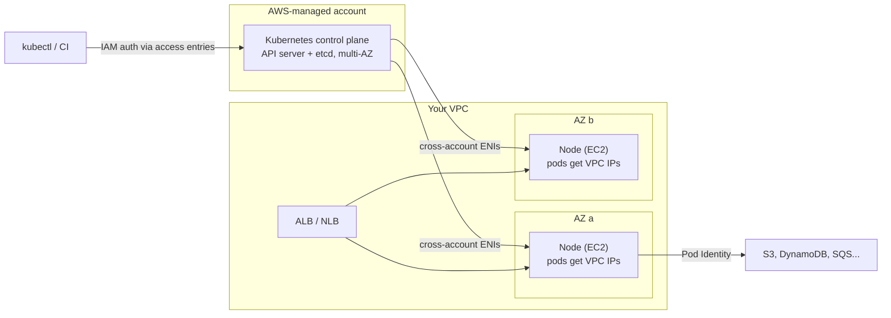

# Amazon EKS

## Introduction

**Amazon Elastic Kubernetes Service (EKS)** runs a certified, upstream Kubernetes control plane for you. AWS operates the API servers and the etcd database across multiple Availability Zones, patches them and keeps them highly available. You run your workloads with standard `kubectl`, Helm and Kubernetes manifests, so knowledge and tooling carry over from any other Kubernetes environment, including Azure's AKS.

What you still decide is **where the pods run** (the data plane) and **how much of it AWS manages**. With classic EKS you manage node groups and add-ons. With **EKS Auto Mode**, AWS also launches, patches, scales and replaces the worker nodes and runs the core add-ons (networking, load balancing, storage drivers, DNS) for you.

An analogy: plain Kubernetes is **running your own airport**. EKS hands the control tower (control plane) to AWS. Managed node groups also give you a fleet of planes, but you still schedule maintenance. EKS Auto Mode hands AWS the hangar and maintenance crew too; you just say where the passengers (pods) need to go.

If Kubernetes itself is new to you, start with the [Kubernetes tutorial](/docs/devops/kubernetes). This page focuses on what is specific to running it on AWS. The Azure counterpart is [Azure Kubernetes Service](./5-cloud-aks.mdx).

## How EKS Is Put Together



Key AWS-specific pieces:

- **Amazon VPC CNI**: every pod gets a real IP address from your VPC subnets. This makes pods first-class network citizens (security groups for pods, direct routing from load balancers), but it consumes subnet IPs quickly. Plan subnet sizes generously. See [Subnets, Route Tables and Gateways](../8-cloud-networking/2-cloud-subnets-and-routing.mdx).
- **IAM for humans**: people and pipelines authenticate to the Kubernetes API with IAM. **Access entries** map IAM roles to Kubernetes permissions. The older `aws-auth` ConfigMap still works but access entries are the recommended way.
- **IAM for pods**: **EKS Pod Identity** (recommended) or **IAM Roles for Service Accounts (IRSA)** give pods temporary AWS credentials scoped to their Kubernetes service account.
- **Add-ons**: VPC CNI, CoreDNS, kube-proxy and the EBS CSI driver can be installed as **EKS add-ons** that AWS versions and updates. In Auto Mode they are built in.

## Data Plane Options

| Option | What AWS manages | What you manage | Good for |
| --- | --- | --- | --- |
| **EKS Auto Mode** | Nodes (Bottlerocket-based, immutable), scaling (Karpenter-based), patching, core add-ons, load balancer and storage integration | NodePools for special needs, your workloads | Most new clusters; teams wanting Kubernetes without node operations |
| Managed node groups | Node provisioning and graceful updates in an Auto Scaling group | Instance types, AMI updates, scaling setup, add-ons | Teams wanting control over node groups |
| Self-managed nodes | Nothing beyond the control plane | Everything about the instances | Custom AMIs, special OS needs |
| Karpenter (self-installed) | Nothing; open source | Karpenter install and its NodePools | Flexible, fast node provisioning without Auto Mode |
| AWS Fargate for EKS | A micro-VM per pod | Fargate profiles | Small, isolated workloads; note DaemonSets and some features are not supported |
| EKS Hybrid Nodes | Control plane in AWS | On-premises or edge servers joined to the cluster | Hybrid workloads |

:::note Auto Mode node behavior
Auto Mode nodes are treated like appliances: no SSH or SSM access, a read-only root file system, and a **maximum node lifetime of 21 days** after which nodes are replaced. Your pods must tolerate being rescheduled, which is good Kubernetes practice anyway. Use Pod Disruption Budgets to control how many replicas can be disrupted at once.
:::

## Hands-On: Create an EKS Auto Mode Cluster

You need the AWS CLI v2, `kubectl` (within one minor version of the cluster) and `eksctl` (version 0.195.0 or later for Auto Mode). Authenticate with SSO or a role, not long-lived keys.

:::warning Cost
An EKS cluster bills **per cluster-hour** for the control plane, more once its Kubernetes version moves into **extended support**. Auto Mode adds a **management fee** per managed instance (per second, on top of the EC2 price). You also pay for EC2 nodes, EBS volumes, load balancers, NAT gateways, public IPv4 addresses and cross-AZ traffic. A forgotten test cluster costs money every hour. See [Amazon EKS pricing](https://aws.amazon.com/eks/pricing/) and run the cleanup step.
:::

### Step 1: Create the cluster

```bash
eksctl create cluster \
  --name demo-eks \
  --region us-east-1 \
  --enable-auto-mode
```

Example output (trimmed):

```text
[ℹ]  eksctl version 0.2xx.0
[ℹ]  using region us-east-1
[ℹ]  subnets for us-east-1a - public:192.168.0.0/19 private:192.168.96.0/19
[ℹ]  subnets for us-east-1b - public:192.168.32.0/19 private:192.168.128.0/19
[ℹ]  creating EKS cluster "demo-eks" in "us-east-1" region with Auto Mode enabled
[✔]  saved kubeconfig as "/home/you/.kube/config"
[✔]  EKS cluster "demo-eks" in "us-east-1" region is ready
```

`eksctl` creates a new VPC with public and private subnets (tagged for load balancers), the cluster IAM role, the node IAM role, and writes your kubeconfig. It takes roughly 10 to 20 minutes. For production, define the cluster in Terraform, CloudFormation or CDK instead; see [Terraform for AWS and Azure](../10-cloud-infrastructure-as-code/4-cloud-terraform-multi-cloud.mdx).

If you created the cluster another way, connect `kubectl` with:

```bash
aws eks update-kubeconfig --region us-east-1 --name demo-eks
kubectl get nodes
```

Example output:

```text
Added new context arn:aws:eks:us-east-1:123456789012:cluster/demo-eks to /home/you/.kube/config
No resources found
```

"No resources found" is expected with Auto Mode: it launches nodes only when pods need them.

### Step 2: Deploy an application

```yaml
# app.yaml
apiVersion: v1
kind: Namespace
metadata:
  name: hello
---
apiVersion: apps/v1
kind: Deployment
metadata:
  name: hello-cloud
  namespace: hello
spec:
  replicas: 3
  selector:
    matchLabels:
      app: hello-cloud
  template:
    metadata:
      labels:
        app: hello-cloud
    spec:
      containers:
        - name: web
          image: 123456789012.dkr.ecr.us-east-1.amazonaws.com/invoicing/api:1.0.0
          ports:
            - containerPort: 8080
          resources:
            requests:
              cpu: 250m
              memory: 256Mi
            limits:
              memory: 512Mi
          readinessProbe:
            httpGet:
              path: /health
              port: 8080
          livenessProbe:
            httpGet:
              path: /health
              port: 8080
            initialDelaySeconds: 10
---
apiVersion: v1
kind: Service
metadata:
  name: hello-cloud
  namespace: hello
spec:
  selector:
    app: hello-cloud
  ports:
    - port: 80
      targetPort: 8080
```

```bash
kubectl apply -f app.yaml
kubectl get pods -n hello -o wide
kubectl get nodes
```

Example output:

```text
NAME                           READY   STATUS    RESTARTS   AGE   IP              NODE
hello-cloud-6d9f7c8b5-2kqzp    1/1     Running   0          58s   192.168.110.21  i-0a1b2c3d4e5f60718
hello-cloud-6d9f7c8b5-8xw2m    1/1     Running   0          58s   192.168.141.7   i-0f9e8d7c6b5a40312
hello-cloud-6d9f7c8b5-tn4vd    1/1     Running   0          58s   192.168.110.88  i-0a1b2c3d4e5f60718

NAME                  STATUS   ROLES    AGE   VERSION
i-0a1b2c3d4e5f60718   Ready    <none>   50s   v1.3x.x-eks-abcdef
i-0f9e8d7c6b5a40312   Ready    <none>   48s   v1.3x.x-eks-abcdef
```

Auto Mode saw three pending pods, chose instance types that fit their **resource requests**, and launched nodes in two Availability Zones. Accurate requests matter: they drive both scheduling and cost. Pod IPs come straight from the VPC subnets.

Nodes pull from ECR using the node IAM role, which eksctl created with ECR read permissions. For images in another account, add a repository policy that allows that role.

### Step 3: Expose it with an Application Load Balancer

Auto Mode includes the load balancer integration. Create an `IngressClass` that uses it, then an `Ingress`:

```yaml
# ingress.yaml
apiVersion: networking.k8s.io/v1
kind: IngressClass
metadata:
  name: alb
spec:
  controller: eks.amazonaws.com/alb
---
apiVersion: networking.k8s.io/v1
kind: Ingress
metadata:
  name: hello-cloud
  namespace: hello
  annotations:
    alb.ingress.kubernetes.io/scheme: internet-facing
    alb.ingress.kubernetes.io/target-type: ip
spec:
  ingressClassName: alb
  rules:
    - http:
        paths:
          - path: /
            pathType: Prefix
            backend:
              service:
                name: hello-cloud
                port:
                  number: 80
```

```bash
kubectl apply -f ingress.yaml
kubectl get ingress -n hello
```

Example output (after 2 to 3 minutes):

```text
NAME          CLASS   HOSTS   ADDRESS                                                   PORTS   AGE
hello-cloud   alb     *       k8s-hello-hellocl-1a2b3c4d5e-123456789.us-east-1.elb.amazonaws.com   80      3m
```

The `ip` target type sends traffic straight to pod IPs, which works because of the VPC CNI. On a non-Auto Mode cluster you would install the **AWS Load Balancer Controller** yourself (with Helm) to get the same behavior. For HTTPS, add an ACM certificate ARN annotation; see [Load Balancers](../8-cloud-networking/4-cloud-load-balancers.mdx).

### Step 4: Give pods AWS permissions with Pod Identity

Suppose the app reads invoices from S3. Create a role that EKS Pod Identity can assume:

```bash
cat > pod-identity-trust.json <<'EOF'
{
  "Version": "2012-10-17",
  "Statement": [
    {
      "Effect": "Allow",
      "Principal": { "Service": "pods.eks.amazonaws.com" },
      "Action": ["sts:AssumeRole", "sts:TagSession"]
    }
  ]
}
EOF

aws iam create-role --role-name hello-cloud-s3-reader \
  --assume-role-policy-document file://pod-identity-trust.json
aws iam attach-role-policy --role-name hello-cloud-s3-reader \
  --policy-arn arn:aws:iam::123456789012:policy/invoices-read-only

kubectl create serviceaccount hello-cloud -n hello

aws eks create-pod-identity-association \
  --cluster-name demo-eks \
  --namespace hello \
  --service-account hello-cloud \
  --role-arn arn:aws:iam::123456789012:role/hello-cloud-s3-reader
```

Then set `serviceAccountName: hello-cloud` in the Deployment's pod spec. AWS SDKs such as boto3 pick up the credentials automatically through the default credential chain; no code changes and no keys. Auto Mode includes the Pod Identity Agent; on other clusters, install the `eks-pod-identity-agent` add-on first.

| | EKS Pod Identity | IRSA |
| --- | --- | --- |
| Setup | One association via the EKS API | OIDC provider per cluster, annotate service account |
| Role trust policy | One service principal (`pods.eks.amazonaws.com`) reusable across clusters | Includes each cluster's OIDC issuer |
| Works on Fargate pods | No | Yes |
| Recommended for new work | Yes | When Pod Identity is not supported |

The Azure equivalent is **Microsoft Entra Workload ID** on AKS. See [Workload Identity](../2-cloud-identity/4-cloud-workload-identity.mdx).

### Step 5: Give a teammate access

Access entries grant Kubernetes permissions to IAM principals, managed through the EKS API rather than a ConfigMap inside the cluster:

```bash
aws eks create-access-entry \
  --cluster-name demo-eks \
  --principal-arn arn:aws:iam::123456789012:role/DeveloperRole

aws eks associate-access-policy \
  --cluster-name demo-eks \
  --principal-arn arn:aws:iam::123456789012:role/DeveloperRole \
  --policy-arn arn:aws:eks::aws:cluster-access-policy/AmazonEKSEditPolicy \
  --access-scope type=namespace,namespaces=hello
```

The developer, after assuming `DeveloperRole` (for example through IAM Identity Center), can edit resources only in the `hello` namespace. AWS also provides `AmazonEKSViewPolicy`, `AmazonEKSAdminPolicy` and `AmazonEKSClusterAdminPolicy`. Because access entries live outside the cluster, you can recover access even if someone breaks in-cluster RBAC. See [Federation, SSO and Identity Center](../2-cloud-identity/5-cloud-federation-and-sso.mdx).

### Step 6: Clean up

Delete Kubernetes resources that created AWS resources **first**, so load balancers are removed cleanly, then delete the cluster:

```bash
kubectl delete -f ingress.yaml
kubectl delete -f app.yaml
eksctl delete cluster --name demo-eks --region us-east-1
aws iam detach-role-policy --role-name hello-cloud-s3-reader \
  --policy-arn arn:aws:iam::123456789012:policy/invoices-read-only
aws iam delete-role --role-name hello-cloud-s3-reader
```

Afterwards, check the EC2 console for leftover load balancers, EBS volumes or elastic IPs.

## Day-2 Operations

### Kubernetes version upgrades

Kubernetes releases a new minor version roughly three times a year. EKS supports each version for a **standard support** period (about 14 months from its EKS release), then an **extended support** period (about 12 more months) at a higher cluster-hour price. After that, AWS upgrades the cluster automatically. Plan to upgrade a few times a year:

```bash
aws eks describe-cluster --name demo-eks --query 'cluster.{version:version,platform:platformVersion}'
NEXT_VERSION=1.xx   # the next minor version after the current one
aws eks update-cluster-version --name demo-eks --kubernetes-version "$NEXT_VERSION"
```

The control plane upgrades one minor version at a time. In Auto Mode, nodes follow automatically while respecting Pod Disruption Budgets. With managed node groups, you upgrade node groups and add-ons yourself afterwards. Check deprecated APIs before every upgrade; the EKS console's **upgrade insights** help. Version numbers and dates change; see the [EKS Kubernetes versions page](https://docs.aws.amazon.com/eks/latest/userguide/kubernetes-versions.html).

### Scaling

- **Pods**: the Horizontal Pod Autoscaler scales replicas on CPU, memory or custom metrics. KEDA adds event-driven scaling (SQS, Kafka).
- **Nodes**: Auto Mode (Karpenter-based) adds and consolidates nodes automatically. Without Auto Mode, install Karpenter or the Cluster Autoscaler.
- **Spot**: create a custom Auto Mode NodePool that allows Spot capacity for interruption-tolerant workloads.

### Observability

Turn on control plane logs to CloudWatch, and use CloudWatch Container Insights or Amazon Managed Service for Prometheus with Amazon Managed Grafana. See [Monitoring: CloudWatch and Azure Monitor](../12-cloud-observability-and-security/0-cloud-monitoring.mdx).

## EKS vs AKS at a Glance

| Topic | Amazon EKS | Azure Kubernetes Service |
| --- | --- | --- |
| Control plane price | Per cluster-hour; higher in extended support | Free tier (no SLA) or Standard/Premium tier fee |
| Fully managed nodes | EKS Auto Mode | AKS Automatic (node auto-provisioning) |
| Node autoscaling | Karpenter (built into Auto Mode) or Cluster Autoscaler | Node auto-provisioning (Karpenter-based) or Cluster Autoscaler |
| Pod networking default | VPC CNI, pods get VPC IPs | Azure CNI Overlay is common; pods use an overlay range |
| Human access | IAM + access entries | Microsoft Entra ID + Kubernetes or Azure RBAC |
| Pod cloud identity | EKS Pod Identity or IRSA | Microsoft Entra Workload ID |
| Registry integration | ECR via node role | ACR via `--attach-acr` (kubelet identity) |
| Get credentials | `aws eks update-kubeconfig` | `az aks get-credentials` |
| Long-term version support | Extended support (paid) | Long Term Support with Premium tier |

## Real-World Scenario

A fintech company runs 40 microservices on self-managed Kubernetes on EC2. Two engineers spend most of their time on control plane upgrades, etcd backups and node patching. The company uses Helm charts from vendors, Argo CD for GitOps, and needs strict audit trails for who changed what. They are evaluating **EKS vs moving to ECS**.

### The solution

- Move to **EKS with Auto Mode** in a dedicated workload account per environment. Keep Helm charts and Argo CD unchanged.
- **Access entries** tied to IAM Identity Center roles, scoped by namespace per team. Every API call is attributable in CloudTrail.
- **Pod Identity** for every service that touches AWS APIs; remove static keys from Kubernetes Secrets.
- A custom NodePool allowing **Spot** for batch namespaces; on-demand for payment services.
- A quarterly upgrade cadence that stays in standard support.

### Why this approach

The company already depends on the Kubernetes ecosystem (Helm, Argo CD, operators). Moving to ECS would mean rewriting every deployment. EKS removes the control plane and, with Auto Mode, node operations, which is where the two engineers' time was going.

### When not to use EKS

If the team ran only a handful of services and had no Kubernetes investment, ECS or Azure Container Apps would be simpler and avoid the cluster fee. EKS pays off when you have many services, multiple teams, or need Kubernetes-specific tooling or portability.

### Alternatives and trade-offs

| Approach | Pros | Cons | Best for |
| --- | --- | --- | --- |
| EKS Auto Mode | Kubernetes API with minimal node ops, built-in LB/storage/networking | Management fee, less node customization, 21-day node lifetime | Most new EKS clusters |
| EKS with managed node groups + Karpenter | More control over nodes and add-ons | More to operate and upgrade | Teams with specific node needs and platform skills |
| Amazon ECS on Fargate | Simpler API, no cluster fee, no upgrades | AWS-only, no Kubernetes ecosystem | Small to medium AWS-only teams |
| Self-managed Kubernetes on EC2 | Total control | You run etcd, upgrades, HA | Rare; special compliance or research needs |
| Azure AKS | Similar Kubernetes on Azure, free control plane tier | Different identity and networking model | Azure-first organizations |

## Common Mistakes

- **Running out of IP addresses.** With the VPC CNI, every pod uses a subnet IP. Small subnets fill up and pods stay `Pending`. Size subnets for pods, not just nodes, or use prefix delegation or IPv6.
- **No resource requests.** Without requests, the scheduler and Auto Mode cannot size nodes, and noisy pods starve others.
- **Using node IAM roles for application permissions.** Every pod on that node gets the permissions. Use Pod Identity per service account.
- **Skipping upgrades until extended support.** You pay more per hour and the jump becomes harder. Upgrade regularly.
- **Deleting the cluster before load balancers.** Orphaned ALBs and NLBs keep billing. Delete Ingress and `LoadBalancer` Services first.
- **Editing the `aws-auth` ConfigMap by hand** and locking everyone out. Prefer access entries.
- **Public API endpoint open to the world** with no further restriction. Restrict CIDRs or use a private endpoint for production.

## Summary

- **EKS** runs a managed, upstream Kubernetes control plane; you choose how the data plane is managed.
- **EKS Auto Mode** also manages nodes, scaling, patching, load balancers, storage and core networking. Managed node groups, Karpenter, Fargate and hybrid nodes are alternatives.
- **Access entries** map IAM principals to Kubernetes permissions; **Pod Identity** gives pods scoped AWS credentials.
- The **VPC CNI** gives pods real VPC IPs, enabling direct load balancer routing but requiring IP planning.
- Billing: **cluster-hour** (higher in extended support), Auto Mode **management fee**, plus EC2, storage, load balancers and networking.
- Choose EKS when you need Kubernetes itself; otherwise ECS or Container Apps is usually simpler.

## Exercises

1. Create an Auto Mode cluster, deploy `hello-cloud` with 3 replicas, then scale to 15 with `kubectl scale`. Watch `kubectl get nodes -w` to see Auto Mode add capacity, then scale back to 3 and watch consolidation. Clean up the cluster.
2. Create a Pod Identity association and run a pod with the AWS CLI image that calls `aws sts get-caller-identity`. Confirm the assumed role name in the output.
3. Create an access entry with `AmazonEKSViewPolicy` scoped to one namespace. Assume that role and confirm you can list pods in that namespace but not create them.
4. Compare the IAM permissions in your Ingress-created ALB setup with what the AWS Load Balancer Controller would need on a non-Auto Mode cluster. Write down which component holds those permissions in each case.

**Next:** compare with [Azure Kubernetes Service](./5-cloud-aks.mdx), then decide with [Choosing a Container Platform](./6-cloud-choosing-container-platform.mdx). For deeper Kubernetes topics, see the [Kubernetes tutorial](/docs/devops/kubernetes).
