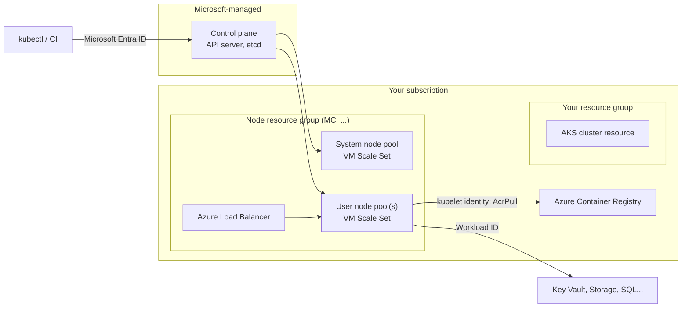

# Azure Kubernetes Service

## Introduction

**Azure Kubernetes Service (AKS)** is Azure's managed Kubernetes. Microsoft runs the control plane (API server, etcd, scheduler) and you run workloads with the same `kubectl`, Helm and manifests you would use anywhere else. It is the Azure counterpart of [Amazon EKS](./4-cloud-eks.mdx).

AKS comes in two flavors, chosen with the cluster **SKU**:

- **AKS Automatic**: a production-ready cluster with best-practice defaults. Azure manages node provisioning (node auto-provisioning, based on Karpenter), system node pools, upgrades, monitoring integration, Microsoft Entra authentication and policy guardrails. It includes a **pod readiness SLA**. Microsoft positions it as the recommended default for most production workloads.
- **AKS Standard** (the "Base" SKU): you design and manage node pools, VM sizes, scaling and many add-ons yourself. Maximum flexibility.

Separately, the **pricing tier** controls the control plane SLA: **Free** (no financially backed SLA, for dev/test), **Standard** (uptime SLA, recommended for production) or **Premium** (Standard plus Long Term Support for Kubernetes versions). Automatic clusters always use the Standard tier.

An analogy: AKS Standard is **leasing a car** where the dealer handles the engine warranty (control plane) but you choose tires, schedule oil changes and decide when to upgrade. AKS Automatic is a **car subscription**: maintenance, tire changes and upgrades happen on schedule, and you just drive.

New to Kubernetes? Start with the [Kubernetes tutorial](/docs/devops/kubernetes). This page covers what is specific to Azure.

## How AKS Is Put Together



Things that surprise people the first time:

- **Two resource groups.** Your cluster resource lives in your resource group, while its nodes, disks, load balancers and public IPs live in an automatically created **node resource group** named like `MC_rg_cluster_region`. Do not edit it by hand; on Automatic clusters it is locked down.
- **System vs user node pools.** System pools run critical add-ons such as CoreDNS. Run your applications on **user** node pools so a noisy app cannot starve cluster services. On Automatic clusters, system nodes are managed for you.
- **Several identities.** The cluster has a control plane identity, the **kubelet identity** (used by nodes to pull images), and you create separate identities for workloads through **Microsoft Entra Workload ID**.

## Feature Map: AKS Automatic vs Standard

| Area | AKS Automatic | AKS Standard |
| --- | --- | --- |
| Node management | Node auto-provisioning picks VM sizes from pending pods; managed system node pools | You create node pools, choose VM sizes, enable Cluster Autoscaler or node auto-provisioning |
| Pricing tier | Standard (preconfigured) | Free, Standard or Premium |
| SLA | Cluster uptime SLA plus pod readiness SLA | Uptime SLA on Standard/Premium; none on Free |
| Authentication | Microsoft Entra ID with Azure RBAC for Kubernetes | Local accounts or Entra ID (configurable) |
| Ingress | Application routing add-on (Gateway API by default on newer versions) | Add-on or your own controller |
| Guardrails | Azure Policy and deployment safeguards enabled | Optional |
| Windows nodes | Not supported | Supported |
| Upgrades | Automatic, within maintenance windows | You choose channels and timing |

AKS Automatic is generally available in many but not all regions, and requires a recent Azure CLI (2.86.0 or later at the time of writing). Check the [AKS Automatic docs](https://learn.microsoft.com/azure/aks/intro-aks-automatic) for current regions and limitations.

## Hands-On Option A: An AKS Automatic Cluster

:::warning Cost
AKS bills for **nodes** (VMs, disks, public IPs, load balancers) and, on the Standard and Premium tiers, an **hourly fee per cluster** for the control plane. Automatic clusters use the Standard tier. Monitoring adds Log Analytics and Managed Prometheus costs. Clusters left running cost money every hour. See [AKS pricing](https://azure.microsoft.com/pricing/details/kubernetes-service/) and run the cleanup step.
:::

```bash
az provider register --namespace Microsoft.PolicyInsights
az group create --name rg-aks-auto --location eastus

az aks create \
  --resource-group rg-aks-auto \
  --name aks-auto-demo \
  --sku automatic

az aks get-credentials --resource-group rg-aks-auto --name aks-auto-demo
kubectl get nodes
```

Example output (trimmed):

```text
To sign in, use a web browser to open the page https://microsoft.com/devicelogin and enter the code ABCD1234 to authenticate.

NAME                           STATUS   ROLES    AGE   VERSION
aks-system-surge-zq4d2         Ready    <none>   19m   v1.3x.x
```

Because Automatic clusters use Microsoft Entra authentication, `kubectl` asks you to sign in (through `kubelogin`, which `az aks install-cli` installs). The cluster creator is granted the **Azure Kubernetes Service RBAC Cluster Admin** role. Deploy workloads as usual, and node auto-provisioning creates user nodes sized for your pods' requests.

Clean up:

```bash
az group delete --name rg-aks-auto --yes --no-wait
```

## Hands-On Option B: A Standard Cluster, Step by Step

Building a Standard cluster yourself shows each moving part, which helps when you troubleshoot Automatic clusters too.

### Step 1: Create the cluster

```bash
RG=rg-aks-demo
CLUSTER=aks-demo
ACR_NAME=invoicingacr2026
LOCATION=eastus

az group create --name $RG --location $LOCATION

az aks create \
  --resource-group $RG \
  --name $CLUSTER \
  --tier free \
  --node-count 1 \
  --network-plugin azure \
  --network-plugin-mode overlay \
  --enable-oidc-issuer \
  --enable-workload-identity \
  --attach-acr $ACR_NAME \
  --generate-ssh-keys
```

What each option does:

- `--tier free`: no control plane fee and no SLA. Use `standard` for production.
- `--network-plugin azure --network-plugin-mode overlay`: **Azure CNI Overlay**. Nodes get VNet IPs, pods get IPs from a private overlay range, which avoids exhausting your VNet. (Compare with EKS, where pods take VNet-style VPC IPs by default.)
- `--enable-oidc-issuer --enable-workload-identity`: prepares **Microsoft Entra Workload ID** for pods.
- `--attach-acr`: grants the kubelet identity the `AcrPull` role on your registry, so nodes pull images without passwords. (For ACR registries using the `rbac-abac` mode, assign `Container Registry Repository Reader` instead.)

Example output (trimmed):

```text
{
  "kubernetesVersion": "1.3x.x",
  "name": "aks-demo",
  "nodeResourceGroup": "MC_rg-aks-demo_aks-demo_eastus",
  "provisioningState": "Succeeded",
  "sku": { "name": "Base", "tier": "Free" }
}
```

### Step 2: Add a user node pool with autoscaling

```bash
az aks nodepool add \
  --resource-group $RG \
  --cluster-name $CLUSTER \
  --name userpool \
  --mode User \
  --node-count 1 \
  --enable-cluster-autoscaler \
  --min-count 1 \
  --max-count 5

az aks nodepool list --resource-group $RG --cluster-name $CLUSTER \
  --query "[].{name:name, mode:mode, count:count, vmSize:vmSize}" --output table
```

Example output:

```text
Name       Mode    Count    VmSize
---------  ------  -------  ---------------
nodepool1  System  1        Standard_D2s_v5
userpool   User    1        Standard_D2s_v5
```

The default VM size depends on region and quota. Each node pool is a **Virtual Machine Scale Set**; let the Kubernetes Cluster Autoscaler manage its size, and never enable scale-set autoscaling on it directly. See [Auto Scaling Groups and Scale Sets](../3-cloud-compute/3-cloud-autoscaling.mdx).

### Step 3: Deploy the app

```bash
az aks get-credentials --resource-group $RG --name $CLUSTER
LOGIN_SERVER=$(az acr show --name $ACR_NAME --query loginServer --output tsv)
```

```yaml
# app.yaml (replace LOGIN_SERVER with your ACR login server)
apiVersion: apps/v1
kind: Deployment
metadata:
  name: hello-cloud
spec:
  replicas: 3
  selector:
    matchLabels:
      app: hello-cloud
  template:
    metadata:
      labels:
        app: hello-cloud
    spec:
      nodeSelector:
        kubernetes.azure.com/mode: user
      containers:
        - name: web
          image: LOGIN_SERVER/invoicing/api:1.0.0
          ports:
            - containerPort: 8080
          resources:
            requests:
              cpu: 250m
              memory: 256Mi
            limits:
              memory: 512Mi
          readinessProbe:
            httpGet:
              path: /health
              port: 8080
---
apiVersion: v1
kind: Service
metadata:
  name: hello-cloud
spec:
  type: LoadBalancer
  selector:
    app: hello-cloud
  ports:
    - port: 80
      targetPort: 8080
```

```bash
sed "s|LOGIN_SERVER|$LOGIN_SERVER|" app.yaml | kubectl apply -f -
kubectl get pods -o wide
kubectl get service hello-cloud --watch
```

Example output:

```text
NAME                          READY   STATUS    RESTARTS   AGE   IP            NODE
hello-cloud-7c9d8f6b4-4hx2k   1/1     Running   0          40s   10.244.1.12   aks-userpool-31415926-vmss000000
hello-cloud-7c9d8f6b4-9mzpl   1/1     Running   0          40s   10.244.1.13   aks-userpool-31415926-vmss000000
hello-cloud-7c9d8f6b4-qrv7d   1/1     Running   0          40s   10.244.1.14   aks-userpool-31415926-vmss000000

NAME          TYPE           CLUSTER-IP    EXTERNAL-IP    PORT(S)        AGE
hello-cloud   LoadBalancer   10.0.142.77   20.81.112.45   80:31234/TCP   72s
```

The `nodeSelector` keeps the app on the user pool. Pod IPs (`10.244.x.x`) come from the overlay range, not the VNet. A `LoadBalancer` Service creates a public IP on the Azure Load Balancer in the node resource group. For HTTP routing, TLS and host-based rules, enable the managed **application routing** add-on (`az aks approuting enable`) instead of exposing every service on its own IP. Note that the community **ingress-nginx** project has been retired upstream, and newer AKS Automatic clusters default to the **Kubernetes Gateway API** through the application routing add-on.

### Step 4: Give pods Azure permissions with Workload ID

Workload ID lets a Kubernetes service account exchange its token for a Microsoft Entra token for a managed identity. No secrets are stored in the cluster.

```bash
AKS_OIDC_ISSUER=$(az aks show --resource-group $RG --name $CLUSTER \
  --query "oidcIssuerProfile.issuerUrl" --output tsv)

az identity create --name id-hello-cloud --resource-group $RG
CLIENT_ID=$(az identity show --name id-hello-cloud --resource-group $RG --query clientId --output tsv)

az identity federated-credential create \
  --name fic-hello-cloud \
  --identity-name id-hello-cloud \
  --resource-group $RG \
  --issuer "$AKS_OIDC_ISSUER" \
  --subject system:serviceaccount:default:hello-cloud \
  --audience api://AzureADTokenExchange
```

```yaml
# workload-identity.yaml
apiVersion: v1
kind: ServiceAccount
metadata:
  name: hello-cloud
  namespace: default
  annotations:
    azure.workload.identity/client-id: "CLIENT_ID_HERE"
```

Then, in the Deployment's pod template, add the label `azure.workload.identity/use: "true"` and `serviceAccountName: hello-cloud`. The Workload ID webhook injects environment variables and a token file, and `DefaultAzureCredential` in the Azure SDK picks them up automatically. Grant the identity only the roles it needs, for example `Storage Blob Data Reader` on one storage account. Role assignments can take several minutes to propagate.

| | AKS Workload ID | EKS Pod Identity |
| --- | --- | --- |
| Cloud identity | User-assigned managed identity (or app registration) | IAM role |
| Link to service account | Federated identity credential (issuer + subject) | Pod Identity association |
| In-cluster config | Service account annotation + pod label | `serviceAccountName` only |
| SDK support | `DefaultAzureCredential` | Default AWS credential chain |

### Step 5: Clean up

```bash
kubectl delete -f app.yaml   # or delete the Service first to remove the public IP
az group delete --name $RG --yes --no-wait
```

Deleting your resource group also removes the `MC_` node resource group and the managed identities created for the cluster.

## Day-2 Operations

### Upgrades

```bash
az aks get-upgrades --resource-group $RG --name $CLUSTER --output table
az aks upgrade --resource-group $RG --name $CLUSTER --kubernetes-version 1.xx.x
az aks update --resource-group $RG --name $CLUSTER --auto-upgrade-channel stable
```

AKS supports a rolling window of recent Kubernetes minor versions. Set an **auto-upgrade channel** (`patch`, `stable`, `rapid` or `node-image`) and a **planned maintenance window** so upgrades happen when you expect. Node OS images are patched separately through the node OS upgrade channel. If you need to stay on one version for longer, the **Premium** tier adds **Long Term Support (LTS)** for selected versions. Check the [AKS supported versions page](https://learn.microsoft.com/azure/aks/supported-kubernetes-versions) for current dates.

### Scaling

- **Pods**: Horizontal Pod Autoscaler; the **KEDA add-on** for event-driven scaling (Service Bus, Event Hubs).
- **Nodes**: Cluster Autoscaler per node pool, or **node auto-provisioning** (built into Automatic) which picks VM sizes for pending pods.
- **Burst**: virtual nodes can schedule pods onto Azure Container Instances for sudden spikes.
- **Spot node pools**: `az aks nodepool add --priority Spot` for interruption-tolerant work.

### Observability and security

Enable **Container Insights** and **Azure Monitor managed service for Prometheus** with Azure Managed Grafana. Use **Microsoft Defender for Containers** for runtime threat detection and image scanning, and **Azure Policy** for guardrails (for example, "no privileged containers"). See [Policies and Governance](../12-cloud-observability-and-security/7-cloud-compliance-and-governance.mdx).

## AKS and EKS Side by Side

| Task | AKS | EKS |
| --- | --- | --- |
| Create a fully managed cluster | `az aks create --sku automatic` | `eksctl create cluster --enable-auto-mode` |
| Get credentials | `az aks get-credentials` | `aws eks update-kubeconfig` |
| Registry access | `--attach-acr` (kubelet identity gets `AcrPull`) | Node role with ECR read permissions |
| Pod cloud identity | Workload ID (federated credential) | Pod Identity association |
| Add a node group | `az aks nodepool add` | `eksctl create nodegroup` (or Auto Mode NodePool) |
| Upgrade | `az aks upgrade` / auto-upgrade channel | `aws eks update-cluster-version` |
| Control plane fee | Free tier: none; Standard/Premium: hourly | Hourly per cluster |
| Longer version support | Premium tier with LTS | Extended support at a higher hourly rate |

## Real-World Scenario

A retail company standardized on Azure. Its platform team supports eight product teams with about 60 services. Some services need GPUs for recommendation models, two vendors deliver software only as Helm charts, and security requires Entra ID sign-in and audited access. A newer team running three simple APIs asks whether they can just use Container Apps instead.

### The solution

- A shared **AKS Automatic** cluster per environment for the platform: Entra authentication with Azure RBAC per namespace, node auto-provisioning, Azure Policy guardrails, and Workload ID for every service.
- A separate **AKS Standard** cluster (Premium tier with LTS) for the GPU workloads, where the team needs specific GPU VM sizes, driver control and a slower upgrade cadence for a certified ML stack.
- The newer team's three APIs go to **Azure Container Apps**, which scale to zero overnight and need no Kubernetes knowledge. They can move to AKS later if they outgrow it, since images are portable.

### Why this approach

Most teams get Kubernetes with very little node operations through Automatic, and the vendor Helm charts run unchanged. The special GPU case gets the flexibility it needs without forcing that complexity on everyone. Small, simple services avoid Kubernetes entirely.

### When to use AKS, and when not to

- **Use AKS** when you need the Kubernetes API: Helm charts, operators, service meshes, GitOps with Argo CD or Flux, multi-cloud portability of manifests, or many teams sharing a platform.
- **Prefer Azure Container Apps** when you have a few services, want scale to zero, and do not need Kubernetes APIs.
- **Prefer App Service** for traditional web apps that benefit from deployment slots and built-in authentication.

### Alternatives and trade-offs

| Approach | Pros | Cons | Best for |
| --- | --- | --- | --- |
| AKS Automatic | Kubernetes with best-practice defaults, managed nodes, pod readiness SLA | Fewer knobs, no Windows nodes, region availability | Most production Kubernetes on Azure |
| AKS Standard | Full control: VM sizes, Windows, GPUs, network plugins | You manage node pools, upgrades, add-ons | Specialized or highly customized clusters |
| Azure Container Apps | Serverless, scale to zero, simple | No direct Kubernetes API | Microservices without a platform team |
| Amazon EKS | Similar Kubernetes on AWS | Cluster-hour fee always, different identity model | AWS-first organizations |

## Common Mistakes

- **Using the Free tier in production.** It has no financially backed SLA for the API server. Use Standard or Premium.
- **Running apps on the system node pool.** Add a user pool and use node selectors or taints.
- **Editing resources in the `MC_` node resource group.** Changes can be overwritten or break the cluster. Configure through the AKS API.
- **Storing service principal secrets in Kubernetes Secrets.** Use Workload ID with managed identities.
- **Choosing classic Azure CNI with small subnets.** Every pod takes a VNet IP and subnets run out. Use Azure CNI Overlay unless pods must be directly routable from the VNet.
- **Falling behind on versions.** Unsupported versions lose patches. Set an auto-upgrade channel and maintenance window.
- **Creating `LoadBalancer` Services for everything.** Each one gets a public IP. Use an ingress or Gateway API routing layer.

## Summary

- **AKS** runs a managed Kubernetes control plane on Azure. Choose **Automatic** (managed nodes, best-practice defaults, pod readiness SLA) or **Standard** (full control).
- **Pricing tiers**: Free (no SLA), Standard (uptime SLA) and Premium (adds Long Term Support). You always pay for nodes and networking.
- **Node pools** are VM Scale Sets; keep apps on **user** pools; scale with Cluster Autoscaler or node auto-provisioning.
- Pull from ACR with `--attach-acr`; give pods Azure access with **Microsoft Entra Workload ID**.
- Upgrade regularly using **auto-upgrade channels** and **maintenance windows**.
- The AWS counterpart is **EKS** (with Auto Mode as the analog of AKS Automatic).

## Exercises

1. Create a Free-tier Standard cluster with one system node and a user pool with the Cluster Autoscaler (1 to 3 nodes). Deploy `hello-cloud` with 10 replicas and high CPU requests, and watch the autoscaler add nodes. Then delete the resource group.
2. Set up Workload ID for a pod that runs the `azure-cli` image and calls `az login --federated-token` (or a small Python script with `DefaultAzureCredential`) to list blobs in a storage account. Confirm no secrets exist in the namespace.
3. Run `az aks get-upgrades` on your cluster and write an upgrade plan: the order of control plane, node pools and add-ons, and what you would check before each step.
4. Compare the cost drivers of a three-node AKS Standard-tier cluster and a three-node EKS cluster using the official pricing calculators. List each billed item and how it is metered (per hour, per GB, per node), and note the date you checked, since prices change.

**Next:** bring it all together in [Choosing a Container Platform](./6-cloud-choosing-container-platform.mdx), or compare with [Amazon EKS](./4-cloud-eks.mdx).
