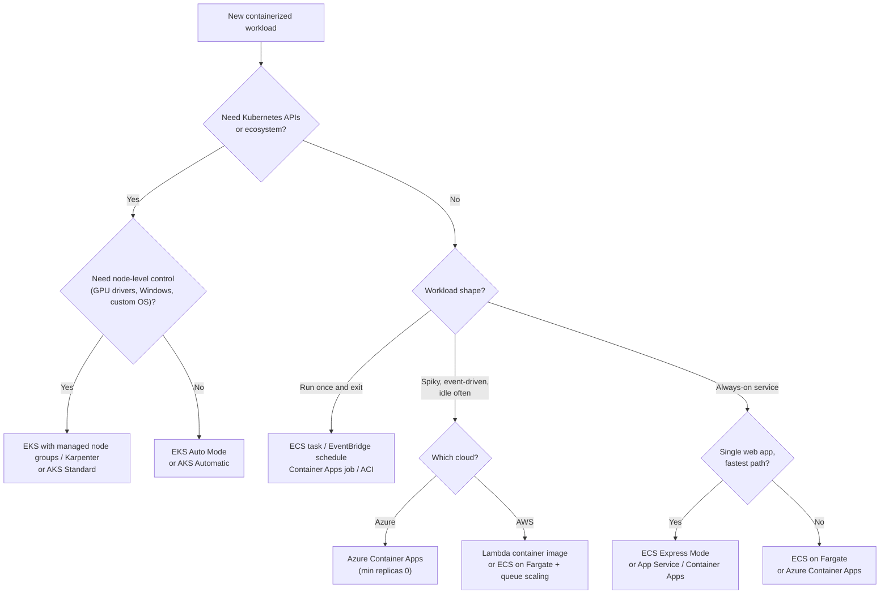
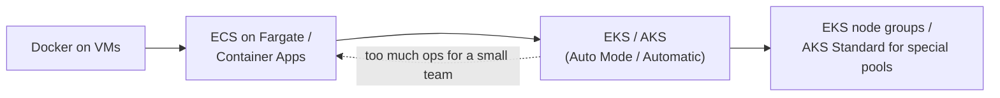

# Choosing a Container Platform

## Introduction

You have now seen every major way to run containers on AWS and Azure: [ECS and Fargate](./2-cloud-ecs-and-fargate.mdx), [Container Apps and Container Instances](./3-cloud-azure-container-apps.mdx), [EKS](./4-cloud-eks.mdx) and [AKS](./5-cloud-aks.mdx). They can all run the same image. So how do you choose?

The honest answer is that **the technology is rarely the deciding factor**. Team skills, the shape of your workloads, how much operations work you can afford, and how your costs behave at low and high load matter more than feature checklists. A great platform that nobody on the team understands will hurt you more than a "lesser" one that everyone can operate at 3 a.m.

Think of it like choosing a vehicle for a delivery business. A cargo van (Container Apps, ECS on Fargate) handles most jobs with little fuss. A fleet of trucks with your own depot (EKS, AKS) makes sense once you have many routes, drivers and special cargo. Hiring a courier for one-off deliveries (ACI, a one-off ECS task) is cheapest when you only ship occasionally. Each is right for someone.

This page gives you a repeatable way to decide, and to explain the decision to your team.

## The Questions That Matter

Work through these in order. Early answers often settle the decision.

1. **Does the team already run Kubernetes, or depend on its ecosystem?** Vendor Helm charts, operators, Argo CD or Flux, service meshes, Kubernetes-native security tools. If yes, EKS or AKS is likely; rewriting all of that is expensive.
2. **How many services and teams?** Three services owned by one team rarely justify a cluster. Fifty services across eight teams often do, because a shared platform pays for itself.
3. **What shape are the workloads?** Always-on HTTP APIs, spiky webhooks, queue workers, scheduled jobs, long-running batch, GPU inference. Some platforms fit some shapes much better.
4. **Do you need scale to zero?** Azure Container Apps does it natively for apps and jobs. On AWS, Lambda (including container images) is the main scale-to-zero option; ECS services typically keep at least one task.
5. **Do you need low-level control?** GPUs with specific drivers, Windows containers, privileged containers, DaemonSets, custom kernels or node tuning push you toward Kubernetes (Standard mode), ECS on EC2 or ECS Managed Instances.
6. **What are the networking and compliance requirements?** Private-only endpoints, VNet/VPC integration, egress through firewalls, data residency. All options support private networking, but with different effort.
7. **Single cloud or multi-cloud?** Kubernetes manifests are the most portable artifact, but identity, networking, storage and load balancing still differ per cloud.
8. **What is your operations budget?** Count people-hours, not just cloud bills. Cluster upgrades, add-on management and node patching take real time unless the provider automates them (EKS Auto Mode, AKS Automatic).

## A Decision Tree



Treat the tree as a first draft of an answer. Then check it against the trade-offs below.

## The Full Comparison

| Platform | Control | Ops effort | Scale to zero | Kubernetes API | Billing shape | Typical fit |
| --- | --- | --- | --- | --- | --- | --- |
| Azure Container Instances | Low | Very low | N/A (runs until stopped) | No | Per second per container group | One-off tasks, simple tools, burst from AKS |
| ECS task on Fargate (one-off) | Low | Very low | N/A | No | Per second vCPU + memory | Batch, scheduled jobs |
| ECS Express Mode | Low to medium | Very low | No | No | Fargate + ALB, no extra fee | Single web apps and APIs |
| Azure Container Apps | Medium | Low | Yes | No (KEDA/Dapr concepts) | Per second, idle rate, free grant; or Dedicated profiles | Microservices, workers, jobs |
| ECS on Fargate | Medium | Low | No for services | No | Per second vCPU + memory per task | AWS services and workers |
| ECS Managed Instances / ECS on EC2 | High | Medium | No | No | Per instance (plus management fee for Managed Instances) | GPUs, dense packing, steady load |
| EKS Auto Mode / AKS Automatic | High | Medium | No (nodes scale down, cluster stays) | Yes | Cluster fee + nodes (+ Auto Mode fee) | Kubernetes platforms without node ops |
| EKS (node groups) / AKS Standard | Very high | High | No | Yes | Cluster fee (AKS Free tier: none) + nodes | Custom platforms, special hardware |

## Requirement Lookup

Some requirements rule options in or out immediately. Use this table to shortlist before you compare costs. Capabilities change, so confirm the current state in each service's documentation.

| Requirement | Strong candidates | Usually a poor fit |
| --- | --- | --- |
| Scale to zero for HTTP APIs | Azure Container Apps, Lambda container images | ECS services, EKS, AKS (the cluster keeps running) |
| Windows containers | ECS on EC2, EKS with Windows nodes, AKS Standard, ACI, App Service | AKS Automatic, Container Apps (Linux only) |
| GPU workloads | ECS Managed Instances or EC2, EKS, AKS, Container Apps serverless GPU or GPU workload profiles | Fargate, ACI (GPU support is limited; check current docs) |
| Privileged containers or DaemonSets | EKS, AKS, ECS on EC2 (privileged; daemon scheduling) | Fargate, Container Apps, ACI |
| Vendor Helm charts and operators | EKS, AKS | ECS, Container Apps |
| Run-to-completion jobs | ECS tasks, Container Apps jobs, ACI, Kubernetes Jobs | Long-running service platforms alone |
| Event-driven scaling from queues | Container Apps (KEDA built in), EKS/AKS with KEDA, ECS with custom metrics | ACI |
| Traffic splitting and canaries built in | Container Apps (revisions), ECS (blue/green deployments) | ACI |
| Strong isolation per workload | Fargate (micro-VM per task), ACI (hypervisor isolation), dedicated node pools | Shared nodes without extra controls |

## The Same App on Three Platforms

Seeing the deployment definitions side by side shows how much each platform asks of you. All three run the `hello-cloud` image with 0.5 vCPU, port 8080 and public HTTP access.

**ECS on Fargate (CloudFormation, trimmed):**

```yaml
Resources:
  TaskDef:
    Type: AWS::ECS::TaskDefinition
    Properties:
      Family: hello-cloud
      Cpu: "512"
      Memory: "1024"
      NetworkMode: awsvpc
      RequiresCompatibilities: [FARGATE]
      ExecutionRoleArn: !GetAtt ExecutionRole.Arn
      ContainerDefinitions:
        - Name: web
          Image: 123456789012.dkr.ecr.us-east-1.amazonaws.com/invoicing/api:1.0.0
          PortMappings:
            - ContainerPort: 8080
  Service:
    Type: AWS::ECS::Service
    Properties:
      Cluster: !Ref Cluster
      LaunchType: FARGATE
      DesiredCount: 2
      TaskDefinition: !Ref TaskDef
      NetworkConfiguration:
        AwsvpcConfiguration:
          Subnets: [!Ref PrivateSubnetA, !Ref PrivateSubnetB]
          SecurityGroups: [!Ref TaskSecurityGroup]
      # plus: load balancer, target group, listener, log group, scaling policy
```

**Azure Container Apps (Bicep, trimmed):**

```bicep
resource app 'Microsoft.App/containerApps@2024-03-01' = {
  name: 'hello-cloud'
  location: location
  properties: {
    managedEnvironmentId: env.id
    configuration: {
      ingress: {
        external: true
        targetPort: 8080
      }
    }
    template: {
      containers: [
        {
          name: 'web'
          image: '${acrLoginServer}/invoicing/api:1.0.0'
          resources: {
            cpu: json('0.5')
            memory: '1Gi'
          }
        }
      ]
      scale: {
        minReplicas: 0
        maxReplicas: 5
      }
    }
  }
}
```

**Kubernetes on EKS or AKS (trimmed):** a `Deployment`, a `Service`, and an `Ingress` or Gateway route, like the manifests on the [EKS](./4-cloud-eks.mdx) and [AKS](./5-cloud-aks.mdx) pages, plus the cluster itself, its node configuration, add-ons and upgrade plan.

The Container Apps definition includes HTTPS ingress and scaling in one resource. ECS needs separate load balancer resources but gives you fine control over each. Kubernetes manifests are the most portable, but you also own the cluster they run on.

## Thinking About Cost Shapes

Never compare platforms by copying prices from a blog post: prices vary by region and change often. Instead, understand the **shape** of each billing model, then plug in current numbers from the [AWS Pricing Calculator](https://calculator.aws/) or the [Azure Pricing Calculator](https://azure.microsoft.com/pricing/calculator/).

Three shapes matter:

- **Pay while replicas run, scale to zero allowed** (Container Apps Consumption, Lambda): near-zero cost when idle, cost grows with traffic.
- **Pay per running task** (Fargate, ACI): you pay for every task you keep running, even idle ones; no cluster fee.
- **Pay for capacity** (nodes in EKS/AKS, EC2, Dedicated profiles): a fixed base you fill with work; cheapest per unit **if** utilization is high.

This small script shows how the shapes cross over as load grows. The unit rates are **made-up placeholders**, not real prices. Replace them with numbers from the calculators for your region before drawing conclusions.

```python
# cost_shapes.py - compare billing SHAPES, not real prices
# All rates below are illustrative placeholders. Replace with values from the
# AWS Pricing Calculator or Azure Pricing Calculator for your region.

HOURS_PER_MONTH = 730

# Placeholder unit rates (arbitrary "cost units")
SERVERLESS_RATE_PER_BUSY_HOUR = 1.00    # pay only while handling load
TASK_RATE_PER_HOUR = 0.60               # always-on task, per task-hour
NODE_RATE_PER_HOUR = 2.00               # one node fits several tasks
CLUSTER_FEE_PER_HOUR = 0.50             # control plane fee
TASKS_PER_NODE = 6
MIN_TASKS = 2                           # keep 2 tasks for availability

def serverless(busy_fraction: float, peak_tasks: int) -> float:
    return SERVERLESS_RATE_PER_BUSY_HOUR * peak_tasks * busy_fraction * HOURS_PER_MONTH

def per_task(busy_fraction: float, peak_tasks: int) -> float:
    avg_tasks = max(MIN_TASKS, peak_tasks * busy_fraction)
    return TASK_RATE_PER_HOUR * avg_tasks * HOURS_PER_MONTH

def cluster(busy_fraction: float, peak_tasks: int) -> float:
    avg_tasks = max(MIN_TASKS, peak_tasks * busy_fraction)
    nodes = max(2, -(-int(avg_tasks * 1.3) // TASKS_PER_NODE))  # 30% headroom, ceil
    return (NODE_RATE_PER_HOUR * nodes + CLUSTER_FEE_PER_HOUR) * HOURS_PER_MONTH

print(f"{'busy %':>7} {'peak':>5} {'scale-to-zero':>14} {'per-task':>10} {'cluster':>10}")
for busy, peak in [(0.02, 4), (0.10, 4), (0.30, 10), (0.60, 30), (0.90, 60)]:
    print(f"{busy*100:6.0f}% {peak:5d} {serverless(busy, peak):14.0f} "
          f"{per_task(busy, peak):10.0f} {cluster(busy, peak):10.0f}")
```

Example output:

```text
 busy %  peak  scale-to-zero   per-task    cluster
     2%     4             58        876       3285
    10%     4            292        876       3285
    30%    10           2190       1314       3285
    60%    30          13140       7884       6205
    90%    60          39420      23652      17885
```

With these placeholder numbers, the pattern is what you see in practice: **scale-to-zero wins when you are mostly idle**, **per-task billing wins in the middle**, and **dense capacity (nodes) wins at sustained high utilization**, provided someone keeps the nodes well packed. Commitments (Savings Plans, reservations) and Spot shift the lines further. See [Cost Optimization and FinOps](../13-cloud-architecture/4-cloud-cost-optimization.mdx).

:::caution Don't forget the fixed costs
Load balancers, NAT gateways, log ingestion, public IPv4 addresses and cross-AZ traffic often dominate small deployments, regardless of platform. Include them in every comparison.
:::

## A Scoring Worksheet

When a team is split, a weighted scorecard makes the trade-offs explicit and turns a debate into a discussion about **weights**. Score each option 1 to 5 per criterion for **your** situation:

```python
# platform_scorecard.py
weights = {
    "team_skills": 5,
    "ops_effort": 4,       # higher score = less effort
    "workload_fit": 5,
    "cost_at_our_load": 3,
    "ecosystem_needs": 2,
    "portability": 1,
}

scores = {
    "Azure Container Apps": {"team_skills": 4, "ops_effort": 5, "workload_fit": 4,
                             "cost_at_our_load": 5, "ecosystem_needs": 2, "portability": 3},
    "AKS Automatic":        {"team_skills": 2, "ops_effort": 3, "workload_fit": 5,
                             "cost_at_our_load": 3, "ecosystem_needs": 5, "portability": 5},
    "ECS on Fargate":       {"team_skills": 4, "ops_effort": 4, "workload_fit": 4,
                             "cost_at_our_load": 4, "ecosystem_needs": 2, "portability": 2},
}

max_total = 5 * sum(weights.values())
ranked = sorted(
    ((sum(weights[c] * s[c] for c in weights), name) for name, s in scores.items()),
    reverse=True,
)
for total, name in ranked:
    print(f"{name:<22} {total:>3} / {max_total}  ({total / max_total:.0%})")
```

Example output:

```text
Azure Container Apps    82 / 100  (82%)
ECS on Fargate          74 / 100  (74%)
AKS Automatic           71 / 100  (71%)
```

The numbers are only as good as the honesty of the scores, but writing them down exposes hidden assumptions ("we weighted portability at 1, yet we keep arguing about multi-cloud").

## Keeping Your Options Open

Whatever you choose, these habits make a later move cheap:

- **Standard OCI images** with no platform-specific entrypoints. Configuration through environment variables.
- **Twelve-factor style apps**: stateless processes, logs to stdout, backing services by URL.
- **Health endpoints** (`/health`, `/ready`) that every platform can probe.
- **Graceful shutdown** on `SIGTERM`, which every platform sends.
- **Identity through the SDK's default credential chain** (`boto3` default chain, `DefaultAzureCredential`) so code does not care whether it runs on Fargate, Container Apps, EKS or AKS.
- **Infrastructure as code** for the platform layer. See [Choosing an IaC Tool](../10-cloud-infrastructure-as-code/5-cloud-choosing-iac-tool.mdx).

Common migration paths, in order of frequency:



Moving "down" the arrow (from Kubernetes back to serverless containers) is also common, and healthy, when a team realizes the cluster costs more attention than it saves.

## A Design Review Checklist

Before you commit, make sure the proposal answers these questions in writing:

- Which workloads run where, and what shape is each one (always-on, spiky, job)?
- Who operates the platform, and how many hours per month does that take (upgrades, patching, incidents)?
- How do images get built, scanned, signed and promoted? See [Container Registries](./1-cloud-container-registries.mdx).
- How do workloads authenticate to cloud services without stored secrets?
- What is the network path for users, for internal calls, and for egress to the internet?
- How are logs, metrics and traces collected, and what does that cost per month at expected volume?
- What are the scaling limits per task, replica or node, and how far below them will you run?
- What is the cleanup and decommission plan for environments that are no longer needed?
- What event would make you revisit the decision (number of services, a new compliance requirement, a cost threshold)?

## Real-World Scenario

A 25-person health-tech startup runs on AWS today: 12 services on ECS Fargate, a few Lambda functions, and Aurora. A large hospital customer requires that its data stay in that hospital's **Azure** tenant region, and the board asks: "Should we go multi-cloud, and should we move everything to Kubernetes to make that easier?"

### Walking through it

1. **What actually needs to run on Azure?** Only the deployment for that customer: the API, two workers and a scheduled export job. Not the whole company.
2. **Do we need Kubernetes for portability?** The images are already portable. The non-portable parts are identity, networking, secrets, databases and observability, and Kubernetes does not remove those differences.
3. **Team skills?** Strong ECS skills, no Kubernetes operators on staff.
4. **Decision:** keep AWS on **ECS Fargate**. Deploy the customer's stack on **Azure Container Apps** (API with `minReplicas 2`, workers with KEDA queue scaling, a scheduled job), with Azure Database for PostgreSQL, Key Vault and Workload identity via managed identities. Use **Terraform** for both clouds, with one module per platform and shared conventions.

### Why this approach

It meets the data-residency requirement with the least new operational surface. ECS and Container Apps share a similar mental model (service, revision, replica, scale rule), so the team learns quickly. Kubernetes stays an option if dozens of customers make the same demand.

### When to use it, and when not to

- **Use "best serverless container service per cloud"** when multi-cloud is driven by specific customers or regulations and the footprint on the second cloud is small.
- **Do not** use it if the company plans to run large, identical platforms on both clouds with one platform team. Then a common Kubernetes layer (EKS + AKS with shared GitOps) pays back its cost. See [Multi-Cloud and Hybrid Strategy](../13-cloud-architecture/5-cloud-multi-cloud-strategy.mdx).

### Alternatives and trade-offs

| Approach | Pros | Cons | Best for |
| --- | --- | --- | --- |
| Native serverless containers per cloud (ECS + Container Apps) | Least ops, uses each cloud's strengths | Two deployment models to maintain | Small second-cloud footprint |
| Kubernetes on both (EKS + AKS) | One deployment model (manifests, Helm, GitOps) | Two clusters to run, identity and networking still differ | Large, symmetric multi-cloud platforms |
| Single cloud, decline the requirement | Simplest | Lose the customer | When the business case is weak |
| Single cloud with a region in the customer's geography | Simple, may satisfy residency | Does not meet "must be in our Azure tenant" demands | When residency, not tenancy, is the real requirement |

## Common Mistakes

- **Choosing by popularity or résumé value.** "Everyone uses Kubernetes" is not a requirement. Start from workload shape and team skills.
- **Ignoring people costs.** A cluster that needs half an engineer to keep upgraded is expensive, even if the cloud bill looks fine.
- **Comparing list prices instead of billing shapes.** Utilization, idle time and fixed networking costs decide real spend.
- **Assuming Kubernetes makes you cloud-agnostic.** Manifests are portable; identity, storage classes, load balancers and managed databases are not.
- **One platform for everything.** It is fine to run most services on Container Apps or Fargate and a few special ones on AKS or EKS.
- **Skipping a proof of concept.** Deploy one real service end to end (build, deploy, scale, log, roll back) on your top two candidates before committing. A week of hands-on work beats a month of slide decks.
- **Forgetting the exit cost.** Note what you would have to rewrite to leave a platform (task definitions, Bicep, Helm charts, scaling rules) and keep that list short.
- **Never revisiting the decision.** Re-evaluate yearly. Services like EKS Auto Mode, AKS Automatic and ECS Express Mode keep changing the trade-offs.

## Summary

- Decide with **team skills, workload shape, number of services, control needs and operations budget** first, features second.
- **Serverless containers** (ECS on Fargate, Azure Container Apps) are the default for most teams with a handful to a few dozen services.
- **Managed Kubernetes** (EKS, AKS) fits when you need the Kubernetes ecosystem or run a shared platform for many teams; **Auto Mode** and **Automatic** reduce node operations.
- **Single-container services** (ACI, one-off ECS tasks, Container Apps jobs) fit batch and occasional work.
- Compare **billing shapes**: scale-to-zero, per-task and per-capacity, plus fixed networking costs. Use official calculators for numbers.
- Keep images and apps **portable** so changing your mind later is cheap.

## Exercises

1. Run `cost_shapes.py` with rates you take from the AWS and Azure pricing calculators for your region (Fargate task, Container Apps consumption, a small node size and the cluster fee). At what busy percentage does each option become cheapest? Note the date you collected the rates.
2. Fill in `platform_scorecard.py` for a real project you know. Ask a teammate to fill it in independently, then compare weights rather than totals.
3. Take the decision tree above and add one branch for a requirement it ignores (for example, Windows containers or GPU inference). Which platforms does that branch lead to on each cloud?
4. Write a one-page architecture decision record for the health-tech scenario, including the "revisit when" trigger that would make you switch to Kubernetes on both clouds.

**Related pages:** [Container Options in the Cloud](./0-cloud-container-options.mdx), [Choosing a Compute Option](../3-cloud-compute/0-cloud-compute-options.mdx), [Serverless Trade-offs and Costs](../4-cloud-serverless/7-cloud-serverless-trade-offs.mdx), and the hands-on [Project: Containerized App on Managed Containers](../14-cloud-projects/3-cloud-project-containerized-app.mdx).
