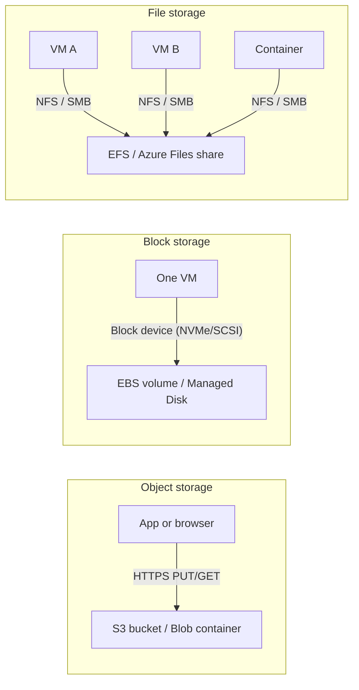
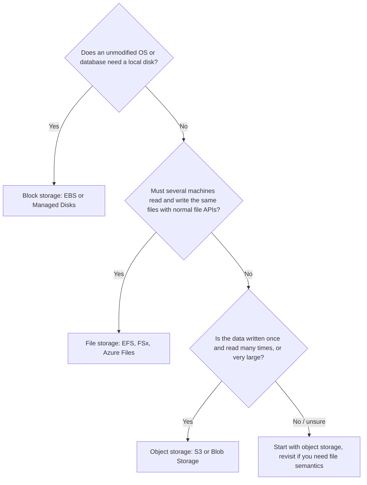
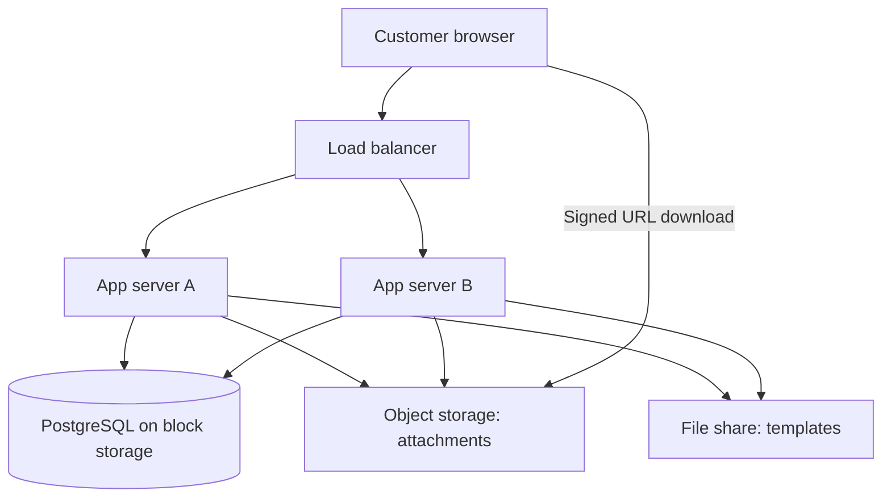

# Object, Block and File Storage

## Introduction

Every application stores data somewhere: user uploads, database files, log files, build artifacts, backups. On your laptop all of that lives on one disk and you never think about it. In the cloud you have to choose, because the providers offer three very different kinds of storage, and each one is billed, accessed and scaled differently.

| Storage type | You work with | Accessed through | AWS service | Azure service |
| --- | --- | --- | --- | --- |
| **Object** | Whole objects (files plus metadata) identified by a key | HTTPS API (`PUT`, `GET`, `DELETE`) | Amazon S3 | Azure Blob Storage |
| **Block** | A raw virtual disk that an OS formats with a file system | Attached to one VM like a local drive | Amazon EBS | Azure Managed Disks |
| **File** | A shared directory tree with folders and files | Network file protocols (NFS, SMB) | Amazon EFS, Amazon FSx | Azure Files, Azure NetApp Files |

A helpful analogy is moving house:

- **Object storage** is a self-storage warehouse. You hand over a sealed box with a label, and you get it back by quoting the label. You cannot open the box in the warehouse and change one page. You take the whole box out, change it, and put a new box back. The warehouse is effectively endless.
- **Block storage** is the hard drive inside your own desk. It is fast and private, you organize it however you like, and only the person sitting at that desk can use it.
- **File storage** is the shared filing cabinet in the office. Several people can open the same drawer at the same time, and everybody sees the same folders.

This page explains the three models, maps them to AWS and Azure, and gives you a decision process. The rest of this section goes deep on each service.

## How the Three Models Work



### Object storage

Object storage is a flat collection of **objects** inside a **bucket** (AWS) or **container** (Azure). Each object has:

- a **key** (its name, such as `invoices/2026/10/inv-1042.pdf`),
- the **data** (any bytes, from zero bytes up to many terabytes),
- **metadata** (content type, custom key-value pairs, tags).

There are no real folders. The `/` characters in the key are just part of the name. Consoles and CLIs *show* them as folders for convenience.

Key properties:

- **Accessed over HTTPS.** Any program with network access and permission can read and write it. You do not mount it like a disk.
- **Whole-object writes.** To change one byte you upload a new version of the whole object. (Azure append blobs are an exception for log-style appends.)
- **Practically unlimited scale.** You do not provision capacity. You pay per GB-month stored, per request, and for data transferred out.
- **Very high durability.** Both providers replicate data across multiple devices, and optionally across zones and regions.

Good fits: user uploads, images and video, static websites, backups, data lake files (Parquet, CSV, JSON), logs, ML training data, build artifacts.

Poor fits: database data files, anything that needs to modify small parts of a file in place, or software that expects a POSIX file system.

### Block storage

Block storage gives a VM a **virtual disk**. The operating system sees a raw device (for example `/dev/nvme1n1` on Linux), puts a file system on it (ext4, XFS, NTFS), and reads and writes fixed-size blocks.

Key properties:

- **Attached to one VM at a time** (with narrow multi-attach exceptions for clustered software).
- **Low latency and high IOPS**, because it is designed to behave like a local disk.
- **Provisioned capacity.** You pay for the size you create (and sometimes for extra IOPS or throughput) whether you fill it or not.
- **Zonal.** A disk lives in one availability zone, next to its VM. To protect it you take **snapshots**.

Good fits: VM boot disks, self-managed databases (PostgreSQL or SQL Server on a VM), anything that needs a real local file system with fast random I/O.

### File storage

File storage is a **managed network file system**. Many clients mount the same share and see the same directory tree with normal file operations: open, seek, write, lock, rename.

Key properties:

- **Shared** by many VMs, containers and even on-premises machines.
- **Standard protocols**: NFS (Linux) and SMB (Windows, and Linux too).
- **POSIX-like semantics**, so existing software works unchanged.
- **Billing** is either by data stored (EFS) or by capacity and performance you provision (Azure Files provisioned models).

Good fits: shared content for a web farm, home directories, lift-and-shift apps that write to a shared drive, persistent volumes that several Kubernetes pods must read and write at the same time.

## Side-by-Side Comparison

| Property | Object | Block | File |
| --- | --- | --- | --- |
| Interface | REST API over HTTPS | Disk device | NFS / SMB mount |
| Concurrent writers | Many (whole objects) | One VM (usually) | Many |
| Latency | Tens of milliseconds typical | Sub-millisecond to low milliseconds | Around a millisecond to tens of ms |
| Capacity model | Pay for what you store | Pay for what you provision | Pay for stored (EFS) or provisioned (Azure Files v2) |
| Scope | Regional (data spread across zones by default on S3 Standard) | Zonal | Regional or zonal depending on option |
| Modify part of a file | No, rewrite the object | Yes | Yes |
| Reach from the internet | Yes, with auth or public policy | No | Not directly; private network access recommended |
| Typical cost per GB | Lowest | Middle | Highest |

The "typical cost" row is a general pattern, not a price list. Exact prices vary by region, tier and redundancy option and change over time, so check the [AWS Pricing Calculator](https://calculator.aws/) and the [Azure Pricing Calculator](https://azure.microsoft.com/pricing/calculator/).

## Mapping the Services

### On AWS

| Need | Service | Notes |
| --- | --- | --- |
| Object storage | Amazon S3 general purpose buckets | Multiple storage classes from S3 Standard to S3 Glacier Deep Archive |
| Ultra-low-latency object storage | S3 Express One Zone (directory buckets) | Single AZ, for latency-sensitive analytics and ML |
| Block storage | Amazon EBS | Volume types `gp3`, `gp2`, `io2` Block Express, `io1`, `st1`, `sc1` |
| Temporary local disk | EC2 instance store | Physically attached, data is lost when the instance stops |
| Linux shared file system | Amazon EFS | NFS v4, elastic size, pay per GB stored |
| Windows / NetApp / HPC file systems | Amazon FSx (for Windows File Server, NetApp ONTAP, OpenZFS, Lustre) | For specialized protocols and performance |

### On Azure

| Need | Service | Notes |
| --- | --- | --- |
| Object storage | Azure Blob Storage (in a storage account) | Access tiers Hot, Cool, Cold, Archive, plus Smart tier |
| Big-data object storage | Azure Data Lake Storage (hierarchical namespace on a storage account) | Real directories and POSIX-style ACLs |
| Block storage | Azure Managed Disks | Ultra Disk, Premium SSD v2, Premium SSD, Standard SSD, Standard HDD |
| Temporary local disk | VM temporary disk | Data can be lost on redeploy or resize |
| Shared file system | Azure Files | SMB and NFS, SSD or HDD media |
| High-performance NAS | Azure NetApp Files | Enterprise NFS/SMB with NetApp features |

One structural difference matters early: on Azure, Blob Storage and Azure Files both live inside a **storage account**, which has its own name, redundancy setting (LRS, ZRS, GRS, GZRS) and network rules. On AWS, S3 buckets and EFS file systems are separate, independent resources. You will see this in every CLI example in this section.

## A First Look in Code

Here is the same small task, saving a JSON report, done three ways, so you can feel the difference in the programming model.

### Object storage from Python

On AWS with `boto3`:

```python
import json
import boto3

s3 = boto3.client("s3")

report = {"date": "2026-10-11", "orders": 1042, "revenue_cents": 9876500}

s3.put_object(
    Bucket="reports-demo-bucket-a1b2c3",
    Key="daily/2026-10-11.json",
    Body=json.dumps(report).encode("utf-8"),
    ContentType="application/json",
)

obj = s3.get_object(Bucket="reports-demo-bucket-a1b2c3", Key="daily/2026-10-11.json")
print(json.loads(obj["Body"].read()))
```

On Azure with `azure-storage-blob` and `azure-identity`:

```python
import json
from azure.identity import DefaultAzureCredential
from azure.storage.blob import BlobServiceClient, ContentSettings

service = BlobServiceClient(
    account_url="https://reportsdemoa1b2c3.blob.core.windows.net",
    credential=DefaultAzureCredential(),
)
blob = service.get_blob_client(container="reports", blob="daily/2026-10-11.json")

report = {"date": "2026-10-11", "orders": 1042, "revenue_cents": 9876500}
blob.upload_blob(
    json.dumps(report).encode("utf-8"),
    overwrite=True,
    content_settings=ContentSettings(content_type="application/json"),
)

print(json.loads(blob.download_blob().readall()))
```

Example output (both):

```text
{'date': '2026-10-11', 'orders': 1042, 'revenue_cents': 9876500}
```

Notice that neither program touches a file system. It is an API call with a bucket or container, a key, and bytes.

### Block and file storage from Python

Once a disk is attached and mounted, or a share is mounted, your code is ordinary file I/O. The cloud is invisible to the program:

```python
import json
from pathlib import Path

# /data is an EBS volume or Managed Disk; /shared is an EFS or Azure Files mount
for base in (Path("/data/reports"), Path("/shared/reports")):
    base.mkdir(parents=True, exist_ok=True)
    path = base / "2026-10-11.json"
    path.write_text(json.dumps({"orders": 1042}))
    print(path, "->", path.read_text())
```

Example output:

```text
/data/reports/2026-10-11.json -> {"orders": 1042}
/shared/reports/2026-10-11.json -> {"orders": 1042}
```

That is the core trade-off. Object storage needs code that speaks its API, but it scales without limits and is reachable from anywhere. Block and file storage work with unmodified software, but they live inside your network and have capacity and performance you must plan for.

## Durability, Availability and Redundancy

These two words are often confused:

- **Durability** is the chance your data still exists. Both S3 and Blob Storage are designed for very high durability (AWS documents 11 nines for S3 storage classes).
- **Availability** is the chance you can read it *right now*. A storage class can be very durable but less available, for example S3 One Zone-IA or the Azure Archive tier.

Each provider lets you choose how widely your data is copied:

| Scope | AWS | Azure |
| --- | --- | --- |
| Within one zone | S3 One Zone-IA, S3 Express One Zone, EBS volumes, EFS One Zone | LRS (locally redundant storage), most managed disks |
| Across zones in a region | Most S3 classes (three or more AZs), EFS Regional | ZRS (zone-redundant storage) |
| Across regions | S3 Replication (Cross-Region), EFS replication | GRS / GZRS (geo-redundant), RA-GRS / RA-GZRS for read access |

AWS makes multi-AZ the default for S3 and asks you to opt in to cross-region replication. Azure asks you to pick a redundancy SKU when you create the storage account, and the cheapest choice, LRS, keeps all copies in a single datacenter. On Azure, choose that setting on purpose.

:::caution
Redundancy is **not** backup. If someone deletes an object or ransomware encrypts a disk, replication copies the damage to every replica. You also need versioning, soft delete, snapshots and real backups. See [Backup and Archive](./7-cloud-backup-and-archive.mdx).
:::

## How Storage Is Billed

You will rarely be surprised by the per-GB price. Surprises usually come from the other parts of the bill:

| Cost component | Object | Block | File |
| --- | --- | --- | --- |
| Capacity | GB-month actually stored | GB-month **provisioned** | EFS: GB-month stored. Azure Files provisioned v2: storage, IOPS and throughput provisioned |
| Performance | Included | Extra IOPS/throughput on `gp3`, `io2`, Premium SSD v2, Ultra | Elastic throughput (EFS) or provisioned IOPS/throughput (Azure Files) |
| Requests | Per 1,000 or 10,000 requests, higher on colder tiers | Transactions on some Azure Standard disks | Included or per transaction depending on model |
| Retrieval | Per GB on infrequent and archive tiers | None | Per GB read from IA/Archive on EFS |
| Data transfer out | Per GB leaving the region or the cloud | Same | Same |
| Minimum duration | 30, 90 or 180 days on colder tiers | None | 90 days on EFS Archive |

Prices change and vary by region. Use this table to understand *what* you pay for, then put your own numbers into the [AWS Pricing Calculator](https://calculator.aws/) or the [Azure Pricing Calculator](https://azure.microsoft.com/pricing/calculator/).

## Performance Vocabulary

You will see three performance words throughout this section:

| Term | Meaning | Matters most for |
| --- | --- | --- |
| **Latency** | Time for one operation to complete (first byte back) | Databases, interactive apps |
| **IOPS** | Input/output operations per second, usually small random reads and writes | Databases, boot disks |
| **Throughput** | Bytes per second, usually large sequential reads and writes (MiB/s or GiB/s) | Video, analytics, backups, log processing |

A database doing thousands of 8 KiB lookups needs IOPS and low latency. A nightly job reading 500 GB of Parquet files needs throughput. Object storage gives huge aggregate throughput when you read many objects in parallel, but each request has higher latency than a local disk. Block storage gives the lowest latency. File storage sits in between.

When you size block or file storage, you often provision IOPS and throughput separately from capacity. When you use object storage, you instead design for parallelism: many concurrent requests across many keys.

## A Decision Flow

When you are not sure which type to use, walk through these questions in order:



Object storage is the default for application data in the cloud because it is the cheapest, the most durable and the easiest to scale. Reach for block or file storage when software requires them.

## Storage for Containers and Serverless

The same three types appear when you run containers or functions, just behind different names:

| Platform | Block-backed volume | Shared file volume | Notes |
| --- | --- | --- | --- |
| Kubernetes on AWS (EKS) | EBS CSI driver, `ReadWriteOnce` | EFS CSI driver, `ReadWriteMany` | An EBS volume follows its pod only within one AZ |
| Kubernetes on Azure (AKS) | Azure Disk CSI driver, `ReadWriteOnce` | Azure Files CSI driver, `ReadWriteMany` | Zone-redundant disks (ZRS) can follow pods across zones |
| AWS Lambda | Ephemeral `/tmp` (configurable size) | EFS mount | `/tmp` is lost when the execution environment is recycled |
| Azure Functions / Container Apps | Ephemeral local storage | Azure Files mount | Prefer Blob Storage for anything you must keep |

The rule of thumb is the same everywhere. Treat container and function local storage as scratch space, keep durable data in object storage or a database, and mount file storage only when the software needs a shared file system. See [Container Options in the Cloud](../5-cloud-containers/0-cloud-container-options.mdx) and [Serverless Introduction](../4-cloud-serverless/0-cloud-serverless-introduction.mdx).

## Real-World Scenario

Your team runs a small SaaS helpdesk. Customers open tickets, attach screenshots and PDFs, and agents reply. The current setup is a single VM with a PostgreSQL database, and attachments sit in a folder on the same disk. The disk is 85% full, backups take hours, and you want to add a second app server behind a load balancer.

**The decision:**

1. **Attachments go to object storage** (S3 or Blob Storage). They are written once, read many times, and can be large. The app stores only the object key in the database. Browsers download through short-lived signed URLs (S3 presigned URLs, Azure SAS tokens), so file traffic no longer passes through your servers.
2. **The database stays on block storage** for now (an EBS `gp3` volume or Premium SSD v2), or moves to a managed database. Databases need low-latency random writes, and they are the classic block storage workload. See [Choosing a Cloud Database](../7-cloud-databases/0-cloud-database-options.mdx).
3. **Shared file storage is only for what really needs it.** The two app servers share a small directory of email templates that support staff edit. That fits a small EFS file system or Azure Files share. You could also move the templates to object storage and cache them. Both work.



**Why this approach:** each type of data goes to the storage type designed for its access pattern. Attachments can grow without limit and without resizing disks. The database keeps its low latency. The app servers become stateless, which is what makes the load balancer work.

**When to use it / when not to:** this split is right for almost any web application. Skip the file share if nothing truly needs shared POSIX access. Many teams add one by reflex and later find it is the most expensive per-GB storage in the account.

**Alternatives and trade-offs:**

| Approach | Pros | Cons | Best for |
| --- | --- | --- | --- |
| Everything on one big block volume | Simple, no code changes | Cannot scale out, single point of failure, slow backups | Prototypes |
| Attachments on a shared file system | No code changes when you add servers | Higher cost per GB, capacity and throughput to manage | Legacy apps you cannot change |
| Attachments in object storage | Cheapest, scales without limit, direct browser downloads | Code must use the SDK and signed URLs | Most new and modernized apps |
| Mount object storage as a file system (Mountpoint for Amazon S3, BlobFuse2) | Legacy code can read objects as files | Not full POSIX (limited renames, appends, locking) | Read-heavy analytics and ML pipelines |

## Common Mistakes

- **Using block storage as a shared drive.** An EBS volume or managed disk belongs to one VM. Multi-attach exists only for clustered software that coordinates writes itself. Use file storage for sharing.
- **Running a database on file or object storage.** Network file systems add latency and have locking subtleties. Object storage cannot update in place. Use block storage or a managed database.
- **Treating object keys as a real directory tree.** "Renaming a folder" in S3 or a flat-namespace Blob account means copying and deleting every object under that prefix.
- **Forgetting that block storage is billed as provisioned.** A 1 TB disk holding 10 GB costs the same as a full one, and a detached disk keeps billing until you delete it.
- **Choosing the cheapest Azure redundancy by default.** LRS keeps every copy in one datacenter. Decide on ZRS or GRS deliberately for important data.
- **Assuming redundancy equals backup.** Replication copies deletes and corruption too.

## Summary

- Cloud storage comes in three models: **object** (API, whole objects, unlimited scale), **block** (virtual disk for one VM) and **file** (shared network file system).
- AWS: **S3**, **EBS**, **EFS** and **FSx**. Azure: **Blob Storage**, **Managed Disks**, **Azure Files** and **Azure NetApp Files**.
- On Azure, blobs and file shares live inside a **storage account** with its own redundancy setting. On AWS, each service is a separate resource.
- Choose by access pattern. Use object storage for files that are written once and read many times, block storage for databases and boot disks, and file storage only when many machines must share POSIX files.
- Billing has several parts: capacity, performance, requests, retrieval, data transfer and minimum duration. Check the official calculators for current prices.

## Exercises

1. List five kinds of data your current or a hobby project stores. For each, pick object, block or file storage and write one sentence explaining why.
2. Run the two object-storage snippets above against a test bucket and container (see [Amazon S3](./1-cloud-s3.mdx) and [Azure Blob Storage](./2-cloud-azure-blob.mdx) for setup). Then delete the test resources.
3. Rewrite the helpdesk scenario for a video-transcoding service that processes 4 GB files. Which storage type holds the input videos, the temporary working files and the outputs?
4. Open the AWS and Azure pricing calculators and compare *how* each storage type is billed in one region of your choice. Do not focus on the numbers. Write down which line items appear.

**Next in this section:** [Amazon S3](./1-cloud-s3.mdx), then [Azure Blob Storage](./2-cloud-azure-blob.mdx), [Block Storage: EBS and Managed Disks](./4-cloud-block-storage.mdx) and [File Storage: EFS and Azure Files](./5-cloud-file-storage.mdx). For identity concepts used in the code above, see [Workload Identity: Instance Roles and Managed Identities](../2-cloud-identity/4-cloud-workload-identity.mdx).
