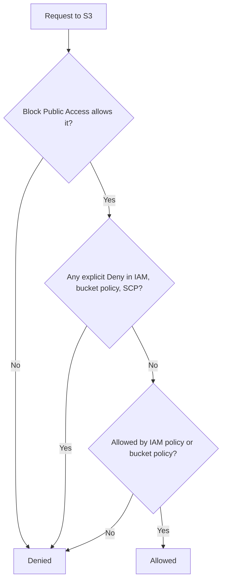
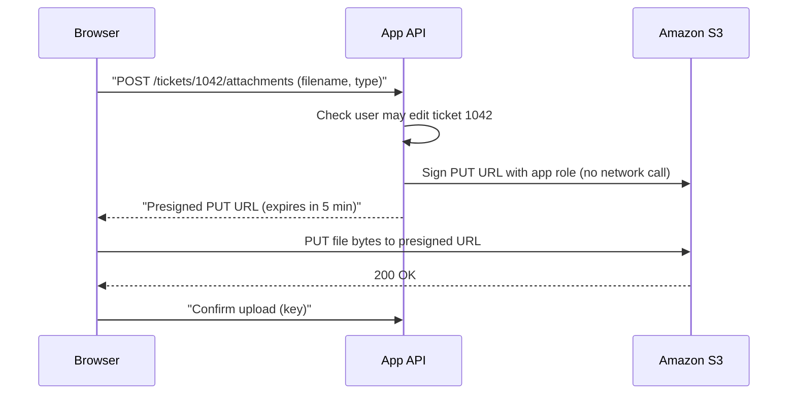

# Amazon S3

## Introduction

**Amazon Simple Storage Service (S3)** is AWS's object storage service and one of the oldest services in any cloud. Huge parts of the internet rely on it: static websites, mobile app uploads, data lakes, backups, logs, and the artifacts of nearly every CI/CD pipeline that runs on AWS.

This page teaches S3 hands-on: creating a bucket safely, uploading and downloading with the CLI and Python, controlling access, protecting data with versioning, sharing files with presigned URLs, and reacting to uploads with events. Each concept is compared with its Azure equivalent, which [Azure Blob Storage](./2-cloud-azure-blob.mdx) covers in full.

If object storage is new to you, read [Object, Block and File Storage](./0-cloud-storage-types.mdx) first.

:::warning Cost and cleanup
The examples on this page create real resources. S3 bills for storage (per GB-month), for requests, and for data transferred out of AWS. Small tests usually cost very little, but forgotten buckets with versioning enabled can grow quietly. Run the cleanup commands at the end, and set a budget alert first (see [Budgets and Billing Alerts](../1-cloud-getting-started/7-cloud-budgets-and-alerts.mdx)). Check current prices on the [Amazon S3 pricing page](https://aws.amazon.com/s3/pricing/) or the [AWS Pricing Calculator](https://calculator.aws/).
:::

## Core Concepts

| Concept | What it is | Azure equivalent |
| --- | --- | --- |
| **Bucket** | A container for objects, created in one AWS Region | Container (inside a storage account) |
| **Object** | Data plus metadata, up to 50 TB | Blob (block blob) |
| **Key** | The object's full name, such as `uploads/user-42/avatar.png` | Blob name |
| **Prefix** | The part of a key before a `/`, shown as a "folder" | Virtual directory |
| **Storage class** | Price/performance tier set per object | Access tier |
| **Bucket policy** | JSON resource policy attached to the bucket | Azure RBAC role assignments, SAS, container access level |
| **Versioning** | Keeps every version of each key | Blob versioning |

A few facts worth knowing up front:

- **Regional resource, global name.** You choose a Region when you create a bucket, and the data stays there unless you replicate it. Classic general purpose bucket names share a global namespace across all AWS accounts in a partition. AWS now also offers an **account regional namespace**: bucket names ending in `-<account-id>-<region>-an` that only your account can ever create. AWS recommends it because a deleted global name can be claimed by someone else.
- **Strong consistency.** After a successful `PUT`, every subsequent `GET` or `LIST` sees the new data. You do not need to wait or retry.
- **Object size.** A single `PUT` uploads up to 5 GB. Multipart upload handles larger objects, and the maximum object size is now **50 TB** (it was 5 TB for many years, so older articles are out of date). The AWS CLI and SDK transfer managers switch to multipart automatically.
- **Secure defaults.** New buckets have **Block Public Access** turned on, **ACLs disabled** (Object Ownership set to "bucket owner enforced"), and **default encryption with SSE-S3** for every new object at no extra cost.

## Creating a Bucket with the AWS CLI

The commands below assume you have the AWS CLI v2 configured with short-lived credentials from IAM Identity Center (`aws configure sso`), as described in [The AWS CLI](../1-cloud-getting-started/2-cloud-aws-cli.mdx). Never create long-lived access keys for this.

```bash
export AWS_REGION=us-east-1
ACCOUNT_ID=$(aws sts get-caller-identity --query Account --output text)

# Account regional namespace bucket name: only your account can own it
BUCKET="helpdesk-attachments-${ACCOUNT_ID}-${AWS_REGION}-an"

aws s3api create-bucket \
  --bucket "$BUCKET" \
  --bucket-namespace account-regional \
  --region "$AWS_REGION"
```

Example output:

```text
{
    "Location": "/helpdesk-attachments-111122223333-us-east-1-an"
}
```

:::note
In any Region other than `us-east-1` you must also pass `--create-bucket-configuration LocationConstraint=<region>`. If your CLI version does not recognize `--bucket-namespace`, update the CLI or use a classic globally unique name with a random suffix instead, for example `helpdesk-attachments-7f3a9c`.
:::

Verify the secure defaults instead of assuming them:

```bash
aws s3api get-public-access-block --bucket "$BUCKET"
aws s3api get-bucket-encryption --bucket "$BUCKET" \
  --query 'ServerSideEncryptionConfiguration.Rules[0].ApplyServerSideEncryptionByDefault'
aws s3api get-bucket-ownership-controls --bucket "$BUCKET" \
  --query 'OwnershipControls.Rules[0].ObjectOwnership'
```

Example output (trimmed):

```text
{
    "PublicAccessBlockConfiguration": {
        "BlockPublicAcls": true,
        "IgnorePublicAcls": true,
        "BlockPublicPolicy": true,
        "RestrictPublicBuckets": true
    }
}
{
    "SSEAlgorithm": "AES256"
}
"BucketOwnerEnforced"
```

Add tags so the bucket shows up in cost reports (see [Tagging Strategies](../1-cloud-getting-started/6-cloud-tagging.mdx)):

```bash
aws s3api put-bucket-tagging --bucket "$BUCKET" \
  --tagging 'TagSet=[{Key=project,Value=helpdesk},{Key=env,Value=dev},{Key=owner,Value=platform-team}]'
```

## Uploading, Listing and Downloading

The high-level `aws s3` commands work like `cp`, `ls` and `rsync`:

```bash
echo "Printer on floor 3 is jammed" > ticket-1042.txt

aws s3 cp ticket-1042.txt "s3://$BUCKET/tickets/1042/ticket.txt"
aws s3 ls "s3://$BUCKET/tickets/" --recursive --human-readable
aws s3 cp "s3://$BUCKET/tickets/1042/ticket.txt" ./downloaded.txt
cat downloaded.txt
```

Example output:

```text
upload: ./ticket-1042.txt to s3://helpdesk-attachments-111122223333-us-east-1-an/tickets/1042/ticket.txt
2026-10-11 09:14:02   29 Bytes tickets/1042/ticket.txt
download: s3://helpdesk-attachments-111122223333-us-east-1-an/tickets/1042/ticket.txt to ./downloaded.txt
Printer on floor 3 is jammed
```

To mirror a whole directory, use `sync`. It only uploads changed files, and `--delete` removes objects that no longer exist locally:

```bash
aws s3 sync ./exports "s3://$BUCKET/exports/" --delete
```

The lower-level `aws s3api` commands map one-to-one to S3 API operations and let you set every option:

```bash
aws s3api put-object \
  --bucket "$BUCKET" \
  --key tickets/1042/screenshot.png \
  --body screenshot.png \
  --content-type image/png \
  --metadata ticket-id=1042,uploaded-by=agent-7
```

## Working with S3 from Python (boto3)

Install the SDK with `pip install boto3`. Credentials come from the default chain: your SSO profile on a laptop, or the IAM role of the EC2 instance, Lambda function or ECS task in AWS.

```python
import boto3
from botocore.exceptions import ClientError

BUCKET = "helpdesk-attachments-111122223333-us-east-1-an"
s3 = boto3.client("s3", region_name="us-east-1")


def save_attachment(ticket_id: int, filename: str, data: bytes, content_type: str) -> str:
    key = f"tickets/{ticket_id}/{filename}"
    s3.put_object(Bucket=BUCKET, Key=key, Body=data, ContentType=content_type)
    return key


def list_attachments(ticket_id: int) -> list[str]:
    paginator = s3.get_paginator("list_objects_v2")
    keys = []
    for page in paginator.paginate(Bucket=BUCKET, Prefix=f"tickets/{ticket_id}/"):
        keys.extend(obj["Key"] for obj in page.get("Contents", []))
    return keys


def read_attachment(key: str) -> bytes | None:
    try:
        return s3.get_object(Bucket=BUCKET, Key=key)["Body"].read()
    except ClientError as err:
        if err.response["Error"]["Code"] == "NoSuchKey":
            return None
        raise


if __name__ == "__main__":
    k = save_attachment(1042, "notes.txt", b"Toner replaced", "text/plain")
    print("saved", k)
    print("listing", list_attachments(1042))
    print("content", read_attachment(k))
    print("missing", read_attachment("tickets/9999/none.txt"))
```

Example output:

```text
saved tickets/1042/notes.txt
listing ['tickets/1042/notes.txt', 'tickets/1042/screenshot.png', 'tickets/1042/ticket.txt']
content b'Toner replaced'
missing None
```

Two habits to copy from this example:

- **Always paginate listings.** `list_objects_v2` returns at most 1,000 keys per call.
- **Handle `NoSuchKey` explicitly** instead of catching every exception.

For large files use `s3.upload_file(...)` and `s3.download_file(...)`. They use multipart transfers and parallel threads automatically.

## Controlling Access

S3 access is decided by several layers working together:



In practice:

1. **IAM policies** on roles grant your applications access. Scope them to one bucket and, where possible, one prefix.
2. **Bucket policies** add rules on the bucket itself, for example "deny anything not over TLS" or "allow only this CloudFront distribution".
3. **Block Public Access** is a safety net that overrides any policy granting public access. Leave it on unless you deliberately serve public content, and even then prefer CloudFront (see [Hosting Static Websites](./6-cloud-static-websites.mdx)).
4. **ACLs** are a legacy mechanism. Keep them disabled.

A least-privilege IAM policy for the helpdesk app role:

```json
{
  "Version": "2012-10-17",
  "Statement": [
    {
      "Sid": "ReadWriteTicketAttachments",
      "Effect": "Allow",
      "Action": ["s3:GetObject", "s3:PutObject"],
      "Resource": "arn:aws:s3:::helpdesk-attachments-111122223333-us-east-1-an/tickets/*"
    },
    {
      "Sid": "ListOnlyTicketPrefix",
      "Effect": "Allow",
      "Action": "s3:ListBucket",
      "Resource": "arn:aws:s3:::helpdesk-attachments-111122223333-us-east-1-an",
      "Condition": { "StringLike": { "s3:prefix": ["tickets/*"] } }
    }
  ]
}
```

A bucket policy that rejects unencrypted (non-TLS) connections:

```json
{
  "Version": "2012-10-17",
  "Statement": [
    {
      "Sid": "DenyInsecureTransport",
      "Effect": "Deny",
      "Principal": "*",
      "Action": "s3:*",
      "Resource": [
        "arn:aws:s3:::helpdesk-attachments-111122223333-us-east-1-an",
        "arn:aws:s3:::helpdesk-attachments-111122223333-us-east-1-an/*"
      ],
      "Condition": { "Bool": { "aws:SecureTransport": "false" } }
    }
  ]
}
```

```bash
aws s3api put-bucket-policy --bucket "$BUCKET" --policy file://deny-insecure.json
```

Notice that the `ListBucket` permission targets the bucket ARN while `GetObject` targets object ARNs ending in `/*`. Mixing these up is the most common cause of `AccessDenied`. For more on IAM, see [AWS IAM Users, Groups, Roles and Policies](../2-cloud-identity/1-cloud-aws-iam.mdx).

## Sharing Files Safely with Presigned URLs

Users should not need AWS credentials to upload a screenshot, and your servers should not proxy every byte. A **presigned URL** is a normal HTTPS URL with a signature and expiry time in the query string. Anyone holding it can perform that one operation on that one key until it expires.



```python
import boto3

s3 = boto3.client("s3", region_name="us-east-1")
BUCKET = "helpdesk-attachments-111122223333-us-east-1-an"

upload_url = s3.generate_presigned_url(
    "put_object",
    Params={"Bucket": BUCKET, "Key": "tickets/1042/photo.jpg", "ContentType": "image/jpeg"},
    ExpiresIn=300,
)
download_url = s3.generate_presigned_url(
    "get_object",
    Params={"Bucket": BUCKET, "Key": "tickets/1042/photo.jpg"},
    ExpiresIn=600,
)
print(upload_url[:90] + "...")
```

Example output:

```text
https://helpdesk-attachments-111122223333-us-east-1-an.s3.amazonaws.com/tickets/1042/photo.jpg?X-Amz-...
```

The client must send the same `Content-Type` header it was signed with. A URL signed by temporary role credentials also stops working when those credentials expire, even if `ExpiresIn` is longer. The Azure equivalent is a **user delegation SAS**, shown in [Azure Blob Storage](./2-cloud-azure-blob.mdx).

## Versioning and Conditional Writes

**Versioning** keeps every version of every key. An overwrite creates a new version, and a delete adds a "delete marker" instead of erasing data. It is the cheapest protection against accidental deletes and bad deployments.

```bash
aws s3api put-bucket-versioning --bucket "$BUCKET" \
  --versioning-configuration Status=Enabled

echo "v2" | aws s3 cp - "s3://$BUCKET/tickets/1042/ticket.txt"
aws s3api list-object-versions --bucket "$BUCKET" \
  --prefix tickets/1042/ticket.txt \
  --query 'Versions[].{Id:VersionId,Latest:IsLatest,Size:Size}' --output table
```

Example output:

```text
---------------------------------------------------------
|                  ListObjectVersions                   |
+------------------------------------+---------+--------+
|                 Id                 | Latest  | Size   |
+------------------------------------+---------+--------+
|  3HL4kqtJlcpXroDTDmJ.rmSpXd3dIbrHY |  True   |  3     |
|  EXAMPLEb8tUZCwMt3q1vBRrIDp6pmLCD  |  False  |  29    |
+------------------------------------+---------+--------+
```

Every old version is billed as stored data. Pair versioning with a lifecycle rule that expires noncurrent versions after a set number of days, as shown in [Storage Classes, Tiers and Lifecycle Policies](./3-cloud-storage-classes.mdx).

**Conditional writes** stop two writers from overwriting each other. With `If-None-Match: *`, the upload succeeds only if the key does not exist yet:

```bash
aws s3api put-object --bucket "$BUCKET" --key locks/report-2026-10-11 \
  --body /dev/null --if-none-match '*'
```

A second identical call fails with `PreconditionFailed` (HTTP 412). That gives you a simple "create once" primitive without a database.

## Reacting to Uploads with Events

S3 can emit an event whenever an object is created or deleted. Common targets are Lambda, SQS, SNS and EventBridge. Sending events to EventBridge is the most flexible option because you can route one event to many targets with rules:

```bash
aws s3api put-bucket-notification-configuration --bucket "$BUCKET" \
  --notification-configuration '{"EventBridgeConfiguration": {}}'
```

A typical use is generating thumbnails when an image lands under `tickets/`. The full pattern is built in [Project: Event-Driven Image Processing Pipeline](../14-cloud-projects/4-cloud-project-event-pipeline.mdx), and event routing is explained in [Pub/Sub: SNS, EventBridge and Event Grid](../9-cloud-messaging-and-integration/2-cloud-sns-and-event-grid.mdx).

## Defining the Bucket as Code

Clicking in the console is fine for learning. For anything you keep, define the bucket in infrastructure as code. A Terraform example with the AWS provider:

```hcl
resource "aws_s3_bucket" "attachments" {
  bucket = "helpdesk-attachments-a1b2c3d4"
  tags = {
    project = "helpdesk"
    env     = "dev"
  }
}

resource "aws_s3_bucket_versioning" "attachments" {
  bucket = aws_s3_bucket.attachments.id
  versioning_configuration {
    status = "Enabled"
  }
}

resource "aws_s3_bucket_public_access_block" "attachments" {
  bucket                  = aws_s3_bucket.attachments.id
  block_public_acls       = true
  ignore_public_acls      = true
  block_public_policy     = true
  restrict_public_buckets = true
}
```

Setting the public access block explicitly, even though it is the default, documents your intent and protects you if an account-level setting changes. See [Terraform for AWS and Azure](../10-cloud-infrastructure-as-code/4-cloud-terraform-multi-cloud.mdx) and [AWS CloudFormation](../10-cloud-infrastructure-as-code/1-cloud-cloudformation.mdx) for full workflows.

## S3 Compared with Azure Blob Storage

| Topic | Amazon S3 | Azure Blob Storage |
| --- | --- | --- |
| Top-level resource | Bucket | Storage account, then container |
| Name scope | Global (or account regional namespace) | Storage account name is globally unique (it becomes a DNS name) |
| Redundancy choice | Per storage class (most classes span 3+ AZs) | Per storage account (LRS, ZRS, GRS, GZRS) |
| Default encryption | SSE-S3 | Microsoft-managed keys |
| Public access guardrail | Block Public Access | `allowBlobPublicAccess` account setting |
| Identity for apps | IAM roles | Entra ID with managed identities and Azure RBAC data roles |
| Temporary sharing | Presigned URL | SAS token (prefer user delegation SAS) |
| Max object size | 50 TB | About 190.7 TiB per block blob |
| Event source | S3 Event Notifications, EventBridge | Event Grid |

The biggest mental shift is that Azure groups storage under an **account** that carries settings such as redundancy, networking and default tier. In S3, each bucket stands alone.

## Real-World Scenario

Your team runs a SaaS helpdesk on AWS. Attachments currently go through the API servers: the browser posts a 20 MB file, the server buffers it, and then the server writes it to an EBS volume. During a busy Monday, the API servers run out of memory and the disk fills up.

**The solution:**

1. Create one bucket per environment with Block Public Access, versioning and tags, defined in Terraform.
2. The API returns a **presigned PUT URL** scoped to `tickets/<id>/<uuid>-<filename>`, valid for five minutes, after checking that the user may edit that ticket.
3. The browser uploads directly to S3. The API only stores the key in PostgreSQL.
4. Downloads use short-lived **presigned GET URLs**, generated each time an agent opens a ticket.
5. An EventBridge rule triggers a Lambda function that scans uploads for malware and creates thumbnails.
6. A lifecycle rule moves attachments older than 90 days to S3 Standard-IA and expires noncurrent versions after 30 days.

**Why this approach:** the API servers no longer handle file bytes, so their memory and disk problems disappear. S3 absorbs any upload volume. Access stays private, because every URL is scoped to one key and expires quickly.

**When to use it / when not to:** use presigned uploads whenever end users send files. Do not use them when you must inspect or transform the content before it is stored, such as for strict content validation. In that case, upload to a quarantine prefix first and promote the file after scanning.

**Alternatives and trade-offs:**

| Approach | Pros | Cons | Best for |
| --- | --- | --- | --- |
| Proxy uploads through your API | Full control, simple auth | Servers carry all traffic and memory load | Small files, low volume |
| Presigned PUT URL | Direct to S3, scales without limit | Client must follow the signed headers exactly | Most web and mobile uploads |
| Presigned POST (browser form) | Can enforce size limits and key prefix with a policy | Slightly more complex client code | Browser forms needing a max size |
| Amazon Cognito identity pools with scoped IAM | Mobile clients use the SDK directly | More IAM design work | Mobile apps with many direct operations |
| CloudFront signed URLs for downloads | Cached at the edge, custom domain | Extra service to configure | High-volume public-facing downloads |

## Common Mistakes

- **Turning off Block Public Access to "fix" a 403.** Find the real cause (often a wrong resource ARN in IAM) instead. Public buckets remain a top cause of data leaks.
- **Hard-coding access keys in apps.** Use IAM roles for EC2, Lambda and ECS, and SSO for people. See [Workload Identity: Instance Roles and Managed Identities](../2-cloud-identity/4-cloud-workload-identity.mdx).
- **Enabling versioning without a lifecycle rule.** Old versions accumulate and you pay for all of them.
- **Not paginating listings.** Code that reads only the first 1,000 keys works in dev and silently breaks in production.
- **Using periods in bucket names.** They break virtual-hosted-style HTTPS certificates. Use hyphens.
- **Deleting a classic bucket and expecting to get the name back.** Another account can claim it. Use the account regional namespace or keep the empty bucket.
- **Putting secrets or personal data in keys or metadata.** Keys appear in logs and URLs.

## Cleanup

A bucket must be empty before you delete it, including all versions and delete markers if versioning was on.

```bash
# Remove current objects
aws s3 rm "s3://$BUCKET" --recursive

# Remove all versions and delete markers (needed when versioning was enabled)
aws s3api delete-objects --bucket "$BUCKET" --delete "$(aws s3api list-object-versions \
  --bucket "$BUCKET" --output json \
  --query '{Objects: [Versions[].{Key:Key,VersionId:VersionId}, DeleteMarkers[].{Key:Key,VersionId:VersionId}][]}')"

aws s3api delete-bucket --bucket "$BUCKET"
```

Example output:

```text
delete: s3://helpdesk-attachments-111122223333-us-east-1-an/tickets/1042/ticket.txt
...
```

If the bucket holds many versions, the single `delete-objects` call can exceed its 1,000-key limit. In that case, add a lifecycle rule that expires everything and wait a day, or empty the bucket from the console with the **Empty** button.

## Summary

- S3 stores **objects** in **buckets** inside a Region. Keys look like paths, but the namespace is flat.
- New buckets are private by default, have ACLs disabled, and encrypt with SSE-S3. Verify these defaults and declare them in code.
- Use the **account regional namespace** for new bucket names so that nobody else can ever claim them.
- Grant access with IAM roles and least-privilege policies. Share individual files with **presigned URLs**.
- Turn on **versioning**, together with a lifecycle rule for old versions. Use **conditional writes** to prevent overwrites.
- Single `PUT` operations handle up to 5 GB. Multipart uploads handle objects up to 50 TB.
- Clean up versions and delete markers before you delete a bucket.

## Exercises

1. Create a bucket in the account regional namespace, verify its four Block Public Access settings, upload a file, and download it again with a presigned URL using `curl`.
2. Enable versioning, overwrite one object three times, then restore the first version by copying it over the current one (`aws s3api copy-object` with `--copy-source bucket/key?versionId=...`).
3. Write an IAM policy that lets a role read only `reports/*` and write only `uploads/*` in one bucket. Test both allowed and denied actions.
4. Repeat exercise 1 on Azure using [Azure Blob Storage](./2-cloud-azure-blob.mdx) and write down three differences you noticed.

**Related pages:** [Storage Classes, Tiers and Lifecycle Policies](./3-cloud-storage-classes.mdx), [Hosting Static Websites](./6-cloud-static-websites.mdx), [Encryption and KMS](../12-cloud-observability-and-security/5-cloud-encryption-and-kms.mdx), [Backup and Archive](./7-cloud-backup-and-archive.mdx).
