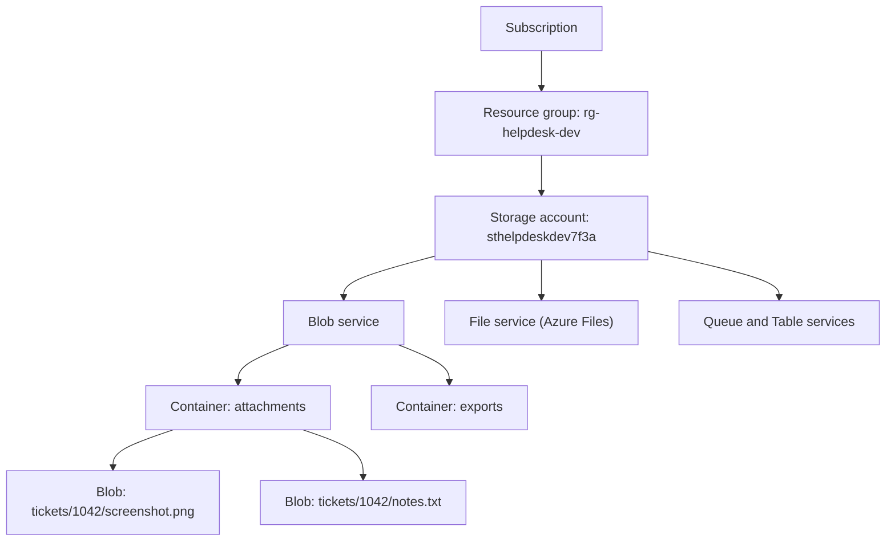
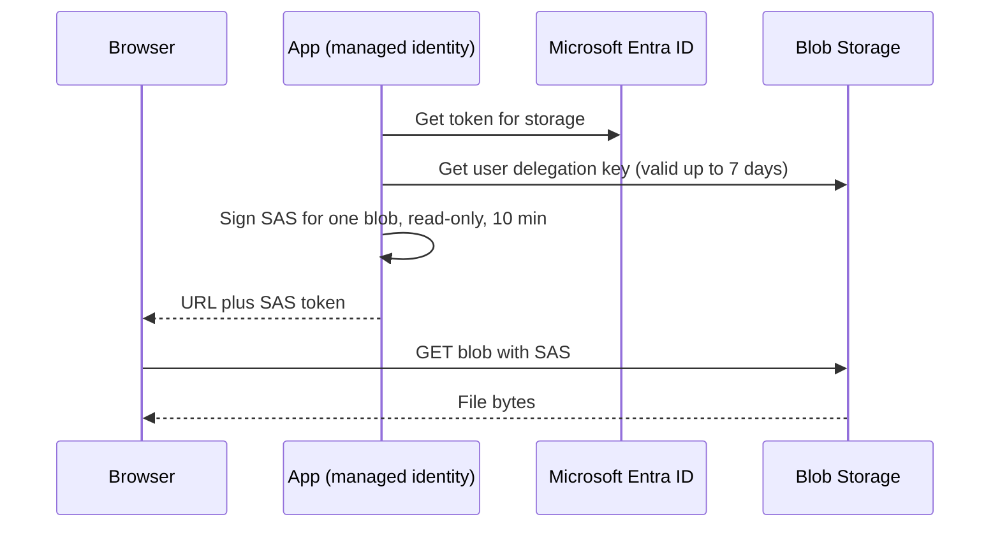

# Azure Blob Storage

## Introduction

**Azure Blob Storage** is Microsoft Azure's object storage service. "Blob" stands for *binary large object*: any bytes you want to keep, such as images, videos, backups, logs, CSV exports or machine learning datasets. It plays the same role on Azure that [Amazon S3](./1-cloud-s3.mdx) plays on AWS, and the two are similar enough that most designs translate directly.

The main difference is structural. On Azure, blobs live inside **containers**, and containers live inside a **storage account**. The storage account is where you choose redundancy, networking rules, encryption keys and the default access tier. If you come from AWS, think of the storage account as a bundle of settings that S3 spreads across individual buckets and account-wide options.

This page walks through creating a storage account securely, granting access with Microsoft Entra ID instead of keys, working with blobs from the CLI and Python, sharing files with SAS tokens, protecting data with soft delete and versioning, and cleaning up.

:::warning Cost and cleanup
These examples create billable resources. Blob Storage bills per GB-month (by tier and redundancy), per operation, for data retrieval from cooler tiers, and for data transferred out of the region. Geo-redundant options cost more than local ones. Delete the resource group at the end, and set a budget first (see [Budgets and Billing Alerts](../1-cloud-getting-started/7-cloud-budgets-and-alerts.mdx)). Check current prices on the [Blob Storage pricing page](https://azure.microsoft.com/pricing/details/storage/blobs/) or the [Azure Pricing Calculator](https://azure.microsoft.com/pricing/calculator/).
:::

## The Resource Hierarchy



| Level | Key settings | AWS analogy |
| --- | --- | --- |
| **Storage account** | Name (global DNS name), region, performance (Standard/Premium), redundancy (LRS/ZRS/GRS/GZRS), network rules, default access tier, shared-key access | Some bucket settings plus account-level S3 settings |
| **Container** | Name, anonymous access level (keep private), immutability policies | Bucket |
| **Blob** | Name, type, access tier, metadata, index tags, versions | Object |

Each blob is one of three **blob types**:

- **Block blobs**: general files, up to about 190.7 TiB. This is what you use 99% of the time.
- **Append blobs**: optimized for appending, such as log files.
- **Page blobs**: random-access 512-byte pages. They historically backed VM disks. Today you use [Managed Disks](./4-cloud-block-storage.mdx) instead.

## Choosing Redundancy

On Azure, the redundancy choice is part of the storage account's SKU and affects price, durability and which features you can use.

| SKU suffix | Copies | Protects against | Notes |
| --- | --- | --- | --- |
| `LRS` | 3 in one datacenter | Disk and rack failures | Cheapest. A datacenter-level event can make data unavailable |
| `ZRS` | 3 across availability zones | Loss of one zone | Good default for production in regions with zones |
| `GRS` / `RA-GRS` | LRS in the primary region plus LRS in the paired region | Regional disaster | `RA-` adds read access to the secondary region |
| `GZRS` / `RA-GZRS` | ZRS in the primary region plus LRS in the secondary region | Zone and regional failures | Highest resilience |

There are trade-offs inside these choices. The Archive tier works only with LRS, GRS and RA-GRS accounts, while the newer Smart tier requires zone-redundant accounts. See [Storage Classes, Tiers and Lifecycle Policies](./3-cloud-storage-classes.mdx).

:::tip
The Azure CLI picks `Standard_RAGRS` if you do not pass `--sku`. Always set `--sku` on purpose so that you do not pay for geo-replication you did not intend to have, or go without zone redundancy you assumed you had.
:::

## Creating a Secure Storage Account

The commands below assume you signed in with `az login` as a user. See [The Azure CLI](../1-cloud-getting-started/3-cloud-azure-cli.mdx) for setup.

```bash
RG=rg-helpdesk-dev
LOCATION=eastus
SA=sthelpdeskdev$RANDOM      # 3-24 chars, lowercase letters and digits only

az group create --name $RG --location $LOCATION --tags project=helpdesk env=dev

az storage account create \
  --name $SA \
  --resource-group $RG \
  --location $LOCATION \
  --kind StorageV2 \
  --sku Standard_ZRS \
  --min-tls-version TLS1_2 \
  --allow-blob-public-access false \
  --allow-shared-key-access false \
  --tags project=helpdesk env=dev \
  --query "{name:name, sku:sku.name, publicAccess:allowBlobPublicAccess, sharedKey:allowSharedKeyAccess}" \
  --output table
```

Example output:

```text
Name                 Sku           PublicAccess    SharedKey
-------------------  ------------  --------------  -----------
sthelpdeskdev18342   Standard_ZRS  False           False
```

What these flags do:

- `--kind StorageV2`: a general-purpose v2 account, the recommended kind for blobs.
- `--allow-blob-public-access false`: no container can ever be made anonymously readable. This is the default for new accounts, and setting it explicitly documents your intent.
- `--allow-shared-key-access false`: disables the two account keys. Every request must then use Microsoft Entra ID (or a user delegation SAS, which is backed by Entra ID). Account keys grant full access to everything in the account and are easy to leak, so turning them off removes a whole class of risk.

:::note
Some older tools and services still require shared keys. If something breaks after you disable them, check that tool's documentation for Entra ID support before you turn keys back on.
:::

## Granting Access with Entra ID and RBAC

Being the subscription Owner does **not** let you read blob data. Azure separates the *control plane* (managing the account) from the *data plane* (reading and writing blobs). You need a data role:

| Built-in role | Allows |
| --- | --- |
| Storage Blob Data Reader | Read and list blobs |
| Storage Blob Data Contributor | Read, write and delete blobs |
| Storage Blob Data Owner | All of the above, plus POSIX ACL management on Data Lake accounts |

Assign the narrowest role at the narrowest scope (a container if possible):

```bash
ME=$(az ad signed-in-user show --query id --output tsv)
SA_ID=$(az storage account show --name $SA --resource-group $RG --query id --output tsv)

az role assignment create \
  --assignee $ME \
  --role "Storage Blob Data Contributor" \
  --scope "$SA_ID/blobServices/default/containers/attachments"
```

Applications running in Azure use a **managed identity** with the same kind of role assignment, so no secret ever exists. See [Workload Identity: Instance Roles and Managed Identities](../2-cloud-identity/4-cloud-workload-identity.mdx) and [Microsoft Entra ID and Azure RBAC](../2-cloud-identity/2-cloud-azure-entra-id.mdx).

## Working with Blobs from the CLI

Pass `--auth-mode login` so that the CLI uses your Entra ID token instead of looking up account keys:

```bash
az storage container create --account-name $SA --name attachments --auth-mode login

echo "Printer on floor 3 is jammed" > ticket.txt
az storage blob upload --account-name $SA --container-name attachments \
  --name tickets/1042/ticket.txt --file ticket.txt --auth-mode login

az storage blob list --account-name $SA --container-name attachments \
  --prefix tickets/1042/ --auth-mode login \
  --query "[].{name:name, tier:properties.blobTier, size:properties.contentLength}" --output table

az storage blob download --account-name $SA --container-name attachments \
  --name tickets/1042/ticket.txt --file downloaded.txt --auth-mode login
```

Example output (trimmed):

```text
{
  "created": true
}
Finished[#############################################################]  100.0000%
Name                     Tier    Size
-----------------------  ------  ------
tickets/1042/ticket.txt  Hot     29
```

Role assignments can take a few minutes to take effect. If you get `AuthorizationPermissionMismatch` right after assigning the role, wait and retry.

For whole directories, use `upload-batch`, or install **AzCopy**, Microsoft's high-performance transfer tool. AzCopy is the closest equivalent to `aws s3 sync`:

```bash
az storage blob upload-batch --account-name $SA --destination exports \
  --source ./exports --auth-mode login --overwrite

azcopy login
azcopy sync ./exports "https://$SA.blob.core.windows.net/exports" --delete-destination=true
```

## Working with Blobs from Python

Install the packages: `pip install azure-storage-blob azure-identity`. `DefaultAzureCredential` tries, in order, environment variables, workload identity, managed identity, and developer sign-ins such as the Azure CLI. The same code therefore works on your laptop and in production.

```python
from azure.core.exceptions import ResourceNotFoundError
from azure.identity import DefaultAzureCredential
from azure.storage.blob import BlobServiceClient, ContentSettings

ACCOUNT_URL = "https://sthelpdeskdev18342.blob.core.windows.net"
service = BlobServiceClient(account_url=ACCOUNT_URL, credential=DefaultAzureCredential())
container = service.get_container_client("attachments")


def save_attachment(ticket_id: int, filename: str, data: bytes, content_type: str) -> str:
    name = f"tickets/{ticket_id}/{filename}"
    container.upload_blob(
        name,
        data,
        overwrite=True,
        content_settings=ContentSettings(content_type=content_type),
        metadata={"ticket_id": str(ticket_id)},
    )
    return name


def list_attachments(ticket_id: int) -> list[str]:
    # list_blobs pages through results automatically
    return [b.name for b in container.list_blobs(name_starts_with=f"tickets/{ticket_id}/")]


def read_attachment(name: str) -> bytes | None:
    try:
        return container.download_blob(name).readall()
    except ResourceNotFoundError:
        return None


if __name__ == "__main__":
    n = save_attachment(1042, "notes.txt", b"Toner replaced", "text/plain")
    print("saved", n)
    print("listing", list_attachments(1042))
    print("content", read_attachment(n))
    print("missing", read_attachment("tickets/9999/none.txt"))
```

Example output:

```text
saved tickets/1042/notes.txt
listing ['tickets/1042/notes.txt', 'tickets/1042/ticket.txt']
content b'Toner replaced'
missing None
```

Compare this with the boto3 version on the [Amazon S3](./1-cloud-s3.mdx) page. The shape is almost identical. The Azure SDK pages through results automatically, while boto3 needs an explicit paginator.

## Sharing Files with SAS Tokens

A **shared access signature (SAS)** is a signed query string that grants limited access to a blob or container for a limited time. It is Azure's version of an S3 presigned URL. There are three kinds:

| SAS type | Signed with | Recommendation |
| --- | --- | --- |
| **User delegation SAS** | A key obtained with Entra ID credentials | Preferred. Works with shared keys disabled and can be revoked by revoking the delegation key |
| Service SAS | Account key | Avoid if you can. Requires shared-key access |
| Account SAS | Account key | Avoid. Broad scope |



```python
from datetime import datetime, timedelta, timezone
from azure.identity import DefaultAzureCredential
from azure.storage.blob import BlobSasPermissions, BlobServiceClient, generate_blob_sas

ACCOUNT = "sthelpdeskdev18342"
service = BlobServiceClient(f"https://{ACCOUNT}.blob.core.windows.net", credential=DefaultAzureCredential())

now = datetime.now(timezone.utc)
delegation_key = service.get_user_delegation_key(
    key_start_time=now - timedelta(minutes=5),
    key_expiry_time=now + timedelta(hours=1),
)

sas = generate_blob_sas(
    account_name=ACCOUNT,
    container_name="attachments",
    blob_name="tickets/1042/notes.txt",
    user_delegation_key=delegation_key,
    permission=BlobSasPermissions(read=True),
    expiry=now + timedelta(minutes=10),
)
url = f"https://{ACCOUNT}.blob.core.windows.net/attachments/tickets/1042/notes.txt?{sas}"
print(url[:95] + "...")
```

Example output:

```text
https://sthelpdeskdev18342.blob.core.windows.net/attachments/tickets/1042/notes.txt?skoid=...
```

Getting a user delegation key requires the identity to have a role that includes the `generateUserDelegationKey` action. All three Storage Blob Data roles include it. From the CLI, `az storage blob generate-sas ... --as-user --auth-mode login --full-uri` produces the same kind of URL.

## Protecting Data: Soft Delete and Versioning

Azure has several overlapping protection features. Turn on at least the first three for important data:

| Feature | Protects against | Closest S3 feature |
| --- | --- | --- |
| Blob soft delete | Deleted blobs, recoverable for N days | Versioning delete markers |
| Container soft delete | Deleted containers | No direct equivalent (bucket deletion requires an empty bucket) |
| Blob versioning | Overwrites; keeps previous versions | Versioning |
| Point-in-time restore | Restores block blobs to an earlier time | No direct equivalent |
| Immutable storage (WORM) | Any change or delete during retention | S3 Object Lock |

```bash
az storage account blob-service-properties update \
  --account-name $SA --resource-group $RG \
  --enable-delete-retention true --delete-retention-days 14 \
  --enable-container-delete-retention true --container-delete-retention-days 7 \
  --enable-versioning true \
  --query "{softDelete:deleteRetentionPolicy.days, versioning:isVersioningEnabled}"
```

Example output:

```text
{
  "softDelete": 14,
  "versioning": true
}
```

Soft-deleted data and old versions are billed as stored data. Add a lifecycle rule to delete old versions after a set number of days (see [Storage Classes, Tiers and Lifecycle Policies](./3-cloud-storage-classes.mdx)). Immutability is covered in [Backup and Archive](./7-cloud-backup-and-archive.mdx).

## Defining It as Code (Bicep)

```bicep
param location string = resourceGroup().location
param accountName string

resource sa 'Microsoft.Storage/storageAccounts@2023-05-01' = {
  name: accountName
  location: location
  kind: 'StorageV2'
  sku: { name: 'Standard_ZRS' }
  properties: {
    minimumTlsVersion: 'TLS1_2'
    allowBlobPublicAccess: false
    allowSharedKeyAccess: false
    supportsHttpsTrafficOnly: true
  }
  tags: { project: 'helpdesk', env: 'dev' }
}

resource blobSvc 'Microsoft.Storage/storageAccounts/blobServices@2023-05-01' = {
  parent: sa
  name: 'default'
  properties: {
    deleteRetentionPolicy: { enabled: true, days: 14 }
    isVersioningEnabled: true
  }
}

resource attachments 'Microsoft.Storage/storageAccounts/blobServices/containers@2023-05-01' = {
  parent: blobSvc
  name: 'attachments'
  properties: { publicAccess: 'None' }
}
```

```bash
az deployment group create --resource-group $RG --template-file storage.bicep \
  --parameters accountName=$SA
```

API versions change over time. Your editor's Bicep extension suggests the latest one. See [Azure Bicep and ARM Templates](../10-cloud-infrastructure-as-code/3-cloud-bicep-and-arm.mdx).

## Other Features Worth Knowing

- **Data Lake Storage (hierarchical namespace).** Enable it at account creation (`--enable-hierarchical-namespace true`) for analytics workloads. You get real directories, atomic renames and POSIX ACLs. Some Blob features behave differently with it enabled.
- **Blob index tags.** Key-value tags you can query across a whole account with "find blobs by tags", and use as lifecycle filters.
- **Event Grid.** Emits `Microsoft.Storage.BlobCreated` and similar events to Functions, queues or webhooks. See [Pub/Sub: SNS, EventBridge and Event Grid](../9-cloud-messaging-and-integration/2-cloud-sns-and-event-grid.mdx).
- **Network rules and private endpoints.** Restrict the account to selected virtual networks, or remove public network access completely. See [Private Endpoints, Peering and Transit](../8-cloud-networking/7-cloud-private-connectivity.mdx).
- **Object replication.** Asynchronously copies block blobs between accounts, for example to another region.

## Real-World Scenario

Your company's analytics team exports a nightly 30 GB CSV extract from an on-premises ERP system. Today it goes to a shared Windows file server that keeps filling up. The team is moving to Azure and wants the extracts in the cloud, readable by an Azure Databricks job and by one external auditor for a few days each quarter.

**The solution:**

1. Create a `StorageV2` account with `Standard_ZRS`, public blob access off and shared keys off.
2. The on-premises export server authenticates with a service principal that uses a **certificate** (or, better, Azure Arc and a managed identity), holding only **Storage Blob Data Contributor** on the `erp-exports` container. AzCopy uploads the nightly file.
3. The Databricks job's managed identity gets **Storage Blob Data Reader** on the same container.
4. For the auditor, the app generates a **user delegation SAS** with read and list permission on the container, valid for 72 hours.
5. Soft delete (14 days) and versioning protect against mistakes, and a lifecycle policy moves extracts older than 30 days to Cool and deletes them after a year.

**Why this approach:** no account keys exist to leak, each consumer has exactly the access it needs, and the auditor's access expires automatically.

**When to use it / when not to:** this pattern fits any file-drop or data-sharing workflow. If the external party needs ongoing access, invite them as a guest in Entra ID with an RBAC role instead of issuing SAS tokens over and over. If they need SFTP, Blob Storage has an SFTP endpoint option, at extra cost.

**Alternatives and trade-offs:**

| Approach | Pros | Cons | Best for |
| --- | --- | --- | --- |
| Account keys in scripts | Works with every tool | Full account access, hard to rotate, easy to leak | Nothing new |
| Service SAS (key-signed) | Simple, scoped | Needs shared keys enabled. Revoking means rotating keys | Legacy integrations |
| User delegation SAS | Entra ID backed, short-lived, revocable | Max 7-day delegation key | Temporary external sharing |
| Entra ID guest plus RBAC | Auditable, revocable per person | Guest onboarding overhead | Long-term partners |
| SFTP endpoint | Partners use familiar tools | Extra hourly cost, local users to manage | Partners who require SFTP |

## Common Mistakes

- **Expecting Owner to read data.** Control-plane roles do not grant data access. Assign a Storage Blob Data role.
- **Forgetting `--auth-mode login`.** Without it, the CLI tries to fetch account keys and fails when shared keys are disabled.
- **Leaving the default SKU.** `Standard_RAGRS` might be more than you need, and `LRS` might be less than you assume.
- **Making containers public to share a file.** Use a user delegation SAS instead.
- **Picking a storage account name you cannot change.** Names are permanent and globally unique. Use a naming convention (for example `st` + app + env + suffix).
- **Ignoring versioning costs.** Every version is stored data. Add a lifecycle rule for old versions.

## Cleanup

Deleting the resource group deletes the storage account and all its data:

```bash
az group delete --name $RG --yes --no-wait
az group show --name $RG --query properties.provisioningState --output tsv
```

Example output:

```text
Deleting
```

Run the second command again after a few minutes. It returns a `ResourceGroupNotFound` error when the deletion is complete. Storage accounts can be recovered for a limited time after deletion if you act quickly, but do not rely on that.

## Summary

- Blob Storage is organized as **storage account, then container, then blob**. The account holds redundancy, network and security settings.
- Choose the redundancy SKU (`LRS`, `ZRS`, `GRS`, `GZRS`) explicitly. It affects cost, resilience and which tiers you can use.
- Disable anonymous access and shared keys. Use **Entra ID with Storage Blob Data roles** and managed identities.
- Use `--auth-mode login` in the CLI and `DefaultAzureCredential` in code.
- Share files with **user delegation SAS** tokens, which are short-lived and backed by Entra ID.
- Turn on soft delete and versioning, and clean them up with lifecycle rules.

## Exercises

1. Create a storage account with shared keys disabled. Try `az storage blob list` without `--auth-mode login` and read the error, then fix it.
2. Assign yourself **Storage Blob Data Reader** only, and confirm that uploads now fail while downloads work.
3. Generate a user delegation SAS valid for five minutes, download the blob with `curl`, wait six minutes, and try again.
4. Delete a blob with soft delete enabled, then restore it with `az storage blob undelete`.

**Related pages:** [Amazon S3](./1-cloud-s3.mdx), [Storage Classes, Tiers and Lifecycle Policies](./3-cloud-storage-classes.mdx), [Hosting Static Websites](./6-cloud-static-websites.mdx), [Organizing Resources: Accounts, Subscriptions and Resource Groups](../1-cloud-getting-started/5-cloud-resource-organization.mdx).
