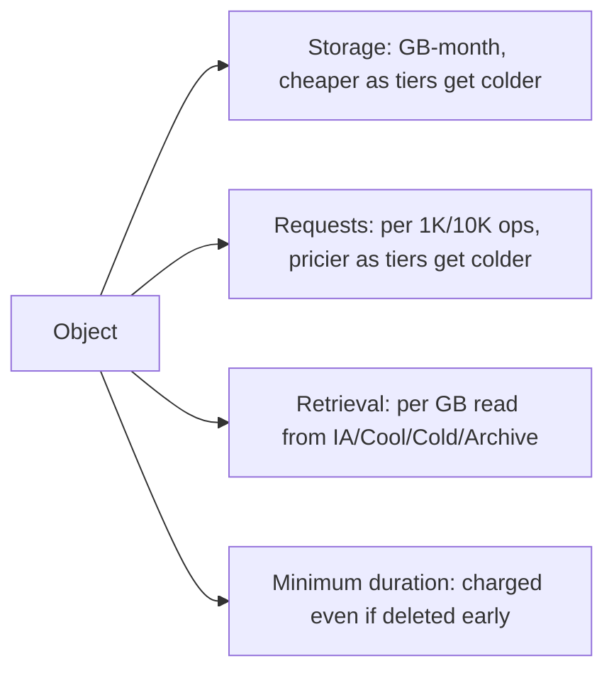
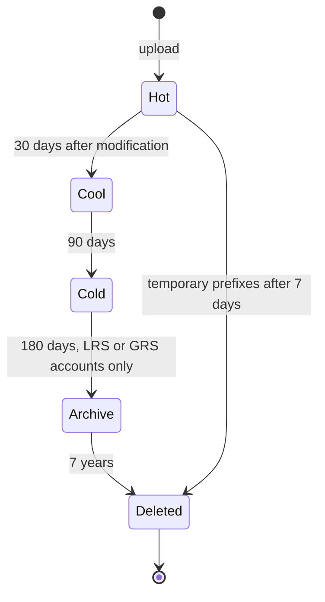

# Storage Classes, Tiers and Lifecycle Policies

## Introduction

Most data is hot for a short time and then almost never read again. A customer's invoice PDF is opened a few times in its first week, perhaps once more at tax time, and then sits untouched for the seven years you must keep it. Log files are useful for a few days of debugging and then only matter for audits.

Object storage providers price for this pattern. They offer several **storage classes** (AWS) or **access tiers** (Azure). Each one trades a lower price per GB stored for higher access costs, slower retrieval, or a minimum storage duration. **Lifecycle policies** then move data between tiers, and finally delete it, without any code on your part.

Think of it like a library. New books sit on the open shelves near the entrance. Older books go to the stacks in the basement, where you can still get them in a few minutes. Rarely requested material goes to an off-site depository, and you have to put in a request and wait a day. The library pays far less per book in the depository, but each retrieval is slow and costs staff time.

This page covers the tiers on both clouds, how they are billed, how to automate transitions, and the traps that turn a cost optimization into a bigger bill.

:::info Prices
This page never quotes prices because they vary by region and change over time. It explains *how* each tier is billed. Use the [Amazon S3 pricing page](https://aws.amazon.com/s3/pricing/), the [Azure Blob Storage pricing page](https://azure.microsoft.com/pricing/details/storage/blobs/), and the AWS and Azure pricing calculators for current numbers.
:::

## The Tiers on Each Cloud

### On AWS: S3 storage classes

| Storage class | API name | Access | Min. duration | Min. billable size | Retrieval fee | AZs |
| --- | --- | --- | --- | --- | --- | --- |
| S3 Standard | `STANDARD` | Milliseconds | None | None | No | 3 or more |
| S3 Intelligent-Tiering | `INTELLIGENT_TIERING` | Milliseconds (optional archive tiers are asynchronous) | None | Objects under 128 KB are not tiered | No (small monitoring fee per object) | 3 or more |
| S3 Standard-IA | `STANDARD_IA` | Milliseconds | 30 days | 128 KB | Per GB | 3 or more |
| S3 One Zone-IA | `ONEZONE_IA` | Milliseconds | 30 days | 128 KB | Per GB | 1 |
| S3 Express One Zone | `EXPRESS_ONEZONE` | Single-digit ms | None | None | No | 1 (directory buckets) |
| S3 Glacier Instant Retrieval | `GLACIER_IR` | Milliseconds | 90 days | 128 KB | Per GB | 3 or more |
| S3 Glacier Flexible Retrieval | `GLACIER` | Minutes to hours after a restore | 90 days | 40 KB metadata overhead per object | Per GB, by retrieval speed | 3 or more |
| S3 Glacier Deep Archive | `DEEP_ARCHIVE` | Hours after a restore | 180 days | 40 KB metadata overhead per object | Per GB, by retrieval speed | 3 or more |

Reduced Redundancy Storage (`REDUCED_REDUNDANCY`) still appears in the API, but AWS recommends against it because S3 Standard is more cost-effective. The S3 Glacier storage classes are part of S3. You use them through the S3 API, not through the separate, older Amazon Glacier vault API.

### On Azure: Blob access tiers

| Tier | Access | Min. retention (GPv2 accounts) | Billing pattern | Redundancy support |
| --- | --- | --- | --- | --- |
| **Hot** | Milliseconds | None | Highest storage, lowest access cost | All |
| **Cool** | Milliseconds | 30 days | Lower storage, higher access cost | All |
| **Cold** | Milliseconds | 90 days | Lower still, higher access cost | All |
| **Archive** | Offline. Rehydrate first (up to 15 hours) | 180 days | Lowest storage, highest retrieval cost | LRS, GRS, RA-GRS only |
| **Smart** | Milliseconds (moves between Hot, Cool and Cold automatically) | None (no early deletion fees) | Underlying tier rates plus a monitoring fee per object over 128 KiB | Zone-redundant accounts (ZRS, GZRS, RA-GZRS) |

Tiers apply to **block blobs** in general-purpose v2 accounts. Premium block blob accounts do not tier.

### Mapping the two

| Purpose | AWS | Azure |
| --- | --- | --- |
| Frequently used data | S3 Standard | Hot |
| Unknown or changing access patterns, automatic | S3 Intelligent-Tiering | Smart tier |
| Monthly access, instant | S3 Standard-IA | Cool |
| Quarterly access, instant | S3 Glacier Instant Retrieval | Cold |
| Rarely accessed, can wait minutes to hours | S3 Glacier Flexible Retrieval | Archive (standard or high-priority rehydration) |
| Compliance archive, can wait up to a day or two | S3 Glacier Deep Archive | Archive |
| Re-creatable data, cheaper single zone | S3 One Zone-IA | Cool or Cold on an LRS account |

The mapping is approximate. Azure Archive covers both Glacier Flexible Retrieval and Deep Archive use cases, with a single rehydration model: standard priority (up to 15 hours) or high priority (often under an hour for blobs under 10 GB). On AWS you choose between two archive classes, each with its own retrieval speeds.

## How Tiering Changes Your Bill

Every tier decision balances four cost components:



A tier is only cheaper if the storage savings exceed the extra request, retrieval and transition costs over the object's lifetime. The script below models that trade-off. It uses **made-up price units**, not real prices. Replace them with numbers from the pricing pages for your region.

```python
"""Compare lifetime cost of keeping an object in a hot vs. a cool tier.

All prices are ILLUSTRATIVE UNITS, not real prices. Look up current values
for your region on the official pricing pages before using this.
"""

def lifetime_cost(gb, months, reads_per_month, storage_per_gb_month,
                  retrieval_per_gb, transition_fee, min_months):
    billed_months = max(months, min_months)
    storage = gb * storage_per_gb_month * billed_months
    retrieval = gb * retrieval_per_gb * reads_per_month * months
    return storage + retrieval + transition_fee


HOT = dict(storage_per_gb_month=1.00, retrieval_per_gb=0.00, transition_fee=0.0, min_months=0)
COOL = dict(storage_per_gb_month=0.55, retrieval_per_gb=0.45, transition_fee=0.01, min_months=1)

for reads in (0, 0.5, 1, 2):
    hot = lifetime_cost(gb=1, months=12, reads_per_month=reads, **HOT)
    cool = lifetime_cost(gb=1, months=12, reads_per_month=reads, **COOL)
    winner = "cool" if cool < hot else "hot"
    print(f"reads/month={reads:<4} hot={hot:6.2f} cool={cool:6.2f} -> {winner}")
```

Example output:

```text
reads/month=0    hot= 12.00 cool=  6.61 -> cool
reads/month=0.5  hot= 12.00 cool=  9.31 -> cool
reads/month=1    hot= 12.00 cool= 12.01 -> hot
reads/month=2    hot= 12.00 cool= 17.41 -> hot
```

With these example units, the break-even point is about one full read per month. That is why the providers describe the infrequent tiers as being for data accessed "about once a month" or less. Your real break-even depends on actual prices, object sizes and request counts.

## Setting a Tier by Hand

### On AWS

Set the class at upload time, or change it by copying the object onto itself:

```bash
aws s3 cp report.pdf s3://$BUCKET/archive/report.pdf --storage-class STANDARD_IA

aws s3 cp s3://$BUCKET/archive/report.pdf s3://$BUCKET/archive/report.pdf \
  --storage-class GLACIER_IR

aws s3api head-object --bucket $BUCKET --key archive/report.pdf --query StorageClass
```

Example output:

```text
upload: ./report.pdf to s3://helpdesk-attachments-111122223333-us-east-1-an/archive/report.pdf
copy: s3://helpdesk-attachments-111122223333-us-east-1-an/archive/report.pdf to s3://helpdesk-attachments-111122223333-us-east-1-an/archive/report.pdf
"GLACIER_IR"
```

To read an object in `GLACIER` or `DEEP_ARCHIVE`, first request a temporary restored copy:

```bash
aws s3api restore-object --bucket $BUCKET --key archive/2019-ledger.zip \
  --restore-request '{"Days": 3, "GlacierJobParameters": {"Tier": "Standard"}}'

aws s3api head-object --bucket $BUCKET --key archive/2019-ledger.zip --query Restore
```

Example output:

```text
"ongoing-request=\"true\""
```

Retrieval tiers for Glacier Flexible Retrieval are **Expedited** (typically 1 to 5 minutes), **Standard** (typically 3 to 5 hours) and **Bulk** (typically 5 to 12 hours). For Deep Archive they are **Standard** (within 12 hours) and **Bulk** (within 48 hours). While the restored copy exists, you pay for both the archived object and the temporary copy.

### On Azure

```bash
az storage blob upload --account-name $SA --container-name exports \
  --name 2026/report.pdf --file report.pdf --tier Cool --auth-mode login

az storage blob set-tier --account-name $SA --container-name exports \
  --name 2026/report.pdf --tier Cold --auth-mode login

# Rehydrate an archived blob (Archive requires an LRS/GRS/RA-GRS account)
az storage blob set-tier --account-name $SA --container-name exports \
  --name 2019/ledger.zip --tier Hot --rehydrate-priority Standard --auth-mode login
```

While rehydration runs, the blob still reports `Archive`, and its `archiveStatus` shows `rehydrate-pending-to-hot`. Instead of polling, subscribe to the `Microsoft.Storage.BlobTierChanged` Event Grid event to learn when it finishes.

## Automatic Tiering: Intelligent-Tiering and Smart Tier

When you cannot predict access patterns, let the provider watch them for you.

**S3 Intelligent-Tiering** moves each object between a Frequent Access tier, an Infrequent Access tier (after 30 days without access) and an Archive Instant Access tier (after 90 days). Reading an object moves it back to Frequent. You can also opt in to asynchronous Archive Access and Deep Archive Access tiers:

```bash
aws s3api put-bucket-intelligent-tiering-configuration --bucket $BUCKET \
  --id archive-cold-data \
  --intelligent-tiering-configuration '{
    "Id": "archive-cold-data",
    "Status": "Enabled",
    "Tierings": [
      {"Days": 90, "AccessTier": "ARCHIVE_ACCESS"},
      {"Days": 180, "AccessTier": "DEEP_ARCHIVE_ACCESS"}
    ]
  }'
```

Only enable the archive tiers if your application can handle an object that must be restored before reading.

**Azure smart tier** works similarly across Hot, Cool and Cold. Objects move to Cool after 30 days without access and to Cold after 90 days. An access moves them back to Hot. There are no early deletion or retrieval fees inside smart tier, and objects up to 128 KiB stay in Hot and are not charged the monitoring fee. You enable it as the account's default access tier, and it requires a zone-redundant account:

```bash
az storage account update --resource-group $RG --name $SA --access-tier Smart
```

Smart tier does not use Archive. For data that must go offline, combine explicit tiers with a lifecycle policy.

## Lifecycle Policies

A lifecycle policy is a set of rules that the provider runs for you, typically once a day. Rules match objects by prefix, tags or size, and then **transition** or **expire** them.



### On AWS

```json
{
  "Rules": [
    {
      "ID": "attachments-tiering",
      "Filter": { "Prefix": "tickets/" },
      "Status": "Enabled",
      "Transitions": [
        { "Days": 30, "StorageClass": "STANDARD_IA" },
        { "Days": 180, "StorageClass": "GLACIER_IR" }
      ],
      "NoncurrentVersionExpiration": { "NoncurrentDays": 30 }
    },
    {
      "ID": "logs-archive-then-expire",
      "Filter": { "Prefix": "logs/" },
      "Status": "Enabled",
      "Transitions": [{ "Days": 30, "StorageClass": "GLACIER" }],
      "Expiration": { "Days": 365 }
    },
    {
      "ID": "cleanup-failed-uploads",
      "Filter": {},
      "Status": "Enabled",
      "AbortIncompleteMultipartUpload": { "DaysAfterInitiation": 7 }
    }
  ]
}
```

```bash
aws s3api put-bucket-lifecycle-configuration --bucket $BUCKET \
  --lifecycle-configuration file://lifecycle.json

aws s3api get-bucket-lifecycle-configuration --bucket $BUCKET \
  --query 'Rules[].{id:ID,status:Status}' --output table
```

Example output:

```text
-------------------------------------------
|      GetBucketLifecycleConfiguration     |
+---------------------------+-------------+
|            id             |   status    |
+---------------------------+-------------+
|  attachments-tiering      |  Enabled    |
|  logs-archive-then-expire |  Enabled    |
|  cleanup-failed-uploads   |  Enabled    |
+---------------------------+-------------+
```

S3 lifecycle rules you should know:

- Transitions follow a **waterfall**: you can only move to colder classes. Objects must stay in S3 Standard at least 30 days before moving to Standard-IA or One Zone-IA.
- Since September 2024, lifecycle rules by default **do not transition objects smaller than 128 KB**, because the per-object transition request can cost more than the savings. Override this with an `ObjectSizeGreaterThan` filter if you really need to.
- `AbortIncompleteMultipartUpload` removes leftover parts from failed uploads. These parts are billed but invisible in normal listings, so every bucket should have this rule.

### On Azure

Azure policies are JSON documents applied to the whole storage account:

```json
{
  "rules": [
    {
      "enabled": true,
      "name": "attachments-tiering",
      "type": "Lifecycle",
      "definition": {
        "filters": {
          "blobTypes": ["blockBlob"],
          "prefixMatch": ["attachments/tickets/"]
        },
        "actions": {
          "baseBlob": {
            "tierToCool": { "daysAfterModificationGreaterThan": 30 },
            "tierToCold": { "daysAfterModificationGreaterThan": 180 },
            "delete": { "daysAfterModificationGreaterThan": 2555 }
          },
          "version": {
            "delete": { "daysAfterCreationGreaterThan": 30 }
          }
        }
      }
    }
  ]
}
```

```bash
az storage account management-policy create \
  --account-name $SA --resource-group $RG --policy @policy.json

az storage account management-policy show \
  --account-name $SA --resource-group $RG --query "policy.rules[].name"
```

Example output:

```text
[
  "attachments-tiering"
]
```

Azure lifecycle details to know:

- `prefixMatch` starts with the **container name** (`attachments/tickets/`), unlike S3 prefixes, which start inside the bucket.
- A policy is read and written as a whole. There are no partial updates, so keep it in source control.
- Changes can take up to 24 hours to take effect.
- To tier on **last access** instead of last modification, enable access tracking first (`az storage account blob-service-properties update --enable-last-access-tracking true`) and use `daysAfterLastAccessTimeGreaterThan`. The `enableAutoTierToHotFromCool` action moves a blob back to Hot when it is read.
- `tierToArchive` does not work on ZRS or GZRS accounts. The example above uses Cold for that reason. If you rehydrate blobs, add `daysAfterLastTierChangeGreaterThan` so that the policy does not send them straight back to Archive.

## Real-World Scenario

Your team runs a document-management SaaS. Customers upload contracts and invoices. Usage data shows that 90% of reads happen in the first 30 days, a small spike happens at fiscal year end, and regulations require seven years of retention. Storage is now the second-largest line on the cloud bill.

**The solution:**

1. **Days 0 to 30:** S3 Standard or Azure Hot.
2. **Days 30 to 365:** S3 Standard-IA or Azure Cool. Reads are rare but must be instant when a customer clicks.
3. **Year 1 to 7:** S3 Glacier Instant Retrieval or Azure Cold. Reads are very rare and still instant, which keeps the product simple. You avoid offline archive tiers because a customer clicking "open" should never see "come back in 12 hours".
4. **After 7 years:** lifecycle expiration deletes the documents, plus their old versions.
5. A separate **export bucket** for compliance copies goes straight to Deep Archive or Azure Archive (on an LRS or GRS account), because nobody reads it except during an audit.

**Why this approach:** each transition matches a real change in access frequency. Choosing instant-access tiers for anything customers can open keeps the user experience intact, and the archive-only export captures the deepest savings where latency does not matter.

**When to use it / when not to:** lifecycle tiering pays off for large volumes of objects that are larger than about 128 KB and live for months. It is not worth it for millions of tiny objects (transition fees dominate), for data you delete within 30 days (minimum durations dominate), or for data with unpredictable re-reads (use Intelligent-Tiering or smart tier instead).

**Alternatives and trade-offs:**

| Approach | Pros | Cons | Best for |
| --- | --- | --- | --- |
| Keep everything Hot / Standard | Simplest, no surprises | Highest storage cost | Small datasets, short-lived data |
| Age-based lifecycle rules | Predictable, free to run | Wrong guesses cause retrieval and early-deletion fees | Known, age-driven access patterns |
| Intelligent-Tiering / smart tier | Adapts per object, no retrieval fees | Per-object monitoring fee, no Archive on Azure smart tier | Unknown or mixed access patterns |
| Manual tiering from app code | Full control using business logic | Code to write and maintain | Tiering driven by business events, such as a closed case |
| Archive tiers for everything old | Lowest storage cost | Hours to restore, retrieval costs, 180-day minimums | Compliance copies nobody reads |

## Common Mistakes

- **Tiering short-lived data.** Moving a file to Standard-IA or Cool and deleting it a week later costs the full 30-day minimum.
- **Archiving tiny objects.** Archive classes add per-object overhead (40 KB of metadata on S3 Glacier Flexible Retrieval and Deep Archive) and per-object transition fees. Bundle small files into larger archives such as `.tar` or `.zip` first.
- **Forgetting old versions.** Versioned buckets keep paying for noncurrent versions until a rule expires them.
- **Missing `AbortIncompleteMultipartUpload`.** Failed uploads leave invisible, billable parts behind.
- **Putting user-facing data in offline tiers.** Restores take hours. Use Glacier Instant Retrieval or Cold for data users may click on.
- **Expecting Archive on a ZRS account.** Azure Archive needs LRS, GRS or RA-GRS. Plan redundancy and tiering together.
- **Not measuring first.** Use S3 Storage Lens or Storage Class Analysis, and Azure Storage metrics or blob inventory, to see real access patterns before you write rules.

## Summary

- Colder tiers cost less to store and more to access, and they often have minimum storage durations and minimum billable sizes.
- AWS: Standard, Intelligent-Tiering, Standard-IA, One Zone-IA, Express One Zone, Glacier Instant Retrieval, Glacier Flexible Retrieval and Glacier Deep Archive.
- Azure: Hot, Cool (30 days), Cold (90 days), Archive (180 days, offline) and Smart tier (automatic across Hot, Cool and Cold).
- Lifecycle policies transition and expire data automatically. Always expire old versions and abort incomplete multipart uploads.
- Choose tiers from measured access patterns, and keep anything users open interactively in an instant-access tier.

## Exercises

1. Write an S3 lifecycle configuration for a `logs/` prefix: Standard-IA at 30 days, Deep Archive at 120 days, delete at 400 days. Validate it with `python3 -m json.tool lifecycle.json`, then apply it to a test bucket.
2. Write the equivalent Azure policy. Explain why it must target an LRS or GRS account if it uses `tierToArchive`.
3. Change the illustrative prices in the Python model to values from the official pricing pages for your region, and find the break-even read frequency for Cool versus Hot.
4. Upload a file to S3 as `GLACIER`, start a `Bulk` restore, and track it with `head-object`. Then delete the bucket. Note that deleting it within 90 days still incurs the minimum-duration charge, which is tiny for a small test file.

**Related pages:** [Amazon S3](./1-cloud-s3.mdx), [Azure Blob Storage](./2-cloud-azure-blob.mdx), [Backup and Archive](./7-cloud-backup-and-archive.mdx), [Cost Optimization and FinOps](../13-cloud-architecture/4-cloud-cost-optimization.mdx).
