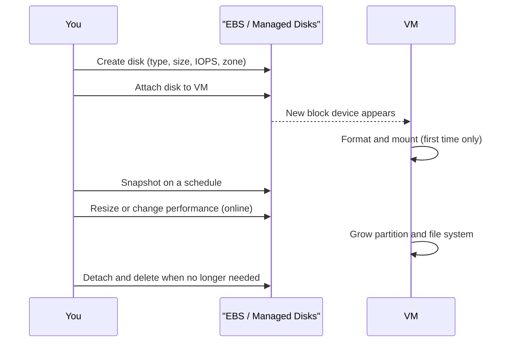

# Block Storage: EBS and Managed Disks

## Introduction

Every virtual machine needs a disk to boot from, and many need extra disks for databases, message brokers or build caches. In the cloud, those disks are **network-attached block storage**: virtual drives that live on the provider's storage fleet and appear to your VM as local devices.

- On AWS they are **Amazon Elastic Block Store (EBS) volumes**.
- On Azure they are **Azure Managed Disks**.

Because the disk is not physically inside the server, you get features a laptop drive cannot offer. You can resize a disk while it is in use, change its performance without downtime, take incremental snapshots, and detach it from a broken VM and attach it to a healthy one. The trade-off is that you must choose a disk type and size up front, and you pay for what you **provision**, not what you use.

Think of it like renting a storage unit by size and speed. A bigger unit costs more whether it is full or not, and a unit next to the loading dock (more IOPS) costs more than one at the back of the building.

This page compares the disk types, shows how to create, attach, resize and snapshot disks on both clouds, and helps you size a disk for a real database.

:::warning Cost and cleanup
Disks bill per GB-month **provisioned**, plus provisioned IOPS and throughput on some types, plus snapshot storage. A detached disk keeps billing until you delete it, and so do its snapshots. Use the cleanup commands at the end. See the [Amazon EBS pricing page](https://aws.amazon.com/ebs/pricing/), the [Managed Disks pricing page](https://azure.microsoft.com/pricing/details/managed-disks/), and the official calculators for current prices.
:::

## Key Concepts

| Concept | Amazon EBS | Azure Managed Disks |
| --- | --- | --- |
| The disk | Volume | Managed disk |
| Scope | One Availability Zone | One zone (zonal), or regional with ZRS disks on some types |
| Attach to | EC2 instance in the same AZ | VM in the same region/zone |
| Point-in-time copy | Snapshot (incremental, stored regionally) | Snapshot (incremental recommended) |
| Encryption at rest | EBS encryption with KMS keys. Can be on by default per Region | Always on with platform-managed keys. Customer-managed keys optional |
| Resize | Elastic Volumes: size, type, IOPS and throughput online | Increase size (often online). Adjust performance on Premium SSD v2 and Ultra |
| Shared attach | Multi-Attach on `io1`/`io2` | Shared disks on Premium SSD, Premium SSD v2 and Ultra |
| Local, temporary disk | Instance store | Temporary disk |



:::caution Local disks are temporary
EC2 **instance store** volumes and the Azure VM **temporary disk** are physically attached to the host. They are fast and included in the VM price, but their data is lost when the VM stops, is deallocated or moves to another host. Use them only for caches, scratch space and swap.
:::

## Disk Types

### On AWS: EBS volume types

| Type | Media | Size | Max IOPS | Max throughput | Typical use |
| --- | --- | --- | --- | --- | --- |
| `gp3` | SSD | 1 GiB to 64 TiB | 80,000 | 2,000 MiB/s | Default for boot disks and most workloads |
| `gp2` | SSD | 1 GiB to 16 TiB | 16,000 | 250 MiB/s | Previous default. IOPS tied to size |
| `io2` Block Express | SSD | 4 GiB to 64 TiB | 256,000 | 4,000 MiB/s | Critical databases needing consistent sub-millisecond latency |
| `io1` | SSD | 4 GiB to 16 TiB | 64,000 | 1,000 MiB/s | Older provisioned-IOPS volumes |
| `st1` | HDD | 125 GiB to 16 TiB | 500 | 500 MiB/s | Big sequential reads: logs, data warehouses |
| `sc1` | HDD | 125 GiB to 16 TiB | 250 | 250 MiB/s | Cheapest, cold sequential data |

`gp3` includes a baseline of 3,000 IOPS and 125 MiB/s at any size, and you can buy more IOPS and throughput separately from capacity. With `gp2`, the only way to get more IOPS is to buy a bigger disk. Migrating `gp2` volumes to `gp3` is usually an easy, online cost saving. Maximums apply only on instances that can deliver them. Every instance type also has its own EBS bandwidth and IOPS limit.

### On Azure: Managed disk types

| Type | SKU name | Max size | Max IOPS | Max throughput | OS disk? | Typical use |
| --- | --- | --- | --- | --- | --- | --- |
| Ultra Disk | `UltraSSD_LRS` | 64 TiB | 400,000 | 10,000 MB/s | No | SAP HANA, top-tier databases |
| Premium SSD v2 | `PremiumV2_LRS` | 64 TiB | 80,000 | 2,000 MB/s | No | Production databases. Best price-performance for most data disks |
| Premium SSD | `Premium_LRS`, `Premium_ZRS` | 32 TiB | 20,000 | 900 MB/s | Yes | Production OS disks and data disks |
| Standard SSD | `StandardSSD_LRS`, `StandardSSD_ZRS` | 32 TiB | 6,000 | 750 MB/s | Yes | Web servers, dev/test |
| Standard HDD | `Standard_LRS` | 32 TiB | 2,000 (3,000 with performance plus) | 500 MB/s | Yes, but retiring as OS disk in September 2028 | Backups, infrequent access |

Premium SSD, Standard SSD and Standard HDD come in **fixed size tiers** (for example P30 = 1 TiB). A 200 GiB Premium SSD is billed as the next tier up, and its performance comes from that tier. Premium SSD v2 and Ultra Disk instead let you set capacity, IOPS and throughput independently, much like `gp3` and `io2`. Premium SSD v2 includes 3,000 IOPS and 125 MB/s at any size. Neither Premium SSD v2 nor Ultra can be an OS disk, so a common pattern is a Premium SSD OS disk plus Premium SSD v2 data disks.

### Mapping

| Need | AWS | Azure |
| --- | --- | --- |
| General-purpose SSD, tunable performance | `gp3` | Premium SSD v2 (data) or Premium SSD (OS) |
| Highest IOPS, lowest latency | `io2` Block Express | Ultra Disk |
| Cheap sequential throughput | `st1` | Standard HDD (or Standard SSD) |
| Zone-redundant disk | Not available (snapshots are regional) | `Premium_ZRS` and `StandardSSD_ZRS` |

The last row is a real architectural difference. An EBS volume can never survive the loss of its AZ. You recover by restoring a snapshot in another AZ. Azure ZRS disks replicate synchronously across three zones, so a VM in another zone can take over the same disk.

## Creating and Attaching a Disk

### On AWS

```bash
AZ=us-east-1a
INSTANCE_ID=i-0abc123def4567890   # an existing instance in the same AZ

VOLUME_ID=$(aws ec2 create-volume \
  --availability-zone $AZ \
  --volume-type gp3 --size 100 --iops 6000 --throughput 250 \
  --encrypted \
  --tag-specifications 'ResourceType=volume,Tags=[{Key=Name,Value=pg-data},{Key=project,Value=helpdesk}]' \
  --query VolumeId --output text)

aws ec2 wait volume-available --volume-ids $VOLUME_ID
aws ec2 attach-volume --volume-id $VOLUME_ID --instance-id $INSTANCE_ID --device /dev/sdf
```

Example output:

```text
{
    "AttachTime": "2026-10-11T10:02:41.512Z",
    "Device": "/dev/sdf",
    "InstanceId": "i-0abc123def4567890",
    "State": "attaching",
    "VolumeId": "vol-0f1e2d3c4b5a69788"
}
```

Turn on encryption by default for every new volume in the Region, so that no one can forget `--encrypted`:

```bash
aws ec2 enable-ebs-encryption-by-default
```

### On Azure

```bash
RG=rg-helpdesk-dev
VM=vm-pg-01          # an existing VM deployed in zone 1

az disk create --resource-group $RG --name disk-pg-data \
  --sku PremiumV2_LRS --size-gb 100 \
  --disk-iops-read-write 6000 --disk-mbps-read-write 250 \
  --zone 1 --location eastus \
  --tags project=helpdesk

az vm disk attach --resource-group $RG --vm-name $VM --name disk-pg-data --lun 0
```

Example output (trimmed):

```text
{
  "diskIOPSReadWrite": 6000,
  "diskMBpsReadWrite": 250,
  "diskSizeGB": 100,
  "diskState": "Unattached",
  "name": "disk-pg-data",
  "sku": { "name": "PremiumV2_LRS", "tier": "Premium" },
  "zones": [ "1" ]
}
```

Premium SSD v2 disks must be in the same zone as the VM in most regions. Azure encrypts all managed disks at rest automatically. Use a **disk encryption set** if you need customer-managed keys, and **encryption at host** if you also want temp disks and caches encrypted. See [Encryption and KMS](../12-cloud-observability-and-security/5-cloud-encryption-and-kms.mdx).

### Formatting and mounting (Linux, both clouds)

From the VM's point of view, the new disk is just an empty device:

```bash
lsblk -o NAME,SIZE,TYPE,MOUNTPOINT
sudo mkfs.xfs /dev/nvme1n1          # device name varies: check lsblk (Azure often shows /dev/sdc)
sudo mkdir -p /var/lib/pgdata
sudo mount /dev/nvme1n1 /var/lib/pgdata

# Mount by UUID on every boot; nofail lets the VM boot even if the disk is missing
UUID=$(sudo blkid -s UUID -o value /dev/nvme1n1)
echo "UUID=$UUID /var/lib/pgdata xfs defaults,nofail 0 2" | sudo tee -a /etc/fstab
df -h /var/lib/pgdata
```

Example output:

```text
NAME          SIZE TYPE MOUNTPOINT
nvme0n1         8G disk
└─nvme0n1p1     8G part /
nvme1n1       100G disk
Filesystem      Size  Used Avail Use% Mounted on
/dev/nvme1n1    100G  746M  100G   1% /var/lib/pgdata
```

Always mount by UUID, not by device name. Device names such as `/dev/sdf` and `/dev/nvme1n1` can change between reboots, especially on Nitro instances where EBS volumes appear as NVMe devices.

## Resizing and Tuning Performance

Both clouds let you grow disks and change performance without detaching them.

### On AWS

```bash
aws ec2 modify-volume --volume-id $VOLUME_ID --size 200 --iops 8000 --throughput 400
aws ec2 describe-volumes-modifications --volume-ids $VOLUME_ID \
  --query 'VolumesModifications[0].{state:ModificationState,progress:Progress}'
```

Example output:

```text
{
    "state": "optimizing",
    "progress": 12
}
```

The new size is usable once the state reaches `optimizing`. There is a cooldown period before you can modify the same volume again, so plan changes rather than making many small ones. Check the current limits in the [EBS modification documentation](https://docs.aws.amazon.com/ebs/latest/userguide/ebs-modify-volume.html).

### On Azure

```bash
az disk update --resource-group $RG --name disk-pg-data \
  --size-gb 200 --disk-iops-read-write 8000 --disk-mbps-read-write 400
```

Premium SSD v2 and Ultra Disk allow a limited number of performance changes per 24 hours (creation counts as one). For Premium SSD, Standard SSD and Standard HDD, you change performance by changing the size tier or the SKU. Some SKU changes require deallocating the VM.

### Growing the file system (both clouds)

The cloud grows the block device. The operating system must grow the partition and file system:

```bash
sudo growpart /dev/nvme0n1 1      # only if the file system sits on a partition
sudo xfs_growfs /var/lib/pgdata   # for ext4 use: sudo resize2fs /dev/nvme1n1
```

You can grow disks but not shrink them. To get a smaller disk, create a new one and copy the data.

## Snapshots

Snapshots are point-in-time, **incremental** copies stored outside the zone. They are the basis for backups, cloning environments and moving disks between zones or regions.

```bash
# AWS
SNAP_ID=$(aws ec2 create-snapshot --volume-id $VOLUME_ID \
  --description "pg-data before upgrade" \
  --tag-specifications 'ResourceType=snapshot,Tags=[{Key=project,Value=helpdesk}]' \
  --query SnapshotId --output text)
aws ec2 wait snapshot-completed --snapshot-ids $SNAP_ID

# Restore into a different AZ
aws ec2 create-volume --snapshot-id $SNAP_ID --availability-zone us-east-1b --volume-type gp3
```

```bash
# Azure
DISK_ID=$(az disk show -g $RG -n disk-pg-data --query id -o tsv)
az snapshot create -g $RG -n snap-pg-data-pre-upgrade --source $DISK_ID --incremental true

# Restore into a new disk
az disk create -g $RG -n disk-pg-data-restored --source snap-pg-data-pre-upgrade \
  --sku PremiumV2_LRS --zone 2
```

A crash-consistent snapshot of a running database is like pulling the power cord. The database usually recovers, but you should flush or freeze writes first, or use application-consistent backups. Scheduling and retention belong to a backup service, covered in [Backup and Archive](./7-cloud-backup-and-archive.mdx).

## Finding Forgotten Disks

Unattached disks are one of the most common sources of cloud waste. This script lists them on AWS:

```python
import boto3

ec2 = boto3.client("ec2", region_name="us-east-1")
paginator = ec2.get_paginator("describe_volumes")

total_gib = 0
for page in paginator.paginate(Filters=[{"Name": "status", "Values": ["available"]}]):
    for vol in page["Volumes"]:
        tags = {t["Key"]: t["Value"] for t in vol.get("Tags", [])}
        total_gib += vol["Size"]
        print(f'{vol["VolumeId"]}  {vol["VolumeType"]:4}  {vol["Size"]:>5} GiB  '
              f'created {vol["CreateTime"]:%Y-%m-%d}  name={tags.get("Name", "-")}')
print(f"Unattached total: {total_gib} GiB")
```

Example output:

```text
vol-0a1b2c3d4e5f60718  gp2     500 GiB  created 2025-03-02  name=old-jenkins
vol-0f1e2d3c4b5a69788  gp3     100 GiB  created 2026-10-11  name=pg-data
Unattached total: 600 GiB
```

The Azure equivalent is one CLI query:

```bash
az disk list --query "[?diskState=='Unattached'].{name:name, rg:resourceGroup, sku:sku.name, gb:diskSizeGB}" -o table
```

Example output:

```text
Name               Rg               Sku             Gb
-----------------  ---------------  --------------  ----
disk-old-build     rg-ci            Premium_LRS     512
disk-pg-data       rg-helpdesk-dev  PremiumV2_LRS   100
```

## Real-World Scenario

Your team runs a self-managed PostgreSQL 16 server for the helpdesk product. Monitoring shows about 400 GB of data, a steady 4,000 IOPS with peaks of 9,000 during the morning rush, and nightly reporting jobs that read about 300 MB/s. The current disk is a 1 TB `gp2` volume (or a P30 Premium SSD on Azure) that was sized for IOPS, not capacity.

**The decision:**

- **AWS:** move to `gp3`, 600 GiB, 10,000 IOPS, 400 MiB/s. Capacity, IOPS and throughput are set separately, so you stop paying for 400 GB of empty space just to get IOPS. The change is an online `modify-volume`.
- **Azure:** keep a small Premium SSD OS disk and move the data to a **Premium SSD v2** data disk with the same 600 GiB, 10,000 IOPS and 400 MB/s. Copy the data during a maintenance window, because you cannot convert a Premium SSD in place to v2.
- Check that the VM size can actually deliver 10,000 IOPS and 400 MB/s to its disks. Both clouds cap disk performance per VM size, and this is the most common reason a fast disk looks slow.
- Schedule daily snapshots through AWS Backup or Azure Backup, and keep the database's WAL archive in object storage for point-in-time recovery.

**Why this approach:** tunable-performance disks decouple the three dimensions that the workload needs, and the change is reversible.

**When to use it / when not to:** self-managing a database on block storage makes sense when you need extensions, versions or tuning that managed services do not allow. Otherwise, a managed database (RDS, Aurora, Azure Database for PostgreSQL) handles disks, backups, patching and failover for you. See [Managed Relational Databases: RDS, Aurora and Azure SQL](../7-cloud-databases/1-cloud-rds-and-azure-sql.mdx).

**Alternatives and trade-offs:**

| Approach | Pros | Cons | Best for |
| --- | --- | --- | --- |
| `gp3` / Premium SSD v2 | Tunable, good price-performance | Max IOPS and latency below io2 / Ultra | Most databases |
| `io2` Block Express / Ultra Disk | Highest IOPS, lowest and most consistent latency | Higher cost | Large OLTP, SAP, latency-critical systems |
| Striping several disks (RAID 0) | Exceeds single-disk limits | More complex. One disk failure breaks the array | Very large throughput needs |
| Instance store / temp disk | Very fast, included in VM price | Data lost on stop or host failure | Caches, replicas that can be rebuilt |
| Managed database service | No disk management, built-in HA and backups | Less control, can cost more | Teams without DBA capacity |

## Common Mistakes

- **Sizing disks for capacity and forgetting performance (or the reverse).** Measure IOPS, throughput and latency, then pick the type.
- **Ignoring VM-level limits.** A disk cannot exceed the VM's storage bandwidth.
- **Keeping data on instance store or the temp disk.** It disappears on stop, deallocation or host failure.
- **Mounting by device name.** Use UUIDs and `nofail` in `/etc/fstab`.
- **Leaving detached disks and old snapshots behind.** Tag everything and review unattached disks regularly.
- **Assuming a snapshot is a backup strategy.** You also need schedules, retention, copies to another region or account, and tested restores.
- **Expecting an EBS volume to survive an AZ outage.** Plan cross-AZ recovery from snapshots or replication. On Azure, consider ZRS disks.

## Cleanup

```bash
# AWS
aws ec2 detach-volume --volume-id $VOLUME_ID
aws ec2 wait volume-available --volume-ids $VOLUME_ID
aws ec2 delete-volume --volume-id $VOLUME_ID
aws ec2 delete-snapshot --snapshot-id $SNAP_ID

# Azure
az vm disk detach --resource-group $RG --vm-name $VM --name disk-pg-data
az disk delete --resource-group $RG --name disk-pg-data --yes
az disk delete --resource-group $RG --name disk-pg-data-restored --yes
az snapshot delete --resource-group $RG --name snap-pg-data-pre-upgrade
```

Unmount the file system inside the VM (`sudo umount /var/lib/pgdata`) and remove its `/etc/fstab` line before detaching.

## Summary

- EBS volumes and Azure Managed Disks are network block devices attached to one VM in one zone, billed by provisioned size and performance.
- Default choices: `gp3` on AWS. Premium SSD v2 for Azure data disks, with Premium SSD or Standard SSD for OS disks.
- Use `io2` Block Express or Ultra Disk only when you need the highest IOPS and lowest latency.
- Both clouds support online resizing. You must still grow the partition and file system yourself.
- Snapshots are incremental and can be restored into other zones. Azure also offers zone-redundant (ZRS) disks.
- Encrypt by default, mount by UUID, respect VM-level limits, and delete unattached disks.

## Exercises

1. Create a 20 GiB `gp3` volume (or a Premium SSD v2 disk), attach it to a test VM, format it, mount it by UUID, and reboot to confirm that it remounts.
2. Grow it to 30 GiB online, then grow the file system. Record each command you needed.
3. Snapshot the disk, restore the snapshot into a *different* zone, and attach the new disk to a VM there.
4. Run the unattached-disk script or the `az disk list` query in your account and estimate how much provisioned storage nobody is using.

**Related pages:** [Virtual Machines: EC2 and Azure VMs](../3-cloud-compute/1-cloud-virtual-machines.mdx), [Instance Types and Sizing](../3-cloud-compute/2-cloud-instance-types.mdx), [File Storage: EFS and Azure Files](./5-cloud-file-storage.mdx), [Backup and Archive](./7-cloud-backup-and-archive.mdx).
