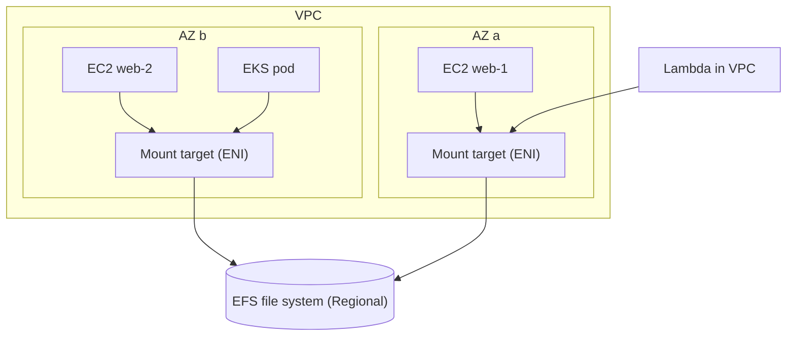

# File Storage: EFS and Azure Files

## Introduction

Some software simply expects a shared folder. A content management system writes uploaded images to `/var/www/uploads` on every web server. A build farm shares a cache directory. A Windows team has used `\\fileserver\finance` for twenty years. A machine learning job has several containers reading the same training files with normal file operations.

You could rewrite all of these to use object storage, and sometimes you should. When you cannot, or should not yet, the cloud offers **managed network file systems**:

- **Amazon Elastic File System (EFS)**: a serverless NFS file system for Linux that grows and shrinks automatically.
- **Azure Files**: managed file shares that speak **SMB** (Windows, macOS, Linux) and **NFS** (Linux).

Both remove the work of running a file server. You never patch an OS, replace a disk or grow a volume. The trade-offs are higher cost per GB than object storage, higher latency than a local disk, and network and identity details you must get right.

:::warning Cost and cleanup
EFS bills for data stored in each storage class (per GB-month), for data read and written under Elastic throughput, and for any provisioned throughput. Azure Files provisioned v2 shares bill for the storage, IOPS and throughput you **provision**, whether you use them or not. Pay-as-you-go shares bill for used storage plus transactions. Delete test file systems and shares when you finish. See the [Amazon EFS pricing page](https://aws.amazon.com/efs/pricing/), [Azure Files pricing](https://azure.microsoft.com/pricing/details/storage/files/), and the official calculators.
:::

## NFS vs SMB

| | NFS | SMB |
| --- | --- | --- |
| Native clients | Linux and Unix | Windows (also macOS and Linux) |
| Typical identity | UID/GID on the client, network-level controls | User identities from Active Directory or Entra ID |
| Permissions | POSIX mode bits (and ACLs) | Windows NTFS ACLs |
| Ports | 2049 | 445 |
| AWS service | EFS, FSx for OpenZFS, FSx for NetApp ONTAP | FSx for Windows File Server, FSx for NetApp ONTAP |
| Azure service | Azure Files NFS (SSD shares), Azure NetApp Files | Azure Files SMB, Azure NetApp Files |

Linux applications usually want NFS, and Windows applications want SMB. EFS is NFS only. Azure Files covers both, but each share uses one protocol, and NFS shares require the SSD (premium) media tier.

## Amazon EFS

### How EFS is built

An EFS file system is a regional resource. Clients reach it through **mount targets**, which are network interfaces that you place in subnets, typically one per Availability Zone. Each mount target has a security group, and clients connect on TCP port 2049.



Choices you make for an EFS file system:

| Setting | Options | Recommendation |
| --- | --- | --- |
| File system type | **Regional** (data in 3 or more AZs) or **One Zone** | Regional for production. One Zone for re-creatable data |
| Performance mode | **General Purpose** or Max I/O (previous generation) | General Purpose. AWS recommends it for all file systems |
| Throughput mode | **Elastic**, Provisioned, Bursting | Elastic (the default) for spiky or unpredictable workloads |
| Storage classes | **Standard**, **Infrequent Access (IA)**, **Archive** | Use lifecycle management to tier cold files |
| Encryption at rest | KMS key | Always on |

With **Elastic throughput** you pay for data read and written instead of reserving capacity, and throughput scales automatically. **Provisioned** throughput suits steady, known high throughput. **Bursting** ties throughput to the amount of data stored, which surprises teams with small file systems that suddenly need speed.

IA and Archive have a minimum billing charge of 128 KiB per file, and Archive has a 90-day minimum storage duration. Reads from IA and Archive incur per-GB access charges, and Archive requires Elastic throughput.

### Creating an EFS file system

```bash
VPC_ID=vpc-0abc1234
SUBNET_A=subnet-0aaa1111
SUBNET_B=subnet-0bbb2222
APP_SG=sg-0app5555          # security group of the web servers

# Security group for the mount targets: allow NFS only from the app servers
EFS_SG=$(aws ec2 create-security-group --group-name efs-cms --description "NFS from CMS servers" \
  --vpc-id $VPC_ID --query GroupId --output text)
aws ec2 authorize-security-group-ingress --group-id $EFS_SG \
  --protocol tcp --port 2049 --source-group $APP_SG

FS_ID=$(aws efs create-file-system \
  --performance-mode generalPurpose --throughput-mode elastic --encrypted \
  --tags Key=Name,Value=cms-uploads Key=project,Value=cms \
  --query FileSystemId --output text)

aws efs create-mount-target --file-system-id $FS_ID --subnet-id $SUBNET_A --security-groups $EFS_SG
aws efs create-mount-target --file-system-id $FS_ID --subnet-id $SUBNET_B --security-groups $EFS_SG

aws efs put-lifecycle-configuration --file-system-id $FS_ID --lifecycle-policies \
  "TransitionToIA=AFTER_30_DAYS" "TransitionToArchive=AFTER_90_DAYS" \
  "TransitionToPrimaryStorageClass=AFTER_1_ACCESS"
```

Example output (from `create-mount-target`, trimmed):

```text
{
    "MountTargetId": "fsmt-0123456789abcdef0",
    "FileSystemId": "fs-0a1b2c3d4e5f67890",
    "SubnetId": "subnet-0aaa1111",
    "LifeCycleState": "creating",
    "IpAddress": "10.0.1.57",
    "AvailabilityZoneName": "us-east-1a"
}
```

`TransitionToPrimaryStorageClass=AFTER_1_ACCESS` moves a file back to Standard when someone reads it, so files that become hot again stop paying access charges on every read.

### Mounting EFS

Install the EFS mount helper (`amazon-efs-utils`, preinstalled on Amazon Linux) and mount with TLS. Adding `iam` makes the client authenticate with the instance's IAM role, so access can be controlled with a file system policy.

```bash
sudo dnf install -y amazon-efs-utils     # Amazon Linux 2023
sudo mkdir -p /var/www/uploads
sudo mount -t efs -o tls,iam fs-0a1b2c3d4e5f67890:/ /var/www/uploads

echo "fs-0a1b2c3d4e5f67890:/ /var/www/uploads efs _netdev,tls,iam,nofail 0 0" | sudo tee -a /etc/fstab
df -h /var/www/uploads
```

Example output:

```text
Filesystem      Size  Used Avail Use% Mounted on
127.0.0.1:/     8.0E     0  8.0E   0% /var/www/uploads
```

The 8.0 exabyte "size" is not a typo. EFS has no fixed capacity, and you pay only for what you store.

### Access points

An **EFS access point** gives an application its own entry directory and enforces a POSIX user and group, no matter what UID the client process uses. This is how you safely share one file system among several apps or Lambda functions:

```bash
aws efs create-access-point --file-system-id $FS_ID \
  --posix-user Uid=1001,Gid=1001 \
  --root-directory 'Path=/cms,CreationInfo={OwnerUid=1001,OwnerGid=1001,Permissions=750}' \
  --tags Key=Name,Value=cms-ap
```

Clients then mount with `-o tls,iam,accesspoint=fsap-0123...`. In Kubernetes, the EFS CSI driver can create one access point per persistent volume automatically.

## Azure Files

### How Azure Files is built

Classic Azure file shares live in a **storage account**, just like blob containers. You choose:

| Setting | Options | Notes |
| --- | --- | --- |
| Media tier | **SSD** (premium) or **HDD** (standard) | NFS requires SSD |
| Billing model | **Provisioned v2** (recommended for new shares), provisioned v1, pay-as-you-go | v2 lets you provision storage, IOPS and throughput separately |
| Redundancy | LRS, ZRS (SSD and HDD), GRS and GZRS (HDD only) | Set on the storage account |
| Protocol | SMB or NFS per share | One protocol per share |

For provisioned v2 shares, the storage account kind is `FileStorage` with a SKU such as `StandardV2_LRS`, `StandardV2_ZRS`, `PremiumV2_LRS` or `PremiumV2_ZRS`. Pay-as-you-go HDD shares use a regular `StorageV2` account and an access tier (transaction optimized, hot or cool). Microsoft has also introduced a top-level **file share** resource (`Microsoft.FileShares`) that needs no storage account, currently for SSD NFS shares only. Check the current options in [Understand Azure Files billing](https://learn.microsoft.com/azure/storage/files/understanding-billing).

### Creating a provisioned v2 SMB share

```bash
RG=rg-cms-dev
LOCATION=eastus
SA=stcmsfiles$RANDOM

az group create --name $RG --location $LOCATION

az storage account create --resource-group $RG --name $SA --location $LOCATION \
  --kind FileStorage --sku StandardV2_ZRS \
  --min-tls-version TLS1_2 --tags project=cms

az storage share-rm create --resource-group $RG --storage-account $SA \
  --name uploads --enabled-protocols SMB \
  --quota 256 --provisioned-iops 3000 --provisioned-bandwidth-mibps 100
```

Example output (trimmed):

```text
{
  "enabledProtocols": "SMB",
  "name": "uploads",
  "provisionedBandwidthMibps": 100,
  "provisionedIops": 3000,
  "shareQuota": 256
}
```

If you leave out `--provisioned-iops` and `--provisioned-bandwidth-mibps`, Azure applies recommended values based on the provisioned storage. You can scale each value up at any time, and you can scale down 24 hours after the last increase.

### Mounting Azure Files

**Windows clients with identity-based access (SMB).** Configure identity-based authentication on the storage account (on-premises AD DS, Microsoft Entra Domain Services, or Microsoft Entra Kerberos for hybrid identities), and assign share-level RBAC roles such as **Storage File Data SMB Share Contributor**. Users then map the share with their own identity, and no keys are involved:

```text
net use Z: \\stcmsfiles18342.file.core.windows.net\uploads
```

**Linux clients (NFS on SSD shares).** NFS shares do not use storage account keys. They rely on network security, so place them behind a **private endpoint** (or service endpoint) in your virtual network:

```bash
sudo apt-get install -y nfs-common
sudo mkdir -p /var/www/uploads
sudo mount -t nfs -o vers=4,minorversion=1,sec=sys,nconnect=4 \
  stcmsnfs18342.file.core.windows.net:/stcmsnfs18342/uploads /var/www/uploads
```

Linux can also mount SMB shares with `mount -t cifs`, but that usually means storing a storage account key on the machine. Prefer NFS for Linux fleets, or use identity-based SMB where your environment supports it.

:::caution Port 445
Many home ISPs and corporate networks block outbound TCP port 445. Mounting an SMB share from a laptop "over the internet" often fails for that reason alone. Production access should go through a VPN, ExpressRoute or private endpoint. See [Hybrid Connectivity: VPN and Direct Connect/ExpressRoute](../8-cloud-networking/8-cloud-hybrid-connectivity.mdx).
:::

### Azure File Sync

**Azure File Sync** keeps an Azure file share in sync with folders on Windows Servers in your offices. Frequently used files stay cached locally, and cold files are tiered to the cloud. This is a popular way to retire traditional file servers gradually. AWS's closest equivalent is **Amazon FSx File Gateway** in front of FSx for Windows File Server.

## Performance Tips and Monitoring

Network file systems behave differently from local disks. Each file open, close, `stat` and rename is a network round trip, so **many small files** are far slower than **a few large files** of the same total size. You can see this with a quick experiment on any mount:

```python
import os
import time
from pathlib import Path

def write_files(base: Path, count: int, size: int) -> float:
    base.mkdir(parents=True, exist_ok=True)
    payload = os.urandom(size)
    start = time.perf_counter()
    for i in range(count):
        (base / f"f{i:05d}.bin").write_bytes(payload)
    return time.perf_counter() - start

mount = Path(os.environ.get("TEST_DIR", "/var/www/uploads/bench"))
small = write_files(mount / "small", count=2000, size=4 * 1024)      # 2,000 x 4 KiB
large = write_files(mount / "large", count=8, size=1024 * 1024)      # 8 x 1 MiB
print(f"2000 small files: {small:.2f}s   8 large files: {large:.2f}s")
```

Example output (on a network file system; numbers vary widely):

```text
2000 small files: 9.84s   8 large files: 0.21s
```

Both runs write about 8 MiB, yet the small-file run is dramatically slower because of per-file round trips. Practical tips:

- Use more clients and threads. Network file systems scale with parallelism, and per-client limits are lower than per-file-system limits.
- On Linux NFS clients, use `nconnect` (supported by the EFS mount helper and Azure Files NFS) to open several TCP connections.
- Keep build caches, `node_modules` and temporary files on local disk, and share only the results.
- Bundle many small files into archives when you move them in bulk.

Watch these metrics:

| Question | EFS (CloudWatch) | Azure Files (Azure Monitor) |
| --- | --- | --- |
| Am I near the throughput limit? | `PercentIOLimit`, `MeteredIOBytes` | `Transactions` and `Egress`/`Ingress` against provisioned values |
| How many clients are connected? | `ClientConnections` | `Transactions` split by API name |
| Am I being throttled? | Throughput utilization graph | `Transactions` filtered by `ResponseType` (throttling errors) |
| How much is stored per class or tier? | `StorageBytes` by storage class | `File Capacity` |

```bash
aws cloudwatch get-metric-statistics --namespace AWS/EFS --metric-name ClientConnections \
  --dimensions Name=FileSystemId,Value=$FS_ID \
  --start-time $(date -u -d '-1 hour' +%FT%TZ) --end-time $(date -u +%FT%TZ) \
  --period 300 --statistics Sum --query 'Datapoints[].Sum'
```

See [Monitoring: CloudWatch and Azure Monitor](../12-cloud-observability-and-security/0-cloud-monitoring.mdx) for alarms on these metrics.

## Mapping and Alternatives

| Need | AWS | Azure |
| --- | --- | --- |
| Elastic Linux NFS, pay per GB stored | Amazon EFS | Azure Files NFS (SSD, provisioned) |
| Windows SMB shares with AD integration | FSx for Windows File Server | Azure Files SMB |
| Enterprise NAS features (snapshots, cloning, multiprotocol) | FSx for NetApp ONTAP | Azure NetApp Files |
| HPC and ML scratch at very high throughput | FSx for Lustre | Azure Managed Lustre |
| Kubernetes `ReadWriteMany` volumes | EFS CSI driver | Azure Files CSI driver |
| Hybrid caching for branch offices | FSx File Gateway | Azure File Sync |

A key difference in billing: **EFS charges for what you store**, so it suits file systems whose size is unknown or changes a lot. **Azure Files provisioned models charge for what you reserve**, which makes the bill predictable but means you must size and resize shares. Azure Files pay-as-you-go (HDD) is closer to the EFS model, with per-transaction charges.

## Real-World Scenario

Your team is moving a PHP content management system from a single on-premises server to the cloud. To handle traffic, it will run on three VMs behind a load balancer. The CMS stores editor uploads (images and PDFs, about 80 GB, growing slowly) in `wp-content/uploads`, and its plugins assume a local file path.

**The solution:**

- **AWS:** a Regional EFS file system with Elastic throughput, mount targets in each AZ the web servers use, a security group that allows port 2049 only from the web tier, TLS and IAM mount options, an access point that forces the web server's UID, and a lifecycle policy that moves files to IA after 30 days.
- **Azure:** an SSD NFS share on a `PremiumV2_ZRS` FileStorage account reached through a private endpoint, or an HDD SMB share if the servers are Windows-based.
- Put a CDN in front of the site so that most image requests never reach the file system. See [CDNs: CloudFront and Azure Front Door](../8-cloud-networking/6-cloud-cdn.mdx).
- Back up the file system with AWS Backup or Azure Backup.

**Why this approach:** the application keeps working without code changes, every web server sees new uploads instantly, and the file system is managed and highly available.

**When to use it / when not to:** a shared file system is the right first step for lift-and-shift. In the longer term, an offload plugin that writes uploads to S3 or Blob Storage is usually cheaper and scales further. Avoid shared file systems for databases, high-churn small-file workloads with heavy locking, or anything that runs fine on object storage.

**Alternatives and trade-offs:**

| Approach | Pros | Cons | Best for |
| --- | --- | --- | --- |
| EFS / Azure Files | No code changes, shared and highly available | Higher cost per GB, network latency on metadata-heavy operations | Lift-and-shift, shared config and content |
| Object storage plus SDK or plugin | Cheapest, unlimited scale, CDN-friendly | Code or plugin changes required | Modernized apps |
| Mountpoint for Amazon S3 / BlobFuse2 | Read objects as files without rewriting code | Limited POSIX support (renames, appends, locks) | Read-heavy data and ML pipelines |
| FSx for NetApp ONTAP / Azure NetApp Files | Rich NAS features, very high performance | Higher minimum cost, more to configure | Enterprise NAS migrations |
| Sync uploads between servers (rsync, lsyncd) | No managed service needed | Race conditions, lag, fragile | Avoid |

## Common Mistakes

- **Forgetting a mount target in an AZ.** Clients in an AZ without a mount target either cannot mount or pay cross-AZ data charges.
- **Opening port 2049 or 445 to the world.** Allow it only from the security groups or subnets that need it.
- **Using Bursting throughput on a small EFS file system.** Small file systems earn few burst credits. Use Elastic.
- **Running databases on network file systems.** Use block storage or a managed database.
- **Storing storage account keys on servers to mount SMB shares.** Prefer identity-based SMB, NFS with private networking, or a secret store with rotation.
- **Over-provisioning Azure Files shares and never revisiting them.** Provisioned v2 bills for what you reserve. Watch the metrics and scale down.
- **Many tiny files with heavy metadata operations** (such as `npm install` into a shared mount). Network file systems are much slower than local disks for this pattern.

## Cleanup

```bash
# AWS: delete mount targets first, then the file system
for MT in $(aws efs describe-mount-targets --file-system-id $FS_ID --query 'MountTargets[].MountTargetId' --output text); do
  aws efs delete-mount-target --mount-target-id $MT
done
sleep 60
aws efs delete-file-system --file-system-id $FS_ID
aws ec2 delete-security-group --group-id $EFS_SG

# Azure: deleting the resource group removes the storage account and shares
az group delete --name $RG --yes --no-wait
```

Unmount on every client first (`sudo umount /var/www/uploads`) and remove the matching `/etc/fstab` lines, or the VMs may wait for the share at boot.

## Summary

- Managed file storage gives many machines a shared POSIX (NFS) or Windows (SMB) file system without running a file server.
- **EFS**: Linux NFS, Regional or One Zone, Elastic throughput by default, Standard, IA and Archive classes, billed for what you store. Mount targets per AZ, TLS and IAM mounts, access points.
- **Azure Files**: SMB or NFS shares in a storage account, SSD or HDD, with provisioned v2 recommended for new shares. Identity-based SMB, NFS through private endpoints, and Azure File Sync for hybrid setups.
- Use FSx or Azure NetApp Files for Windows-native, NetApp or HPC requirements.
- Prefer object storage when the application can use it. Use file storage when it truly needs a shared file system.

## Exercises

1. Create an EFS file system with two mount targets, mount it on two EC2 instances, write a file from one, and read it from the other.
2. Create an EFS access point that forces UID 1001, mount through it, and check the owner of a new file with `ls -ln`.
3. Create an Azure Files provisioned v2 share and scale its IOPS up and down. Note the 24-hour rule for decreases.
4. Write a short decision record: for a team running Windows desktops that need a shared "Finance" drive with AD permissions, which service would you choose on each cloud, and why?

**Related pages:** [Object, Block and File Storage](./0-cloud-storage-types.mdx), [Block Storage: EBS and Managed Disks](./4-cloud-block-storage.mdx), [Security Groups and Network Security Groups](../8-cloud-networking/3-cloud-security-groups-nsgs.mdx), [Amazon EKS](../5-cloud-containers/4-cloud-eks.mdx), [Azure Kubernetes Service](../5-cloud-containers/5-cloud-aks.mdx).
