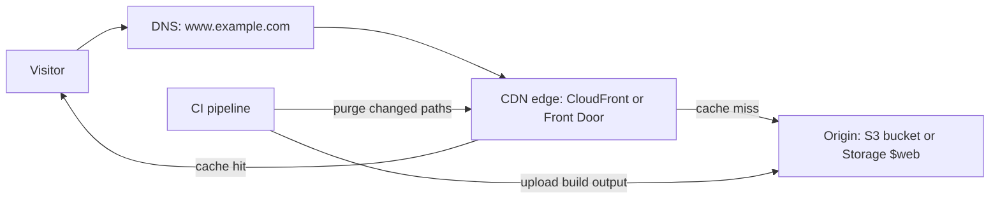

# Hosting Static Websites

## Introduction

A **static website** is made of files that are the same for every visitor: HTML, CSS, JavaScript, images and fonts. Documentation sites, marketing pages, blogs built with a static site generator, and single-page applications (React, Vue, Angular, Svelte) all fit this description. The browser does any dynamic work, often by calling APIs.

You do not need a web server for static files. Object storage can serve them, and a **content delivery network (CDN)** can cache them close to users around the world. That combination is cheap, very fast, scales without effort, and has almost nothing to patch. In fact, this tutorial site is a static site.

This page compares the main options on AWS and Azure, shows a quick demo and a production setup on each cloud, and covers the details that trip people up: HTTPS on custom domains, single-page-app routing, cache headers and deployments.

:::warning Cost and cleanup
Static hosting is usually inexpensive, but it is not free. You pay for storage, requests, data transfer out, and CDN requests and data transfer, and some managed hosting services have plan fees. A viral page or a misconfigured cache can raise the bill quickly. Set a budget alert first, and delete the demo resources at the end. Check the [CloudFront pricing page](https://aws.amazon.com/cloudfront/pricing/), [Azure Front Door pricing](https://azure.microsoft.com/pricing/details/frontdoor/), and the official calculators.
:::

## The Options

| Option | HTTPS on custom domain | Global CDN | Build and deploy from Git | Good for |
| --- | --- | --- | --- | --- |
| **S3 website endpoint** | No (HTTP only) | No | No | Quick demos, redirects |
| **S3 (private) + CloudFront** | Yes (ACM certificate) | Yes | Bring your own CI | Production sites with full control |
| **AWS Amplify Hosting** | Yes, managed | Yes (CloudFront) | Yes | Teams wanting a managed experience. AWS recommends it for static sites on S3 |
| **Azure Storage static website** | Only via Front Door | No (add Front Door) | Bring your own CI | Simple sites, internal docs |
| **Storage static website + Azure Front Door** | Yes, managed certificates | Yes | Bring your own CI | Production sites with full control |
| **Azure Static Web Apps** | Yes, managed | Yes (global distribution) | Yes (GitHub Actions or Azure Pipelines) | SPAs and Jamstack sites, with optional built-in API and auth |



:::note Azure CDN changes
**Azure CDN Standard from Microsoft (classic)** stopped accepting new profiles and domains in August 2025 and retires on September 30, 2027. The Edgio-based Azure CDN offering has already been retired. For new work on Azure, use **Azure Front Door Standard or Premium**. Older tutorials that say "add Azure CDN" are out of date.
:::

## A Sample Site

Every option below uploads the same small build output:

```bash
mkdir -p site/assets
cat > site/index.html <<'EOF'
<!doctype html>
<html lang="en">
  <head>
    <meta charset="utf-8">
    <title>Helpdesk Status</title>
    <link rel="stylesheet" href="/assets/app.3f9a1c.css">
  </head>
  <body>
    <h1>All systems operational</h1>
    <script src="/assets/app.8b2e44.js"></script>
  </body>
</html>
EOF
echo "body { font-family: sans-serif; }" > site/assets/app.3f9a1c.css
echo "console.log('status page loaded');" > site/assets/app.8b2e44.js
cp site/index.html site/404.html
```

The hashed filenames (`app.8b2e44.js`) matter for caching, as explained later. Every modern build tool produces them.

## On AWS

### Quick demo: the S3 website endpoint

The S3 website endpoint serves an index document and an error document over **HTTP only**, and it requires the bucket to be **public**. Use it for throwaway demos and redirect buckets, not production.

```bash
BUCKET=status-demo-$RANDOM
aws s3api create-bucket --bucket $BUCKET --region us-east-1

# A public website needs Block Public Access relaxed on THIS bucket only
aws s3api put-public-access-block --bucket $BUCKET \
  --public-access-block-configuration BlockPublicAcls=true,IgnorePublicAcls=true,BlockPublicPolicy=false,RestrictPublicBuckets=false

aws s3api put-bucket-policy --bucket $BUCKET --policy "{
  \"Version\": \"2012-10-17\",
  \"Statement\": [{\"Effect\": \"Allow\", \"Principal\": \"*\",
    \"Action\": \"s3:GetObject\", \"Resource\": \"arn:aws:s3:::$BUCKET/*\"}]}"

aws s3 website s3://$BUCKET --index-document index.html --error-document 404.html
aws s3 sync ./site s3://$BUCKET
curl -s http://$BUCKET.s3-website-us-east-1.amazonaws.com | head -n 3
```

Example output:

```text
<!doctype html>
<html lang="en">
  <head>
```

If your account-level Block Public Access blocks public policies (as it should in most organizations), this demo fails. That is the safety net working as intended.

### Production: private S3 bucket + CloudFront with OAC

The production pattern keeps the bucket **private** and lets only one CloudFront distribution read it, through **Origin Access Control (OAC)**. CloudFront adds HTTPS with a free AWS Certificate Manager (ACM) certificate, HTTP/2 and HTTP/3, compression, caching at edge locations, and optionally AWS WAF. Use OAC, not the legacy Origin Access Identity (OAI), which does not support SSE-KMS encrypted buckets.

The bucket policy that allows only your distribution:

```json
{
  "Version": "2012-10-17",
  "Statement": [
    {
      "Sid": "AllowCloudFrontServicePrincipalReadOnly",
      "Effect": "Allow",
      "Principal": { "Service": "cloudfront.amazonaws.com" },
      "Action": "s3:GetObject",
      "Resource": "arn:aws:s3:::status-site-origin-a1b2c3/*",
      "Condition": {
        "StringEquals": {
          "AWS:SourceArn": "arn:aws:cloudfront::111122223333:distribution/E2EXAMPLE12345"
        }
      }
    }
  ]
}
```

The whole setup in Terraform (abbreviated, using the AWS-managed `CachingOptimized` cache policy):

```hcl
resource "aws_s3_bucket" "site" {
  bucket = "status-site-origin-a1b2c3"
}

resource "aws_cloudfront_origin_access_control" "site" {
  name                              = "status-site-oac"
  origin_access_control_origin_type = "s3"
  signing_behavior                  = "always"
  signing_protocol                  = "sigv4"
}

resource "aws_cloudfront_distribution" "site" {
  enabled             = true
  default_root_object = "index.html"
  aliases             = ["status.example.com"]

  origin {
    domain_name              = aws_s3_bucket.site.bucket_regional_domain_name
    origin_id                = "s3-site"
    origin_access_control_id = aws_cloudfront_origin_access_control.site.id
  }

  default_cache_behavior {
    target_origin_id       = "s3-site"
    viewer_protocol_policy = "redirect-to-https"
    allowed_methods        = ["GET", "HEAD"]
    cached_methods         = ["GET", "HEAD"]
    cache_policy_id        = "658327ea-f89d-4fab-a63d-7e88639e58f6" # Managed-CachingOptimized
    compress               = true
  }

  # Single-page app routing: serve index.html for unknown paths
  custom_error_response {
    error_code         = 403
    response_code      = 200
    response_page_path = "/index.html"
  }

  restrictions {
    geo_restriction {
      restriction_type = "none"
    }
  }

  viewer_certificate {
    acm_certificate_arn      = var.certificate_arn # must be in us-east-1
    ssl_support_method       = "sni-only"
    minimum_protocol_version = "TLSv1.2_2021"
  }
}
```

Two details catch everyone:

- The ACM certificate for CloudFront must be created in **us-east-1**, whatever Region your bucket is in.
- With a private bucket, a missing object returns **403**, not 404, because S3 does not reveal whether the key exists. That is why the SPA fallback maps 403 to `/index.html`.

The full step-by-step build, including DNS in Route 53, is in [Project: Static Website with CDN and HTTPS](../14-cloud-projects/0-cloud-project-static-site.mdx).

### The managed alternative: Amplify Hosting

AWS Amplify Hosting connects to a Git repository (or an S3 bucket), runs your build, deploys to a CloudFront-backed CDN, issues certificates for custom domains, and creates preview environments for pull requests. You give up some low-level control in exchange for far less setup.

## On Azure

### Storage account static website

Enabling the static website feature creates a special container named `$web`. Files in it are served anonymously, read-only, from a dedicated web endpoint with HTTPS. This works even when anonymous blob access is disabled on the account, because the web endpoint is separate from the blob endpoint.

```bash
RG=rg-status-site
SA=ststatus$RANDOM
az group create --name $RG --location eastus
az storage account create --name $SA --resource-group $RG --location eastus \
  --kind StorageV2 --sku Standard_LRS --allow-blob-public-access false

az storage blob service-properties update --account-name $SA --auth-mode login \
  --static-website --index-document index.html --404-document 404.html

# Needs Storage Blob Data Contributor on the account for --auth-mode login
az storage blob upload-batch --account-name $SA --auth-mode login \
  --source ./site --destination '$web' --overwrite

az storage account show --name $SA --resource-group $RG \
  --query "primaryEndpoints.web" --output tsv
```

Example output:

```text
https://ststatus20931.z13.web.core.windows.net/
```

Quote `'$web'` in the shell, or your shell will expand `$web` as an empty variable. The static website endpoint supports HTTPS on its own `*.web.core.windows.net` name. For HTTPS on **your own domain**, custom headers or caching rules, put Azure Front Door in front of it.

### Production: static website + Azure Front Door

```bash
WEB_HOST=$(az storage account show -n $SA -g $RG --query "primaryEndpoints.web" -o tsv \
  | sed 's#https://##; s#/##')

az afd profile create -g $RG --profile-name fd-status --sku Standard_AzureFrontDoor
FD_ENDPOINT=status-$RANDOM
az afd endpoint create -g $RG --profile-name fd-status --endpoint-name $FD_ENDPOINT --enabled-state Enabled
az afd origin-group create -g $RG --profile-name fd-status --origin-group-name og-web \
  --probe-request-type HEAD --probe-protocol Https --probe-interval-in-seconds 120 --probe-path / \
  --sample-size 4 --successful-samples-required 3 --additional-latency-in-milliseconds 50
az afd origin create -g $RG --profile-name fd-status --origin-group-name og-web --origin-name web \
  --host-name $WEB_HOST --origin-host-header $WEB_HOST \
  --priority 1 --weight 1000 --enabled-state Enabled --https-port 443 --http-port 80
```

You then create a **route** from the endpoint to the origin group (with HTTPS redirect and caching enabled), add your custom domain, and let Front Door issue a managed certificate. Command flags evolve, so follow the official [Front Door quickstart](https://learn.microsoft.com/azure/frontdoor/create-front-door-cli) for the remaining steps. Front Door rules can also add security headers such as `Strict-Transport-Security`, which the storage static website cannot set on its own.

### The managed alternative: Azure Static Web Apps

**Azure Static Web Apps** connects to GitHub or Azure DevOps, builds and deploys on every push, creates preview environments for pull requests, issues certificates, and can host a small Azure Functions API and built-in authentication. Routing, headers and SPA fallback live in a `staticwebapp.config.json` file in your repository:

```json
{
  "navigationFallback": {
    "rewrite": "/index.html",
    "exclude": ["/assets/*", "/*.{png,jpg,svg,ico}"]
  },
  "globalHeaders": {
    "X-Content-Type-Options": "nosniff",
    "Referrer-Policy": "strict-origin-when-cross-origin"
  },
  "routes": [
    { "route": "/assets/*", "headers": { "Cache-Control": "public, max-age=31536000, immutable" } }
  ]
}
```

It is the closest Azure equivalent to Amplify Hosting.

## Caching Correctly

The CDN makes your site fast only if your cache headers are right. The standard pattern:

| File | `Cache-Control` | Why |
| --- | --- | --- |
| Hashed assets (`app.8b2e44.js`) | `public, max-age=31536000, immutable` | The name changes whenever the content changes, so caching for a year is safe |
| `index.html` and other HTML | `no-cache` (revalidate every time) | Visitors pick up new deployments immediately |

Set the headers at upload time. On AWS:

```bash
aws s3 sync ./site/assets s3://$BUCKET/assets --cache-control "public, max-age=31536000, immutable"
aws s3 cp ./site/index.html s3://$BUCKET/index.html --cache-control "no-cache" --content-type text/html
```

On Azure:

```bash
az storage blob upload-batch --account-name $SA --auth-mode login --source ./site/assets \
  --destination '$web' --destination-path assets --overwrite --content-cache-control "public, max-age=31536000, immutable"
az storage blob upload --account-name $SA --auth-mode login --container-name '$web' \
  --name index.html --file ./site/index.html --overwrite --content-cache-control "no-cache"
```

If you must remove something from the CDN early, purge it. This is usually only needed for HTML files when you have not set `no-cache`:

```bash
aws cloudfront create-invalidation --distribution-id E2EXAMPLE12345 --paths "/index.html"
az afd endpoint purge -g $RG --profile-name fd-status --endpoint-name $FD_ENDPOINT --content-paths "/index.html"
```

## Deploying from CI with OIDC

Deploy from a pipeline, never from a laptop, and never with long-lived keys stored as CI secrets. GitHub Actions can exchange its OIDC token for short-lived cloud credentials. A trimmed AWS workflow:

```yaml
name: deploy-site
on:
  push:
    branches: [main]
permissions:
  id-token: write
  contents: read
jobs:
  deploy:
    runs-on: ubuntu-latest
    steps:
      - uses: actions/checkout@v4
      - run: npm ci && npm run build
      - uses: aws-actions/configure-aws-credentials@v4
        with:
          role-to-assume: arn:aws:iam::111122223333:role/site-deployer
          aws-region: us-east-1
      - run: aws s3 sync ./dist s3://status-site-origin-a1b2c3 --delete
      - run: aws cloudfront create-invalidation --distribution-id E2EXAMPLE12345 --paths "/index.html"
```

The Azure version uses `azure/login` with a federated credential on a managed identity or app registration. Both are explained in [Keyless CI/CD with OIDC](../2-cloud-identity/6-cloud-oidc-for-ci.mdx).

## Real-World Scenario

Your team builds a React dashboard for customers. It calls a REST API on a separate domain, must be served from `app.example.com` over HTTPS, and is deployed several times a day. Customers are in North America and Europe. The team is small and wants the least operational work that still gives full control over headers and security.

**The decision:** private bucket or storage account as the origin, a CDN in front (CloudFront with OAC, or Front Door Standard), hashed assets cached for a year, `index.html` set to `no-cache`, SPA fallback to `index.html`, security headers added by the CDN, and deployment from GitHub Actions with OIDC.

**Why this approach:** the origin is never public, every request goes through HTTPS at the edge, deployments take seconds, and the cache strategy means you almost never need to purge.

**When to use it / when not to:** use this pattern for any static site or SPA you want to control closely. Choose Amplify Hosting or Static Web Apps if you value pull-request previews and zero CDN setup more than fine-grained control. Choose server-side rendering (for example on App Service, Container Apps or Lambda) when pages must be rendered per request for SEO or personalization.

**Alternatives and trade-offs:**

| Approach | Pros | Cons | Best for |
| --- | --- | --- | --- |
| S3 website endpoint / Storage `$web` alone | Simplest, cheapest | No custom-domain HTTPS (S3 has no HTTPS at all), no edge caching | Demos, internal docs |
| Object storage + CloudFront / Front Door | Full control, private origin, WAF option | More pieces to configure | Production sites with custom needs |
| Amplify Hosting / Static Web Apps | Git-based deploys, PR previews, managed certs | Less low-level control, platform conventions | Small teams, SPAs, Jamstack |
| Third-party static hosts | Excellent developer experience | Another vendor and bill, outside your cloud governance | Teams not tied to one cloud |
| Web server on a VM or container | Any server logic | Patching, scaling, higher cost | Sites that are not really static |

## Common Mistakes

- **Making the bucket public when CloudFront is in front.** Use OAC and keep Block Public Access on.
- **Creating the CloudFront certificate in the wrong Region.** It must be in us-east-1.
- **Long cache times on `index.html`.** Visitors get stale HTML that points to deleted assets. Use `no-cache` for HTML and hashed names for assets.
- **Forgetting SPA routing.** Deep links such as `/settings` return 403 or 404 unless you configure a fallback to `index.html`.
- **Forgetting to quote `$web`** in shell commands.
- **Planning new work on Azure CDN classic.** It no longer accepts new profiles. Use Front Door.
- **Deploying with personal or long-lived credentials.** Use OIDC from CI.

## Cleanup

```bash
# AWS demo bucket
aws s3 rm s3://$BUCKET --recursive
aws s3api delete-bucket --bucket $BUCKET

# Azure: removes the storage account and Front Door profile
az group delete --name $RG --yes --no-wait
```

For CloudFront created with Terraform, run `terraform destroy`. A distribution must be disabled before it can be deleted, and Terraform handles that for you.

## Summary

- Static sites and SPAs need only object storage and a CDN, with no web servers.
- The S3 website endpoint is HTTP-only and public. For production, use a **private S3 bucket + CloudFront with OAC**, or **Amplify Hosting**.
- Azure Storage static websites serve the `$web` container. Add **Azure Front Door** for custom-domain HTTPS and headers, or use **Azure Static Web Apps** for a managed Git-based workflow. Azure CDN classic is retiring.
- Cache hashed assets for a long time and HTML for no time. Configure SPA fallbacks.
- Deploy from CI with OIDC and purge only what you must.

## Exercises

1. Host the sample site with Azure Storage static website and confirm it loads over HTTPS on the `web.core.windows.net` endpoint. Then delete the resource group.
2. Using Terraform, deploy the private S3 + CloudFront + OAC setup without a custom domain (use the default certificate). Confirm that the S3 object URL returns 403 while the CloudFront URL works.
3. Add an SPA route such as `/settings` and make deep links work on both clouds.
4. Use your browser's developer tools to check the `Cache-Control` and `Age` headers on your assets and on `index.html` after two page loads.

**Related pages:** [Amazon S3](./1-cloud-s3.mdx), [Azure Blob Storage](./2-cloud-azure-blob.mdx), [CDNs: CloudFront and Azure Front Door](../8-cloud-networking/6-cloud-cdn.mdx), [DNS: Route 53 and Azure DNS](../8-cloud-networking/5-cloud-dns.mdx), [Project: Static Website with CDN and HTTPS](../14-cloud-projects/0-cloud-project-static-site.mdx).
