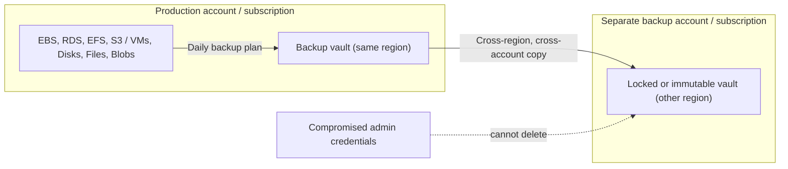

# Backup and Archive

## Introduction

Cloud storage is extremely durable. S3 is designed for 11 nines of durability, and Azure keeps at least three copies of every byte. So why back anything up?

Because durability protects you from **hardware** failure, not from **people and software**. The provider faithfully keeps three copies of whatever you tell it to keep, including the file a buggy deployment just overwrote, the table an engineer dropped by mistake, and the disk that ransomware just encrypted. Replication copies these mistakes instantly. A backup is a separate, older, protected copy that the mistake cannot reach.

**Archive** is a related but different job: keeping data you rarely or never read, often for legal or compliance reasons, as cheaply as possible.

| | Replication / redundancy | Backup | Archive |
| --- | --- | --- | --- |
| Goal | Survive hardware, zone or region failure | Recover from deletion, corruption or attack | Retain data long-term at low cost |
| Copies mistakes? | Yes, immediately | No, older versions are kept | Not applicable |
| Typical retention | Current state only | Days to months (sometimes years) | Years |
| Restore speed | Instant (it is live) | Minutes to hours | Hours to days |
| Example | S3 Cross-Region Replication, Azure GZRS | AWS Backup, Azure Backup | S3 Glacier Deep Archive, Azure Archive tier |

This page covers how to design backups (RPO, RTO, 3-2-1), how AWS Backup and Azure Backup work, how to make backups immutable so ransomware cannot delete them, object-level protection features, archives, and the restore testing everyone forgets.

:::warning Cost and cleanup
Backups bill for backup storage (per GB-month, often with a per-instance fee on Azure Backup), cross-region copy transfer, and restores. **Locked vaults and compliance-mode retention cannot be deleted early by anyone, including you and the cloud provider.** In experiments, use governance mode or no lock, and short retention. See [AWS Backup pricing](https://aws.amazon.com/backup/pricing/) and [Azure Backup pricing](https://azure.microsoft.com/pricing/details/backup/).
:::

## Designing Backups: RPO, RTO and 3-2-1

Two numbers drive every backup design:

- **RPO (recovery point objective):** how much data you can afford to lose, measured in time. Daily backups mean an RPO of up to 24 hours.
- **RTO (recovery time objective):** how long you can afford to be down while restoring.

Lower RPO and RTO cost more. A nightly snapshot is cheap. Point-in-time recovery to any second, plus a warm standby, is not. [Disaster Recovery Strategies](../13-cloud-architecture/2-cloud-disaster-recovery.mdx) covers RPO and RTO at the architecture level.

The classic **3-2-1 rule** translated to the cloud:

- **3 copies** of the data: production plus two backups.
- **2 different storage systems or failure domains**, such as snapshots in the same region plus copies in another region.
- **1 copy isolated** from your normal credentials: a different account or subscription, a locked or immutable vault, or a logically air-gapped vault.



The isolated copy is what saves you from ransomware. Attackers who steal administrator credentials usually try to delete backups first.

## Backups on AWS: AWS Backup

**AWS Backup** centrally manages backups for many services: EBS volumes, EC2 instances, RDS and Aurora, DynamoDB, EFS, FSx, S3 and others. Its building blocks:

| Concept | Meaning |
| --- | --- |
| **Backup vault** | A container for recovery points, encrypted with a KMS key, with its own access policy |
| **Backup plan** | Rules: schedule, start window, retention lifecycle and copy actions |
| **Resource assignment (selection)** | Which resources a plan protects, usually chosen by tags |
| **Recovery point** | One backup of one resource |
| **Vault Lock** | WORM protection for a vault, in governance or compliance mode |
| **Logically air-gapped vault** | A specialized vault with compliance-mode lock built in, encrypted with an AWS-owned key by default, shareable with other accounts for restores |

### Create a vault, plan and tag-based selection

```bash
aws backup create-backup-vault --backup-vault-name helpdesk-vault \
  --backup-vault-tags project=helpdesk
```

`plan.json`, with daily backups kept for 35 days and a copy sent to a vault in another Region:

```json
{
  "BackupPlanName": "helpdesk-daily",
  "Rules": [
    {
      "RuleName": "daily-0500-utc",
      "TargetBackupVaultName": "helpdesk-vault",
      "ScheduleExpression": "cron(0 5 ? * * *)",
      "StartWindowMinutes": 60,
      "CompletionWindowMinutes": 240,
      "Lifecycle": { "DeleteAfterDays": 35 },
      "CopyActions": [
        {
          "DestinationBackupVaultArn": "arn:aws:backup:us-west-2:111122223333:backup-vault:helpdesk-dr-vault",
          "Lifecycle": { "DeleteAfterDays": 35 }
        }
      ]
    }
  ]
}
```

`selection.json` protects every resource tagged `backup=daily`:

```json
{
  "SelectionName": "tagged-daily",
  "IamRoleArn": "arn:aws:iam::111122223333:role/service-role/AWSBackupDefaultServiceRole",
  "ListOfTags": [
    { "ConditionType": "STRINGEQUALS", "ConditionKey": "backup", "ConditionValue": "daily" }
  ]
}
```

```bash
PLAN_ID=$(aws backup create-backup-plan --backup-plan file://plan.json \
  --query BackupPlanId --output text)
aws backup create-backup-selection --backup-plan-id $PLAN_ID \
  --backup-selection file://selection.json

# Opt a resource in by tagging it
aws ec2 create-tags --resources vol-0f1e2d3c4b5a69788 --tags Key=backup,Value=daily
```

Example output (from `create-backup-selection`):

```text
{
    "SelectionId": "4f2b9c1e-8d7a-4c3b-9e6f-0a1b2c3d4e5f",
    "BackupPlanId": "8a6b5c4d-3e2f-1a0b-9c8d-7e6f5a4b3c2d",
    "CreationDate": "2026-10-11T11:20:04.118000+00:00"
}
```

Tag-based selection is the key design choice. New resources are protected as soon as someone tags them, and your infrastructure as code can add the tag by default. The destination vault in the copy action must already exist, and its access policy must allow the copy.

### Lock the vault

Vault Lock makes recovery points **WORM** (write once, read many): nobody can delete them or shorten their retention.

```bash
# Governance mode: users with special IAM permissions can still remove the lock (good for testing)
aws backup put-backup-vault-lock-configuration --backup-vault-name helpdesk-vault \
  --min-retention-days 7 --max-retention-days 400

# Compliance mode: add --changeable-for-days (minimum 3). After that grace time the lock is permanent.
aws backup put-backup-vault-lock-configuration --backup-vault-name helpdesk-dr-vault \
  --changeable-for-days 3 --min-retention-days 7 --max-retention-days 400
```

:::warning
After the grace time, a compliance-mode lock cannot be removed by anyone, including the root user and AWS. Recovery points stay, and keep billing, until their retention ends. Never set retention to "always" in a compliance-locked vault, and test with governance mode first.
:::

For the strongest isolation, copy to a **logically air-gapped vault** in a dedicated backup account. It comes with a compliance-mode lock, and you can share it with a recovery account through AWS RAM so that you can restore even if the production account is compromised.

### On-demand backup and restore check

```bash
aws backup start-backup-job --backup-vault-name helpdesk-vault \
  --resource-arn arn:aws:ec2:us-east-1:111122223333:volume/vol-0f1e2d3c4b5a69788 \
  --iam-role-arn arn:aws:iam::111122223333:role/service-role/AWSBackupDefaultServiceRole

aws backup list-backup-jobs --by-state COMPLETED --max-results 5 \
  --query 'BackupJobs[].{type:ResourceType,state:State,completed:CompletionDate}' --output table
```

AWS Backup also offers **restore testing** plans that periodically restore recovery points into a sandbox, validate them and clean up. Use them. Backups that have never been restored are a hope, not a plan.

## Backups on Azure: Azure Backup

Azure Backup uses two kinds of vault, depending on the workload:

| Vault type | Protects (examples) | CLI group |
| --- | --- | --- |
| **Recovery Services vault** | Azure VMs, SQL Server and SAP HANA in VMs, Azure Files, on-premises (MARS agent) | `az backup` |
| **Backup vault** | Azure Blobs, Azure Managed Disks, Azure Database for PostgreSQL, AKS | `az dataprotection` (CLI extension) |

Microsoft keeps adding workloads to Backup vaults, so check the [support matrix](https://learn.microsoft.com/azure/backup/backup-support-matrix) for each service. Vaulted backup data is stored in a Microsoft-managed subscription and tenant, separate from your production subscription.

### Back up a VM with a Recovery Services vault

```bash
RG=rg-helpdesk-dev
az backup vault create --resource-group $RG --name rsv-helpdesk --location eastus

# Choose storage redundancy BEFORE protecting anything (default is geo-redundant)
az backup vault backup-properties set --resource-group $RG --name rsv-helpdesk \
  --backup-storage-redundancy ZoneRedundant

az backup protection enable-for-vm --resource-group $RG --vault-name rsv-helpdesk \
  --vm vm-pg-01 --policy-name DefaultPolicy

az backup job list --resource-group $RG --vault-name rsv-helpdesk --output table
```

Example output:

```text
Name      Operation        Status      Item Name    Start Time UTC       Duration
--------  ---------------  ----------  -----------  -------------------  --------------
a0a8e5e6  ConfigureBackup  Completed   vm-pg-01     2026-10-11T11:31:12  0:00:31.191807
```

`DefaultPolicy` takes one backup a day and keeps it for 30 days. Create your own policy for different schedules, or for **Enhanced** policies that allow several backups per day. Azure VM backups take application-consistent snapshots where the guest supports it, and keep the most recent restore points as instant snapshots so that restores are fast.

### Protect the vault itself

Turn on these features on both kinds of vault:

- **Soft delete:** deleted backup data is kept for a retention period (14 days by default, configurable longer), so that a malicious "stop backup and delete data" can be undone. Leave it on, and consider making it always on.
- **Immutable vault:** prevents operations that would delete or shorten retention of recovery points. Once you **lock** immutability, it cannot be turned off.
- **Multi-user authorization (MUA):** critical operations, such as disabling soft delete, require approval through a Resource Guard owned by a different team or tenant.
- **Cross Region Restore:** for geo-redundant vaults, lets you restore in the paired region whenever you need to, including for DR drills.

These map roughly to AWS Backup's Vault Lock, logically air-gapped vaults and separate-account designs. The goal is the same: someone with stolen production admin rights cannot destroy your backups.

## Object-Level Protection: Versioning, Object Lock and Immutable Blobs

For object storage, you can build protection into the bucket or container itself, in addition to (or sometimes instead of) a backup service.

| Feature | AWS | Azure |
| --- | --- | --- |
| Keep old versions | S3 Versioning | Blob versioning |
| Recover deletes | Versioning delete markers | Blob and container soft delete |
| WORM retention | **S3 Object Lock** (governance or compliance mode, legal holds) | **Immutable blob storage** (time-based retention policies, legal holds) |
| Restore a whole container to a point in time | AWS Backup for S3 (continuous backup) | Point-in-time restore for block blobs, or Azure Backup for Blobs |
| Copy to another region | S3 Replication | Object replication, GRS/GZRS |

S3 Object Lock with a default retention period:

```bash
aws s3api create-bucket --bucket audit-exports-a1b2c3 --region us-east-1 \
  --object-lock-enabled-for-bucket

aws s3api put-object-lock-configuration --bucket audit-exports-a1b2c3 \
  --object-lock-configuration '{"ObjectLockEnabled": "Enabled",
    "Rule": {"DefaultRetention": {"Mode": "GOVERNANCE", "Days": 30}}}'
```

Azure container-level time-based retention:

```bash
az storage container immutability-policy create --resource-group $RG \
  --account-name sthelpdeskdev18342 --container-name audit-exports --period 30
```

Both start in a mode you can still change (S3 governance mode, or an Azure policy that is not yet locked). Compliance mode in S3, or locking the Azure policy, makes the retention irreversible. That is what regulations such as SEC 17a-4 require, and it is exactly why you test with the unlocked modes first.

## Archives

Archiving is about retention at the lowest possible storage cost:

- Store archives in **S3 Glacier Flexible Retrieval or Glacier Deep Archive** or the **Azure Archive** tier, usually through lifecycle rules. See [Storage Classes, Tiers and Lifecycle Policies](./3-cloud-storage-classes.mdx).
- **Bundle small files** into large archives (`tar`, `zip`, Parquet) before archiving. Per-object overheads and fees make millions of tiny archived objects expensive.
- **Write an index** (what is in each archive, and its date range) to a normal storage tier or a database, so you know what to restore without listing or rehydrating everything.
- **Add WORM retention** if regulations require it, and a lifecycle **expiration** so that data is deleted when retention ends. Keeping data forever is a cost and a legal risk.
- **Plan restores.** Retrieval takes hours and costs per GB. Document who can request a restore and how long it takes.

AWS Backup can also move some recovery points to a cold storage tier, and Azure Backup has an archive tier for long-term recovery points of some workloads. These are useful for monthly or yearly backups that you must keep for years.

## Monitoring Backup Freshness

A backup job that silently stopped running is a common, nasty surprise. This script reports the newest recovery point for every protected resource and flags anything older than 26 hours:

```python
from datetime import datetime, timedelta, timezone
import boto3

backup = boto3.client("backup", region_name="us-east-1")
threshold = datetime.now(timezone.utc) - timedelta(hours=26)

paginator = backup.get_paginator("list_protected_resources")
stale = 0
for page in paginator.paginate():
    for res in page["Results"]:
        last = res.get("LastBackupTime")
        status = "OK"
        if last is None or last < threshold:
            status = "STALE"
            stale += 1
        print(f'{status:5}  {res["ResourceType"]:8}  {res["ResourceArn"].split(":")[-1]:40}  {last}')
print(f"{stale} stale resource(s)")
```

Example output:

```text
OK     EBS       volume/vol-0f1e2d3c4b5a69788              2026-10-11 05:12:44+00:00
STALE  EFS       file-system/fs-0a1b2c3d4e5f67890          2026-10-08 05:09:02+00:00
1 stale resource(s)
```

On Azure, query the protected items and their last backup status:

```bash
az backup item list --resource-group $RG --vault-name rsv-helpdesk \
  --query "[].{item:properties.friendlyName, last:properties.lastBackupTime, status:properties.lastBackupStatus}" -o table
```

In production, send failed-job events to an alert (EventBridge rules for AWS Backup job state changes, and Azure Monitor alerts or Backup center for Azure Backup). See [Alerting and Dashboards](../12-cloud-observability-and-security/3-cloud-alerting.mdx).

## Real-World Scenario

Your company runs a B2B SaaS on AWS, with a smaller analytics stack on Azure. After a competitor suffered a ransomware attack that deleted their backups, leadership asks: "If an attacker gets an admin's credentials, can we still recover?" Today, the answer is no. Snapshots live in the production account and are created by a cron script.

**The solution:**

1. **AWS:** AWS Backup plans with tag-based selection (`backup=daily`, `backup=hourly`) for RDS, EBS, EFS and S3. Daily copies go to a **logically air-gapped vault** in a dedicated backup account in another Region. The production account cannot delete them, and a separate recovery account can restore from them. An organization backup policy enforces the plans across accounts.
2. **Azure:** Recovery Services and Backup vaults with soft delete always on, **immutability locked**, **multi-user authorization** with a Resource Guard owned by the security team, and Cross Region Restore enabled.
3. **Object storage:** versioning everywhere, plus Object Lock or immutable containers on audit exports.
4. **Restore testing:** monthly automated restore tests on AWS, and a quarterly DR drill that restores a full environment from backups. Restore times are measured against the RTO.
5. **Monitoring:** alerts on failed or missing backups.

**Why this approach:** it implements 3-2-1 with an isolated, immutable copy, removes hand-written scripts, and proves recoverability instead of assuming it.

**When to use it / when not to:** every production system needs backups. The heavier controls (air-gapped vaults, compliance-mode locks, MUA) are worth it for business-critical and regulated data. For a dev environment that can be rebuilt from code and seed data, simple snapshots with short retention are enough, and infrastructure as code is the real backup.

**Alternatives and trade-offs:**

| Approach | Pros | Cons | Best for |
| --- | --- | --- | --- |
| Hand-written snapshot scripts | Free to write, flexible | Easy to break silently, no central view, no immutability | Avoid for production |
| AWS Backup / Azure Backup with plans and policies | Central, policy-driven, reporting | Per-service support varies. Service costs | Most workloads |
| Locked or air-gapped vaults in a separate account | Survives credential compromise | Irreversible retention, more accounts to manage | Critical and regulated data |
| Third-party backup platforms | Multi-cloud, single console | Another vendor, licensing cost | Multi-cloud or hybrid estates |
| Database-native PITR (RDS, Azure SQL) | Second-level RPO | Database only, same account by default | Databases, combined with vault copies |

## Common Mistakes

- **Treating replication as backup.** Replicas copy deletions and encryption by ransomware too.
- **Keeping backups in the same account with the same admins.** One stolen credential can delete everything.
- **Never testing restores.** Measure the real RTO, and check that restored data is usable.
- **Crash-consistent backups of busy databases** without application consistency or native database backups.
- **Locking a vault in compliance mode during an experiment.** You will pay for that retention period no matter what.
- **Archiving millions of tiny files individually.** Bundle them, and keep an index.
- **No alerts on failed backups.** A plan that stopped running months ago is discovered only when you need it.

## Cleanup

```bash
# AWS: remove selection and plan, then delete recovery points and the (unlocked) vault
SELECTION_ID=$(aws backup list-backup-selections --backup-plan-id $PLAN_ID \
  --query 'BackupSelectionsList[0].SelectionId' --output text)
aws backup delete-backup-selection --backup-plan-id $PLAN_ID --selection-id $SELECTION_ID
aws backup delete-backup-plan --backup-plan-id $PLAN_ID
for RP in $(aws backup list-recovery-points-by-backup-vault --backup-vault-name helpdesk-vault \
    --query 'RecoveryPoints[].RecoveryPointArn' --output text); do
  aws backup delete-recovery-point --backup-vault-name helpdesk-vault --recovery-point-arn $RP
done
aws backup delete-backup-vault --backup-vault-name helpdesk-vault

# Azure: stop protection and delete backup data, then delete the vault
az backup protection disable --resource-group $RG --vault-name rsv-helpdesk \
  --container-name vm-pg-01 --item-name vm-pg-01 --backup-management-type AzureIaaSVM \
  --delete-backup-data true
az backup vault delete --resource-group $RG --name rsv-helpdesk
```

With soft delete enabled, Azure keeps deleted backup items in a soft-deleted state for the retention period, and the vault cannot be deleted until they are purged. That is the feature protecting you. For a test vault, follow the documented steps to undelete and then permanently delete those items. Vaults with a compliance-mode lock (AWS) or locked immutability (Azure) cannot be removed until retention expires.

## Summary

- Durability and replication protect against hardware failure. **Backups** protect against deletion, corruption and attacks. **Archives** keep rarely used data cheaply for a long time.
- Design from **RPO and RTO**, and follow **3-2-1**, with at least one isolated, immutable copy.
- **AWS Backup:** vaults, plans, tag-based selections, cross-region and cross-account copies, Vault Lock, logically air-gapped vaults and restore testing.
- **Azure Backup:** Recovery Services vaults and Backup vaults, soft delete, immutable vaults, multi-user authorization and Cross Region Restore.
- Protect object storage with versioning, plus **S3 Object Lock** or **immutable blob storage**, where needed.
- Test restores regularly, and alert on missing backups.

## Exercises

1. Create an AWS Backup plan with a tag-based selection, tag one small EBS volume, trigger an on-demand backup, and restore it into a new volume. Then clean up.
2. Protect a small Azure VM with a Recovery Services vault and `DefaultPolicy`, run a backup now, then restore a single file using file recovery.
3. Write down the RPO and RTO for a system you know. Does its current backup setup meet them? What would you change?
4. Enable S3 Object Lock in governance mode on a test bucket, upload an object, and try to delete that object version. Then remove the retention using the governance-bypass permission, and delete the bucket.

**Related pages:** [Block Storage: EBS and Managed Disks](./4-cloud-block-storage.mdx), [Storage Classes, Tiers and Lifecycle Policies](./3-cloud-storage-classes.mdx), [Database High Availability and Backups](../7-cloud-databases/4-cloud-database-ha-and-backups.mdx), [Disaster Recovery Strategies](../13-cloud-architecture/2-cloud-disaster-recovery.mdx), [Multi-Account and Landing Zone Strategy](../2-cloud-identity/7-cloud-multi-account-strategy.mdx).
