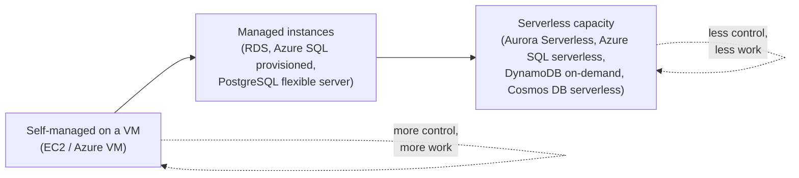
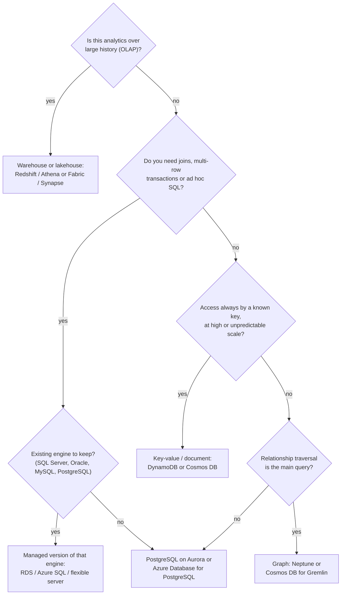
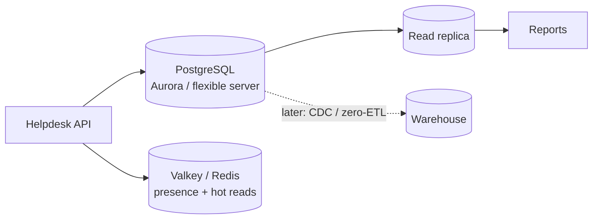

# Choosing a Cloud Database

## Introduction

On your laptop, "the database" is usually one PostgreSQL or MySQL server. In the cloud, AWS and Azure each offer more than a dozen managed database services. That choice is powerful, but it is also the first place new cloud developers get stuck: should the new app use RDS or Aurora? DynamoDB or Cosmos DB? Do you need a cache? A warehouse?

The good news is that the decision is mostly about **your data and your access patterns**, not about the cloud. If you can answer a handful of questions about how your application reads and writes data, the service list shrinks quickly.

Think of it like choosing a vehicle. A delivery van, a sports car and a bus are all "vehicles", but you pick one based on what you carry, how far, and how often. Nobody asks "which vehicle is best?" without context. Databases work the same way.

This page gives you:

- The main **database categories** and what each is good at
- A **mapping table** between AWS and Azure services
- How **managed**, **serverless** and **self-managed** options differ
- How each kind of database is **billed**
- A **decision process** you can reuse, plus a worked scenario

The rest of this section goes deeper into each family:
[relational](./1-cloud-rds-and-azure-sql.mdx), [NoSQL](./2-cloud-dynamodb-cosmosdb.mdx), [caching](./3-cloud-caching.mdx),
[high availability and backups](./4-cloud-database-ha-and-backups.mdx), [migration](./5-cloud-database-migration.mdx) and
[data warehouses](./6-cloud-data-warehouses.mdx).

:::tip New to databases?
If terms like "normalization", "index" or "ACID transaction" are unfamiliar, skim the [Database Fundamentals tutorial](/docs/fundamental/database) first. This page assumes you know what a table and a query are.
:::

## The Database Families

Most cloud database services fall into one of these families.

| Family | Data shape | Strengths | Typical use |
| --- | --- | --- | --- |
| Relational (SQL) | Tables with rows, columns, foreign keys | Joins, transactions, ad hoc queries, mature tooling | Orders, billing, users, most business apps |
| Key-value | Item looked up by a key | Predictable low latency at almost any scale | Sessions, carts, user profiles, IoT state |
| Document | JSON-like documents | Flexible schema, nested data, developer-friendly | Product catalogs, content, user settings |
| Wide-column | Rows with many dynamic columns, partitioned | Huge write volumes, time-ordered data | Telemetry, messaging history |
| Graph | Nodes and edges | Relationship traversal | Fraud rings, recommendations, social graphs |
| In-memory | Keys in RAM | Microsecond to sub-millisecond reads | Caching, leaderboards, rate limiting |
| Search | Inverted indexes | Full-text and relevance ranking | Site search, log search |
| Time series | Timestamped measurements | Fast aggregation over time windows | Metrics, sensor data |
| Warehouse (OLAP) | Columnar tables | Scanning and aggregating billions of rows | Reporting, BI dashboards, analytics |

Two ideas help you sort these:

- **OLTP vs OLAP.** Online transaction processing (OLTP) means many small reads and writes, like "insert this order". Online analytical processing (OLAP) means few, huge reads, like "total revenue by region for 2025". Operational databases serve OLTP; warehouses serve OLAP. Mixing them on one server is a classic source of slowdowns.
- **Query flexibility vs scale predictability.** Relational databases let you ask almost any question later. Key-value stores ask you to design for your questions up front, and in return give you consistent performance at very large scale.

## AWS and Azure Service Mapping

Here is the same landscape on both clouds. Service names change over time, so treat this as a map, and confirm current names on the official pages ([AWS databases](https://aws.amazon.com/products/databases/), [Azure databases](https://azure.microsoft.com/products/category/databases/)).

| Need | AWS | Azure |
| --- | --- | --- |
| Managed open-source relational | Amazon RDS for PostgreSQL, MySQL, MariaDB | Azure Database for PostgreSQL (flexible server), Azure Database for MySQL (flexible server) |
| Cloud-native relational | Amazon Aurora (MySQL- and PostgreSQL-compatible), Aurora DSQL | Azure SQL Database Hyperscale, Azure Cosmos DB for PostgreSQL |
| Commercial engines | RDS for SQL Server, Oracle, Db2 | Azure SQL Database, Azure SQL Managed Instance |
| Key-value and document | Amazon DynamoDB | Azure Cosmos DB for NoSQL |
| MongoDB-compatible | Amazon DocumentDB | Azure DocumentDB, Azure Cosmos DB for MongoDB |
| Cassandra-compatible | Amazon Keyspaces | Azure Cosmos DB for Apache Cassandra, Azure Managed Instance for Apache Cassandra |
| Graph | Amazon Neptune | Azure Cosmos DB for Apache Gremlin |
| In-memory cache | Amazon ElastiCache (Valkey, Redis OSS, Memcached), Amazon MemoryDB | Azure Managed Redis |
| Search | Amazon OpenSearch Service | Azure AI Search |
| Warehouse and analytics | Amazon Redshift, Amazon Athena | Microsoft Fabric, Azure Synapse Analytics, Azure Databricks |

:::info Recent renames and retirements
- **Azure Cache for Redis** is being retired (Enterprise tiers on March 31, 2027; Basic, Standard and Premium on September 30, 2028). Microsoft recommends **Azure Managed Redis** for new caches. See the [retirement FAQ](https://learn.microsoft.com/en-us/azure/azure-cache-for-redis/retirement-faq).
- **Azure DocumentDB** is Microsoft's MongoDB-compatible service built on the open-source DocumentDB engine. Older material may call this "Azure Cosmos DB for MongoDB (vCore)".
- **Amazon ElastiCache** now supports **Valkey**, the open-source fork of Redis, alongside Redis OSS and Memcached.
- **Aurora Serverless** (often still called "Aurora Serverless v2") can now scale to **0 ACUs** and pause when idle.
:::

## Managed, Serverless or Self-Managed?

For each family you also choose *how much* the cloud runs for you.



| Model | You manage | Cloud manages | Billed by | Good when |
| --- | --- | --- | --- | --- |
| Self-managed on a VM | OS, engine install, patching, backups, replication, failover | Hardware, hypervisor | VM hours, disks | You need an unsupported engine, extension or OS-level access |
| Managed instances | Schema, queries, instance size, scaling decisions | Patching, backups, failover, monitoring hooks | Instance hours plus storage, I/O and backup storage | Steady workloads with known size |
| Serverless capacity | Schema, queries, min and max limits | Everything above plus capacity changes | Capacity units per second, or per request | Spiky, unpredictable or mostly idle workloads |

The [Shared Responsibility Model](../0-cloud-fundamentals/3-cloud-shared-responsibility.mdx) applies directly here. With a managed database, the provider patches the engine and runs backups. You are still responsible for **who can connect**, **what data you store**, **encryption key choices**, and **testing restores**.

:::caution Self-managed is rarely cheaper overall
Running PostgreSQL on a VM can look cheaper on the bill. But you then own backups, upgrades, failover and 3 a.m. pages. Count engineering time before you choose it. It makes sense mainly for special requirements, not for saving money.
:::

## How Cloud Databases Are Billed

Prices vary by region and change over time, so this page never quotes numbers. Use the [AWS Pricing Calculator](https://calculator.aws/) and the [Azure Pricing Calculator](https://azure.microsoft.com/pricing/calculator/) for real estimates. What you *should* learn is the **billing dimensions**, because they decide which design is cheap and which is expensive.

| Dimension | Examples | What drives it up |
| --- | --- | --- |
| Compute time | RDS instance hours, Azure SQL vCore hours | Bigger instance classes, more replicas, running 24/7 |
| Serverless capacity | Aurora ACUs per second, Azure SQL serverless vCore-seconds | Sustained load, a high minimum capacity |
| Requests or throughput | DynamoDB read and write request units, Cosmos DB Request Units (RU/s) | Large items, scans, many indexes, strong consistency |
| Storage | GB-month of data and indexes | Unbounded tables, no TTL, wide indexes |
| I/O | Aurora I/O (on the Standard configuration) | Write-heavy workloads, poor indexing |
| Backup storage | Snapshots, long-term retention | Long retention, frequent manual snapshots |
| Data transfer | Cross-AZ, cross-region, internet egress | Replicas in other regions, apps in a different AZ or region |

A useful rule of thumb: **provisioned capacity is cheaper per unit when it is busy, serverless is cheaper when it is idle.** If your database is busy all day, a right-sized provisioned instance (possibly with a reservation) usually wins. If it sits idle most of the night and weekend, serverless or auto-pause options can save a lot.

## A Repeatable Decision Process

Answer these questions in order. Most teams land on a clear answer by question four.



Then add supporting services only when a real need appears:

- A **cache** when the same reads repeat and latency or database load matters ([Managed Caching](./3-cloud-caching.mdx)).
- A **search service** when users type free text.
- A **warehouse** when reports start hurting the operational database.

:::tip Default to relational
If you are unsure, start with managed PostgreSQL. It handles relational data, JSON columns (`jsonb`), full-text search and many extensions. You can add a specialized store later when you have evidence you need it. Moving *from* a key-value design *to* SQL is usually harder than the reverse.
:::

## Exploring the Options from the CLI

You can browse what is available in your region without creating anything. These commands only read metadata and do not cost money.

### On AWS

List the PostgreSQL major versions RDS currently offers, and check which instance classes support one of them:

```bash
# Supported RDS for PostgreSQL versions (trimmed to the last few)
aws rds describe-db-engine-versions \
  --engine postgres \
  --query "DBEngineVersions[].EngineVersion" \
  --output text | tr '\t' '\n' | tail -5

# Instance classes available for a given engine version in this region
aws rds describe-orderable-db-instance-options \
  --engine postgres --engine-version 17.4 \
  --query "OrderableDBInstanceOptions[].DBInstanceClass" \
  --output text | tr '\t' '\n' | sort -u | head -5
```

Example output:

```text
17.2
17.4
17.5
18.0
18.1
db.m7g.large
db.m7g.xlarge
db.r7g.large
db.t4g.micro
db.t4g.small
```

### On Azure

List the PostgreSQL flexible server capabilities (compute tiers, SKUs and versions) for a region, and the Azure SQL Database editions:

```bash
# Long JSON document: compute tiers, SKUs, storage options and versions
az postgres flexible-server list-skus --location eastus --output json > pg-skus.json
grep -o '"name": "[A-Za-z]*"' pg-skus.json | sort -u | head -5

# Azure SQL Database editions available in the region
az sql db list-editions --location eastus --query "[].name" -o tsv
```

Example output (trimmed; field names can differ slightly between CLI versions):

```text
"name": "Burstable"
"name": "GeneralPurpose"
"name": "MemoryOptimized"
Basic
BusinessCritical
GeneralPurpose
Hyperscale
Premium
Standard
```

The exact versions you see will differ, because both clouds add new major versions and retire old ones on a schedule. Check the [RDS PostgreSQL release calendar](https://docs.aws.amazon.com/AmazonRDS/latest/PostgreSQLReleaseNotes/postgresql-release-calendar.html) and the [Azure PostgreSQL supported versions](https://learn.microsoft.com/en-us/azure/postgresql/configure-maintain/concepts-supported-versions) page.

## A Small Decision Helper in Python

The decision process above can be written as code. This script runs locally, makes no cloud calls, and is a handy way to record *why* you picked a database in a design review.

```python
from dataclasses import dataclass


@dataclass
class Workload:
    name: str
    analytics: bool = False          # big scans and aggregations over history
    needs_joins: bool = False        # joins, multi-row transactions, ad hoc SQL
    existing_engine: str | None = None
    key_lookups_only: bool = False   # always read by a known key
    graph_traversal: bool = False
    spiky_or_idle: bool = False


def recommend(w: Workload) -> tuple[str, str, str]:
    """Return (family, AWS option, Azure option)."""
    if w.analytics:
        return ("warehouse", "Amazon Redshift / Athena", "Microsoft Fabric Warehouse")
    if w.needs_joins:
        engine = w.existing_engine or "postgresql"
        if engine == "sqlserver":
            return ("relational", "RDS for SQL Server", "Azure SQL Database")
        aws = "Aurora Serverless" if w.spiky_or_idle else f"RDS or Aurora ({engine})"
        azure = f"Azure Database for {engine.capitalize()} flexible server"
        if engine == "postgresql":
            azure = "Azure Database for PostgreSQL flexible server"
        return ("relational", aws, azure)
    if w.key_lookups_only:
        mode = "on-demand" if w.spiky_or_idle else "provisioned"
        return ("key-value", f"DynamoDB ({mode})", "Cosmos DB for NoSQL")
    if w.graph_traversal:
        return ("graph", "Amazon Neptune", "Cosmos DB for Apache Gremlin")
    return ("relational", "RDS for PostgreSQL", "Azure Database for PostgreSQL flexible server")


workloads = [
    Workload("orders", needs_joins=True),
    Workload("sessions", key_lookups_only=True, spiky_or_idle=True),
    Workload("legacy-erp", needs_joins=True, existing_engine="sqlserver"),
    Workload("revenue-reports", analytics=True),
]

for w in workloads:
    family, aws, azure = recommend(w)
    print(f"{w.name:16} {family:11} AWS: {aws:30} Azure: {azure}")
```

Output:

```text
orders           relational  AWS: RDS or Aurora (postgresql)     Azure: Azure Database for PostgreSQL flexible server
sessions         key-value   AWS: DynamoDB (on-demand)           Azure: Cosmos DB for NoSQL
legacy-erp       relational  AWS: RDS for SQL Server             Azure: Azure SQL Database
revenue-reports  warehouse   AWS: Amazon Redshift / Athena       Azure: Microsoft Fabric Warehouse
```

Real decisions have more inputs (team skills, compliance, existing contracts), but writing the rules down forces you to state your assumptions.

## Where AWS and Azure Differ

The two clouds solve the same problems with different packaging. A few differences matter when you choose:

- **One multi-model service vs many focused services.** Azure Cosmos DB exposes several APIs (NoSQL, MongoDB, Cassandra, Gremlin, Table, PostgreSQL) under one brand. AWS tends to ship one service per model (DynamoDB, DocumentDB, Keyspaces, Neptune). On Azure you pick an *API* when you create the account, and you cannot switch it later.
- **SQL Server.** Azure SQL Database and Azure SQL Managed Instance are built by the SQL Server team and get new engine features early. If your organization runs on SQL Server, Azure is usually the smoother path. RDS for SQL Server works well but is closer to "SQL Server, managed".
- **Cloud-native relational engines.** AWS Aurora separates compute from a distributed storage layer shared across Availability Zones. Azure's closest equivalent is the **Hyperscale** tier of Azure SQL Database. Both make storage growth, replicas and restores faster than classic designs.
- **Identity.** AWS databases use IAM database authentication for supported engines. Azure databases use **Microsoft Entra ID** authentication, and several services now default to Entra-only access. Either way, prefer identity-based access over static passwords (see [Workload Identity](../2-cloud-identity/4-cloud-workload-identity.mdx)).

## Real-World Scenario

Your team builds a **SaaS helpdesk**. Customers create tickets, agents reply, and managers want weekly reports. You expect a few hundred tenants in year one. Traffic is busy in business hours and quiet at night. The data looks like this:

- **Tickets, comments, users, tenants.** Strongly related, and needs transactions ("close ticket and log the change").
- **Agent presence and typing indicators.** Tiny, very frequent writes, expire after seconds.
- **Ticket search.** Customers search ticket text.
- **Reporting.** Monthly SLA reports across all tickets.

### The solution

1. **Primary store:** managed PostgreSQL, either **Aurora PostgreSQL** (with serverless capacity for nights) or **Azure Database for PostgreSQL flexible server**. Tickets and comments live in normal tables, and tenant isolation uses a `tenant_id` column with row-level security.
2. **Presence data:** a managed **Valkey/Redis cache** (ElastiCache or Azure Managed Redis) with short TTLs. If the cache is lost, nothing important is lost.
3. **Search:** start with PostgreSQL full-text search (`tsvector`). Add OpenSearch or Azure AI Search only if relevance tuning or scale demands it.
4. **Reporting:** at first, run reports against a **read replica**. When reports grow, replicate into a warehouse (Redshift, or Fabric through mirroring) as described in [Data Warehouses and Analytics Services](./6-cloud-data-warehouses.mdx).



### Why this approach

- One relational database covers about 90% of the data and keeps transactions simple.
- The cache handles the only data with a very different shape (short-lived, high-frequency).
- Every extra service is added in response to a measured need, so the team operates fewer moving parts in year one.

### When to use it, and when not to

Use this "relational core plus targeted helpers" pattern for most business applications. Do **not** use it when your main access pattern is single-key lookups at massive, global scale (for example, a gaming backend with millions of concurrent players). There, a key-value store like DynamoDB or Cosmos DB as the primary database is a better fit.

### Alternatives and trade-offs

| Approach | Pros | Cons | Best for |
| --- | --- | --- | --- |
| Relational core plus cache | Simple, flexible queries, one source of truth | Vertical scaling limits eventually; schema migrations needed | Most SaaS and line-of-business apps |
| Key-value first (DynamoDB / Cosmos DB) | Predictable latency at huge scale, serverless billing | Must know access patterns up front; ad hoc queries are hard | High-scale, well-understood access patterns |
| Polyglot from day one | Each workload on an ideal engine | More services to secure, monitor, back up and pay for | Large teams with clear, distinct workloads |
| Self-managed on VMs | Full control, any extension | You own patching, backups and failover | Special engine or OS requirements |

## Common Mistakes

- **Choosing by popularity instead of access pattern.** "Everyone uses DynamoDB" is not a reason. Write down your top five queries first.
- **Running analytics on the primary.** Large report queries steal CPU and I/O from customer traffic. Use a replica or a warehouse.
- **Ignoring data transfer.** An app in one region talking to a database in another pays latency *and* transfer charges on every query.
- **Leaving databases public.** Managed does not mean private. Keep databases in private subnets or behind private endpoints (see [Private Endpoints, Peering and Transit](../8-cloud-networking/7-cloud-private-connectivity.mdx)).
- **Forgetting the cleanup.** A test database left running costs money every hour. Tag everything and delete test resources the same day.
- **Treating "serverless" as "free when idle".** Many serverless databases still bill for storage, backups and a minimum capacity unless you set them to scale to zero.

## Summary

- Pick a database by **data shape and access patterns**, not by brand.
- Main families: relational, key-value/document, wide-column, graph, in-memory, search, time series and warehouse.
- AWS and Azure offer equivalents for each family; Azure Cosmos DB bundles several models, while AWS uses separate services.
- Choose a **management model** (self-managed, managed instance, serverless) based on control needs and how steady your load is.
- Billing depends on compute, request units, storage, I/O, backups and data transfer. Use the official pricing calculators for numbers.
- Default to managed PostgreSQL when in doubt, and add caches, search or warehouses when you can measure the need.

## Exercises

1. List the top five queries of an app you know (for example, "get all open tickets for tenant X, newest first"). For each, decide whether a relational or key-value store fits better and explain why.
2. Run the two read-only CLI commands for your preferred cloud and note which PostgreSQL major versions are available in your region.
3. Extend the Python decision helper with a `full_text_search` flag and a `global_low_latency` flag, and decide what each should recommend on AWS and Azure.
4. Using the AWS or Azure pricing calculator, compare a small always-on managed PostgreSQL instance with a serverless option that is idle 16 hours a day. Write down which billing dimensions dominate in each case.

### Related pages

- [Managed Relational Databases: RDS, Aurora and Azure SQL](./1-cloud-rds-and-azure-sql.mdx)
- [NoSQL: DynamoDB and Cosmos DB](./2-cloud-dynamodb-cosmosdb.mdx)
- [Managed Caching: ElastiCache and Azure Cache for Redis](./3-cloud-caching.mdx)
- [Data Warehouses and Analytics Services](./6-cloud-data-warehouses.mdx)
- [AWS and Azure Service Mapping](../0-cloud-fundamentals/6-cloud-service-mapping.mdx)
- [Cloud Pricing Models](../0-cloud-fundamentals/7-cloud-pricing-models.mdx)
