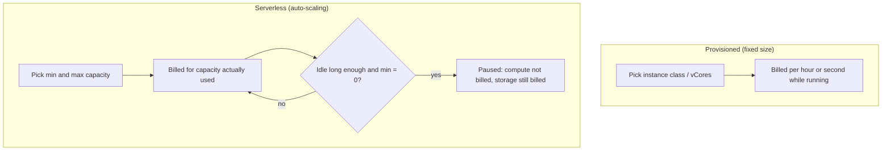
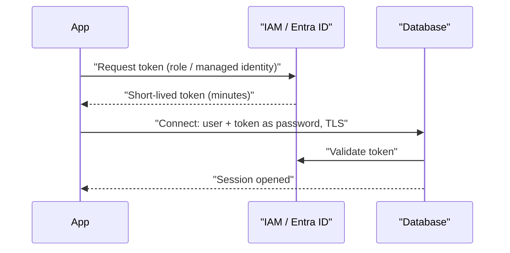

# Managed Relational Databases: RDS, Aurora and Azure SQL

## Introduction

A relational database is still the right home for most application data: users, orders, invoices, tickets. Running one yourself means installing the engine, patching it, taking backups, setting up replication and handling failover. A **managed relational database** hands those chores to the cloud provider, while you keep full SQL access.

An analogy: running PostgreSQL on your own VM is like owning a car. Managed databases are like a long-term lease with servicing included. You still drive (write queries, design schemas), but someone else changes the oil and fixes the brakes.

On this page you will:

- Learn the managed relational services on **AWS** (RDS, Aurora) and **Azure** (Azure SQL Database, SQL Managed Instance, Azure Database for PostgreSQL and MySQL)
- Understand **instance-based** vs **serverless** compute
- Create a small database on each cloud with the CLI, using **passwordless** or managed credentials
- Connect from Python with **IAM** and **Microsoft Entra ID** tokens
- Clean everything up

If you have not chosen a database family yet, start with [Choosing a Cloud Database](./0-cloud-database-options.mdx).

:::warning Cost warning
Every command on this page that creates a database starts billing immediately: compute by the hour or second, plus storage and backup storage. Use the smallest sizes shown, stay inside any free offers you are eligible for, and run the **Cleanup** section the same day. Check current prices with the [AWS Pricing Calculator](https://calculator.aws/) or the [Azure Pricing Calculator](https://azure.microsoft.com/pricing/calculator/).
:::

## The Services at a Glance

| Need | AWS | Azure |
| --- | --- | --- |
| PostgreSQL | RDS for PostgreSQL, Aurora PostgreSQL | Azure Database for PostgreSQL (flexible server) |
| MySQL / MariaDB | RDS for MySQL, RDS for MariaDB, Aurora MySQL | Azure Database for MySQL (flexible server) |
| SQL Server | RDS for SQL Server | Azure SQL Database, Azure SQL Managed Instance |
| Oracle, Db2 | RDS for Oracle, RDS for Db2 | Oracle Database@Azure (partner service), or VMs |
| Serverless relational | Aurora Serverless, Aurora DSQL | Azure SQL Database serverless |
| Connection pooling | RDS Proxy | Built-in PgBouncer on PostgreSQL flexible server |

### On AWS

- **Amazon RDS** runs a standard engine (PostgreSQL, MySQL, MariaDB, SQL Server, Oracle, Db2) on a managed instance with attached storage. It feels like "your engine, managed".
- **Amazon Aurora** is AWS's cloud-native engine, compatible with MySQL and PostgreSQL. Compute instances share a distributed storage volume that spans three Availability Zones. Replicas attach to the same storage, so adding a reader does not copy data.
- **Aurora Serverless** uses the `db.serverless` instance class. Capacity is measured in **Aurora Capacity Units (ACUs)** and changes in half-ACU steps. With a minimum of **0 ACUs**, instances can auto-pause after an idle period you choose (5 minutes up to 1 day) and resume on the next connection, typically in about 15 seconds according to the [auto-pause documentation](https://docs.aws.amazon.com/AmazonRDS/latest/AuroraUserGuide/aurora-serverless-v2-auto-pause.html).
- **Aurora DSQL** is a newer, serverless, distributed PostgreSQL-compatible database with active-active multi-region clusters. It suits globally distributed transactional apps, but it does not support every PostgreSQL feature, so check [SQL feature compatibility](https://docs.aws.amazon.com/aurora-dsql/latest/userguide/working-with-postgresql-compatibility.html) first.

### On Azure

- **Azure SQL Database** is a fully managed SQL Server-based database. You create a **logical server** (a connection endpoint and security boundary) and databases inside it. It offers the **vCore** model (General Purpose, Business Critical, Hyperscale tiers) and the older **DTU** model.
- **Serverless compute** is a compute tier of Azure SQL Database (General Purpose and Hyperscale). It scales vCores automatically and, on General Purpose, can **auto-pause** after a delay you set, so compute stops billing while storage still bills.
- **Azure SQL Managed Instance** gives near-complete SQL Server compatibility (SQL Agent, cross-database queries) for lift-and-shift migrations.
- **Azure Database for PostgreSQL flexible server** and **Azure Database for MySQL flexible server** run the community engines on a managed VM, with Burstable, General Purpose and Memory Optimized compute tiers. The older "single server" offerings are retired, so use flexible server for anything new.

:::info Same idea, different packaging
On AWS you create a *DB instance* or *DB cluster* directly. On Azure SQL Database you first create a *logical server*, then databases on it. The logical server is not a VM; it is a namespace for logins, firewall rules and Entra ID admins.
:::

## How Compute Is Sized and Billed



| Billing item | RDS / Aurora | Azure SQL / flexible server |
| --- | --- | --- |
| Compute | Instance class hours, or ACU-hours for Aurora Serverless | vCore hours (provisioned) or vCore-seconds (serverless); flexible server bills per compute SKU |
| Storage | GB-month; Aurora bills for storage used | GB-month of allocated (or used, depending on tier) storage |
| I/O | Aurora Standard bills I/O requests; Aurora I/O-Optimized includes I/O in a higher compute and storage rate | Included in most tiers |
| Backup storage | Free up to the database size for automated backups; extra beyond that | Free up to the database's max data size; extra beyond that |
| Licensing | Included for open-source engines; SQL Server and Oracle have license-included or BYOL options | SQL Server license included, or Azure Hybrid Benefit with existing licenses |

Exact rules and amounts change, so verify on the [Amazon RDS pricing](https://aws.amazon.com/rds/pricing/) and [Azure SQL Database pricing](https://azure.microsoft.com/pricing/details/azure-sql-database/single/) pages.

## Creating a Database on AWS

The examples use the default VPC for brevity. In a real system, put the database in **private subnets** and allow traffic only from your app's security group (see [Security Groups and Network Security Groups](../8-cloud-networking/3-cloud-security-groups-nsgs.mdx)).

### Option A: RDS for PostgreSQL (small, provisioned)

```bash
aws rds create-db-instance \
  --db-instance-identifier helpdesk-dev \
  --engine postgres \
  --db-instance-class db.t4g.micro \
  --allocated-storage 20 \
  --storage-type gp3 \
  --master-username dbadmin \
  --manage-master-user-password \
  --enable-iam-database-authentication \
  --storage-encrypted \
  --backup-retention-period 7 \
  --no-publicly-accessible \
  --tags Key=project,Value=helpdesk Key=env,Value=dev
```

Example output (trimmed):

```text
{
    "DBInstance": {
        "DBInstanceIdentifier": "helpdesk-dev",
        "DBInstanceClass": "db.t4g.micro",
        "Engine": "postgres",
        "DBInstanceStatus": "creating",
        "MasterUsername": "dbadmin",
        "MasterUserSecret": {
            "SecretArn": "arn:aws:secretsmanager:us-east-1:123456789012:secret:rds!db-...",
            "SecretStatus": "creating"
        },
        "StorageEncrypted": true,
        "IAMDatabaseAuthenticationEnabled": true
    }
}
```

Key flags:

- `--manage-master-user-password` stores the admin password in **AWS Secrets Manager** and rotates it. You never type or commit it.
- `--enable-iam-database-authentication` lets applications log in with short-lived IAM tokens instead of passwords.
- `--no-publicly-accessible` keeps the endpoint off the internet.

Wait for it and fetch the endpoint:

```bash
aws rds wait db-instance-available --db-instance-identifier helpdesk-dev
aws rds describe-db-instances --db-instance-identifier helpdesk-dev \
  --query "DBInstances[0].Endpoint.Address" --output text
```

Example output:

```text
helpdesk-dev.abcdefghij12.us-east-1.rds.amazonaws.com
```

### Option B: Aurora PostgreSQL with serverless capacity

Aurora has two layers: a **cluster** (storage and endpoints) and one or more **instances** (compute).

```bash
aws rds create-db-cluster \
  --db-cluster-identifier helpdesk-aurora \
  --engine aurora-postgresql \
  --serverless-v2-scaling-configuration MinCapacity=0,MaxCapacity=4,SecondsUntilAutoPause=900 \
  --master-username dbadmin \
  --manage-master-user-password \
  --enable-iam-database-authentication \
  --storage-encrypted

aws rds create-db-instance \
  --db-instance-identifier helpdesk-aurora-writer \
  --db-cluster-identifier helpdesk-aurora \
  --engine aurora-postgresql \
  --db-instance-class db.serverless
```

Notes:

- `MinCapacity=0` enables auto-pause; `SecondsUntilAutoPause=900` pauses after 15 idle minutes. Auto-pause needs a recent engine version (Aurora PostgreSQL 13.15, 14.12, 15.7, 16.3 or later), so let the CLI pick the default version or specify a supported one.
- Features that keep connections open, such as **RDS Proxy**, logical replication or being the primary of a global database, prevent pausing.
- For production, set a non-zero minimum so the first request after a quiet period is not delayed.

## Creating a Database on Azure

Start with a resource group so cleanup is a single command:

```bash
az group create --name rg-helpdesk-dev --location eastus
```

### Option A: Azure SQL Database, serverless, Entra-only authentication

First create the logical server with **Microsoft Entra ID only** authentication, so no SQL password exists at all. You need the object ID of the user or group that will be the admin:

```bash
ADMIN_ID=$(az ad signed-in-user show --query id -o tsv)
ADMIN_UPN=$(az ad signed-in-user show --query userPrincipalName -o tsv)

az sql server create \
  --name sql-helpdesk-dev-4821 \
  --resource-group rg-helpdesk-dev \
  --location eastus \
  --enable-ad-only-auth \
  --external-admin-principal-type User \
  --external-admin-name "$ADMIN_UPN" \
  --external-admin-sid "$ADMIN_ID" \
  --minimal-tls-version 1.2
```

Then create a serverless database that pauses after one hour idle:

```bash
az sql db create \
  --resource-group rg-helpdesk-dev \
  --server sql-helpdesk-dev-4821 \
  --name helpdesk \
  --edition GeneralPurpose \
  --family Gen5 \
  --capacity 2 \
  --compute-model Serverless \
  --auto-pause-delay 60 \
  --backup-storage-redundancy Local
```

Example output (trimmed):

```text
{
  "autoPauseDelay": 60,
  "currentServiceObjectiveName": "GP_S_Gen5_2",
  "kind": "v12.0,user,vcore,serverless",
  "name": "helpdesk",
  "requestedBackupStorageRedundancy": "Local",
  "status": "Online"
}
```

:::tip Free offer for learning
Azure SQL Database has a free offer for a limited number of serverless databases per subscription. The CLI exposes it with `--use-free-limit --free-limit-exhaustion-behavior AutoPause`, which pauses the database instead of billing when the monthly free amount is used up. Limits change, so check the [free offer documentation](https://learn.microsoft.com/en-us/azure/azure-sql/database/free-offer) before relying on it.
:::

`--backup-storage-redundancy Local` is fine for dev. Production databases usually keep the default geo-redundant backups so they can be restored in another region (see [Database High Availability and Backups](./4-cloud-database-ha-and-backups.mdx)).

### Option B: Azure Database for PostgreSQL flexible server

```bash
az postgres flexible-server create \
  --resource-group rg-helpdesk-dev \
  --name pg-helpdesk-dev-4821 \
  --location eastus \
  --tier Burstable \
  --sku-name Standard_B1ms \
  --storage-size 32 \
  --version 17 \
  --microsoft-entra-auth Enabled \
  --password-auth Disabled \
  --admin-object-id "$ADMIN_ID" \
  --admin-display-name "$ADMIN_UPN" \
  --admin-type User \
  --public-access None
```

`--password-auth Disabled` together with `--microsoft-entra-auth Enabled` gives you passwordless access through Entra ID. `--public-access None` means you will connect through private networking. For a quick lab from your laptop you could pass your own IP address instead, but never open `0.0.0.0-255.255.255.255`.

## Infrastructure as Code Version

The CLI is great for learning. Real teams define databases in code. Here is a minimal Terraform sketch for the Azure SQL serverless database (the AWS equivalent uses `aws_rds_cluster` and `aws_rds_cluster_instance`). See [Terraform for AWS and Azure](../10-cloud-infrastructure-as-code/4-cloud-terraform-multi-cloud.mdx) for a full workflow.

```hcl
resource "azurerm_mssql_server" "helpdesk" {
  name                          = "sql-helpdesk-dev-4821"
  resource_group_name           = "rg-helpdesk-dev"
  location                      = "eastus"
  version                       = "12.0"
  minimum_tls_version           = "1.2"
  public_network_access_enabled = false

  azuread_administrator {
    login_username              = "dba-group"
    object_id                   = var.dba_group_object_id
    azuread_authentication_only = true
  }
}

resource "azurerm_mssql_database" "helpdesk" {
  name                        = "helpdesk"
  server_id                   = azurerm_mssql_server.helpdesk.id
  sku_name                    = "GP_S_Gen5_2"
  auto_pause_delay_in_minutes = 60
  min_capacity                = 0.5
  storage_account_type        = "Local"
}
```

## Connecting from Python Without Passwords

Both clouds let an application exchange its identity for a short-lived database token. The token is used *as the password* in the normal driver.



### On AWS: IAM database authentication

First, inside PostgreSQL, create a login role mapped to IAM (run once as the admin):

```sql
CREATE USER helpdesk_app;
GRANT rds_iam TO helpdesk_app;
GRANT CONNECT ON DATABASE postgres TO helpdesk_app;
```

The app's IAM role needs the `rds-db:connect` permission for that database user. Then connect with `boto3` and `psycopg` (`pip install boto3 "psycopg[binary]"`):

```python
import boto3
import psycopg

HOST = "helpdesk-dev.abcdefghij12.us-east-1.rds.amazonaws.com"
PORT = 5432
USER = "helpdesk_app"
REGION = "us-east-1"

rds = boto3.client("rds", region_name=REGION)
token = rds.generate_db_auth_token(DBHostname=HOST, Port=PORT, DBUsername=USER, Region=REGION)

with psycopg.connect(host=HOST, port=PORT, user=USER, password=token,
                     dbname="postgres", sslmode="require") as conn:
    row = conn.execute("SELECT current_user, version()").fetchone()
    print(row[0])
    print(row[1][:40])
```

Example output:

```text
helpdesk_app
PostgreSQL 17.4 on aarch64-unknown-linux
```

The token is valid for 15 minutes and is only needed when *opening* a connection. Connection pools must generate a fresh token for each new connection.

### On Azure: Microsoft Entra ID token

For PostgreSQL flexible server, request a token for the `https://ossrdbms-aad.database.windows.net/.default` scope. `DefaultAzureCredential` uses your `az login` session locally and the **managed identity** when deployed (`pip install azure-identity "psycopg[binary]"`):

```python
import psycopg
from azure.identity import DefaultAzureCredential

HOST = "pg-helpdesk-dev-4821.postgres.database.azure.com"
USER = "alice@contoso.com"   # Entra user, group or managed identity name

credential = DefaultAzureCredential()
token = credential.get_token("https://ossrdbms-aad.database.windows.net/.default").token

with psycopg.connect(host=HOST, port=5432, user=USER, password=token,
                     dbname="postgres", sslmode="require") as conn:
    print(conn.execute("SELECT current_user").fetchone()[0])
```

Example output:

```text
alice@contoso.com
```

For **Azure SQL Database**, the scope is `https://database.windows.net/.default`, and the Microsoft ODBC driver can do this for you with `Authentication=ActiveDirectoryDefault` in the connection string. See [Connect with Microsoft Entra authentication](https://learn.microsoft.com/en-us/azure/azure-sql/database/authentication-aad-overview).

:::note Why tokens beat passwords
A leaked token expires in minutes. A leaked password works until someone notices. Tokens also tie database access to the same identity system you already audit (see [Workload Identity: Instance Roles and Managed Identities](../2-cloud-identity/4-cloud-workload-identity.mdx)).
:::

## Real-World Scenario

Your company runs an internal **expense-approval app** on SQL Server in its own data center. Usage is heavy from 9 to 5 on weekdays and near zero otherwise. The team wants to move to the cloud with minimal code changes, and the finance team wants the bill to reflect the quiet nights.

### The solution

- Move to **Azure SQL Database, General Purpose serverless**. It speaks T-SQL, so the app code barely changes. Set a minimum of 0.5 vCores, a maximum of 4, and an auto-pause delay of 60 minutes.
- Switch logins to **Microsoft Entra ID** groups, and give the App Service a **managed identity** as its database user.
- If the team were standardized on AWS instead, the equivalent is **RDS for SQL Server** (provisioned, with stop/start scheduling for dev environments) or rewriting to **Aurora PostgreSQL Serverless** if they are willing to port T-SQL.

### Why this approach

- The workload is idle most of the week, which is exactly where serverless and auto-pause save money.
- Keeping the SQL Server engine avoids a risky rewrite.
- Entra ID integration replaces shared SQL passwords with audited identities.

### When to use it, and when not to

Serverless relational fits **intermittent** workloads: internal tools, dev and test, new products with unknown traffic. Avoid auto-pause when users cannot tolerate the resume delay (customer-facing APIs), or when the database is busy around the clock. A provisioned instance, perhaps with a reservation, is cheaper per unit of sustained work.

### Alternatives and trade-offs

| Approach | Pros | Cons | Best for |
| --- | --- | --- | --- |
| Azure SQL Database serverless | T-SQL compatible, auto-pause, auto-scale | Resume delay; per-unit compute rate higher than provisioned | Intermittent SQL Server workloads |
| Azure SQL Managed Instance | Near-full SQL Server feature set | Larger minimum footprint, slower to create | Lift-and-shift with SQL Agent, cross-DB queries |
| RDS for SQL Server | Familiar engine on AWS | No serverless option; licensing cost included | SQL Server shops standardized on AWS |
| Aurora PostgreSQL Serverless | Scales to zero, open-source engine | Requires porting T-SQL code | Teams willing to modernize |
| SQL Server on a VM | Full control, any feature | You patch, back up and fail over | Unsupported features or third-party agents |

## Common Mistakes

- **Public endpoints with wide firewall rules.** Keep databases private and reach them through the app's network or a bastion/VPN.
- **Hard-coded admin passwords.** Use `--manage-master-user-password` on AWS, Entra-only auth on Azure, and secrets stores for anything else ([Secrets Management](../11-cloud-devops/4-cloud-secrets-management.mdx)).
- **Too many connections.** Serverless functions can open thousands of connections. Use RDS Proxy, the built-in PgBouncer on flexible server, or a pool in your app.
- **Picking the biggest instance "to be safe".** Start small, watch CPU, memory and I/O metrics, then resize. Resizing a managed database is a short operation.
- **Assuming auto-pause always happens.** Open connections from tools, health checks or proxies keep the database awake. Close idle sessions in development.
- **Skipping engine upgrades.** Major versions reach end of support. Plan upgrades before the provider forces one (and before extended-support fees apply).

## Cleanup

Delete everything you created on this page.

### On AWS

```bash
aws rds delete-db-instance --db-instance-identifier helpdesk-dev \
  --skip-final-snapshot --delete-automated-backups

aws rds delete-db-instance --db-instance-identifier helpdesk-aurora-writer
aws rds wait db-instance-deleted --db-instance-identifier helpdesk-aurora-writer
aws rds delete-db-cluster --db-cluster-identifier helpdesk-aurora --skip-final-snapshot
```

Example output (trimmed):

```text
{
    "DBInstance": {
        "DBInstanceIdentifier": "helpdesk-dev",
        "DBInstanceStatus": "deleting"
    }
}
```

`--skip-final-snapshot` is fine for a lab. For anything with real data, take a final snapshot instead, and remember snapshots keep billing for storage until you delete them.

### On Azure

```bash
az group delete --name rg-helpdesk-dev --yes --no-wait
```

This removes the SQL server, its databases and the PostgreSQL server in one go.

## Summary

- **RDS** manages standard engines; **Aurora** adds a distributed storage layer and **serverless** capacity that can scale to 0 ACUs.
- **Azure SQL Database** (logical server plus databases) is the managed SQL Server option, with a **serverless** tier that can auto-pause; **flexible server** hosts PostgreSQL and MySQL.
- Billing combines compute, storage, I/O (on some options), backup storage and licensing. Use the pricing calculators for numbers.
- Prefer **passwordless access**: IAM database authentication on AWS and **Microsoft Entra ID** on Azure, with managed secrets for any remaining admin password.
- Keep databases private, size them from metrics, and always clean up lab resources.

## Exercises

1. Create the smallest RDS for PostgreSQL or Azure Database for PostgreSQL instance, connect with a token-based login from Python, create a `tickets` table, then delete the server.
2. Create an Aurora Serverless cluster with `MinCapacity=0`, leave it idle, and use the `ServerlessDatabaseCapacity` CloudWatch metric to confirm when it pauses.
3. Write the Azure SQL serverless database in Bicep or Terraform, including Entra-only authentication, and deploy it to a test resource group.
4. Compare the monthly cost estimate of a provisioned General Purpose Azure SQL database with a serverless one that is active 40 hours a week, using the Azure Pricing Calculator.

### Related pages

- [Choosing a Cloud Database](./0-cloud-database-options.mdx)
- [Database High Availability and Backups](./4-cloud-database-ha-and-backups.mdx)
- [Migrating Databases to the Cloud](./5-cloud-database-migration.mdx)
- [Workload Identity: Instance Roles and Managed Identities](../2-cloud-identity/4-cloud-workload-identity.mdx)
- [PostgreSQL tutorial](/docs/database/postgresql) and [MySQL tutorial](/docs/database/mysql)
